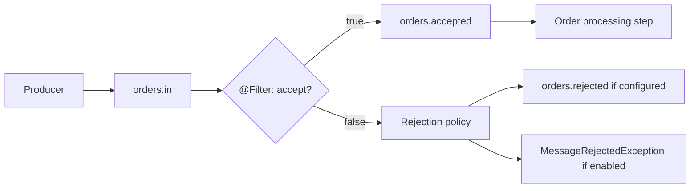

# `@Filter`: Controlling Which Messages Proceed in Spring Integration

## 1. Objectives and Position in the Integration Flow

In the **SPRING_INTEGRATION_CORE** module, `@Filter` is the annotation-based way to declare an endpoint implementing the **Message Filter** pattern. It connects a Java predicate to `MessageChannel`s, helping decide which messages continue processing.

For example, a system accepts orders from multiple sources but only wants to pass orders from the website with a valid order ID and a positive total to the next processing step. Orders that do not meet the conditions should be kept on a separate branch for inspection.

After this lesson, you can:

- Write a `@Filter` method accepting a payload, a `Message<?>`, or header values.
- Declare input, accept, and discard channels.
- Distinguish between returning `false`, throwing a business exception on rejection, and encountering an error while evaluating the condition.
- Translate the same rule between annotations, XML, and Java DSL.
- Write tests proving messages reach the right branch and retain the required data.

The examples use Java 17 or higher, `spring-integration-core`, and JUnit Jupiter for testing. Spring Framework and Spring Integration versions must be managed with a compatible dependency set in your project; if your project uses Spring Boot, use Boot's dependency management. The examples create an `ApplicationContext` directly to make the infrastructure explicit without depending on an existing Boot application.

## 2. Processing Model: A Boolean Condition Controls the Path

A message consists of a payload and headers. A filter reads the needed data to answer one question: **should this message proceed on the main branch?**



Both actions on the rejection branch can occur together; the diagram does not represent two mutually exclusive options.

When the condition is true, the forwarded data is the input message, not a message with payload `true`. The filter also does not automatically add a rejection reason or modify the payload. This is the Message Filter semantics in [Spring Integration Filter documentation](https://docs.spring.io/spring-integration/reference/filter.html).

Structurally, there are three parts to distinguish:

1. **Business method** computing the accept or reject result.
2. **Filter message handler** enforcing the decision and handling the outcome.
3. **Consumer endpoint** receiving messages from the channel and invoking the handler.

Therefore, simply writing an annotated method is not enough: the object containing it must be a Spring bean and Spring Integration infrastructure must process that annotation.

### Distinguishing from Similar Endpoints

| Need | Appropriate Component | Example |
| --- | --- | --- |
| Decide whether to continue the main branch | Filter | Only accept qualifying orders |
| Choose one or more target branches based on data | Router | Pick North, Central, or South warehouse |
| Produce output data with a different structure or value | Transformer | Convert JSON to `Order` |
| Execute a processing operation | Service activator | Call an order confirmation service |

If the requirement is to return a result containing `accepted`, `reasonCode`, and a list of errors, compute that result in a separate processing step and route on it. A single boolean does not carry enough information to represent a full validation outcome.

## 3. Method Signatures and Input Data

Import the right Spring Integration annotation:

```java
import org.springframework.integration.annotation.Filter;
import org.springframework.messaging.Message;
import org.springframework.messaging.handler.annotation.Header;
```

`@Filter` here is not a servlet filter and not the `Stream.filter()` operator.

### 3.1. Receiving Only the Payload

```java
@Filter(inputChannel = "text.in", outputChannel = "text.accepted")
public boolean hasContent(String text) {
    return !text.isBlank();
}
```

In this snippet, the parameter is a `String` payload; you do not need to call `message.getPayload()` yourself.

### 3.2. Receiving the Entire Message

```java
@Filter(inputChannel = "events.in", outputChannel = "events.accepted")
public boolean isTrusted(Message<?> message) {
    return Boolean.TRUE.equals(message.getHeaders().get("trusted"));
}
```

This signature is useful when the condition needs to combine the payload and multiple headers, or when you need to check the payload type before using it.

### 3.3. Receiving Payload Together with a Header

```java
@Filter(inputChannel = "text.in", outputChannel = "text.accepted")
public boolean hasContentFromWeb(
        String text,
        @Header(value = "source", required = false) String source) {
    return "WEB".equals(source) && !text.isBlank();
}
```

The snippets above are alternative declarations, not three endpoints to register together. The return type of a filter method is `boolean` or `Boolean`; prefer `boolean` to avoid a `null` result that has no business meaning. The signature contract is described in [Javadoc for `@Filter`](https://docs.spring.io/spring-integration/api/org/springframework/integration/annotation/Filter.html).

`@Header` requires the header to exist by default. In the example, `required = false` allows `source` to be missing and passes `null` into the method; the expression `"WEB".equals(source)` returns `false`. If left required, a missing header causes parameter resolution to fail before the rule is evaluated. See [Javadoc for `@Header`](https://docs.spring.io/spring-framework/docs/current/javadoc-api/org/springframework/messaging/handler/annotation/Header.html).

The framework's ability to convert certain data types does not replace an input contract. This example establishes that the payload is `Order` and `source` is a string. Raw JSON should be converted to `Order` in an appropriate step before the filter.

## 4. Complete Example with Annotations

### 4.1. Business Contract

An order is accepted when all of the following hold:

- The `source` header equals `WEB`, case-sensitive.
- `orderId` is non-null, non-empty, and not whitespace-only.
- `total` is non-null and greater than 0.

Any case not meeting these conditions goes to `orders.rejected`. This branch holds rejected messages so another consumer can decide how to handle them next.

### 4.2. Data Model and Independent Rules

Each public class below resides in a Java file of the same name under package `example.integration`.

```java
package example.integration;

import java.math.BigDecimal;

public record Order(String orderId, BigDecimal total) {
}
```

```java
package example.integration;

public class OrderPolicy {

    public boolean accepts(Order order, String source) {
        return order != null
                && "WEB".equals(source)
                && order.orderId() != null
                && !order.orderId().isBlank()
                && order.total() != null
                && order.total().signum() > 0;
    }
}
```

The `Order` object here allows invalid fields to demonstrate the filter. In a real project, the data model and validation steps may enforce stricter constraints.

`OrderPolicy` only evaluates the condition. It does not send messages, write to a database, or mutate the order. This allows the same rule to be reused across annotation, XML, and Java DSL configurations.

### 4.3. Adapter Annotated with `@Filter`

```java
package example.integration;

import org.springframework.integration.annotation.Filter;
import org.springframework.messaging.handler.annotation.Header;

public class AnnotatedOrderFilter {

    private final OrderPolicy policy;

    public AnnotatedOrderFilter(OrderPolicy policy) {
        this.policy = policy;
    }

    @Filter(
            inputChannel = "orders.in",
            outputChannel = "orders.accepted",
            discardChannel = "orders.rejected",
            throwExceptionOnRejection = "false")
    public boolean accept(
            Order order,
            @Header(value = "source", required = false) String source) {
        return policy.accepts(order, source);
    }
}
```

`throwExceptionOnRejection` is a `String`-typed attribute in the annotation, so its value is written as `"false"`. This also allows using property placeholders when the project needs environment-based configuration.

### 4.4. Declaring Beans and Channels

```java
package example.integration;

import org.springframework.context.annotation.Bean;
import org.springframework.context.annotation.Configuration;
import org.springframework.integration.channel.DirectChannel;
import org.springframework.integration.channel.QueueChannel;
import org.springframework.integration.config.EnableIntegration;

@Configuration
@EnableIntegration
public class OrderFilterConfiguration {

    @Bean("orders.in")
    public DirectChannel ordersIn() {
        return new DirectChannel();
    }

    @Bean("orders.accepted")
    public QueueChannel ordersAccepted() {
        return new QueueChannel(100);
    }

    @Bean("orders.rejected")
    public QueueChannel ordersRejected() {
        return new QueueChannel(100);
    }

    @Bean
    public OrderPolicy orderPolicy() {
        return new OrderPolicy();
    }

    @Bean
    public AnnotatedOrderFilter annotatedOrderFilter(OrderPolicy policy) {
        return new AnnotatedOrderFilter(policy);
    }
}
```

In this standalone Java context, `@EnableIntegration` registers the integration infrastructure and annotation processors. `AnnotatedOrderFilter` is added to the context via `@Bean`, so no component scanning is needed for that class. The infrastructure's role is described at [Configuration and `@EnableIntegration`](https://docs.spring.io/spring-integration/reference/overview.html#configuration-enable-integration).

Calling `new AnnotatedOrderFilter(policy).accept(order, source)` directly only executes Java and returns a boolean. It does not create an endpoint or send to `outputChannel` and `discardChannel`.

Do not place `@Bean` on the business method `accept(...)` itself that returns a boolean in this model. `@Bean` is used to register the object containing the method, while `@Filter` describes how the method participates in the message flow.

### 4.5. Why Choose These Channel Types?

`orders.in` uses `DirectChannel` so the filter call runs on the sender's thread. The two output channels use `QueueChannel` so the example and tests can receive messages via `receive(...)`. Queue-backed output channels do not require the filter to have a poller; a poller depends on **the endpoint's input channel**. Channel characteristics are described in [Message Channel Implementations](https://docs.spring.io/spring-integration/reference/channel/implementations.html).

The queues in the example have a capacity of 100 and are in-memory by default. In a long-running system, consumers are needed to read from both branches; a full queue can cause sends to block or fail. A discard channel does not by itself create durable persistence or a broker dead-letter queue.

## 5. Common Configuration Attributes

| Attribute | Design Meaning |
| --- | --- |
| `inputChannel` | Channel supplying messages to the endpoint |
| `outputChannel` | Channel receiving messages that pass the condition |
| `discardChannel` | Channel receiving rejected messages |
| `throwExceptionOnRejection` | Enables throwing an error when the condition returns `false` |
| `poller` | How messages are pulled if the input is a `PollableChannel` |

In addition to the above, `adviceChain`, `discardWithinAdvice`, `autoStartup`, and `sendTimeout` serve advanced requirements. Attribute names and types should be checked against the [API for `@Filter`](https://docs.spring.io/spring-integration/api/org/springframework/integration/annotation/Filter.html).

In the example configuration, channel names are declared explicitly so the flow structure is visible. If `outputChannel` is omitted, forwarding can use the `replyChannel` header; if both are missing, an accepted message can still fail when resolving a send destination. The reply destination mechanism is explained in [Annotation Support](https://docs.spring.io/spring-integration/reference/configuration/annotations.html).

## 6. Handling Rejected Messages

### 6.1. Behavior Matrix

Assume the method executed normally and returned `false`:

| `discardChannel` | `throwExceptionOnRejection` | Outcome |
| --- | --- | --- |
| Not configured | `false` | Message is not sent to the main branch; discarded |
| Configured | `false` | Sends message to the discard channel |
| Not configured | `true` | Throws `MessageRejectedException` |
| Configured | `true` | Sends to the discard channel, then throws `MessageRejectedException` |

The last row assumes sending to the discard channel succeeds; if that send itself fails, the send error may appear first. The two options are evaluated independently according to [Javadoc for `MessageFilter`](https://docs.spring.io/spring-integration/api/org/springframework/integration/filter/MessageFilter.html).

When there is no discard channel and exceptions are disabled, starting in Spring Integration 6.1 the filter logs a warning for dropped messages. If you want to intentionally discard messages without this warning, you can set `discardChannel = "nullChannel"`. The logging behavior and `NullChannel` option are stated in the [Filter documentation](https://docs.spring.io/spring-integration/reference/filter.html).

### 6.2. Returning `false` vs. Encountering an Exception

Suppose data has `total = 0`: the rule evaluates and returns `false`. This is a normal rejection decision.

Conversely, if the method calls a service and hits a connection error, it has not computed an acceptance decision. An exception raised while invoking the method is not automatically turned into `false`, and `discardChannel` does not automatically become a sink for all technical errors.

Therefore, avoid writing:

```java
// Avoid: all operational errors are turned into business rejections.
public boolean acceptWithHiddenFailure(Order order) {
    try {
        return externalRiskServiceAllows(order);
    }
    catch (RuntimeException exception) {
        return false;
    }
}
```

This snippet illustrates a design flaw; `externalRiskServiceAllows(...)` represents an external call. If you need a decision based on remote data, fetch that data in a service activator or enricher step, handle errors there, and then let the filter evaluate the fetched result.

### 6.3. `send()` Does Not Return the Filter's Business Decision

```java
boolean sent = inputChannel.send(message);
```

This value reflects the channel's send operation, not the boolean returned by the `@Filter` method.

In the example, a rejected order can still make `orders.in.send(message)` return `true`: the channel delivered the message to the filter, and the filter handled it by sending it to `orders.rejected`. To know the business outcome, observe the output branches or design a dedicated reply message.

## 7. Equivalent XML Configuration

When the topology needs to be expressed in XML, you can still reuse `OrderPolicy`. The adapter below is a plain POJO without `@Filter`:

```java
package example.integration;

import org.springframework.messaging.Message;

public class XmlOrderSelector {

    private final OrderPolicy policy;

    public XmlOrderSelector(OrderPolicy policy) {
        this.policy = policy;
    }

    public boolean accept(Message<Order> message) {
        String source = message.getHeaders().get("source", String.class);
        return policy.accepts(message.getPayload(), source);
    }
}
```

With the `Order` payload and string `source` header contract, the corresponding XML is:

```xml
<?xml version="1.0" encoding="UTF-8"?>
<beans xmlns="http://www.springframework.org/schema/beans"
       xmlns:xsi="http://www.w3.org/2001/XMLSchema-instance"
       xmlns:int="http://www.springframework.org/schema/integration"
       xsi:schemaLocation="
           http://www.springframework.org/schema/beans
           https://www.springframework.org/schema/beans/spring-beans.xsd
           http://www.springframework.org/schema/integration
           https://www.springframework.org/schema/integration/spring-integration.xsd">

    <int:channel id="orders.in"/>

    <int:channel id="orders.accepted">
        <int:queue capacity="100"/>
    </int:channel>

    <int:channel id="orders.rejected">
        <int:queue capacity="100"/>
    </int:channel>

    <bean id="orderPolicy" class="example.integration.OrderPolicy"/>

    <bean id="xmlOrderSelector"
          class="example.integration.XmlOrderSelector">
        <constructor-arg ref="orderPolicy"/>
    </bean>

    <int:filter id="orderEligibilityFilter"
                input-channel="orders.in"
                output-channel="orders.accepted"
                discard-channel="orders.rejected"
                throw-exception-on-rejection="false"
                ref="xmlOrderSelector"
                method="accept"/>
</beans>
```

`ref` selects the bean, and `method` selects the evaluation method. Using a boolean-returning POJO is described in [Configuring a Filter with XML](https://docs.spring.io/spring-integration/reference/filter.html#filter-namespace).

This XML is an **alternative** to `OrderFilterConfiguration`, not something to load alongside it. If you register both an annotation endpoint and an XML endpoint on the same `DirectChannel`, they can become competing consumers. Do not expect two filters to automatically chain or both receive every message.

## 8. The Same Rule in Java DSL

Java DSL is convenient when you want to read the entire chain of processing steps in a single declaration. The following example is a third alternative, still using the `Order` and `OrderPolicy` classes above:

```java
package example.integration;

import org.springframework.context.annotation.Bean;
import org.springframework.context.annotation.Configuration;
import org.springframework.integration.channel.DirectChannel;
import org.springframework.integration.channel.QueueChannel;
import org.springframework.integration.config.EnableIntegration;
import org.springframework.integration.core.MessageSelector;
import org.springframework.integration.dsl.IntegrationFlow;

@Configuration
@EnableIntegration
public class OrderDslConfiguration {

    @Bean("orders.in")
    public DirectChannel ordersIn() {
        return new DirectChannel();
    }

    @Bean("orders.accepted")
    public QueueChannel ordersAccepted() {
        return new QueueChannel(100);
    }

    @Bean("orders.rejected")
    public QueueChannel ordersRejected() {
        return new QueueChannel(100);
    }

    @Bean
    public OrderPolicy orderPolicy() {
        return new OrderPolicy();
    }

    @Bean
    public IntegrationFlow orderEligibilityFlow(OrderPolicy policy) {
        MessageSelector selector = message -> policy.accepts(
                (Order) message.getPayload(),
                message.getHeaders().get("source", String.class));

        return IntegrationFlow.from("orders.in")
                .filter(selector, endpoint -> endpoint
                        .discardChannel("orders.rejected")
                        .throwExceptionOnRejection(false))
                .channel("orders.accepted")
                .get();
    }
}
```

`MessageSelector` takes `Message<?>` and returns a boolean, so the lambda can read both payload and headers. This is the contract published in [Javadoc for `MessageSelector`](https://docs.spring.io/spring-integration/api/org/springframework/integration/core/MessageSelector.html). Configuring the discard branch belongs to the [`FilterEndpointSpec` API](https://docs.spring.io/spring-integration/api/org/springframework/integration/dsl/FilterEndpointSpec.html).

The DSL example casts the payload based on the input contract. If multiple types must be supported, check `instanceof` explicitly or add a prior conversion step. Do not rely on the type safety of a cast inside a lambda.

| Component | Annotation | XML | Java DSL |
| --- | --- | --- | --- |
| Filter step | `@Filter` | `<int:filter>` | `.filter(...)` |
| Input | `inputChannel` | `input-channel` | `IntegrationFlow.from(...)` |
| Accept branch | `outputChannel` | `output-channel` | `.channel(...)` after filter |
| Reject branch | `discardChannel` | `discard-channel` | `.discardChannel(...)` |
| Reject as error | String `"true"` | `"true"` in XML | Boolean `true` |

Choose one way to register an endpoint at each position in the flow. Multiple styles can be combined within the same application, as long as it is clear which endpoint belongs to which configuration.

## 9. When the Input Is a `QueueChannel`: Requiring a Poller

If `orders.in` is replaced by a `QueueChannel`, the filter must actively pull messages from the queue through a polling consumer. One variant of the annotated method is:

```java
import org.springframework.integration.annotation.Filter;
import org.springframework.integration.annotation.Poller;
import org.springframework.messaging.handler.annotation.Header;

@Filter(
        inputChannel = "orders.pending",
        outputChannel = "orders.accepted",
        discardChannel = "orders.rejected",
        poller = @Poller(
                fixedDelay = "200",
                maxMessagesPerPoll = "10",
                receiveTimeout = "0"))
public boolean acceptPending(
        Order order,
        @Header(value = "source", required = false) String source) {
    return policy.accepts(order, source);
}
```

This snippet is placed in a bean with a `policy` field; an additional `orders.pending` channel of type `QueueChannel` must be declared. This is an alternative variant, not code to append alongside the original `orders.in` endpoint.

The parameters illustrate polling every cycle with a fixed delay of 200 ms, pulling at most 10 messages per poll, and not waiting when the queue is empty. They are message-retrieval parameters, not a business rate-limit rule for `@Filter`. See [Javadoc for `@Poller`](https://docs.spring.io/spring-integration/api/org/springframework/integration/annotation/Poller.html).

If no dedicated poller is declared, a polling consumer can use a configured default poller; if no suitable poller exists, endpoint initialization will fail. Distinguish dedicated pollers from the default poller in [Using the `@Poller` Annotation](https://docs.spring.io/spring-integration/reference/configuration/annotations.html#annotations-poller).

With a queue input, `send()` can complete immediately after putting data into the queue. At that point the filter may not have run yet. Asynchronous tests need to wait for output results with a finite timeout, rather than checking the queue immediately or using a fixed `Thread.sleep(...)`.

## 10. Relationship with Gateways and Error Handling

### 10.1. Filter in a Request–Reply Flow

A gateway method with a return value typically expects downstream to send a reply. If the filter returns `false`, no step produces a reply and no exception is thrown, so the caller may have to wait until the reply timeout.

For example, an API asking "has the order been accepted?" should not use dropping the message as a way to represent the answer "no". Choose a clear contract:

- **Fire-and-forget:** gateway returns `void`, and outcomes are observed through another mechanism.
- **Rejection is a call error:** enable exceptions and define how the caller receives errors.
- **Rejection is a normal outcome:** the rejection branch creates a reply with an appropriate data type and reason code.

A message placed on `orders.rejected` does not automatically become the gateway reply. A consumer on that branch must actively produce a reply if the contract requires one. Gateway and reply channel mechanics are explained in [Messaging Gateways](https://docs.spring.io/spring-integration/reference/gateway.html).

### 10.2. Do Not Equate `discardChannel` with `errorChannel`

| Scenario | What to Check |
| --- | --- |
| Condition returns `false` | Discard policy and throw-on-rejection flag |
| Missing required header or wrong data type | Mapping/conversion error before or during method invocation |
| Evaluation method throws an exception | Flow error-handling path |
| Sending to accept or discard branch fails | Message delivery error |

When using the default `DirectChannel` and direct sends, synchronous processing errors propagate back to the caller. With asynchronous tasks or pollers managed by Spring Integration, the error handler mechanism can wrap the error in an `ErrorMessage` and send it to the appropriate error channel. Simply setting an `errorChannel` header does not turn all synchronous errors from direct `DirectChannel.send` calls into error messages. See [Error Handling](https://docs.spring.io/spring-integration/reference/error-handling.html).

Messages sent to the filter's `discardChannel` are rejected messages. An `ErrorMessage` carrying an exception is a different data contract. The error-handling consumer and the rejected-order consumer must understand the exact payload type they receive.

## 11. Advice, Retry, and Side Effects

If you add advice to a filter, you must determine the scope of the discard branch. By default, discarding and throwing on rejection occur within the advice scope; `discardWithinAdvice = "false"` moves them outside that scope. Thus, an error during discard handling can trigger retries if retry advice wraps it. See [Advising Filters](https://docs.spring.io/spring-integration/reference/handler-advice/advising-filters.html).

An example to think through: the rejection branch writes an audit record and then throws an error, after which the retry mechanism runs again. If the record has no duplicate protection, one request could create multiple audit records.

Some design principles for the order example:

- Keep `OrderPolicy` as a read-only check without mutating data.
- Distinguish transient infrastructure errors from an order failing business rules.
- Do not retry endlessly just because an order has a total of 0.
- When the rejection branch writes external data, design a business key or idempotency mechanism for that operation.
- Define a replay policy: can a discarded order be resubmitted after fixing data, or must it go through a separate workflow?

Changing the advice scope does not create a shared transaction, guarantee exactly-once processing, or replace durable storage design.

## 12. Testing the Rules and Endpoint Wiring

### 12.1. What Needs to Be Proven

Testing `policy.accepts(...)` alone does not prove the annotation was detected or the channels are wired properly. Conversely, only proving the context starts up does not test the message path.

| Data | Business Outcome | Expected Branch |
| --- | --- | --- |
| `WEB`, valid order ID, positive total | Accepted | `orders.accepted` |
| `WEB`, zero or negative total | Rejected | `orders.rejected` |
| `WEB`, missing order ID or total | Rejected | `orders.rejected` |
| `BATCH`, valid order data | Rejected | `orders.rejected` |
| Missing `source` | Rejected by rule, no missing-header error | `orders.rejected` |

The two tests below focus on wiring, target branches, and preserving payload/headers. Edge cases of the rule can be added as unit tests for `OrderPolicy`.

### 12.2. Testing with a Standalone Java Context

Place the test class in package `example.integration`, alongside the annotation approach classes from section 4. Do not load XML or DSL configurations in these tests.

```java
package example.integration;

import java.math.BigDecimal;

import org.junit.jupiter.api.Test;
import org.springframework.context.annotation.AnnotationConfigApplicationContext;
import org.springframework.integration.channel.QueueChannel;
import org.springframework.messaging.Message;
import org.springframework.messaging.MessageChannel;
import org.springframework.messaging.support.MessageBuilder;

import static org.junit.jupiter.api.Assertions.assertEquals;
import static org.junit.jupiter.api.Assertions.assertNotNull;
import static org.junit.jupiter.api.Assertions.assertNull;
import static org.junit.jupiter.api.Assertions.assertSame;
import static org.junit.jupiter.api.Assertions.assertTrue;

class OrderFilterIntegrationTest {

    @Test
    void acceptedOrderKeepsPayloadAndBusinessHeader() {
        try (var context = new AnnotationConfigApplicationContext(
                OrderFilterConfiguration.class)) {

            MessageChannel input = context.getBean(
                    "orders.in", MessageChannel.class);
            QueueChannel accepted = context.getBean(
                    "orders.accepted", QueueChannel.class);
            QueueChannel rejected = context.getBean(
                    "orders.rejected", QueueChannel.class);

            Order order = new Order("ORD-101", new BigDecimal("250000"));
            Message<Order> request = MessageBuilder.withPayload(order)
                    .setHeader("source", "WEB")
                    .setHeader("businessCorrelationId", "REQ-101")
                    .build();

            assertTrue(input.send(request, 1000));

            Message<?> result = accepted.receive(1000);
            assertNotNull(result);
            assertSame(order, result.getPayload());
            assertEquals("REQ-101",
                    result.getHeaders().get("businessCorrelationId"));
            assertNull(rejected.receive(0));
        }
    }

    @Test
    void missingOptionalHeaderGoesToRejectedChannel() {
        try (var context = new AnnotationConfigApplicationContext(
                OrderFilterConfiguration.class)) {

            MessageChannel input = context.getBean(
                    "orders.in", MessageChannel.class);
            QueueChannel accepted = context.getBean(
                    "orders.accepted", QueueChannel.class);
            QueueChannel rejected = context.getBean(
                    "orders.rejected", QueueChannel.class);

            Order order = new Order("ORD-102", new BigDecimal("100000"));
            Message<Order> request = MessageBuilder.withPayload(order)
                    .setHeader("businessCorrelationId", "REQ-102")
                    .build();

            // Channel send succeeds even though the filter rule returns false.
            assertTrue(input.send(request, 1000));

            Message<?> result = rejected.receive(1000);
            assertNotNull(result);
            assertSame(order, result.getPayload());
            assertEquals("REQ-102",
                    result.getHeaders().get("businessCorrelationId"));
            assertNull(accepted.receive(0));
        }
    }
}
```

Each test creates a fresh context so the two queues hold no leftover data from previous tests. `receive(1000)` bounds the wait time, while `receive(0)` immediately checks the branch that should have no data. Checking the other branch immediately works here because `orders.in` is a `DirectChannel` and filter processing finishes before `send()` returns.

Checking payload identity proves the filter forwards the order instead of sending a boolean as the payload. Checking the business header helps catch wiring changes that drop request context.

### 12.3. Expanding Tests When Changing the Rejection Policy

If you change `throwExceptionOnRejection` to `"true"`, add tests for invalid messages:

1. Calling send on the synchronous input must raise `MessageRejectedException`.
2. The accept branch receives no message.
3. If a discard channel is still configured, the message reached it before the exception was thrown, assuming the discard send succeeded.

If you switch to a queue input and poller, the point of error observation must change to follow asynchronous processing. Do not keep the assumption that the caller of `send()` will catch exceptions raised later in the polling task.

The test code snippets in this lesson are examples for learners to implement; generating documentation does not mean the tests have been executed on a project classpath.

## 13. Common Errors and Diagnostics

| Symptom | What to Check |
| --- | --- |
| Method is not invoked | Is the bean in the context; is annotation infrastructure active; is the input channel name right |
| `send()` succeeds but the main branch has no data | Did the rule return `false`; is the message on the discard channel |
| Missing header breaks the flow | Is `@Header` required or optional; is the actual data the expected type |
| Data sits in the input queue but the filter does not run | Has a dedicated poller or default poller been configured |
| Only one of several filters on the same input receives messages | Is the input a point-to-point channel with competing consumers |
| Gateway waits even though the order was rejected | Is there a reply-producing branch or an appropriate exception policy |
| Rejected order is recorded multiple times | Retries, replays, or discard processing with side effects lacking deduplication |
| Main branch cannot find a send destination | `outputChannel`, `replyChannel`, and consumers of the target channel |

When observing the system, log the rule code, accept/reject outcome, and business correlation ID. If you need to store a structured rejection reason, construct it explicitly in a processing step; `discardChannel` does not add a reason on its own. Avoid using order IDs or entire payloads as unbounded metric labels.

If you place a filter after a splitter and before an aggregator, revisit the group completion condition: dropped elements can cause the aggregator to keep waiting for the original element count. That is a topology consequence to solve in group and timeout design, not something `@Filter` adjusts automatically.

## 14. Key Takeaways When Applying

`@Filter` expresses a boolean decision at a specific point in the flow. A complete design needs clear rules, registered beans, properly typed channels, and a rejection policy matching the caller's contract.

With the order example, annotations, XML, and Java DSL all connect the same `OrderPolicy` into a topology of `orders.in`, `orders.accepted`, and `orders.rejected`. When evaluating a configuration, trace the accept branch, the discard branch, and evaluation failures; that is how you see the endpoint's real behavior.
