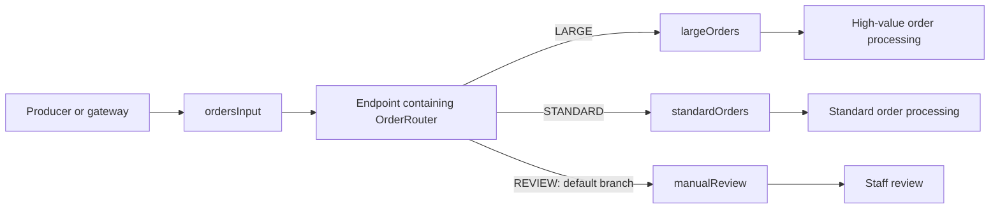

# @Router — Routing Messages with Annotations

In the **Annotations and XML** chapter of **SPRING_INTEGRATION_CORE**, `@Router` expresses the decision of which processing branch to send a message to. The decision can be based on the payload, headers, or both, while transferring messages between components is handled by `MessageChannel`s and endpoints.

This lesson uses an order-routing scenario to connect the concepts of `Message`, channel, endpoint, gateway, and Java DSL. After this lesson, you can write a routing method, map keys to channels, choose a policy when no matching destination exists, and test the actual message path.

The examples use Java 17 and Spring Integration 6.5.x APIs. This is the API baseline for the lesson; when applying it to a project, use the Spring version set managed consistently by the project's BOM. The main example requires `spring-integration-core`; the tests require JUnit Jupiter along with parameterized test support. The XML and DSL snippets are alternative configuration options explained separately.

## 1. The Problem a Router Solves

An order-intake service has three rules:

- Orders with a risk flag must be reviewed by staff, regardless of value.
- Orders of 5,000,000 VND or more go to the high-value order processing flow.
- All remaining orders go to the standard processing flow.

If the intake component directly calls each processing service, it must know both the rules and how to connect to those services. With a router, the sender only pushes a `Message<Order>` onto the input channel; the router picks the branch, and downstream endpoints perform the business work.



In the example, `LARGE`, `STANDARD`, and `REVIEW` are **decision keys**. `largeOrders`, `standardOrders`, and `manualReview` are **channel bean names**. Separating these two sets of names lets you change flow topology with minimal edits to business rules.

## 2. Method Returns Destination; Message Continues Carrying Business Data

`@Router` belongs to the `org.springframework.integration.annotation` package. Common return types are `String`, `MessageChannel`, or a list or array containing those values. One result can lead to a single destination or multiple destinations. [Annotation-based router configuration documentation](https://docs.spring.io/spring-integration/reference/6.5/router/annotation.html).

```java
@Router(inputChannel = "input")
public String choose(Order order) {
    return "standardOrders";
}
```

If you return a channel name directly like above without configuring mappings or a default branch, the endpoint looks up the channel named `standardOrders` and forwards the input message there. The payload at the destination is still `Order`; the string `"standardOrders"` only describes the routing decision.

| Component | Responsibility in the Order Flow | Typical Meaning of Method Return Value |
| --- | --- | --- |
| Transformer | Converts incoming data into `Order` | Transformed payload or message |
| Filter | Accepts or drops orders based on conditions | Keep or discard decision |
| Router | Selects the order processing workflow | Destination or key used to look up destination |
| Service activator | Performs work on a branch | Processing result, or no return value |
| Aggregator | Combines related results | Aggregated result of a group |

Returning `"APPROVED"` in a router does not automatically generate an approval reply for the caller. If a gateway needs to return a business result, the final processing branch must produce an appropriate reply; if the flow awaits results from multiple branches, an aggregation step must be designed.

## 3. Choosing Input Data for the Method

| Example Signature | When to Use |
| --- | --- |
| `String route(Order order)` | Rule depends only on the payload |
| `String route(@Header("region") String region)` | Rule depends only on a single header |
| `String route(Order order, @Header("riskFlag") Boolean flag)` | Rule combines payload and header |
| `String route(Message<Order> message)` | Need to inspect multiple pieces of message info |
| `List<String> route(Order order)` | One decision needs to send to multiple branches |
| `MessageChannel route(Order order)` | Decision directly uses channel instances |

`@Header` and `@Headers` belong to `org.springframework.messaging.handler.annotation`. A missing required header can cause parameter binding to fail before the method body runs. For optional headers, use `required = false`, choose a reference type such as `Boolean`, and handle `null` explicitly. [Mechanism for binding payload and headers to parameters](https://docs.spring.io/spring-integration/reference/6.5/configuration/annotations.html).

There is no need to accept the entire `Message<?>` just to read a field that can already be passed with `@Header`. A method that takes only the data it needs is easier to call directly in rule unit tests.

## 4. Complete Example: Order Routing

The main example has three classes in package `example.routing`. The input channel is a `DirectChannel`; the output channels are `QueueChannel`s so messages can be received and observed without building full business services yet.

### 4.1. `Order` Payload

```java
package example.routing;

import java.math.BigDecimal;
import java.util.Objects;

public record Order(String id, BigDecimal total) {

    public Order {
        Objects.requireNonNull(id, "id must not be null");
        Objects.requireNonNull(total, "total must not be null");
        if (id.isBlank()) {
            throw new IllegalArgumentException("id must not be blank");
        }
        if (total.signum() < 0) {
            throw new IllegalArgumentException("total must be non-negative");
        }
    }
}
```

Monetary values use `BigDecimal`. Comparing with `compareTo()` expresses the threshold numerically, independent of whether the amount is represented as `5000000`, `5000000.0`, or `5000000.00`.

Input validation sits at object construction boundaries. If a source sends JSON or text, an upstream transformer is responsible for creating `Order`; the router does not double as a source format parser.

### 4.2. Class Containing Rules and Annotation

```java
package example.routing;

import java.math.BigDecimal;

import org.springframework.integration.annotation.MessageEndpoint;
import org.springframework.integration.annotation.Router;
import org.springframework.messaging.handler.annotation.Header;

@MessageEndpoint
public class OrderRouter {

    private static final BigDecimal LARGE_ORDER_THRESHOLD =
            new BigDecimal("5000000");

    @Router(
            inputChannel = "ordersInput",
            channelMappings = {
                    "LARGE=largeOrders",
                    "STANDARD=standardOrders"
            },
            defaultOutputChannel = "manualReview",
            resolutionRequired = "false",
            sendTimeout = "1000"
    )
    public String route(
            Order order,
            @Header(value = "riskFlag", required = false) Boolean riskFlag) {

        if (Boolean.TRUE.equals(riskFlag)) {
            return "REVIEW";
        }

        return order.total().compareTo(LARGE_ORDER_THRESHOLD) >= 0
                ? "LARGE"
                : "STANDARD";
    }
}
```

`REVIEW` is intentionally absent from `channelMappings`: in this configuration, an unmapped key goes to `manualReview`. The risk flag is checked before the amount threshold so high-value orders with risk still go to staff review.

`@MessageEndpoint` expresses the class's role in Spring. To avoid relying on package scanning, the configuration below registers the class with `@Import`.

### 4.3. Channel and Integration Infrastructure Configuration

```java
package example.routing;

import org.springframework.context.annotation.Bean;
import org.springframework.context.annotation.Configuration;
import org.springframework.context.annotation.Import;
import org.springframework.integration.channel.DirectChannel;
import org.springframework.integration.channel.QueueChannel;
import org.springframework.integration.config.EnableIntegration;

@Configuration
@EnableIntegration
@Import(OrderRouter.class)
public class OrderRoutingConfig {

    @Bean
    public DirectChannel ordersInput() {
        return new DirectChannel();
    }

    @Bean
    public QueueChannel largeOrders() {
        return new QueueChannel(100);
    }

    @Bean
    public QueueChannel standardOrders() {
        return new QueueChannel(100);
    }

    @Bean
    public QueueChannel manualReview() {
        return new QueueChannel(100);
    }
}
```

In this standalone Java configuration, `@EnableIntegration` enables the annotation-processing infrastructure. Beans are declared explicitly so channel types and queue capacities are visible decisions.

Path of a 7,000,000 VND order with no risk flag:

1. Producer sends `Message<Order>` to `ordersInput`.
2. Endpoint calls `OrderRouter.route(order, null)`.
3. Method returns key `LARGE`.
4. Mapping translates `LARGE` to bean name `largeOrders`.
5. Router sends the message to the `largeOrders` bean.
6. Consumer on that branch receives the original `Order` payload.

`DirectChannel` invokes subscribers on the sender's thread. `QueueChannel` buffers messages for receivers to pull later; successfully enqueuing does not mean business processing is finished. The queues in the example store data in memory. [Characteristics of channel types](https://docs.spring.io/spring-integration/reference/6.5/channel/implementations.html).

### 4.4. Sending and Observing a Message

```java
package example.routing;

import java.math.BigDecimal;

import org.springframework.context.annotation.AnnotationConfigApplicationContext;
import org.springframework.integration.channel.QueueChannel;
import org.springframework.messaging.Message;
import org.springframework.messaging.MessageChannel;
import org.springframework.messaging.support.MessageBuilder;

public class RoutingDemo {

    public static void main(String[] args) {
        try (var context = new AnnotationConfigApplicationContext(
                OrderRoutingConfig.class)) {

            Order order = new Order("OD-1001", new BigDecimal("7000000"));
            Message<Order> request = MessageBuilder.withPayload(order)
                    .setHeader("traceId", "trace-1001")
                    .build();

            MessageChannel input = context.getBean(
                    "ordersInput", MessageChannel.class);
            if (!input.send(request, 1000)) {
                throw new IllegalStateException("Input rejected the message");
            }

            QueueChannel destination = context.getBean(
                    "largeOrders", QueueChannel.class);
            Message<?> result = destination.receive(1000);
            if (result == null) {
                throw new IllegalStateException("No routed message received");
            }

            System.out.println(result.getPayload());
            System.out.println(result.getHeaders().get("traceId"));
        }
    }
}
```

The expected output is the `OD-1001` order details and the `trace-1001` header. If you add `.setHeader("riskFlag", true)`, you must receive from `manualReview` instead of `largeOrders`.

## 5. Reading Key Attributes Accurately

Several `@Router` attributes use strings, including values representing booleans or durations. Thus write `resolutionRequired = "false"`, not `resolutionRequired = false`. Strings also allow property placeholders on supported attributes, such as `sendTimeout = "${orders.routing.send-timeout:1000}"`.

| Attribute | Design Usage |
| --- | --- |
| `inputChannel` | Specifies the message receiving point |
| `channelMappings` | Declares `key=channelName` pairs |
| `prefix`, `suffix` | Joins name parts when resolving string channel names |
| `defaultOutputChannel` | Selects a branch when no target channel can be determined |
| `resolutionRequired` | Controls whether failing to resolve a name raises an error immediately |
| `applySequence` | Adds sequence metadata when coordinating multiple branches |
| `ignoreSendFailures` | Controls handling of failures when sending to destinations |
| `sendTimeout` | Limits send wait time when the target channel supports waiting |
| `poller` | Configures how messages are pulled from a pollable input |
| `autoStartup`, `phase` | Controls endpoint lifecycle |

Cross-check attribute types in [Spring Integration 6.5.10 `@Router` declaration](https://github.com/spring-projects/spring-integration/blob/v6.5.10/spring-integration-core/src/main/java/org/springframework/integration/annotation/Router.java).

Naming-convention example, applied to a router independent of the main example:

```java
@Router(
        inputChannel = "regionalInput",
        prefix = "region.",
        suffix = ".orders"
)
public String routeByRegion(@Header("region") String region) {
    return switch (region) {
        case "VN" -> "vn";
        case "SG" -> "sg";
        default -> throw new IllegalArgumentException("Unsupported region");
    };
}
```

This configuration requires channels `region.vn.orders`, `region.sg.orders`, and input `regionalInput`. Joined names are case-sensitive. Return values and actual bean names must be kept in sync.

If the number of branches is small and there is no cross-cutting naming convention, explicit mappings are usually easier to read than string concatenation. Never let externally supplied data become arbitrary channel names; convert that data into a defined set of business keys.

## 6. Distinguishing Missing Mapping, Failed Resolution, and Send Failure

These three situations occur at different steps, so they require separate reasoning.

### 6.1. Unmapped Key

In the main example, `REVIEW` has no mapping. Since Spring Integration 6.0, `channelKeyFallback` defaults to `false` when a default output channel is configured, unless that option is explicitly set. An unmapped key is therefore sent to the default branch instead of continuing to be treated as a channel name. [Mapping router rules since version 6.0](https://docs.spring.io/spring-integration/reference/6.5/router/common-parameters.html).

`channelKeyFallback` is not a direct attribute on `@Router`. When explicit control is needed, you can configure the router object or use Java DSL.

### 6.2. Mapping Points to a Non-Existent Bean

Suppose you mistype `LARGE=largeOrdes`. The key has a mapping, but the name `largeOrdes` cannot be resolved to a channel.

- With `resolutionRequired = "true"`, a resolution error is reported.
- With `resolutionRequired = "false"`, the unresolvable destination can be ignored; if no destinations remain, the router uses the default channel if present.
- When no destinations remain and there is no default channel, the router's default configuration can still raise an error; `resolutionRequired = "false"` alone does not guarantee silently dropping the message.

The sample configuration chooses `false` to express a policy of routing unresolved cases to `manualReview`. A consequence is that typos in channel names could also be sent to that queue. Systems that need early detection of configuration errors can choose `true` for mandatory mappings and test the default branch separately.

Do not memorize a rule like "having a default means it can never error." A configuration with a default channel that explicitly sets both `channelKeyFallback = true` and `resolutionRequired = true` is rejected by the mapping router on initialization. [`AbstractMappingMessageRouter` contract](https://docs.spring.io/spring-integration/docs/current/api/org/springframework/integration/router/AbstractMappingMessageRouter.html).

### 6.3. Destination Exists but Cannot Receive or Process the Message

For example:

- Target `DirectChannel` has no subscribers.
- Target queue is full and the send timeout expires.
- A handler downstream of `DirectChannel` throws an exception during processing.

These errors occur after the destination-selection step. `defaultOutputChannel` does not automatically become a catch-all branch for those exceptions, and `resolutionRequired = "false"` cannot fix them.

If the business intentionally drops unmatched messages, you can choose `defaultOutputChannel = "nullChannel"`. Document clearly that this is a discard policy; if auditing is needed, a review or audit channel makes the decision more visible. [Default branch and send errors](https://docs.spring.io/spring-integration/reference/router/common-parameters.html).

## 7. Routing Explicitly by Header

The standalone example below routes based on intake source; the mentioned channels must be declared before use:

```java
@Router(
        inputChannel = "sourceInput",
        channelMappings = {
                "WEB=webOrders",
                "STORE=storeOrders"
        },
        defaultOutputChannel = "unknownSourceOrders",
        resolutionRequired = "false"
)
public String routeBySource(
        @Header(value = "source", required = false) String source) {

    if (source == null || source.isBlank()) {
        return "UNKNOWN";
    }
    return switch (source) {
        case "WEB" -> "WEB";
        case "STORE" -> "STORE";
        default -> "UNKNOWN";
    };
}
```

Both a missing header and an unrecognized value lead to `unknownSourceOrders`. Values are normalized into an application-controlled set of keys.

Header types should be standardized at the intake boundary. The main example creates `riskFlag` as `Boolean`; if a source sends the string `"true"`, the flow should define where conversion happens and how malformed data is handled instead of relying on implicit conversion in multiple places.

Routing rules should avoid updating databases or calling services with side effects. When a flow has retries or message replay, a decision with side effects makes behavior hard to explain and hard to test.

## 8. Sending to Multiple Branches and Preparing for an Aggregator

An order may simultaneously require inventory and payment checks. This condensed snippet requires declaring `verificationInput`, `inventoryChecks`, `paymentChecks`, and their corresponding consumers:

```java
@Router(inputChannel = "verificationInput", applySequence = "true")
public java.util.List<String> verificationTargets(Order order) {
    return java.util.List.of("inventoryChecks", "paymentChecks");
}
```

Both destinations receive messages carrying the same order data. Two items in the list describe two destinations, not two data fragments split from the order.

When results need to be aggregated, `applySequence = "true"` provides correlation and ordering headers such as `correlationId`, `sequenceNumber`, and `sequenceSize`. The aggregator still needs a return path for results, a group release condition, and a policy for incomplete groups. [Aggregator correlation and release mechanisms](https://docs.spring.io/spring-integration/reference/6.5/aggregator.html).

For instance, each verification branch must return a result preserving correlation metadata. If the payment branch fails without producing a fallback result, an aggregator waiting for two parts can stall on that group unless a timeout policy is configured.

Returning multiple destinations does not make branches run in parallel automatically. Targets using default `DirectChannel`s execute on the sending thread; to separate threads, choose appropriate channels and executors. Nor is there any automatic distributed transaction just because destinations are returned in one list.

Messages sent to multiple branches do not mean the payload was deep-copied. Use immutable data or make intentional copies if branches need to modify data independently.

## 9. When the Input Is a Queue, the Router Needs a Poller

The main example sets no poller because `ordersInput` is a `DirectChannel`. If you replace the input with a `QueueChannel`, the endpoint needs a mechanism to pull messages from the queue.

The condensed example below belongs in an endpoint bean; `queuedOrders`, `standardOrders`, and `routingErrors` must also be declared:

```java
import org.springframework.integration.annotation.Poller;
import org.springframework.integration.annotation.Router;

@Router(
        inputChannel = "queuedOrders",
        poller = @Poller(
                fixedDelay = "200",
                maxMessagesPerPoll = "10",
                errorChannel = "routingErrors"
        )
)
public String routeQueuedOrder(Order order) {
    return "standardOrders";
}
```

The poller pulls up to 10 messages per cycle and uses a 200 ms fixed delay between cycles according to the scheduler. If not specified on the annotation, a suitable default poller must exist in the application context. [Configuring `@Poller` for endpoints](https://docs.spring.io/spring-integration/reference/6.5/configuration/annotations.html#using-the-poller-annotation).

What matters is the router's **input channel type**. Sending to an output `QueueChannel` does not make the router itself require a poller; consumers downstream of that queue are the ones that need an appropriate receiving mechanism.

## 10. Error Handling and Timeout Boundaries

### 10.1. Synchronous Flow via `DirectChannel`

In the main example, the sender calls `MessageChannel.send()` directly. If the routing decision or a synchronous downstream step throws an exception, the error can propagate back to the sender. Setting an `errorChannel` header alone does not automatically convert every synchronous exception into an `ErrorMessage`.

### 10.2. Flows with a Poller or Asynchronous Boundary

When running on a task managed by Integration infrastructure, errors can be published as `ErrorMessage`s via an appropriate error handler. In the poller example above, `errorChannel = "routingErrors"` specifies where the poller sends errors. That channel needs a consumer or designed error collection mechanism. [Synchronous and asynchronous error handling](https://docs.spring.io/spring-integration/reference/6.5/error-handling.html).

### 10.3. Default Branch and Error Flow Have Separate Roles

`manualReview` in the example is a business branch for unmapped decisions. Exceptions such as a payment service outage belong in an error flow, carrying the cause and failed message. Both cases may require human intervention, but they carry different operational meanings.

`ignoreSendFailures` defaults to `false`. When sending to multiple destinations, a send error can stop subsequent destinations from receiving the message; destinations that already received it are not rolled back automatically. Setting `true` lets the router ignore send failures and continue to remaining destinations, but requires a policy to track partial delivery. [Router send-failure behavior](https://www.springframework.org/spring-integration/docs/current/api/org/springframework/integration/annotation/Router.html).

`sendTimeout = "1000"` in the example limits send waiting when a target channel has a matching limit, such as a full queue. It is not a timeout for running Java rules or all handlers behind a `DirectChannel`, nor does it replace a gateway's reply timeout.

## 11. Representing the Same Decision in XML

When configuring endpoints with XML, you can reference a POJO and decision method. The example below reuses the `Order` payload, replacing the annotated `OrderRouter` with a plain POJO `XmlOrderDecider`:

```java
package example.routing;

import java.math.BigDecimal;

import org.springframework.messaging.handler.annotation.Header;

public class XmlOrderDecider {

    private static final BigDecimal LARGE_ORDER_THRESHOLD =
            new BigDecimal("5000000");

    public String route(
            Order order,
            @Header(value = "riskFlag", required = false) Boolean riskFlag) {
        if (Boolean.TRUE.equals(riskFlag)) {
            return "REVIEW";
        }
        return order.total().compareTo(LARGE_ORDER_THRESHOLD) >= 0
                ? "LARGE"
                : "STANDARD";
    }
}
```

Standalone XML configuration:

```xml
<?xml version="1.0" encoding="UTF-8"?>
<beans xmlns="http://www.springframework.org/schema/beans"
       xmlns:xsi="http://www.w3.org/2001/XMLSchema-instance"
       xmlns:int="http://www.springframework.org/schema/integration"
       xsi:schemaLocation="
         http://www.springframework.org/schema/beans
         https://www.springframework.org/schema/beans/spring-beans.xsd
         http://www.springframework.org/schema/integration
         https://www.springframework.org/schema/integration/spring-integration.xsd">

    <int:channel id="ordersInput"/>

    <int:channel id="largeOrders">
        <int:queue capacity="100"/>
    </int:channel>
    <int:channel id="standardOrders">
        <int:queue capacity="100"/>
    </int:channel>
    <int:channel id="manualReview">
        <int:queue capacity="100"/>
    </int:channel>

    <bean id="orderDecider" class="example.routing.XmlOrderDecider"/>

    <int:router id="orderRoutingEndpoint"
                input-channel="ordersInput"
                ref="orderDecider"
                method="route"
                default-output-channel="manualReview"
                resolution-required="false"
                timeout="1000">
        <int:mapping value="LARGE" channel="largeOrders"/>
        <int:mapping value="STANDARD" channel="standardOrders"/>
    </int:router>
</beans>
```

`ref` selects the bean; `method` selects the method; `int:mapping` elements correspond to `channelMappings`. The XML attribute limiting send wait time is `timeout`, whereas the annotation uses `sendTimeout`. [Configuring a generic router with XML](https://docs.spring.io/spring-integration/reference/6.5/router/namespace.html).

To try this option, load only the XML configuration and corresponding POJO. If you also register the old annotation endpoint on the same `ordersInput`, you create an extra consumer. With `DirectChannel`, consumers may share message dispatching between them, producing behavior different from having a single router.

Distinguish XML **flow configuration** here from XML-formatted payloads. `@Router` does not automatically evaluate XPath just because this chapter covers Annotations and XML; XPath routing is a different specialized router option.

## 12. Representing with Java DSL

To view the flow structure seamlessly in Java, you can use `.route(...)`. The snippet below is an alternative configuration, reusing `Order` and the channel beans from the main example while **removing `@Import(OrderRouter.class)`** so the old annotation endpoint is not registered:

```java
@Bean
public org.springframework.integration.dsl.IntegrationFlow orderRoutingFlow() {
    return org.springframework.integration.dsl.IntegrationFlow
            .from("ordersInput")
            .route("orderDecider", "route", router -> router
                    .channelMapping("LARGE", "largeOrders")
                    .channelMapping("STANDARD", "standardOrders")
                    .channelKeyFallback(false)
                    .defaultOutputChannel("manualReview")
                    .resolutionRequired(false)
                    .sendTimeout(1000))
            .get();
}

@Bean
public XmlOrderDecider orderDecider() {
    return new XmlOrderDecider();
}
```

The POJO is reused from the XML section, so it still receives payload and headers under the same rules. In this approach, the DSL wires the endpoint into the flow; the decision method has no `@Router`.

The DSL also supports lambdas, expressions, and specialized router types. When comparing a single payload value, a lambda can be concise; when rules need independent testing or multiple header parameters, a POJO expresses them more clearly. [Ways to configure message routers in Java DSL](https://docs.spring.io/spring-integration/reference/6.5/dsl/java-routers.html).

## 13. Testing Decisions and Message Paths

Calling `new OrderRouter().route(order, null)` only verifies the returned key. It does not verify mappings, channel bean names, header binding, or endpoint registration. Flow tests must send messages into real channels inside an application context.

The dataset covers boundary values and precedence order:

| Total | `riskFlag` | Expected Key | Expected Channel |
| --- | --- | --- | --- |
| `0` | absent | `STANDARD` | `standardOrders` |
| `4999999.99` | `false` | `STANDARD` | `standardOrders` |
| `5000000.00` | absent | `LARGE` | `largeOrders` |
| `7000000` | `false` | `LARGE` | `largeOrders` |
| `100000` | `true` | `REVIEW` | `manualReview` |
| `7000000` | `true` | `REVIEW` | `manualReview` |

The JUnit 5 test below is for the **initial annotation configuration**, placed in package `example.routing`. Each run uses a fresh context so leftover messages cannot affect subsequent cases:

```java
package example.routing;

import java.math.BigDecimal;
import java.util.List;
import java.util.stream.Stream;

import org.junit.jupiter.params.ParameterizedTest;
import org.junit.jupiter.params.provider.Arguments;
import org.junit.jupiter.params.provider.MethodSource;
import org.springframework.context.annotation.AnnotationConfigApplicationContext;
import org.springframework.integration.channel.QueueChannel;
import org.springframework.messaging.Message;
import org.springframework.messaging.MessageChannel;
import org.springframework.messaging.support.MessageBuilder;

import static org.junit.jupiter.api.Assertions.assertEquals;
import static org.junit.jupiter.api.Assertions.assertNotNull;
import static org.junit.jupiter.api.Assertions.assertNull;
import static org.junit.jupiter.api.Assertions.assertSame;
import static org.junit.jupiter.api.Assertions.assertTrue;

class OrderRoutingTest {

    static Stream<Arguments> routingCases() {
        return Stream.of(
                Arguments.of("0", null, "standardOrders"),
                Arguments.of("4999999.99", false, "standardOrders"),
                Arguments.of("5000000.00", null, "largeOrders"),
                Arguments.of("7000000", false, "largeOrders"),
                Arguments.of("100000", true, "manualReview"),
                Arguments.of("7000000", true, "manualReview")
        );
    }

    @ParameterizedTest
    @MethodSource("routingCases")
    void shouldRouteToExactlyOneDestination(
            String total, Boolean riskFlag, String expectedChannel) {

        try (var context = new AnnotationConfigApplicationContext(
                OrderRoutingConfig.class)) {

            Order payload = new Order("OD-test", new BigDecimal(total));
            Message<Order> request = MessageBuilder.withPayload(payload)
                    .setHeader("riskFlag", riskFlag)
                    .setHeader("traceId", "trace-test")
                    .build();

            MessageChannel input = context.getBean(
                    "ordersInput", MessageChannel.class);
            assertTrue(input.send(request, 1000));

            for (String channelName : List.of(
                    "largeOrders", "standardOrders", "manualReview")) {

                QueueChannel channel = context.getBean(
                        channelName, QueueChannel.class);
                Message<?> actual = channel.receive(0);

                if (channelName.equals(expectedChannel)) {
                    assertNotNull(actual, "Expected message on " + channelName);
                    assertSame(payload, actual.getPayload());
                    assertEquals("trace-test",
                            actual.getHeaders().get("traceId"));
                    assertNull(channel.receive(0), "Unexpected duplicate");
                }
                else {
                    assertNull(actual, "Unexpected message on " + channelName);
                }
            }
        }
    }
}
```

When `riskFlag` is `null`, `MessageBuilder.setHeader()` does not keep that header, so those rows test the missing-header case. `receive(0)` is appropriate here because `DirectChannel` has already executed the router and sent to the queue before `send()` returns. For inputs with a poller or executor, an appropriate bounded wait must be used.

Beyond the happy path, add tests matching the policy the application actually chooses:

- Should a mistyped channel name in a mapping raise an error or fall back to review?
- At which step should a missing or wrong-type required header be detected?
- Does a full queue trigger the expected send timeout?
- With multiple destinations, should an error on one branch allow subsequent branches to receive?
- With an aggregator, how is the group handled when one branch returns no result?

These cases verify the flow's contract, rather than merely testing `if` statements in a Java method.

## 14. Diagnosing Common Errors

| Symptom | What to Check |
| --- | --- |
| `DirectChannel` has no subscribers | Is the endpoint class a Spring bean, is Integration infrastructure enabled, does the input name match |
| Cannot find output channel | Returned key, mappings, bean names, and prefix/suffix concatenation |
| All orders go to `manualReview` | Do keys match mappings; is a mapping name misspelled and ignored because `resolutionRequired = "false"` |
| Error reported before the method runs | Payload type, header type, required headers, and parameter binding |
| Input is a queue but nothing is processed | Has a poller on the endpoint or a default poller been configured |
| Some messages go through a different configuration | Are multiple endpoints subscribed to one `DirectChannel`, such as loading both XML and annotations |
| Gateway times out even though router picked a branch | Does the final branch produce a reply, is reply metadata preserved across steps |
| Aggregator waits indefinitely | Actual number of results received, correlation headers, sequence, and incomplete-group policy |

When tracing an order, preserve `traceId` and order ID across branches. Monitor both counts entering each branch and counts entering the default branch: a mapping bug can let the flow keep accepting messages while misrouting them completely.

## 15. Extended Practice

Extend the example with order sources `WEB`, `STORE`, and these priority rules:

1. Orders with risk always go to `manualReview`.
2. Non-risky orders of 5,000,000 VND or more go to `largeOrders`.
3. Remaining orders from `STORE` go to `storeOrders`.
4. Remaining orders from `WEB` go to `standardOrders`.
5. Missing or unsupported sources go to `unknownSourceOrders`.

Write out a decision table before editing the router. In particular, test a high-value order from `STORE` to prove precedence order works, and test a missing source on an order below the threshold to verify the policy for unidentified sources.

Then express the same decision table in XML or DSL, registering only one endpoint option at a time for the input. Run the same message set and compare receiving channels, payloads, and business headers. The exercise succeeds when the configuration format changes while the routing contract stays identical.
