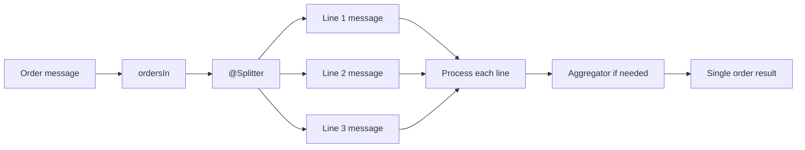

# @Splitter

## 1. Objectives and Position in the Message Flow

In the **Annotations and XML** chapter of the **SPRING_INTEGRATION_CORE** module, `@Splitter` represents the step of splitting one message into multiple messages to process each part individually. This lesson focuses on connecting this endpoint to `MessageChannel`s, preserving `Message` information, and coordinating with transformers, routers, filters, aggregators, or gateways.

After this lesson, you can:

- Declare a splitter using annotations and an XML configuration with equivalent behavior.
- Distinguish a list inside a single payload from multiple independent messages.
- Explain the headers used for grouping and ordering.
- Choose how to handle empty orders, mid-stream errors, and sources of unknown size.
- Write tests for both the splitting algorithm and the Spring-managed endpoint.

The examples use Java 17, Spring Integration 6.5 APIs, and JUnit Jupiter. The project requires `org.springframework.integration:spring-integration-core`; tests require JUnit Jupiter. Choose dependency versions according to the BOM or Spring platform in use. The lesson does not require Spring Boot or a broker connection.

## 2. Problem: From an Order to Individual Line Tasks

An order has three lines. The warehouse system needs to receive each line independently to check inventory, select a warehouse, and record results.

```text
Message<PurchaseOrder>
  orderId = ORD-100
  lines   = [L1, L2, L3]

          @Splitter
              |
              +--> Message<LineTask L1>
              +--> Message<LineTask L2>
              +--> Message<LineTask L3>
```

A splitter changes the number of messages flowing through the pipeline. A transformer returning a `List<LineTask>` normally creates a single message whose payload is the entire list; a splitter interprets the elements of the split result to emit multiple messages. When you need to keep the batch intact to call an API that takes a list, a transformer is more appropriate.

A splitter also differs from a router and a publish-subscribe channel:

| Component | Primary Job | Example |
| --- | --- | --- |
| Splitter | Splits content into multiple parts | One order into three line tasks |
| Router | Selects target destinations based on conditions | Sends task to North or South warehouse |
| Filter | Allows or drops a message | Blocks tasks with invalid data |
| Publish-subscribe channel | Delivers the same message to multiple subscribers | Notifies both audit and monitoring systems of an order |
| Aggregator | Combines messages in the same group into one result | Merges three line results into an order report |

These components can sit in sequence. Splitting does not automatically choose a warehouse, execute in parallel, or reassemble results afterward.



## 3. Contract of a @Splitter Method

`@Splitter` belongs to the `org.springframework.integration.annotation` package and is typically placed on a method of a Spring bean. The annotation describes the messaging role; the algorithm that selects and builds elements lives in the method or an invoked service.

Minimal illustrative example:

```java
@Splitter(inputChannel = "ordersIn", outputChannel = "lineTasks")
public List<LineTask> split(PurchaseOrder order) {
    return orderSplitter.split(order);
}
```

There are three distinct steps:

1. The endpoint receives a message from `ordersIn`.
2. Spring maps the payload into the `PurchaseOrder` parameter and invokes the method.
3. The splitter emits each `LineTask` as a message to `lineTasks`.

A direct Java call such as `endpoints.split(order)` only returns a list. Sending a message through the channel is what triggers the endpoint, creates child messages, and attaches flow headers.

### 3.1. Input Parameters

Use a payload parameter when the algorithm only needs business data. When you need to read request metadata, you can accept `Message<PurchaseOrder>`. If only one header is needed, you can add a parameter with `@Header`:

```java
public List<LineTask> split(
        PurchaseOrder order,
        @Header("tenantId") String tenantId) {
    // Illustrative signature: validate tenantId then create tasks.
    return orderSplitter.split(order);
}
```

This is an alternative method signature, not an additional endpoint. `@Header` is in `org.springframework.messaging.handler.annotation`; by default, the header is required. Only use `required = false` if business logic defines how to handle its absence.

Parameter declarations and annotation attributes are described in [@Splitter 6.5 API](https://docs.spring.io/spring-integration/docs/6.5.0/api/org/springframework/integration/annotation/Splitter.html).

### 3.2. Return Value

Choose `List<T>` when you want a clear example that preserves order and has a known element count.

| Algorithm Return Value | How the Endpoint Interprets It |
| --- | --- |
| `List<LineTask>` or similar collection | Each element becomes the payload of a message |
| Object array | Each element is an item to emit |
| `List<Message<LineTask>>` | Allows explicitly setting extra headers on each part |
| A single object | A single result is emitted |
| `Iterator`, `Iterable`, `Stream` | Traverses parts; total count may be unknown beforehand |
| Empty collection | No child messages; a discard path can be configured |
| `null` | Ends the branch here, producing no reply |

Do not return `void` for an algorithm that must emit parts. Do not put `null` elements inside the list: messages need valid payloads. `Iterator` or `Stream` sources require extra design for resource lifecycles and completion conditions; section 10 explains the consequences when reaggregating.

Return contracts and collection usage are presented in the [Splitter documentation](https://docs.spring.io/spring-integration/reference/6.5/splitter.html).

## 4. Complete Example with Annotations

The practice flow is:

```text
ordersIn: DirectChannel
    -> OrderEndpoints.split(...)
    -> lineTasks: QueueChannel
```

`ordersIn` delivers messages to the splitter directly on the sender's thread. `lineTasks` buffers emitted parts for tests or for another consumer to read later. In this example, the output queue does not yet have an automatic consumer.

The public types below belong in separate Java files under package `example.splitter`.

### 4.1. Data Model

```java
package example.splitter;

import java.util.Objects;

public record OrderLine(String lineId, String sku, int quantity) {
    public OrderLine {
        Objects.requireNonNull(lineId, "lineId");
        Objects.requireNonNull(sku, "sku");
        if (quantity <= 0) {
            throw new IllegalArgumentException("quantity must be positive");
        }
    }
}
```

```java
package example.splitter;

import java.util.List;
import java.util.Objects;

public record PurchaseOrder(String orderId, List<OrderLine> lines) {
    public PurchaseOrder {
        Objects.requireNonNull(orderId, "orderId");
        lines = List.copyOf(lines);
    }
}
```

```java
package example.splitter;

public record LineTask(
        String orderId,
        String lineId,
        String sku,
        int quantity) {
}
```

`List.copyOf` copies the list and rejects null lists or null elements. Order lines are records with immutable fields, so the example avoids one consumer mutating a line object shared with another consumer.

`LineTask` keeps `orderId` and `lineId` because a subtask needs enough information to trace or retry independently. Emitting only the SKU could lose line identity, especially when an order has multiple lines with the same SKU.

### 4.2. Spring-Independent Splitting Algorithm

```java
package example.splitter;

import java.util.List;

public class OrderSplitter {

    public List<LineTask> split(PurchaseOrder order) {
        if (order.lines().isEmpty()) {
            throw new IllegalArgumentException(
                    "Order must contain at least one line");
        }

        return order.lines().stream()
                .map(line -> new LineTask(
                        order.orderId(),
                        line.lineId(),
                        line.sku(),
                        line.quantity()))
                .toList();
    }
}
```

The example's policy rejects orders with no lines. Returning a complete list also detects task-creation errors before the endpoint begins sending the first task. This does not guarantee that all tasks will succeed together downstream.

This class carries no messaging annotations, so it can be reused from XML or Java DSL and tested with a plain Java call.

### 4.3. Endpoint with @Splitter

```java
package example.splitter;

import java.util.List;
import org.springframework.integration.annotation.Splitter;

public class OrderEndpoints {

    private final OrderSplitter orderSplitter;

    public OrderEndpoints(OrderSplitter orderSplitter) {
        this.orderSplitter = orderSplitter;
    }

    @Splitter(
            inputChannel = "ordersIn",
            outputChannel = "lineTasks",
            applySequence = "true",
            sendTimeout = "1000")
    public List<LineTask> split(PurchaseOrder order) {
        return orderSplitter.split(order);
    }
}
```

`applySequence` is `String`-typed, so it must be written `"true"`. Enable this attribute to provide sequence metadata for observability and grouping. The default effective setting on a splitter enables sequences; the example writes it explicitly to show the contract.

`sendTimeout = "1000"` sets the send wait timeout when the output channel may block, such as a capacity-bounded queue. This is not a business execution deadline for a single order line.

### 4.4. Registering Beans and Channels

```java
package example.splitter;

import org.springframework.context.annotation.Bean;
import org.springframework.context.annotation.Configuration;
import org.springframework.integration.channel.DirectChannel;
import org.springframework.integration.channel.QueueChannel;
import org.springframework.integration.config.EnableIntegration;

@Configuration
@EnableIntegration
public class SplitterConfig {

    @Bean
    public DirectChannel ordersIn() {
        return new DirectChannel();
    }

    @Bean
    public QueueChannel lineTasks() {
        return new QueueChannel(100);
    }

    @Bean
    public OrderSplitter orderSplitter() {
        return new OrderSplitter();
    }

    @Bean
    public OrderEndpoints orderEndpoints(OrderSplitter orderSplitter) {
        return new OrderEndpoints(orderSplitter);
    }
}
```

`@EnableIntegration` registers the Spring Integration infrastructure in this Java configuration. `OrderEndpoints` is added to the context via `@Bean`, so no component scan is needed for that class. If choosing component scanning, you can use `@Component` or `@MessageEndpoint` and remove the duplicate bean registration.

`@Splitter` on an object instantiated with `new` outside the Spring context does not register a consumer. Likewise, do not place `@Splitter` on a `@Bean` factory method returning `List<LineTask>` expecting it to handle messages; factory methods initialize beans, while message-processing methods need an endpoint contract.

How annotation processing creates endpoints and handlers is explained in [Annotation Support](https://docs.spring.io/spring-integration/reference/6.5/configuration/annotations.html).

## 5. Sequence Headers: Understanding Each Group and Part

With the configuration above, send an input message with hypothetical ID `M1` and three order lines. The child messages take the following shape:

| Message | Payload | `correlationId` | `sequenceNumber` | `sequenceSize` |
| --- | --- | --- | --- | --- |
| Child 1 | `LineTask(ORD-100, L1, ...)` | `M1` | 1 | 3 |
| Child 2 | `LineTask(ORD-100, L2, ...)` | `M1` | 2 | 3 |
| Child 3 | `LineTask(ORD-100, L3, ...)` | `M1` | 3 | 3 |

The corresponding Java constants reside in `IntegrationMessageHeaderAccessor`:

```java
IntegrationMessageHeaderAccessor.CORRELATION_ID
IntegrationMessageHeaderAccessor.SEQUENCE_NUMBER
IntegrationMessageHeaderAccessor.SEQUENCE_SIZE
```

The `correlationId` of a split batch normally ties to the parent message ID, while `orderId` is the business identifier. Resending the same order content in a new message creates a new correlation group. Therefore, deduplication needs business keys such as `orderId + lineId`, adding a business version if a line can validly be reprocessed.

Child messages are distinct messages with their own IDs. Application headers such as `traceId` are propagated via normal reply creation; you must actively preserve them if you construct new messages manually in downstream steps. Spring does not deep-copy the entire payload just because a splitter is present.

### 5.1. applySequence Does Not Guarantee Completion Order

`sequenceNumber` describes position in the emitted sequence. If downstream processes asynchronously, line 3 may finish before line 1. To assemble in business order, preserve the sequence metadata and use a resequencer or explicit sorting in result-building logic.

With nested splitters, sequences have multiple layers; the framework has a mechanism to preserve prior layer metadata so aggregator steps can restore it. Do not overwrite all sequence headers with fixed values on every message.

Only set `applySequence = "false"` when downstream does not depend on this sequence or you have designed your own correlation and release conditions. This attribute prevents the splitter from adding its sequence; it does not automatically strip any metadata already present on the input.

## 6. Equivalent XML Configuration

Reuse `PurchaseOrder`, `OrderLine`, `LineTask`, and the `OrderSplitter` POJO from section 4. In this option, XML registers the endpoint, so do not also register `OrderEndpoints` or load `SplitterConfig`.

```xml
<?xml version="1.0" encoding="UTF-8"?>
<beans xmlns="http://www.springframework.org/schema/beans"
       xmlns:xsi="http://www.w3.org/2001/XMLSchema-instance"
       xmlns:int="http://www.springframework.org/schema/integration"
       xsi:schemaLocation="
           http://www.springframework.org/schema/beans
           https://www.springframework.org/schema/beans/spring-beans.xsd
           http://www.springframework.org/schema/integration
           https://www.springframework.org/schema/integration/spring-integration.xsd">

    <int:channel id="ordersIn"/>

    <int:channel id="lineTasks">
        <int:queue capacity="100"/>
    </int:channel>

    <bean id="orderSplitter" class="example.splitter.OrderSplitter"/>

    <int:splitter id="orderSplitEndpoint"
                  input-channel="ordersIn"
                  output-channel="lineTasks"
                  ref="orderSplitter"
                  method="split"
                  apply-sequence="true"
                  send-timeout="1000"/>
</beans>
```

The attributes relate as follows:

| Annotation | XML | Meaning in the Example |
| --- | --- | --- |
| `inputChannel = "ordersIn"` | `input-channel="ordersIn"` | Where orders arrive |
| `outputChannel = "lineTasks"` | `output-channel="lineTasks"` | Where individual tasks are emitted |
| `applySequence = "true"` | `apply-sequence="true"` | Adds sequence metadata |
| `sendTimeout = "1000"` | `send-timeout="1000"` | Max send wait bounded by channel limits |
| Annotated method | `ref` together with `method` | Selects the bean and execution method |

If the input payload is already a collection to split directly, you can use the default splitter:

```xml
<int:splitter id="defaultListSplitter"
              input-channel="batchesIn"
              output-channel="itemsOut"/>
```

This snippet is an alternative configuration for a flow where `batchesIn` and `itemsOut` channels are already declared. It fits payloads such as `List<LineTask>`. For `PurchaseOrder`, you need to specify the element-extraction algorithm; do not expect the default splitter to automatically understand the `lines` field.

When mixing XML and annotations, keep track of which configuration owns each endpoint. Loading two splitters listening on `ordersIn` can distribute messages across different consumers on a `DirectChannel`. If the input is a publish-subscribe channel, each subscriber could even split the same order again. That is a topology registration bug, not a bug in the list-building algorithm.

## 7. Representing the Same Flow in Java DSL

Java DSL is useful when you want to read consecutive endpoints in one place. Below is a standalone alternative configuration to `SplitterConfig`, using the `splitWith` API of Spring Integration 6.5:

```java
package example.splitter;

import org.springframework.context.annotation.Bean;
import org.springframework.context.annotation.Configuration;
import org.springframework.integration.channel.DirectChannel;
import org.springframework.integration.channel.QueueChannel;
import org.springframework.integration.config.EnableIntegration;
import org.springframework.integration.dsl.IntegrationFlow;

@Configuration
@EnableIntegration
public class DslSplitterConfig {

    @Bean
    public DirectChannel ordersIn() {
        return new DirectChannel();
    }

    @Bean
    public QueueChannel lineTasks() {
        return new QueueChannel(100);
    }

    @Bean
    public OrderSplitter orderSplitter() {
        return new OrderSplitter();
    }

    @Bean
    public IntegrationFlow orderFlow(OrderSplitter orderSplitter) {
        return IntegrationFlow.from("ordersIn")
                .splitWith(spec -> spec
                        .ref(orderSplitter)
                        .method("split")
                        .applySequence(true)
                        .sendTimeout(1000))
                .channel("lineTasks")
                .get();
    }
}
```

This option does not create an `OrderEndpoints` bean. Business logic stays inside `OrderSplitter`. If you do not need to customize sequence or timeout settings, you can use the shorter form `.split(orderSplitter, "split")`.

If the input is already a collection, `.split()` expresses the default splitting step. If you only need an element-extraction function, the DSL has overloads taking the payload type and splitting function. Whichever form you choose, verify the overloads against your dependency version. The configuration API here is described in [SplitterSpec 6.5](https://docs.spring.io/spring-integration/docs/6.5.0/api/org/springframework/integration/dsl/SplitterSpec.html).

## 8. The Channel Determines Execution Behavior

### 8.1. DirectChannel at the Input

In the annotation example, `ordersIn.send(message)` invokes the splitter on the sender's thread. The splitter creates three results and sends them sequentially into `lineTasks`. When `send` returns normally, the tasks have been placed into the queue; that does not prove warehouse business processing is finished.

`QueueChannel(100)` holds up to 100 pending messages. When full, sends may wait; `sendTimeout` bounds that wait time. This value does not control the runtime of `OrderSplitter.split` or a downstream HTTP call. With a `DirectChannel` at the output, `sendTimeout` also does not interrupt a long-running synchronous handler.

### 8.2. QueueChannel at the Input and @Poller

If you want the splitter to receive orders from a `QueueChannel`, replace the `ordersIn` bean with a queue and update the annotation on the handler method:

```java
@Splitter(
        inputChannel = "ordersIn",
        outputChannel = "lineTasks",
        applySequence = "true",
        sendTimeout = "1000",
        poller = @Poller(
                fixedDelay = "200",
                maxMessagesPerPoll = "1"))
public List<LineTask> split(PurchaseOrder order) {
    return orderSplitter.split(order);
}
```

The additional import is `org.springframework.integration.annotation.Poller`. The input must be configured as a `QueueChannel` for this variant. If no dedicated poller is used, the context must have a suitable default poller.

`maxMessagesPerPoll = "1"` limits how many input messages are pulled in one poll. A single order with 500 lines will still produce 500 child messages; that attribute does not slice an order into one-line batches.

Equivalent XML configuration for a queue-reading endpoint:

```xml
<int:splitter id="pollingOrderSplitter"
              input-channel="ordersIn"
              output-channel="lineTasks"
              ref="orderSplitter"
              method="split"
              apply-sequence="true"
              send-timeout="1000">
    <int:poller fixed-delay="200" max-messages-per-poll="1"/>
</int:splitter>
```

This is also an alternative, not something to add to the previous XML as a second consumer. The input channel determines whether the endpoint needs polling; see [Message Endpoints](https://docs.spring.io/spring-integration/reference/6.5/endpoint.html).

### 8.3. Parallel Processing

A splitter does not automatically spawn a thread per element. You can send tasks through an `ExecutorChannel` or through a queue with executor-backed consumers to introduce concurrency.

When doing so, decide limits on in-flight tasks, queue capacity, and saturation handling. A list of 100,000 lines incurs overhead for message creation, header copying, queuing, and state storage if an aggregator is present. Adding threads without bounding load may simply shift the bottleneck to the database or warehouse service.

## 9. Empty Results and the Discard Path

There are three distinct scenarios:

| Scenario | Behavior | Design Approach |
| --- | --- | --- |
| Method throws an exception | Error flow follows execution boundary | Map to a business error or handle error messages |
| Returns an empty collection | Emits no items; original request can go to discard channel | Handle empty orders via a separate branch |
| Returns `null` | Stops branch, no reply | Use only if silent termination is intentional |

The main example chooses to throw an exception for empty orders. If the business treats empty orders as valid, change the algorithm and design an explicit result branch. You can place a filter or router before the splitter to handle this case.

In an XML variant where the split function can genuinely return an empty collection, add the attribute:

```xml
<int:splitter id="possiblyEmptyOrderSplitter"
              input-channel="ordersIn"
              output-channel="lineTasks"
              ref="orderSplitter"
              method="split"
              discard-channel="emptyOrders"/>

<int:channel id="emptyOrders">
    <int:queue capacity="20"/>
</int:channel>
```

This snippet replaces the old endpoint and requires corresponding input, output, and service beans. `emptyOrders` receives the **original request**, not a child message with an empty payload. In a real application there must be a consumer for this branch; a bare queue only helps with inspection or temporary buffering.

In the DSL, the corresponding setting is on `SplitterSpec.discardChannel`. The Spring Integration 6.5 `@Splitter` annotation has no `discardChannel` attribute, so you cannot add `discardChannel = "emptyOrders"` to the annotation instead of XML.

If a gateway is waiting for a result, a branch that emits no child messages will not automatically produce a "0 lines" report. You must build a business result on the empty-order branch or explicitly return an error.

## 10. Coordinating Splitter with Aggregator and Gateway

An order-processing flow can look like:

```text
Gateway -> Splitter -> process each line -> Aggregator -> reply
```

A typical request-reply gateway expects a single reply message. It does not automatically collect replies from all lines just because the gateway method returns a `List`. An aggregator is the right component to produce a single message containing the final list or report.

By default, an aggregator uses metadata to determine which parts belong to the same group and when the group is complete. You must preserve those headers across processing steps. If a transformer builds a new message manually and drops metadata, grouping will break. See [Aggregator](https://docs.spring.io/spring-integration/reference/6.5/aggregator.html).

### 10.1. A Filter After a Splitter Can Prevent Group Completion

Suppose a splitter emits three messages with `sequenceSize = 3`. A downstream filter drops line 2. The aggregator receives only line 1 and line 3, so the group can wait forever under a complete-all-three rule.

Some design options:

- Validate and select lines to process before splitting, if the valid count can be determined upfront.
- Have every line emit a result, including rejected or failed statuses.
- Use a custom release strategy, timeout, and missing-result policy when the business allows it.

A router can cause the same situation if it sends parts across multiple branches and only one branch returns to the aggregator. When a combined report is needed, define the convergence point and how each branch's outcome is represented.

A timeout ends waiting according to policy; it does not prove that every line succeeded.

### 10.2. Iterators and Streams with Unknown Total Count

The list in the example has a known size. With lazy traversal sources where the splitter cannot determine the size, `sequenceSize` can be `0`. In that context, `0` indicates unknown total count, not proof of an empty order.

Consequently, a design relying on `sequenceSize` as the expected result count will be insufficient. You can:

- Use a finite collection if data size fits in memory.
- Pass the expected count via a dedicated contract and design a matching release strategy.
- Use an explicit end signal or a timeout with an appropriate completion rule.

End signals must be designed carefully when parts run in parallel: receiving an "all emitted" signal does not mean all tasks have finished executing. If the traversal source holds a cursor or I/O resources, define resource closing for both success and failure cases.

## 11. Error Handling and Retries

### 11.1. Errors on a Synchronous Flow

In the `DirectChannel -> splitter -> QueueChannel` example, if the splitting algorithm throws an exception, the `ordersIn.send(...)` call receives a message-handling error. The business exception may sit inside the cause of a framework-wrapped exception.

If the output is also a `DirectChannel`, the first line's consumer can run immediately inside the splitter's emission loop. When the second line raises an exception, the first line may already have caused side effects; later lines may not have been emitted yet. The splitter does not automatically roll back side effects that already occurred.

### 11.2. Errors After an Asynchronous Boundary

For consumers executed by a Spring Integration poller or executor, errors are typically converted into an `ErrorMessage`. The error-handling system can choose a channel via the `errorChannel` header or the global error channel depending on configuration.

An error during enqueuing inside a synchronous call itself can still propagate back to the caller. Having a queue later in the flow does not turn all preceding exceptions into asynchronous error flows. Details of this distinction are in [Error Handling](https://docs.spring.io/spring-integration/reference/6.5/error-handling.html).

When handling an `ErrorMessage`, extract the exception and failed message info appropriately; the error message payload is not directly a `LineTask`. Do not confuse the empty-collection discard path with the exception-handling path.

### 11.3. Placing Retries at the Right Unit of Work

If you retry the entire order message, the splitter may re-emit all lines, including lines that already succeeded. To retry a single line independently, place the retry policy on the `LineTask` processing step and use an appropriate idempotency key.

For example, one run of `ORD-100/L1` already recorded an inventory deduction. When encountering the same task again, the consumer checks the stored result before performing the side effect a second time. Using only `MessageHeaders.ID` as a key is insufficient if a resend creates a new message.

`@Splitter` has an `adviceChain` attribute to attach advice to the handler, but that attribute alone does not guarantee the entire downstream flow is covered. Determine the advice scope, transaction boundaries, and side-effect locations before choosing where to place retries.

## 12. Testing the Algorithm and Endpoint

Two test layers serve two different purposes. Unit tests verify the business contract; Spring context tests verify channel wiring, message emission, and header generation.

### 12.1. Unit Test for the POJO

```java
package example.splitter;

import java.util.List;
import org.junit.jupiter.api.Test;

import static org.junit.jupiter.api.Assertions.*;

class OrderSplitterTest {

    private final OrderSplitter splitter = new OrderSplitter();

    @Test
    void createsOneTaskForEachOrderLine() {
        var order = new PurchaseOrder("ORD-100", List.of(
                new OrderLine("L1", "BOOK", 2),
                new OrderLine("L2", "PEN", 5)));

        var tasks = splitter.split(order);

        assertEquals(List.of(
                new LineTask("ORD-100", "L1", "BOOK", 2),
                new LineTask("ORD-100", "L2", "PEN", 5)),
                tasks);
    }

    @Test
    void rejectsAnOrderWithoutLines() {
        var order = new PurchaseOrder("ORD-EMPTY", List.of());

        assertThrows(IllegalArgumentException.class,
                () -> splitter.split(order));
    }
}
```

The first test verifies task count, order, identifiers, and carried data. It does not prove that `@Splitter` was registered by Spring, because the test has not started a context.

### 12.2. Testing the Annotation Flow Through Channels

```java
package example.splitter;

import java.util.List;
import org.junit.jupiter.api.Test;
import org.springframework.context.annotation.AnnotationConfigApplicationContext;
import org.springframework.integration.IntegrationMessageHeaderAccessor;
import org.springframework.integration.channel.DirectChannel;
import org.springframework.integration.channel.QueueChannel;
import org.springframework.messaging.Message;
import org.springframework.messaging.MessagingException;
import org.springframework.messaging.support.MessageBuilder;

import static org.junit.jupiter.api.Assertions.*;

class SplitterEndpointTest {

    @Test
    void emitsThreeMessagesWithSequenceAndTraceHeaders() {
        try (var context =
                     new AnnotationConfigApplicationContext(
                             SplitterConfig.class)) {

            var input = context.getBean("ordersIn", DirectChannel.class);
            var output = context.getBean("lineTasks", QueueChannel.class);

            var order = new PurchaseOrder("ORD-100", List.of(
                    new OrderLine("L1", "BOOK", 2),
                    new OrderLine("L2", "PEN", 5),
                    new OrderLine("L3", "BAG", 1)));

            Message<PurchaseOrder> request = MessageBuilder
                    .withPayload(order)
                    .setHeader("traceId", "TRACE-100")
                    .build();

            assertTrue(input.send(request));

            var expected = List.of(
                    new LineTask("ORD-100", "L1", "BOOK", 2),
                    new LineTask("ORD-100", "L2", "PEN", 5),
                    new LineTask("ORD-100", "L3", "BAG", 1));

            for (int index = 0; index < expected.size(); index++) {
                Message<?> part = output.receive(1000);

                assertNotNull(part);
                assertEquals(expected.get(index), part.getPayload());
                assertEquals("TRACE-100",
                        part.getHeaders().get("traceId"));
                assertEquals(request.getHeaders().getId(),
                        part.getHeaders().get(
                                IntegrationMessageHeaderAccessor.CORRELATION_ID));
                assertEquals(index + 1,
                        part.getHeaders().get(
                                IntegrationMessageHeaderAccessor.SEQUENCE_NUMBER));
                assertEquals(3,
                        part.getHeaders().get(
                                IntegrationMessageHeaderAccessor.SEQUENCE_SIZE));
                assertNotEquals(request.getHeaders().getId(),
                        part.getHeaders().getId());
            }

            assertNull(output.receive(0));
        }
    }

    @Test
    void invalidOrderFailsBeforeAnyTaskIsEmitted() {
        try (var context =
                     new AnnotationConfigApplicationContext(
                             SplitterConfig.class)) {

            var input = context.getBean("ordersIn", DirectChannel.class);
            var output = context.getBean("lineTasks", QueueChannel.class);

            Message<PurchaseOrder> request = MessageBuilder
                    .withPayload(
                            new PurchaseOrder("ORD-EMPTY", List.of()))
                    .build();

            assertThrows(MessagingException.class,
                    () -> input.send(request));
            assertNull(output.receive(0));
        }
    }
}
```

The decisive point is `input.send(request)`. If you only fetch the bean and call `split(order)`, the test skips child message creation and sequence headers.

`receive(1000)` is a bounded receive, preventing indefinite waits when the endpoint is misconfigured. `receive(0)` checks that no extra messages exist at that moment. This check works for the example because queue emission happens synchronously inside `input.send`; with a poller or executor, you must wait for completion conditions using an appropriate asynchronous testing mechanism.

### 12.3. Using the Same Contract to Test XML and DSL

For DSL, initialize the context with `DslSplitterConfig.class` instead of `SplitterConfig.class` and keep the same payload and header assertions.

For XML, save the configuration from section 6 as resource `splitter.xml` on the classpath and open it with `ClassPathXmlApplicationContext`:

```java
try (var context = new ClassPathXmlApplicationContext("splitter.xml")) {
    var input = context.getBean("ordersIn", DirectChannel.class);
    var output = context.getBean("lineTasks", QueueChannel.class);
    // Send the same request and apply the same assertions as in the annotation test.
}
```

Add an import for `org.springframework.context.support.ClassPathXmlApplicationContext`. This snippet replaces how the context is initialized, rather than being a standalone complete test.

Changing the configuration style should not change the output contract: one task per line, accurate identifiers, accurate sequence metadata, and the same policy for empty orders. Do not load all three configurations into the same context to compare them.

## 13. Common Pitfalls and Troubleshooting Guide

| Symptom | Possible Cause | Where to Check |
| --- | --- | --- |
| Sending to channel finds no consumer | Endpoint bean not registered or integration infrastructure not enabled | Verify the context loaded the right configuration |
| Receiving one message containing the whole list | Using a regular transformer or service activator | Check the endpoint role at the step that should split |
| Calling method directly produces no child messages | Performing a direct Java call | Send the request through the input channel |
| Empty order causes gateway to time out | Split branch emits no items and has no fallback reply | Design a result or error for empty orders |
| Aggregator holds an incomplete group | Some part was filtered, errored, or routed to a non-converging branch | Track expected count and per-line outcomes |
| Aggregator cannot rely on sequence size | Traversal source has unknown total count | Design a custom release strategy |
| Output order changes when increasing concurrency | Task completion times vary | Preserve business order and sort where needed |
| Some orders pass through an unexpected splitter | Multiple consumers registered on the input channel | Audit annotation, XML, and DSL configuration loading |
| Duplicate inventory deduction after order retry | Re-emitting tasks that already succeeded | Scope retries per line and enforce idempotency |
| Initialization error after switching input to queue | Endpoint lacks an appropriate poller | Add a poller or default poller |
| Sending slows down when output queue fills up | Consumer cannot keep pace with emission rate | Review queue capacity, timeouts, and downstream throughput |

To observe a splitting flow, log `orderId`, `lineId`, trace ID, and sequence metadata at emission, receipt, and completion points. The number of emitted parts and the number of successfully processed parts are two separate metrics.

## 14. Principles for Application

Choose a splitter when the downstream unit of work is each individual part of a message. Keep the splitting algorithm easy to test, ensure each subtask carries sufficient business identifiers, and register a single clear configuration approach per endpoint.

Before combining with an aggregator or gateway, define completion behavior for empty orders, filtered lines, and failed lines. When moving to parallel processing or lazy traversal sources, revisit load limits, ordering, retryability, and termination conditions.

Reference documentation for the version used in this lesson:

- [Splitter: processing model, collections, and XML configuration](https://docs.spring.io/spring-integration/reference/6.5/splitter.html).
- [@Splitter 6.5 API: annotation configuration parameters](https://docs.spring.io/spring-integration/docs/6.5.0/api/org/springframework/integration/annotation/Splitter.html).
- [Annotation Support: endpoint registration and parameter binding](https://docs.spring.io/spring-integration/reference/6.5/configuration/annotations.html).
- [SplitterSpec 6.5: Java DSL configuration and discard channel](https://docs.spring.io/spring-integration/docs/6.5.0/api/org/springframework/integration/dsl/SplitterSpec.html).
- [Message Endpoints: polling and input channels](https://docs.spring.io/spring-integration/reference/6.5/endpoint.html).
- [Aggregator: correlation and release conditions](https://docs.spring.io/spring-integration/reference/6.5/aggregator.html).
- [Error Handling: synchronous and asynchronous errors](https://docs.spring.io/spring-integration/reference/6.5/error-handling.html).
