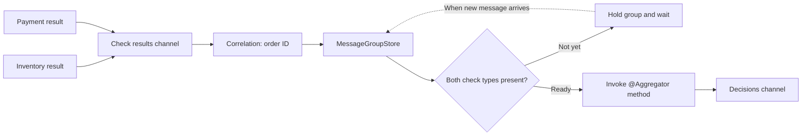

# @Aggregator

In the **SPRING_INTEGRATION_CORE** module, `@Aggregator` is the way to declare an endpoint that combines multiple related messages into a single result. This lesson belongs to the **Annotations and XML** chapter and focuses on connecting a Java method to `MessageChannel`s, identifying groups, deciding when to emit results, and managing incomplete groups.

Running example: an order requires **inventory** and **payment** check results. The two results may arrive out of order, interleaved with other orders, or be resent. The system must only issue a final decision once both check types have arrived.

## 1. Learning Objectives

After this lesson, you can:

- Distinguish three responsibilities: correlation, release, and aggregation.
- Declare `@Aggregator`, `@CorrelationStrategy`, and `@ReleaseStrategy` on a Spring bean.
- Choose signatures accepting a collection of payloads or a collection of `Message<?>`.
- Identify when to use default sequence headers and when business rules are needed.
- Switch to XML or Java DSL when timeouts, message stores, and group cleanup policies are needed.
- Design tests for incomplete groups, duplicate messages, late messages, and processing errors.

Java examples use Java 17 syntax and Spring Integration 6.5 APIs. The project requires the `org.springframework.integration:spring-integration-core` dependency; Spring versions should be managed consistently by a BOM or the project's dependency configuration. Illustrative tests use JUnit Jupiter.

## 2. Three Questions of an Aggregator

Suppose the following payloads arrive:

| Arrival Order | Order ID | Check Type | Result |
|---|---|---|---|
| 1 | A-101 | INVENTORY | Pass |
| 2 | B-202 | PAYMENT | Fail |
| 3 | A-101 | PAYMENT | Pass |
| 4 | B-202 | INVENTORY | Pass |

The aggregator must answer three different questions:

| Responsibility | Question | Rule in the Example |
|---|---|---|
| Correlation | Which group does the message belong to? | Group by order ID |
| Release | Is the group ready for processing? | Both INVENTORY and PAYMENT are present |
| Aggregation | What result should be built from the group? | Order is accepted when both checks pass |

A complete group does not mean business success. B-202 can still be fully aggregated to emit a rejection decision.



An aggregator is a **stateful** component: group messages are held in a `MessageGroupStore` between arrivals. The aggregation method does not need to maintain a global `Map` itself to wait for data.

Documentation describing handler roles and strategies is at [Spring Integration — Aggregator](https://docs.spring.io/spring-integration/reference/6.5/aggregator.html).

## 3. What Does @Aggregator Declare?

Import the right annotation:

```java
import org.springframework.integration.annotation.Aggregator;
```

A minimal declaration looks like:

```java
@Aggregator(
    inputChannel = "numbers",
    outputChannel = "totals"
)
public Integer total(List<Integer> values) {
    return values.stream().mapToInt(Integer::intValue).sum();
}
```

`numbers` is the channel receiving individual input messages; `totals` receives messages whose payload is the sum. The snippet above only illustrates the processing method: for a working endpoint, the object must be a Spring bean and Spring Integration infrastructure must be enabled.

`@Aggregator` defines **how a group's result is built**. It does not mean "take any three messages and add them," nor does it invent group keys or wait counts on its own.

### 3.1. Method Signatures

| Input Signature | Data the Method Receives |
|---|---|
| `List<CheckResult>` | Payloads of the messages in the group |
| `Collection<CheckResult>` | Collection of payloads |
| `List<Message<?>>` | Messages, including payload and headers |
| `Collection<Message<?>>` | Collection of messages |

Keeping concrete generics makes clear whether you want to process payloads or full messages. The return value can be a business object or a `Message<?>`; a plain object is used as the output message's payload. See [@Aggregator API](https://docs.spring.io/spring-integration/api/org/springframework/integration/annotation/Aggregator.html).

Do not rely on element order in the collection to infer business order. If the result needs sorting, sort explicitly by a key such as line number or business timestamp.

The method should build a new result. Avoid mutating the input collection directly or retaining references to framework-provided collections; if you want to emit a list of messages or items, copy it into a separate collection.

### 3.2. Common Attributes

| Attribute | Purpose |
|---|---|
| `inputChannel` | Name of the channel receiving parts to aggregate |
| `outputChannel` | Name of the channel receiving the result |
| `discardChannel` | Destination for messages discarded under handler policies |
| `sendTimeout` | Wait time when sending the result to a bounded channel |
| `sendPartialResultsOnExpiry` | Allows aggregating available partial data when a group expires |
| `poller` | Polling configuration when the input is a pollable channel |
| `autoStartup`, `phase` | Controls endpoint lifecycle |

Values such as `sendTimeout = "1000"` and `sendPartialResultsOnExpiry = "false"` are strings in the annotation.

**`sendTimeout` is not the wait time for all parts of the group to arrive.** It relates to sending the result, such as when a capacity-bounded `QueueChannel` is full. Setting `sendTimeout` does not create a group deadline.

Verify attribute names in the [6.5 `@Aggregator` declaration](https://raw.githubusercontent.com/spring-projects/spring-integration/6.5.x/spring-integration-core/src/main/java/org/springframework/integration/annotation/Aggregator.java).

## 4. Default Rules and Sequence Headers

If no custom strategies are declared:

- Correlation uses the `correlationId` header.
- Release uses `SimpleSequenceSizeReleaseStrategy`.

Common headers are:

| Constant in IntegrationMessageHeaderAccessor | Header Name | Meaning |
|---|---|---|
| `CORRELATION_ID` | `correlationId` | Group key |
| `SEQUENCE_NUMBER` | `sequenceNumber` | Position in a sequence |
| `SEQUENCE_SIZE` | `sequenceSize` | Expected number of parts in the sequence |

Example of three messages belonging to the same sequence:

```text
payload = 10, correlationId = batch-01, sequenceNumber = 1, sequenceSize = 3
payload = 20, correlationId = batch-01, sequenceNumber = 2, sequenceSize = 3
payload = 30, correlationId = batch-01, sequenceNumber = 3, sequenceSize = 3
```

Standard splitters supply sequence headers. With a publish-subscribe channel or recipient-list router, consider enabling `applySequence` when relying on this mechanism for reaggregation.

One limitation to remember: `SimpleSequenceSizeReleaseStrategy` compares group size against `sequenceSize`; it does not check for duplicate `sequenceNumber` values. Counting enough messages does not by itself prove distinct parts were received. See [SimpleSequenceSizeReleaseStrategy API](https://docs.spring.io/spring-integration/api/org/springframework/integration/aggregator/SimpleSequenceSizeReleaseStrategy.html).

In the order example, data originates from two independent sources and may be resent. We choose correlation by order ID and release by the set of check types, rather than relying on arrived message count.

## 5. Complete Example with Annotations

Place the following code in `example/OrderChecksConfig.java`:

```java
package example;

import java.util.EnumMap;
import java.util.EnumSet;
import java.util.List;
import java.util.Objects;
import java.util.Set;

import org.springframework.context.annotation.Bean;
import org.springframework.context.annotation.Configuration;
import org.springframework.integration.annotation.Aggregator;
import org.springframework.integration.annotation.CorrelationStrategy;
import org.springframework.integration.annotation.ReleaseStrategy;
import org.springframework.integration.channel.DirectChannel;
import org.springframework.integration.channel.QueueChannel;
import org.springframework.integration.config.EnableIntegration;

@Configuration
@EnableIntegration
public class OrderChecksConfig {

    public enum CheckType {
        INVENTORY, PAYMENT
    }

    public record CheckResult(
            String orderId,
            CheckType checkType,
            boolean approved) {

        public CheckResult {
            Objects.requireNonNull(orderId, "orderId");
            Objects.requireNonNull(checkType, "checkType");
            if (orderId.isBlank()) {
                throw new IllegalArgumentException("orderId must not be blank");
            }
        }
    }

    public record OrderDecision(
            String orderId,
            boolean complete,
            boolean accepted,
            Set<CheckType> missingChecks) {

        public OrderDecision {
            missingChecks = Set.copyOf(missingChecks);
        }
    }

    @Bean
    public DirectChannel checkResults() {
        return new DirectChannel();
    }

    @Bean
    public QueueChannel orderDecisions() {
        return new QueueChannel();
    }

    @Bean
    public QueueChannel aggregationDiscards() {
        return new QueueChannel();
    }

    @Bean
    public OrderAggregator orderAggregator() {
        return new OrderAggregator();
    }

    public static class OrderAggregator {

        @CorrelationStrategy
        public String correlationKey(CheckResult result) {
            return result.orderId();
        }

        @ReleaseStrategy
        public boolean ready(List<CheckResult> results) {
            return index(results).size() == CheckType.values().length;
        }

        @Aggregator(
            inputChannel = "checkResults",
            outputChannel = "orderDecisions",
            discardChannel = "aggregationDiscards",
            sendPartialResultsOnExpiry = "false"
        )
        public OrderDecision aggregate(List<CheckResult> results) {
            EnumMap<CheckType, CheckResult> checks = index(results);

            EnumSet<CheckType> missing =
                    EnumSet.allOf(CheckType.class);
            missing.removeAll(checks.keySet());

            boolean complete = missing.isEmpty();
            boolean accepted = complete && checks.values().stream()
                    .allMatch(CheckResult::approved);

            return new OrderDecision(
                    results.get(0).orderId(),
                    complete,
                    accepted,
                    missing
            );
        }

        private EnumMap<CheckType, CheckResult> index(
                List<CheckResult> results) {

            if (results.isEmpty()) {
                throw new IllegalArgumentException("Empty check group");
            }

            String orderId = results.get(0).orderId();
            EnumMap<CheckType, CheckResult> indexed =
                    new EnumMap<>(CheckType.class);

            for (CheckResult result : results) {
                if (!orderId.equals(result.orderId())) {
                    throw new IllegalArgumentException("Mixed order group");
                }

                CheckResult previous =
                        indexed.putIfAbsent(result.checkType(), result);

                if (previous != null
                        && previous.approved() != result.approved()) {
                    throw new IllegalArgumentException(
                            "Conflicting check: " + result.checkType()
                    );
                }
            }

            return indexed;
        }
    }
}
```

### 5.1. Why Does This Configuration Work?

`@EnableIntegration` enables endpoint-processing infrastructure in a plain Java Spring application. The `orderAggregator` bean is processed by a post-processor; the three annotated methods on **the same object** are used for the three corresponding responsibilities.

In the 6.5 line, the `@Aggregator` processor looks for correlation and release methods directly on the target bean, and builds the handler with a `SimpleMessageStore`. Merely declaring another store bean in the context does not make this annotated endpoint switch to that store automatically. The mechanism is shown in [AggregatorAnnotationPostProcessor](https://raw.githubusercontent.com/spring-projects/spring-integration/6.5.x/spring-integration-core/src/main/java/org/springframework/integration/config/AggregatorAnnotationPostProcessor.java).

`OrderAggregator` does not have `@Component` because it is already registered with `@Bean`. If choosing component scanning, you can use `@Component` or `@MessageEndpoint` and configure scanning accordingly. Choose only one registration method per object. See [Annotation Support](https://docs.spring.io/spring-integration/reference/configuration/annotations.html).

### 5.2. Business Rules in the Example

- Two results with the same `orderId` belong to the same group.
- Two identical INVENTORY messages still represent only one check type.
- Conflicting INVENTORY results in the same group raise an error.
- Having both INVENTORY and PAYMENT releases the group, even if one result has `approved = false`.
- The decision only has `accepted = true` when data is complete and every check passes.

This is the policy chosen by the example. Real applications must define clearly whether updated results, new versions, or compensating events are allowed.

Using `orderId` as the key only fits when each order ID has one check run within the group retention window. If there are multiple attempts or multiple tenants, use a composite key such as `tenantId + orderId + attemptId` to separate them.

### 5.3. Semantic Deduplication Is Not Store Deduplication

The `index` function prevents identical resends from skewing the decision. However, messages with distinct IDs can still accumulate inside the group before completion.

Therefore, a constantly resending producer can still cause group size to grow. Under high load, consider an idempotent receiver or a deduplication step before the aggregator, alongside group time and size limits. Do not treat grouping by `CheckType` as a memory-bounding mechanism.

## 6. Testing the Endpoint Through Channels

Calling `new OrderAggregator().aggregate(...)` directly only tests the business computation. To test wiring, correlation, and release, send individual messages through the channels inside a Spring context.

The following example uses a `DirectChannel` input, so processing happens synchronously inside `send`. Therefore, you can check the queue immediately afterward without `Thread.sleep`.

```java
package example;

import example.OrderChecksConfig.CheckResult;
import example.OrderChecksConfig.CheckType;
import example.OrderChecksConfig.OrderDecision;

import org.junit.jupiter.api.Test;
import org.springframework.context.annotation.AnnotationConfigApplicationContext;
import org.springframework.integration.channel.QueueChannel;
import org.springframework.messaging.Message;
import org.springframework.messaging.MessageChannel;
import org.springframework.messaging.support.MessageBuilder;

import static org.junit.jupiter.api.Assertions.*;

class OrderAggregatorTest {

    @Test
    void groupsOrdersAndWaitsForDistinctCheckTypes() {
        try (var context = new AnnotationConfigApplicationContext(
                OrderChecksConfig.class)) {

            MessageChannel input =
                    context.getBean("checkResults", MessageChannel.class);
            QueueChannel output =
                    context.getBean("orderDecisions", QueueChannel.class);
            QueueChannel discards =
                    context.getBean("aggregationDiscards", QueueChannel.class);

            send(input, "A-101", CheckType.INVENTORY, true);
            send(input, "B-202", CheckType.PAYMENT, false);
            assertNull(output.receive(0));

            // Resending the same check type is not enough to release group A.
            send(input, "A-101", CheckType.INVENTORY, true);
            assertNull(output.receive(0));

            send(input, "A-101", CheckType.PAYMENT, true);
            OrderDecision a = receiveDecision(output);
            assertEquals("A-101", a.orderId());
            assertTrue(a.complete());
            assertTrue(a.accepted());
            assertTrue(a.missingChecks().isEmpty());

            send(input, "B-202", CheckType.INVENTORY, true);
            OrderDecision b = receiveDecision(output);
            assertEquals("B-202", b.orderId());
            assertTrue(b.complete());
            assertFalse(b.accepted());

            // Group A is already complete; the late message goes to discard.
            send(input, "A-101", CheckType.INVENTORY, true);
            Message<?> late = discards.receive(0);
            assertNotNull(late);
            assertInstanceOf(CheckResult.class, late.getPayload());
            assertNull(output.receive(0));
        }
    }

    private static void send(
            MessageChannel channel,
            String orderId,
            CheckType type,
            boolean approved) {

        assertTrue(channel.send(MessageBuilder
                .withPayload(new CheckResult(orderId, type, approved))
                .build()));
    }

    private static OrderDecision receiveDecision(QueueChannel output) {
        Message<?> message = output.receive(0);
        assertNotNull(message);
        return assertInstanceOf(OrderDecision.class, message.getPayload());
    }
}
```

This test checks an important behavior: the first three messages for order A may include a resend, yet only two **distinct check types** complete the group.

In an asynchronous flow, use receive with a finite timeout or condition-waiting utilities. Using `receive(0)` in this example matches the synchronous processing chosen.


## 7. Incomplete Groups and the Meaning of Timeouts

The annotation configuration in section 5 does not set a deadline on groups. If PAYMENT never arrives, the group can remain waiting in the store. `sendPartialResultsOnExpiry = "false"` only determines behavior **when expiry occurs**; it does not create a task that expires groups automatically.

Three durations must be distinguished:

| Duration | What Does It Control? |
|---|---|
| `sendTimeout` | Waiting to send the result to the target channel |
| `groupTimeout` | Scheduling processing of an incomplete group when no new message arrives |
| Gateway reply timeout | Limiting how long the caller waits for a reply |

A gateway timing out does not delete the group inside the aggregator. A decision arriving later still must be handled according to the application's contract.

When `groupTimeout` is a millisecond number, the wait timer resets whenever the group receives a new message and still does not satisfy the release condition. For example, `5000` means waiting five seconds with no new messages; a continuous stream of resends can extend the group's lifetime.

If you need a deadline measured from group creation time, configure an appropriate expression or schedule instead of assuming a numeric timeout is a fixed total lifetime.

### 7.1. Send Partial Data or Discard?

When the timeout task runs, the handler checks the release strategy again. If still not ready, the expiry policy decides whether to emit a partial result or discard.

| Policy | When to Use |
|---|---|
| `sendPartialResultOnExpiry(false)` | Missing required checks go to a missing-data handling flow |
| `sendPartialResultOnExpiry(true)` | Allows incomplete results, with a contract showing missing parts |

The annotation attribute name is **`sendPartialResultsOnExpiry`**, while the Java DSL method is **`sendPartialResultOnExpiry`**.

`OrderDecision` has `complete` and `missingChecks` fields to represent an incomplete result if the application chooses partial mode. When `complete = false`, downstream must route to a supplemental wait or missing-data flow; do not use `accepted = false` alone to conclude the order was rejected after full checks.

Refer to scheduling and expiry options in [CorrelationHandlerSpec of 6.5](https://raw.githubusercontent.com/spring-projects/spring-integration/6.5.x/spring-integration-core/src/main/java/org/springframework/integration/dsl/CorrelationHandlerSpec.java).

## 8. When Should You Use Java DSL Instead of Plain Annotations?

In the API used here, `@Aggregator` does not have `messageStore`, `groupTimeout`, or `expireGroupsUponCompletion` attributes. To control them directly, you can use Java DSL, XML, or declare an `AggregatingMessageHandler` via `@Bean` and wire it with `@ServiceActivator`.

The example below reuses the types and algorithms from `OrderChecksConfig`, but builds the endpoint using Java DSL. This is an **alternative configuration**; when testing it, load this configuration separately. The `policy` object is instantiated with `new`, not registered as a separate annotated bean.

Place in `example/TimedOrderChecksConfig.java`:

```java
package example;

import org.springframework.beans.factory.annotation.Qualifier;
import org.springframework.context.annotation.Bean;
import org.springframework.context.annotation.Configuration;
import org.springframework.integration.channel.DirectChannel;
import org.springframework.integration.channel.QueueChannel;
import org.springframework.integration.config.EnableIntegration;
import org.springframework.integration.dsl.IntegrationFlow;
import org.springframework.integration.store.MessageGroupStore;
import org.springframework.integration.store.SimpleMessageStore;
import org.springframework.messaging.MessageChannel;

@Configuration
@EnableIntegration
public class TimedOrderChecksConfig {

    @Bean
    public DirectChannel timedChecks() {
        return new DirectChannel();
    }

    @Bean
    public QueueChannel timedDecisions() {
        return new QueueChannel();
    }

    @Bean
    public QueueChannel timedDiscards() {
        return new QueueChannel();
    }

    @Bean
    public MessageGroupStore orderCheckStore() {
        return new SimpleMessageStore();
    }

    @Bean
    public IntegrationFlow timedOrderChecks(
            @Qualifier("timedChecks") MessageChannel input,
            @Qualifier("timedDecisions") MessageChannel output,
            @Qualifier("timedDiscards") MessageChannel discards,
            MessageGroupStore orderCheckStore) {

        var policy = new OrderChecksConfig.OrderAggregator();

        return IntegrationFlow.from(input)
                .aggregate(a -> a
                        .processor(policy)
                        .messageStore(orderCheckStore)
                        .groupTimeout(5_000L)
                        .sendPartialResultOnExpiry(false)
                        .expireGroupsUponCompletion(false)
                        .expireGroupsUponTimeout(false)
                        .discardChannel(discards))
                .channel(output)
                .get();
    }
}
```

Here, `.processor(policy)` uses the annotated methods to identify aggregation, correlation, and release algorithms. Channels and group lifecycle are configured on the DSL. See [AggregatorSpec](https://raw.githubusercontent.com/spring-projects/spring-integration/6.5.x/spring-integration-core/src/main/java/org/springframework/integration/dsl/AggregatorSpec.java) and [Aggregators and Resequencers in Java DSL](https://docs.spring.io/spring-integration/reference/dsl/java-aggregators.html).

With an input containing only INVENTORY, after the timeout the group follows the discard policy. Because the example sets `expireGroupsUponTimeout(false)`, closed group metadata is retained to recognize late messages. A metadata cleanup schedule matching the application's retention window should be added.

To test partial results, change `.sendPartialResultOnExpiry(false)` to `true` and verify the output contains `complete = false`, `accepted = false`, and `missingChecks = [PAYMENT]`. Waiting for timeouts should be tested with bounded time conditions; do not infer results by calling the algorithm directly.

## 9. Equivalent XML Configuration for Responsibilities

XML allows explicitly declaring the processing algorithm, correlation, release, store, and timeout. To see each responsibility independently, the example below uses a batch of three integers with an upstream deduplication step assumed.

POJO `example/SumPolicy.java`:

```java
package example;

import java.util.List;

public class SumPolicy {

    public Integer sum(List<Integer> values) {
        return values.stream().mapToInt(Integer::intValue).sum();
    }
}
```

XML configuration:

```xml
<?xml version="1.0" encoding="UTF-8"?>
<beans xmlns="http://www.springframework.org/schema/beans"
       xmlns:xsi="http://www.w3.org/2001/XMLSchema-instance"
       xmlns:int="http://www.springframework.org/schema/integration"
       xsi:schemaLocation="
           http://www.springframework.org/schema/beans
           https://www.springframework.org/schema/beans/spring-beans.xsd
           http://www.springframework.org/schema/integration
           https://www.springframework.org/schema/integration/spring-integration.xsd">

    <int:channel id="batchNumbers"/>

    <int:channel id="batchTotals">
        <int:queue/>
    </int:channel>

    <int:channel id="batchDiscards">
        <int:queue/>
    </int:channel>

    <bean id="sumPolicy" class="example.SumPolicy"/>

    <bean id="batchStore"
          class="org.springframework.integration.store.SimpleMessageStore"/>

    <int:aggregator id="batchAggregator"
                    input-channel="batchNumbers"
                    output-channel="batchTotals"
                    ref="sumPolicy"
                    method="sum"
                    correlation-strategy-expression="headers['batchId']"
                    release-strategy-expression="size() == 3"
                    message-store="batchStore"
                    group-timeout="5000"
                    send-partial-result-on-expiry="false"
                    expire-groups-upon-completion="false"
                    expire-groups-upon-timeout="false"
                    discard-channel="batchDiscards"/>
</beans>
```

Each input message has an `Integer` payload and a valid `batchId`:

```java
MessageBuilder.withPayload(10)
        .setHeader("batchId", "batch-01")
        .build();
```

Sending 20 and 30 with the same `batchId` produces 60. The first two values produce no output yet. The rule `size() == 3` assumes the batch has exactly three parts and is already deduplicated; if the part count varies per business data, replace it with a proper release strategy.

In XML, `correlation-strategy-expression` evaluates against the current message, whereas `release-strategy-expression` has `MessageGroup` as its root. Thus `size()` in the release expression is the group size. Element structure is presented in [Configuring an Aggregator with XML](https://docs.spring.io/spring-integration/reference/aggregator.html#aggregator-configuring-xml).

`SumPolicy` is a POJO without endpoint annotations. When moving an algorithm between XML, annotations, and DSL, designate one place responsible for creating the endpoint to avoid accidentally registering two consumers on the same channel.

## 10. Completed Groups, Expired Groups, and Late Messages

Two concepts must be kept separate:

- **Complete:** the group has been marked finished; metadata may still remain in the store.
- **Expire/remove:** the group record is removed from the store; the same correlation key can open a new group.

| Configuration | Design Consequence |
|---|---|
| Retain metadata after completion | Detects and discards late messages for an already closed group |
| `expireGroupsUponCompletion(true)` | Removes group after normal completion; subsequent messages can open a new group |
| `expireGroupsUponTimeout(false)` | Retains metadata when a group closes due to expiry instead of removing immediately |
| Purge metadata after retention period | Frees store space while ending protection against late messages |

In the 6.5 line, `expireGroupsUponCompletion` defaults to `false`, while `expireGroupsUponTimeout` defaults to `true`. The two settings do not represent the same scenario; when a timeout runs and the release strategy allows normal release, also check the applicable completion rule.

Group and timeout management APIs are described in [AbstractCorrelatingMessageHandler](https://docs.spring.io/spring-integration/api/org/springframework/integration/aggregator/AbstractCorrelatingMessageHandler.html).

In the order example, removing group A-101 immediately and later receiving old INVENTORY and PAYMENT messages could produce a second decision. A sound policy typically combines:

1. A correlation key distinguishing runs, such as adding `attemptId`.
2. Retaining completed group records for a defined window.
3. Idempotency where decisions are persisted or business side effects occur.

After records are purged, duplicate handling must still be enforced at the business layer if producers can replay old data.

## 11. Message Store, Resources, and Multiple Instances

`SimpleMessageStore` works for demonstrations and scenarios where losing state on process shutdown is acceptable. If waiting for parts must survive restarts, choose a durable `MessageGroupStore` and verify payload and header serialization.

Four questions need answers before putting an aggregator into production:

| Question | Example Decision Needed |
|---|---|
| How long can a group wait? | Timeout when checks are missing after an idle interval |
| How long are closed groups retained? | Protection window against late resends |
| What are the resource limits? | Open group count, parts per group, total store capacity |
| How does restart recovery work? | Find and handle lingering groups instead of waiting forever |

`MessageGroupStoreReaper` is one option for scanning groups on a schedule. Tie the expiry mechanism to the right store and endpoint policy; a store used for reaper scanning should be dedicated or properly partitioned.

With multiple instances processing the same group, a shared store must pair with appropriate distributed locking. An in-memory lock on instance A does not protect concurrent updates on instance B. Persistence also does not automatically provide "exactly-once" guarantees for database writes or external service calls.

For the order problem, track open group count, oldest group age, timeout count, discard count, and conflicting-data error count. These metrics help catch a check branch that stops responding before the store grows too large.

## 12. Output Headers and Connecting to a Gateway

If the algorithm returns `OrderDecision`, the framework creates a message with that payload. If you need to construct headers explicitly, switch to a method returning `Message<OrderDecision>` and build it with `MessageBuilder`.

Do not assume every header from every part appears intact at the output. Under the default header aggregation mechanism, headers with conflicting values are dropped; a header merely absent on some parts is not treated as a conflict. See [DefaultAggregateHeadersFunction](https://docs.spring.io/spring-integration/api/org/springframework/integration/aggregator/DefaultAggregateHeadersFunction.html).

For example, INVENTORY and PAYMENT may have different `source` values. If you need to preserve contributing sources from both, put that information in an explicit result structure or define a custom header aggregation function.

In a request-reply flow using a gateway, all parts must preserve the original request's reply context. If each part comes from an independent request with a different `replyChannel`, you cannot assume one aggregated result will satisfy every caller. For independent events, a fixed output channel like in the example usually expresses the contract more clearly.

## 13. Distinguishing Discard from Processing Errors

`discardChannel` is for data dropped by group policy, such as messages arriving after group completion or incomplete group parts on expiry. It does not automatically receive exceptions from correlation, release, or aggregation methods.

In the example, two conflicting PAYMENT results cause `index` to throw an exception. With `DirectChannel`, the processing error propagates back to the `send` caller. When processing asynchronously via an executor or poller, configure `ErrorMessage` emission and an appropriate error consumer. Scheduler-driven timeout tasks also need properly configured error paths. See [Spring Integration — Error Handling](https://docs.spring.io/spring-integration/reference/error-handling.html).

An exception does not promise that the group was automatically deleted or that a subsequent attempt will succeed. Inspect actual store state and transactions before choosing to retry.

For two conflicting results, an appropriate resolution can be quarantining the whole check run and opening a new `attemptId` after investigation. Continuously retrying the same conflicting data only repeats the business error.

## 14. Interactions That Easily Leave Groups Incomplete

### 14.1. Filter Upstream of an Aggregator

Suppose a splitter emits three parts with `sequenceSize = 3`, but a filter drops one part. An aggregator using the default release strategy may receive only two parts and keep waiting.

The fix must reflect business intent: send a compensating message representing the dropped part, change the release strategy, or adjust how expected results are determined. A timeout only stops waiting; it does not supply missing data.

### 14.2. Router Sending Parts to Different Branches

Ensure every branch participating in the decision has a path back to the aggregation channel. A branch that fails and stops before the aggregator can leave the group short of results. For business check failures, emitting a `CheckResult(approved = false)` is usually clearer than dropping the message and leaving the group waiting.

### 14.3. Confusing Aggregator with Resequencer or Transformer

| Component | Appropriate Role |
|---|---|
| Transformer | Converts a single message into another representation |
| Resequencer | Reorders and emits parts in sequence |
| Aggregator | Builds a result based on a group of messages |

If you only need to normalize a payload that already holds all data, a transformer is usually enough. If you need to wait for individual events arriving over time and make a combined decision, an aggregator models that accurately.

## 15. Additional Scenarios to Test

Beyond the JUnit example above, the following tests verify the flow's contract:

| Scenario | Outcome to Verify |
|---|---|
| PAYMENT arrives before INVENTORY | Still produces one decision once both types arrive |
| Multiple interleaved orders | Data is not mixed into the wrong group |
| Only INVENTORY arrives | No decision before expiry |
| Resent message with same content | Does not release the group prematurely |
| Same check type with conflicting results | Error is handled per chosen policy |
| One check fails | Group still completes; decision is not accepted |
| Group times out with partial disabled | Data goes to discard path |
| Group times out with partial enabled | Result clearly reports missing parts |
| Message arrives after completion | Follows metadata retention or removal policy |
| Restart while group is open | Behavior matches chosen store and recovery plan |
| Two instances process the same key | No duplicate business side effects from contention |

For timeout cases, observe output and discard channels with bounded deadlines. For recovery, test with the actual store type deployed by the application; testing with an in-memory store does not prove restart continuity.

## 16. Takeaways When Designing @Aggregator

A sound aggregator needs the **right group key**, **right release condition**, **right aggregation algorithm**, and a **clear group lifecycle policy**.

In the order-checks problem, the order ID identifies the group, the set of check types determines completeness, and the check outcomes determine the business decision. Annotations work well for concise algorithm declarations on a Spring bean; XML and Java DSL provide more explicit configuration for timeouts, stores, and metadata retention.
