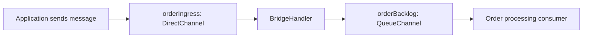
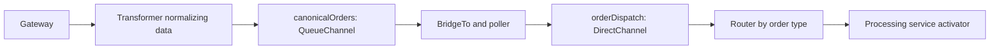

# @BridgeTo

## 1. Objectives and Use Case

In the **Annotations and XML** chapter of the **SPRING_INTEGRATION_CORE** module, `@BridgeTo` declares a messaging bridge directly on the source channel bean. A bridge forwards messages to the next channel, helping connect segments of an integration flow without writing a business method solely to forward data.

After this lesson, you can accurately identify the annotation's direction, configure a bridge for a synchronous channel or a queue-backed channel, use `replyChannel`, and convert the declaration to XML or Java DSL. You will also know where to place a bridge in a flow with gateways, transformers, routers, filters, and aggregators.

Suppose the application receives an `OrderRequest` that already has the right structure. The intake segment sends to `orderIngress`, while the processing segment reads from `orderBacklog`. We need to connect the two channels:



A bridge does not normalize order IDs or validate quantities. If data is not yet in the right format, add a transformer; if you need to accept or drop messages, add a filter. The bridge only solves the link between channels in this scenario.

## 2. Reading the Direction of `@BridgeTo`

The annotation belongs to the package:

```java
import org.springframework.integration.annotation.BridgeTo;
```

Basic usage:

```java
@Bean
@BridgeTo("orderBacklog")
public MessageChannel orderIngress() {
    return new DirectChannel();
}
```

Read the configuration by this rule:

```text
channel created by the @Bean method → channel named in value
orderIngress                        → orderBacklog
```

The annotated channel bean is the **bridge's input channel**. `value` is the name of the **output channel**. Spring Integration creates a `BridgeHandler` and consumer endpoint to connect both sides. The source channel type determines whether the endpoint uses subscription or polling. This contract is stated in [Javadoc for `@BridgeTo`](https://docs.spring.io/spring-integration/api/org/springframework/integration/annotation/BridgeTo.html).

### 2.1. A Factory Method Is Not a Per-Message Processing Method

`orderIngress()` runs when Spring creates beans. When a message arrives, the framework does not call that method again to process the payload; it uses the created channel and registered bridge endpoint.

Therefore, placing `@BridgeTo` on a business method like `OrderRequest process(OrderRequest request)` is not the usage demonstrated here. This annotation is for `@Bean` methods creating a `MessageChannel` in Spring configuration. The application also needs integration infrastructure; the examples use `@EnableIntegration` to make that explicit.

### 2.2. Distinguishing from `@BridgeFrom`

| Annotation | Annotated Channel Bean | Channel Named in `value` |
| --- | --- | --- |
| `@BridgeTo("B")` on bean `A` | Source `A` | Target `B` |
| `@BridgeFrom("A")` on bean `B` | Target `B` | Source `A` |

Both approaches can express `A → B`, but the annotation sits on opposite ends. Pick only one approach for the same link; declaring both creates an extra endpoint rather than adding information to a single endpoint. See [Creating a Bridge with Annotations](https://docs.spring.io/spring-integration/reference/6.5/configuration/meta-annotations.html).

### 2.3. A Bridge Creates a Forwarding Path, Not an Alias

`orderIngress` and `orderBacklog` remain two distinct channel objects. The bridge is a consumer on the source and a producer forwarding to the target. Stopping the bridge, changing the source channel, or changing the target channel alters the forwarding path's behavior.

A bean alias is merely multiple names referencing the same bean. It cannot replace a bridge that connects two channels with different characteristics.

## 3. Complete Example: From `DirectChannel` to a Queue

### 3.1. Environment

The example uses Java 17 or higher and Spring Integration 6.x, with reference documentation aligned to 6.5. The project needs `org.springframework.integration:spring-integration-core`; tests use JUnit Jupiter. Spring dependencies must be managed consistently via a BOM or your project's version management.

In a project with a compatible Spring Boot parent or BOM, you can use:

```xml
<dependency>
    <groupId>org.springframework.boot</groupId>
    <artifactId>spring-boot-starter-integration</artifactId>
</dependency>
<dependency>
    <groupId>org.springframework.boot</groupId>
    <artifactId>spring-boot-starter-test</artifactId>
    <scope>test</scope>
</dependency>
```

These are dependency snippets to add to a project that already manages versions, not a complete `pom.xml`. The demo flow runs in memory and requires no broker or database.

### 3.2. Configuration Declaration

Sample file `DirectBridgeConfiguration.java`:

```java
package example.integration.bridge;

import org.springframework.context.annotation.Bean;
import org.springframework.context.annotation.Configuration;
import org.springframework.integration.annotation.BridgeTo;
import org.springframework.integration.channel.DirectChannel;
import org.springframework.integration.channel.QueueChannel;
import org.springframework.integration.config.EnableIntegration;
import org.springframework.messaging.MessageChannel;
import org.springframework.messaging.PollableChannel;

@Configuration(proxyBeanMethods = false)
@EnableIntegration
public class DirectBridgeConfiguration {

    @Bean
    @BridgeTo("orderBacklog")
    public MessageChannel orderIngress() {
        return new DirectChannel();
    }

    @Bean
    public PollableChannel orderBacklog() {
        return new QueueChannel(20);
    }
}
```

The default bean name comes from the method name. If renamed using `@Bean("anotherName")`, all related channel references must use the actual bean name.

In this configuration, the bridge's input is a `DirectChannel`, so the bridge is triggered immediately on send. The queue is only on the **output**, so the bridge does not need a poller. Channel send/receive rules are described in [Message Channel Implementations](https://docs.spring.io/spring-integration/reference/6.5/channel/implementations.html).

### 3.3. Sending and Reading Back a Message

Sample file `DirectBridgeDemo.java`:

```java
package example.integration.bridge;

import org.springframework.context.annotation.AnnotationConfigApplicationContext;
import org.springframework.messaging.Message;
import org.springframework.messaging.MessageChannel;
import org.springframework.messaging.PollableChannel;
import org.springframework.messaging.support.MessageBuilder;

public class DirectBridgeDemo {

    public record OrderRequest(String orderId, int quantity) {
    }

    public static void main(String[] args) {
        try (var context = new AnnotationConfigApplicationContext(
                DirectBridgeConfiguration.class)) {

            MessageChannel ingress = context.getBean(
                    "orderIngress", MessageChannel.class);
            PollableChannel backlog = context.getBean(
                    "orderBacklog", PollableChannel.class);

            Message<OrderRequest> request = MessageBuilder
                    .withPayload(new OrderRequest("OD-42", 3))
                    .setHeader("traceId", "trace-order-42")
                    .build();

            if (!ingress.send(request)) {
                throw new IllegalStateException("Message was not accepted");
            }

            Message<?> forwarded = backlog.receive(1000);
            if (forwarded == null) {
                throw new IllegalStateException("No forwarded message received");
            }

            System.out.println(forwarded.getPayload());
            System.out.println(forwarded.getHeaders().get("traceId"));
        }
    }
}
```

Expected output:

```text
OrderRequest[orderId=OD-42, quantity=3]
trace-order-42
```

In this flow, `send` invokes the bridge on the sending thread itself and the bridge puts the message into the queue before the call returns. There is no business consumer in the configuration yet: reading the queue in the demo only serves to observe the forwarding result.

### 3.4. How Is the Message Preserved?

`BridgeHandler` forwards the message without actively transforming payload or headers. In this minimal configuration, payload, `traceId`, and message ID can be compared across both ends. This is the behavior of [BridgeHandler](https://docs.spring.io/spring-integration/api/org/springframework/integration/handler/BridgeHandler.html).

That is not a promise that every other component in a flow leaves the message unchanged. Interceptors, message history, or transformers added later can build new messages or attach metadata.

A bridge also does not deep-copy the payload. A mutable object can still be modified by other code holding the same reference. For messages traversing multiple steps, immutable payloads like the record in the example make the contract easier to reason about. See [Message and Payload/Header Immutability](https://docs.spring.io/spring-integration/reference/6.5/message.html).

## 4. When the Source Channel Has a Queue: Adding a Poller

If the input is a `QueueChannel`, `send` only places the message in the queue. A consumer is needed to pull messages out for the bridge to forward. Complete alternative example:

```java
package example.integration.bridge;

import org.springframework.context.annotation.Bean;
import org.springframework.context.annotation.Configuration;
import org.springframework.integration.annotation.BridgeTo;
import org.springframework.integration.annotation.Poller;
import org.springframework.integration.channel.QueueChannel;
import org.springframework.integration.config.EnableIntegration;
import org.springframework.messaging.PollableChannel;

@Configuration(proxyBeanMethods = false)
@EnableIntegration
public class PolledBridgeConfiguration {

    @Bean
    @BridgeTo(
            value = "readyOrders",
            poller = @Poller(
                    fixedDelay = "100",
                    maxMessagesPerPoll = "5",
                    receiveTimeout = "0"))
    public PollableChannel bufferedOrders() {
        return new QueueChannel(100);
    }

    @Bean
    public PollableChannel readyOrders() {
        return new QueueChannel(100);
    }
}
```

The path is now:

```text
sending thread → bufferedOrders
                     ↓ poller pulls message
                BridgeHandler → readyOrders
```

Parameters in the example:

| Parameter | Meaning |
| --- | --- |
| `fixedDelay = "100"` | Schedules the next poll after a 100 ms delay once the previous one finishes, with this trigger configuration. |
| `maxMessagesPerPoll = "5"` | Processes at most 5 messages in one polling cycle. |
| `receiveTimeout = "0"` | Does not wait when the source queue is empty. |

`maxMessagesPerPoll` is not a worker count and does not combine 5 messages into one batch payload. The bridge still forwards each message individually. Delay, processing time, scheduler behavior, and downstream receive capacity all affect throughput; do not treat this configuration as a fixed rate SLA.

A `PollableChannel` input requires an explicitly configured poller or an appropriate default poller. Missing both is a configuration error; the framework does not invent a schedule for the application. With `@Poller("namedPoller")`, options must be declared on the referenced `PollerMetadata` bean. See [Using the `@Poller` Annotation](https://docs.spring.io/spring-integration/reference/6.5/configuration/annotations.html).

### Connecting a Queue to a Channel with Subscribers

A common variant is `bufferedOrders → orderWorkers`, where `orderWorkers` is a `DirectChannel`. The poller sits on the bridge reading `bufferedOrders`; endpoints subscribed to `orderWorkers` do not need to pull messages from a queue themselves.

In that case, there must be a real consumer subscribed to `orderWorkers`, such as an order-processing service activator. Creating a `DirectChannel` as a target without a subscriber will cause message delivery to fail when the bridge sends to it.

### A Queue Does Not Automatically Guarantee Durable Storage

The example queues are in-memory. A successful `send` to `bufferedOrders` means the message is queued; it does not prove the bridge has forwarded it or that business processing is complete. If the process stops, default in-memory queues do not replace a persistent message store or a broker with corresponding persistence mechanisms.

## 5. Omitting Target: Forwarding to `replyChannel`

`@BridgeTo` can omit `value`:

```java
package example.integration.bridge;

import org.springframework.context.annotation.Bean;
import org.springframework.context.annotation.Configuration;
import org.springframework.integration.annotation.BridgeTo;
import org.springframework.integration.channel.DirectChannel;
import org.springframework.integration.config.EnableIntegration;
import org.springframework.messaging.MessageChannel;

@Configuration(proxyBeanMethods = false)
@EnableIntegration
public class ReplyBridgeConfiguration {

    @Bean
    @BridgeTo
    public MessageChannel replyExit() {
        return new DirectChannel();
    }
}
```

Usage snippet inside a method:

```java
try (var context = new AnnotationConfigApplicationContext(
        ReplyBridgeConfiguration.class)) {

    MessageChannel exit = context.getBean("replyExit", MessageChannel.class);
    QueueChannel replies = new QueueChannel(1);

    Message<String> reply = MessageBuilder
            .withPayload("ACK-OD-42")
            .setReplyChannel(replies)
            .build();

    exit.send(reply);
    Message<?> received = replies.receive(1000);
    if (received == null) {
        throw new IllegalStateException("No reply received");
    }
    System.out.println(received.getPayload());
}
```

This snippet requires imports for `AnnotationConfigApplicationContext`, `QueueChannel`, `Message`, `MessageChannel`, and `MessageBuilder` as in prior examples. The `replies` queue is a channel object placed directly in the header; it does not need to be a named bean in this context.

For the basic case in this lesson without a routing slip configured, the destination-selection rules are:

1. If `value` is present, send to the configured channel.
2. If `value` is absent, use the message's `replyChannel`.
3. If both are missing, an error occurs during message handling.

The header used in Java is `replyChannel`, with constant `MessageHeaders.REPLY_CHANNEL`. Do not manually set a header named `reply-channel` expecting the Java mechanism to read it.

A bridge does not send simultaneously to both an explicit destination and the reply channel. When an explicit destination exists, the reply header can still be preserved for a downstream endpoint to use. Omitting the output channel to use the reply address is described in [Messaging Bridge](https://docs.spring.io/spring-integration/reference/6.5/bridge.html).

In a request-reply flow, a gateway can supply the reply address; a bridge at the end of a flow segment helps route the produced message back to that address. A bridge does not generate business reply data, add an ACK code, or replace the full role of a gateway.

## 6. Lifecycle and Execution Options

| `@BridgeTo` Attribute | Role |
| --- | --- |
| `value` | Output channel name; can be omitted to use the message's reply mechanism. |
| `poller` | How to pull messages if the source channel requires polling. |
| `autoStartup` | String configuring whether the endpoint starts automatically; defaults to `"true"`. |
| `phase` | Lifecycle phase when Spring starts/stops the endpoint. |
| `reactive` | Reactive consumer option; cannot be configured together with `poller`. |

Example keeping the bridge from reading the queue immediately upon context startup:

```java
@Bean
@BridgeTo(
        value = "readyOrders",
        autoStartup = "false",
        poller = @Poller(fixedDelay = "100", receiveTimeout = "0"))
public PollableChannel bufferedOrders() {
    return new QueueChannel(100);
}
```

This is a replacement for the same-named bean in the polling configuration, not an additional bean. With a source queue, messages can accumulate while the bridge is stopped. With a `DirectChannel` source and no other consumer, sending messages while the bridge is not subscribed will fail.

Lifecycle control requires interacting with the created consumer endpoint, not re-invoking the channel factory method. In large applications, establish endpoint management conventions and inspect actual beans before controlling them via lifecycle APIs or a control bus.

Do not copy attributes from other annotations onto `@BridgeTo`. For example, `sendTimeout` is not an attribute of this annotation. If detailed handler configuration is needed, declare `BridgeHandler` explicitly via an appropriate endpoint configuration. The attribute list is in the [API for `@BridgeTo`](https://docs.spring.io/spring-integration/api/org/springframework/integration/annotation/BridgeTo.html).

## 7. Equivalent XML Configuration

To replace `DirectBridgeConfiguration`, you can use a `direct-bridge.xml` file on the classpath:

```xml
<?xml version="1.0" encoding="UTF-8"?>
<beans xmlns="http://www.springframework.org/schema/beans"
       xmlns:xsi="http://www.w3.org/2001/XMLSchema-instance"
       xmlns:int="http://www.springframework.org/schema/integration"
       xsi:schemaLocation="
         http://www.springframework.org/schema/beans
         https://www.springframework.org/schema/beans/spring-beans.xsd
         http://www.springframework.org/schema/integration
         https://www.springframework.org/schema/integration/spring-integration.xsd">

    <int:channel id="orderIngress"/>

    <int:channel id="orderBacklog">
        <int:queue capacity="20"/>
    </int:channel>

    <int:bridge id="orderIngressBridge"
                input-channel="orderIngress"
                output-channel="orderBacklog"/>
</beans>
```

Open the XML context with `ClassPathXmlApplicationContext("direct-bridge.xml")`, then retrieve `orderIngress` and `orderBacklog` to send/receive as in the Java demo.

When the source is a queue, the bridge includes a poller:

```xml
<int:channel id="bufferedOrders">
    <int:queue capacity="100"/>
</int:channel>

<int:channel id="readyOrders">
    <int:queue capacity="100"/>
</int:channel>

<int:bridge id="bufferedOrdersBridge"
            input-channel="bufferedOrders"
            output-channel="readyOrders">
    <int:poller fixed-delay="100"
                max-messages-per-poll="5"
                receive-timeout="0"/>
</int:bridge>
```

The second snippet is a configuration fragment placed inside a `<beans>` element with matching namespaces; use it to replace the channels and bridge from the first example when switching to the polling model.

| Java annotation | XML |
| --- | --- |
| Channel bean annotated with `@BridgeTo` | `input-channel` on `<int:bridge>` |
| `@BridgeTo("target")` | `output-channel="target"` |
| `poller = @Poller(...)` | Child element `<int:poller .../>` |
| `autoStartup = "false"` | `auto-startup="false"` on bridge |
| Omitting `value` | Omitting `output-channel`; requires a valid reply address. |

XML and Java declarations for a messaging bridge are presented in [Messaging Bridge — Configuration](https://docs.spring.io/spring-integration/reference/6.5/bridge.html).

Load only one endpoint declaration for each link in the examples. Loading both XML and annotations for the same bridge can create competing consumers or bean conflicts. On a `DirectChannel`, having multiple subscribers does not mean every subscriber receives a copy.

## 8. Representing with Java DSL

Java DSL lets you read the link within the step chain of an `IntegrationFlow`:

```java
package example.integration.bridge;

import org.springframework.context.annotation.Bean;
import org.springframework.context.annotation.Configuration;
import org.springframework.integration.channel.DirectChannel;
import org.springframework.integration.channel.QueueChannel;
import org.springframework.integration.config.EnableIntegration;
import org.springframework.integration.dsl.IntegrationFlow;
import org.springframework.messaging.MessageChannel;
import org.springframework.messaging.PollableChannel;

@Configuration(proxyBeanMethods = false)
@EnableIntegration
public class DslBridgeConfiguration {

    @Bean
    public MessageChannel orderIngress() {
        return new DirectChannel();
    }

    @Bean
    public PollableChannel orderBacklog() {
        return new QueueChannel(20);
    }

    @Bean
    public IntegrationFlow orderBridgeFlow() {
        return IntegrationFlow.from("orderIngress")
                .bridge()
                .channel("orderBacklog")
                .get();
    }
}
```

`orderIngress()` no longer carries `@BridgeTo`: `.bridge()` owns the endpoint declaration. Channels remain separate beans, while `IntegrationFlow` describes how they connect. See [Java DSL](https://docs.spring.io/spring-integration/reference/6.5/dsl.html).

With the two queue beans `bufferedOrders` and `readyOrders`, the corresponding polling flow can be written as:

```java
import org.springframework.integration.dsl.Pollers;

@Bean
public IntegrationFlow bufferedOrderBridgeFlow() {
    return IntegrationFlow.from("bufferedOrders")
            .bridge(endpoint -> endpoint.poller(
                    Pollers.fixedDelay(100)
                            .maxMessagesPerPoll(5)
                            .receiveTimeout(0)))
            .channel("readyOrders")
            .get();
}
```

This snippet assumes the channels are already registered and integration infrastructure is enabled. Remove `@BridgeTo` from the source bean when moving bridge creation ownership to the DSL.

Annotations fit well when you want to declare a link right on the source channel. DSL fits well when you need to read multiple consecutive steps such as transform, route, or handle. Whichever you choose, keep the same message contract, queue placement, and error policy.

## 9. Execution Flow, Errors, and Buffer Limits

### 9.1. Synchronous Source vs. Queue Source

| Pattern | When `send` Completes Successfully | Observing Processing Errors |
| --- | --- | --- |
| `DirectChannel → bridge → QueueChannel` | The bridge has sent the message to the target queue in this configuration. | Forwarding errors can throw back to the sending thread. |
| `QueueChannel → poller → bridge → target channel` | The producer has placed the message in the source queue. | Errors in the polling task are handled via the poller's error mechanism. |
| `DirectChannel → bridge → DirectChannel → handler` | The synchronous call chain to the handler has finished if no other async boundary exists. | Exceptions can propagate down the call stack to the sender. |

A bridge does not create a background thread on its own. A queue read by a poller or a channel backed by an executor is what changes execution behavior. Naming a channel with the word `async` does not change behavior.

For polling, you can declare a dedicated error channel:

```java
@BridgeTo(
        value = "orderWorkers",
        poller = @Poller(
                fixedDelay = "100",
                maxMessagesPerPoll = "5",
                receiveTimeout = "0",
                errorChannel = "bridgeErrors"))
```

The annotation above is used on the `@Bean` creating the source queue. Both `orderWorkers` and `bridgeErrors` must be registered; if `bridgeErrors` is a queue, there needs to be a reader or error-handling consumer.

When a polling task fails, the error handler mechanism can emit an `ErrorMessage` for the application to observe. With suitable default configuration, the error channel can be resolved from the message header or the global channel; configuring one directly on the poller makes the policy clearer for this bridge. An `errorChannel` header does not automatically catch and turn every exception from a `DirectChannel.send` call into an error message. See [Error Handling](https://docs.spring.io/spring-integration/reference/6.5/error-handling.html).

### 9.2. Full Queues and Timeouts

If input rate exceeds consumption rate, a bounded queue will fill up. At that point, send operations may block or fail depending on the sender's timeout and configuration. Capacity makes buffer limits explicit; it does not increase consumer throughput.

A timeout passed to `source.send(message, timeout)` does not become a deadline for all downstream steps. With a bridge, forwarding to the output is a separate send operation performed by the handler. If you need to bound the handler's own send wait time, use appropriate handler configuration and test behavior at the target channel.

Do not infer a retry, requeue, or exactly-once policy merely from the presence of a bridge. With an in-memory non-transactional queue, a message already pulled from the source queue is not automatically returned when sending to the target fails. Persistence, transactions, and recovery mechanisms must be designed explicitly for the flow's requirements.

### 9.3. Error-Prone Topologies

- Bridging from `A` back to `A`, or a cycle `A → B → A`, can cause infinite forwarding or stack overflow on synchronous paths.
- Adding a consumer directly to a queue being read by a bridge creates competition for messages; that consumer may receive messages before the bridge.
- Adding two bridges on the same `DirectChannel` does not broadcast to both branches. If the requirement is to send copies to multiple subscribers, consider `PublishSubscribeChannel` and a matching error policy.
- Connecting to a target `DirectChannel` with no subscriber can cause failures only when the first message arrives, even though the context starts cleanly.

## 10. Testing Key Contracts

The classes below are illustrative test code to include in a project; they verify annotation wiring and observable behavior through channels. No out-of-process broker is needed.

### 10.1. Forwarding and Explicit Target Precedence

Sample file `DirectBridgeTest.java`:

```java
package example.integration.bridge;

import org.junit.jupiter.api.Test;
import org.springframework.context.annotation.AnnotationConfigApplicationContext;
import org.springframework.integration.channel.QueueChannel;
import org.springframework.messaging.Message;
import org.springframework.messaging.MessageChannel;
import org.springframework.messaging.PollableChannel;
import org.springframework.messaging.support.MessageBuilder;
import static org.junit.jupiter.api.Assertions.*;

class DirectBridgeTest {

    @Test
    void forwardsPayloadAndHeaders() {
        try (var context = new AnnotationConfigApplicationContext(
                DirectBridgeConfiguration.class)) {

            MessageChannel input = context.getBean(
                    "orderIngress", MessageChannel.class);
            PollableChannel output = context.getBean(
                    "orderBacklog", PollableChannel.class);

            Message<String> request = MessageBuilder
                    .withPayload("OD-42")
                    .setHeader("traceId", "trace-order-42")
                    .build();

            assertTrue(input.send(request));
            Message<?> actual = output.receive(1000);

            assertNotNull(actual);
            assertEquals(request.getPayload(), actual.getPayload());
            assertEquals("trace-order-42", actual.getHeaders().get("traceId"));
            assertEquals(request.getHeaders().getId(), actual.getHeaders().getId());
            assertNull(output.receive(0));
        }
    }

    @Test
    void explicitOutputIsUsedInsteadOfReplyHeader() {
        try (var context = new AnnotationConfigApplicationContext(
                DirectBridgeConfiguration.class)) {

            MessageChannel input = context.getBean(
                    "orderIngress", MessageChannel.class);
            PollableChannel output = context.getBean(
                    "orderBacklog", PollableChannel.class);
            QueueChannel replies = new QueueChannel(1);

            Message<String> request = MessageBuilder
                    .withPayload("OD-42")
                    .setReplyChannel(replies)
                    .build();

            assertTrue(input.send(request));
            assertNotNull(output.receive(1000));
            assertNull(replies.receive(0));
        }
    }
}
```

Checking the message ID applies to this minimal configuration with no message-altering steps. It helps detect accidentally introducing a transformation on a link expected to only forward messages.

### 10.2. Forwarding to Reply Address and Failing When Missing

Sample file `ReplyBridgeTest.java`:

```java
package example.integration.bridge;

import org.junit.jupiter.api.Test;
import org.springframework.context.annotation.AnnotationConfigApplicationContext;
import org.springframework.integration.channel.QueueChannel;
import org.springframework.messaging.Message;
import org.springframework.messaging.MessageChannel;
import org.springframework.messaging.MessagingException;
import org.springframework.messaging.support.MessageBuilder;
import static org.junit.jupiter.api.Assertions.*;

class ReplyBridgeTest {

    @Test
    void forwardsToReplyChannelWhenOutputIsOmitted() {
        try (var context = new AnnotationConfigApplicationContext(
                ReplyBridgeConfiguration.class)) {

            MessageChannel input = context.getBean(
                    "replyExit", MessageChannel.class);
            QueueChannel replies = new QueueChannel(1);

            Message<String> request = MessageBuilder
                    .withPayload("ACK-OD-42")
                    .setReplyChannel(replies)
                    .build();

            assertTrue(input.send(request));
            Message<?> actual = replies.receive(1000);
            assertNotNull(actual);
            assertEquals("ACK-OD-42", actual.getPayload());
        }
    }

    @Test
    void failsWhenNeitherOutputNorReplyChannelExists() {
        try (var context = new AnnotationConfigApplicationContext(
                ReplyBridgeConfiguration.class)) {

            MessageChannel input = context.getBean(
                    "replyExit", MessageChannel.class);
            Message<String> request = MessageBuilder
                    .withPayload("ACK-OD-42")
                    .build();

            assertThrows(MessagingException.class, () -> input.send(request));
        }
    }
}
```

The failure test uses `DirectChannel`, so the exception can be observed at the send call. Do not apply that assumption to a queue read by a scheduler.

### 10.3. Bridge Reading a Queue on a Schedule

Sample file `PolledBridgeTest.java`:

```java
package example.integration.bridge;

import org.junit.jupiter.api.Test;
import org.springframework.context.annotation.AnnotationConfigApplicationContext;
import org.springframework.messaging.Message;
import org.springframework.messaging.PollableChannel;
import org.springframework.messaging.support.MessageBuilder;
import static org.junit.jupiter.api.Assertions.*;

class PolledBridgeTest {

    @Test
    void eventuallyForwardsMessageFromSourceQueue() {
        try (var context = new AnnotationConfigApplicationContext(
                PolledBridgeConfiguration.class)) {

            PollableChannel input = context.getBean(
                    "bufferedOrders", PollableChannel.class);
            PollableChannel output = context.getBean(
                    "readyOrders", PollableChannel.class);

            Message<String> request = MessageBuilder
                    .withPayload("OD-42")
                    .setHeader("traceId", "trace-order-42")
                    .build();

            assertTrue(input.send(request, 1000));
            Message<?> actual = output.receive(3000);

            assertNotNull(actual);
            assertEquals("OD-42", actual.getPayload());
            assertEquals("trace-order-42", actual.getHeaders().get("traceId"));
        }
    }
}
```

Instead of calling `Thread.sleep` for a fixed duration and hoping the scheduler has run, the test waits for a message at the output with a finite timeout. The context is closed after each test to release the scheduler and prevent leftover queue state from affecting other tests.

To test the polling error path, create a separate configuration with a source queue, a poller with `errorChannel = "bridgeErrors"`, and a target `DirectChannel` with no subscriber. Send a message into the source queue, then receive an `ErrorMessage` on the error queue. The test should verify the error type and failed message, demonstrating that successful enqueuing does not guarantee successful forwarding.

## 11. Placing a Bridge in an Enterprise Integration Flow

An order-intake flow can be organized as follows:



In this design:

| Component | Responsibility |
| --- | --- |
| Gateway | Translates application calls into messaging interactions and manages reply contracts. |
| Transformer | Normalizes data into a canonical model understood by downstream steps. |
| Queue | Creates a buffer at the chosen boundary. |
| Bridge with poller | Pulls messages from the buffer and connects to the next processing segment. |
| Router | Selects a processing branch based on content or metadata. |
| Filter | Controls whether a message proceeds based on intake criteria. |
| Aggregator | Combines correlated messages according to group completion rules. |

Not every flow needs all of these components. If a transformer can already receive from a queue with a poller and send to the next channel, adding a separate bridge only makes sense when it represents a clear boundary or independent management requirement.

When bridging a segment between a splitter and an aggregator, verify that correlation and sequence headers remain intact. A bridge does not create new correlation IDs or repair group metadata for you. When connecting to an outbound adapter, mapping headers out to the transport belongs to adapter configuration, not `@BridgeTo`.

A bridge should connect in-process channels for a specific purpose. Naming a target channel after a Kafka topic or RabbitMQ queue does not create a broker connection; reaching external systems requires an adapter or channel configured for that transport.

## 12. Quick Diagnostics for Common Misconceptions

| Symptom | Cause to Check | Adjustment |
| --- | --- | --- |
| Messages go in the opposite direction from expected | Confused source bean with target `value`. | Redraw `bean with BridgeTo → value`. |
| Context fails when source is a queue | Missing dedicated poller or default poller. | Declare an appropriate polling schedule. |
| Target queue has messages but business logic does not run | No consumer reading the queue. | Add a consumer and processing contract. |
| Sending to target channel fails with no subscribers | Target is a `DirectChannel` with no handler. | Verify the downstream endpoint is registered and started. |
| Omitting `value` then throwing an error | Missing a valid reply address. | Set `replyChannel` or configure an explicit destination. |
| One of two branches receives no messages | Multiple consumers on a point-to-point channel. | Choose a distribution mechanism matching requirements. |
| Messages in queue are not forwarded | Bridge not started, poller inactive, or another consumer is reading. | Check lifecycle, schedule, and queue ownership. |
| Same link behaves erratically after config edits | Annotation, XML, and DSL all creating endpoints. | Keep one place declaring the endpoint for the link. |
| Increasing `maxMessagesPerPoll` stays slow | Downstream, scheduler, or target queue is the bottleneck. | Observe processing time and queue depth per segment. |
| Setting `sendTimeout` in `@BridgeTo` fails to compile | Annotation has no such attribute. | Configure an explicit handler if send options are needed. |

When troubleshooting, trace step by step which channel accepted the message, which endpoint received it, which target was chosen, and where errors are observed. Those steps distinguish wiring errors, orchestration errors, and downstream business errors.

## 13. Practice Exercises

1. With the synchronous configuration, add `correlationId` to the request and verify its value in the target queue. Explain why the bridge does not need a method that manually copies headers.
2. Switch the source to a `QueueChannel`, keep the same input data, and add a poller. Describe what can be concluded immediately after `send` in each configuration.
3. Rewrite the link using `@BridgeFrom` on the target bean. Keep only a single bridge, then compare results with `@BridgeTo`.
4. Use the configuration without `value` to forward two messages to two different reply channels. Verify each side receives only the message carrying its own reply address.
5. Convert the same link to XML and then DSL; reuse the checks for payload, headers, and missing reply address errors.
6. Trigger a failure at the target of a polling bridge, receive the `ErrorMessage`, and identify which message failed. State what recovery policy must be added if data loss is not permitted.

You have mastered the lesson when you can explain the forwarding direction, where consumers are triggered, how output is selected, and how errors are observed for each bridge variant.
