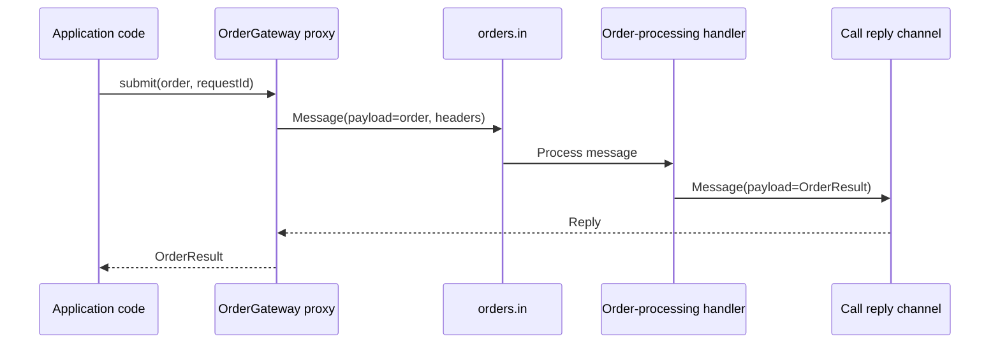

# `@MessagingGateway`: Calling a Message Flow via a Java Interface

## 1. Objectives and Problem Statement

In the **SPRING_INTEGRATION_CORE** module, `@MessagingGateway` is the annotation that places a Java interface in front of a Spring Integration flow. The caller works with a method that has clear parameters and a return type; the gateway translates that call into interactions over message channels.

Suppose an order-intake feature needs to call an integration flow to validate data and receive a result. If interacting directly with messaging APIs, the caller must construct a `Message`, set headers, select channels, and handle receiving the reply. With a gateway, the caller can write:

```java
OrderResult result = orderGateway.submit(order, "REQ-101");
```

The integration configuration decides where the message is sent and how the reply is retrieved. This proxy mechanism is described in [Javadoc for `GatewayProxyFactoryBean`](https://docs.spring.io/spring-integration/api/org/springframework/integration/gateway/GatewayProxyFactoryBean.html).

After this lesson, you can:

- Register a `@MessagingGateway` interface as a proxy bean.
- Map parameters to payload, headers, and return types.
- Distinguish request-reply calls from one-way calls.
- Set timeouts appropriate for the channels and execution model.
- Design reply paths, error paths, and the required tests.
- Compare annotations with gateway configuration in XML and flows in Java DSL.

Examples use Java 17 or higher and Spring Integration **6.2 or higher**. Version 6.2 is chosen because this lesson uses `errorOnTimeout`. The project requires `spring-integration-core`, compatible Spring Context infrastructure, and JUnit Jupiter for the sample test code. Projects using Spring Boot should manage versions through Boot's dependency set.

## 2. Position of the Gateway in the System



The interface is the caller's contract; the Spring-generated proxy is the object executing that contract. The proxy does not implement order-validation logic itself. Logic resides in handlers and endpoints behind the channel.

`@MessagingGateway` does not turn an interface into an HTTP API, send data over a network, or add a broker by itself. If downstream includes HTTP, JDBC, AMQP, or Kafka adapters, those are separate parts of the flow configuration.

### Distinguishing Related Components

| Component | Responsibility |
| --- | --- |
| `@MessagingGateway` | Declares an interface used as an entry point to a messaging flow |
| `@Gateway` | Customizes mapping or channel/timeout settings per interface method |
| `@ServiceActivator` | Receives messages and invokes downstream processing logic |
| `MessageChannel` | Connects steps by transferring messages |
| HTTP/AMQP/JMS gateway | Integrates with the corresponding protocol when configured in the flow |

In Java DSL, the `.gateway(...)` operator calls a request–reply subflow from inside another flow. It is related in interaction pattern, but does not replace registering a `@MessagingGateway` interface for application code.

## 3. Registering the Proxy: Annotations Must Be Discovered

### 3.1. Scanning with `@IntegrationComponentScan`

```java
@Configuration
@EnableIntegration
@IntegrationComponentScan(basePackageClasses = OrderGateway.class)
public class ScannedGatewayConfiguration {
}
```

This snippet illustrates gateway registration; channels and handlers are not declared yet. `basePackageClasses` selects the package of the specified class or interface to scan, rather than registering only that single type. See [Javadoc for `@IntegrationComponentScan`](https://docs.spring.io/spring-integration/api/org/springframework/integration/annotation/IntegrationComponentScan.html).

Regular `@ComponentScan` is not enough to find and create proxies for gateway interfaces. When the bean cannot be found, check scan scope and interface registration before writing a manual implementation class. This is emphasized in [Javadoc for `@MessagingGateway`](https://docs.spring.io/spring-integration/api/org/springframework/integration/annotation/MessagingGateway.html).

### 3.2. Explicit Registration with `@Import`

Starting in Spring Integration 6.0, interfaces annotated with `@MessagingGateway` can also be registered via `@Import`. The complete example in this lesson chooses this approach so the context imports only the exact gateway needed:

```java
@Configuration
@EnableIntegration
@Import(OrderGateway.class)
public class ExplicitGatewayConfiguration {
}
```

Do not use multiple registration mechanisms simultaneously for the same gateway without intent. `@Import` support is described in the annotation registration section of [Messaging Gateways](https://docs.spring.io/spring-integration/reference/gateway.html).

In this lesson's standalone Java context, `@EnableIntegration` registers the integration infrastructure components. Importing or scanning the gateway interface is a separate responsibility from enabling infrastructure. See [Configuration and `@EnableIntegration`](https://docs.spring.io/spring-integration/reference/overview.html#configuration-enable-integration).

## 4. Complete Example: Accepting Orders and Sending Audit Events

The example has two methods:

- `submit(...)` sends to `orders.in`, expecting an `OrderResult`.
- `audit(...)` sends to `orders.audit`, without waiting for a business result.

Each public class or interface in the example sits in a file of the same name under package `example.gateway`. Alternative configuration snippets in later sections should not be loaded into this same context.

### 4.1. Data Definitions

```java
package example.gateway;

import java.math.BigDecimal;

public record OrderRequest(String orderId, BigDecimal total) {
}
```

```java
package example.gateway;

public record OrderResult(
        String orderId,
        String status,
        String requestId,
        String source) {
}
```

`requestId` is an application-supplied ID used to correlate a request in the example. It does not replace the technical `id` header managed by the framework.

### 4.2. Gateway Interface

```java
package example.gateway;

import org.springframework.integration.annotation.Gateway;
import org.springframework.integration.annotation.GatewayHeader;
import org.springframework.integration.annotation.MessagingGateway;
import org.springframework.messaging.handler.annotation.Header;

@MessagingGateway(
        name = "orderGateway",
        defaultRequestChannel = "orders.in",
        defaultRequestTimeout = "1000",
        defaultReplyTimeout = "2000",
        errorOnTimeout = true,
        defaultHeaders = @GatewayHeader(name = "source", value = "PORTAL"))
public interface OrderGateway {

    OrderResult submit(
            OrderRequest order,
            @Header("requestId") String requestId);

    @Gateway(requestChannel = "orders.audit")
    void audit(
            OrderRequest order,
            @Header("requestId") String requestId);
}
```

The `submit(...)` method does not need `@Gateway` because it uses the interface-level default configuration. The `audit(...)` method only overrides the request channel and selects a one-way contract via its `void` return type.

Mapping of a call `submit(order, "REQ-101")`:

| Call Component | In the Message |
| --- | --- |
| `order` | Payload of type `OrderRequest` |
| `"REQ-101"` | `requestId` header |
| `@GatewayHeader` on interface | `source = PORTAL` header |
| Flow return value | Reply payload returned as `OrderResult` |

`@GatewayHeader` can supply a fixed `value` or an `expression` to compute the value. Choose only the representation suited to each header; see [Javadoc for `@GatewayHeader`](https://docs.spring.io/spring-integration/api/org/springframework/integration/annotation/GatewayHeader.html).

### 4.3. Order Processing Logic

```java
package example.gateway;

public class OrderService {

    public OrderResult submit(
            OrderRequest order,
            String requestId,
            String source) {

        if (order.orderId() == null || order.orderId().isBlank()
                || order.total() == null || order.total().signum() <= 0) {
            throw new IllegalArgumentException("Invalid order");
        }

        return new OrderResult(
                order.orderId(), "ACCEPTED", requestId, source);
    }
}
```

To stay focused on the gateway, the service only validates data and builds the result without writing to a database or calling external systems. In a real application, the `ACCEPTED` status must correspond to a defined business commitment.

Adapter connecting this service to the message channel:

```java
package example.gateway;

import org.springframework.integration.annotation.ServiceActivator;
import org.springframework.messaging.handler.annotation.Header;

public class OrderEndpoint {

    private final OrderService service;

    public OrderEndpoint(OrderService service) {
        this.service = service;
    }

    @ServiceActivator(inputChannel = "orders.in", requiresReply = "true")
    public OrderResult handle(
            OrderRequest order,
            @Header("requestId") String requestId,
            @Header("source") String source) {
        return service.submit(order, requestId, source);
    }
}
```

Do not set `outputChannel` on the final endpoint so the reply goes to the request's `replyChannel`. `requiresReply = "true"` catches cases where the handler produces no result; this attribute does not measure handler execution duration. How a service activator picks the reply destination is described in [Service Activator](https://docs.spring.io/spring-integration/reference/service-activator.html).

### 4.4. Context Configuration

```java
package example.gateway;

import org.springframework.context.annotation.Bean;
import org.springframework.context.annotation.Configuration;
import org.springframework.context.annotation.Import;
import org.springframework.integration.channel.DirectChannel;
import org.springframework.integration.channel.QueueChannel;
import org.springframework.integration.config.EnableIntegration;

@Configuration
@EnableIntegration
@Import(OrderGateway.class)
public class OrderGatewayConfiguration {

    @Bean("orders.in")
    public DirectChannel ordersIn() {
        return new DirectChannel();
    }

    @Bean("orders.audit")
    public QueueChannel ordersAudit() {
        return new QueueChannel(50);
    }

    @Bean
    public OrderService orderService() {
        return new OrderService();
    }

    @Bean
    public OrderEndpoint orderEndpoint(OrderService service) {
        return new OrderEndpoint(service);
    }
}
```

The standalone context can be invoked as follows:

```java
try (var context = new AnnotationConfigApplicationContext(
        OrderGatewayConfiguration.class)) {

    OrderGateway gateway = context.getBean(OrderGateway.class);
    OrderRequest request = new OrderRequest(
            "ORD-101", new BigDecimal("250000"));

    OrderResult result = gateway.submit(request, "REQ-101");
    gateway.audit(request, "REQ-AUDIT-101");
}
```

This call snippet requires imports for `java.math.BigDecimal` and `org.springframework.context.annotation.AnnotationConfigApplicationContext`.

`submit(...)` runs through a `DirectChannel`, so synchronous processing in the example completes on the calling thread. `audit(...)` simply places a message onto a queue with available space. The example does not register an audit consumer; the default queue stores data in memory and will not survive closing the context.

## 5. Method Mapping: Payload, Headers, and Return Value

### 5.1. Clarifying Which Parameter Is the Payload

A single unannotated parameter of type `OrderRequest` is the simplest choice for the payload. Metadata parameters should be explicitly marked with `@Header` or `@Headers`:

```java
OrderResult submit(
        OrderRequest order,
        @Headers Map<String, Object> metadata);
```

This signature requires importing `java.util.Map` and `org.springframework.messaging.handler.annotation.Headers`. It is a variant of the initial contract, not an extra required overload.

Avoid leaving multiple business parameters without mapping instructions, such as `submit(OrderRequest order, Customer customer)`, expecting the framework to guess how to combine them. You can create a DTO holding all needed data or declare an explicit payload expression. Parameter and return mapping contracts are described in [Javadoc for `@Gateway`](https://docs.spring.io/spring-integration/api/org/springframework/integration/annotation/Gateway.html).

### 5.2. Specifying a Payload Expression

When selecting a payload from multiple arguments:

```java
@Gateway(
        requestChannel = "orders.in",
        payloadExpression = "#args[0]")
OrderResult submitSelected(
        OrderRequest order,
        @Header("requestId") String requestId);
```

In this example the expression merely selects the first argument, so it could be omitted while keeping the contract clear. The value of this technique shows up with more complex signatures. Do not put lengthy business logic inside SpEL if a DTO or Java method expresses it in a more testable way.

If configuring a custom `mapper` via `MethodArgsMessageMapper`, the mapper is responsible for constructing the `Message`; do not combine it with payload expressions and standard header declarations on that gateway. The mapper contract is in [Javadoc for `MethodArgsMessageMapper`](https://docs.spring.io/spring-integration/api/org/springframework/integration/gateway/MethodArgsMessageMapper.html), and configuration constraints are stated in the [`MessagingGateway` API](https://docs.spring.io/spring-integration/api/org/springframework/integration/annotation/MessagingGateway.html).

### 5.3. Return the Payload or Return the Whole Message?

| Return Signature | Meaning for the Caller |
| --- | --- |
| `OrderResult` | Receives the result payload |
| `Message<OrderResult>` | Receives both reply payload and headers |
| `void` | Does not require the gateway to return a business reply |
| `CompletableFuture<OrderResult>` | Receives the result through the configured async mechanism |

If application code should deal exclusively in business types, prefer `OrderResult`. If you need to read reply headers for inspection or integration with another messaging API, `Message<OrderResult>` can be chosen, though the caller then depends on Spring Messaging.

Declaring a return type does not automatically produce data of that type. Downstream must return a compatible result; an appropriate transformer is needed if the raw reply is JSON, XML, or another DTO. Do not assume any arbitrary data structure converts automatically into `OrderResult`.

## 6. Reply Path and the Role of `replyChannel`

In standard request–reply, the gateway creates a temporary reply channel for the invocation and places the reply address in headers. The final endpoint can return the result through that address. You typically do not have to declare a separate `defaultReplyChannel` for an example like section 4.

What must remain intact throughout the flow is **the ability to reply to the exact waiting invocation**. If a transformer builds a new message manually and accidentally drops reply-routing headers, the final handler may still compute the result, yet the gateway never receives it.

Some design guidelines for the order example:

- Processing steps should preserve `requestId` context for business correlation.
- The final step must produce a result or raise an error according to the contract.
- If adding an `outputChannel` to the final step, verify that the new path still routes back to the gateway.
- If adding a splitter/aggregator, define whether the final result is a single reply or a collection of results.

A shared `QueueChannel` does not automatically correlate replies by `requestId`. Do not build a model where "all callers read from one shared result queue" expecting each caller to reliably receive its own reply. If a named reply channel is needed, understand how it bridges to each call's reply channel and test concurrent calls.

Do not serialize internal channel objects directly into network payloads. When a flow crosses a broker or serializes messages, design header mapping and request–reply correlation suited to the transport.

## 7. Timeouts: Separating Send Time from Reply Wait Time

### 7.1. Two Types of Timeouts

| Attribute | When Does It Have a Significant Effect? |
| --- | --- |
| `defaultRequestTimeout` / `requestTimeout` | Bounds waiting to send onto a channel that can block, e.g., a full bounded queue |
| `defaultReplyTimeout` / `replyTimeout` | Bounds how long the gateway waits while receiving the reply |

In the interface-level annotation, default timeouts are strings such as `"1000"`. In `@Gateway`, `requestTimeout` and `replyTimeout` are `long` numbers, for example:

```java
@Gateway(
        requestChannel = "orders.priority",
        requestTimeout = 300,
        replyTimeout = 1500)
OrderResult submitPriority(
        OrderRequest order,
        @Header("requestId") String requestId);
```

This is an illustrative method-level override signature; `orders.priority` and its processing flow must be declared before use.

`replyTimeout` begins during the phase where the gateway waits for a reply, after control returns to the gateway. It is not a mechanism to cancel a synchronous call running inside `send()`. Details of this timing are stated in [Javadoc for `Gateway.replyTimeout`](https://docs.spring.io/spring-integration/api/org/springframework/integration/annotation/Gateway.html#replyTimeout()).

### 7.2. Why Does `DirectChannel` Cause Timeouts to Be Misunderstood?

Suppose downstream runs synchronously for 8 seconds before returning a result. Even with a reply timeout of 2 seconds, the gateway cannot use it to interrupt the handler at the 2-second mark: the calling thread is still executing the handler.

```text
Caller -> gateway -> DirectChannel.send() -> handler runs 8 seconds
                                             |
                                             +-> returns result
                         gateway resumes <---+
```

With an input queue consumed on another thread, the send can finish before processing completes; only then does the gateway actually have an independent reply wait window. The same-thread behavior of `DirectChannel` and buffering of `QueueChannel` are described in [Message Channel Implementations](https://docs.spring.io/spring-integration/reference/channel/implementations.html).

Therefore, if downstream calls HTTP, JDBC, or a blocking library, configure timeouts on that I/O operation itself. Changing one number on the gateway is not enough to bound total processing duration.

### 7.3. Missing Reply: `null` or Exception?

The main example sets `errorOnTimeout = true`. Starting in Spring Integration 6.2, this option represents a timeout via `MessageTimeoutException`, or routes to an error channel if configured appropriately, instead of returning `null` per the default behavior when no reply arrives. See [`MessagingGateway.errorOnTimeout`](https://docs.spring.io/spring-integration/api/org/springframework/integration/annotation/MessagingGateway.html#errorOnTimeout()).

Scenarios to account for include:

- A filter drops the request and no branch creates a reply.
- A handler returns `null` in a flow that does not require a reply.
- The message enters a queue with no consumer processing it.
- Reply headers are lost or the reply is sent elsewhere.

A timeout does not prove the business operation did not happen. Asynchronous processing may continue after the caller has timed out. When designing retries for write operations, require idempotency or a way to query the outcome by business key.

## 8. `void` Is One-Way, Not Automatically Background Execution

The `audit(...)` method in the example does not wait for an `OrderResult`, yet it still must perform the message send operation. If the channel is a full queue, the caller may block on the send. If the channel is a `DirectChannel`, a synchronous handler may execute right inside the call.

Thus, there are two separate questions:

1. Does the method contract require a reply?
2. Is the processing thread decoupled from the caller's thread?

Changing the return type to `void` only answers the first question. To process on another thread, configure an executor or appropriate channel/consumer type.

With a one-way call, the method returning successfully may only prove the message was accepted onto a queue. It does not prove the audit record was durably persisted. If the caller needs confirmation of a business commitment, return a reply representing that exact commitment.

Do not use downstream reply messages as a hidden result channel for a `void` method. One-way contracts must have separate error-observation and status mechanisms when needed.

## 9. Error Handling and the Caller Contract

### 9.1. Without Configuring `errorChannel`

The main example sets no `errorChannel` on the gateway. When `OrderService` throws `IllegalArgumentException`, the caller must observe the failed call; the tests later verify this case.

Spring Integration may wrap processing errors in `MessagingException` to retain message context. The gateway inspects the cause chain and `throws` signature to decide which exception to throw to the caller. Therefore, do not assume every exception always appears under the same wrapper class.

Choosing between business exceptions and result DTOs is part of API design. An order rejected by business rules can be represented by a `REJECTED` result; a connection failure to another system can be a technical failure. Do not conflate these two categories just because both pass through the gateway.

### 9.2. Configuring an Error Flow

A gateway can route errors into a dedicated channel:

```java
@MessagingGateway(
        defaultRequestChannel = "orders.in",
        errorChannel = "orders.errors",
        defaultRequestTimeout = "1000",
        defaultReplyTimeout = "2000",
        errorOnTimeout = true,
        defaultHeaders = @GatewayHeader(name = "source", value = "PORTAL"))
public interface RecoveringOrderGateway {

    OrderResult submit(
            OrderRequest order,
            @Header("requestId") String requestId);
}
```

This is a variant, not a complete runnable setup: you must register this interface, declare `orders.errors`, and add an error-handling consumer. The consumer can turn the error into a reply DTO compatible with `OrderResult`, or throw an exception per policy.

If the error flow only logs and finishes, it has not produced the result required by `submit(...)`. If it returns an exception or a message with a `Throwable` payload, the gateway can still treat it as an error; to return a normal reply, it must construct business data matching the contract.

When reading an error to extract `requestId`, do not assume every exception carries a `failedMessage`. Handle cases lacking a failed message and do not fabricate correlation IDs.

### 9.3. Asynchronous Flows

With handlers running on another thread, exceptions cannot return to the caller simply via the same Java call stack. Error handling must deliver the error back to the waiting caller or to a designed error-monitoring channel. The difference between same-thread and asynchronous handling is presented in [Error Handling](https://docs.spring.io/spring-integration/reference/error-handling.html).

Do not set `errorChannel = "nullChannel"` just to make exceptions vanish on an API whose caller expects a result. Swallowing errors deprives callers of the ability to distinguish success from incomplete processing.

## 10. Configuring a Gateway with XML

XML can create a proxy for an interface without `@MessagingGateway`. The alternative interface can still use `@Header` to describe parameters:

```java
package example.gateway;

import org.springframework.messaging.handler.annotation.Header;

public interface XmlOrderGateway {

    OrderResult submit(
            OrderRequest order,
            @Header("requestId") String requestId);

    void audit(
            OrderRequest order,
            @Header("requestId") String requestId);
}
```

To reuse `OrderService` without registering another annotated endpoint, create an XML adapter without `@ServiceActivator`:

```java
package example.gateway;

import org.springframework.messaging.Message;

public class XmlOrderHandler {

    private final OrderService service;

    public XmlOrderHandler(OrderService service) {
        this.service = service;
    }

    public OrderResult handle(Message<OrderRequest> message) {
        return service.submit(
                message.getPayload(),
                message.getHeaders().get("requestId", String.class),
                message.getHeaders().get("source", String.class));
    }
}
```

Corresponding XML context configuration:

```xml
<?xml version="1.0" encoding="UTF-8"?>
<beans xmlns="http://www.springframework.org/schema/beans"
       xmlns:xsi="http://www.w3.org/2001/XMLSchema-instance"
       xmlns:int="http://www.springframework.org/schema/integration"
       xsi:schemaLocation="
           http://www.springframework.org/schema/beans
           https://www.springframework.org/schema/beans/spring-beans.xsd
           http://www.springframework.org/schema/integration
           https://www.springframework.org/schema/integration/spring-integration.xsd">

    <int:channel id="orders.in"/>

    <int:channel id="orders.audit">
        <int:queue capacity="50"/>
    </int:channel>

    <int:gateway id="xmlOrderGateway"
                 service-interface="example.gateway.XmlOrderGateway"
                 default-request-channel="orders.in"
                 default-request-timeout="1000"
                 default-reply-timeout="2000"
                 error-on-timeout="true">
        <int:default-header name="source" value="PORTAL"/>
        <int:method name="audit" request-channel="orders.audit"/>
    </int:gateway>

    <bean id="orderService" class="example.gateway.OrderService"/>

    <bean id="xmlOrderHandler" class="example.gateway.XmlOrderHandler">
        <constructor-arg ref="orderService"/>
    </bean>

    <int:service-activator input-channel="orders.in"
                           ref="xmlOrderHandler"
                           method="handle"
                           requires-reply="true"/>
</beans>
```

This is an alternative context to the annotation configuration in section 4. Keeping the XML interface free of `@Gateway` also avoids two places specifying channels or timeouts for one method.

| Intent | Annotation | XML |
| --- | --- | --- |
| Interface used to create proxy | Interface with `@MessagingGateway` | `service-interface` |
| Default channel | `defaultRequestChannel` | `default-request-channel` |
| Common headers | `defaultHeaders` | `<int:default-header>` |
| Per-method configuration | `@Gateway` | `<int:method>` |
| Timeout as error | `errorOnTimeout` | `error-on-timeout` |
| Error channel | `errorChannel` | `error-channel` |

When using XML, the schema from the library version on your classpath must support the attributes used. Do not mix older dependencies with configurations using `error-on-timeout` from newer versions.

## 11. Gateway with a Java DSL Flow

The gateway interface only needs to know the entry channel; downstream steps can be written in DSL. Thus you can keep `OrderGateway` and replace `OrderEndpoint` with an `IntegrationFlow`:

```java
@Bean
public IntegrationFlow orderFlow(OrderService service) {
    return IntegrationFlow.from("orders.in")
            .handle(OrderRequest.class, (order, headers) -> service.submit(
                    order,
                    (String) headers.get("requestId"),
                    (String) headers.get("source")))
            .get();
}
```

This snippet requires importing `org.springframework.integration.dsl.IntegrationFlow` and `org.springframework.context.annotation.Bean`. Place it in a configuration that still declares both channels, `OrderService`, integration infrastructure, and `OrderGateway` registration as before, while **not registering `OrderEndpoint`**.

`handle(...)` creates the processing step returning `OrderResult`. Since no other output channel is set, the result returns to the request's reply address. Using `.handle()` to represent a service activator is described in [Service Activator](https://docs.spring.io/spring-integration/reference/service-activator.html).

Registering both the annotated adapter and the DSL flow on the same `DirectChannel` can create competing consumers. That does not make the two steps chain automatically. Choose one concrete topology and test the message path.

## 12. Controlled Extension: `CompletableFuture`

If the caller needs to continue other work while waiting for the result, a gateway returning `CompletableFuture` can be used. A variant using an explicit executor:

```java
@MessagingGateway(
        defaultRequestChannel = "orders.in",
        defaultReplyTimeout = "2000",
        errorOnTimeout = true,
        asyncExecutor = "gatewayExecutor",
        defaultHeaders = @GatewayHeader(name = "source", value = "PORTAL"))
public interface AsyncOrderGateway {

    CompletableFuture<OrderResult> submit(
            OrderRequest order,
            @Header("requestId") String requestId);
}
```

The interface needs to import `java.util.concurrent.CompletableFuture` and the annotations from the main example. Register an additional executor bean in this variant's context:

```java
@Bean("gatewayExecutor")
public ThreadPoolTaskExecutor gatewayExecutor() {
    ThreadPoolTaskExecutor executor = new ThreadPoolTaskExecutor();
    executor.setCorePoolSize(2);
    executor.setMaxPoolSize(4);
    executor.setQueueCapacity(50);
    executor.setThreadNamePrefix("order-gateway-");
    return executor;
}
```

This bean requires importing `org.springframework.scheduling.concurrent.ThreadPoolTaskExecutor`. Spring manages its initialization and lifecycle. Also import or scan `AsyncOrderGateway` and keep the required channels and handlers.

In executor mode, the example downstream still returns `OrderResult`; the gateway completes the future with that result. If downstream itself returns a future and you want to pass that future straight out, that is a different configuration mode: do not automatically wrap it with a second executor. Check [Javadoc for `GatewayProxyFactoryBean`](https://docs.spring.io/spring-integration/api/org/springframework/integration/gateway/GatewayProxyFactoryBean.html) when selecting executor modes.

Calling `future.get(...)` or `join()` can block the caller again. Using a future does not turn synchronous JDBC or HTTP into non-blocking I/O, and a timeout on the caller does not cancel side effects already running downstream.

## 13. Testing Gateway Behavior

### 13.1. What Needs to Be Proven

| Test | Meaning |
| --- | --- |
| Retrieving the `OrderGateway` bean | Interface was registered properly |
| `submit` returns the expected `OrderResult` | Request enters the right flow and reply returns to caller |
| `requestId`, `source` appear in the result | Parameter mapping and default headers work |
| `audit` places a message in the queue | Method-specific configuration is applied |
| Invalid order produces an error | Caller receives failure per contract |
| Missing reply leads to timeout | Missing-reply case has a bounded wait |

Mocking the gateway in a service unit test only checks how the service uses the contract. To verify the proxy and wiring, use a real context with channels and a minimal downstream, as in the examples below.

### 13.2. Testing Request–Reply, One-Way, and Errors

```java
package example.gateway;

import java.math.BigDecimal;

import org.junit.jupiter.api.Test;
import org.springframework.context.annotation.AnnotationConfigApplicationContext;
import org.springframework.integration.channel.QueueChannel;
import org.springframework.messaging.Message;

import static org.junit.jupiter.api.Assertions.assertEquals;
import static org.junit.jupiter.api.Assertions.assertNotNull;
import static org.junit.jupiter.api.Assertions.assertSame;
import static org.junit.jupiter.api.Assertions.assertThrows;

class OrderGatewayIntegrationTest {

    @Test
    void submitMapsArgumentsAndReceivesReply() {
        try (var context = new AnnotationConfigApplicationContext(
                OrderGatewayConfiguration.class)) {

            OrderGateway gateway = context.getBean(OrderGateway.class);
            OrderRequest order = new OrderRequest(
                    "ORD-101", new BigDecimal("250000"));

            OrderResult result = gateway.submit(order, "REQ-101");

            assertNotNull(result);
            assertEquals("ORD-101", result.orderId());
            assertEquals("ACCEPTED", result.status());
            assertEquals("REQ-101", result.requestId());
            assertEquals("PORTAL", result.source());
        }
    }

    @Test
    void auditUsesItsOwnChannelWithoutBusinessReply() {
        try (var context = new AnnotationConfigApplicationContext(
                OrderGatewayConfiguration.class)) {

            OrderGateway gateway = context.getBean(OrderGateway.class);
            QueueChannel audit = context.getBean(
                    "orders.audit", QueueChannel.class);
            OrderRequest order = new OrderRequest(
                    "ORD-102", new BigDecimal("100000"));

            gateway.audit(order, "REQ-AUDIT-102");

            Message<?> message = audit.receive(0);
            assertNotNull(message);
            assertSame(order, message.getPayload());
            assertEquals("REQ-AUDIT-102",
                    message.getHeaders().get("requestId"));
            assertEquals("PORTAL", message.getHeaders().get("source"));
        }
    }

    @Test
    void invalidOrderPropagatesBusinessFailure() {
        try (var context = new AnnotationConfigApplicationContext(
                OrderGatewayConfiguration.class)) {

            OrderGateway gateway = context.getBean(OrderGateway.class);
            OrderRequest order = new OrderRequest(
                    "ORD-103", BigDecimal.ZERO);

            assertThrows(IllegalArgumentException.class,
                    () -> gateway.submit(order, "REQ-103"));
        }
    }
}
```

The audit test reads the queue right after the call because sending to the queue has already completed. It does not prove an audit consumer processed it or that data was durably saved. Each test creates a new context, so queue data is never shared across test runs.

### 13.3. Testing a Request Received with No Reply

To test timeouts, distinguish "message was received but nobody replied" from "channel has no subscribers so send fails immediately." The fixture below registers a subscriber that receives the message and finishes without sending a reply:

```java
package example.gateway;

import org.junit.jupiter.api.Test;
import org.springframework.context.annotation.AnnotationConfigApplicationContext;
import org.springframework.context.annotation.Bean;
import org.springframework.context.annotation.Configuration;
import org.springframework.context.annotation.Import;
import org.springframework.integration.MessageTimeoutException;
import org.springframework.integration.annotation.MessagingGateway;
import org.springframework.integration.channel.DirectChannel;
import org.springframework.integration.config.EnableIntegration;

import static org.junit.jupiter.api.Assertions.assertThrows;

class GatewayTimeoutTest {

    @MessagingGateway(
            defaultRequestChannel = "noReply.in",
            defaultReplyTimeout = "50",
            errorOnTimeout = true)
    public interface NoReplyGateway {
        String request(String payload);
    }

    @Configuration
    @EnableIntegration
    @Import(NoReplyGateway.class)
    public static class TimeoutConfiguration {

        @Bean("noReply.in")
        public DirectChannel noReplyInput() {
            DirectChannel channel = new DirectChannel();
            channel.subscribe(message -> {
                // Intentionally receive the message without producing a reply.
            });
            return channel;
        }
    }

    @Test
    void missingReplyBecomesTimeoutException() {
        try (var context = new AnnotationConfigApplicationContext(
                TimeoutConfiguration.class)) {

            NoReplyGateway gateway = context.getBean(NoReplyGateway.class);

            assertThrows(MessageTimeoutException.class,
                    () -> gateway.request("request-101"));
        }
    }
}
```

The test verifies the exception type, not exact wall-clock timing. The 50 ms value only shortens waiting in this small fixture. Do not use it as a sample timeout setting for production environments. The exception class is described in [Javadoc for `MessageTimeoutException`](https://docs.spring.io/spring-integration/api/org/springframework/integration/MessageTimeoutException.html).

The test code in this lesson is practice material; generating documentation does not mean the tests have been run on a project classpath.

## 14. Common Pitfalls When Using `@MessagingGateway`

| Symptom | What to Check |
| --- | --- |
| Gateway bean cannot be found | Was the interface `@Import`ed or included in `@IntegrationComponentScan` |
| Bean exists but calls fail looking up channel | Request channel name and channel configuration in context |
| Caller receives wrong type or conversion fails | Does actual reply payload match the return type |
| Caller waits even though handler processed message | Did the handler produce a reply; where did the reply go; are reply headers intact |
| `replyTimeout` does not interrupt a slow handler | Is the handler running synchronously on the `send()` thread |
| `void` method is still slow | Is sending blocking or is downstream running on the same thread |
| Error flow logs but caller gets no result | Does the error flow return a reply matching the contract |
| Audit error appears after caller already returned | Is the asynchronous consumer's error path configured and observed |
| Retries create duplicate orders or audit records | Idempotency policy and actual state after timeout |
| Adding XML/DSL makes behavior unpredictable | Are duplicate gateways or competing consumers registered on the same channel |

Another easy-to-misunderstand case is a zero-argument method. Without a configured payload, the gateway can take on receive semantics from a pollable channel instead of sending an empty command. If you want a zero-argument method to trigger downstream, declare an explicit payload expression and test that contract.

## 15. Principles for Designing Gateway Contracts

A gateway fits well when you need a strongly typed entry point into an integration flow. The contract should make the operation name, request data, result semantics, and failure representation explicit.

For the order-intake feature:

- If the caller needs to know the order was confirmed, return a result expressing that confirmation.
- If merely accepting commands onto a queue, do not describe the return as proof that business processing completed.
- Configure gateway timeouts alongside downstream I/O timeouts.
- Preserve business correlation IDs across the flow, while letting the framework manage its reply mechanism.
- When adding filters, routers, or aggregators, re-verify that every path produces a proper reply or error.
- Test through real gateway calls to verify both data mapping and reply paths.

In the example, `OrderGateway` is the contract with the caller, channels are the connectors, and annotation endpoints, XML, and DSL are ways to organize downstream. Keeping these responsibilities distinct lets you change topology while maintaining the behavior callers rely on.
