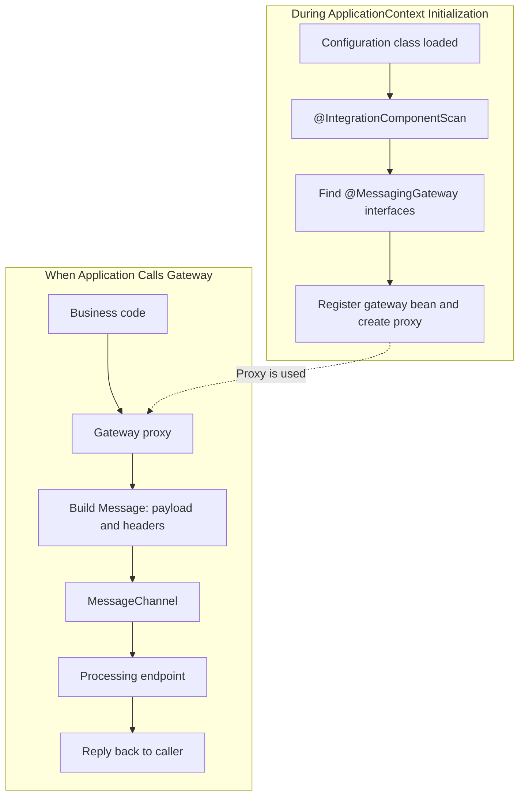

# @IntegrationComponentScan

In the **SPRING_INTEGRATION_CORE** module, `@IntegrationComponentScan` registers gateway interfaces so business code can call a Java method and enter a message flow. This lesson belongs to the **Annotations and XML** chapter and focuses on scan scope, differences between scan mechanisms, connecting gateways to channels, and verifying configuration.

Practice scenario: the application has a `TextGateway` interface to normalize text per tenant. Calling `normalize(" spring integration ", "vi")` should pass through a channel, be handled by an endpoint, and return `"vi:SPRING INTEGRATION"`.

## 1. Why Do Gateway Interfaces Need a Dedicated Scanning Mechanism?

A gateway usually declares only a contract:

```java
@MessagingGateway(defaultRequestChannel = "textRequests")
public interface TextGateway {
    String normalize(String text);
}
```

This interface has no business implementation class that you instantiate with `new`. Spring Integration provides a proxy that converts method calls into messages, sends them through a channel, and receives results if the method has a return value.

`@IntegrationComponentScan` finds interfaces annotated with `@MessagingGateway` within the configured scope so they are registered as gateway beans. Regular `@ComponentScan` ignores interfaces, so scanning only for `@Component`s is not enough.

This role is stated in [IntegrationComponentScan API](https://docs.spring.io/spring-integration/api/org/springframework/integration/annotation/IntegrationComponentScan.html) and the [6.5 MessagingGateway declaration](https://raw.githubusercontent.com/spring-projects/spring-integration/6.5.x/spring-integration-core/src/main/java/org/springframework/integration/annotation/MessagingGateway.java).

### Two Distinct Moments



Scanning happens when building the context. It does not rescan packages on each gateway call, nor does it decide whether messages run synchronously or asynchronously.

## 2. Distinguishing Three Easily Confused Annotations

| Annotation | Primary Responsibility | Related Component Examples |
|---|---|---|
| `@ComponentScan` | Finds component classes in packages | `@Service`, `@Component`, `@MessageEndpoint` |
| `@IntegrationComponentScan` | Discovers gateway interfaces by scope and filters | Interfaces with `@MessagingGateway` |
| `@EnableIntegration` | Enables Spring Integration infrastructure | Processors, infrastructure beans, and endpoint annotation handling |

A `@MessageEndpoint` class with a `@ServiceActivator` method is typically brought into the context via component scan, `@Bean`, or `@Import`. Gateway interfaces use an appropriate gateway registration mechanism. Both kinds of components must be present in the context before infrastructure can wire them into a flow.

In a plain Java Spring application, without Integration XML and without relying on Spring Boot auto-configuration, you typically have a configuration like:

```java
@Configuration
@EnableIntegration
@IntegrationComponentScan(basePackages = "example.integration.api")
public class IntegrationConfig {
}
```

This only handles initialization and gateway discovery. The application still needs to declare channels, endpoints, and business dependencies.

See the infrastructure role in [EnableIntegration API](https://docs.spring.io/spring-integration/api/org/springframework/integration/config/EnableIntegration.html), and the relationship between components and endpoint annotations in [Annotation Support](https://docs.spring.io/spring-integration/reference/6.5/configuration/annotations.html).

## 3. Configuring Scan Scope

Import the right annotation:

```java
import org.springframework.integration.annotation.IntegrationComponentScan;
```

### 3.1. Scanning by Package Name

These two forms serve the same purpose:

```java
@IntegrationComponentScan("example.integration.api")
```

```java
@IntegrationComponentScan(basePackages = "example.integration.api")
```

`value` and `basePackages` are aliases; pick one style within a single declaration. You can pass an array of multiple packages if gateways span multiple modules.

The scope includes the specified base package and its subpackages. Pick packages narrow enough so the registered gateway list matches the application's features.

### 3.2. Scanning by Marker Type

Example of a behavior-free marker:

```java
package example.integration.api;

public interface GatewayPackage {
}
```

Configuration:

```java
@IntegrationComponentScan(basePackageClasses = GatewayPackage.class)
```

`basePackageClasses` uses the **package containing the type** as the scan root. It does not mean only the passed type is registered. The marker itself needs no gateway annotation.

This approach helps when renaming packages in an IDE: a type reference makes refactoring easier to track than a package name string.

### 3.3. When No Package Is Specified

If `@IntegrationComponentScan` has no scope attributes, the registrar uses the package of the configuration class declaring the annotation as the root. A class in `example.integration.config` will not automatically scan a sibling package `example.integration.api`.

In projects with separated package structures, marker types make scan intent clearer. How the default package is determined is shown in [IntegrationComponentScanRegistrar 6.5](https://raw.githubusercontent.com/spring-projects/spring-integration/6.5.x/spring-integration-core/src/main/java/org/springframework/integration/config/IntegrationComponentScanRegistrar.java).

## 4. Complete Example: Gateway, Channel, and Endpoint

The example uses Java 17, Spring Integration 6.5, and the `org.springframework.integration:spring-integration-core` dependency. Spring versions should be managed consistently via a BOM or your project's dependency configuration. Tests use JUnit Jupiter.

Sample code structure:

```text
example.integration
├── api
│   ├── GatewayPackage.java
│   └── TextGateway.java
├── config
│   └── IntegrationConfig.java
├── endpoint
│   └── TextEndpoint.java
└── DemoApplication.java
```

### 4.1. Gateway Interface

File `example/integration/api/TextGateway.java`:

```java
package example.integration.api;

import org.springframework.integration.annotation.MessagingGateway;
import org.springframework.messaging.handler.annotation.Header;

@MessagingGateway(
    name = "textGateway",
    defaultRequestChannel = "textRequests",
    defaultReplyTimeout = "1000"
)
public interface TextGateway {

    String normalize(
            String text,
            @Header("tenantId") String tenantId);
}
```

The `text` parameter is used as the payload. `tenantId` is mapped to the header with the declared name. The bean name is explicitly set to `textGateway`.

### 4.2. Gateway Package Marker

File `example/integration/api/GatewayPackage.java`:

```java
package example.integration.api;

public interface GatewayPackage {
}
```

### 4.3. Processing Endpoint

File `example/integration/endpoint/TextEndpoint.java`:

```java
package example.integration.endpoint;

import java.util.Locale;

import org.springframework.integration.annotation.MessageEndpoint;
import org.springframework.integration.annotation.ServiceActivator;
import org.springframework.messaging.handler.annotation.Header;

@MessageEndpoint
public class TextEndpoint {

    @ServiceActivator(inputChannel = "textRequests")
    public String normalize(
            String text,
            @Header("tenantId") String tenantId) {

        if (tenantId.isBlank()) {
            throw new IllegalArgumentException("tenantId must not be blank");
        }

        return tenantId + ":" + text.strip().toUpperCase(Locale.ROOT);
    }
}
```

The endpoint sets no `outputChannel`. The result can return to the gateway through the `replyChannel` info supplied by the gateway in the request-reply call.

### 4.4. Configuration Class

File `example/integration/config/IntegrationConfig.java`:

```java
package example.integration.config;

import example.integration.api.GatewayPackage;
import example.integration.endpoint.TextEndpoint;

import org.springframework.context.annotation.Bean;
import org.springframework.context.annotation.ComponentScan;
import org.springframework.context.annotation.Configuration;
import org.springframework.integration.annotation.IntegrationComponentScan;
import org.springframework.integration.channel.DirectChannel;
import org.springframework.integration.config.EnableIntegration;

@Configuration
@EnableIntegration
@IntegrationComponentScan(basePackageClasses = GatewayPackage.class)
@ComponentScan(basePackageClasses = TextEndpoint.class)
public class IntegrationConfig {

    @Bean
    public DirectChannel textRequests() {
        return new DirectChannel();
    }
}
```

The two scan mechanisms have separate scopes:

- Integration scan finds `TextGateway` in package `api`.
- Component scan finds `TextEndpoint` in package `endpoint`.

`DirectChannel` is declared via `@Bean` so channel name wiring is clear. Both the gateway and endpoint use the name `textRequests`.

### 4.5. Calling the Gateway

File `example/integration/DemoApplication.java`:

```java
package example.integration;

import example.integration.api.TextGateway;
import example.integration.config.IntegrationConfig;

import org.springframework.context.annotation.AnnotationConfigApplicationContext;

public class DemoApplication {

    public static void main(String[] args) {
        try (var context = new AnnotationConfigApplicationContext(
                IntegrationConfig.class)) {

            TextGateway gateway = context.getBean(TextGateway.class);

            String result = gateway.normalize(
                    " spring integration ",
                    "vi"
            );

            System.out.println(result);
        }
    }
}
```

Expected output:

```text
vi:SPRING INTEGRATION
```

There is no need to write a `TextGatewayImpl` class. The object fetched from the context is a gateway proxy provided by the framework.

Parameter mapping and reply creation rules are described in [Messaging Gateways 6.5](https://docs.spring.io/spring-integration/reference/6.5/gateway.html).

## 5. Reading the Example's Behavior Accurately

There are three distinct layers of configuration info:

| Information | Where Declared | Role |
|---|---|---|
| Package containing gateways | `@IntegrationComponentScan` | Determines which gateways are registered |
| Input channel name | `@MessagingGateway` and `@ServiceActivator` | Connects gateway to endpoint |
| Payload and headers | Method signature, `@Header` | Determines message contents |

Changing scan scope does not fix a channel name. Changing the gateway bean name does not change the channel name. Using different channel names on the two sides prevents the gateway from reaching the intended endpoint.

`defaultReplyTimeout = "1000"` controls waiting for a reply; it is not a package-scanning timeout. For synchronous processing through `DirectChannel`, this attribute also does not interrupt a long-running business method.

If you instantiate the endpoint with `new TextEndpoint()` outside Spring and call it directly, normalization may still produce the right string. That does not prove the gateway was scanned or the messaging flow is wired properly.

## 6. Testing Registration and End-to-End Flow Invocation

### 6.1. Testing the Gateway Bean and Result

Sample test file:

```java
package example.integration;

import example.integration.api.TextGateway;
import example.integration.config.IntegrationConfig;

import org.junit.jupiter.api.Test;
import org.springframework.context.annotation.AnnotationConfigApplicationContext;

import static org.junit.jupiter.api.Assertions.*;

class IntegrationComponentScanTest {

    @Test
    void registersGatewayAndInvokesTheEndpoint() {
        try (var context = new AnnotationConfigApplicationContext(
                IntegrationConfig.class)) {

            var gateways = context.getBeansOfType(TextGateway.class);

            assertEquals(1, gateways.size());

            TextGateway gateway = context.getBean(
                    "textGateway",
                    TextGateway.class
            );

            assertSame(gateway, context.getBean(TextGateway.class));
            assertEquals(
                    "vi:SPRING INTEGRATION",
                    gateway.normalize(" spring integration ", "vi")
            );
        }
    }
}
```

The test verifies both bean existence and the payload/header path. Do not assert purely on the proxy class name, because proxy implementation details are not a business contract to protect.

### 6.2. Control Test: ComponentScan Only

The following configuration intentionally uses only component scan, even on the package containing the gateway:

```java
package example.integration;

import example.integration.api.GatewayPackage;
import example.integration.api.TextGateway;
import example.integration.endpoint.TextEndpoint;

import org.junit.jupiter.api.Test;
import org.springframework.beans.factory.NoSuchBeanDefinitionException;
import org.springframework.context.annotation.AnnotationConfigApplicationContext;
import org.springframework.context.annotation.Bean;
import org.springframework.context.annotation.ComponentScan;
import org.springframework.context.annotation.Configuration;
import org.springframework.integration.channel.DirectChannel;
import org.springframework.integration.config.EnableIntegration;

import static org.junit.jupiter.api.Assertions.*;

class MissingGatewayScanTest {

    @Configuration
    @EnableIntegration
    @ComponentScan(basePackageClasses = {
        GatewayPackage.class,
        TextEndpoint.class
    })
    static class ComponentOnlyConfig {

        @Bean
        public DirectChannel textRequests() {
            return new DirectChannel();
        }
    }

    @Test
    void componentScanDoesNotRegisterGatewayInterface() {
        try (var context = new AnnotationConfigApplicationContext(
                ComponentOnlyConfig.class)) {

            assertTrue(context.getBeansOfType(TextGateway.class).isEmpty());

            assertThrows(
                    NoSuchBeanDefinitionException.class,
                    () -> context.getBean(TextGateway.class)
            );
        }
    }
}
```

This control test uses a plain Spring context. If run in a Spring Boot context with Integration auto-configuration, the gateway could be registered by auto-configuration, so the "component scan only" experiment would no longer isolate that condition properly.


## 7. Attributes and Filters

Key attributes of the annotation include:

| Attribute | Meaning |
|---|---|
| `value`, `basePackages` | Base packages to scan |
| `basePackageClasses` | Types used to determine base packages |
| `useDefaultFilters` | Whether to use default discovery conditions |
| `includeFilters` | Adds candidate selection conditions |
| `excludeFilters` | Excludes candidates from results |
| `nameGenerator` | Naming strategy for discovered beans |

By default `useDefaultFilters = true`, so `@MessagingGateway` interfaces within scan scope are considered for registration. The full attribute and alias list is in the [6.5 IntegrationComponentScan declaration](https://raw.githubusercontent.com/spring-projects/spring-integration/6.5.x/spring-integration-core/src/main/java/org/springframework/integration/annotation/IntegrationComponentScan.java).

The snippets below illustrate **replacing the scan declaration** in the main configuration; keep the corresponding channels, endpoints, and infrastructure when running.

### 7.1. Selecting Only One Specific Gateway in a Package

```java
import example.integration.api.GatewayPackage;
import example.integration.api.TextGateway;

import org.springframework.context.annotation.ComponentScan;
import org.springframework.context.annotation.FilterType;
import org.springframework.integration.annotation.IntegrationComponentScan;

@IntegrationComponentScan(
    basePackageClasses = GatewayPackage.class,
    useDefaultFilters = false,
    includeFilters = @ComponentScan.Filter(
        type = FilterType.ASSIGNABLE_TYPE,
        classes = TextGateway.class
    )
)
```

Here default filters are disabled, and only types matching the specified filter are included. `TextGateway` still keeps `@MessagingGateway` and its channel wiring details.

If `useDefaultFilters = true` is left enabled, an include filter does not turn the scope into "only gateways matching this filter." Other gateways can still be picked up by the default filter. This is an easy pitfall when using an include filter expecting to narrow the list.

Filters also only operate within the scanned packages. They will not discover a type outside the selected package scope.

### 7.2. Excluding an Internal Gateway Package

Example excluding types under `example.integration.api.internal`:

```java
@IntegrationComponentScan(
    basePackages = "example.integration.api",
    excludeFilters = @ComponentScan.Filter(
        type = FilterType.REGEX,
        pattern = "example[.]integration[.]api[.]internal[.].*"
    )
)
```

The regex here matches the fully qualified type name. Exclude filters drop candidates even if they match an include condition.

A common misconfiguration is disabling default filters without providing any include filter. In that case, no gateway selection criteria remain as the author intended.

Do not use broad filters to treat every business interface as a gateway. Candidate selection must pair with the `@MessagingGateway` contract or an appropriate explicit gateway registration mechanism.

## 8. Managing Bean Names and Avoiding Duplicate Registration

### 8.1. Naming Gateways Explicitly

The main example used:

```java
@MessagingGateway(
    name = "textGateway",
    defaultRequestChannel = "textRequests"
)
```

The name `textGateway` identifies the bean; `textRequests` is the channel name. They can differ and serve two independent roles.

If multiple gateway beans satisfy one injection type, use an appropriate bean name or qualifier at injection sites. Changing packages to avoid name collisions does not solve having multiple beans of the same type.

For example, two modules having distinct interfaces with the same simple name:

```text
example.sales.api.CommandGateway
example.billing.api.CommandGateway
```

The default naming strategy can cause a simple-name collision. You can assign distinct names via `@MessagingGateway(name = "...")`, or choose a package-qualified naming strategy.

### 8.2. Using Fully Qualified Names When Needed

```java
import org.springframework.context.annotation.FullyQualifiedAnnotationBeanNameGenerator;

@IntegrationComponentScan(
    basePackages = {
        "example.sales.api",
        "example.billing.api"
    },
    nameGenerator = FullyQualifiedAnnotationBeanNameGenerator.class
)
```

This generator uses the fully qualified type name as the default bean name when no explicit name is given. If two gateways are both given the same explicit name, those names themselves must be fixed.

Refer to [FullyQualifiedAnnotationBeanNameGenerator](https://docs.spring.io/spring-framework/docs/current/javadoc-api/org/springframework/context/annotation/FullyQualifiedAnnotationBeanNameGenerator.html).

### 8.3. Centralizing Scan Configuration

With the 6.5 registrar under consideration, multiple `@IntegrationComponentScan` declarations in the same registry should not be treated as scopes that automatically accumulate. The registrar checks whether it has already been registered and warns when encountering subsequent declarations.

The clear approach is to centralize packages to scan in one configuration:

```java
@IntegrationComponentScan(basePackages = {
    "example.sales.api",
    "example.billing.api"
})
```

This limitation is in the [IntegrationComponentScanRegistrar source](https://raw.githubusercontent.com/spring-projects/spring-integration/6.5.x/spring-integration-core/src/main/java/org/springframework/integration/config/IntegrationComponentScanRegistrar.java). When upgrading versions, recheck related behavior if your architecture relies on multiple imported configurations.

A gateway can also be registered via scan, XML, or direct import. Designating a single place responsible for registering each gateway avoids name conflicts and diagnostic confusion.

## 9. Spring Boot: Check Auto-Configuration Before Concluding a Missing Scan

The earlier example used plain Spring to show each annotation's role clearly. With Spring Boot, behavior also depends on auto-configuration and the application's package structure.

In Spring Boot 3.5, Integration auto-configuration can:

- Enable infrastructure via `@EnableIntegration`.
- Register gateway scanning if no application-provided scan registrar exists yet.

These conditions are shown in [IntegrationAutoConfiguration 3.5](https://raw.githubusercontent.com/spring-projects/spring-boot/3.5.x/spring-boot-project/spring-boot-autoconfigure/src/main/java/org/springframework/boot/autoconfigure/integration/IntegrationAutoConfiguration.java).

Automatic scanning derives its scope from `AutoConfigurationPackages`. That is not a promise to scan the entire classpath. See [IntegrationAutoConfigurationScanRegistrar](https://raw.githubusercontent.com/spring-projects/spring-boot/3.5.x/spring-boot-project/spring-boot-autoconfigure/src/main/java/org/springframework/boot/autoconfigure/integration/IntegrationAutoConfigurationScanRegistrar.java).

### 9.1. Gateways in a Library Outside the Application Package

Suppose:

```text
com.company.app.Application
com.company.contracts.api.OrderGateway
```

A gateway in `com.company.contracts.api` may sit outside the application's auto-scan scope. In that case, an explicit `@IntegrationComponentScan` configuration listing the needed packages makes the intent clear.

Once you add an explicit scan, include all required internal gateways as well. Do not assume the new scope automatically merges onto a separate auto-scan pass.

### 9.2. scanBasePackages on SpringBootApplication

`@SpringBootApplication(scanBasePackages = "...")` configures an alias for `@ComponentScan`. Do not use that attribute as proof that every gateway interface in those same packages was processed by integration scanning.

Alias relationships are in the [SpringBootApplication 3.5 declaration](https://raw.githubusercontent.com/spring-projects/spring-boot/3.5.x/spring-boot-project/spring-boot-autoconfigure/src/main/java/org/springframework/boot/autoconfigure/SpringBootApplication.java).

### 9.3. An Explicit Boot Configuration

The following example is an alternative startup setup using `spring-boot-starter-integration`. It reuses the defined gateway and endpoint, without loading the `IntegrationConfig` class from the plain Spring example:

```java
package example.boot;

import example.integration.api.GatewayPackage;
import example.integration.endpoint.TextEndpoint;

import org.springframework.boot.SpringApplication;
import org.springframework.boot.autoconfigure.SpringBootApplication;
import org.springframework.context.annotation.Bean;
import org.springframework.integration.annotation.IntegrationComponentScan;
import org.springframework.integration.channel.DirectChannel;

@SpringBootApplication(scanBasePackageClasses = TextEndpoint.class)
@IntegrationComponentScan(basePackageClasses = GatewayPackage.class)
public class BootApplication {

    public static void main(String[] args) {
        SpringApplication.run(BootApplication.class, args);
    }

    @Bean
    public DirectChannel textRequests() {
        return new DirectChannel();
    }
}
```

The example's component scan picks the endpoint package; integration scan picks the gateway package. Boot auto-configures Integration infrastructure when required conditions are met.

When diagnosing in Boot, inspect the auto-configuration condition report and actual registered beans. A plain Spring context test and a full Boot application test can yield different results because bean registration sources differ.

## 10. XML: Explicit Gateway Registration

If you want to specify each gateway in XML, you can use `<int:gateway>`. This approach needs no gateway interface scanning for that definition.

We keep the `TextGateway` contract and use a handler without endpoint-creating annotations so XML owns the flow wiring.

Sample Java file `example/integration/xml/PlainTextHandler.java`:

```java
package example.integration.xml;

import java.util.Locale;

import org.springframework.messaging.handler.annotation.Header;

public class PlainTextHandler {

    public String normalize(
            String text,
            @Header("tenantId") String tenantId) {

        if (tenantId.isBlank()) {
            throw new IllegalArgumentException("tenantId must not be blank");
        }

        return tenantId + ":" + text.strip().toUpperCase(Locale.ROOT);
    }
}
```

File `integration.xml` on the classpath:

```xml
<?xml version="1.0" encoding="UTF-8"?>
<beans xmlns="http://www.springframework.org/schema/beans"
       xmlns:xsi="http://www.w3.org/2001/XMLSchema-instance"
       xmlns:int="http://www.springframework.org/schema/integration"
       xsi:schemaLocation="
           http://www.springframework.org/schema/beans
           https://www.springframework.org/schema/beans/spring-beans.xsd
           http://www.springframework.org/schema/integration
           https://www.springframework.org/schema/integration/spring-integration.xsd">

    <int:channel id="textRequests"/>

    <int:gateway id="textGateway"
                 service-interface="example.integration.api.TextGateway"
                 default-request-channel="textRequests"
                 default-reply-timeout="1000"/>

    <bean id="plainTextHandler"
          class="example.integration.xml.PlainTextHandler"/>

    <int:service-activator input-channel="textRequests"
                           ref="plainTextHandler"
                           method="normalize"/>
</beans>
```

You can load the XML context separately:

```java
try (var context = new ClassPathXmlApplicationContext("integration.xml")) {
    TextGateway gateway = context.getBean(TextGateway.class);
    System.out.println(gateway.normalize(" spring integration ", "vi"));
}
```

This call snippet requires importing `org.springframework.context.support.ClassPathXmlApplicationContext` and the corresponding gateway interface.

In this configuration, XML creates the gateway proxy and endpoint; the `@Header` parameter annotation still serves data mapping. Do not also load a gateway-scanning configuration for the same `textGateway` definition.

The gateway proxy mechanism and XML namespace are described in [Messaging Gateways](https://docs.spring.io/spring-integration/reference/gateway.html).

## 11. Combining Gateway Scanning with Java DSL

The gateway is the entry point of the flow; Java DSL is one way to declare downstream processing steps. These two approaches combine cleanly.

For example, replace the endpoint component scan in `IntegrationConfig` with a flow using the plain handler defined in the XML section:

```java
package example.integration.config;

import example.integration.api.GatewayPackage;
import example.integration.xml.PlainTextHandler;

import org.springframework.context.annotation.Bean;
import org.springframework.context.annotation.Configuration;
import org.springframework.integration.annotation.IntegrationComponentScan;
import org.springframework.integration.channel.DirectChannel;
import org.springframework.integration.config.EnableIntegration;
import org.springframework.integration.dsl.IntegrationFlow;

@Configuration
@EnableIntegration
@IntegrationComponentScan(basePackageClasses = GatewayPackage.class)
public class DslIntegrationConfig {

    @Bean
    public DirectChannel textRequests() {
        return new DirectChannel();
    }

    @Bean
    public IntegrationFlow normalizeTextFlow() {
        return IntegrationFlow.from("textRequests")
                .handle(new PlainTextHandler(), "normalize")
                .get();
    }
}
```

Load `DslIntegrationConfig` separately to try this approach. Calling the gateway stays the same:

```java
gateway.normalize(" spring integration ", "vi");
```

`@IntegrationComponentScan` registers the gateway interface. The `IntegrationFlow` bean declares the consumer on `textRequests`. The plain handler executes the logic and its return value becomes the reply.

When extending the flow with transformers, routers, filters, or aggregators, scanning's responsibility remains registering the gateway. Routing rules, aggregation counts, and error handling belong to flow configuration.

## 12. Common Configuration Errors

| Symptom | Causes to Consider | How to Check |
|---|---|---|
| Cannot inject TextGateway | Gateway not registered or wrong scan scope | Check annotations, packages, and loaded config sources |
| Gateway in sibling package does not appear | Default scan from config package is too narrow | Specify an exact marker or package |
| Include filter used but other gateways still appear | Default filters are still enabled | Review filter combination and bean list |
| No gateways found after adding a filter | Disabled default filters without a matching include filter | Check type, package, and selection criteria |
| Gateway bean name conflict | Two interfaces share a bean name or multiple registration sources | List bean names and declaration sites |
| Gateway bean exists but calls miss the handler | Channel name mismatch or missing consumer | Compare request channel against input channel |
| Plain context fails while Boot works | Boot adds infrastructure or gateway scanning | Compare configurations actually loaded |
| Annotations declared yet have no effect | Configuration class was not loaded into context | Check bootstrap classes, imports, and component scan |
| Gateway bean exists but calls receive no reply | Flow does not return a result per contract | Check output, replyChannel, filters, and timeouts |

### Troubleshooting in Order

1. Confirm the application type: plain Spring, XML, or Boot.
2. Confirm the configuration class containing the scan was loaded.
3. Check base packages and filters.
4. Inspect the gateway bean by both type and name if needed.
5. Invoke a small scenario with a deterministic result.
6. Once the bean exists, check channels and endpoints rather than broadening scan scope arbitrarily.

A "missing gateway bean" error is different from "gateway exists but flow does not reply." Separating these two stages identifies the exact configuration layer to fix.

## 13. Package Organization and Module Boundaries

Place gateway interfaces in a package representing the flow's entry contract, for example:

```text
com.company.order.integration.api
com.company.order.integration.endpoint
com.company.order.integration.config
```

The `api` package holds a marker for integration scanning. The `endpoint` package holds processing classes or objects declared as beans. The `config` package centralizes channels and wiring configuration.

A library module can provide a gateway interface without deciding which application will register it. Consuming applications choose the appropriate scan scope or import. Having the dependency on the classpath only makes the type discoverable; it does not guarantee the gateway will be registered in every context.

For a small, fixed set of gateways, Spring Integration 6.0+ also supports directly importing interfaces annotated with `@MessagingGateway`:

```java
@Configuration
@EnableIntegration
@Import(TextGateway.class)
public class ExplicitGatewayConfig {
}
```

This example illustrates gateway registration; channels and endpoints still must be loaded via appropriate configuration. When using direct import, omit duplicate scanning or XML declarations for that gateway.

Interface importing support is documented in [the @MessagingGateway Annotation section](https://docs.spring.io/spring-integration/reference/6.5/gateway.html#messaging-gateway-annotation).

Choose scanning when you want to register a set of gateways by package boundary. Choose explicit declaration when you want a fixed, tightly controlled list of types. Either way, keep context tests covering the gateway set and one representative invocation path.

## 14. Key Points to Remember

`@IntegrationComponentScan` solves **bringing gateway interfaces into the Spring context**. Package scope and filters decide which gateways are discovered; the gateway contract decides how method calls become messages; channels and endpoints decide how messages are processed.

In plain Spring configuration, keep infrastructure, gateway registration, and endpoint registration as clear responsibilities. In Spring Boot, inspect auto-configuration and actual package scope before adding or replacing scans. A test that retrieves the bean and calls the gateway through to the expected result validates both stages.
