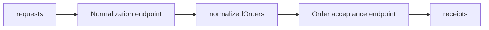

# input-channel and output-channel

## 1. Lesson Objectives

In the **Annotations and XML** chapter of the **SPRING_INTEGRATION_CORE** module, `input-channel` and `output-channel` describe how an endpoint connects to message channels. Understanding these two attributes accurately lets you read a flow's topology, choose execution mechanisms, and diagnose why messages stop or take the wrong branch.

After this lesson, you can:

- Distinguish channels, endpoints, and business methods.
- Convert declarations between XML, annotations, and Java DSL.
- Determine which endpoint needs a poller and where results are sent.
- Distinguish a fixed `output-channel` destination from a reply address in headers.
- Test the flow through channels instead of merely calling Java methods directly.

Examples use Java 17 syntax and Spring Integration 6.5 APIs. The project needs the `org.springframework.integration:spring-integration-core` dependency and JUnit Jupiter for tests. Dependency versions must match your project's BOM or Spring platform; this lesson needs no Spring Boot, broker, or external service.

## 2. Reading Attribute Names from the Endpoint's Perspective

An endpoint receives messages from an input channel, performs a processing role, and may emit results to an output channel:

```text
Producer
    |
    v
requests --[processing endpoint]--> results
  input-channel                  output-channel
```

Here:

- `input-channel` is the channel from which the endpoint **consumes messages**.
- `output-channel` is the channel to which the result-producing handler **sends result messages**.
- The business method is where operations on the payload or message run.
- A channel is a message-transfer point; a channel name itself contains no processing algorithm.

The same channel can be the output of an upstream endpoint and the input of a downstream endpoint. The words "input" and "output" describe relationships with each endpoint, not two permanent categories dividing all channels in the system.

For example:



For the normalization endpoint, `normalizedOrders` is the output channel. For the order acceptance endpoint, that very same channel is the input channel.

### 2.1. Three Kinds of Names to Distinguish

```xml
<int:channel id="requests"/>
<int:channel id="results"/>

<int:service-activator id="acceptEndpoint"
                       input-channel="requests"
                       output-channel="results"
                       ref="orderOperations"
                       method="accept"/>
```

This is an illustrative configuration snippet; the `orderOperations` bean must be declared separately.

| Name | Represents | Role |
| --- | --- | --- |
| `requests` | Channel bean | Receives messages from producer |
| `results` | Channel bean | Receives processing results |
| `acceptEndpoint` | Endpoint | Connects message reception to the handler |
| `orderOperations` | Business bean | Object holding the `accept` method |
| `accept` | Java method | Executes the business operation |

Do not use a service bean name as `output-channel` unless that bean is actually a channel. Nor does a channel name turn into a Kafka topic, JMS queue, or HTTP URL on its own. Communicating with external systems requires configuring dedicated adapters, gateways, or transport-backed channels.

## 3. One Relationship, Three Representations

| Meaning | XML | Annotation on POJO Method | Java DSL |
| --- | --- | --- | --- |
| Receive from channel | `input-channel="requests"` | `inputChannel = "requests"` | `IntegrationFlow.from("requests")` |
| Send result to channel | `output-channel="results"` | `outputChannel = "results"` | `.channel("results")` after result-producing step |
| Invoke service | `ref` and `method` | Annotated method | `.handle(service, "method")` |
| Transform payload | `<int:transformer>` | `@Transformer` | `.transform(...)` |

XML uses hyphenated attribute names; annotations use camelCase. Java DSL expresses relationships via chained operations with channels in between.

Connection points must rely on bean names or actual channel references. The framework does not infer "the next step" from method declaration order, bean placement in a configuration class, or suffixes like `Input` and `Output`.

Some annotations can auto-create channels when no matching bean exists yet. In the examples below, every channel is declared explicitly to control channel type, capacity, and execution style. Annotation registration is described in [Annotation Support](https://docs.spring.io/spring-integration/reference/6.5/configuration/annotations.html).

## 4. Annotation Example: Normalizing and Accepting Orders

The sample flow receives an order ID string, normalizes it, and creates a receipt:

```text
requests: DirectChannel
    -> normalize(String)
normalizedOrders: DirectChannel
    -> accept(String)
receipts: QueueChannel
```

Data contract at each connection point:

| Channel | Expected Payload | Example |
| --- | --- | --- |
| `requests` | `String` containing raw order ID | `"  ord-100  "` |
| `normalizedOrders` | Normalized `String` | `"ORD-100"` |
| `receipts` | `OrderReceipt` | Receipt with order ID and status |

Channel names do not validate payload types on behalf of handlers. If an out-of-contract type is sent, parameter binding or processing may fail; do not rely on implicit type conversion to mask contract mismatches.

The public types in the example reside in separate Java files under package `example.channels`.

### 4.1. Result Payload and Business POJO

```java
package example.channels;

public record OrderReceipt(String orderId, String status) {
}
```

```java
package example.channels;

import java.util.Locale;
import java.util.Objects;

public class OrderOperations {

    public String normalize(String rawOrderId) {
        String orderId = Objects.requireNonNull(
                rawOrderId, "rawOrderId").strip();

        if (orderId.isEmpty()) {
            throw new IllegalArgumentException("Order ID must not be blank");
        }

        return orderId.toUpperCase(Locale.ROOT);
    }

    public OrderReceipt accept(String orderId) {
        return new OrderReceipt(orderId, "ACCEPTED");
    }
}
```

`accept` here creates a receipt only in memory to keep focus on observing the flow. In a real application, if this step writes to a database or calls a service, design transactions, idempotency, and error handling as well.

### 4.2. Endpoint Methods

```java
package example.channels;

import org.springframework.integration.annotation.ServiceActivator;
import org.springframework.integration.annotation.Transformer;

public class OrderEndpoints {

    private final OrderOperations operations;

    public OrderEndpoints(OrderOperations operations) {
        this.operations = operations;
    }

    @Transformer(
            inputChannel = "requests",
            outputChannel = "normalizedOrders")
    public String normalize(String rawOrderId) {
        return operations.normalize(rawOrderId);
    }

    @ServiceActivator(
            inputChannel = "normalizedOrders",
            outputChannel = "receipts",
            requiresReply = "true",
            sendTimeout = "1000")
    public OrderReceipt accept(String orderId) {
        return operations.accept(orderId);
    }
}
```

When a message is sent to `requests`, the first endpoint extracts the payload, calls `normalize`, and sends the result to `normalizedOrders`. The second endpoint receives that result, calls `accept`, and emits `OrderReceipt` into `receipts`.

`requiresReply = "true"` requires the service activator to produce a result. It does not mean the caller receives the receipt directly as the return value of `MessageChannel.send`. `sendTimeout` limits send waiting based on the output channel's capacity; it does not limit the execution time of the entire business operation.

### 4.3. Spring Context Configuration

```java
package example.channels;

import org.springframework.context.annotation.Bean;
import org.springframework.context.annotation.Configuration;
import org.springframework.integration.channel.DirectChannel;
import org.springframework.integration.channel.QueueChannel;
import org.springframework.integration.config.EnableIntegration;

@Configuration
@EnableIntegration
public class ChannelFlowConfig {

    @Bean
    public DirectChannel requests() {
        return new DirectChannel();
    }

    @Bean
    public DirectChannel normalizedOrders() {
        return new DirectChannel();
    }

    @Bean
    public QueueChannel receipts() {
        return new QueueChannel(10);
    }

    @Bean
    public OrderOperations orderOperations() {
        return new OrderOperations();
    }

    @Bean
    public OrderEndpoints orderEndpoints(OrderOperations operations) {
        return new OrderEndpoints(operations);
    }
}
```

`@EnableIntegration` enables integration infrastructure for this Java configuration. `OrderEndpoints` is registered via `@Bean`, so no component scan is needed for that class. If choosing `@Component` or `@MessageEndpoint` with scanning, avoid registering the same endpoint class again via another bean.

`receipts` has no automatic consumer yet: the example will pull results with `receive` in tests. A queue can accept messages before a consumer exists, though having a message in the queue does not prove downstream business steps have completed.

### 4.4. Calling Java Directly vs. Sending a Message Are Different Execution Paths

```java
OrderReceipt receipt = operations.accept("ORD-100");
```

This call only executes a Java method. It does not go through `normalizedOrders`, does not trigger endpoints, and does not place a receipt onto `receipts`.

To test topology, you must send a `Message` into the flow's channel. After `send` succeeds, receive the message at the output or observe the actual consumer. The tests in section 11 exercise that exact path.

## 5. Equivalent XML Configuration

Reuse `OrderOperations` and `OrderReceipt`. XML registers endpoints directly, so this option neither loads `ChannelFlowConfig` nor registers `OrderEndpoints`.

```xml
<?xml version="1.0" encoding="UTF-8"?>
<beans xmlns="http://www.springframework.org/schema/beans"
       xmlns:xsi="http://www.w3.org/2001/XMLSchema-instance"
       xmlns:int="http://www.springframework.org/schema/integration"
       xsi:schemaLocation="
           http://www.springframework.org/schema/beans
           https://www.springframework.org/schema/beans/spring-beans.xsd
           http://www.springframework.org/schema/integration
           https://www.springframework.org/schema/integration/spring-integration.xsd">

    <int:channel id="requests"/>
    <int:channel id="normalizedOrders"/>

    <int:channel id="receipts">
        <int:queue capacity="10"/>
    </int:channel>

    <bean id="orderOperations"
          class="example.channels.OrderOperations"/>

    <int:transformer id="normalizeEndpoint"
                     input-channel="requests"
                     output-channel="normalizedOrders"
                     ref="orderOperations"
                     method="normalize"/>

    <int:service-activator id="acceptEndpoint"
                           input-channel="normalizedOrders"
                           output-channel="receipts"
                           ref="orderOperations"
                           method="accept"
                           requires-reply="true"
                           send-timeout="1000"/>
</beans>
```

`<int:channel>` without child elements creates a `DirectChannel`. `<int:queue>` changes the channel's storage and delivery mechanism into a queue. Where channels are declared in XML does not dictate processing order; input/output relationships determine the path. See [Configuring Message Channels](https://docs.spring.io/spring-integration/reference/6.5/channel/configuration.html).

Do not run both this XML and the annotation configuration simultaneously for the same topology. If two consumers listen on the same `DirectChannel`, messages may be dispatched to an unintended consumer; that does not make them two chained processing steps.

## 6. Input Channel Type Determines How Endpoints Receive Messages

The `input-channel` attribute selects the intake point. The channel type at that point determines how the endpoint is triggered.

| Channel | How the Endpoint Receives | Consequences to Remember |
| --- | --- | --- |
| `DirectChannel` | Registers handler and is invoked on `send` | Typically executes on the sending thread |
| `QueueChannel` | Pulls messages via polling | Consumer endpoint needs a dedicated poller or default poller |
| `PublishSubscribeChannel` | Registers subscribers | One message is distributed to subscribers |
| `ExecutorChannel` | Dispatches via configured executor | Can move processing to another thread; depends on executor policy |

`DirectChannel` dispatches across subscribers and can fail over on handler errors depending on configuration. Do not attach two endpoints to this same channel expecting it to mean "run endpoint A then run endpoint B."

`PublishSubscribeChannel` fits when multiple subscribers should each receive a notification. It does not split a collection into elements, nor does publish-subscribe automatically imply parallel execution: execution mechanics still depend on the executor. Channel traits are presented in [Message Channel Implementations](https://docs.spring.io/spring-integration/reference/6.5/channel/implementations.html).

### 6.1. The Poller Lives on the Endpoint Reading the Queue

Replace `normalizedOrders` in the example with `QueueChannel(10)`:

```text
requests: DirectChannel
    -> normalize
normalizedOrders: QueueChannel
    -> accept's poller
    -> accept
receipts: QueueChannel
```

Here, `normalize` still receives synchronously from `requests`. It is the `accept` endpoint that needs a poller because its input channel is a queue.

Replace the annotation on `accept` with:

```java
@ServiceActivator(
        inputChannel = "normalizedOrders",
        outputChannel = "receipts",
        requiresReply = "true",
        sendTimeout = "1000",
        poller = @Poller(
                fixedDelay = "200",
                maxMessagesPerPoll = "1"))
public OrderReceipt accept(String orderId) {
    return operations.accept(orderId);
}
```

Import `org.springframework.integration.annotation.Poller`. The `normalizedOrders` bean must also be changed to `QueueChannel`; do not change only the annotation. This is a replacement variant for the previous configuration.

Equivalent XML for the queue-reading endpoint:

```xml
<int:service-activator id="pollingAcceptEndpoint"
                       input-channel="normalizedOrders"
                       output-channel="receipts"
                       ref="orderOperations"
                       method="accept"
                       requires-reply="true"
                       send-timeout="1000">
    <int:poller fixed-delay="200" max-messages-per-poll="1"/>
</int:service-activator>
```

Having `receipts` as an output queue does not make `accept` require another poller. Only if another endpoint reads `receipts` does that downstream endpoint need a poller. A direct `receive` in tests can also pull messages, but does not replace application consumer configuration.

### 6.2. A Queue Is a Buffer, Not a Self-Running Worker

A queue holds messages waiting for a receiver. It does not call services or spawn a business-processing thread on its own. In the variant with an intermediate queue, `requests.send(...)` can finish before `accept` runs.

The example queues live in memory and have bounded capacity. If data must survive process shutdown, pick an appropriate message store or transport; renaming a channel does not add persistence.

### 6.3. Error Paths Depend on Execution Boundaries

With the first two channels as `DirectChannel`s in the original example, handler errors can propagate back to the `send` caller. When work is executed asynchronously by a Spring Integration poller or executor, the system typically converts errors into `ErrorMessage`s per error-handling configuration.

`output-channel` is the business result path. It does not become an exception-receiving path on its own. The `errorChannel` header and global error channel serve a different contract from `output-channel` or `replyChannel`. See [Error Handling](https://docs.spring.io/spring-integration/reference/6.5/error-handling.html).

## 7. An Output Channel Does Not Create Results by Itself

Having an output channel only specifies the **send destination**. The endpoint still must produce an appropriate result to send.

### 7.1. Service Activator Returning void or null

Consider a variant:

```java
@ServiceActivator(
        inputChannel = "normalizedOrders",
        outputChannel = "receipts")
public void record(String orderId) {
    repository.save(orderId);
}
```

This is an example of a different method; `repository` represents an injected business dependency. Despite having `outputChannel`, a `void` method creates no `OrderReceipt` and does not forward the order ID string to `receipts` automatically.

If the flow must continue after a side effect, define an explicit result contract, such as returning the order ID or a receipt. If the endpoint is allowed to terminate the flow, remove the caller's expectation of waiting for a reply.

For a service activator:

| Method Result | Configuration | Expected Behavior |
| --- | --- | --- |
| Returns an object | Valid send destination exists | Emits result message |
| Returns `void` or `null` | Reply not required | Terminates processing at this endpoint |
| Returns `null` | `requiresReply = "true"` | Raises error because required reply is missing |
| Returns an object | No usable output channel or reply destination | Destination resolution error |
| Returns an object | Output is `nullChannel` | Result is intentionally discarded |

Do not mechanically apply the service activator's `null` rule to every endpoint. For example, a transformer must produce a valid transformed result; returning `null` is not a general way to use a transformer as a filter.

### 7.2. Ending with nullChannel

If a method produces a result but the designed branch does not use it, configure explicitly:

```xml
<int:service-activator input-channel="normalizedOrders"
                       output-channel="nullChannel"
                       ref="orderOperations"
                       method="accept"/>
```

`nullChannel` is a special framework-provided channel. It accepts and discards messages. This is a branch-terminating choice; a caller waiting for a receipt will not receive a success reply automatically.

### 7.3. Successful Send Does Not Equal Business Result

`MessageChannel.send` returns a `boolean` indicating send status per channel contract; it does not return a business payload. With a queue, success usually only indicates the message entered the buffer. With a synchronous channel, the handler may have executed, yet the caller still needs request-reply or an output channel receive to obtain the result.

Timeouts must also be distinguished:

- Send timeout relates to whether the channel can accept the message, such as whether a queue has space.
- Receive or reply timeout relates to whether a reply message arrives.
- API or database timeouts bound the corresponding business operation.

Send timeout does not interrupt a long-running Java method invoked synchronously over `DirectChannel`. Do not use one channel timeout value as a substitute for all system bounds.

## 8. Output Channel and the replyChannel Header

For a reply-producing service activator, destination selection follows a precedence order. In typical cases:

1. Use `output-channel` configured on the handler if present.
2. If no fixed target is configured, inspect the request's `replyChannel` header.
3. When the request has no reply address and the result is a `Message`, the handler can inspect `replyChannel` on the result message.
4. If no valid destination exists for a required reply, raise a destination resolution error.

The `replyChannel` header can hold a `MessageChannel` object or a resolvable channel name. Destination selection and result handling are described in [Service Activator](https://docs.spring.io/spring-integration/reference/6.5/service-activator.html).

The two mechanisms serve two needs:

| Mechanism | Characteristics | Suitable Case |
| --- | --- | --- |
| `output-channel` | Fixed destination for a step in topology | Forwarding from normalization to order acceptance |
| `replyChannel` header | Reply address traveling with the request | Sending the result back to the exact caller |
| `errorChannel` | Error notification path per execution config | Handling failures of asynchronous work |

### 8.1. Fixed Output Takes Precedence

In the original example, the final endpoint has `outputChannel = "receipts"`. If a producer attaches another queue to the `replyChannel` header, the receipt still goes to `receipts`. It does not send an extra copy to the header's queue.

This is a common reason why a gateway waits for a reply while the result sits in a fixed queue. The gateway succeeding in sending a request does not prove the return path to the caller is wired properly.

### 8.2. Per-Request Reply Endpoint Variant

A short endpoint without a fixed output can look like:

```java
@ServiceActivator(
        inputChannel = "replyRequests",
        requiresReply = "true")
public OrderReceipt accept(String orderId) {
    return new OrderReceipt(orderId, "ACCEPTED");
}
```

This snippet is a standalone variant receiving a normalized order ID. The endpoint bean must be registered by Spring and the `replyRequests` channel must exist in the context.

A caller can create a dedicated queue for the reply:

```java
QueueChannel replies = new QueueChannel(1);

Message<String> request = MessageBuilder
        .withPayload("ORD-100")
        .setReplyChannel(replies)
        .build();

replyRequests.send(request);
Message<?> reply = replies.receive(1000);
```

`replyRequests` here is a reference to the variant's input channel. The `replies` queue needs no bean name because the header carries the channel object reference directly. The test section below provides full context for this approach.

Do not confuse `outputChannel` with an arbitrary header named `outputChannel`. The handler configuration attribute and the reply address in `MessageHeaders.REPLY_CHANNEL` are two distinct mechanisms.

### 8.3. Gateway Hiding Reply Channel Creation

The flow can be invoked through an interface:

```java
package example.channels;

import org.springframework.integration.annotation.MessagingGateway;

@MessagingGateway(
        defaultRequestChannel = "replyRequests",
        defaultReplyTimeout = "1000")
public interface OrderGateway {
    OrderReceipt submit(String normalizedOrderId);
}
```

This interface must be registered through a gateway mechanism, such as adding `@IntegrationComponentScan(basePackageClasses = OrderGateway.class)` to an appropriate configuration. The scan annotation lives in `org.springframework.integration.annotation`.

A request-reply gateway typically creates a temporary reply address and attaches it to the request. A final endpoint without a fixed output can use that address to return an `OrderReceipt` to the caller. You do not need to create a single shared reply queue for all callers.

When a flow has multiple steps, keep fixed output channels on intermediate steps to stay on the pipeline. Only the final endpoint replies to the request's reply address if the flow contract calls for it. Preserve necessary headers across steps, especially when manually building new messages. See [Messaging Gateways](https://docs.spring.io/spring-integration/reference/6.5/gateway.html).

## 9. Do Not Apply One Attribute Pattern to Every Component

`input-channel` and `output-channel` are pervasive, yet result emission semantics still depend on the endpoint type.

| Component | What to Watch When Reading Links |
| --- | --- |
| Transformer | Transformed result goes to output channel or appropriate reply address |
| Filter | Only accepted messages proceed; rejected branch can use a discard channel |
| Splitter | One input can emit multiple messages to the output |
| Aggregator | Only emits a result when the group release condition is met |
| Router | Chooses one or more destinations per routing rules; has routing-specific attributes |
| Channel adapter | Many adapters use a `channel` attribute to connect to internal flows |
| Messaging gateway | Uses request/reply configuration to express interaction with callers |

Do not add `output-channel` to every XML element out of habit. Check the contract and schema of the exact endpoint, especially routers, inbound adapters, and outbound adapters.

### 9.1. POJO Method vs. @Bean Factory

The main example places annotations on a processing method of a POJO bean. That is where Spring maps payloads and invokes business logic per message.

Another case is placing annotations on a `@Bean` factory returning a pre-configured `MessageHandler`. Then the endpoint uses **the handler created by the factory**; the factory is not invoked again per message. Handler-owned attributes, such as output channel, must be set directly on the handler via its API. Do not assume every annotation attribute from the POJO example applies identically to a factory. See [Annotations on @Bean Methods](https://docs.spring.io/spring-integration/reference/6.5/configuration/meta-annotations.html).

## 10. Reading the Same Topology in Java DSL

In an alternative Java configuration, keep the `requests`, `normalizedOrders`, `receipts`, and `orderOperations` beans from section 4. Omit the `OrderEndpoints` bean and replace it with this flow bean:

```java
import org.springframework.context.annotation.Bean;
import org.springframework.integration.dsl.IntegrationFlow;

@Bean
public IntegrationFlow orderFlow(OrderOperations operations) {
    return IntegrationFlow.from("requests")
            .transform(operations, "normalize")
            .channel("normalizedOrders")
            .handle(operations, "accept",
                    endpoint -> endpoint
                            .requiresReply(true)
                            .sendTimeout(1000))
            .channel("receipts")
            .get();
}
```

Place this method in a configuration class with `@Configuration` and `@EnableIntegration`. Imports for the configuration class and channel beans remain the same as in section 4.

Reading the chain from left to right:

1. `from("requests")` designates the flow's input.
2. `transform` produces the normalized result.
3. `channel("normalizedOrders")` is the link between the two steps.
4. `handle` invokes the acceptance business logic.
5. `channel("receipts")` receives the final result.

Between consecutive DSL steps there may be internal channels created by the framework. Declaring a named channel is helpful when you need observability, interceptors, or explicit boundaries in the flow contract.

Do not simultaneously register both this flow bean and the old annotated endpoints on the same channels. The two configurations are alternatives; they do not combine into a longer flow.

## 11. Testing Endpoint Connection Contracts

The tests below use JUnit Jupiter and create a fresh Spring context scoped to each test. They test sending and receiving messages, not merely return values from direct POJO calls.

### 11.1. Fixed Output Takes Precedence Over replyChannel

```java
package example.channels;

import org.junit.jupiter.api.Test;
import org.springframework.context.annotation.AnnotationConfigApplicationContext;
import org.springframework.integration.channel.DirectChannel;
import org.springframework.integration.channel.QueueChannel;
import org.springframework.messaging.Message;
import org.springframework.messaging.support.MessageBuilder;

import static org.junit.jupiter.api.Assertions.*;

class FixedOutputChannelTest {

    @Test
    void sendsTheReceiptToTheConfiguredOutput() {
        try (var context =
                     new AnnotationConfigApplicationContext(
                             ChannelFlowConfig.class)) {

            var requests =
                    context.getBean("requests", DirectChannel.class);
            var receipts =
                    context.getBean("receipts", QueueChannel.class);
            var callerReplies = new QueueChannel(1);

            Message<String> request = MessageBuilder
                    .withPayload("  ord-100  ")
                    .setHeader("traceId", "TRACE-100")
                    .setReplyChannel(callerReplies)
                    .build();

            assertTrue(requests.send(request));

            Message<?> result = receipts.receive(1000);
            assertNotNull(result);
            assertEquals(
                    new OrderReceipt("ORD-100", "ACCEPTED"),
                    result.getPayload());
            assertEquals("TRACE-100",
                    result.getHeaders().get("traceId"));

            assertNull(callerReplies.receive(0));
            assertNull(receipts.receive(0));
        }
    }
}
```

The test verifies the whole route: normalization ran, the receipt has the right payload, the trace header is preserved, and the result went to `receipts`. The queue supplied by the caller in the header receives no duplicate copy.

The `receive(0)` checks work here because the entire path to the final queue is synchronous. For variants with a poller or executor, wait for appropriate completion conditions before concluding no messages remain.

### 11.2. Using the Reply Address When No Fixed Output Exists

The test below declares a separate context for the `replyRequests` variant. Do not load the three-channel topology from section 4.

```java
package example.channels;

import org.junit.jupiter.api.Test;
import org.springframework.context.annotation.AnnotationConfigApplicationContext;
import org.springframework.context.annotation.Bean;
import org.springframework.context.annotation.Configuration;
import org.springframework.integration.annotation.ServiceActivator;
import org.springframework.integration.channel.DirectChannel;
import org.springframework.integration.channel.QueueChannel;
import org.springframework.integration.config.EnableIntegration;
import org.springframework.messaging.Message;
import org.springframework.messaging.MessagingException;
import org.springframework.messaging.support.MessageBuilder;

import static org.junit.jupiter.api.Assertions.*;

class ReplyChannelTest {

    @Test
    void usesTheReplyChannelFromTheRequest() {
        try (var context =
                     new AnnotationConfigApplicationContext(
                             ReplyOnlyConfig.class)) {

            var requests =
                    context.getBean("replyRequests", DirectChannel.class);
            var replies = new QueueChannel(1);

            Message<String> request = MessageBuilder
                    .withPayload("ORD-101")
                    .setReplyChannel(replies)
                    .build();

            assertTrue(requests.send(request));

            Message<?> reply = replies.receive(1000);
            assertNotNull(reply);
            assertEquals(
                    new OrderReceipt("ORD-101", "ACCEPTED"),
                    reply.getPayload());
            assertNull(replies.receive(0));
        }
    }

    @Test
    void failsWhenAResultHasNoReplyDestination() {
        try (var context =
                     new AnnotationConfigApplicationContext(
                             ReplyOnlyConfig.class)) {

            var requests =
                    context.getBean("replyRequests", DirectChannel.class);
            Message<String> request = MessageBuilder
                    .withPayload("ORD-102")
                    .build();

            assertThrows(MessagingException.class,
                    () -> requests.send(request));
        }
    }

    @Configuration
    @EnableIntegration
    static class ReplyOnlyConfig {

        @Bean
        public DirectChannel replyRequests() {
            return new DirectChannel();
        }

        @Bean
        public ReturnAddressEndpoint returnAddressEndpoint() {
            return new ReturnAddressEndpoint();
        }
    }

    static class ReturnAddressEndpoint {

        @ServiceActivator(
                inputChannel = "replyRequests",
                requiresReply = "true")
        public OrderReceipt accept(String orderId) {
            return new OrderReceipt(orderId, "ACCEPTED");
        }
    }
}
```

The first test confirms a header suffices to provide a reply destination. The second test shows that omitting output channel does not mean the result is dropped or returned to the input channel. When a handler has a result to send and no valid destination exists, the flow fails.

### 11.3. Comparing XML and DSL Using the Same Assertions

To test XML, save the configuration from section 5 as `channel-flow.xml` on the classpath and use `ClassPathXmlApplicationContext` instead of the context initialization in the first test. The `requests` and `receipts` beans keep the same names and types, so payload, trace header, and output precedence contracts remain identical.

For DSL, load the alternative configuration class that registers `orderFlow`. Do not also load `ChannelFlowConfig` containing annotated endpoints.

Tests must observe the contract's outcome. Successful context startup does not prove messages reach the right destination; an output `DirectChannel` lacking a subscriber may only reveal the error when a message arrives.

## 12. Common Pitfalls and Reasoning

| Symptom | What to Check |
| --- | --- |
| Message enters but next step never happens | Did the handler produce a result; does output have the right channel name |
| Output channel exists but no output message arrives | Did the method return `void` or `null`; did a filter drop the message |
| Sending to synchronous channel reports no subscriber | Is the endpoint registered, running, and listening on the right input channel |
| Switched channel to queue and endpoint stops running | Does the queue-reading consumer have a poller or default poller |
| Queue has messages but business logic does not run | Is there an actual consumer pulling messages |
| Gateway times out while output queue holds results | Does the final endpoint have a fixed output preventing replies from reaching the caller |
| Result fails with missing reply destination | Is there a usable output or `replyChannel` header |
| Two services do not run sequentially | Are both listening on one point-to-point channel instead of wired via two channels |
| Messages loop continuously | Does output point back into input or form a cycle without a stop condition |
| Sending slows under high load | Is a queue full or is a synchronous downstream running slowly |
| Errors do not appear on output channel | Are you confusing the result path with error handling |

If an endpoint's output points back to its own input via `DirectChannel`, a flow without a stop condition can recurse repeatedly and exhaust the stack. With a queue in between, a cycle can cause the same work to reprocess across polling cycles. Every loop in a topology must be intentional and have an explicit termination condition or bound.

When reading an unfamiliar flow, trace one edge at a time: who sends to the channel, which endpoint receives, what the handler returns, and where the result goes. Only then inspect threads, pollers, queue bounds, and error paths. This reading discipline applies consistently across XML, annotations, and DSL.

## 13. Reference Documentation

- [Annotation Support](https://docs.spring.io/spring-integration/reference/6.5/configuration/annotations.html): declaring messaging methods and wiring channels.
- [Service Activator](https://docs.spring.io/spring-integration/reference/6.5/service-activator.html): results, output channels, and reply destinations.
- [Configuring Message Channels](https://docs.spring.io/spring-integration/reference/6.5/channel/configuration.html): declaring channels in Java and XML.
- [Message Channel Implementations](https://docs.spring.io/spring-integration/reference/6.5/channel/implementations.html): dispatching and buffering mechanisms.
- [Messaging Gateways](https://docs.spring.io/spring-integration/reference/6.5/gateway.html): request channels and reply addresses.
- [Annotations on @Bean Methods](https://docs.spring.io/spring-integration/reference/6.5/configuration/meta-annotations.html): distinguishing factory beans from POJO methods.
- [Error Handling](https://docs.spring.io/spring-integration/reference/6.5/error-handling.html): synchronous and asynchronous error boundaries.
