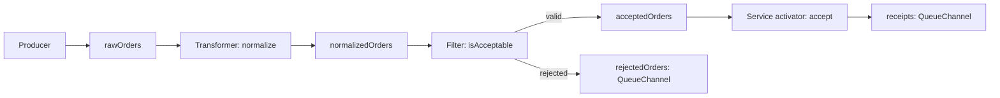

# XML Namespace Configuration — Configuring Spring Integration Flows with XML

In the **Annotations and XML** chapter of **SPRING_INTEGRATION_CORE**, XML namespace configuration is a way to declare channels, endpoints, and integration components using domain-meaningful XML elements such as `channel`, `transformer`, `filter`, `router`, `service-activator`, and `gateway`.

This lesson uses an order normalization, validation, and acceptance flow to explain namespace structure, endpoint wiring, and execution behavior. You will learn how to read an XML configuration into a message flow diagram, load it into Spring, add pollers when needed, and test both the success branch and the discarded branch.

The examples take Java 17 and Spring Integration 6.5.x as the API baseline. The main example requires `spring-integration-core` along with compatible Spring libraries; tests use JUnit Jupiter. Let your project's BOM manage Spring versions consistently. The file and class names below are illustrative layouts for practice, not requirements to change your current project structure.

## 1. What Does the Namespace Help Express?

If using plain bean definitions, a single endpoint can require multiple declarations for the handler, consumer, channels, and references between them. The Integration namespace provides syntax that directly expresses intent:

```xml
<int:service-activator id="acceptOrderEndpoint"
                       input-channel="acceptedOrders"
                       output-channel="receipts"
                       ref="orderFlowService"
                       method="accept"/>
```

Read the configuration left to right in terms of flow: receive messages from `acceptedOrders`, invoke method `accept` on bean `orderFlowService`, and send the result to `receipts`.

XML elements are translated by Spring Integration's parsers into bean definitions. When the context initializes, those beans create the channels, handlers, and endpoints that run the flow. XML is a way to describe application structure; it is not a separate message-processing engine. [Spring XML namespace extension mechanism](https://docs.spring.io/spring-framework/reference/core/appendix/xml-custom.html).

Therefore, switching from annotations or Java DSL to XML does not lose the module's core concepts: messages still have payloads and headers, channels still govern delivery, and endpoints still connect processing components to channels.

## 2. Reading the Header of an XML Document Correctly

A minimal core configuration document has the structure:

```xml
<?xml version="1.0" encoding="UTF-8"?>
<beans xmlns="http://www.springframework.org/schema/beans"
       xmlns:xsi="http://www.w3.org/2001/XMLSchema-instance"
       xmlns:int="http://www.springframework.org/schema/integration"
       xsi:schemaLocation="
         http://www.springframework.org/schema/beans
         https://www.springframework.org/schema/beans/spring-beans.xsd
         http://www.springframework.org/schema/integration
         https://www.springframework.org/schema/integration/spring-integration.xsd">

    <int:channel id="input"/>

</beans>
```

There are three pieces of information to separate:

| Component | Meaning |
| --- | --- |
| `xmlns:int` | Binds prefix `int` to Spring Integration's namespace URI |
| Namespace URI | Identifies the element group, e.g. `http://www.springframework.org/schema/integration` |
| `xsi:schemaLocation` | Pairs of namespace URI and XSD location used to validate XML structure |

`schemaLocation` is a list of **pairs**, not a list of standalone URLs. Each namespace must be paired with its corresponding XSD. The prefix `int` can be renamed if used consistently; the URI is the real identifier. [Official core namespace configuration](https://docs.spring.io/spring-integration/reference/6.5/configuration/namespace.html).

In this template, the namespace URI uses `http`, while the XSD location uses `https`. Those are two different roles. Do not manually change the URI to `https://www.springframework.org/schema/integration` just to look uniform: namespace handlers are registered by exact URI. [Namespace handler mappings in the core module](https://github.com/spring-projects/spring-integration/blob/v6.5.10/spring-integration-core/src/main/resources/META-INF/spring.handlers).

### Default Namespace Governs Unprefixed Tags

Because the default `xmlns` in the example is the `beans` namespace, `<bean>` and `<import>` belong to Spring Beans. Integration elements require a prefix, such as `<int:channel>`.

You can also make Integration the default namespace, though then standard beans must be written with a prefix, such as `<beans:bean>`. Within the same configuration group, stick to one consistent style so readers do not have to guess which schema each tag belongs to.

### XSD Does Not Install Libraries or Select Runtime Versions

Adding an XSD URL does not put `spring-integration-core` on the classpath. XSD checks syntax, while parsers and execution classes must exist in the application's dependencies.

The core module packages `META-INF/spring.schemas` mappings, allowing Spring to resolve supported schema URLs to resources inside the JAR. Thus, the application does not have to download XSDs over the network on every startup. Versionless XSD URLs also do not mean the runtime automatically upgrades to the latest release. [Packaged schema mappings in Spring Integration](https://github.com/spring-projects/spring-integration/blob/v6.5.10/spring-integration-core/src/main/resources/META-INF/spring.schemas).

## 3. Preparing the Example: Order-Intake Flow

Suppose an external sender submits an order containing an order ID and quantity. The flow needs to:

1. Trim leading/trailing whitespace and uppercase the order ID.
2. Accept non-blank IDs and quantities greater than 0.
3. For valid orders, create a receipt.
4. For invalid orders, route the message to a separate queue for inspection.



Channels between steps are `DirectChannel`s. The two final channels use queues so learners can receive and observe results without writing full production consumers yet.

### 3.1. Two Payload Types

Place each public class in its matching Java file under package `example.xmlflow`:

```java
package example.xmlflow;

import java.util.Objects;

public record OrderCommand(String id, int quantity) {

    public OrderCommand {
        Objects.requireNonNull(id, "id must not be null");
    }
}
```

```java
package example.xmlflow;

public record OrderReceipt(String orderId, int quantity, String status) {
}
```

Quantity is not blocked directly in the constructor so we can practice the filter's rejection branch. A `null` order ID is a data error violating the input type contract; empty or whitespace-only strings are allowed into the flow for the filter to decide.

### 3.2. Business POJO

```java
package example.xmlflow;

import java.util.Locale;

public class OrderFlowService {

    public OrderCommand normalize(OrderCommand command) {
        return new OrderCommand(
                command.id().strip().toUpperCase(Locale.ROOT),
                command.quantity());
    }

    public boolean isAcceptable(OrderCommand command) {
        return !command.id().isBlank() && command.quantity() > 0;
    }

    public OrderReceipt accept(OrderCommand command) {
        return new OrderReceipt(
                command.id(), command.quantity(), "ACCEPTED");
    }
}
```

This class needs no `@Transformer`, `@Filter`, or `@ServiceActivator`, because XML specifies which method plays which role. Separating the POJO makes business logic testable independently of wiring configuration.

## 4. Complete XML Configuration

When practicing, place the following resource at `src/main/resources/integration/order-flow.xml` so its classpath path is `integration/order-flow.xml`:

```xml
<?xml version="1.0" encoding="UTF-8"?>
<beans xmlns="http://www.springframework.org/schema/beans"
       xmlns:xsi="http://www.w3.org/2001/XMLSchema-instance"
       xmlns:int="http://www.springframework.org/schema/integration"
       xsi:schemaLocation="
         http://www.springframework.org/schema/beans
         https://www.springframework.org/schema/beans/spring-beans.xsd
         http://www.springframework.org/schema/integration
         https://www.springframework.org/schema/integration/spring-integration.xsd">

    <bean id="orderFlowService"
          class="example.xmlflow.OrderFlowService"/>

    <int:channel id="rawOrders"/>
    <int:channel id="normalizedOrders"/>
    <int:channel id="acceptedOrders"/>

    <int:channel id="rejectedOrders">
        <int:queue capacity="100"/>
    </int:channel>

    <int:channel id="receipts">
        <int:queue capacity="100"/>
    </int:channel>

    <int:transformer id="normalizeOrderEndpoint"
                     input-channel="rawOrders"
                     output-channel="normalizedOrders"
                     ref="orderFlowService"
                     method="normalize"/>

    <int:filter id="validateOrderEndpoint"
                input-channel="normalizedOrders"
                output-channel="acceptedOrders"
                discard-channel="rejectedOrders"
                throw-exception-on-rejection="false"
                ref="orderFlowService"
                method="isAcceptable"/>

    <int:service-activator id="acceptOrderEndpoint"
                           input-channel="acceptedOrders"
                           output-channel="receipts"
                           requires-reply="true"
                           ref="orderFlowService"
                           method="accept"/>

</beans>
```

The order of tags in the file does not dictate message processing order. The `input-channel`, `output-channel`, and `discard-channel` links form the flow structure. Placing channels and beans before endpoints is simply an organization choice for readability.

The filter sends rejected messages to `discard-channel`; it does not create an `OrderReceipt` for that order. The attribute `throw-exception-on-rejection="false"` expresses the intent to treat this as a classification branch rather than an exception. [Configuring filters with XML](https://docs.spring.io/spring-integration/reference/6.5/filter.html).

`requires-reply="true"` forces the service activator to raise an error if the handler fails to produce the required result. `output-channel="receipts"` specifies where receipts are sent. [Configuring service activators and replies](https://docs.spring.io/spring-integration/reference/6.5/service-activator.html).

## 5. Loading XML and Observing Messages

A standalone Java application can load the resource via `ClassPathXmlApplicationContext`. Simply placing an XML file in resources does not load it automatically.

```java
package example.xmlflow;

import org.springframework.context.support.ClassPathXmlApplicationContext;
import org.springframework.messaging.Message;
import org.springframework.messaging.MessageChannel;
import org.springframework.messaging.PollableChannel;
import org.springframework.messaging.support.MessageBuilder;

public class XmlFlowDemo {

    public static void main(String[] args) {
        try (var context = new ClassPathXmlApplicationContext(
                "integration/order-flow.xml")) {

            MessageChannel input = context.getBean(
                    "rawOrders", MessageChannel.class);
            PollableChannel receipts = context.getBean(
                    "receipts", PollableChannel.class);

            Message<OrderCommand> request = MessageBuilder
                    .withPayload(new OrderCommand("  od-42  ", 3))
                    .setHeader("traceId", "trace-42")
                    .build();

            if (!input.send(request, 1000)) {
                throw new IllegalStateException("Input rejected the message");
            }

            Message<?> reply = receipts.receive(1000);
            if (reply == null) {
                throw new IllegalStateException("No receipt available");
            }

            System.out.println(reply.getPayload());
            System.out.println(reply.getHeaders().get("traceId"));
        }
    }
}
```

Expected payload is an `OrderReceipt` with ID `OD-42`, quantity `3`, status `ACCEPTED`; the business header `traceId` stays attached to the result.

The transformer returns a new `OrderCommand` payload, and the framework wraps it in a message for forwarding. If you manually return a `Message<?>` from a transformer, building its header set must be reviewed against the transformer contract, especially headers used for correlation or replies. [Roles and return types of transformers](https://docs.spring.io/spring-integration/reference/6.5/transformer.html).

Do not use `send()` returning `true` to conclude every order was accepted. With quantity `0`, the input can still accept the message successfully, while the filter routes it to `rejectedOrders` and produces no receipt.

## 6. Viewing XML as Beans and Links Between Them

| Attribute | Question It Answers |
| --- | --- |
| `id` | What name does this component carry in the Spring context? |
| `input-channel` | Where does the endpoint receive messages from? |
| `output-channel` | Where are results forwarded? |
| `ref` | Which processing bean is used? |
| `method` | Which public method on that bean is invoked? |
| `discard-channel` | Where does the filter send rejected messages? |
| `auto-startup` | Does the endpoint start automatically with context lifecycle? |

`ref="orderFlowService"` is a bean name, not the class name `OrderFlowService`. Inside `<bean>`, the `class` attribute takes the fully qualified class name. Endpoint name `acceptOrderEndpoint` also differs from POJO bean name `orderFlowService`; each has its own role.

A stateless POJO can supply multiple methods to endpoints as in the example. When shared state is added, consider concurrent calls from multiple threads into that singleton.

A valid XSD only verifies structure known to the schema. It does not prove Java classes exist on the classpath, referenced beans exist, methods accept the right payloads, or flows always have subscribers. Those must be checked when the context initializes and when messages are sent.

### Common Core Namespace Vocabulary

| Element | Role in the Flow |
| --- | --- |
| `int:channel` | Declares a point-to-point channel or queue-backed channel |
| `int:publish-subscribe-channel` | Broadcasts messages to subscribers |
| `int:transformer` | Converts payloads or builds messages in another representation |
| `int:filter` | Keeps or drops based on a condition |
| `int:router` | Selects one or more target channels |
| `int:splitter` | Emits message parts from one input |
| `int:aggregator` | Correlates and combines related messages |
| `int:service-activator` | Connects a business-processing bean to channels |
| `int:gateway` | Creates an invocation entry point via a Java interface |
| `int:bridge` | Forwards messages between channels |
| `int:poller` | Describes how an endpoint pulls messages on a schedule |

Not every endpoint shares the same attribute set. Routers typically determine targets via mappings or method results; do not guess by copying service-activator attributes onto a router. Consult the schema matching your library version when your IDE or parser reports an unsupported attribute. [Spring Integration 6.5.10 core schema](https://github.com/spring-projects/spring-integration/blob/v6.5.10/spring-integration-core/src/main/resources/org/springframework/integration/config/spring-integration.xsd).

## 7. Channel Type Determines How Endpoints Receive Messages

Two similar-looking configurations can carry very different execution behavior:

```xml
<!-- DirectChannel: handler is invoked on the sending thread. -->
<int:channel id="directInput"/>

<!-- QueueChannel: messages are buffered for receivers to pull later. -->
<int:channel id="queuedInput">
    <int:queue capacity="100"/>
</int:channel>

<!-- Broadcasts to subscribers. -->
<int:publish-subscribe-channel id="orderEvents"/>
```

`int:channel` without child elements creates a `DirectChannel`; adding `int:queue` creates a pollable buffered channel. With a subscribable input, endpoints can subscribe to receive; with a pollable input, endpoints must pull messages via polling. [Configuring channels with XML](https://docs.spring.io/spring-integration/reference/6.5/channel/configuration.html).

In the main example, `receipts` is an output queue and the program actively calls `receive()`. There is no need to add a poller just because it has a queue. A poller is needed when an **endpoint** attaches to that queue to pull automatically.

`capacity="100"` is a limit on how many messages can sit in the queue. It is not a count of concurrent worker threads. Example queues live in memory; declaring capacity does not turn one into a durable queue or an external broker.

`DirectChannel` is also not broadcast: adding two service activators listening on one channel does not mean both always receive copies of every message. When every consumer must receive an event, consider publish-subscribe and explicitly design behavior when one subscriber fails.

## 8. Configuring a Poller When Switching Input to a Queue

To try this variant, replace the `rawOrders` declaration from the main example with a queue, then **replace** the old transformer with the following poller-equipped endpoint. Do not keep two transformers listening on `rawOrders`.

```xml
<int:channel id="rawOrders">
    <int:queue capacity="100"/>
</int:channel>

<int:channel id="flowErrors">
    <int:queue capacity="100"/>
</int:channel>

<int:transformer id="normalizeOrderEndpoint"
                 input-channel="rawOrders"
                 output-channel="normalizedOrders"
                 ref="orderFlowService"
                 method="normalize">
    <int:poller fixed-delay="200"
                max-messages-per-poll="10"
                receive-timeout="0"
                error-channel="flowErrors"/>
</int:transformer>
```

The poller pulls up to 10 messages per cycle, uses a 200 ms fixed delay between cycles, and does not wait when a receive encounters an empty queue. These numbers do not guarantee throughput or business completion time; handler processing duration still affects the entire cycle.

A poller can be extracted into a reusable declaration:

```xml
<int:poller id="orderPoller"
            fixed-delay="200"
            max-messages-per-poll="10"
            receive-timeout="0"
            error-channel="flowErrors"/>

<!-- Child element inside an endpoint using this poller. -->
<int:poller ref="orderPoller"/>
```

The two snippets sit in different places: the poller with `id` sits at top level inside `beans`; the poller with `ref` sits inside the endpoint. Do not combine `ref` with schedule attributes like `fixed-delay` on the same element.

If you want a default poller for endpoints needing polling without a dedicated one, declare a top-level poller with `default="true"`. Only one global default poller can exist in a context; this option changes default behavior for many endpoints, so place it somewhere easy to spot. [Endpoint namespace support and poller options](https://docs.spring.io/spring-integration/reference/6.5/endpoint.html#endpoint-namespace).

## 9. Distinguishing the Discard Branch from Exception Handling

In the sample flow, an invalid quantity is a business decision: the message goes to `rejectedOrders`. The payload there is still the normalized `OrderCommand`.

If `normalize()` or `accept()` throws an exception, that is a processing failure. A filter's `discard-channel` does not automatically catch all exceptions in the flow.

With a `DirectChannel` chain and a producer calling `send()` directly, exceptions can propagate back along the same call stack. Adding an `errorChannel` header alone does not turn all synchronous errors into error messages.

With the poller variant, errors during a polling cycle are routed by the poller's error handler to the appropriate error channel. `error-channel="flowErrors"` designates where the poller sends errors; the example sets no separate error header on messages. The payload of an `ErrorMessage` is an exception, unlike the order payload in `rejectedOrders`. [Spring Integration error-handling mechanism](https://docs.spring.io/spring-integration/reference/6.5/error-handling.html).

In practice exercises, you can receive from `flowErrors` to observe errors. In production systems, you need an error-handling consumer, correlation metadata retention, and a recovery policy. The name `flowErrors` by itself creates no retries, transactions, or zero-loss guarantees.

## 10. SpEL Expressions, Placeholders, and XML Characters

### 10.1. Choosing a POJO or an Expression for an Endpoint

The example's filter can be replaced with an equivalent expression:

```xml
<int:filter id="validateOrderEndpoint"
            input-channel="normalizedOrders"
            output-channel="acceptedOrders"
            discard-channel="rejectedOrders"
            expression="!payload.id().isBlank() &amp;&amp; payload.quantity() &gt; 0"/>
```

Inside `expression`, `payload` and `headers` are accessible in the message context. Do not wrap this endpoint expression in `#{...}`. Use one way to define logic, such as `expression` or `ref` with `method`; do not combine both as if they were two sequential steps.

Expressions fit short conditions. When conditions branch extensively or call other services, a POJO usually improves naming and testability.

### 10.2. Placeholders Are Environment Configuration

To use the `context` namespace, add to the root tag:

```xml
xmlns:context="http://www.springframework.org/schema/context"
```

And add the corresponding schema pair to `xsi:schemaLocation`:

```text
http://www.springframework.org/schema/context
https://www.springframework.org/schema/context/spring-context.xsd
```

Then you can configure:

```xml
<context:property-placeholder/>

<int:poller id="orderPoller"
            fixed-delay="${orders.poll-delay-ms:200}"
            max-messages-per-poll="${orders.max-per-poll:10}"
            receive-timeout="0"/>
```

Values can come from environment property sources; if absent, the default after `:` is used. This is a bean configuration step, not a per-message payload read. If using the `location` attribute to point to a properties file, that resource must actually exist on the classpath. [Combining XML, Java configuration, and property placeholders](https://docs.spring.io/spring-framework/reference/core/beans/java/composing-configuration-classes.html).

### 10.3. Escaping Properly per XML Rules

| Character to Represent in Attribute Value | How to Write |
| --- | --- |
| `&` | `&amp;` |
| `<` | `&lt;` |
| `>` | Can be written `&gt;` for clarity |
| `"` when attribute is quoted with `"` | `&quot;` |

For example, a Java condition with `&&` must be written `&amp;&amp;` inside an XML attribute. `CDATA` is for element body content, not for wrapping a snippet inside an attribute value.

## 11. Gateway Variant: Calling the Flow Through a Java Interface

The main example explicitly sends to a channel and receives from the `receipts` queue. If you want callers to see only a business method, you can configure a gateway.

```java
package example.xmlflow;

public interface OrderGateway {
    OrderReceipt submit(OrderCommand command);
}
```

This is a **request-reply variant**. Reuse the bean, transformer, and intermediate channels from the main configuration, then make these replacements:

- Add a gateway pointing to `rawOrders`.
- Replace the old filter with a filter that throws an exception on rejection, preventing calls from waiting for a receipt that will never be produced.
- Replace the final service activator with a version without `output-channel`, so results return to the gateway call's `replyChannel`.

```xml
<int:gateway id="orderGateway"
             service-interface="example.xmlflow.OrderGateway"
             default-request-channel="rawOrders"
             default-request-timeout="1000"
             default-reply-timeout="1000"/>

<int:filter id="validateOrderEndpoint"
            input-channel="normalizedOrders"
            output-channel="acceptedOrders"
            throw-exception-on-rejection="true"
            ref="orderFlowService"
            method="isAcceptable"/>

<int:service-activator id="acceptOrderEndpoint"
                       input-channel="acceptedOrders"
                       requires-reply="true"
                       ref="orderFlowService"
                       method="accept"/>
```

With this variant, `OrderGateway.submit()` returns `OrderReceipt`. The gateway manages temporary reply channels itself, so you do not need `default-reply-channel` just for standard replies. The `receipts` queue from the main configuration is no longer the destination for this call path. [Gateways and XML namespace](https://docs.spring.io/spring-integration/reference/6.5/gateway.html).

Do not keep the old endpoints listening on those same input channels. Also distinguish reply wait timeout from handler execution limits: in a synchronous same-thread chain, reply timeout does not interrupt a long-running business method.

If the business needs a rejection reply instead of an exception, design a branch that constructs a rejection result of a type matching the gateway contract. You cannot merely send the message to a discard queue and expect it to act as a reply.

## 12. Combining Namespaces, Splitting Files, and Java Configuration

### 12.1. Core and Supplemental Namespaces

| Common Prefix | Namespace URI | Role |
| --- | --- | --- |
| `int` | `http://www.springframework.org/schema/integration` | Core integration patterns and channels |
| `context` | `http://www.springframework.org/schema/context` | Component scanning, placeholders, and Spring Context infrastructure |
| `int-file` | `http://www.springframework.org/schema/integration/file` | File-handling adapters |
| `int-jms` | `http://www.springframework.org/schema/integration/jms` | JMS integration components |
| `int-xml` | `http://www.springframework.org/schema/integration/xml` | XML payload processing components, such as XPath |

Each used namespace requires declaring `xmlns`, a matching schema pair, and the corresponding runtime dependency. For example, the file namespace requires the `spring-integration-file` module; adding `xmlns:int-file` alone is not enough.

Spring configuration XML and XML payloads are two separate topics. A flow declared in XML can still process Java records like `OrderCommand`; adding a namespace for XML payload processing is an independent choice. [Namespaces for XML processing components](https://docs.spring.io/spring-integration/reference/6.5/xml/xpath-namespace-support.html).

### 12.2. Splitting by Responsibility and Importing Explicitly

In a root configuration with the `beans` namespace, you can import a flow with:

```xml
<import resource="classpath:integration/order-flow.xml"/>
```

As a system grows, you can separate shared channels, inbound adapters, and business flows into distinct resources. Every XML file needs its own namespace declarations; namespace declarations do not automatically inherit from importing files to imported files.

Have one root configuration responsible for importing resources, while keeping shared channel names consistent. Avoid both importing a resource directly and loading another configuration that re-registers its endpoints.

### 12.3. Loading XML from Java Configuration

If the application uses Java configuration as its entry point, you can use:

```java
package example.xmlflow;

import org.springframework.context.annotation.Configuration;
import org.springframework.context.annotation.ImportResource;

@Configuration
@ImportResource("classpath:integration/order-flow.xml")
public class IntegrationXmlConfig {
}
```

The Java context must register or scan `IntegrationXmlConfig` for the annotation to take effect. `@ImportResource` loads the XML definitions into that context; there is no need to open a separate XML context just to share those beans. [Combining Java configuration with XML](https://docs.spring.io/spring-framework/reference/core/beans/java/composing-configuration-classes.html#beans-java-combining).

When mixing styles, establish who registers each endpoint. If `accept()` is already wired with `int:service-activator`, adding `@ServiceActivator(inputChannel = "acceptedOrders")` on a scanned bean can create a duplicate endpoint. If using Java DSL for a replacement segment, remove the matching XML segment as well.

## 13. Testing Both Configuration and Message Paths

POJO tests only confirm that `normalize()` or `isAcceptable()` return expected values. Namespace configuration tests also need to load real XML to catch bad schemas, missing beans, wrong `ref`s, misspelled channel names, and broken branch wiring.

The JUnit 5 example below applies to **the main configuration in section 4**, before switching to a gateway or polled input. The resource `integration/order-flow.xml` must exist on the test classpath.

```java
package example.xmlflow;

import java.util.stream.Stream;

import org.junit.jupiter.api.Test;
import org.junit.jupiter.params.ParameterizedTest;
import org.junit.jupiter.params.provider.MethodSource;
import org.springframework.context.support.ClassPathXmlApplicationContext;
import org.springframework.messaging.Message;
import org.springframework.messaging.MessageChannel;
import org.springframework.messaging.PollableChannel;
import org.springframework.messaging.support.MessageBuilder;

import static org.junit.jupiter.api.Assertions.assertEquals;
import static org.junit.jupiter.api.Assertions.assertInstanceOf;
import static org.junit.jupiter.api.Assertions.assertNotNull;
import static org.junit.jupiter.api.Assertions.assertNull;
import static org.junit.jupiter.api.Assertions.assertTrue;

class OrderXmlFlowTest {

    @Test
    void acceptedOrderShouldBeNormalizedAndProduceOneReceipt() {
        try (var context = new ClassPathXmlApplicationContext(
                "integration/order-flow.xml")) {

            MessageChannel input = context.getBean(
                    "rawOrders", MessageChannel.class);
            PollableChannel receipts = context.getBean(
                    "receipts", PollableChannel.class);
            PollableChannel rejected = context.getBean(
                    "rejectedOrders", PollableChannel.class);

            var request = MessageBuilder
                    .withPayload(new OrderCommand("  od-42  ", 1))
                    .setHeader("traceId", "trace-42")
                    .build();

            assertTrue(input.send(request, 1000));

            Message<?> result = receipts.receive(0);
            assertNotNull(result);
            assertEquals(new OrderReceipt("OD-42", 1, "ACCEPTED"),
                    result.getPayload());
            assertEquals("trace-42", result.getHeaders().get("traceId"));
            assertNull(receipts.receive(0), "Unexpected extra receipt");
            assertNull(rejected.receive(0), "Accepted order was discarded");
        }
    }

    static Stream<OrderCommand> invalidOrders() {
        return Stream.of(
                new OrderCommand("OD-1", 0),
                new OrderCommand("OD-2", -1),
                new OrderCommand("   ", 2));
    }

    @ParameterizedTest
    @MethodSource("invalidOrders")
    void rejectedOrderShouldNotProduceReceipt(OrderCommand command) {
        try (var context = new ClassPathXmlApplicationContext(
                "integration/order-flow.xml")) {

            MessageChannel input = context.getBean(
                    "rawOrders", MessageChannel.class);
            PollableChannel receipts = context.getBean(
                    "receipts", PollableChannel.class);
            PollableChannel rejected = context.getBean(
                    "rejectedOrders", PollableChannel.class);

            var request = MessageBuilder.withPayload(command)
                    .setHeader("traceId", "trace-rejected")
                    .build();

            assertTrue(input.send(request, 1000));

            Message<?> discarded = rejected.receive(0);
            assertNotNull(discarded);
            OrderCommand actual = assertInstanceOf(
                    OrderCommand.class, discarded.getPayload());
            assertEquals(command.quantity(), actual.quantity());
            assertEquals("trace-rejected",
                    discarded.getHeaders().get("traceId"));
            assertNull(receipts.receive(0), "Rejected order got a receipt");
            assertNull(rejected.receive(0), "Unexpected duplicate discard");
        }
    }
}
```

The test cases confirm both boundary `quantity = 1` accepted and `quantity = 0` rejected. A fresh context per run keeps queues isolated so leftover messages from prior cases cannot skew results.

`receive(0)` works here because the input processing chain is synchronous: when `send()` returns, the result has already been placed into one of the two final queues. For variants with a poller, receive with a bounded wait or use condition-waiting utilities; do not add arbitrary `sleep()` calls hoping the poller has run.

Do not stop at an XML well-formedness check: a syntactically valid XML document can still reference a non-existent Java method or wire a flow incorrectly. Context-loading tests and message-flow tests supply two complementary layers of proof.

## 14. Relationship to Annotations and Java DSL

All three styles configure the same Integration concepts already covered:

| XML | Common Annotation | Common Java DSL |
| --- | --- | --- |
| `int:transformer` | `@Transformer` | `.transform(...)` |
| `int:filter` | `@Filter` | `.filter(...)` |
| `int:router` | `@Router` | `.route(...)` |
| `int:splitter` | `@Splitter` | `.split(...)` |
| `int:aggregator` | `@Aggregator` | `.aggregate(...)` |
| `int:service-activator` | `@ServiceActivator` | `.handle(...)` |
| `int:gateway` | `@MessagingGateway` on interface | Gateway configuration or `.gateway(...)` step per flow position |

The table shows corresponding roles, not a literal attribute-renaming exercise. For instance, Java annotations use `inputChannel`, XML uses `input-channel`, and DSL expresses links via chained configuration calls.

XML is useful when a team wants to inspect links in a configuration resource separated from business classes. Annotations place endpoint roles close to processing methods. DSL expresses flow structure in Java and works smoothly with lambdas. Choose what matches how your team reads, evolves, and tests the system.

When converting an XML segment to DSL or annotations, keep the contract test suite: the same input must produce the same payload, business headers, and paths to destinations. Also re-verify channel types, polling, discard branches, and error responses; those cannot be inferred from business method names alone.

## 15. Layered Error Diagnostics

| Symptom | Layer to Check | Specific Check |
| --- | --- | --- |
| Unbound prefix | XML syntax | Declare `xmlns:int` or the used prefix right on that document |
| Element declaration not found | Schema | Check URI, `schemaLocation` pairs, default namespace, and matching XSD |
| Namespace handler not found | Classpath | Check module dependency and whether URI matches packaged mapping |
| Attribute not allowed | Version/schema | Inspect element in running dependency's XSD; check element nesting |
| Referenced bean not found | Bean wiring | Check `id`, `ref`, channel names, and imported resources |
| No matching method found | Method binding | Check `method`, public visibility, payload, and header parameters |
| Channel has no subscriber | Endpoint wiring | Check endpoint was loaded, started, and points to right input |
| Input queue not drained | Polling | Check local poller or default poller and endpoint lifecycle |
| Gateway waits then times out | Reply contract | Check filter discard branch, null-returning handler, and reply routing |
| Only one of several consumers receives | Channel semantics | Check whether point-to-point is used for a broadcast need |
| Behavior changes after adding Java config | Duplicate registration | Check whether XML, annotations, or DSL registered the same segment twice |

For startup errors, read the root cause and reported XML resource location rather than only the outermost exception. For runtime processing errors, trace order ID and `traceId` to see which step the message reached.

An IDE may report XSD errors from its own catalog while the runtime resolves packaged schemas cleanly. The reverse can also happen: the IDE fetches an XSD online while the application lacks the dependency containing the parser. Therefore, verify IDE warnings against loading a real application context.

## 16. Extended Practice

From the main configuration, add a router step after `acceptedOrders` so orders with quantity 10 or more go to `bulkOrders` and the rest go to `standardOrders`. Each branch creates an `OrderReceipt` with its own status, then forwards to the `receipts` queue.

Proceed in order:

1. Sketch the new channels and endpoints, and identify which old service activator is replaced.
2. Choose POJO or expression routing and declare explicit mappings.
3. Keep the `rejectedOrders` branch for invalid data before the routing step.
4. Test quantities `0`, `1`, `9`, and `10` and verify each order produces output only on the expected path.
5. Switch `rawOrders` to a queue, add a poller, and update tests to wait boundedly for results.
6. Load the XML flow via `@ImportResource` and confirm only one set of flow endpoints is registered.

Finally, build a separate gateway variant and test both successful replies and rejected orders. When you can explain everything from namespace declarations to the final payload, you have mastered using XML to assemble Spring Integration's core components.
