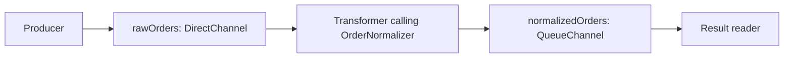

# Java Config and XML Config

## 1. Objective: One Flow, Multiple Ways to Declare It

In the **Annotations and XML** chapter of the **SPRING_INTEGRATION_CORE** module, Java config and XML config are two ways to describe how Spring creates beans, registers endpoints, and connects channels. They help construct message flows from components such as transformers, routers, filters, aggregators, and gateways.

What needs to be compared is **the component graph and runtime behavior**, not just writing style. Two configurations that both contain a transformer but use different input channel types can differ in execution thread, when errors surface, and whether a poller is required.

After this lesson, you can:

- Declare a flow using Java config, XML config, and Java DSL.
- Distinguish business beans, handlers, endpoints, and channels.
- Combine Java and XML within the same application context without duplicate declarations.
- Convert configurations based on message contracts, tests, and operational policies.

The running example is an order ID normalization step:



The input is the string `"  od-42  "`; the output is `"OD-42"`. The `traceId` header must be preserved. Whitespace-only input must trigger an error. We keep this exact contract as we change configuration styles.

## 2. Three Conceptual Layers to Keep Separate

### 2.1. Container Configuration

Spring Framework manages beans and their dependencies:

| Java config | XML config | Role |
| --- | --- | --- |
| `@Configuration` | `<beans>` document | Supplies bean definitions. |
| `@Bean` method | `<bean>` element | Creates and configures a container-managed object. |
| `@Bean` method parameters | `constructor-arg`, `property`, `ref` | Wires dependencies between beans. |
| `@Import` | `<import resource="..."/>` for XML resources | Splits and combines configurations; the two mechanisms accept different input types. |
| `@ImportResource` | Loads additional XML from Java configuration | Combines both declaration styles. |

`@Bean` creates a managed object, but does not automatically make any object a consumer on a channel. To get a consumer endpoint, you must also declare the link and processing role. `@Bean`/`@Configuration` concepts are explained in [Spring Framework — Basic Concepts](https://docs.spring.io/spring-framework/reference/6.2/core/beans/java/basic-concepts.html).

### 2.2. Spring Integration Flow Configuration

An endpoint typically involves a handler performing work, an input channel, and a consumer-triggering mechanism. XML namespaces such as `<int:transformer>` create the definitions needed for that role; Java offers messaging annotations, explicit bean configuration, or Java DSL.

Both Java config and XML use Spring Integration components at runtime. XML is not a separate integration engine, nor does it force payloads to be XML. Payloads can still be `String`, records, POJOs, `byte[]`, or any suitable type. See [Overview of Spring Integration Framework](https://docs.spring.io/spring-integration/reference/6.5/overview.html).

### 2.3. Business Rules

Order ID normalization rules can reside in a plain Java class. Java config or XML only decides how that class is instantiated and invoked within the messaging flow.

This separation lets you change configuration without rewriting business logic at the same time. If you change both configuration and data rules in a single migration, it becomes hard to pinpoint the cause when results differ.

## 3. Preparing the Shared Example

### 3.1. Environment and Dependencies

The examples use Java 17 or higher, Spring Integration 6.x, and JUnit Jupiter. Integration docs are referenced against the 6.5 line. The project requires `org.springframework.integration:spring-integration-core`; Spring library versions must be managed consistently.

In a project with a compatible Spring Boot parent or BOM, the dependencies can be:

```xml
<dependency>
    <groupId>org.springframework.boot</groupId>
    <artifactId>spring-boot-starter-integration</artifactId>
</dependency>
<dependency>
    <groupId>org.springframework.boot</groupId>
    <artifactId>spring-boot-starter-test</artifactId>
    <scope>test</scope>
</dependency>
```

These are snippets to add to a project that already has version management, not a complete `pom.xml`. The examples open application contexts directly so it is clear which configuration is loaded without depending on scanning the entire application package tree.

### 3.2. Configuration-Independent Business Bean

Sample file `OrderNormalizer.java`:

```java
package example.integration.config;

import java.util.Locale;

public class OrderNormalizer {

    public String normalize(String rawOrderId) {
        if (rawOrderId == null || rawOrderId.isBlank()) {
            throw new IllegalArgumentException("orderId must not be blank");
        }
        return rawOrderId.strip().toUpperCase(Locale.ROOT);
    }
}
```

This class does not register endpoints itself. It only defines data transformation rules. Using `Locale.ROOT` makes uppercase conversion independent of the host machine's default locale.

### 3.3. Contract to Preserve Across Configuration Variants

| Item | Example Contract |
| --- | --- |
| Input channel | Bean named `rawOrders`, type `DirectChannel`. |
| Output channel | Bean named `normalizedOrders`, type `QueueChannel`, capacity 20. |
| Transformation | Calls `OrderNormalizer.normalize`. |
| Input/output payload | `String` → trimmed and uppercased `String`. |
| Metadata | Preserves `traceId` header when transformer returns only payload. |
| Invalid input | Reports an error on whitespace-only strings. |
| Execution | Transformer runs on sender thread; output is placed in queue. |

An output queue does not make normalization asynchronous on its own. The input channel type and consumer configuration determine how that step is triggered.

## 4. First Approach: Java Config with Messaging Annotations

### 4.1. Declaring Channels and Endpoint

Sample file `JavaOrderConfiguration.java`:

```java
package example.integration.config;

import org.springframework.context.annotation.Bean;
import org.springframework.context.annotation.Configuration;
import org.springframework.integration.annotation.Transformer;
import org.springframework.integration.channel.DirectChannel;
import org.springframework.integration.channel.QueueChannel;
import org.springframework.integration.config.EnableIntegration;
import org.springframework.messaging.MessageChannel;
import org.springframework.messaging.PollableChannel;

@Configuration(proxyBeanMethods = false)
@EnableIntegration
public class JavaOrderConfiguration {

    @Bean
    public MessageChannel rawOrders() {
        return new DirectChannel();
    }

    @Bean
    public PollableChannel normalizedOrders() {
        return new QueueChannel(20);
    }

    @Bean
    public OrderNormalizer orderNormalizer() {
        return new OrderNormalizer();
    }

    @Bean
    public NormalizationEndpoint normalizationEndpoint(
            OrderNormalizer normalizer) {
        return new NormalizationEndpoint(normalizer);
    }

    public static class NormalizationEndpoint {

        private final OrderNormalizer normalizer;

        public NormalizationEndpoint(OrderNormalizer normalizer) {
            this.normalizer = normalizer;
        }

        @Transformer(
                inputChannel = "rawOrders",
                outputChannel = "normalizedOrders")
        public String normalize(String payload) {
            return normalizer.normalize(payload);
        }
    }
}
```

In this configuration:

- `@Bean` registers the channels, business bean, and object containing the processing method.
- `@Transformer` provides metadata to create the endpoint that receives messages and sends results.
- `@EnableIntegration` registers integration infrastructure and configuration processors.

No component scan is needed because beans are registered explicitly. Turning annotated methods into endpoints is described in [Annotation Support](https://docs.spring.io/spring-integration/reference/6.5/configuration/annotations.html).

### 4.2. Why Inject Dependencies via Parameters?

`normalizationEndpoint(OrderNormalizer normalizer)` receives the bean from the container. We do not call `orderNormalizer()` directly inside the endpoint factory method.

With `@Configuration(proxyBeanMethods = false)`, calling a `@Bean` method directly is a plain Java call and can create a new instance separate from the bean you intend to reference. Passing dependencies as parameters clearly expresses using container-managed beans. This mechanism is explained in [Java Configuration — Full vs. Lite Mode](https://docs.spring.io/spring-framework/reference/6.2/core/beans/java/basic-concepts.html).

### 4.3. What Can Java Config Verify?

The compiler checks Java types, class names, and the `normalizer.normalize(payload)` call. However, channel names in `inputChannel` and `outputChannel` remain strings. Runtime payload compatibility and many wiring relationships are only verified when the context starts or messages are sent.

Therefore, do not conclude that Java config eliminates all runtime errors. Explicit channel declarations and message-path tests remain essential.

## 5. Second Approach: XML Config with Integration Namespace

Sample file `src/main/resources/integration/order-flow.xml`:

```xml
<?xml version="1.0" encoding="UTF-8"?>
<beans xmlns="http://www.springframework.org/schema/beans"
       xmlns:xsi="http://www.w3.org/2001/XMLSchema-instance"
       xmlns:int="http://www.springframework.org/schema/integration"
       xsi:schemaLocation="
         http://www.springframework.org/schema/beans
         https://www.springframework.org/schema/beans/spring-beans.xsd
         http://www.springframework.org/schema/integration
         https://www.springframework.org/schema/integration/spring-integration.xsd">

    <int:channel id="rawOrders"/>

    <int:channel id="normalizedOrders">
        <int:queue capacity="20"/>
    </int:channel>

    <bean id="orderNormalizer"
          class="example.integration.config.OrderNormalizer"/>

    <int:transformer id="normalizeOrder"
                     input-channel="rawOrders"
                     output-channel="normalizedOrders"
                     ref="orderNormalizer"
                     method="normalize"/>
</beans>
```

`<int:channel>` without a queue or executor child element in this example creates a direct channel. `<int:queue>` establishes buffering at the output. `<int:transformer>` both selects the business bean via `ref` and identifies the method via `method`.

XML does not need the `NormalizationEndpoint` wrapper class from the Java approach: the transformer element itself expresses both processing role and channel wiring. `OrderNormalizer` remains a shared class and does not need `@Transformer` for XML to invoke the designated method. See [Transformer — Configuring a Transformer with XML](https://docs.spring.io/spring-integration/reference/6.5/transformer.html).

### Namespaces Are Not Message Data

URIs in `xmlns` and `xsi:schemaLocation` describe configuration grammar. Do not alter the namespace URI arbitrarily just because schema document locations shifted from HTTP to HTTPS. The prefix `int` can be changed if used consistently; the namespace URI is the identifier meaningful to the parser.

Schemas validate element and attribute structure. They do not guarantee a Java method name is spelled right, a target bean exists with the right semantics, or runtime payloads match the contract. Those require a running context and runtime tests.

### When Is Integration Infrastructure Loaded?

When parsers encounter elements from the Spring Integration namespace, the framework registers the infrastructure needed to support that configuration. In the Java-only configuration of the previous example, `@EnableIntegration` registers the infrastructure explicitly. That is a difference in configuration bootstrap, not a difference in integration patterns. See [Configuration and `@EnableIntegration`](https://docs.spring.io/spring-integration/reference/6.5/overview.html).

## 6. Bootstrapping and Observing the Same Contract

### 6.1. Opening a Java or XML Context

With Java:

```java
try (var context = new AnnotationConfigApplicationContext(
        JavaOrderConfiguration.class)) {
    // Send messages and read results here.
}
```

With XML:

```java
try (var context = new ClassPathXmlApplicationContext(
        "integration/order-flow.xml")) {
    // Send messages and read results here.
}
```

These two context classes live in `org.springframework.context.annotation` and `org.springframework.context.support`, respectively. The XML file must be on the application or test classpath; merely creating the file without loading it creates no endpoints.

### 6.2. Sending and Receiving Independent of Configuration Style

Place the following snippet inside either context block above:

```java
MessageChannel input = context.getBean("rawOrders", MessageChannel.class);
PollableChannel output = context.getBean(
        "normalizedOrders", PollableChannel.class);

Message<String> request = MessageBuilder
        .withPayload("  od-42  ")
        .setHeader("traceId", "trace-order-42")
        .build();

if (!input.send(request)) {
    throw new IllegalStateException("Message was not accepted");
}

Message<?> result = output.receive(1000);
if (result == null) {
    throw new IllegalStateException("No normalized message received");
}

System.out.println(result.getPayload());
System.out.println(result.getHeaders().get("traceId"));
```

`Message`, `MessageChannel`, and `PollableChannel` belong to `org.springframework.messaging`; `MessageBuilder` belongs to `org.springframework.messaging.support`. Expected output for both configurations:

```text
OD-42
trace-order-42
```

A successful `send` in this specific flow indicates the transformer placed the result into the queue. It does not prove a business step downstream of the queue has finished processing the order.

## 7. Where Does Java DSL Fit Within Java Config?

Java config is a broader concept than Java DSL. You can create beans and use messaging annotations as in section 4, or register an `IntegrationFlow` to describe a step chain via a fluent API.

Sample file `DslOrderConfiguration.java`:

```java
package example.integration.config;

import org.springframework.context.annotation.Bean;
import org.springframework.context.annotation.Configuration;
import org.springframework.integration.channel.DirectChannel;
import org.springframework.integration.channel.QueueChannel;
import org.springframework.integration.config.EnableIntegration;
import org.springframework.integration.dsl.IntegrationFlow;
import org.springframework.messaging.MessageChannel;
import org.springframework.messaging.PollableChannel;

@Configuration(proxyBeanMethods = false)
@EnableIntegration
public class DslOrderConfiguration {

    @Bean
    public MessageChannel rawOrders() {
        return new DirectChannel();
    }

    @Bean
    public PollableChannel normalizedOrders() {
        return new QueueChannel(20);
    }

    @Bean
    public OrderNormalizer orderNormalizer() {
        return new OrderNormalizer();
    }

    @Bean
    public IntegrationFlow normalizeOrderFlow(OrderNormalizer normalizer) {
        return IntegrationFlow.from("rawOrders")
                .transform(String.class, normalizer::normalize)
                .channel("normalizedOrders")
                .get();
    }
}
```

Here, `.transform(...)` creates the transformation step; there is no longer a need for an annotated `NormalizationEndpoint` bean. The method reference lets the compiler verify the method call, while runtime messaging input still must match type and semantics.

DSL uses Spring Integration components directly, rather than translating the flow into an XML document for execution. See [Java DSL](https://docs.spring.io/spring-integration/reference/6.5/dsl.html).

When testing each option, load only the corresponding Java annotation, XML, or DSL configuration. Loading all three is not a way to verify equivalence: it can cause duplicate beans or multiple consumers on the same channel.

## 8. Component-by-Component Configuration Comparison

| Concept | Java Config / Annotations | XML Config | What Must Be Preserved |
| --- | --- | --- | --- |
| Direct channel | `new DirectChannel()` | `<int:channel id="..."/>` in basic config | Delivery semantics and subscribers. |
| Queue channel | `new QueueChannel(20)` | `<int:queue capacity="20"/>` | Capacity and send/receive wait policies. |
| Transformer | Method with `@Transformer`, or `.transform(...)` | `<int:transformer ref="..." method="..."/>` | Payload types, conversion rules, and headers. |
| Service activator | `@ServiceActivator`, or `.handle(...)` | `<int:service-activator .../>` | Business invocation and reply contract. |
| Filter | `@Filter`, or `.filter(...)` | `<int:filter .../>` | Accept/discard condition and discard path. |
| Router | `@Router`, or `.route(...)` | `<int:router .../>` | Branch selection logic and channel mappings. |
| Aggregator | `@Aggregator`, or `.aggregate(...)` | `<int:aggregator .../>` | Correlation, release, timeout, and message store. |
| Gateway | `@MessagingGateway` and proxy registration | `<int:gateway .../>` | Request channel, reply, timeout, and error handling. |
| Poller | `@Poller`, or `Pollers` config in DSL | `<int:poller .../>` | Schedule, per-poll limit, and error handler. |

This table is a map for reading configurations, not a guarantee that every attribute keeps the exact same name or defaults. For handlers created via `@Bean`, certain options must be set directly on the handler object instead of on the annotation. The returned object's type determines how the framework applies configuration. See [Annotations on `@Bean` Methods](https://docs.spring.io/spring-integration/reference/6.5/configuration/meta-annotations.html).

### Commonly Confused Scanning Mechanisms

- `@EnableIntegration` registers integration infrastructure; it does not substitute for selecting which business beans to load.
- `@ComponentScan` scans component classes within the selected scope.
- `@IntegrationComponentScan` discovers interfaces annotated with `@MessagingGateway` to create messaging proxies.
- Explicit `<bean>` declarations in XML do not require component scanning just to instantiate those beans.

Do not widen component scanning to the entire package in comparative examples: it can accidentally load alternative configurations. Gateway scanning specifics are described in [IntegrationComponentScan](https://docs.spring.io/spring-integration/docs/6.5.2/api/org/springframework/integration/annotation/IntegrationComponentScan.html).

## 9. Combining Java and XML in the Same Application Context

An application can keep stable XML flows while using Java for business beans or new flows. The prerequisite is clearly defining which configuration owns each bean and endpoint.

### 9.1. Java as Bootstrap, XML Owning Channels and Endpoints

Sample file `HybridOrderConfiguration.java`:

```java
package example.integration.config;

import org.springframework.context.annotation.Bean;
import org.springframework.context.annotation.Configuration;
import org.springframework.context.annotation.ImportResource;
import org.springframework.integration.config.EnableIntegration;

@Configuration(proxyBeanMethods = false)
@EnableIntegration
@ImportResource("classpath:integration/order-hybrid.xml")
public class HybridOrderConfiguration {

    @Bean
    public OrderNormalizer orderNormalizer() {
        return new OrderNormalizer();
    }
}
```

Sample file `src/main/resources/integration/order-hybrid.xml`:

```xml
<?xml version="1.0" encoding="UTF-8"?>
<beans xmlns="http://www.springframework.org/schema/beans"
       xmlns:xsi="http://www.w3.org/2001/XMLSchema-instance"
       xmlns:int="http://www.springframework.org/schema/integration"
       xsi:schemaLocation="
         http://www.springframework.org/schema/beans
         https://www.springframework.org/schema/beans/spring-beans.xsd
         http://www.springframework.org/schema/integration
         https://www.springframework.org/schema/integration/spring-integration.xsd">

    <int:channel id="rawOrders"/>

    <int:channel id="normalizedOrders">
        <int:queue capacity="20"/>
    </int:channel>

    <int:transformer id="normalizeOrder"
                     input-channel="rawOrders"
                     output-channel="normalizedOrders"
                     ref="orderNormalizer"
                     method="normalize"/>
</beans>
```

Bootstrap with `new AnnotationConfigApplicationContext(HybridOrderConfiguration.class)`. XML uses `ref="orderNormalizer"` to reference the Java-created bean inside the same context. There is no second `<bean id="orderNormalizer">` in XML.

This is a single context combining two sources of bean definitions, not two independent containers automatically sharing beans. Resource combining and importing are explained in [Spring Framework — Composing Java-based Configurations](https://docs.spring.io/spring-framework/reference/6.2/core/beans/java/composing-configuration-classes.html).

### 9.2. Clear Ownership Is Essential

| Component in Hybrid Example | Where Declared |
| --- | --- |
| `orderNormalizer` bean | Java config. |
| `rawOrders`, `normalizedOrders` channels | XML. |
| Transformer endpoint | XML. |
| Application context entry point | Java. |

Do not simultaneously import the full `order-flow.xml` from section 5 and `order-hybrid.xml`: they describe the same channels and endpoint. Likewise, do not also register `NormalizationEndpoint` or `normalizeOrderFlow` for the same step.

The reverse direction is also supported by Spring: an XML-bootstrapped application can register `@Configuration` classes with appropriate annotation processing. When applying it, distinguish loading a Java configuration class from redeclaring endpoints that class already created.

## 10. When Changing Channels, Migrate Execution Semantics Too

### 10.1. Example: Switching Input from Direct to Queue

In the Java annotation approach, replace the `rawOrders` bean:

```java
@Bean
public PollableChannel rawOrders() {
    return new QueueChannel(100);
}
```

At the same time, update the annotation on the handler method:

```java
@Transformer(
        inputChannel = "rawOrders",
        outputChannel = "normalizedOrders",
        poller = @Poller(
                fixedDelay = "100",
                maxMessagesPerPoll = "5",
                receiveTimeout = "0"))
public String normalize(String payload) {
    return normalizer.normalize(payload);
}
```

Import `org.springframework.integration.annotation.Poller`. With XML, the corresponding replacement is:

```xml
<int:channel id="rawOrders">
    <int:queue capacity="100"/>
</int:channel>

<int:transformer id="normalizeOrder"
                 input-channel="rawOrders"
                 output-channel="normalizedOrders"
                 ref="orderNormalizer"
                 method="normalize">
    <int:poller fixed-delay="100"
                max-messages-per-poll="5"
                receive-timeout="0"/>
</int:transformer>
```

This XML snippet sits inside `<beans>` alongside the existing namespaces and remaining beans; it replaces the old input channel and transformer rather than adding a second transformer.

### 10.2. What Changes After Adding a Source Queue

| Aspect | `DirectChannel` Input | `QueueChannel` Input with Poller |
| --- | --- | --- |
| When normalizer runs | On the sender's call path. | When the consumer pulls messages on schedule. |
| Meaning of successful send | Synchronous step completed along the wired path. | Message has been placed into the source queue. |
| Data errors | Can throw back to the sender as a messaging exception. | Must observe errors from the polling task. |
| Polling configuration | No poller on this consumer. | Requires a direct poller or valid default poller. |

The same channel change must be reflected in every configuration variant meant to stay equivalent. If you change only Java to a queue while leaving XML as direct, the two versions no longer behave identically.

The example's default queues are in-memory. When recovery across process shutdown is required, design an appropriate message store or durable transport. Choosing Java or XML does not change a channel's storage durability by itself. See [Message Channel Implementations](https://docs.spring.io/spring-integration/reference/6.5/channel/implementations.html).

## 11. Environment Properties, Lifecycle, and Errors

### 11.1. Same Configuration Values, Same Defaults

Queue capacity, polling schedule, endpoint auto-startup, and timeouts are parts of behavior to align. They can be externalized to property sources.

Java example, assuming a property source and placeholder resolution are configured:

```java
@Bean
public PollableChannel normalizedOrders(
        @Value("${orders.queue-capacity:20}") int capacity) {
    return new QueueChannel(capacity);
}
```

Import `org.springframework.beans.factory.annotation.Value`. Corresponding XML, with property placeholder resolution registered:

```xml
<int:channel id="normalizedOrders">
    <int:queue capacity="${orders.queue-capacity:20}"/>
</int:channel>
```

Simply writing `${...}` in a file does not make the application discover every property source automatically. Determine how property sources are loaded into the application context or your application's configuration mechanism. When converting, preserve default values too; do not let Java default to 20 while XML falls back to a different capacity.

Profiles and conditional bean registration must also be aligned. In this comparative lesson, contexts are created separately so multiple alternative configurations do not run together. In real applications, use profiles or explicit import points to select the active configuration.

### 11.2. Distinguishing Configuration Errors from Message-Processing Errors

| Stage | Example Error | How Observed |
| --- | --- | --- |
| Java compilation | Wrong return type or non-existent method call. | Compiler and IDE. |
| XML loading | Malformed XML, invalid schema element or attribute. | Context parse/startup error. |
| Bean wiring | Duplicate beans, unresolved dependencies, wrong `ref`. | Context error, sometimes during deferred reference resolution. |
| Message delivery | No subscriber or destination not found. | Runtime send/routing failure. |
| Data processing | Invalid payload, normalizer throws exception. | Synchronous exception or error message depending on execution boundary. |

With a direct input, setting an `errorChannel` header alone does not turn all errors into `ErrorMessage`s. With polling or tasks executed via the framework's asynchronous mechanisms, the error handler can route errors through an error channel. Preserve this same policy when converting configurations; see [Error Handling](https://docs.spring.io/spring-integration/reference/6.5/error-handling.html).

### 11.3. Bean Names and Lifecycle Are Not Mere Presentation Details

XML can assign explicit endpoint `id`s; annotations and DSL have their own naming conventions. Do not guess endpoint names by converting hyphens to camelCase. If the system uses a control bus, monitoring, or name-based start/stop operations, verify actual runtime names after conversion.

Similarly, `autoStartup`/`auto-startup` and `phase` affect when endpoints start receiving messages. Having XML outside Java code does not mean you can edit a running file and have every endpoint reconfigure itself automatically. Reloading or dynamic registration requires a specific application mechanism.

## 12. Testing the Same Contract Across All Configuration Styles

The snippets below are illustrative test code for a project. The goal is to test flow behavior, not compare configuration line counts or bean string representations.

Sample file `ConfigurationContractTest.java`:

```java
package example.integration.config;

import org.junit.jupiter.params.ParameterizedTest;
import org.junit.jupiter.params.provider.ValueSource;
import org.springframework.context.ConfigurableApplicationContext;
import org.springframework.context.annotation.AnnotationConfigApplicationContext;
import org.springframework.context.support.ClassPathXmlApplicationContext;
import org.springframework.integration.channel.DirectChannel;
import org.springframework.integration.channel.QueueChannel;
import org.springframework.messaging.Message;
import org.springframework.messaging.MessageChannel;
import org.springframework.messaging.MessagingException;
import org.springframework.messaging.PollableChannel;
import org.springframework.messaging.support.MessageBuilder;
import static org.junit.jupiter.api.Assertions.*;

class ConfigurationContractTest {

    @ParameterizedTest
    @ValueSource(strings = {"java", "xml", "dsl", "hybrid"})
    void normalizesPayloadAndPreservesTraceId(String style) {
        try (ConfigurableApplicationContext context = openContext(style)) {
            MessageChannel input = context.getBean(
                    "rawOrders", MessageChannel.class);
            PollableChannel output = context.getBean(
                    "normalizedOrders", PollableChannel.class);

            assertInstanceOf(DirectChannel.class, input);
            assertInstanceOf(QueueChannel.class, output);

            Message<String> request = MessageBuilder
                    .withPayload("  od-42  ")
                    .setHeader("traceId", "trace-order-42")
                    .build();

            assertTrue(input.send(request));
            Message<?> actual = output.receive(1000);

            assertNotNull(actual);
            assertEquals("OD-42", actual.getPayload());
            assertEquals("trace-order-42", actual.getHeaders().get("traceId"));
            assertNull(output.receive(0));
        }
    }

    @ParameterizedTest
    @ValueSource(strings = {"java", "xml", "dsl", "hybrid"})
    void reportsBlankInputToDirectChannelSender(String style) {
        try (ConfigurableApplicationContext context = openContext(style)) {
            MessageChannel input = context.getBean(
                    "rawOrders", MessageChannel.class);
            PollableChannel output = context.getBean(
                    "normalizedOrders", PollableChannel.class);
            Message<String> request = MessageBuilder.withPayload("   ").build();

            MessagingException error = assertThrows(MessagingException.class,
                    () -> input.send(request));

            assertInstanceOf(IllegalArgumentException.class, rootCause(error));
            assertNull(output.receive(0));
        }
    }

    private static ConfigurableApplicationContext openContext(String style) {
        return switch (style) {
            case "java" -> new AnnotationConfigApplicationContext(
                    JavaOrderConfiguration.class);
            case "xml" -> new ClassPathXmlApplicationContext(
                    "integration/order-flow.xml");
            case "dsl" -> new AnnotationConfigApplicationContext(
                    DslOrderConfiguration.class);
            case "hybrid" -> new AnnotationConfigApplicationContext(
                    HybridOrderConfiguration.class);
            default -> throw new IllegalArgumentException("Unknown style");
        };
    }

    private static Throwable rootCause(Throwable error) {
        Throwable current = error;
        while (current.getCause() != null) {
            current = current.getCause();
        }
        return current;
    }
}
```

These tests target the direct-input version of each configuration, prior to the polling change in section 10. If you switch the input to a queue, adjust error expectations: enqueuing may succeed, while the normalizer failure surfaces later and must be received on the configured error channel.

A fresh context per run isolates queue state and closes resources after tests. `receive` with a finite timeout catches missing messages; `receive(0)` reads immediately to verify no extra output exists in this minimal flow.

For more complex flows, contract tests must also cover router branches, messages dropped by filters, aggregator release conditions, correlation metadata, and gateway timeouts. Comparing happy-path payloads alone is not enough to prove two configurations are operationally equivalent.

## 13. Choosing a Configuration Style and Migrating Safely

### 13.1. Selection Criteria

| Situation | Considerations |
| --- | --- |
| Team works mainly in Java and frequently refactors classes and methods | Java config is convenient for code navigation, dependency injection, and compiler checks. |
| Want to read a multi-step chain in one place | Java DSL expresses processing order and branches directly through the flow API. |
| System already has many clear, stable XML flows | Maintaining XML or combining selectively can reduce change scope. |
| Business bean must be reused across multiple flows | Keep business logic independent; both Java and XML can reference shared beans. |
| Need environment-specific tuning | Use appropriate property/profile mechanisms while keeping defaults and activation rules clear. |
| Need to alter flows while the application is running | Design dedicated registration and lifecycle management; Java vs. XML format does not provide this on its own. |

There is no rule that XML is always slower or Java is always completely type-safe. Runtime performance primarily depends on channels, handlers, adapters, I/O, and flow settings. Base comparisons on concrete configurations and real measurements.

### 13.2. Sequence for Migrating a Flow

1. Document input/output channels, channel types, endpoints, and business beans of the current flow.
2. Lock down the contract for payloads, headers, errors, control branches, and completion timing.
3. Keep business classes unchanged while writing the replacement configuration.
4. Cross-check pollers, executors, capacities, timeouts, transactions, message stores, and lifecycle settings.
5. Run the exact same contract test suite against each configuration loaded independently.
6. When switching to the new configuration, remove the old import path or old endpoint registrations.
7. Re-verify operational references by endpoint name and behavior at adapter boundaries.

Enabling bean overriding just to let the application start after loading both configurations can mask conflicts. Even when bean names differ, two endpoints reading from the same channel can still alter message distribution.

## 14. Practice Exercises

1. Add a `sourceSystem` header to the request and verify that all four configuration styles preserve this metadata at the output.
2. Externalize queue capacity to an external property using the same default value in both Java and XML. Identify where the property source is loaded.
3. Switch the input to a queue and configure equivalent pollers. Rewrite the error test to receive an `ErrorMessage` on a dedicated error channel.
4. Add a filter before the transformer to reject order IDs outside an accepted scope. Compare both accepted and rejected paths between Java and XML.
5. Split the hybrid configuration into parts with clear ownership: Java creates services, XML creates channels and endpoints. Verify there are no duplicate beans or consumers.
6. Extend the flow to `gateway → transformer → router → service activator`; document the contract of each link before changing the declaration style.

You have completed this lesson when you can change how a flow is declared while still explaining and verifying its message contract, execution model, and error behavior.
