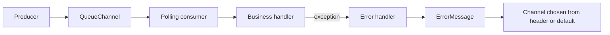

# `errorChannel` Header: Choosing the Error Destination Per Message

## 1. Objectives and Problem Statement

In the **SPRING_INTEGRATION_CORE** module, the `errorChannel` header allows a message to carry its own error destination address. Because of this, requests flowing through the same processing pipeline can have their errors sent to different destinations without requiring the business handler to know where errors should go.

For example, an order-processing flow receives requests from a website and from a data-import job. A shared order-validation handler can be reused, while errors from website requests need to be correlated per request, and errors from the import job need to go to that job's operations branch.

After this lesson, you will be able to:

- Set the header with the correct name and value type.
- Identify when the header is used by the error-handling mechanism.
- Explain the precedence order between the header and the default error channel.
- Read the `ErrorMessage`, exception, and message at the point of failure.
- Deliberately preserve or change the error destination when building flows in Java, XML, and DSL.
- Independently test synchronous errors, errors in a polling task, and error destination selection.

The key point to grasp immediately: **the header is an error destination address; there must be a component that catches the exception and publishes an error message for that address to be used**. Adding the header does not automatically turn every exception into a message send.

## 2. The Header Contract

### 2.1. Header Name and Standard Constant

In Java, use the Spring Messaging constant:

```java
import org.springframework.messaging.MessageHeaders;

String headerName = MessageHeaders.ERROR_CHANNEL; // "errorChannel"
```

This is a message header name. It differs from the `error-channel` attribute in XML or `errorChannel` on an endpoint configuration annotation, even though those configurations may relate to the same error-handling mechanism.

`MessageHeaders` is an immutable structure. Do not call `message.getHeaders().put(...)` to modify it directly; build messages using a builder. This contract is described in the [`MessageHeaders` Javadoc](https://docs.spring.io/spring-framework/docs/current/javadoc-api/org/springframework/messaging/MessageHeaders.html).

### 2.2. Two Commonly Used Value Types

| Header value | Meaning | Example |
| --- | --- | --- |
| A `MessageChannel` instance | Send errors to that exact channel | Reference to a `QueueChannel` in the context |
| A non-empty string | Resolve the channel name and then send the error | `"orders.requestErrors"` |

Example setting a channel name:

```java
Message<OrderRequest> request = MessageBuilder.withPayload(order)
        .setHeader("requestId", "REQ-101")
        .setHeader(MessageHeaders.ERROR_CHANNEL, "orders.requestErrors")
        .build();
```

Example setting an object reference:

```java
Message<OrderRequest> request = MessageBuilder.withPayload(order)
        .setHeader("requestId", "REQ-102")
        .setHeader(MessageHeaders.ERROR_CHANNEL, requestErrors)
        .build();
```

In the second snippet, `requestErrors` must be a `MessageChannel`, not a string representation of the object. The types supported during resolution can be verified in the [official `MessagePublishingErrorHandler` source code](https://raw.githubusercontent.com/spring-projects/spring-integration/v6.5.0/spring-integration-core/src/main/java/org/springframework/integration/channel/MessagePublishingErrorHandler.java).

A channel name is not a broker queue name, a webhook URL, or an email address. For instance, `"orders.requestErrors"` only has meaning when the application's destination resolver can locate the corresponding channel.

## 3. When Does the Header Take Effect?

### 3.1. Sending Directly Through a `DirectChannel`

With a default `DirectChannel`, the handler runs on the sending thread. If the handler throws an exception, the exception travels back up the caller's call stack. Merely setting the `errorChannel` header does not cause the channel to automatically catch the error and send it there.

```text
Caller
  -> DirectChannel.send(message)
     -> handler throws exception
  <- exception propagates back to caller
```

The same-thread nature of channels is explained in [Message Channel Implementations](https://docs.spring.io/spring-integration/reference/channel/implementations.html).

To turn a synchronous error into an error message, you need an explicitly designed mechanism, such as a gateway error flow, an advice, or a deliberate catch-and-publish layer. That mechanism is an added component, not automatic behavior triggered solely by the presence of the header.

### 3.2. Polling Task or Asynchronous Task with an Error Handler

When a message is placed into a `QueueChannel`, the caller can complete the send before the polling consumer processes it. If the handler fails later, there is no longer a synchronous call stack on which to rethrow the exception to the original caller.

In the standard error-handling mechanism, an error handler creates an `ErrorMessage` and sends it to the appropriate channel. A poller managed by Spring Integration has this error-handling path; for custom executors or schedulers, verify whether an error handler is actually attached. See [Error Handling](https://docs.spring.io/spring-integration/reference/error-handling.html).



An arbitrary application `ExecutorService.submit(...)` call does not automatically become a Spring Integration task just because the code inside holds a `Message`. The component creating the task must define how errors from that task are captured and handled.

### 3.3. Distinguishing Errors After Receipt from Errors at Send Time

| Failure timing | Example | What to determine |
| --- | --- | --- |
| During the send operation | No subscriber found; queue full and timeout elapsed | How the caller or sending component handles the failure |
| After the send has completed | Poller retrieves the message and the handler fails | Where the task's error handler sends the error |
| Before a message is retrieved | Poller or data source fails before a specific request exists | Whether a message context exists to read the header or the default must be used |

Therefore, you should not check that a `send()` call returned successfully and conclude that the entire business flow succeeded.

## 4. Error Channel Selection Order

In a handling path that uses `MessagePublishingErrorHandler`, you can reason through the order as follows:

1. If the error has a failed message context and that message has a valid `errorChannel` header, use the address in the header.
2. If there is no per-message destination, use the default error channel configured for that error handler.
3. If no custom default is set, the standard mechanism uses the global channel with bean name `errorChannel`.

`MessagePublishingErrorHandler` is the component that publishes the `ErrorMessage`; it allows configuring the default channel by object reference or name. See the [`MessagePublishingErrorHandler` Javadoc](https://docs.spring.io/spring-integration/api/org/springframework/integration/channel/MessagePublishingErrorHandler.html).

### The Header and `@Poller(errorChannel = ...)`

```java
poller = @Poller(
        fixedDelay = "100",
        errorChannel = "orders.fallbackErrors")
```

The attribute above sets the **default channel of the poller's error handler**; it does not override the per-request header. This meaning is explicitly stated in the [`Poller.errorChannel` Javadoc](https://docs.spring.io/spring-integration/api/org/springframework/integration/annotation/Poller.html#errorChannel()).

| Message header | Poller-specific default | Expected destination in example |
| --- | --- | --- |
| `orders.requestErrors` | `orders.fallbackErrors` | `orders.requestErrors` |
| None | `orders.fallbackErrors` | `orders.fallbackErrors` |
| None | No custom configuration | Global `errorChannel` |

This selects a single destination; it does not by default broadcast simultaneously to both the custom channel and the global channel. If you want to both store a dedicated error and log it in a central place, wire those observation branches explicitly.

Do not treat misspelling a channel name as a way to trigger a fallback. A header value that is present but unresolvable can cause error handling itself to fail; this is different from the header being absent.

## 5. Complete Example: Order Error in a Polling Consumer

### 5.1. Topology and Assumptions

The example uses Java 17 or higher, `spring-integration-core`, a compatible Spring Context, and JUnit Jupiter for testing. Each public class resides in a file of the same name within package `example.errorheader`.

The flow consists of four queue channels:

- `orders.in`: receives orders to be processed.
- `orders.processed`: receives orders processed normally.
- `orders.requestErrors`: receives errors according to the request's header.
- `orders.fallbackErrors`: receives errors when a request has no dedicated address.

Queues are used so that paths can be observed in the example. By default they are in-memory, not a durable error store or a dead-letter queue on a broker.

### 5.2. Data and Business Logic

```java
package example.errorheader;

import java.math.BigDecimal;

public record OrderRequest(String orderId, BigDecimal total) {
}
```

```java
package example.errorheader;

public class OrderProcessor {

    public void process(OrderRequest order) {
        if (order.orderId() == null || order.orderId().isBlank()
                || order.total() == null || order.total().signum() <= 0) {
            throw new IllegalArgumentException("Invalid order");
        }

        // Example only validates data; does not write to an external system.
    }
}
```

The business class does not need to read `errorChannel`. Where errors are sent is a concern of the integration flow.

### 5.3. Endpoint with a Poller

```java
package example.errorheader;

import org.springframework.integration.annotation.Poller;
import org.springframework.integration.annotation.ServiceActivator;

public class PollingOrderEndpoint {

    private final OrderProcessor processor;

    public PollingOrderEndpoint(OrderProcessor processor) {
        this.processor = processor;
    }

    @ServiceActivator(
            inputChannel = "orders.in",
            outputChannel = "orders.processed",
            poller = @Poller(
                    fixedDelay = "100",
                    maxMessagesPerPoll = "1",
                    receiveTimeout = "0",
                    errorChannel = "orders.fallbackErrors"))
    public OrderRequest handle(OrderRequest order) {
        processor.process(order);
        return order;
    }
}
```

The poller retrieves at most one message per poll, does not wait when the queue is empty, and uses a dedicated default error channel. If the processed message carries an `errorChannel` header, that header remains the preferred destination in the illustrated path.

### 5.4. Context Declaration

```java
package example.errorheader;

import org.springframework.context.annotation.Bean;
import org.springframework.context.annotation.Configuration;
import org.springframework.integration.channel.QueueChannel;
import org.springframework.integration.config.EnableIntegration;

@Configuration
@EnableIntegration
public class ErrorHeaderConfiguration {

    @Bean("orders.in")
    public QueueChannel ordersIn() {
        return new QueueChannel(100);
    }

    @Bean("orders.processed")
    public QueueChannel ordersProcessed() {
        return new QueueChannel(100);
    }

    @Bean("orders.requestErrors")
    public QueueChannel ordersRequestErrors() {
        return new QueueChannel(20);
    }

    @Bean("orders.fallbackErrors")
    public QueueChannel ordersFallbackErrors() {
        return new QueueChannel(20);
    }

    @Bean
    public OrderProcessor orderProcessor() {
        return new OrderProcessor();
    }

    @Bean
    public PollingOrderEndpoint pollingOrderEndpoint(OrderProcessor processor) {
        return new PollingOrderEndpoint(processor);
    }
}
```

`@EnableIntegration` and the beans above provide the infrastructure for a standalone Java context. Because the endpoint is registered in the context via `@Bean`, its method is processed as an annotated endpoint; calling `new PollingOrderEndpoint(...)` directly does not create a polling consumer. Configuring pollers with annotations is covered in [Annotation Support](https://docs.spring.io/spring-integration/reference/configuration/annotations.html).

### 5.5. Sending a Request with a Dedicated Error Channel

```java
try (var context = new AnnotationConfigApplicationContext(
        ErrorHeaderConfiguration.class)) {

    MessageChannel input = context.getBean("orders.in", MessageChannel.class);
    QueueChannel requestErrors = context.getBean(
            "orders.requestErrors", QueueChannel.class);

    OrderRequest order = new OrderRequest("ORD-101", BigDecimal.ZERO);
    Message<OrderRequest> request = MessageBuilder.withPayload(order)
            .setHeader("requestId", "REQ-101")
            .setHeader(MessageHeaders.ERROR_CHANNEL, "orders.requestErrors")
            .build();

    if (!input.send(request, 1000)) {
        throw new IllegalStateException("Failed to send request to input queue");
    }

    Message<?> received = requestErrors.receive(3000);
    if (!(received instanceof ErrorMessage error)) {
        throw new IllegalStateException("Expected ErrorMessage was not received");
    }

    Throwable failure = error.getPayload();
    // Inspect failure and the failed message as shown in the next section.
}
```

The calling snippet requires imports for `java.math.BigDecimal`, `AnnotationConfigApplicationContext`, `Message`, `MessageChannel`, `MessageHeaders`, `QueueChannel`, `MessageBuilder`, and `ErrorMessage` matching the packages in the test examples at the end of this lesson.

`send()` only places the order into the queue. The poller processes it afterward, detects that the total is zero, raises an error, and sends an `ErrorMessage` to `orders.requestErrors`. The `orders.fallbackErrors` branch is not chosen for this request.

The wait timeouts here serve a small example. Do not treat them as processing latency guarantees for a real system.

## 6. Reading the Error Message with the Right Structure

### 6.1. The Payload of `ErrorMessage` Is an Exception

An error is not sent with an `OrderRequest` payload like on the success branch:

```text
ErrorMessage
  payload: Throwable
    typically MessagingException
      failedMessage: Message at the point of failure
      cause: business or infrastructure error
  originalMessage: optional, depending on the error-creating component
```

`ErrorMessage` is a `Message<Throwable>`. Its payload is typically a `MessagingException`, while `originalMessage` is optional. `failedMessage` and `originalMessage` may differ if the flow transformed the message before failing. See the [`ErrorMessage` Javadoc](https://docs.spring.io/spring-framework/docs/current/javadoc-api/org/springframework/messaging/support/ErrorMessage.html).

Do not cast `error.getPayload()` to an order. To obtain the order ID or `requestId`, locate the appropriate context message.

### 6.2. Finding the Message at the Point of Failure

A helper you can use during diagnostics:

```java
package example.errorheader;

import org.springframework.messaging.Message;
import org.springframework.messaging.MessagingException;
import org.springframework.messaging.support.ErrorMessage;

public final class ErrorContext {

    private ErrorContext() {
    }

    public static Message<?> findFailedMessage(Throwable failure) {
        for (Throwable current = failure;
                current != null;
                current = current.getCause()) {

            if (current instanceof MessagingException messagingException
                    && messagingException.getFailedMessage() != null) {
                return messagingException.getFailedMessage();
            }
        }
        return null;
    }

    public static Message<?> messageForDiagnostics(ErrorMessage error) {
        Message<?> failed = findFailedMessage(error.getPayload());
        return failed != null ? failed : error.getOriginalMessage();
    }
}
```

The helper looks for an available failed message along the cause chain. Only if none exists does it fall back to `originalMessage` for diagnostic purposes; the result can still be `null`. The `getFailedMessage()` contract is in the [`MessagingException` Javadoc](https://docs.spring.io/spring-framework/docs/current/javadoc-api/org/springframework/messaging/MessagingException.html).

Do not use this helper as a substitute for every component's channel-selection algorithm. Each error publisher constructs context and handles exceptions in its own way.

### 6.3. Do Not Assume Business Headers Are Copied to the Error

```java
Message<?> contextMessage = ErrorContext.messageForDiagnostics(error);

Object requestId = contextMessage == null
        ? null
        : contextMessage.getHeaders().get("requestId");

OrderRequest failedOrder = contextMessage != null
        && contextMessage.getPayload() instanceof OrderRequest order
        ? order
        : null;
```

`error.getHeaders().get("requestId")` does not always hold the value from the request. `ErrorMessage` has its own headers, and the request has its own headers. Likewise, do not assume `getOriginalMessage()` is always populated: the error-creation strategy might not have been supplied with an original message. See [DefaultErrorMessageStrategy](https://docs.spring.io/spring-integration/api/org/springframework/integration/support/DefaultErrorMessageStrategy.html).

For a business error record, clearly establish which fields can be retrieved reliably, which might be missing, and which message is being described. If the message passed through a transformer, the payload at the point of failure might no longer be the original `OrderRequest`.

## 7. Setting the Header in Java DSL and XML

### 7.1. Java DSL: Adding the Header Before Entering a Processing Branch

Instead of requiring every producer to attach the error destination itself, you can attach it at the entry of a branch:

```java
@Bean("orders.entry")
public DirectChannel ordersEntry() {
    return new DirectChannel();
}

@Bean
public IntegrationFlow attachOrderErrorChannel() {
    return IntegrationFlow.from("orders.entry")
            .enrichHeaders(headers -> headers.errorChannel(
                    "orders.requestErrors", true))
            .channel("orders.in")
            .get();
}
```

Place these two beans in the configuration that already defines the queues and endpoint from section 5. Import `DirectChannel`, `IntegrationFlow`, and `Bean`. The producer sends to `orders.entry`, the header is attached, and then the message enters `orders.in` for the poller to process.

The `true` argument here requests overwriting an existing error destination. Choose this behavior only when the branch entry is responsible for redefining the error policy. If you want to preserve an address supplied by the caller, choose `false`. The API supporting bean names or channel instances is documented in [HeaderEnricherSpec](https://docs.spring.io/spring-integration/api/org/springframework/integration/dsl/HeaderEnricherSpec.html).

Enriching headers does not create an error boundary for `orders.entry` itself. A synchronous error occurring right inside the enrich step or when sending to the queue still must be handled by the caller or sending component under the corresponding mechanism.

### 7.2. XML: Header Enricher with a Channel Reference

Equivalent XML fragment, with prefix `int` belonging to the Spring Integration namespace:

```xml
<int:channel id="orders.entry"/>

<int:header-enricher input-channel="orders.entry"
                     output-channel="orders.in">
    <int:error-channel ref="orders.requestErrors" overwrite="true"/>
</int:header-enricher>
```

The fragment assumes `orders.in`, `orders.requestErrors`, and the polling endpoint are already declared in the context. `ref` places the channel reference into the header. If you need to store a string channel name, use a standard header declaration:

```xml
<int:header-enricher input-channel="orders.entry"
                     output-channel="orders.in">
    <int:header name="errorChannel"
                value="orders.requestErrors"
                overwrite="true"/>
</int:header-enricher>
```

The two header enrichers above are alternatives; do not register both as competing consumers on the same `orders.entry`. Special header elements are presented in [Content Enricher](https://docs.spring.io/spring-integration/reference/content-enrichment.html).

## 8. Deliberately Preserving, Overwriting, or Removing the Header

### 8.1. Preserving Context When Building a New Message

If a Java step manually constructs a message from a payload without copying headers, the error destination can be lost:

```java
// Risks losing requestId, errorChannel, and other context.
Message<OrderRequest> rebuilt = MessageBuilder.withPayload(order).build();
```

When keeping the same payload and modifying headers, start from the existing message:

```java
Message<OrderRequest> routed = MessageBuilder.fromMessage(request)
        .setHeader(MessageHeaders.ERROR_CHANNEL, "orders.requestErrors")
        .build();
```

When changing the payload type, use a transformer or a builder with an appropriate header-copying strategy. What you should verify is whether the message at any potential failure point still carries the required error destination and correlation IDs.

### 8.2. Overwriting Changes the Branch Contract

For example, a caller wants to receive request errors via a dedicated channel, but an intermediate step overwrites it with a shared operations channel. From then on, the caller may no longer receive the expected error outcome.

Therefore, every overwrite should have a specific justification: an application boundary, an independent processing branch, or a new operational contract. Do not re-attach a default value at every step merely out of copy-paste convenience.

### 8.3. Removing the Header to Fall Back to the Default Policy

```java
Message<OrderRequest> usingDefaultPolicy = MessageBuilder.fromMessage(request)
        .removeHeader(MessageHeaders.ERROR_CHANNEL)
        .build();
```

Once the header is removed, the standard handling path can use the error handler's default channel. Only do this when the branch genuinely should not use the old error address; in particular, evaluate the impact on any gateway waiting for a reply.

## 9. Distinguishing from Similarly Named or Related Configurations

| Concept | Scope and role |
| --- | --- |
| `errorChannel` header | Error destination carried with a single message |
| Global bean named `errorChannel` | Default error destination in standard infrastructure |
| `@Poller(errorChannel = ...)` | Dedicated default for a poller's error handler |
| `@MessagingGateway(errorChannel = ...)` | Gateway error-flow configuration, tied to the call contract |
| `replyChannel` header | Destination for receiving the reply of a messaging interaction |
| Filter's `discardChannel` | Destination for messages rejected by the filter condition |

Do not assume every attribute named `errorChannel` on every adapter follows the exact same precedence order. Check which component catches the error, whether a request message exists, and which publisher is used.

### Gateways and Synchronous Errors

A gateway can catch call errors and send them to an error flow according to the gateway's own configuration. Consequently, a synchronous flow invoked through a gateway can behave differently from sending directly to a `DirectChannel`.

For a method with a return value, the error flow can convert an exception into a compatible DTO to return to the caller. A consumer that merely logs and terminates does not produce that reply. Gateway error configuration is explained in [Messaging Gateways](https://docs.spring.io/spring-integration/reference/gateway.html).

### Filter Rejection Does Not Necessarily Produce an Error

A filter returning `false` may simply send the message to `discardChannel` or drop the message according to policy. The `errorChannel` header does not automatically receive a message just because a filter rejected it.

An error-publishing path only appears when an exception and a corresponding error-handling mechanism exist. Therefore, the business-rejection branch and the technical-error branch should be designed clearly, even if both ultimately feed into a shared observation target.

## 10. Retry, Recovery, and Business Outcomes

The header is not a retry policy. It does not specify the number of retries, the interval between attempts, or which exception types should be retried.

If an advice performs retries within a single handling attempt and a later attempt succeeds, the earlier transient error might never be published to the external error path. If retries are exhausted and the exception escapes, an outer error handler can then process it. If a recoverer catches the error and sends it to a specific destination, behavior also depends on that recoverer.

Order examples:

- A total amount of zero is invalid data; retrying with the same data typically does not change the result.
- A transiently interrupted service call may suit bounded retries.
- A write operation that might have succeeded while its response was lost requires status checking or deduplication before retrying.

Retry and recovery components are separate configurations; refer to [Provided Advice Classes](https://docs.spring.io/spring-integration/reference/handler-advice/classes.html).

Placing an `ErrorMessage` into a queue does not mean the original data was rolled back, a broker message was requeued, or an external operation was canceled. Those belong to transactions, acknowledgments, and the contract of the relevant adapter or service.

## 11. Designing an Operable Error-Handling Branch

### 11.1. An Error Channel Must Have a Consumer

In the example, errors are kept in queues so tests can read and inspect them. For a long-running application, you need consumers reading them and performing defined actions: recording an error entry, alerting internally, classifying, or feeding a replay workflow.

If you use a `DirectChannel` as an error channel, there must be an appropriate subscriber. If you use a `QueueChannel`, monitor capacity, retention time, and processing rate. A queue without a consumer will eventually fill up and can cause error publishing itself to block or fail.

An error sent to a dedicated channel is not guaranteed to be automatically retried on the global channel if the dedicated channel fails. You must design how delivery failures are observed and define a terminal endpoint for the error flow.

### 11.2. Classifying Without Creating Loops

A consumer receiving `ErrorMessage` should recognize that its payload is a `Throwable`. If you send the error message back to a channel dedicated to processing orders, the handler expecting `OrderRequest` will likely keep failing.

If replay is needed, extract the actual business data, verify that the data or retry conditions are fixed, and construct a request following the replay contract. Do not resend indefinitely just because you found `failedMessage`.

The error-handling branch itself can fail. You need an appropriate terminal destination or operational recording mechanism to avoid a topology that keeps routing errors back into the very step that just failed.

### 11.3. Observability via Correlation IDs

Commonly useful fields include `requestId`, business ID, failed step, exception type, retry state, and error-handling outcome. `requestId` should be read from the identified context message, without assuming it is always on the `ErrorMessage` headers.

Do not put full payloads or stack traces into metric labels. When writing an error record, choose enough data for reconciliation and replay per system requirements rather than blindly copying every technical header.

## 12. The Header Across Storage or Transport Boundaries

A Java channel reference has meaning within the process holding that object. It does not automatically turn into a usable remote address after message serialization or after an application restart.

A bean name as a string is easier to represent, but the receiving application must still know how to resolve that name. Sending the string `"orders.requestErrors"` to another service does not automatically create a bean with that name in that service.

Spring Integration provides `HeaderChannelRegistry` and operations to convert channel headers into strings, keeping a mapping for later resolution. That mapping has a lifecycle; a registry token is not an infinitely durable address usable across arbitrary processes. This mechanism is described in [Header Channel Registry](https://docs.spring.io/spring-integration/reference/content-enrichment.html#header-channel-registry).

When a message crosses a broker or message store, decide:

1. Which headers are actually mapped across the transport?
2. Which application resolves the error destination address?
3. If the original caller or context no longer exists, where are errors stored and handled?
4. What data suffices for reconciliation or replay without relying on an expired channel object?

For workflows that must survive restarts, design a separate durable error contract instead of relying solely on a channel reference in a header.

## 13. Testing Error Destination Selection

### 13.1. Scenarios to Cover

| Scenario | What to prove |
| --- | --- |
| Header is a valid channel name | Error arrives at the specified channel |
| Header is a channel instance | Error arrives at that instance |
| Header is absent | Uses the poller's dedicated default |
| Neither header nor dedicated default | Error path uses the global channel as configured |
| Non-existent channel name | Configuration error is surfaced; do not assume fallback succeeds |
| Synchronous direct send | Exception still propagates to caller without an extra error-capturing mechanism |
| Valid request | Normal output is produced; no error message is created for that request |

The illustrative tests below focus on the two basic routing paths and the synchronous difference. The remaining cases can be added to match your actual topology.

### 13.2. Dedicated Header Takes Precedence Over Poller Default

```java
package example.errorheader;

import java.math.BigDecimal;

import org.junit.jupiter.api.Test;
import org.springframework.context.annotation.AnnotationConfigApplicationContext;
import org.springframework.integration.channel.QueueChannel;
import org.springframework.messaging.Message;
import org.springframework.messaging.MessageChannel;
import org.springframework.messaging.MessageHeaders;
import org.springframework.messaging.MessagingException;
import org.springframework.messaging.support.ErrorMessage;
import org.springframework.messaging.support.MessageBuilder;

import static org.junit.jupiter.api.Assertions.assertEquals;
import static org.junit.jupiter.api.Assertions.assertInstanceOf;
import static org.junit.jupiter.api.Assertions.assertNotNull;
import static org.junit.jupiter.api.Assertions.assertNull;
import static org.junit.jupiter.api.Assertions.assertSame;
import static org.junit.jupiter.api.Assertions.assertTrue;

class ErrorHeaderRoutingTest {

    @Test
    void messageHeaderOverridesPollerDefault() {
        try (var context = new AnnotationConfigApplicationContext(
                ErrorHeaderConfiguration.class)) {

            MessageChannel input = context.getBean(
                    "orders.in", MessageChannel.class);
            QueueChannel requestErrors = context.getBean(
                    "orders.requestErrors", QueueChannel.class);
            QueueChannel fallbackErrors = context.getBean(
                    "orders.fallbackErrors", QueueChannel.class);
            QueueChannel processed = context.getBean(
                    "orders.processed", QueueChannel.class);

            OrderRequest order = new OrderRequest("ORD-101", BigDecimal.ZERO);
            Message<OrderRequest> request = MessageBuilder.withPayload(order)
                    .setHeader("requestId", "REQ-101")
                    .setHeader(MessageHeaders.ERROR_CHANNEL,
                            "orders.requestErrors")
                    .build();

            assertTrue(input.send(request, 1000));

            Message<?> received = requestErrors.receive(3000);
            ErrorMessage error = assertInstanceOf(ErrorMessage.class, received);
            MessagingException failure = assertInstanceOf(
                    MessagingException.class, error.getPayload());
            Message<?> failedMessage = failure.getFailedMessage();

            assertNotNull(failedMessage);
            assertSame(order, failedMessage.getPayload());
            assertEquals("REQ-101", failedMessage.getHeaders().get("requestId"));
            assertInstanceOf(IllegalArgumentException.class,
                    failure.getMostSpecificCause());
            assertNull(fallbackErrors.receive(0));
            assertNull(processed.receive(0));
        }
    }

    @Test
    void missingHeaderUsesPollerDefault() {
        try (var context = new AnnotationConfigApplicationContext(
                ErrorHeaderConfiguration.class)) {

            MessageChannel input = context.getBean(
                    "orders.in", MessageChannel.class);
            QueueChannel requestErrors = context.getBean(
                    "orders.requestErrors", QueueChannel.class);
            QueueChannel fallbackErrors = context.getBean(
                    "orders.fallbackErrors", QueueChannel.class);

            Message<OrderRequest> request = MessageBuilder.withPayload(
                            new OrderRequest("ORD-102", BigDecimal.ZERO))
                    .setHeader("requestId", "REQ-102")
                    .build();

            assertTrue(input.send(request, 1000));

            ErrorMessage error = assertInstanceOf(
                    ErrorMessage.class, fallbackErrors.receive(3000));
            Message<?> failedMessage = ErrorContext.findFailedMessage(
                    error.getPayload());

            assertNotNull(failedMessage);
            assertEquals("REQ-102", failedMessage.getHeaders().get("requestId"));
            assertNull(requestErrors.receive(0));
        }
    }
}
```

Each test creates its own context so no error messages remain from a previous test run. `receive(3000)` waits with a bound for the polling task; there is no need for `Thread.sleep(...)` to guess when the handler executes.

Checking the remaining queue with `receive(0)` happens after observing the result at the expected destination, within a single-request fixture. It verifies the specific path of the fixture, not proof for all behavior in a system with many concurrent tasks.

To test an object-typed header value, replace `"orders.requestErrors"` with the `requestErrors` bean in a separate test and keep the assertions on the error destination.

### 13.3. The Header Does Not Automatically Catch Synchronous Errors

```java
package example.errorheader;

import org.junit.jupiter.api.Test;
import org.springframework.integration.channel.DirectChannel;
import org.springframework.integration.channel.QueueChannel;
import org.springframework.messaging.Message;
import org.springframework.messaging.MessageHandlingException;
import org.springframework.messaging.MessageHeaders;
import org.springframework.messaging.support.MessageBuilder;

import static org.junit.jupiter.api.Assertions.assertNull;
import static org.junit.jupiter.api.Assertions.assertThrows;

class SynchronousErrorHeaderTest {

    @Test
    void directSendStillThrowsToCaller() {
        DirectChannel input = new DirectChannel();
        QueueChannel errors = new QueueChannel();

        input.subscribe(message -> {
            throw new MessageHandlingException(message, "Illustrative synchronous error");
        });

        Message<String> request = MessageBuilder.withPayload("request-101")
                .setHeader(MessageHeaders.ERROR_CHANNEL, errors)
                .build();

        assertThrows(MessageHandlingException.class,
                () -> input.send(request));
        assertNull(errors.receive(0));
    }
}
```

The test has no gateway, advice, or other error publisher. It cleanly isolates the fact that a header does not by itself create an error-catching and publishing mechanism for a synchronous send.

The test code in this lesson is practical exercise content; creating this document does not imply the tests have been executed on the project's classpath.

## 14. Diagnosing When Errors Do Not Arrive at the Right Place

| Symptom | What to check |
| --- | --- |
| Caller receives an exception while error queue is empty | Is it a direct synchronous send, or is there a component catching and publishing errors? |
| Error goes to the default channel | Does the message at the point of failure still have the header; does the exception retain the context message? |
| Header has a channel name, but send fails | Is the name spelled correctly; is the channel in the context used by the resolver? |
| Error reaches the dedicated channel, but nothing is in the global log | Was forwarding or centralized observation configured? |
| Cannot find `requestId` on `ErrorMessage` | Did you inspect `failedMessage` or the appropriate original message? |
| Send succeeds, yet business code has not run | Does the queue have a poller/consumer; has the endpoint started? |
| Error queue steadily fills up | Is the error consumer active; are capacity and processing rate sufficient? |
| Replayed errors appear repeatedly | Are you resending the wrong payload type or retrying endlessly with the same data? |
| Message sent over a broker loses its error destination | Check header mapping, serialization, and destination resolution on the receiving side |

When tracing an incident, start from the message at the point of failure, identify which error handler is running, and check which destination it chooses. Looking only at the initial producer configuration can miss the fact that the header was modified mid-flow.

## 15. Takeaways When Designing Flows

`errorChannel` is a per-message routing address for errors. Its value takes effect inside an error-handling path that has a component creating and sending `ErrorMessage`, with enough context to locate that address.

In the order example, the poller provides the error boundary, the header selects a dedicated error channel, and the poller default handles requests without a dedicated destination. A complete design also requires consumers on the error branch, request correlation, and a recovery policy suited to the business side effects.
