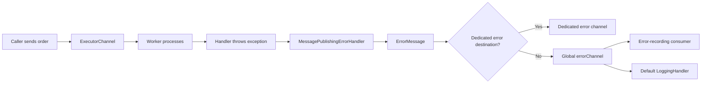

# Global errorChannel

In the **SPRING_INTEGRATION_CORE** module, the global `errorChannel` is the shared error-handling destination of the Spring Integration infrastructure when the error-publishing mechanism does not select a dedicated destination. This lesson belongs to the **Error handling** chapter and focuses on where errors go, what information is contained in `ErrorMessage`, how to add consumers, and how to test synchronous and asynchronous boundaries.

The running example is order processing. A task running on a worker thread fails; the application needs to retrieve the order ID, message ID, and trace ID to record the failure, while distinguishing this situation from an error returned directly to the caller.

## 1. Learning Objectives

After this lesson, you will be able to:

- Explain the role and scope of the bean named specifically `errorChannel`.
- Distinguish between an exception propagating along the call stack and an error published as a message.
- Read the payload, `failedMessage`, and `originalMessage` in the proper context.
- Add consumers to the global error channel without unintentionally altering the default configuration.
- Verify precedence among the `errorChannel` header, local error configurations, and the shared destination.
- Design recording, classification, and recovery flows with clear boundaries.

The examples use Java 17 and Spring Integration 6.5.x APIs. The primary dependency is `org.springframework.integration:spring-integration-core`; the illustrative tests use JUnit Jupiter. Spring versions should be managed consistently via your project's BOM or dependency configuration.

## 2. What Is the Global errorChannel?

`errorChannel` is the **channel bean name** used by Spring Integration as the default error destination across mechanisms that support publishing errors as messages.

"Global" here refers to its shared role within the application infrastructure context. It is not a catcher for every exception in the JVM, nor does it automatically collect errors from other processes or services.

With the default infrastructure enabled, if the application has not provided a channel with that name, Spring Integration creates:

- A `PublishSubscribeChannel` named `errorChannel`.
- A `LoggingHandler` subscriber that logs errors at `ERROR` level.

The initialization mechanism is in [`DefaultConfiguringBeanFactoryPostProcessor` 6.5.x](https://raw.githubusercontent.com/spring-projects/spring-integration/6.5.x/spring-integration-core/src/main/java/org/springframework/integration/config/DefaultConfiguringBeanFactoryPostProcessor.java).

Distinguishing the concepts:

| Component | Role |
|---|---|
| `errorChannel` | Destination receiving error messages |
| `ErrorMessage` | A message whose payload is a `Throwable` |
| `MessagePublishingErrorHandler` | Catches errors within an integrated scope and publishes error messages |
| Error channel consumer | Records, classifies, or forwards to a follow-up processing step |

Having a channel and having an error publisher are two separate requirements. An exception only reaches the channel when the flow has an appropriate error-catching and publishing mechanism.

## 3. Synchronous Errors and Asynchronous Errors

### 3.1. DirectChannel: Errors Typically Return to the Caller

In a synchronous flow:

```text
caller thread
    -> DirectChannel
        -> handler throws exception
    <- exception propagates back to send(...)
```

The caller may receive a `MessagingException` or a related exception depending on the API being used. Simply having an `errorChannel` bean in the context does not mean the error above is automatically routed there.

Even when a message carries an `errorChannel` header, calling `DirectChannel.send(...)` directly still requires a component that actually catches and publishes errors. The header is only routing metadata for mechanisms that support it.

### 3.2. ExecutorChannel: Worker Errors Require Another Notification Path

When the executor actually hands off work to a worker thread:



The caller may have already completed the send operation before the handler encounters an error. An exception on the worker cannot travel back into a call stack that has already returned.

A Spring-managed `ExecutorChannel` is integrated with an execution mechanism that includes error handling. This differs from running an arbitrary `Runnable` yourself on a thread or executor outside the Integration flow. See the [`ExecutorChannel` source code](https://raw.githubusercontent.com/spring-projects/spring-integration/6.5.x/spring-integration-core/src/main/java/org/springframework/integration/channel/ExecutorChannel.java).

### 3.3. Cases to Examine Individually

| Situation | Typical handling path |
|---|---|
| Direct call to `DirectChannel` | Exception propagates back to caller |
| Handler running behind a managed `ExecutorChannel` | Task's error-handling mechanism publishes `ErrorMessage` |
| Polling consumer processing messages from `QueueChannel` | Poller's error handler handles task errors |
| Synchronous gateway | Returns error to caller by default; an error channel can be configured |
| Retry advice with a recovery callback | Callback decides behavior once attempts are exhausted |
| Manually created thread or task outside Integration | Needs its own error-handling mechanism for that task |

A `QueueChannel` by itself only holds messages. Receiving and processing messages via a polling consumer is what introduces the task boundary and corresponding error-handling path.

An overview of execution boundaries is described in [Spring Integration — Error Handling](https://docs.spring.io/spring-integration/reference/6.5/error-handling.html).

## 4. Selecting the Error Channel: Dedicated vs. Default Destination

For the `MessagePublishingErrorHandler` under discussion, information on the failed message can specify a dedicated channel:

```java
MessageBuilder.withPayload(command)
        .setHeader(MessageHeaders.ERROR_CHANNEL, "orderErrors")
        .build();
```

The header value can be a channel name or a suitable `MessageChannel` instance. If no dedicated destination is specified, the error handler uses its default destination; in standard infrastructure configuration, that destination is the global `errorChannel`.

```text
failedMessage.headers.errorChannel has a valid value
    -> specified destination

no dedicated destination specified
    -> default destination of the error-publishing mechanism
    -> typically bean "errorChannel"
```

Poller, gateway, or recoverer configurations can change the error destination within their own scope. Therefore, first identify **which component is publishing the error**, and then determine the final destination.

Do not assume that choosing a dedicated channel will simultaneously send a copy to the global channel. If you want both places to receive it, you must design an explicit forwarding or fan-out step.

Nor should you treat a misspelled dedicated channel name as an automatic failover mechanism to the global channel. An unresolvable channel error is a configuration bug that needs to be detected and tested.

Destination selection rules are implemented in [`MessagePublishingErrorHandler` 6.5.x](https://raw.githubusercontent.com/spring-projects/spring-integration/6.5.x/spring-integration-core/src/main/java/org/springframework/integration/channel/MessagePublishingErrorHandler.java).

## 5. Reading ErrorMessage Properly

Import the message class:

```java
import org.springframework.messaging.support.ErrorMessage;
```

Three items that usually need to be distinguished:

| Location | What does it hold? | Notes |
|---|---|---|
| `error.getPayload()` | `Throwable` describing the error | May be a `MessagingException` wrapper |
| `MessagingException.getFailedMessage()` | Message at the failed processing point | May be absent; payload may already have been transformed |
| `error.getOriginalMessage()` | Context message attached when creating `ErrorMessage` | May be null and does not necessarily match `failedMessage` |

`ErrorMessage` has no contract guaranteeing that every error header is a copy of business headers. To extract `orderId` or `traceId`, first identify the appropriate context message.

For example, if a transformer changes the payload before a service call step fails, the message at the point of failure may differ from the message at the boundary where the publisher catches the error.

See the [`ErrorMessage` API](https://docs.spring.io/spring-framework/docs/current/javadoc-api/org/springframework/messaging/support/ErrorMessage.html). Attaching `originalMessage` also depends on the error-creation strategy and the provided context; [`DefaultErrorMessageStrategy`](https://docs.spring.io/spring-integration/api/org/springframework/integration/support/DefaultErrorMessageStrategy.html) only attaches that information when it is present in the context.

An error consumer should handle the case where the original message is missing. Do not let payload casts or header lookups cause the error-recording path itself to throw a new error.

## 6. Complete Example: Recording Errors from an Order Task

The following configuration keeps the default global `errorChannel` and adds an application consumer. It does not declare a new `errorChannel` bean.

Illustrative file `example/GlobalErrorConfig.java`:

```java
package example;

import java.util.Objects;
import java.util.UUID;

import org.springframework.beans.factory.annotation.Qualifier;
import org.springframework.context.annotation.Bean;
import org.springframework.context.annotation.Configuration;
import org.springframework.integration.annotation.ServiceActivator;
import org.springframework.integration.channel.DirectChannel;
import org.springframework.integration.channel.ExecutorChannel;
import org.springframework.integration.channel.QueueChannel;
import org.springframework.integration.config.EnableIntegration;
import org.springframework.messaging.Message;
import org.springframework.messaging.MessagingException;
import org.springframework.messaging.support.ErrorMessage;
import org.springframework.scheduling.concurrent.ThreadPoolTaskExecutor;

@Configuration
@EnableIntegration
public class GlobalErrorConfig {

    public record OrderCommand(String orderId) {
        public OrderCommand {
            Objects.requireNonNull(orderId, "orderId");
        }
    }

    public record FailureReport(
            String orderId,
            UUID failedMessageId,
            String traceId,
            String exceptionType) {
    }

    @Bean
    public ThreadPoolTaskExecutor orderWorkers() {
        var executor = new ThreadPoolTaskExecutor();
        executor.setCorePoolSize(1);
        executor.setMaxPoolSize(1);
        executor.setQueueCapacity(20);
        executor.setThreadNamePrefix("order-worker-");
        executor.setWaitForTasksToCompleteOnShutdown(true);
        executor.setAwaitTerminationSeconds(5);
        return executor;
    }

    @Bean
    public ExecutorChannel orderInput(
            @Qualifier("orderWorkers") ThreadPoolTaskExecutor executor) {
        return new ExecutorChannel(executor);
    }

    @Bean
    public DirectChannel directOrderInput() {
        return new DirectChannel();
    }

    @Bean
    public QueueChannel processedOrders() {
        return new QueueChannel(100);
    }

    @Bean
    public QueueChannel failureReports() {
        return new QueueChannel(100);
    }

    @Bean
    public QueueChannel orderErrors() {
        return new QueueChannel(100);
    }

    @Bean
    public OrderHandlers orderHandlers() {
        return new OrderHandlers();
    }

    public static class OrderHandlers {

        @ServiceActivator(
            inputChannel = "orderInput",
            outputChannel = "processedOrders"
        )
        public String processAsync(OrderCommand command) {
            return process(command);
        }

        @ServiceActivator(
            inputChannel = "directOrderInput",
            outputChannel = "processedOrders"
        )
        public String processDirect(OrderCommand command) {
            return process(command);
        }

        private String process(OrderCommand command) {
            if (command.orderId().startsWith("FAIL-")) {
                throw new IllegalStateException("Order processing failed");
            }
            return "PROCESSED:" + command.orderId();
        }

        @ServiceActivator(
            inputChannel = "errorChannel",
            outputChannel = "failureReports"
        )
        public FailureReport recordFailure(ErrorMessage error) {
            Throwable failure = error.getPayload();

            Message<?> failed = failure instanceof MessagingException ex
                    ? ex.getFailedMessage()
                    : null;

            if (failed == null) {
                failed = error.getOriginalMessage();
            }

            String orderId = "unknown";
            UUID failedMessageId = null;
            String traceId = "unknown";

            if (failed != null) {
                failedMessageId = failed.getHeaders().getId();

                Object trace = failed.getHeaders().get("traceId");
                if (trace != null) {
                    traceId = trace.toString();
                }

                if (failed.getPayload() instanceof OrderCommand command) {
                    orderId = command.orderId();
                }
            }

            Throwable detail = failure.getCause() != null
                    ? failure.getCause()
                    : failure;

            return new FailureReport(
                    orderId,
                    failedMessageId,
                    traceId,
                    detail.getClass().getName()
            );
        }
    }
}
```

### 6.1. Path of a Failing Order

With `orderId = "FAIL-101"` and no header specifying a dedicated error destination:

1. Caller sends the message to `orderInput`.
2. The worker executes `processAsync`.
3. The business step throws `IllegalStateException`.
4. The infrastructure creates an error message and sends it to the global `errorChannel`.
5. `recordFailure` produces a `FailureReport` in `failureReports`.
6. The default logging subscriber can also log the error message.

A successful `send(...)` return only confirms that the message was accepted for channel dispatch/processing. It does not prove that the order was processed successfully on the worker.

### 6.2. Scope of the Extraction Logic

The illustrative consumer prefers `failedMessage` on the immediate wrapper, and falls back to `originalMessage` if needed. `exceptionType` takes the immediate cause if present.

In a system with multiple wrapper layers, you should add cause-chain traversal and rules for picking the appropriate message. The router section below uses a dedicated component for classifying errors across the cause chain.

The queues here serve result observation and in-memory testing. They do not represent durable error storage or a recovery plan across restarts.


## 7. Testing the Error Path

The following test example creates a separate context for each scenario. For asynchronous processing, use `receive` with a finite timeout to wait for results instead of `Thread.sleep`.

Illustrative file `example/GlobalErrorChannelTest.java`:

```java
package example;

import example.GlobalErrorConfig.FailureReport;
import example.GlobalErrorConfig.OrderCommand;

import org.junit.jupiter.api.Test;
import org.springframework.context.annotation.AnnotationConfigApplicationContext;
import org.springframework.integration.channel.QueueChannel;
import org.springframework.messaging.Message;
import org.springframework.messaging.MessageChannel;
import org.springframework.messaging.MessageHeaders;
import org.springframework.messaging.MessagingException;
import org.springframework.messaging.support.ErrorMessage;
import org.springframework.messaging.support.MessageBuilder;

import static org.junit.jupiter.api.Assertions.*;

class GlobalErrorChannelTest {

    @Test
    void asyncFailureWithoutOverrideGoesToGlobalChannel() {
        try (var context = new AnnotationConfigApplicationContext(
                GlobalErrorConfig.class)) {

            MessageChannel input =
                    context.getBean("orderInput", MessageChannel.class);
            QueueChannel reports =
                    context.getBean("failureReports", QueueChannel.class);
            QueueChannel processed =
                    context.getBean("processedOrders", QueueChannel.class);

            Message<OrderCommand> request = MessageBuilder
                    .withPayload(new OrderCommand("FAIL-101"))
                    .setHeader("traceId", "trace-101")
                    .build();

            assertTrue(input.send(request));

            Message<?> reportMessage = reports.receive(2_000);
            assertNotNull(reportMessage);

            FailureReport report = assertInstanceOf(
                    FailureReport.class,
                    reportMessage.getPayload()
            );

            assertEquals("FAIL-101", report.orderId());
            assertEquals(
                    request.getHeaders().getId(),
                    report.failedMessageId()
            );
            assertEquals("trace-101", report.traceId());
            assertEquals(
                    IllegalStateException.class.getName(),
                    report.exceptionType()
            );
            assertNull(processed.receive(0));
        }
    }

    @Test
    void messageErrorChannelHeaderSelectsLocalDestination() {
        try (var context = new AnnotationConfigApplicationContext(
                GlobalErrorConfig.class)) {

            MessageChannel input =
                    context.getBean("orderInput", MessageChannel.class);
            QueueChannel localErrors =
                    context.getBean("orderErrors", QueueChannel.class);
            QueueChannel globalReports =
                    context.getBean("failureReports", QueueChannel.class);

            Message<OrderCommand> request = MessageBuilder
                    .withPayload(new OrderCommand("FAIL-202"))
                    .setHeader(MessageHeaders.ERROR_CHANNEL, "orderErrors")
                    .build();

            assertTrue(input.send(request));

            Message<?> delivered = localErrors.receive(2_000);
            assertNotNull(delivered);

            ErrorMessage error = assertInstanceOf(
                    ErrorMessage.class,
                    delivered
            );

            MessagingException failure = assertInstanceOf(
                    MessagingException.class,
                    error.getPayload()
            );

            assertNotNull(failure.getFailedMessage());
            assertEquals(
                    request.getHeaders().getId(),
                    failure.getFailedMessage().getHeaders().getId()
            );
            assertNull(globalReports.receive(0));
        }
    }

    @Test
    void directFailurePropagatesEvenWhenErrorHeaderIsPresent() {
        try (var context = new AnnotationConfigApplicationContext(
                GlobalErrorConfig.class)) {

            MessageChannel input =
                    context.getBean("directOrderInput", MessageChannel.class);
            QueueChannel localErrors =
                    context.getBean("orderErrors", QueueChannel.class);
            QueueChannel globalReports =
                    context.getBean("failureReports", QueueChannel.class);

            Message<OrderCommand> request = MessageBuilder
                    .withPayload(new OrderCommand("FAIL-303"))
                    .setHeader(MessageHeaders.ERROR_CHANNEL, "orderErrors")
                    .build();

            MessagingException failure = assertThrows(
                    MessagingException.class,
                    () -> input.send(request)
            );

            assertNotNull(failure.getFailedMessage());
            assertEquals(
                    request.getHeaders().getId(),
                    failure.getFailedMessage().getHeaders().getId()
            );
            assertNull(localErrors.receive(0));
            assertNull(globalReports.receive(0));
        }
    }
}
```

The tests guard three distinct contracts:

| Case | What is confirmed |
|---|---|
| Async, no override | Global consumer receives the failed order's information |
| Async, dedicated destination header | `ErrorMessage` arrives at the dedicated channel |
| Direct, dedicated destination header | Header does not by itself turn an exception into an error message |

To test the success flow, send an ID not starting with `FAIL-` and inspect `processedOrders`. Do not use the absence of an error message over a short window as the sole proof that the business operation succeeded.

## 8. Adding a Consumer or Replacing the Channel?

### 8.1. Adding a Consumer Is the Simple Option

The main configuration simply adds:

```java
@ServiceActivator(
    inputChannel = "errorChannel",
    outputChannel = "failureReports"
)
```

Apply this annotation to the `recordFailure` method shown in the full example.

With the default publish-subscribe global channel, the application can add consumers for recording or classification while preserving the default logging subscriber.

However, publish-subscribe does not mean every subscriber always runs on an independent thread. A `PublishSubscribeChannel` without an executor invokes subscribers on the thread sending to the channel. See the [`PublishSubscribeChannel` API](https://docs.spring.io/spring-integration/api/org/springframework/integration/channel/PublishSubscribeChannel.html).

In the example, the error consumer can run on the very worker handling the failed execution. A slow report-writing operation can hold the worker longer than expected.

### 8.2. Replacing the Global errorChannel When You Need to Control Channel Properties

Example replacement configuration for the default bean:

```java
@Bean(name = "errorChannel")
public PublishSubscribeChannel applicationErrorChannel() {
    return new PublishSubscribeChannel(true);
}
```

The constructor with `true` requires subscribers. This snippet requires importing `org.springframework.integration.channel.PublishSubscribeChannel` and having an appropriate error consumer.

Once you provide your own `errorChannel` bean, do not assume the default logging subscriber is still created alongside it by the infrastructure. If logging is needed, register it or an equivalent consumer in your application configuration.

### 8.3. If You Choose QueueChannel

Another option:

```java
@Bean(name = "errorChannel")
public QueueChannel applicationErrorChannel() {
    return new QueueChannel(500);
}
```

In that case, the consumer needs a poller or an active receiving mechanism:

```java
@ServiceActivator(
    inputChannel = "errorChannel",
    poller = @Poller(fixedDelay = "100", maxMessagesPerPoll = "10")
)
public void consumeGlobalError(ErrorMessage error) {
    // Record or hand off to the next processing step.
}
```

This is an alternative configuration; do not load it alongside the non-polled consumer from the main example. It requires importing `org.springframework.integration.annotation.Poller`.

A queue decouples the time an error is sent from the time the consumer receives it, but an in-memory queue does not automatically persist data. When full, error sending may block or fail according to the publisher's timeout policy.

Ways to declare channels and polling consumers are described in [Configuring Message Channels](https://docs.spring.io/spring-integration/reference/6.5/channel/configuration.html) and [Poller](https://docs.spring.io/spring-integration/reference/6.5/polling-consumer.html).

## 9. requireSubscribers, Consumer Ordering, and Errors in the Error-Handling Path Itself

### 9.1. Meaning of requireSubscribers

The default global error channel in 6.5.x requires subscribers. When the channel has no suitable subscriber to dispatch to, the send is not considered handled normally.

This mechanism helps surface cases where the error path no longer has consumers, such as during certain context-shutdown phases. It does not automatically add durability, retries, or guarantees that the source message will be redelivered.

What happens after failing to deliver an error also depends on the publisher, adapter, and transaction. For `MessagePublishingErrorHandler` in 6.5.x, failures when delivering an `ErrorMessage` may be caught and logged; verify this scenario separately if the application requires guarantees against losing error information.

Do not switch to a mode that ignores missing subscribers just to quiet the logs without first deciding on an alternative error-capture mechanism.

### 9.2. Subscriber Ordering Matters

The default logging subscriber has order `Ordered.LOWEST_PRECEDENCE - 100`. If a consumer preceding it throws an exception and dispatch stops there, subsequent consumers might never be invoked.

Therefore, "having multiple subscribers registered" is not enough to guarantee all of them receive errors when one subscriber fails. Check the order, the channel's failure policy, and how slow or failure-prone work is isolated.

### 9.3. Avoiding Error-Handling Loops

A dangerous path:

```text
errorChannel
    -> calls the failing service again
        -> fails again
            -> routed back to the same errorChannel
                -> keeps looping
```

Global consumers should do minimal work, be time-bounded, and have clear terminal destinations. If recording fails, have a designed fallback—such as local logging or persisting the incident to an independent store—instead of resending indefinitely.

In the main example, sending a report to a queue can also fail when the queue is full. Creating a report in RAM does not mean the error has been safely persisted.


## 10. How Pollers, Schedulers, and Gateways Use the Global Channel

### 10.1. Errors from a Polling Consumer

When an endpoint polls a `QueueChannel`, errors can arise while receiving or processing a message. The poller task's error-handling mechanism is responsible for forwarding the error to the appropriate error path.

Example of a poller using the default destination:

```java
@ServiceActivator(
    inputChannel = "polledOrders",
    poller = @Poller(fixedDelay = "200")
)
public void consumeOrder(OrderCommand command) {
    throw new IllegalStateException("Polling consumer failed");
}
```

This is a method on a managed bean; you must declare `polledOrders` as a `QueueChannel` and enable Integration infrastructure. If a dedicated destination is needed for the poller, specify `errorChannel` in `@Poller` and declare the corresponding consumer.

When a message already carries a dedicated error destination header, check the rules of the error handler in use instead of assuming the poller always sends to the global channel.

### 10.2. Custom-Declared Scheduler

Spring Integration's default scheduler is wired to the error-publishing mechanism. If you replace it with a custom scheduler, configure an appropriate error handler if you want to keep that behavior.

Example reusing the infrastructure error handler:

```java
@Bean(name = "taskScheduler")
public ThreadPoolTaskScheduler taskScheduler(
        @Qualifier("integrationMessagePublishingErrorHandler")
        ErrorHandler errorHandler) {

    var scheduler = new ThreadPoolTaskScheduler();
    scheduler.setPoolSize(2);
    scheduler.setThreadNamePrefix("integration-scheduler-");
    scheduler.setErrorHandler(errorHandler);
    return scheduler;
}
```

This snippet requires importing `org.springframework.scheduling.concurrent.ThreadPoolTaskScheduler` and `org.springframework.util.ErrorHandler`, along with the corresponding Spring annotations.

The name `integrationMessagePublishingErrorHandler` is the infrastructure bean registered in the 6.5.x line under discussion. Custom scheduler configurations should be tested in the actual context, especially when combined with Spring Boot auto-configuration.

### 10.3. Synchronous Gateway Configured with errorChannel

A gateway is a component capable of catching and routing errors according to its configuration, even when the underlying processing runs synchronously. Therefore, distinguish between:

- Calling `DirectChannel.send(...)` directly.
- Calling through a gateway configured with `errorChannel`.

If the gateway expects a return value, the error consumer must adhere to the chosen reply contract. A consumer that only logs or pushes a report onto a queue does not produce a properly typed business result for the gateway call.

In the main example, `recordFailure` sends its output to `failureReports`. It serves task error recording and should not by default be used as a fallback returning a `String` for a request-reply gateway.

Gateway error behavior and unwrapping are covered in [Messaging Gateways — Error Handling](https://docs.spring.io/spring-integration/reference/6.5/gateway.html).

## 11. Classifying Errors from the Global Channel

A global channel can receive errors from many flows. Route them to branches with clear responsibilities instead of writing a single consumer containing every recovery strategy.

`ErrorMessageExceptionTypeRouter` routes by exception types along the cause chain, helping handle cases where a business exception is wrapped inside a `MessagingException`.

Example adding a router and observation destinations:

```java
@Bean
public QueueChannel validationErrors() {
    return new QueueChannel(100);
}

@Bean
public QueueChannel transientErrors() {
    return new QueueChannel(100);
}

@Bean
public QueueChannel unexpectedErrors() {
    return new QueueChannel(100);
}

@Bean
@ServiceActivator(inputChannel = "errorChannel")
public ErrorMessageExceptionTypeRouter globalErrorRouter() {
    var router = new ErrorMessageExceptionTypeRouter();

    router.setChannelMapping(
            IllegalArgumentException.class.getName(),
            "validationErrors"
    );

    router.setChannelMapping(
            java.net.SocketTimeoutException.class.getName(),
            "transientErrors"
    );

    router.setChannelKeyFallback(false);
    router.setResolutionRequired(false);
    router.setDefaultOutputChannelName("unexpectedErrors");

    return router;
}
```

Requires importing `org.springframework.integration.router.ErrorMessageExceptionTypeRouter`. Place these methods in a configuration class with Integration infrastructure enabled.

This can be an additional subscriber on the global channel or a business consumer replacing the report-recording step. If you keep both on a publish-subscribe channel, they act as two error-receiving branches; explicitly verify whether that parallel handling is intended.

| Branch | Application behavior you can design |
|---|---|
| `validationErrors` | Record invalid data; request corrected input |
| `transientErrors` | Hand off to a bounded recovery policy |
| `unexpectedErrors` | Preserve details for investigation and severity-based alerting |

The branch name `transientErrors` does not prove that every timeout error is safe to retry. If the remote operation might have succeeded before the response was lost, retrying requires an idempotency key or reconciliation rules.

The router only selects the destination; the queues in the example need consumers if further processing is desired. The API and cause-traversal algorithm are described in [`ErrorMessageExceptionTypeRouter`](https://docs.spring.io/spring-integration/api/org/springframework/integration/router/ErrorMessageExceptionTypeRouter.html) and the [6.5.x source code](https://raw.githubusercontent.com/spring-projects/spring-integration/6.5.x/spring-integration-core/src/main/java/org/springframework/integration/router/ErrorMessageExceptionTypeRouter.java).

## 12. Global errorChannel, Retry, and Error Storage Are Separate Responsibilities

Sending an exception to a channel does not determine whether the order will be retried, canceled, or accepted with a fallback result.

| Responsibility | Question to answer |
|---|---|
| Error routing | Which consumer receives the error? |
| Retry | Should it be retried, how many times at most, and how long to wait? |
| Recovery | When it cannot proceed, what does the application do? |
| Error storage | What information is retained and does it survive restarts? |
| Acknowledgement/transaction | Does the source consider the message done? |
| Idempotency | Will redelivery produce duplicate business side effects? |

`RequestHandlerRetryAdvice` can apply retries at an endpoint. When attempts are exhausted, a recovery callback such as `ErrorMessageSendingRecoverer` can publish the final error to a chosen channel. If the error is handled by the recovery callback and not rethrown, outer layers may no longer observe the same exception as before.

Refer to [Retry Advice](https://docs.spring.io/spring-integration/reference/6.5/handler-advice/classes.html) and [`ErrorMessageSendingRecoverer`](https://docs.spring.io/spring-integration/api/org/springframework/integration/handler/advice/ErrorMessageSendingRecoverer.html).

In the order problem, a durable failure record may be needed before considering the error handoff complete. A design should specify:

1. The business key identifying the order and processing attempt.
2. The failure cause, failed step, and number of attempts already made.
3. How enough data is stored for investigation or replay.
4. Rules on who is allowed to trigger recovery.
5. How to avoid duplicate sends or writes when the source redelivers.

The default in-memory global channel does not automatically become a broker dead-letter queue. Similarly, successful logging does not prove the source transaction rolled back or that the message will be redelivered. That behavior belongs to the adapter, transaction, and actual recovery policy.

## 13. Designing an Error Consumer for Operations

A shared consumer should have a small contract, be easy to observe, and tolerate missing data.

### 13.1. Retaining Enough Information to Trace Incidents

Useful fields typically include:

- A business identifier, such as `orderId`.
- The ID of the message at the point of failure and the trace ID.
- The flow or endpoint name, if available.
- The outermost exception type and the cause needed for classification.
- The timestamp, attempt count, and next handling decision.

Configuration source and endpoint info in the exception also help locate the wiring causing the failure. Do not rely solely on `exception.getMessage()`, as that string can be missing or insufficient for classification.

`failedMessage` may contain a large payload or data that should not be logged in full. The consumer can extract the required fields and control report contents per the application contract.

### 13.2. Controlling Resources of the Error Path Itself

A sudden spike in errors can fill the report queue or cause workers to spend most of their time handling errors.

Define capacity, send timeouts, consumption rate, and how to behave when the recording system is unavailable. If every error message calls back into the very service that is failing, the error path can suffer the same root cause of failure as the main flow.

When decoupling work with an executor or queue, account for handoff failures and shutdown as well. Splitting threads does not by itself guarantee errors are saved.

### 13.3. Observing Meaningful Metrics

For the order example, distinguish:

| Metric | What to detect |
|---|---|
| Order processing error count | Business service or input data is having issues |
| Errors going to dedicated channels | Traffic that may not show up in the global consumer |
| Errors while writing reports | The recording path itself is experiencing a separate outage |
| Error backlog age and size | Consumer cannot keep up or has stopped working |
| Retry, recovery, and failed handoff counts | Whether recovery is actually making progress or just repeating |

A single error can be recorded by both the default logger and a custom consumer. When building dashboards, know where each metric is measured to avoid counting one incident as multiple business failures.

## 14. Scenarios to Test Before Trusting the Error Path

Beyond the three main tests, select tests suited to your deployment architecture:

| Scenario | What to verify |
|---|---|
| Order processed successfully | Produces success output and no corresponding error report |
| `ErrorMessage` without `originalMessage` | Consumer still handles it cleanly |
| Error payload is not a `MessagingException` | No blind casts or secondary exceptions in the consumer |
| Message passed through a transformer | Extracts the right data from the message at the point of failure |
| Dedicated error channel name does not exist | Misconfiguration is surfaced along the designed error path |
| Error-recording queue is full | Timeout and fallback strategy work |
| Error consumer throws an exception | Know which subscribers run and what gets dropped |
| Custom-configured poller or scheduler fails | Error reaches the expected destination |
| Context is shutting down | Acceptance, drain, and error reporting policies behave properly |
| Source uses transactions or acknowledgements | Commit, rollback, or redelivery matches the contract |
| Endpoint has retry/recovery | Does not mistakenly record every retry attempt as a final failure |

Testing by manually sending `new ErrorMessage(...)` to the global channel only confirms the consumer works. It does not test that the framework catches errors, selects the destination, and preserves the `failedMessage` context. Include at least one test that triggers a real failure inside the task, as in the example.

## 15. Key Takeaways When Using the Global errorChannel

The global `errorChannel` is the default receiving point for error-publishing mechanisms integrated with Spring Integration. To understand where an error goes, identify the execution site, the error-catching component, and the destination-selection rules.

Keep three distinct outcomes separate: the message was sent, the business operation succeeded, and the error was safely recorded. A global consumer helps observe and classify failures; retry, recovery, durable storage, and transactions must be designed and tested under their own contracts.
