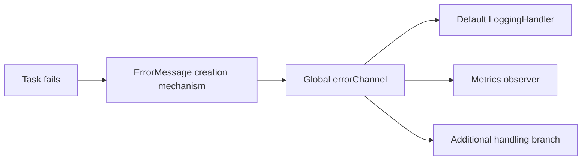

# Default PublishSubscribeChannel

## 1. Scope and Objectives

In the **Error handling** chapter of the **SPRING_INTEGRATION_CORE** module, this topic covers **the global error channel whose bean name is `errorChannel`**. When an application enables Spring Integration infrastructure and has not provided a bean with that name, the framework creates a `PublishSubscribeChannel` along with a logging subscriber.

This lesson helps you:

- Recognize the default configuration of `errorChannel`.
- Explain why multiple subscribers can observe the same error simultaneously.
- Distinguish between errors published as messages and exceptions propagating back to the caller.
- Extract failed request information from an `ErrorMessage`.
- Add observers and test the broadcast mechanism while keeping the default infrastructure intact.

The examples use Java 17, Spring Integration 6.5 APIs, and JUnit Jupiter. The required dependency is `org.springframework.integration:spring-integration-core`; the tests require JUnit Jupiter. Choose dependency versions matching your project's Spring platform. The examples use a plain Spring context and require no external broker or service.

## 2. "Default" Refers to the Configuration of the errorChannel Bean

Distinguish two things:

1. The framework automatically registers the global error channel when no `errorChannel` bean exists.
2. A developer manually instantiates an object with `new PublishSubscribeChannel()`.

Both cases use the same class, yet do not share the exact same configuration:

| Characteristic in Spring Integration 6.5 | Auto-created `errorChannel` | `new PublishSubscribeChannel()` |
| --- | --- | --- |
| Default purpose | Receives error messages routed to the shared error channel | General-purpose broadcast channel |
| `requireSubscribers` | `true` | `false` |
| `ignoreFailures` | `true` | `false` |
| Dedicated dispatch executor | Not provided in default configuration | Not provided |
| Automatic logging subscriber | Yes, registered by infrastructure alongside the channel | Not included merely by calling the constructor |
| Special bean name | `errorChannel` | Only has a name if registered as a bean |

The properties of the auto-created error channel are governed by global properties, including:

```properties
spring.integration.channels.error.requireSubscribers=true
spring.integration.channels.error.ignoreFailures=true
```

These are the defaults for the version used in this lesson, not two configuration lines you are required to add. The values are published in [Global Properties](https://docs.spring.io/spring-integration/reference/6.5/configuration/global-properties.html). The constructors and options of the channel class are described in the [PublishSubscribeChannel API](https://docs.spring.io/spring-integration/docs/6.5.0/api/org/springframework/integration/channel/PublishSubscribeChannel.html).

Merely seeing type `PublishSubscribeChannel` in a debugger is not enough to conclude it is the global error channel or that it has the exact values in the default column. Check the bean name, how it was created, and any overridden settings.

## 3. The Role of Broadcasting in Error Handling

Suppose an inventory-check task fails. The system may simultaneously need to:

- Log for diagnostics.
- Update error metrics.
- Forward relevant details to a business handling flow.

A publish-subscribe channel allows multiple subscribers to receive the error event together:



This distributes one error message to multiple subscribers. It does not distribute work across subscribers like a competing-consumers group, and it does not split the payload into smaller pieces.

Nor is the default channel durable error storage. It dispatches to currently subscribed consumers; it does not retain a history for late-subscribing consumers to replay. If you need to store errors for later processing, design a dedicated persistence or buffering step.

### 3.1. The LoggingHandler Subscriber

The default infrastructure registers a `LoggingHandler` at `ERROR` log level. The processing order of this subscriber is:

```java
Ordered.LOWEST_PRECEDENCE - 100
```

Lower `order` values have higher priority than higher values. When you want the default logger to run before a custom subscriber, the added subscriber needs a suitable order, typically a numeric value greater than the logger's order.

This logger configuration is described in [Error Handling](https://docs.spring.io/spring-integration/reference/6.5/error-handling.html). Do not interpret "precedence" as meaning a larger number runs earlier.

Successful logging only proves that one subscriber observed the error. It does not prove that the task was retried, that data was recovered, or that the caller received a business result.

### 3.2. Default Broadcast Still Runs on the Thread Publishing the Error

A `PublishSubscribeChannel` without its own executor invokes handlers on the thread sending the message to it. For the default error channel, that thread may be the poller or worker thread reporting the error.

Example:

```text
Caller thread:
    sends request to workRequests
    continues other work

Poller thread:
    receives request
    calls business logic -> exception
    creates and publishes ErrorMessage
    runs logger
    runs other error subscribers
```

Moving business processing off the caller thread does not automatically make error subscribers run in parallel with one another. An error observer making a slow HTTP call can block the error-reporting thread and affect throughput for subsequent tasks.

Do not call `receive()` on a `PublishSubscribeChannel` to fetch errors. It is a `SubscribableChannel`: to receive messages, register a subscriber or a corresponding consuming endpoint.

## 4. Which Errors Go to the Global Channel?

The channel only receives messages sent to it. It does not automatically catch every exception in the JVM.

### 4.1. DirectChannel: Exceptions Typically Propagate to the Sender

When a caller sends to a `DirectChannel` and the handler runs on the same thread, errors typically propagate back up the call stack to the caller. An `errorChannel` header on the request does not by itself turn every synchronous call into an error-publishing flow.

```text
caller -> DirectChannel -> handler throws exception
   ^                          |
   +------ exception ---------+
```

A gateway can provide its own error-handling mechanism per configuration. When analyzing a specific case, determine who catches the exception and who is responsible for creating the error message.

### 4.2. Integration-Managed Pollers and Executors

With an endpoint reading a `QueueChannel` via a poller, the caller has already placed the message into the queue before the handler runs. An exception thrown inside the poller task cannot travel back via a normal `throw` to a `send` call that has already finished.

Spring Integration's error-handling infrastructure can wrap the exception in an `ErrorMessage` and send it to the selected error channel. `MessagePublishingErrorHandler` is a component serving this mechanism; see the [MessagePublishingErrorHandler API](https://docs.spring.io/spring-integration/docs/6.5.0/api/org/springframework/integration/channel/MessagePublishingErrorHandler.html).

An arbitrary task submitted to a custom-created executor does not automatically gain this entire mechanism merely because an `errorChannel` bean exists in the application. Attach an appropriate error handler to the execution component.

### 4.3. The errorChannel Header and the Shared Error Channel

In the default error-handling mechanism that supports request metadata:

1. If the failed request provides a valid `errorChannel` header, the error handler can use that address.
2. If no dedicated address is present, the error-handling mechanism uses its default error channel; typically the global `errorChannel` bean.
3. A poller, adapter, or gateway may have its own error configuration, so inspect the specific component.

There is no rule that an error sent to a dedicated channel will also be copied to the global channel. If you want to aggregate both, wire an explicit forwarding branch.

`replyChannel` is the reply address and `errorChannel` is the error-reporting address. Both are request-related metadata, yet they serve different contracts.

## 5. Reading ErrorMessage with the Proper Data Classes

`ErrorMessage` belongs to package `org.springframework.messaging.support` and carries a payload of type `Throwable`. The payload is typically a `MessagingException` holding information about the message at the point of failure:

```text
ErrorMessage
  headers: error message metadata
  payload: Throwable
      may be MessagingException
          failedMessage: message at the error point
          cause: underlying exception
  originalMessage: original message if supplied by the error-creating mechanism
```

Do not cast `error.getPayload()` to an order object. It is an exception, while business data lives in the original message or failed message when available.

A utility method to find the request for observation:

```java
package example.errors;

import org.springframework.messaging.Message;
import org.springframework.messaging.MessagingException;
import org.springframework.messaging.support.ErrorMessage;

public final class ErrorInspection {

    private ErrorInspection() {
    }

    public static Message<?> messageAtFailure(ErrorMessage error) {
        Throwable current = error.getPayload();

        while (current != null) {
            if (current instanceof MessagingException messaging
                    && messaging.getFailedMessage() != null) {
                return messaging.getFailedMessage();
            }

            Throwable next = current.getCause();
            if (next == current) {
                break;
            }
            current = next;
        }

        return error.getOriginalMessage();
    }
}
```

This is a simple observation policy: prefer the message at the point of failure, then use `originalMessage` as a fallback. The result can still be `null`, such as when manually constructing an `ErrorMessage` from only an exception.

`failedMessage` and `originalMessage` are not necessarily the same message. A chain of transformers might have changed the payload before the error occurred. Nor is a trace ID guaranteed to appear on the error message's own headers; look it up on the identified request when needed and handle missing values.

The payload contract and optionality of `originalMessage` are explained in the [ErrorMessage API](https://docs.spring.io/spring-framework/docs/6.2.x/javadoc-api/org/springframework/messaging/support/ErrorMessage.html).

## 6. Example: Poller Error into the Global Channel

Practice flow:

```text
workRequests: QueueChannel
    -> poller
    -> InventoryWorker.process(...)
    -> exception
    -> ErrorMessage
    -> default errorChannel
          +-> default LoggingHandler
          +-> example observer
                  -> errorProbe: QueueChannel
```

`errorProbe` is only used as an observation point in this exercise. It is not the global error channel and does not replace the `errorChannel` bean.

The following public types are placed in separate Java files within package `example.errors`.

### 6.1. Worker Intentionally Producing an Error

```java
package example.errors;

import org.springframework.integration.annotation.Poller;
import org.springframework.integration.annotation.ServiceActivator;

public class InventoryWorker {

    @ServiceActivator(
            inputChannel = "workRequests",
            poller = @Poller(
                    fixedDelay = "50",
                    maxMessagesPerPoll = "1"))
    public void process(String orderId) {
        fail(orderId);
    }

    @ServiceActivator(inputChannel = "syncRequests")
    public void processSynchronously(String orderId) {
        fail(orderId);
    }

    private void fail(String orderId) {
        throw new IllegalStateException(
                "Inventory unavailable for " + orderId);
    }
}
```

Both endpoints call the same intentionally failing operation. `workRequests` uses a queue and poller; `syncRequests` uses a `DirectChannel` to contrast how errors return to the caller.

The methods return `void` because the exercise only observes errors and does not produce a business reply.

### 6.2. Registering an Additional Subscriber While Keeping the Auto-Created errorChannel

```java
package example.errors;

import org.springframework.beans.factory.annotation.Qualifier;
import org.springframework.context.annotation.Bean;
import org.springframework.context.annotation.Configuration;
import org.springframework.integration.annotation.ServiceActivator;
import org.springframework.integration.channel.DirectChannel;
import org.springframework.integration.channel.QueueChannel;
import org.springframework.integration.config.EnableIntegration;
import org.springframework.messaging.MessageDeliveryException;
import org.springframework.messaging.MessageHandler;
import org.springframework.messaging.support.ErrorMessage;

@Configuration
@EnableIntegration
public class DefaultErrorChannelConfig {

    @Bean
    public QueueChannel workRequests() {
        return new QueueChannel(10);
    }

    @Bean
    public DirectChannel syncRequests() {
        return new DirectChannel();
    }

    @Bean
    public QueueChannel errorProbe() {
        return new QueueChannel(10);
    }

    @Bean
    public InventoryWorker inventoryWorker() {
        return new InventoryWorker();
    }

    @Bean
    @ServiceActivator(inputChannel = "errorChannel")
    public MessageHandler captureErrors(
            @Qualifier("errorProbe") QueueChannel errorProbe) {

        return message -> {
            if (!(message instanceof ErrorMessage)) {
                throw new IllegalArgumentException(
                        "Expected an ErrorMessage");
            }

            if (!errorProbe.send(message, 0)) {
                throw new MessageDeliveryException(
                        message, "Error probe is full");
            }
        };
    }
}
```

This configuration does not declare an `errorChannel` bean. `@EnableIntegration` enables the infrastructure, the framework creates the shared error channel and logger, and the `captureErrors` bean registers an additional subscriber on that channel.

The `captureErrors` factory returns a `MessageHandler`. It is invoked to create the handler at context startup, while the handler lambda is invoked for each error message.

Sending to the probe uses a timeout of `0` so it does not wait indefinitely when the queue is full. Throwing an error if the probe is full makes observer failure observable through the dispatch mechanism; with `ignoreFailures=true`, this failure does not turn into a successful error save.

In a real application, the observation branch might record metrics or send a curated error record to a storage system. The probe queue in this lesson has no durability, retry, or automatic alerting.

## 7. Testing the Default Mechanism

The tests create a fresh context per scenario and use bounded receives. There is no need for `Thread.sleep` to guess when the poller has finished running.

### 7.1. Poller Error Becomes an ErrorMessage

```java
package example.errors;

import org.junit.jupiter.api.Test;
import org.springframework.context.annotation.AnnotationConfigApplicationContext;
import org.springframework.integration.channel.PublishSubscribeChannel;
import org.springframework.integration.channel.QueueChannel;
import org.springframework.messaging.Message;
import org.springframework.messaging.MessagingException;
import org.springframework.messaging.support.ErrorMessage;
import org.springframework.messaging.support.MessageBuilder;

import static org.junit.jupiter.api.Assertions.*;

class PollerErrorTest {

    @Test
    void publishesAnErrorForTheFailedRequest() {
        try (var context =
                     new AnnotationConfigApplicationContext(
                             DefaultErrorChannelConfig.class)) {

            assertInstanceOf(PublishSubscribeChannel.class,
                    context.getBean("errorChannel"));

            var input =
                    context.getBean("workRequests", QueueChannel.class);
            var probe =
                    context.getBean("errorProbe", QueueChannel.class);

            Message<String> request = MessageBuilder
                    .withPayload("ORD-100")
                    .setHeader("traceId", "TRACE-100")
                    .build();

            assertTrue(input.send(request, 1000));

            Message<?> observed = probe.receive(3000);
            ErrorMessage error =
                    assertInstanceOf(ErrorMessage.class, observed);
            assertInstanceOf(MessagingException.class,
                    error.getPayload());

            Message<?> failed =
                    ErrorInspection.messageAtFailure(error);
            assertNotNull(failed);
            assertEquals("ORD-100", failed.getPayload());
            assertEquals("TRACE-100",
                    failed.getHeaders().get("traceId"));
        }
    }
}
```

`input.send` succeeds because the request was placed into the queue. The test then observes another result on the error branch, proving the poller ran and caught the failure.

The test reads the trace ID on the failed message. It does not assume the error message automatically copies all business headers.

### 7.2. Broadcast Continues When One Observer Fails

To test both fan-out and `ignoreFailures=true`, the test registers an intentionally failing handler at highest precedence along with an observer that captures the message:

```java
package example.errors;

import java.util.concurrent.atomic.AtomicInteger;
import java.util.concurrent.atomic.AtomicReference;
import org.junit.jupiter.api.Test;
import org.springframework.context.annotation.AnnotationConfigApplicationContext;
import org.springframework.core.Ordered;
import org.springframework.integration.channel.PublishSubscribeChannel;
import org.springframework.integration.channel.QueueChannel;
import org.springframework.messaging.Message;
import org.springframework.messaging.MessageHandler;
import org.springframework.messaging.support.ErrorMessage;

import static org.junit.jupiter.api.Assertions.*;

class ErrorBroadcastTest {

    @Test
    void continuesBroadcastAfterAnObserverFails() {
        try (var context =
                     new AnnotationConfigApplicationContext(
                             DefaultErrorChannelConfig.class)) {

            var errors = context.getBean(
                    "errorChannel", PublishSubscribeChannel.class);
            var probe =
                    context.getBean("errorProbe", QueueChannel.class);

            var throwingObserver = new ThrowingObserver();
            var seen = new AtomicReference<Message<?>>();
            MessageHandler secondObserver = seen::set;

            assertTrue(errors.subscribe(throwingObserver));
            assertTrue(errors.subscribe(secondObserver));

            try {
                ErrorMessage error = new ErrorMessage(
                        new IllegalStateException("Demo failure"));

                assertTrue(errors.send(error));

                assertEquals(1, throwingObserver.calls.get());
                assertSame(error, seen.get());
                assertSame(error, probe.receive(1000));
            }
            finally {
                errors.unsubscribe(throwingObserver);
                errors.unsubscribe(secondObserver);
            }
        }
    }

    static class ThrowingObserver implements MessageHandler, Ordered {

        final AtomicInteger calls = new AtomicInteger();

        @Override
        public int getOrder() {
            return Ordered.HIGHEST_PRECEDENCE;
        }

        @Override
        public void handleMessage(Message<?> message) {
            calls.incrementAndGet();
            throw new IllegalStateException("Observer unavailable");
        }
    }
}
```

The throwing handler runs before the other observers. The fact that the probe and second observer still receive the message illustrates the `ignoreFailures=true` setting of the auto-created error channel.

This is an intentional error-message send to test the channel, not an example of the framework catching an exception on its own. The test in section 7.1 is the one that checks error creation from the poller.

The `assertSame` assertions fit the default configuration in the example, with sequence disabled and no transport crossing. They do not imply that every broadcast topology preserves the exact same Java object instance.

### 7.3. DirectChannel Does Not Automatically Route Synchronous Errors to the Shared Branch

```java
package example.errors;

import org.junit.jupiter.api.Test;
import org.springframework.context.annotation.AnnotationConfigApplicationContext;
import org.springframework.integration.channel.DirectChannel;
import org.springframework.integration.channel.QueueChannel;
import org.springframework.messaging.MessagingException;
import org.springframework.messaging.support.MessageBuilder;

import static org.junit.jupiter.api.Assertions.*;

class SynchronousErrorTest {

    @Test
    void throwsToTheCallerEvenWithAnErrorChannelHeader() {
        try (var context =
                     new AnnotationConfigApplicationContext(
                             DefaultErrorChannelConfig.class)) {

            var input =
                    context.getBean("syncRequests", DirectChannel.class);
            var probe =
                    context.getBean("errorProbe", QueueChannel.class);

            var request = MessageBuilder
                    .withPayload("ORD-SYNC")
                    .setErrorChannelName("errorChannel")
                    .build();

            assertThrows(MessagingException.class,
                    () -> input.send(request));
            assertNull(probe.receive(0));
        }
    }
}
```

No request was sent to the work queue in this test. The synchronous error path ended at the caller, so checking the probe immediately with `receive(0)` is valid.

If you replace the direct call with a gateway configured with error handling, the result may differ. Test the exact calling boundary rather than generalizing this test into a rule that every gateway or adapter behaves identically.

## 8. requireSubscribers and ignoreFailures Solve Two Different Problems

### 8.1. requireSubscribers: Is There a Receiver?

In the default configuration of the version used in this lesson, `requireSubscribers=true` requires at least one subscriber during dispatch. When no subscribers remain—such as when endpoints have stopped during shutdown—the channel does not silently treat dropping an error message as normal.

This behavior has applied to the default error channel since Spring Integration 5.4.3. In some integrations with external sources, failing to report an error can affect callbacks, rollbacks, or negative acknowledgments; the exact result depends on the adapter and transaction.

This property does not guarantee:

- That every observer expected by business logic is present.
- That an observer successfully saved data.
- That the error message was durably persisted.
- That the failed request will automatically be resent.

The default channel normally has a pre-registered logger, so you do not need to add a subscriber solely to satisfy this minimum condition. However, the presence of a logger does not substitute for a required business recovery handler.

### 8.2. ignoreFailures: Does One Failing Observer Block Others?

`ignoreFailures=true` on the auto-created error channel lets the dispatcher keep trying to deliver the message to remaining subscribers when one handler throws an exception. Global configuration for this behavior has existed since Spring Integration 5.5.

Distinguish the two errors:

```text
Original error:
    inventory-check task fails

Subscriber error:
    observer tries to record the inventory error but cannot connect to storage
```

`ignoreFailures` controls how the dispatcher reacts to **subscriber errors**. It does not fix the inventory error and does not automatically retry the failed error write.

With a synchronous dispatcher where `ignoreFailures=false`, a subscriber throwing an exception can prevent subsequent handlers from receiving the message. If you configure the channel yourself or change global properties, review both handler ordering and the observer's error-reporting mechanism. These rules are described in [BroadcastingDispatcher](https://docs.spring.io/spring-integration/docs/6.5.0/api/org/springframework/integration/dispatcher/BroadcastingDispatcher.html).

### 8.3. Do Not Use send's Return Value as Proof of Recovery

A call `errorChannel.send(error)` returning `true` is not proof that every observer succeeded. Under a configuration that ignores dispatch failures, one observer can fail while other subscribers continue running.

If a recovery action must complete, have a separate contract to check completion status or persist recovery work. Do not use a returning log or broadcast call as substitute proof.

When you need to change global properties in a plain Spring application, one framework-supported mechanism is the `META-INF/spring.integration.properties` resource on the classpath. Changing these values alters operational policy; verify the actual effective configuration of your application.

## 9. Adding Subscribers via DSL or XML

The Java example in section 6 registered an observer with `@ServiceActivator`. You can express the equivalent branch in DSL:

```java
import org.springframework.context.annotation.Bean;
import org.springframework.integration.dsl.IntegrationFlow;

@Bean
public IntegrationFlow captureGlobalErrors() {
    return IntegrationFlow.from("errorChannel")
            .bridge(endpoint -> endpoint.sendTimeout(0))
            .channel("errorProbe")
            .get();
}
```

This is a replacement bean for `captureErrors` in the sample configuration. Keep the `errorProbe` bean and the worker beans, and remove the `captureErrors` method to avoid forwarding the same error to the probe twice.

The global error channel is still created by the framework. The bridge branch is just an added subscriber. A send timeout of `0` bounds waiting on the probe queue; if sending fails, observe the observer's own error according to your chosen policy.

In XML with the Spring Integration `int` namespace and the corresponding infrastructure enabled, you can declare:

```xml
<int:channel id="errorProbe">
    <int:queue capacity="10"/>
</int:channel>

<int:bridge id="captureGlobalErrors"
            input-channel="errorChannel"
            output-channel="errorProbe"
            send-timeout="0"/>
```

This is an observation-branch configuration snippet, not a complete XML file. It replaces the corresponding probe and subscriber beans in the Java example; do not declare duplicate beans with the same names.

What all three approaches share is **registering an additional consumer on the existing channel**. You do not need to redeclare `errorChannel` just to add an observer.

## 10. Defining errorChannel Yourself Changes the Default Configuration

Suppose an application adds:

```java
@Bean
public PublishSubscribeChannel errorChannel() {
    return new PublishSubscribeChannel();
}
```

This provides a bean with the same name as the shared error channel. It does not merely add a subscriber. The no-arg constructor does not enable `requireSubscribers` and `ignoreFailures` like the auto-created error configuration does.

In Spring Integration 6.5, registering the default error channel and logger sits inside the branch that checks whether an `errorChannel` bean does not yet exist. Once the application provides this channel itself, do not assume the default logger is still automatically added as before. You can verify this in the [6.5.0 infrastructure initialization code](https://github.com/spring-projects/spring-integration/blob/v6.5.0/spring-integration-core/src/main/java/org/springframework/integration/config/DefaultConfiguringBeanFactoryPostProcessor.java).

If you intentionally provide the channel while wanting to preserve similar key behaviors, configure them explicitly:

```java
package example.errors;

import org.springframework.context.annotation.Bean;
import org.springframework.context.annotation.Configuration;
import org.springframework.core.Ordered;
import org.springframework.integration.annotation.ServiceActivator;
import org.springframework.integration.channel.PublishSubscribeChannel;
import org.springframework.integration.config.EnableIntegration;
import org.springframework.integration.handler.LoggingHandler;

@Configuration
@EnableIntegration
public class CustomErrorChannelConfig {

    @Bean
    public PublishSubscribeChannel errorChannel() {
        var channel = new PublishSubscribeChannel(true);
        channel.setIgnoreFailures(true);
        return channel;
    }

    @Bean
    @ServiceActivator(inputChannel = "errorChannel")
    public LoggingHandler explicitErrorLogger() {
        var logger = new LoggingHandler(LoggingHandler.Level.ERROR);
        logger.setOrder(Ordered.LOWEST_PRECEDENCE - 100);
        return logger;
    }
}
```

This is a minimal configuration for an application-owned error channel. It does not carry the worker or probe from the exercise. The goal of the example is to highlight the decisions that must be made explicitly when replacing the default infrastructure.

If you replace the shared channel with a `QueueChannel`, the mechanics also change: errors are buffered for polling consumers, and multiple consumers compete for messages instead of every consumer receiving every error. You must redesign pollers, capacity, durability, and observability. That is a different topology choice, not a way to keep the default broadcast behavior.

## 11. Boundaries to Include in Flow Design

### 11.1. Logging Does Not Mean Retry or Redelivery

In the queue example, the request was already taken from the queue by the poller before the handler failed. Merely sending the error to a logger does not put the request back on the queue.

Retries require their own policy: which errors are retried, attempt count, backoff, and unit of work. Redelivery from a broker or external source also depends on the acknowledgment and transaction semantics of the corresponding adapter.

If two subscribers both decide to resend the request, one error can trigger multiple retries. Therefore, designate a single component responsible for recovery; metrics or logging observers should only observe according to their contracts.

### 11.2. A Slow Subscriber Still Affects the Error-Reporting Thread

`ignoreFailures=true` handles observer exceptions; it does not cap how long an observer runs. A hanging call that never throws an exception can still block the error-publishing thread.

If you need to isolate a slow observation branch, put a queue or executor on that branch. When doing so, continue defining capacity, overflow behavior, and how failures after the asynchronous boundary are observed. The default error channel does not make these decisions automatically.

### 11.3. Do Not Create Error-Handling Loops

Do not send the same error message back to `errorChannel` from a subscriber listening on that channel without a termination condition. Under synchronous dispatch, this wiring can cause recursion; in an asynchronous topology, it can create an endless chain of error events.

Errors occurring inside an observer need handling suited to the observer's role. Adding another round-trip back to the shared channel does not create a recovery policy.

### 11.4. A Dedicated Error Channel Does Not Automatically Broadcast to the Shared Channel

Example sending a request to the work queue while specifying a dedicated error channel:

```java
QueueChannel privateErrors = new QueueChannel(10);

var request = MessageBuilder
        .withPayload("ORD-PRIVATE")
        .setErrorChannel(privateErrors)
        .build();

workRequests.send(request, 1000);
Message<?> failure = privateErrors.receive(3000);
```

This snippet uses the `workRequests` reference from the sample context and the corresponding messaging imports. With the poller's default error mechanism in the example, the dedicated address on the request routes errors to `privateErrors`. Do not expect the global channel's probe to also receive a copy unless you wire a forwarding branch.

### 11.5. ErrorMessage Does Not Automatically Fulfill Business Contracts

When an item line after a splitter fails, having a logger record the exception does not create a result for the aggregator. The group may still be missing an item.

Similarly, a gateway waiting for a reply does not receive a receipt just because an error subscriber logged successfully. If the business logic needs a failure result, design a corresponding result message or error-return mechanism at the right boundary.

## 12. Checkpoints When Errors Do Not Appear as Expected

| Symptom | What to check |
| --- | --- |
| Caller receives an exception but the error channel has no message | Is the handler running synchronously via a `DirectChannel`? |
| Default logs disappear after configuration changes | Did you provide your own `errorChannel` bean and forget to register a logger? |
| Only one branch receives errors instead of all observers | Was the actual channel changed to a `QueueChannel` or `DirectChannel`? |
| Other observers still run even when one observer fails | Is `ignoreFailures=true` of the default error channel active? |
| Subsequent subscribers do not run | Is fail-fast configured, or is there a handler ordering or hanging observer issue? |
| Request errors do not arrive at the global channel | Did the request, poller, or adapter select a dedicated error channel? |
| Trace ID not found on `ErrorMessage` | Did you inspect `failedMessage` or `originalMessage`? |
| Errors appear in logs but data is not recovered | Is there a recovery handler, retry, or persistent recovery task? |
| Error handling slows down work intake | Is a subscriber performing slow work on the error-reporting thread? |
| Error message exists but `receive` cannot be called | Is the channel a `PublishSubscribeChannel` requiring a subscriber rather than polling? |

When observing a flow, distinguish the number of failed tasks, the number of `ErrorMessage`s published, and the number of completed recovery actions. Broadcasting to multiple observers can produce multiple observation records for a single root error; that does not necessarily mean multiple business failures occurred.

## 13. References

- [Error Handling](https://docs.spring.io/spring-integration/reference/6.5/error-handling.html): shared error channel, logger, and execution boundaries.
- [Global Properties](https://docs.spring.io/spring-integration/reference/6.5/configuration/global-properties.html): `requireSubscribers` and `ignoreFailures` values of the auto-created error channel.
- [PublishSubscribeChannel API](https://docs.spring.io/spring-integration/docs/6.5.0/api/org/springframework/integration/channel/PublishSubscribeChannel.html): constructors and dispatch configuration.
- [BroadcastingDispatcher](https://docs.spring.io/spring-integration/docs/6.5.0/api/org/springframework/integration/dispatcher/BroadcastingDispatcher.html): broadcasting and reaction when a subscriber fails.
- [ErrorMessage API](https://docs.spring.io/spring-framework/docs/6.2.x/javadoc-api/org/springframework/messaging/support/ErrorMessage.html): `Throwable` payload and original message details.
- [MessagePublishingErrorHandler](https://docs.spring.io/spring-integration/docs/6.5.0/api/org/springframework/integration/channel/MessagePublishingErrorHandler.html): publishing exceptions as error messages.
- [Spring Integration 6.5.0 Infrastructure Registration Code](https://github.com/spring-projects/spring-integration/blob/v6.5.0/spring-integration-core/src/main/java/org/springframework/integration/config/DefaultConfiguringBeanFactoryPostProcessor.java): conditions for auto-creating `errorChannel` and its logger.
