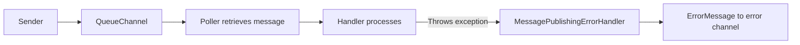
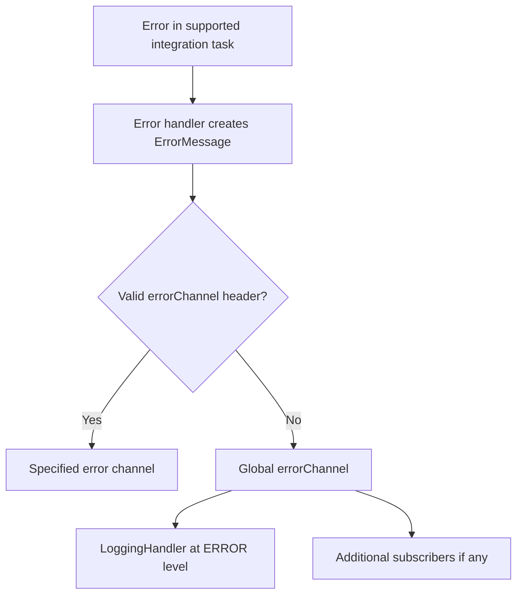

# Default error flow

## 1. Objectives and Scope

In the **SPRING_INTEGRATION_CORE** module, a message flow can pass through gateways, transformers, routers, filters, aggregators, and business service endpoints. When a step fails, the first question is: **can the error still return along the sender's call stack, or must it be represented as a separate message?**

The default error flow is the error-handling path provided by the Spring Integration infrastructure when the application has not replaced the relevant default components. The typical case is when a polling task fails: the framework creates an `ErrorMessage`, sends it to the appropriate error channel, and then the default subscriber logs it.

After this lesson, you will be able to:

- Distinguish synchronous exceptions from errors published via messaging.
- Identify the roles of `errorChannel`, `MessagePublishingErrorHandler`, and `LoggingHandler`.
- Read `ErrorMessage` to find the cause and the message at the point of failure.
- Observe or extend the default error flow without accidentally replacing it.
- Test the default error path, per-header custom error paths, and direct error propagation back to the sender.

The examples use Java 17 or higher and Spring Integration 6.x; default values reference the 6.5 documentation line. If an application has customized the error channel, scheduler, adapters, or gateways, verify the actual configuration before applying conclusions about defaults.

## 2. Synchronous Errors and Errors in Polling Tasks

### 2.1. Handler Running on the Sending Thread

For a call path using only `DirectChannel` and synchronous handlers:

```text
sender → DirectChannel → handler → exception
   ↑___________________________________|
                exception along call stack
```

The sender is still inside the `send` call, so it can receive the exception. Spring Integration typically enriches messaging context or wraps the cause in a messaging exception. Merely having a bean named `errorChannel` in the context does not cause every application exception to be caught and routed to that bean.

In particular, setting an `errorChannel` header on a message does not automatically change this direct call mechanism. There must be an error-handling component that actually reads the header and publishes an error message. The rules distinguishing synchronous paths from asynchronous tasks are described in [Error Handling](https://docs.spring.io/spring-integration/reference/6.5/error-handling.html).

### 2.2. Handler Running After the Message Enters a Queue

With a queue read by a polling consumer:



The sender may have already completed enqueueing before the handler runs. An exception thrown afterward cannot jump back into a `send` call that has already returned. The framework needs a separate error-observation path.

In this lesson's example, the polling task uses Spring Integration's scheduler and error-handler mechanism. An application-created thread or `CompletableFuture` is not automatically integrated into this error flow merely because it runs in the background.

### 2.3. Two Types of Failures at Two Points in Time

| Timing | Example | What can the sender observe? |
| --- | --- | --- |
| When sending to queue | Queue full, enqueue timeout elapsed. | Send result or failure at the send operation, depending on API and channel. |
| When polling consumer processes | ERP call fails after dequeuing the message. | Must observe errors published by the processing task. |

Do not use `send` returning `true` to conclude that the order was processed successfully by business logic.

## 3. Components That Form the Default Error Path

When Integration infrastructure is enabled and the application provides no replacement bean, the framework registers a channel named `errorChannel` along with a default logging component.



### 3.1. `MessagePublishingErrorHandler`

`MessagePublishingErrorHandler` implements the `ErrorHandler` interface: it receives an error and publishes an `ErrorMessage` to a `MessageChannel`. This is the component that actively turns a task error into a messaging interaction; channels do not catch exceptions everywhere on their own. See the [MessagePublishingErrorHandler API](https://docs.spring.io/spring-integration/api/org/springframework/integration/channel/MessagePublishingErrorHandler.html).

In the mechanism used in this lesson, the failed message's error header is inspected to choose the destination; if no suitable dedicated destination exists, the default destination—typically the global `errorChannel`—is used. When the task cannot attach a failed message, there may also be no business headers available to resolve.

### 3.2. Global `errorChannel`

The default channel is a `PublishSubscribeChannel`, allowing multiple subscribers to observe the same error message. It is not a queue storing errors for the application to call `receive()` on later.

In this default configuration, the channel has no dedicated executor. Subscribers are invoked on the thread publishing the error message—usually the polling task's thread in the example. Having business processing run in the background does not mean all error subscribers run in parallel on separate threads.

The dispatch behavior of publish-subscribe channels and the role of executors are described in [Configuring Message Channels](https://docs.spring.io/spring-integration/reference/6.5/channel/configuration.html).

### 3.3. Default `LoggingHandler`

The framework attaches a subscriber that logs at `ERROR` level. In the referenced version line, this handler has order `Ordered.LOWEST_PRECEDENCE - 100`. An additional subscriber is an independent component and does not replace the logger merely by subscribing to the same channel.

Successful logging indicates that the error was observed on the logging path. It has not made the ERP call succeed, has not saved the order for replay, and has not produced a business reply for the caller.

Creation of the default channel and logger resides in [Spring Integration 6.5 DefaultConfiguringBeanFactoryPostProcessor](https://github.com/spring-projects/spring-integration/blob/6.5.x/spring-integration-core/src/main/java/org/springframework/integration/config/DefaultConfiguringBeanFactoryPostProcessor.java).

### 3.4. Subscriber Requirement and Subscriber Failures

In the 6.5 line, the related global properties have default values:

```properties
spring.integration.channels.error.requireSubscribers=true
spring.integration.channels.error.ignoreFailures=true
```

`requireSubscribers` prevents silently treating an error message as delivered when no subscribers exist. `ignoreFailures` allows the error channel's dispatcher to continue to the next subscriber when one subscriber fails under this policy. The two options address two different situations; they do not guarantee an external error-receiving system is always available.

This is the configuration of the default global error channel, not an inferred default for every `PublishSubscribeChannel` created by the application itself. See [Global Properties](https://docs.spring.io/spring-integration/reference/6.5/configuration/global-properties.html).

## 4. Reading the Structure of `ErrorMessage` Properly

`ErrorMessage` is a message with a `Throwable` payload:

```text
ErrorMessage
├── payload: Throwable
│   └── typically MessagingException
│       ├── failedMessage: message at the point of failure, if any
│       └── cause: underlying cause
├── headers: headers of the error message
└── originalMessage: initial context provided, if any
```

`ErrorMessage` is not the exception itself: it is a messaging envelope containing the exception. In a service activator accepting `Throwable`, the parameter is usually the error payload; when accepting `ErrorMessage`, code can access both the envelope and accompanying context. See the [ErrorMessage Javadoc](https://docs.spring.io/spring-framework/docs/6.2.x/javadoc-api/org/springframework/messaging/support/ErrorMessage.html).

### 4.1. `failedMessage` and `originalMessage` Are Not the Same Concept

| Data | Meaning | Always present? |
| --- | --- | --- |
| `error.getPayload()` | Exception contained in the error message. | Payload of a valid `ErrorMessage` is not `null`. |
| `MessagingException.getFailedMessage()` | Message attached to the exception at the point of failure. | May be `null`. |
| `error.getOriginalMessage()` | Context message supplied when creating the error envelope. | May be `null`. |
| Root cause | Deeper cause in the exception chain. | Does not necessarily have a nested `cause`. |

For example, a string request is converted by a transformer into an `OrderCommand`, and then a service activator fails. The message at the point of failure may carry `OrderCommand`; if the strategy preserved the initial context, `originalMessage` may reflect an earlier stage. Do not assume these two messages are identical or always populated.

The `getFailedMessage()` API allows no message to be present; see [MessagingException](https://docs.spring.io/spring-framework/docs/6.2.x/javadoc-api/org/springframework/messaging/MessagingException.html).

### 4.2. Reading Context with Type and Null Checks

A utility method inside an error-handling class can locate the failed message along the cause chain:

```java
static Message<?> findFailedMessage(Throwable failure) {
    Throwable current = failure;
    while (current != null) {
        if (current instanceof MessagingException messagingFailure
                && messagingFailure.getFailedMessage() != null) {
            return messagingFailure.getFailedMessage();
        }
        current = current.getCause();
    }
    return null;
}
```

This snippet uses `Message` and `MessagingException` from `org.springframework.messaging`. If no failed message is found, `originalMessage` can be inspected as an additional context source, while keeping clear which source that data came from.

Do not assume the request's `traceId` sits directly in `error.getHeaders()`. When tracing an order error, retrieve metadata from the properly identified business message. The ID of the error envelope serves a different role from the ID of the failing message.

## 5. Java Example: Preserving the Default Error Flow

### 5.1. Environment

The project requires `org.springframework.integration:spring-integration-core`; the test section uses JUnit Jupiter. Manage Spring versions consistently via a BOM or your project's dependency mechanism.

In a project that already has a Spring Boot parent or compatible BOM, you can use:

```xml
<dependency>
    <groupId>org.springframework.boot</groupId>
    <artifactId>spring-boot-starter-integration</artifactId>
</dependency>
<dependency>
    <groupId>org.springframework.boot</groupId>
    <artifactId>spring-boot-starter-test</artifactId>
    <scope>test</scope>
</dependency>
```

These are the dependencies to plug into a version-managed project. The example opens an application context directly and requires no real ERP.

### 5.2. Service That Intentionally Fails for Error Observation

Illustrative file `UnavailableOrderService.java`:

```java
package example.integration.errors;

public class UnavailableOrderService {

    public void process(String orderId) {
        throw new IllegalStateException("ERP unavailable for order " + orderId);
    }
}
```

This is a mock service for the lesson. Every call fails so we can accurately compare the error paths of the same operation.

### 5.3. Two Input Channels, Same Processing Service

Illustrative file `DefaultErrorFlowConfiguration.java`:

```java
package example.integration.errors;

import org.springframework.context.annotation.Bean;
import org.springframework.context.annotation.Configuration;
import org.springframework.integration.annotation.Poller;
import org.springframework.integration.annotation.ServiceActivator;
import org.springframework.integration.channel.DirectChannel;
import org.springframework.integration.channel.QueueChannel;
import org.springframework.integration.config.EnableIntegration;
import org.springframework.messaging.MessageChannel;
import org.springframework.messaging.PollableChannel;

@Configuration(proxyBeanMethods = false)
@EnableIntegration
public class DefaultErrorFlowConfiguration {

    @Bean
    public MessageChannel ordersDirect() {
        return new DirectChannel();
    }

    @Bean
    public PollableChannel ordersQueued() {
        return new QueueChannel(10);
    }

    @Bean
    public UnavailableOrderService orderService() {
        return new UnavailableOrderService();
    }

    @Bean
    public OrderEndpoints orderEndpoints(UnavailableOrderService service) {
        return new OrderEndpoints(service);
    }

    public static class OrderEndpoints {

        private final UnavailableOrderService service;

        public OrderEndpoints(UnavailableOrderService service) {
            this.service = service;
        }

        @ServiceActivator(inputChannel = "ordersDirect")
        public void processDirect(String orderId) {
            service.process(orderId);
        }

        @ServiceActivator(
                inputChannel = "ordersQueued",
                poller = @Poller(
                        fixedDelay = "50",
                        maxMessagesPerPoll = "1",
                        receiveTimeout = "0"))
        public void processQueued(String orderId) {
            service.process(orderId);
        }
    }
}
```

The configuration does not declare an `errorChannel` bean, does not set a dedicated error channel on the poller, and has no custom error headers. Therefore, queue processing errors follow the framework's default path.

The poller reads at most one message per poll; `receiveTimeout = "0"` avoids waiting when the queue is empty. How pollers are configured is covered in [Annotation Support](https://docs.spring.io/spring-integration/reference/6.5/configuration/annotations.html).

## 6. Observing Errors Without Replacing the Default Channel

Illustrative file `DefaultErrorFlowDemo.java`:

```java
package example.integration.errors;

import java.util.concurrent.BlockingQueue;
import java.util.concurrent.LinkedBlockingQueue;
import java.util.concurrent.TimeUnit;
import org.springframework.context.annotation.AnnotationConfigApplicationContext;
import org.springframework.integration.channel.PublishSubscribeChannel;
import org.springframework.messaging.Message;
import org.springframework.messaging.MessageHandler;
import org.springframework.messaging.MessagingException;
import org.springframework.messaging.PollableChannel;
import org.springframework.messaging.support.ErrorMessage;
import org.springframework.messaging.support.MessageBuilder;

public class DefaultErrorFlowDemo {

    public static void main(String[] args) throws InterruptedException {
        try (var context = new AnnotationConfigApplicationContext(
                DefaultErrorFlowConfiguration.class)) {

            PublishSubscribeChannel errors = context.getBean(
                    "errorChannel", PublishSubscribeChannel.class);
            PollableChannel orders = context.getBean(
                    "ordersQueued", PollableChannel.class);

            BlockingQueue<ErrorMessage> observed = new LinkedBlockingQueue<>();
            MessageHandler observer = message -> {
                if (message instanceof ErrorMessage error) {
                    observed.offer(error);
                }
            };

            errors.subscribe(observer);
            try {
                Message<String> request = MessageBuilder
                        .withPayload("OD-42")
                        .setHeader("traceId", "trace-order-42")
                        .build();

                if (!orders.send(request, 1000)) {
                    throw new IllegalStateException("Could not enqueue order");
                }

                ErrorMessage error = observed.poll(3, TimeUnit.SECONDS);
                if (error == null) {
                    throw new IllegalStateException("No error message observed");
                }

                System.out.println(error.getPayload().getClass().getName());
                if (error.getPayload() instanceof MessagingException failure) {
                    Message<?> failed = failure.getFailedMessage();
                    if (failed != null) {
                        System.out.println(failed.getPayload());
                        System.out.println(failed.getHeaders().get("traceId"));
                    }
                }
            }
            finally {
                errors.unsubscribe(observer);
            }
        }
    }
}
```

The observer is subscribed **before sending** so it does not miss the error message. The default logger remains another subscriber on the same channel. The `observed` queue is an observation tool in the demo, not a durable error-storage mechanism.

What to observe:

1. Sending to `ordersQueued` is accepted.
2. The processing service fails inside the polling task.
3. The default path publishes an `ErrorMessage` to `errorChannel` and the logger logs the error if logging configuration allows `ERROR` level.
4. The observer receives a messaging exception; the failed message contains payload `OD-42` and header `trace-order-42`.

Wrapper class names and log formatting may vary by processing point and version. The important contract is preserving the cause along with the appropriate context, not matching every stack trace line verbatim.

## 7. How Does the `errorChannel` Header Change the Error Destination?

With `ordersQueued` in the configuration above, you can specify a dedicated error channel for a request:

```java
QueueChannel localErrors = new QueueChannel(1);

Message<String> request = MessageBuilder
        .withPayload("OD-42")
        .setHeader("traceId", "trace-order-42")
        .setErrorChannel(localErrors)
        .build();

orders.send(request, 1000);
Message<?> error = localErrors.receive(3000);
```

This snippet assumes `orders` is the `ordersQueued` bean; it requires importing `QueueChannel`, `Message`, and `MessageBuilder`. The channel is placed directly in the header, so it does not need to be registered as a bean in the example.

You can use a bean name via `.setErrorChannelName("orderErrors")` if that channel is registered and resolvable by the resolver. The standard header in Java is `errorChannel`, with constant `MessageHeaders.ERROR_CHANNEL`.

Points to distinguish:

- The header selects a dedicated error destination; it does not automatically send a copy to the global `errorChannel`.
- The default logger on the global channel does not automatically receive errors routed specifically to `localErrors`.
- If the dedicated channel is broken or unable to receive, do not treat the global channel as an automatic rescue mechanism guaranteeing all errors are still captured.
- If you replace `orders` with `ordersDirect`, that header still does not turn synchronous exceptions into automatic message publications.

The resolution order between the header and the default destination for the component used in the example is shown in [MessagePublishingErrorHandler of the 6.5 line](https://github.com/spring-projects/spring-integration/blob/6.5.x/spring-integration-core/src/main/java/org/springframework/integration/channel/MessagePublishingErrorHandler.java).

To achieve both dedicated handling and centralized observation, design an explicit forwarding or publish-subscribe path. Avoid sending error messages back into the same error input in an endless cycle.

## 8. Expressing the Same Example in XML

You can keep `UnavailableOrderService` and use the following XML instead of `DefaultErrorFlowConfiguration`:

```xml
<?xml version="1.0" encoding="UTF-8"?>
<beans xmlns="http://www.springframework.org/schema/beans"
       xmlns:xsi="http://www.w3.org/2001/XMLSchema-instance"
       xmlns:int="http://www.springframework.org/schema/integration"
       xsi:schemaLocation="
         http://www.springframework.org/schema/beans
         https://www.springframework.org/schema/beans/spring-beans.xsd
         http://www.springframework.org/schema/integration
         https://www.springframework.org/schema/integration/spring-integration.xsd">

    <int:channel id="ordersDirect"/>

    <int:channel id="ordersQueued">
        <int:queue capacity="10"/>
    </int:channel>

    <bean id="orderService"
          class="example.integration.errors.UnavailableOrderService"/>

    <int:service-activator id="directOrderEndpoint"
                           input-channel="ordersDirect"
                           ref="orderService"
                           method="process"/>

    <int:service-activator id="queuedOrderEndpoint"
                           input-channel="ordersQueued"
                           ref="orderService"
                           method="process">
        <int:poller fixed-delay="50"
                    max-messages-per-poll="1"
                    receive-timeout="0"/>
    </int:service-activator>
</beans>
```

Save the example on the classpath, for example `integration/default-errors.xml`, and open it with `ClassPathXmlApplicationContext("integration/default-errors.xml")`. The XML does not declare another `errorChannel`, so it still uses the default infrastructure registered by the integration namespace.

Load either the Java config or the XML of this example into a context, not both. Loading both can cause duplicate beans and competing consumers receiving messages.

## 9. Adding Subscribers and Replacing the Channel Are Two Different Things

### 9.1. Adding an Observation Subscriber

You can create a bean containing the method:

```java
@ServiceActivator(inputChannel = "errorChannel")
public void observeFailure(ErrorMessage error) {
    Throwable failure = error.getPayload();
    // Extract necessary context, update statistics, or deliberately forward.
}
```

This is a method inside a Spring bean with Integration infrastructure enabled. It does not recreate the channel; the default logger still remains in the baseline configuration. The observer needs a clear policy for slow work and its own failures because it can run on the thread reporting the error.

If you want to declare an observer using Java DSL, you can add the following flow inside a configuration class with Integration enabled:

```java
@Bean
public IntegrationFlow errorObservationFlow() {
    return IntegrationFlow.from("errorChannel")
            .handle(Throwable.class, (failure, headers) -> {
                System.err.println("Observed error type: "
                        + failure.getClass().getName());
                return null;
            })
            .get();
}
```

Requires importing `IntegrationFlow` from `org.springframework.integration.dsl` and `Bean` from `org.springframework.context.annotation`. `Throwable` in the lambda is the error payload; `headers` are the headers of the error envelope. To inspect the failed message, inspect the exception or accept the full envelope via an appropriate signature.

The illustrative flow terminates after observing; it does not produce a business reply. Returning `null` in a terminal service-activator-style handler here is not a rule for transformers: transformers have a contract requiring a non-`null` return value.

### 9.2. Declaring a Bean Named `errorChannel`

The following example **replaces the default configuration**:

```java
@Bean
public QueueChannel errorChannel() {
    return new QueueChannel(100);
}
```

Here the error channel is a queue. The application must design how to read the queue, buffer limits, error conditions on send, and persistence. Do not assume the default pub-sub logger is still attached by the framework to an application-declared channel.

In the 6.5 registration mechanism, creating the default logger sits inside the same branch that creates the default error channel when no replacement bean exists. Therefore, if the goal is only to add metrics or observation, adding a subscriber is usually more direct than replacing the entire channel.

If durable error storage is needed, an in-memory queue is not enough. You need suitable storage or transport plus a contract covering stored data, replay permissions, and processing status.

## 10. Things the Default Error Flow Does Not Decide Automatically

| Application goal | Behavior that must be designed additionally |
| --- | --- |
| Automatically retry the failed operation | Retry policy, attempt count, and retry conditions. |
| Guarantee messages are not lost after dequeuing | Storage, transactions, acknowledgments, or source-appropriate recovery mechanisms. |
| Replay orders after the ERP recovers | Where messages are held, replay conditions, and duplicate-processing prevention. |
| Return a structured error reply to the caller | Gateway/reply contract and transformation of errors into reply data. |
| Route unprocessable errors to a DLQ | Forwarding path, data schema, and DLQ operational policy. |
| Classify business errors vs. infrastructure errors | Router or classification logic based on exception/context. |
| Compensate a previously succeeded side effect | Business compensation rules and related state. |

Default logging is not a retry attempt. Nor does it mean the message was returned to the source queue. With the example using an in-memory queue and no transactions/recovery, treat handling of the failed message as a responsibility not yet fulfilled by a log line alone.

Gateways have their own error propagation and `errorChannel` configuration. A request-reply gateway can still propagate exceptions back to the caller even if processing crosses an asynchronous boundary, because the gateway manages the reply interaction. Do not mechanically apply conclusions from a direct enqueue call to every gateway call. See [Messaging Gateways — Error Handling](https://docs.spring.io/spring-integration/reference/6.5/gateway.html).

In flows with transformers, routers, filters, and aggregators, also separate errors from valid configured outcomes: a filter discarding a message or an aggregator not yet meeting release conditions is not by default an exception for the default error flow to record.

## 11. Testing the Default Error Path and Its Boundaries

The snippets below are illustrative test code to put in a project. They observe actual messages rather than merely looking for a line of text in logs.

Illustrative file `DefaultErrorFlowTest.java`:

```java
package example.integration.errors;

import java.util.concurrent.BlockingQueue;
import java.util.concurrent.LinkedBlockingQueue;
import java.util.concurrent.TimeUnit;
import org.junit.jupiter.api.Test;
import org.springframework.context.annotation.AnnotationConfigApplicationContext;
import org.springframework.integration.channel.PublishSubscribeChannel;
import org.springframework.integration.channel.QueueChannel;
import org.springframework.messaging.Message;
import org.springframework.messaging.MessageChannel;
import org.springframework.messaging.MessageHandler;
import org.springframework.messaging.MessagingException;
import org.springframework.messaging.PollableChannel;
import org.springframework.messaging.support.ErrorMessage;
import org.springframework.messaging.support.MessageBuilder;
import static org.junit.jupiter.api.Assertions.*;

class DefaultErrorFlowTest {

    @Test
    void polledFailureReachesDefaultGlobalErrorChannel()
            throws InterruptedException {
        try (var context = openContext();
             var capture = captureDefaultErrors(context)) {

            PollableChannel input = context.getBean(
                    "ordersQueued", PollableChannel.class);
            Message<String> request = request();

            assertTrue(input.send(request, 1000));
            ErrorMessage error = capture.poll(3000);

            assertNotNull(error);
            MessagingException failure = assertInstanceOf(
                    MessagingException.class, error.getPayload());
            assertInstanceOf(IllegalStateException.class, rootCause(failure));

            Message<?> failed = failure.getFailedMessage();
            assertNotNull(failed);
            assertEquals("OD-42", failed.getPayload());
            assertEquals("trace-order-42", failed.getHeaders().get("traceId"));
        }
    }

    @Test
    void errorHeaderSelectsLocalChannelInsteadOfGlobalChannel()
            throws InterruptedException {
        try (var context = openContext();
             var capture = captureDefaultErrors(context)) {

            PollableChannel input = context.getBean(
                    "ordersQueued", PollableChannel.class);
            QueueChannel localErrors = new QueueChannel(1);
            Message<String> request = MessageBuilder.fromMessage(request())
                    .setErrorChannel(localErrors)
                    .build();

            assertTrue(input.send(request, 1000));
            ErrorMessage error = assertInstanceOf(
                    ErrorMessage.class, localErrors.receive(3000));

            assertInstanceOf(IllegalStateException.class,
                    rootCause(error.getPayload()));
            assertNull(capture.poll(0));
        }
    }

    @Test
    void directFailureIsThrownEvenWhenErrorHeaderExists()
            throws InterruptedException {
        try (var context = openContext();
             var capture = captureDefaultErrors(context)) {

            MessageChannel input = context.getBean(
                    "ordersDirect", MessageChannel.class);
            QueueChannel localErrors = new QueueChannel(1);
            Message<String> request = MessageBuilder.fromMessage(request())
                    .setErrorChannel(localErrors)
                    .build();

            MessagingException failure = assertThrows(MessagingException.class,
                    () -> input.send(request));

            assertInstanceOf(IllegalStateException.class, rootCause(failure));
            assertNull(localErrors.receive(0));
            assertNull(capture.poll(0));
        }
    }

    private static AnnotationConfigApplicationContext openContext() {
        return new AnnotationConfigApplicationContext(
                DefaultErrorFlowConfiguration.class);
    }

    private static ErrorCapture captureDefaultErrors(
            AnnotationConfigApplicationContext context) {
        return new ErrorCapture(context.getBean(
                "errorChannel", PublishSubscribeChannel.class));
    }

    private static Message<String> request() {
        return MessageBuilder.withPayload("OD-42")
                .setHeader("traceId", "trace-order-42")
                .build();
    }

    private static Throwable rootCause(Throwable error) {
        Throwable current = error;
        while (current.getCause() != null) {
            current = current.getCause();
        }
        return current;
    }

    private static final class ErrorCapture implements AutoCloseable {

        private final PublishSubscribeChannel channel;
        private final BlockingQueue<ErrorMessage> messages =
                new LinkedBlockingQueue<>();
        private final MessageHandler observer = message -> {
            if (message instanceof ErrorMessage error) {
                messages.offer(error);
            }
        };

        private ErrorCapture(PublishSubscribeChannel channel) {
            this.channel = channel;
            channel.subscribe(observer);
        }

        private ErrorMessage poll(long timeoutMillis) throws InterruptedException {
            return messages.poll(timeoutMillis, TimeUnit.MILLISECONDS);
        }

        @Override
        public void close() {
            channel.unsubscribe(observer);
        }
    }
}
```

Each test opens a fresh context and attaches the observer before sending. Try-with-resources unsubscribes the observer before closing the context. Bounded waiting on the observation queue avoids relying on a fixed `Thread.sleep` call.

The three tests verify in order:

1. A polled failure without a dedicated destination goes to the default global channel.
2. An error header selects a dedicated channel without automatically copying to the global channel.
3. A failure on a `DirectChannel` path returns to the caller via an exception even when the message carries an error header.

The default logger may emit an `ERROR` log entry in the first test; that is the expected outcome of an intentionally failing scenario. The assertions focus on the exception and message context rather than depending on logging backend formatting.

## 12. Diagnosing When Errors Do Not Appear Where Expected

| Symptom | What to check |
| --- | --- |
| `send` throws an exception, yet global observer receives nothing | Is the processing path running directly on the sending thread? |
| Queue send succeeds, yet no processing happens | Has the endpoint started, is the poller active, and does the input channel name match? |
| Global logger does not log a request's error | Does the message have a dedicated `errorChannel` or does the poller/adapter have its own error path? |
| Cannot cast bean `errorChannel` to `PublishSubscribeChannel` | Did the application declare another channel with the same name? |
| `traceId` not found in error headers | Is the metadata you need on the failed message or original message? |
| `getFailedMessage()` or `getOriginalMessage()` is `null` | Did the exception/strategy at the error-creation point provide that message? |
| Errors increase, yet there is no data to replay | Is the system only logging, or is there a store and recovery contract? |
| Error subscriber runs very slowly | Is it blocking the error-publishing thread and the flow's scheduler? |
| New errors appear during error reporting | Did the error destination, subscriber, resolver, or error-receiving system fail? |
| Closing the context produces delivery errors | Did subscribers and endpoints stop while tasks were still publishing errors? |

Do not fix issues by looping all errors back to the same channel. First determine which task failed, which error handler is running, and which destination was actually chosen.

A useful observation record typically includes the error type, endpoint or processing stage, timestamp, business identifier, and trace/correlation ID if available. Extract only the required fields from the message instead of assuming the entire payload can always be printed or persisted intact.

## 13. Practice Exercises

1. Run the same request through `ordersDirect` and `ordersQueued`; record where the exception is observed and what a successful `send` means.
2. Add a transformer before the processing service. Identify which stage's data is reflected in the payload inside `failedMessage`.
3. Set a dedicated error channel by bean name, and compare it with placing a channel instance directly into the header.
4. Add a metrics subscriber on the global `errorChannel` without replacing the channel bean. Confirm that the observer and logger still keep their separate roles.
5. Replace the global error channel with a queue in a separate test configuration. Identify which consumer reads the queue and which responsibilities were previously provided by the default configuration.
6. Design an additional path to store errors needing replay, along with a duplicate-processing prevention key. Distinguish what the default error flow provides from the recovery logic added by the application.

You have completed the lesson when you can trace an error from its origin to its receiving destination, explain the data inside `ErrorMessage`, and clearly identify the remaining recovery responsibilities of the application.
