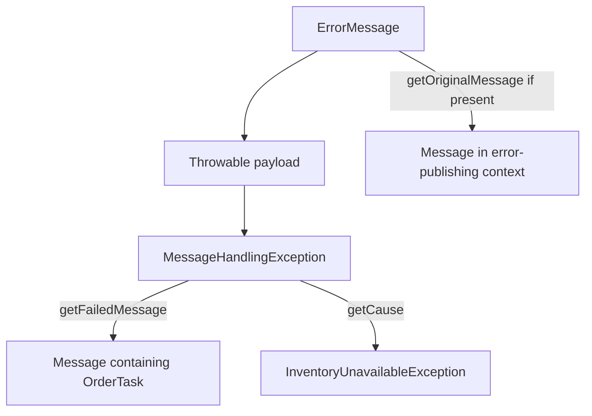

# Exception payload — Reading and Processing Error Data in Spring Integration

In the **Error handling** chapter of **SPRING_INTEGRATION_CORE**, the exception payload is the error object placed in the payload of an error-handling message. Understanding this structure helps you locate the cause, identify the business message that failed, and route the error to the appropriate handling branch while preserving context.

This lesson focuses on `ErrorMessage`, the `Throwable` cause chain, `MessagingException.getFailedMessage()`, and `ErrorMessage.getOriginalMessage()`. The example wires channels, endpoints, and a poller to produce a real error in the flow, then converts the necessary information into a structured failure notice for testing.

The examples use Java 17 and Spring Integration 6.5.x APIs as the baseline. Configuration requires `spring-integration-core` with compatible Spring dependencies; tests use JUnit Jupiter. Java classes are illustrated in package `example.errors`, with each public class placed in its corresponding file when practicing. None of the examples automatically retry or replay tasks merely upon receiving error details.

## 1. When the Payload Is No Longer Business Data

In the business branch, a message might carry an inventory-check task:

```text
Message<OrderTask>
  headers: traceId = trace-73
  payload: OrderTask(orderId = OD-73)
```

If the endpoint processing the task fails and the error-handling mechanism publishes an `ErrorMessage`, the payload on the error branch has a different shape:

```text
ErrorMessage
  headers: error message metadata
  payload: Throwable
    e.g. MessageHandlingException
      failedMessage: Message<OrderTask>
      cause: InventoryUnavailableException
  originalMessage: may or may not be present
```

`ErrorMessage` belongs to `org.springframework.messaging.support` and extends `GenericMessage<Throwable>`. The payload is required to be non-null; the type guaranteed by the API is `Throwable`, not always `MessagingException`. [`ErrorMessage` contract](https://docs.spring.io/spring-framework/docs/6.2.x/javadoc-api/org/springframework/messaging/support/ErrorMessage.html).

Therefore, an error handler cannot blindly cast `errorMessage.getPayload()` to `OrderTask`. It is receiving the **error**, while the business task must be found in the preserved context.

## 2. Four Objects to Distinguish

| Object or value | What do you get? | What to check |
| --- | --- | --- |
| `errorMessage` | Envelope of the error-handling branch | Headers here belong to the error message |
| `errorMessage.getPayload()` | The published `Throwable` object | May be a wrapper or an unwrapped error |
| `messagingException.getFailedMessage()` | Message at the failure point retained by the exception | May be null; the exception may lie deeper in the cause chain |
| `errorMessage.getOriginalMessage()` | Message in the error-message creation context, if supplied | May be null and may differ from the failed message |

`MessagingException` belongs to `org.springframework.messaging` and is the base class for many messaging errors. It has a constructor taking a message, as well as constructors taking only a description or a cause. Thus, even after confirming the `MessagingException` type, you must still check whether `getFailedMessage()` is non-null. [`MessagingException` API](https://docs.spring.io/spring-framework/docs/6.2.x/javadoc-api/org/springframework/messaging/MessagingException.html).

### 2.1. The Failed Message Holds Data at the Point of Failure

Suppose a flow receives a JSON string, a transformer produces an `OrderTask`, and then an inventory-check service activator fails. The message retained at the point of failure may carry `OrderTask`, whereas the message in an outer context still carries the JSON string.

If you need to know what data type the handler was processing when it failed, the failed message is a better source of truth than assuming the initial input payload.

### 2.2. The Original Message Depends on Where the Error Was Published

The name `originalMessage` does not guarantee it is the very first request that entered the entire system. It is the message associated with the context where the error message was created. `DefaultErrorMessageStrategy` only includes `originalMessage` when the context contains the corresponding input message attribute; otherwise it creates an error message with only the throwable. [Default error message strategy](https://docs.spring.io/spring-integration/docs/6.5.0/api/org/springframework/integration/support/DefaultErrorMessageStrategy.html).

A flow with multiple layers of gateways, transformers, or adapters can retain different context checkpoints. Record explicitly which message source was used for diagnostics instead of labeling every case generically as the "original request."

### 2.3. Error Envelope Headers Are Not Automatically Business Headers

When reading `traceId`, `orderId`, `replyChannel`, or correlation data, identify whether you are reading from the error envelope, the failed message, or the original message. The error-message creation mechanism may supply its own headers; do not assume business headers are always copied onto the error envelope.

In this lesson's example, the order ID and `traceId` are explicitly read from the context message. The failure notice also records whether `FAILED_MESSAGE`, `ORIGINAL_MESSAGE`, or `NONE` was selected as the source.

## 3. Wrappers and the Cause Chain

An error can be wrapped through multiple layers:



The wrapper describes what failed at the messaging layer. The cause describes the underlying reason preserved from a lower layer. Both are valuable:

- `MessageHandlingException` indicates the error occurred while handling a message and may hold the failed message.
- `InventoryUnavailableException` helps identify the business error category in this example.
- An even deeper cause, if present, may be a connection library error or an infrastructure failure.

`Throwable.getMessage()` is merely a descriptive string, whereas `getCause()` is the link to the underlying cause. Java also has suppressed exceptions via `getSuppressed()`, often needed when diagnosing resource closing. Suppressed exceptions are not links in `getCause()`. [Java exception chaining structure and mechanics](https://docs.oracle.com/en/java/javase/17/docs/api/java.base/java/lang/Throwable.html).

### Do Not Assume the Business Error Is Always at the First `getCause()`

The following snippet can miss an error wrapped one layer deeper:

```java
boolean inventoryFailure =
        errorMessage.getPayload().getCause()
                instanceof InventoryUnavailableException;
```

At the same time, the payload might have no cause at all. A more resilient approach is to traverse the cause chain, retain the outermost wrapper, and search for the target error types at any permitted depth.

Nor is the "deepest cause" automatically the "cause used for business decisions." For example, a business exception might wrap an I/O error; the handling decision might require both the business semantics and the infrastructure failure category.

## 4. Reading Exception Payloads with a Clear Function Contract

The example below builds a snapshot for internal analysis. It preserves separately the exception payload, traversed causes, failed message, and original message.

```java
package example.errors;

import java.util.List;

import org.springframework.messaging.Message;

public record FailureSnapshot(
        Throwable exceptionPayload,
        List<Throwable> causeChain,
        boolean causeChainComplete,
        Message<?> failedMessage,
        Message<?> originalMessage) {
}
```

Inspection function:

```java
package example.errors;

import java.util.ArrayList;
import java.util.Collections;
import java.util.IdentityHashMap;
import java.util.List;
import java.util.Set;

import org.springframework.messaging.Message;
import org.springframework.messaging.MessagingException;
import org.springframework.messaging.support.ErrorMessage;

public final class ExceptionPayloads {

    private static final int MAX_CAUSES = 32;

    private ExceptionPayloads() {
    }

    public static FailureSnapshot inspect(ErrorMessage errorMessage) {
        List<Throwable> causes = new ArrayList<>();
        Set<Throwable> visited = Collections.newSetFromMap(
                new IdentityHashMap<>());

        Throwable current = errorMessage.getPayload();
        Message<?> failedMessage = null;

        while (current != null
                && causes.size() < MAX_CAUSES
                && visited.add(current)) {

            causes.add(current);

            if (failedMessage == null
                    && current instanceof MessagingException messaging
                    && messaging.getFailedMessage() != null) {
                failedMessage = messaging.getFailedMessage();
            }

            current = current.getCause();
        }

        return new FailureSnapshot(
                errorMessage.getPayload(),
                List.copyOf(causes),
                current == null,
                failedMessage,
                errorMessage.getOriginalMessage());
    }
}
```

This is the **example's inspection policy**, not a mandatory framework rule:

1. Preserve the outermost throwable to retain wrapper context.
2. Find the first non-null failed message when traversing from outer to inner.
3. Keep the original message separate without renaming it to failed message.
4. Stop when encountering the same object again or after traversing 32 levels.
5. Only mark `causeChainComplete = true` when a null cause is reached.

If the chain stopped due to the depth limit or a cycle, the last element found must not be asserted as the root cause. This function also does not inspect suppressed exceptions; if you need to surface them, add a dedicated inspection policy.

`IdentityHashMap` is used to recognize duplicate throwable instances by reference identity. The depth limit keeps the error handler from spending unbounded resources on an unusual exception structure.

## 5. Selecting Information for Decisions and Observation

Once you have a snapshot, you can check for an error type by type:

```java
boolean inventoryFailure = snapshot.causeChain().stream()
        .anyMatch(InventoryUnavailableException.class::isInstance);
```

This check matches subclasses as well, rather than comparing class names or searching substrings inside exception messages. If `causeChainComplete` is false and the target type was not found, the result only means "not found within the traversed portion."

Attributes worth retaining for diagnostics include wrapper type, cause types, processing point, business IDs, and correlation IDs. A string such as `exception.getMessage()` can be helpful for reading logs, but it is not a stable contract for retry or routing decisions.

For data crossing system boundaries, convert it into a DTO with well-defined fields. The fact that `Throwable` implements `Serializable` does not yield a stable event schema across services, languages, or library versions.

## 6. Complete Example: Turning an Order Processing Error into a Structured Notice

The example uses the `FailureSnapshot` and `ExceptionPayloads` classes declared in section 4. Execution flow:

```text
workQueue: QueueChannel
  -> poller
  -> FailingWorker.handle(OrderTask)
  -> exception
  -> poller's error handler
  -> processingErrors: DirectChannel
  -> ErrorObserver.observe(ErrorMessage)
  -> failureNotices: QueueChannel
```

### 6.1. Illustrative Task and Exception

```java
package example.errors;

import java.util.Objects;

public record OrderTask(String orderId) {

    public OrderTask {
        Objects.requireNonNull(orderId, "orderId must not be null");
        if (orderId.isBlank()) {
            throw new IllegalArgumentException("orderId must not be blank");
        }
    }
}
```

```java
package example.errors;

public class InventoryUnavailableException extends RuntimeException {

    public InventoryUnavailableException(String message) {
        super(message);
    }
}
```

The exception name represents this exercise's error category. Merely identifying this category is not enough to conclude the task can be safely replayed: that decision also depends on side effects, idempotency, and the flow's retry policy.

### 6.2. Notice Produced After Inspection

```java
package example.errors;

import java.util.List;

public record FailureNotice(
        String orderId,
        String traceId,
        String contextSource,
        String exceptionType,
        List<String> causeTypes,
        boolean causeChainComplete,
        boolean inventoryFailure) {
}
```

This DTO holds the fields needed for observation and classification. `FailureSnapshot` holds references to the throwable and messages for internal inspection, whereas `FailureNotice` contains only selected values.

### 6.3. Channel and Endpoint Configuration

```java
package example.errors;

import java.util.List;

import org.springframework.context.annotation.Bean;
import org.springframework.context.annotation.Configuration;
import org.springframework.context.annotation.Import;
import org.springframework.integration.annotation.MessageEndpoint;
import org.springframework.integration.annotation.Poller;
import org.springframework.integration.annotation.ServiceActivator;
import org.springframework.integration.channel.DirectChannel;
import org.springframework.integration.channel.QueueChannel;
import org.springframework.integration.config.EnableIntegration;
import org.springframework.messaging.Message;
import org.springframework.messaging.support.ErrorMessage;

@Configuration
@EnableIntegration
@Import({
        ExceptionPayloadConfig.FailingWorker.class,
        ExceptionPayloadConfig.ErrorObserver.class
})
public class ExceptionPayloadConfig {

    @Bean
    public QueueChannel workQueue() {
        return new QueueChannel(100);
    }

    @Bean
    public DirectChannel processingErrors() {
        return new DirectChannel();
    }

    @Bean
    public QueueChannel failureNotices() {
        return new QueueChannel(100);
    }

    @MessageEndpoint
    public static class FailingWorker {

        @ServiceActivator(
                inputChannel = "workQueue",
                poller = @Poller(
                        fixedDelay = "50",
                        maxMessagesPerPoll = "1",
                        receiveTimeout = "0",
                        errorChannel = "processingErrors"
                )
        )
        public void handle(OrderTask task) {
            throw new InventoryUnavailableException(
                    "Inventory service unavailable for " + task.orderId());
        }
    }

    @MessageEndpoint
    public static class ErrorObserver {

        @ServiceActivator(
                inputChannel = "processingErrors",
                outputChannel = "failureNotices"
        )
        public FailureNotice observe(ErrorMessage errorMessage) {
            FailureSnapshot snapshot = ExceptionPayloads.inspect(errorMessage);

            Message<?> context = snapshot.failedMessage();
            String contextSource = "FAILED_MESSAGE";

            if (context == null) {
                context = snapshot.originalMessage();
                contextSource = context == null ? "NONE" : "ORIGINAL_MESSAGE";
            }

            String orderId = context != null
                    && context.getPayload() instanceof OrderTask task
                    ? task.orderId()
                    : "UNKNOWN";

            Object traceValue = context == null
                    ? null
                    : context.getHeaders().get("traceId");
            String traceId = traceValue instanceof String value
                    ? value
                    : "UNKNOWN";

            List<String> causeTypes = snapshot.causeChain().stream()
                    .map(cause -> cause.getClass().getName())
                    .toList();

            boolean inventoryFailure = snapshot.causeChain().stream()
                    .anyMatch(InventoryUnavailableException.class::isInstance);

            return new FailureNotice(
                    orderId,
                    traceId,
                    contextSource,
                    snapshot.exceptionPayload().getClass().getName(),
                    causeTypes,
                    snapshot.causeChainComplete(),
                    inventoryFailure);
        }
    }
}
```

`FailingWorker` intentionally throws an error every time to illustrate the exception payload. It is not a call to a real inventory service.

`@Poller.errorChannel` configures the error handler for the polling task. `processingErrors` is a `DirectChannel` and already has `ErrorObserver` subscribed; no extra poller is needed on this branch. The `failureNotices` queue is where the test program actively receives results. [Configuring pollers and error channels via annotations](https://docs.spring.io/spring-integration/reference/6.5/configuration/annotations.html#using-the-poller-annotation).

The observer's context-selection rule prefers the failed message and falls back to the original message. If the failed message is selected but lacks `traceId`, the example records `UNKNOWN`; it does not silently mix headers across multiple checkpoints. An application can build a per-field fallback policy, but it must explicitly document the source and how conflicting values are resolved.

### 6.4. Sending a Task and Receiving the Result

```java
package example.errors;

import org.springframework.context.annotation.AnnotationConfigApplicationContext;
import org.springframework.messaging.Message;
import org.springframework.messaging.MessageChannel;
import org.springframework.messaging.PollableChannel;
import org.springframework.messaging.support.MessageBuilder;

public class ExceptionPayloadDemo {

    public static void main(String[] args) {
        try (var context = new AnnotationConfigApplicationContext(
                ExceptionPayloadConfig.class)) {

            MessageChannel input = context.getBean(
                    "workQueue", MessageChannel.class);
            PollableChannel notices = context.getBean(
                    "failureNotices", PollableChannel.class);

            Message<OrderTask> request = MessageBuilder
                    .withPayload(new OrderTask("OD-73"))
                    .setHeader("traceId", "trace-73")
                    .build();

            if (!input.send(request, 1000)) {
                throw new IllegalStateException("Work queue rejected request");
            }

            Message<?> noticeMessage = notices.receive(5000);
            if (noticeMessage == null) {
                throw new IllegalStateException("No failure notice received");
            }

            System.out.println(noticeMessage.getPayload());
        }
    }
}
```

The expected output has `orderId = OD-73`, `traceId = trace-73`, context source `FAILED_MESSAGE`, and the cause list containing `InventoryUnavailableException`.

`send()` succeeding here only indicates the task entered the queue. The exception arises when the poller processes it afterward; it is routed to the error branch to produce a notice rather than returning as an exception from the already-completed `send()` call.

## 7. Thrown Exceptions and Published Exceptions Are Two Different Behaviors

Not every `throw` statement automatically creates an `ErrorMessage`. The publishing mechanism depends on where execution occurs and what gateway, adapter, or error handler wraps the processing step.

| Situation | How the error is typically observed |
| --- | --- |
| Direct `send()` into a `DirectChannel` chain | Exception can propagate back to the sender on the same call stack |
| Endpoint receiving from a queue via a poller | The poller's error handler can publish an `ErrorMessage` |
| Gateway configured with error routing | The gateway applies its own error-handling contract |
| Manually sending `new ErrorMessage(failure)` | You created the error envelope, but still must design the channel and consumer |

In an asynchronous flow with an appropriate error-publishing mechanism, the message's `errorChannel` header can participate in selecting the error destination. When no specialized configuration exists, the infrastructure can use the global error channel. The channel name and creation of the exception payload are two separate decisions. [Synchronous and asynchronous error handling](https://docs.spring.io/spring-integration/reference/6.5/error-handling.html).

A channel named `processingErrors` does not automatically enforce that every message passing through it is an `ErrorMessage`. That is a contract of the flow and its producers. If multiple sources send to the channel, align on the envelope type that the error handler supports.

## 8. Choosing the Right Error Handler Signature

The following signatures serve different needs; they are alternatives for an endpoint and should not all be arbitrarily registered on a single point-to-point channel:

```java
public void observe(Throwable failure) {
    // Directly receives the exception payload.
}
```

```java
public void observe(ErrorMessage errorMessage) {
    // Receives the full envelope, throwable, and originalMessage if present.
}
```

```java
public void observe(org.springframework.messaging.Message<Throwable> message) {
    // Receives payload and headers via the Message interface.
    // getOriginalMessage() is only available after checking for ErrorMessage.
}
```

The signature accepting `Throwable` is convenient if you only classify errors. When you need the original message from the publishing context, accepting `ErrorMessage` lets you read it directly. Endpoint parameter binding distinguishes message-typed parameters from payload-typed parameters. [Message, payload, and header parameter support](https://docs.spring.io/spring-integration/reference/6.5/configuration/annotations.html).

In Java DSL, a lambda declared to receive the payload typically sees `Throwable` on an error branch. It does not automatically receive the `OrderTask` inside the failed message. When you need the full envelope, use a handler with an explicit message-accepting contract or reference a method such as `observe(ErrorMessage)` in the example.

## 9. Creating an Error Message and Preserving Causes When Wrapping Manually

Once you have caught an error and know the message at the point of failure, you can build a wrapper with context:

```java
var wrapped = new org.springframework.messaging.MessageHandlingException(
        failedMessage,
        "Inventory processing failed",
        originalFailure);

var errorMessage = new org.springframework.messaging.support.ErrorMessage(
        wrapped,
        originalMessage);
```

In this snippet, `failedMessage` and `originalMessage` are messages supplied by the calling code; `originalFailure` is the caught throwable. Using a constructor that preserves both the cause and the message allows the error branch to inspect both the failure and the data at the point of failure. [`MessageHandlingException` constructors](https://docs.spring.io/spring-framework/docs/6.2.x/javadoc-api/org/springframework/messaging/MessageHandlingException.html).

Avoid wrapping that copies only the message string and drops the cause:

```java
// Loses the cause link and does not preserve the failed message.
throw new RuntimeException(originalFailure.getMessage());
```

If you only need to add technical context to a regular exception, a constructor accepting `cause` preserves the cause chain. If you also need the failed message, choose an appropriate messaging exception class and constructor.

Also distinguish three operations:

| Operation | Meaning |
| --- | --- |
| `throw failure` | Signals an error via Java's exception mechanism |
| `return failure` in a returning handler | Returns a payload value; not equivalent to throwing an exception |
| `new ErrorMessage(failure)` | Creates an error envelope; does not automatically send it to any channel |

To publish the newly created envelope, there must be a send operation or an error publisher/handler performing it. If building a reusable error-publishing mechanism, `ErrorMessageStrategy` is the extension point for creating an `ErrorMessage` from a throwable and context. [`ErrorMessageStrategy` contract](https://docs.spring.io/spring-integration/docs/6.5.0/api/org/springframework/integration/support/ErrorMessageStrategy.html).

## 10. Classifying by Exception Within a Flow

If every outermost payload is `MessageHandlingException`, routing solely by the outermost payload class cannot distinguish the underlying causes. When the goal is to classify along the exception chain, Spring Integration provides `ErrorMessageExceptionTypeRouter`.

Concise DSL example for an independent branch:

```java
@Bean
public org.springframework.integration.dsl.IntegrationFlow classifyErrors() {
    return org.springframework.integration.dsl.IntegrationFlow
            .from("errorsForRouting")
            .routeByException(router -> router
                    .channelMapping(
                            InventoryUnavailableException.class,
                            "inventoryIncidents")
                    .defaultOutputChannel("unclassifiedIncidents"))
            .get();
}
```

This snippet requires Integration infrastructure and three declared channels: `errorsForRouting`, `inventoryIncidents`, and `unclassifiedIncidents`. For example, the input can be a `DirectChannel` and the two outputs `QueueChannel`s for testing. This is a standalone example; do not add it as a competing consumer alongside the observer on `processingErrors` in the main configuration.

The specialized router inspects the cause chain and matching exception classes. It forwards the error message to the destination without replacing the payload with the matched cause. At the destination, you can still access the full envelope to inspect wrappers and context messages. XML provides the corresponding `int:exception-type-router` element. [Routing by exception type](https://docs.spring.io/spring-integration/reference/6.5/router/implementations.html#routing-and-error-handling).

When overlapping mappings exist between a general class and a subclass, mapping order can affect selection. Test concrete wrapper/cause combinations rather than sending a single unwrapped exception and considering the configuration verified.

## 11. Exception Payloads Support Decisions; They Do Not Create Recovery Automatically

From the exception payload, you can gather data to evaluate policy:

| Observed information | Follow-up policy question to answer |
| --- | --- |
| Error caused by input data | Can data be corrected, rejected, or routed for human review? |
| Error caused by temporary service unavailability | Can the task be safely re-executed and are retries bounded? |
| Failed message already passed a transformer | Replay from the start of the flow or resume at the failure point? |
| No context message found | Can we look up by another identifier, or record missing context? |
| Cause chain not fully traversed | Classify as undetermined or route for manual inspection? |

Spring Integration provides retry advices and a recoverer mechanism that publishes `ErrorMessage` when performing recovery after retries. Those components must be configured; receiving a throwable in an error handler does not automatically enable retry. [Retry advice and recovery](https://docs.spring.io/spring-integration/reference/6.5/handler-advice/classes.html#retry-advice).

If replaying, decide whether to use the payload of the failed message or the original message. In a flow that transforms data, sending the wrong payload type back to the input can break the transformer; replaying into a downstream stage might skip essential validation.

Similarly, completing the error flow does not by default guarantee that the business task succeeded, rolled back, or was acknowledged by an external source. Those belong to the contract of the corresponding endpoint, transaction, and adapter.

When an error handler calls another system to persist an incident, that operation itself can fail. Provide observability for failures in the error flow itself and avoid infinitely resending back into the very channel currently handling errors.

The API type is `Throwable`, which does not mean every severe JVM `Error` is a recoverable business error. Publishing and handling depend on the catching component; recovery policy must still be based on the actual incident category.

## 12. Testing Exception Payloads and Error Context

Distinguish two testing layers:

- Unit tests of the inspection function verify reading wrappers, causes, and message sources.
- Integration tests verify a real endpoint throws an error, the error handler publishes the error, and the observer receives it through the configured channel.

The following JUnit 5 example uses the lesson's classes and the configuration from section 6:

```java
package example.errors;

import org.junit.jupiter.api.Test;
import org.springframework.context.annotation.AnnotationConfigApplicationContext;
import org.springframework.messaging.Message;
import org.springframework.messaging.MessageChannel;
import org.springframework.messaging.MessageHandlingException;
import org.springframework.messaging.PollableChannel;
import org.springframework.messaging.support.ErrorMessage;
import org.springframework.messaging.support.MessageBuilder;

import static org.junit.jupiter.api.Assertions.assertEquals;
import static org.junit.jupiter.api.Assertions.assertFalse;
import static org.junit.jupiter.api.Assertions.assertInstanceOf;
import static org.junit.jupiter.api.Assertions.assertNotNull;
import static org.junit.jupiter.api.Assertions.assertNull;
import static org.junit.jupiter.api.Assertions.assertSame;
import static org.junit.jupiter.api.Assertions.assertTrue;

class ExceptionPayloadTest {

    @Test
    void preservesNestedFailureAndDistinctMessageContexts() {
        Message<String> original = MessageBuilder
                .withPayload("incoming order document")
                .setHeader("traceId", "trace-original")
                .build();
        Message<OrderTask> failed = MessageBuilder
                .withPayload(new OrderTask("OD-73"))
                .setHeader("traceId", "trace-worker")
                .build();

        var inventory = new InventoryUnavailableException("Unavailable");
        var handling = new MessageHandlingException(
                failed, "Inventory step failed", inventory);
        var outer = new IllegalStateException("Outer task wrapper", handling);
        var error = new ErrorMessage(outer, original);

        FailureSnapshot snapshot = ExceptionPayloads.inspect(error);

        assertSame(outer, snapshot.exceptionPayload());
        assertSame(failed, snapshot.failedMessage());
        assertSame(original, snapshot.originalMessage());
        assertEquals(3, snapshot.causeChain().size());
        assertSame(inventory, snapshot.causeChain().get(2));
        assertTrue(snapshot.causeChainComplete());

        FailureNotice notice = new ExceptionPayloadConfig.ErrorObserver()
                .observe(error);
        assertEquals("OD-73", notice.orderId());
        assertEquals("trace-worker", notice.traceId());
        assertEquals("FAILED_MESSAGE", notice.contextSource());
        assertTrue(notice.inventoryFailure());
    }

    @Test
    void handlesThrowableWithoutMessagingContext() {
        var failure = new IllegalArgumentException("Invalid request");
        var error = new ErrorMessage(failure);

        FailureSnapshot snapshot = ExceptionPayloads.inspect(error);

        assertSame(failure, snapshot.exceptionPayload());
        assertNull(snapshot.failedMessage());
        assertNull(snapshot.originalMessage());
        assertEquals(1, snapshot.causeChain().size());
        assertTrue(snapshot.causeChainComplete());

        FailureNotice notice = new ExceptionPayloadConfig.ErrorObserver()
                .observe(error);
        assertEquals("NONE", notice.contextSource());
        assertEquals("UNKNOWN", notice.orderId());
        assertFalse(notice.inventoryFailure());
    }

    @Test
    void usesOriginalMessageWhenNoFailedMessageExists() {
        Message<OrderTask> original = MessageBuilder
                .withPayload(new OrderTask("OD-74"))
                .setHeader("traceId", "trace-74")
                .build();
        var error = new ErrorMessage(
                new InventoryUnavailableException("Unavailable"), original);

        FailureNotice notice = new ExceptionPayloadConfig.ErrorObserver()
                .observe(error);

        assertEquals("ORIGINAL_MESSAGE", notice.contextSource());
        assertEquals("OD-74", notice.orderId());
        assertEquals("trace-74", notice.traceId());
        assertTrue(notice.inventoryFailure());
    }

    @Test
    void stopsWhenCauseChainContainsACycle() {
        var first = new RuntimeException("First");
        var second = new RuntimeException("Second", first);
        first.initCause(second);

        FailureSnapshot snapshot = ExceptionPayloads.inspect(
                new ErrorMessage(first));

        assertEquals(2, snapshot.causeChain().size());
        assertFalse(snapshot.causeChainComplete());
    }

    @Test
    void pollerPublishesFailureAndObserverProducesNotice() {
        try (var context = new AnnotationConfigApplicationContext(
                ExceptionPayloadConfig.class)) {

            MessageChannel input = context.getBean(
                    "workQueue", MessageChannel.class);
            PollableChannel notices = context.getBean(
                    "failureNotices", PollableChannel.class);
            Message<OrderTask> request = MessageBuilder
                    .withPayload(new OrderTask("OD-75"))
                    .setHeader("traceId", "trace-75")
                    .build();

            assertTrue(input.send(request, 1000));

            Message<?> result = notices.receive(5000);
            assertNotNull(result, "No failure notice received");
            FailureNotice notice = assertInstanceOf(
                    FailureNotice.class, result.getPayload());

            assertEquals("OD-75", notice.orderId());
            assertEquals("trace-75", notice.traceId());
            assertEquals("FAILED_MESSAGE", notice.contextSource());
            assertTrue(notice.inventoryFailure());
            assertTrue(notice.causeTypes().contains(
                    InventoryUnavailableException.class.getName()));
            assertTrue(notice.causeChainComplete());
            assertNull(notices.receive(0), "Unexpected extra notice");
        }
    }
}
```

The first case intentionally sets different `traceId` values on the original and failed messages. That way, the test proves the observer read from the right source per the example's policy rather than merely proving some `traceId` string appeared somewhere.

The integration case uses `receive(5000)` to wait with a bound for the asynchronous result. It does not assume the error has finished processing immediately when `send()` returns and does not insert an arbitrary `sleep()`.

Additional cases worth adding when implementing your own policy:

| Case | Expectation to define |
| --- | --- |
| `MessagingException` holds no failed message | Continue searching causes or fall back to original per policy |
| Failed message has a payload other than `OrderTask` | Preserve data type details; do not force an invalid cast |
| Context exists but lacks `traceId` | Record missing metadata or use a fallback with a clear source |
| Cause chain exceeds the limit | Mark inspection as incomplete |
| Multiple cause types match router mappings | Pick the right branch per configuration and mapping order |
| Observer or error-notice storage fails | Have a way to observe failures of the error flow itself |

Do not confirm success solely by asserting on the wrapper's `getMessage()` string. That string can vary across endpoint names or library versions; error types, context messages, and business fields are better evidence for the example's contract.

## 13. Common Misconceptions

| Misconception | Correct reading and handling |
| --- | --- |
| The payload of an error message is the failed order | The payload is `Throwable`; look for the order in the context message |
| Every throwable is a `MessagingException` | Check the type before calling messaging-exception-specific APIs |
| `getFailedMessage()` is always non-null | Handle the case where no message was retained |
| `getOriginalMessage()` is always the system's initial input | Identify the context where the error envelope was created |
| Headers on the error envelope are always copied from the order | Read headers from the identified context message |
| Checking `getCause()` once is enough | Traverse the chain with a bound and preserve needed wrappers |
| The last element traversed is always the root cause | Only assert that when traversal reached a null cause |
| Classifying a transient error guarantees safe retry | Check side effects, idempotency, and retry policy |
| Returning an exception triggers the error handler | Distinguish a return value from a thrown exception |
| Naming a channel `errorChannel` creates envelopes automatically | A producer or error-handling mechanism must create and publish the message |

When logging, retain both the processing context and the throwable if stack traces are needed. When creating an event to store or send externally, pick the necessary fields instead of relying on the entire `toString()` of the error envelope. A context message may hold a large payload or data outside the failure-notice contract.

If an incident occurs after a transformer, filter, router, or aggregator, the first step is still identifying the exception payload type and the message at the point of failure. Only then decide which flow checkpoint to read business data from, route to, or recover from.

## 14. Extended Practice Exercise

Extend the example with two error groups: `InventoryUnavailableException` and an input-data exception you define. Keep the goal focused on observation and classification, then perform the following:

1. Add a transformer before the worker to convert an input format into `OrderTask`.
2. Create one failure case before the transformer and one failure case after the transformer; record the failed message's payload type in each case.
3. Manually construct an `ErrorMessage` with distinct original and failed messages, then verify the context-selection policy.
4. Add a router classifying along the exception chain plus a branch for unrecognized errors.
5. Test multi-layer wrappers, missing context, missing headers, and a cause chain exceeding the limit.
6. Design a failure-notice DTO with clear business ID, correlation ID, error category, and context source.

Your result should demonstrate that an error can still be observed in a structured way even when the original message is absent or the exception is wrapped across multiple layers. Resubmitting tasks, retries, and transactions are subsequent policies built on top of accurately read context.
