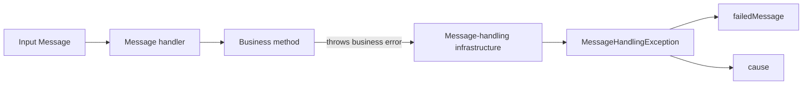

# `MessageHandlingException`: Reading Cause and Context When Message Handling Fails

## 1. Objectives and Meaning of the Exception

In the **SPRING_INTEGRATION_CORE** module, `MessageHandlingException` is a key exception for diagnosing failures at message-handling endpoints. It indicates that an error occurred while handling a message, while helping preserve both the associated message and the underlying cause.

For example, a service activator receives a stock-reservation command for a purchase order. The business service rejects a quantity of zero and throws a domain exception. The integration layer can wrap that exception inside a `MessageHandlingException`, attached to the message at the failed processing point.

What you need to read does not stop at the outer class name:

- **Messaging context:** Which message was being processed, with what payload and headers?
- **Cause:** Invalid data, I/O error, misconfiguration, or programming bug?
- **Error propagation path:** Does a synchronous caller receive the exception, or does a consumer receive an `ErrorMessage`?

After this lesson, you will be able to explain the exception structure, trace the cause chain, read `failedMessage`, choose an error classification approach, and test both synchronous paths and polling consumers.

## 2. Right Class, Right Package, and Right Role

Import the Spring Messaging class:

```java
import org.springframework.messaging.MessageHandlingException;
```

This class belongs to Spring Framework and is used by Spring Integration in its message-handling infrastructure. Main inheritance hierarchy:

```text
RuntimeException
  └─ NestedRuntimeException
      └─ MessagingException
          └─ MessageHandlingException
```

It is an unchecked exception, not required to be declared in `throws`. Constructors take the failed message, optionally along with a description and cause. See the [`MessageHandlingException` Javadoc](https://docs.spring.io/spring-framework/docs/current/javadoc-api/org/springframework/messaging/MessageHandlingException.html).

Example creating an exception with full context:

```java
MessageHandlingException failure = new MessageHandlingException(
        request,
        "Unable to process reservation request",
        originalFailure);
```

In this snippet, `request` is a `Message<?>`, and `originalFailure` is the exception that caused the failure. The description should indicate the failed operation; the detailed reason is preserved via the cause.

Merely constructing the exception object does not send an error message, retry, or roll back. Those behaviors depend on where the exception is thrown, what catches it, and how the flow is configured.

### Distinguishing Related Concepts

| Concept | Meaning during diagnostics |
| --- | --- |
| `MessageHandlingException` | Error during message handling |
| `MessageDeliveryException` | Error related to message delivery |
| `MessageConversionException` | Messaging data conversion error |
| `MessageRejectedException` | Selector rejected the message under a throwing policy |
| `ErrorMessage` | Message whose payload is a `Throwable`, not an exception class |

`MessageDeliveryException` and `MessageHandlingException` both belong to the `MessagingException` family; the outer class name should be read alongside the cause and where the failure occurred. See the [`MessageDeliveryException` Javadoc](https://docs.spring.io/spring-framework/docs/current/javadoc-api/org/springframework/messaging/MessageDeliveryException.html).

`MessageRejectedException` is a subclass of `MessageHandlingException`. Therefore, a `catch (MessageHandlingException ex)` block can catch this rejection error as well; do not infer that every caught error shares the same cause. See the [`MessageRejectedException` Javadoc](https://docs.spring.io/spring-integration/api/org/springframework/integration/MessageRejectedException.html).

## 3. Why Does a Business Exception Become a Messaging Error?

A plain Java business method may only know about domain data and rules:

```java
public ReservationResult reserve(ReservationCommand command) {
    if (command.quantity() <= 0) {
        throw new InvalidReservationException("INVALID_QUANTITY");
    }
    // Continue processing valid request.
}
```

This snippet illustrates part of a method; the full example is in section 5.

When the method is invoked by a message handler, the infrastructure needs to add context that the business exception does not know: the failing message, the running endpoint, and relevant configuration details.



In `AbstractMessageHandler`'s processing path, errors are passed through a wrapping mechanism when needed. Source code illustrating how context is added is in [Spring Integration's `AbstractMessageHandler`](https://raw.githubusercontent.com/spring-projects/spring-integration/v6.5.0/spring-integration-core/src/main/java/org/springframework/integration/handler/AbstractMessageHandler.java).

Not every intermediate layer always creates another `MessageHandlingException`. A `MessagingException` that already carries a `failedMessage` may be kept as-is; errors in specialized components may also use dedicated exception types. Wrapping conditions can be inspected in [`IntegrationUtils`](https://raw.githubusercontent.com/spring-projects/spring-integration/v6.5.0/spring-integration-core/src/main/java/org/springframework/integration/support/utils/IntegrationUtils.java).

The two source links target version 6.5.0 to illustrate a concrete implementation. When diagnosing an application on another version, inspect the stack trace and corresponding source rather than relying on the exact wrapper count in the example.

## 4. Reading Three Key Groups of Information

### 4.1. `failedMessage`: The Message at the Failed Processing Point

```java
Message<?> failed = failure.getFailedMessage();

Object requestId = failed == null
        ? null
        : failed.getHeaders().get("requestId");

Object failedPayload = failed == null ? null : failed.getPayload();
```

`getFailedMessage()` is inherited from `MessagingException`. Do not omit `null` checks in shared diagnostic code for this exception family; the getter contract allows a missing message. See the [`MessagingException` Javadoc](https://docs.spring.io/spring-framework/docs/current/javadoc-api/org/springframework/messaging/MessagingException.html).

`failedMessage` is not necessarily the very first message created by the producer. If the flow converted JSON into a command before failing, the payload at the failure point may be the command, no longer the JSON string.

Additionally, while the message wrapper and headers may be immutable, the payload is an application-managed Java object. If business code mutates a mutable payload in place, the reference in the exception does not automatically create a historical copy of the data prior to mutation.

### 4.2. Direct Cause and Deepest Cause

| API | Returned data |
| --- | --- |
| `getCause()` | Direct cause; may be another wrapper layer |
| `getRootCause()` | Deepest cause if present; may be `null` |
| `getMostSpecificCause()` | Deepest cause, or the current exception itself if no cause exists |
| `contains(SomeException.class)` | Checks type on the exception itself or within the cause chain |

These utilities are inherited from [`NestedRuntimeException`](https://docs.spring.io/spring-framework/docs/current/javadoc-api/org/springframework/core/NestedRuntimeException.html).

Example:

```java
Throwable directCause = failure.getCause();
Throwable mostSpecific = failure.getMostSpecificCause();
boolean invalidRequest = failure.contains(InvalidReservationException.class);
```

Do not assume `getCause()` is always the root business error. Nor should you keep only the deepest cause and discard the rest: a domain exception in the middle of the chain may hold an error code or context that lower-level exceptions lack.

### 4.3. Description and Stack Trace

`getMessage()` and the stack trace help locate the handler, configuration, and failure site. However, the framework's descriptive strings are not a stable contract for routing conditions.

Instead of checking `ex.getMessage().contains("INVALID_QUANTITY")`, look for the `InvalidReservationException` type and read the application-defined error code property.

When logging, retain the exception so the stack trace and cause remain intact. A line logging only `ex.getMessage()` is usually not enough to understand the error's origin. Also consider message data sensitivity when logging, as the exception may carry request payloads and headers.

## 5. Complete Example: Failed Stock Reservation

### 5.1. Purpose of the Example

The example uses Java 17 or higher, `spring-integration-core`, a compatible Spring Context, and JUnit Jupiter for testing. Each public class resides in a file of the same name within package `example.handling`.

Two entry channels share one service:

- `reservations.direct`: `DirectChannel`, processed on the sending thread.
- `reservations.queued`: `QueueChannel`, processed by a poller.

Successful results go to `reservations.results`; errors from the polling task go to `reservations.errors`. The two output queues are for observation and testing, not durable storage.

### 5.2. Command and Result

```java
package example.handling;

public record ReservationCommand(
        String orderId,
        String sku,
        int quantity) {
}
```

```java
package example.handling;

public record ReservationResult(
        String orderId,
        String sku,
        int quantity,
        String status) {
}
```

### 5.3. Domain Exception

```java
package example.handling;

public class InvalidReservationException extends RuntimeException {

    private final String code;

    public InvalidReservationException(String code) {
        super(code);
        this.code = code;
    }

    public String code() {
        return code;
    }
}
```

This exception has no dependency on Spring Messaging. It expresses an invalid reservation request and carries a structured error code.

### 5.4. Business Service

```java
package example.handling;

public class ReservationService {

    public ReservationResult reserve(ReservationCommand command) {
        if (command.orderId() == null || command.orderId().isBlank()) {
            throw new InvalidReservationException("ORDER_ID_REQUIRED");
        }
        if (command.sku() == null || command.sku().isBlank()) {
            throw new InvalidReservationException("SKU_REQUIRED");
        }
        if (command.quantity() <= 0) {
            throw new InvalidReservationException("INVALID_QUANTITY");
        }

        return new ReservationResult(
                command.orderId(), command.sku(), command.quantity(), "RESERVED");
    }
}
```

This is a simulated service: it validates data and produces a result without deducting inventory or persisting real data. In a real system, the `RESERVED` state must be tied to a concrete business commitment.

### 5.5. Configuring Both Flows with Java DSL

```java
package example.handling;

import java.time.Duration;

import org.springframework.context.annotation.Bean;
import org.springframework.context.annotation.Configuration;
import org.springframework.integration.channel.DirectChannel;
import org.springframework.integration.channel.QueueChannel;
import org.springframework.integration.config.EnableIntegration;
import org.springframework.integration.dsl.IntegrationFlow;
import org.springframework.integration.dsl.Pollers;

@Configuration
@EnableIntegration
public class ReservationConfiguration {

    @Bean("reservations.direct")
    public DirectChannel directInput() {
        return new DirectChannel();
    }

    @Bean("reservations.queued")
    public QueueChannel queuedInput() {
        return new QueueChannel(100);
    }

    @Bean("reservations.results")
    public QueueChannel results() {
        return new QueueChannel(100);
    }

    @Bean("reservations.errors")
    public QueueChannel errors() {
        return new QueueChannel(100);
    }

    @Bean
    public ReservationService reservationService() {
        return new ReservationService();
    }

    @Bean
    public IntegrationFlow directReservationFlow(ReservationService service) {
        return IntegrationFlow.from("reservations.direct")
                .handle(service, "reserve")
                .channel("reservations.results")
                .get();
    }

    @Bean
    public IntegrationFlow queuedReservationFlow(ReservationService service) {
        return IntegrationFlow.from("reservations.queued")
                .handle(service, "reserve", endpoint -> endpoint.poller(
                        Pollers.fixedDelay(Duration.ofMillis(100))
                                .maxMessagesPerPoll(1)
                                .receiveTimeout(0)
                                .errorChannel("reservations.errors")))
                .channel("reservations.results")
                .get();
    }
}
```

`.handle(service, "reserve")` creates a service activator calling the business bean's method; this usage is described in [Service Activator](https://docs.spring.io/spring-integration/reference/service-activator.html).

The poller belongs to the consumer reading from `reservations.queued`, not to the output queue. Default error channel configuration for polling tasks can be verified in [`PollerSpec`](https://docs.spring.io/spring-integration/api/org/springframework/integration/dsl/PollerSpec.html).

The two flows have separate entries, so they do not compete on the same input channel. A single send in the example passes only through the chosen flow.

## 6. Observing Errors in the Synchronous Path

Example sending a command with quantity 0 directly:

```java
Message<ReservationCommand> request = MessageBuilder.withPayload(
                new ReservationCommand("ORD-101", "SKU-01", 0))
        .setHeader("requestId", "REQ-101")
        .build();

try {
    directInput.send(request, 1000);
}
catch (MessageHandlingException failure) {
    Message<?> failed = failure.getFailedMessage();
    Throwable mostSpecific = failure.getMostSpecificCause();

    // Use failed to read requestId; use cause to classify the error.
    throw failure;
}
```

This snippet assumes `directInput` is obtained from the context in section 5; complete imports appear in the test section. Catching and rethrowing illustrates where diagnostics can happen without changing the failure contract.

In this fixture, the caller receives `MessageHandlingException`, the payload of `failedMessage` is the failing command, and the cause chain contains `InvalidReservationException`.

No `ErrorMessage` automatically appears merely because the handler threw `MessageHandlingException`. The synchronous error path returns to the caller unless a gateway, advice, or other mechanism actively converts it into an error message.

Even if the request has an `errorChannel` header when sent directly on this synchronous path, the header alone does not replace an error-catching and publishing mechanism.

## 7. Observing the Same Error in a Polling Task

With the same invalid data sent to `reservations.queued`:

```text
Caller sends to queue -> send operation completes

Polling task:
  retrieves command
  -> ReservationService throws InvalidReservationException
  -> message handler adds error context
  -> error handler publishes ErrorMessage
  -> reservations.errors
```

The payload of the message on `reservations.errors` is a `Throwable`, typically carrying a message-handling exception. In this example, it is `MessageHandlingException` with the failed message and business cause.

```java
Message<?> received = errors.receive(3000);

if (received instanceof ErrorMessage error) {
    Throwable throwable = error.getPayload();
    if (throwable instanceof MessageHandlingException failure) {
        Message<?> failed = failure.getFailedMessage();
        // Inspect failed and the cause chain.
    }
}
```

`MessageHandlingException` is an exception object; `ErrorMessage` is the vehicle carrying the error over a channel. These two concepts are not interchangeable. The `ErrorMessage` structure is described in the [`ErrorMessage` Javadoc](https://docs.spring.io/spring-framework/docs/current/javadoc-api/org/springframework/messaging/support/ErrorMessage.html).

In general, do not cast every error payload strictly to `MessageHandlingException`. An error channel can also receive delivery errors, timeouts, source failures, or errors from other components.

Additionally, business headers from the request are not guaranteed to be copied to `ErrorMessage` headers. To get `requestId`, read the context message inside the exception when present. `ErrorMessage.getOriginalMessage()` is optional and may differ from `failedMessage` at the failure point.

How the infrastructure publishes asynchronous errors and handles scheduled poller errors is covered in [Error Handling](https://docs.spring.io/spring-integration/reference/error-handling.html).

## 8. Classifying by Cause Instead of the Outer Wrapper

Two exceptions with the same outer `MessageHandlingException` class may require completely different handling decisions.

| Inner cause | Evaluation direction |
| --- | --- |
| `InvalidReservationException` | Invalid data; fix the request or return a rejection result |
| Timeout calling a service | Determine whether the action already happened and whether retrying is safe |
| Wrong payload type or missing required header | Check flow contracts and wiring |
| Programming bug such as invalid state access | Fix code or data assumptions; do not blindly retry indefinitely |

Example finding the business exception in the cause chain:

```java
package example.handling;

public final class ReservationFailures {

    private ReservationFailures() {
    }

    public static InvalidReservationException findInvalidRequest(
            Throwable failure) {

        for (Throwable current = failure;
                current != null;
                current = current.getCause()) {

            if (current instanceof InvalidReservationException invalid) {
                return invalid;
            }
        }
        return null;
    }
}
```

Then read the structured error code:

```java
InvalidReservationException invalid = ReservationFailures.findInvalidRequest(
        error.getPayload());

if (invalid != null) {
    String code = invalid.code();
    // Map code to an application result or error record.
}
```

This is a helper for a specific business contract, not a general retry policy. When multiple error groups exist, define classification precedence rules and how unknown groups are handled.

Spring Integration provides `ErrorMessageExceptionTypeRouter` to route based on exception types along the cause chain; the router prefers the most specific cause with a matching mapping. See the [`ErrorMessageExceptionTypeRouter` Javadoc](https://docs.spring.io/spring-integration/api/org/springframework/integration/router/ErrorMessageExceptionTypeRouter.html).

Do not simply map all `MessageHandlingException`s into a retry branch, because invalid data could then be retried repeatedly as well.

## 9. When Should You Throw `MessageHandlingException` Yourself?

### 9.1. Inside an Adapter or Handler with Messaging Responsibility

A custom handler accepting `Message<?>` may need to preserve the message when wrapping an error from another API. Example adapter variant:

```java
public ReservationResult handle(Message<ReservationCommand> message) {
    try {
        return service.reserve(message.getPayload());
    }
    catch (InvalidReservationException cause) {
        throw new MessageHandlingException(
                message,
                "Could not execute reservation request",
                cause);
    }
}
```

This snippet sits inside an adapter class with a `ReservationService service` field, not something to add to the initial DSL example. It illustrates the constructor taking message, description, and cause.

### 9.2. Inside a Plain Java Business Service

Usually it is better to let `ReservationService` throw a business exception, and let the messaging infrastructure attach context as in section 5. If every business method had to accept `Message<?>` just to construct exceptions, the business layer would become tightly coupled to Spring Messaging.

Do not wrap manually at every tier just so the exception name looks like an integration error. Redundant wrapper layers can make diagnostics and classification harder.

### 9.3. Practices That Lose Information

```java
// Fails to preserve the original cause.
throw new MessageHandlingException(message, cause.getMessage());
```

When you want to wrap a cause, use the constructor taking `cause`:

```java
throw new MessageHandlingException(
        message, "Unable to process reservation request", cause);
```

Similarly, avoid catching an error, merely logging it, and returning a fake success result. If you deliberately convert a failure into a DTO, that must be an explicit result contract of the flow or gateway.

Do not catch broad `Throwable` to turn every JVM error into a recoverable business error. The catch scope should match the adapter's responsibilities and the errors it can actually handle.

## 10. Gateways Can Change the Exception Seen by the Caller

An application calling through a `@MessagingGateway` might not receive the same outermost exception class as when sending directly to a channel.

A gateway inspects `throws` signatures and the cause chain to propagate an appropriate exception to the caller. Unless configured to keep a messaging exception, the caller may receive the unwrapped business exception from downstream. If an `errorChannel` is configured on the gateway, errors can also be routed to an error flow.

Therefore, both of these observations can be true at the same time:

- A test sending directly to the channel receives `MessageHandlingException`.
- A test calling the gateway receives `InvalidReservationException` or an error DTO per gateway configuration.

Unwrapping behavior and the role of `throws` signatures are explained in [Messaging Gateways](https://docs.spring.io/spring-integration/reference/gateway.html).

When designing a gateway API, decide which failure type the caller should see. When writing tests, invoke the exact boundary used by the real application; do not assume an exception caught inside an error flow is identically seen by external callers.

## 11. Retry and Transactions Cannot Be Inferred from the Exception Name

`MessageHandlingException` can wrap both transient errors and errors unfixable by retrying. Retry policies must be based on the cause, side effects, and operation contract.

For a reservation command:

- `INVALID_QUANTITY` does not change if you resend the exact same command.
- A connection error before executing the operation may suit bounded retries.
- Losing the response after reserving stock can lead to duplicate reservations if retried without a deduplication key.

If using `RequestHandlerRetryAdvice`, verify which step the advice wraps, which exceptions are classified, and what recovery does after attempts are exhausted. Do not assume cause traversal works identically across every retry policy. See [Provided Advice Classes](https://docs.spring.io/spring-integration/reference/handler-advice/classes.html).

A runtime exception can trigger rollback if it escapes across a properly configured transaction boundary. Yet merely seeing `MessageHandlingException` in logs does not prove rollback occurred: a transaction might not exist, might not cover external system actions, or the exception might have been handled by recovery.

Similarly, successfully receiving an `ErrorMessage` does not automatically prove the original broker message was acknowledged, requeued, or moved to a dead-letter queue. Inspect the relevant adapter and transaction configurations.

## 12. Testing the Exception and Context in the Example

### 12.1. Synchronous Send: Preserving Command, Header, and Cause

```java
package example.handling;

import org.junit.jupiter.api.Test;
import org.springframework.context.annotation.AnnotationConfigApplicationContext;
import org.springframework.integration.channel.QueueChannel;
import org.springframework.messaging.Message;
import org.springframework.messaging.MessageChannel;
import org.springframework.messaging.MessageHandlingException;
import org.springframework.messaging.support.ErrorMessage;
import org.springframework.messaging.support.MessageBuilder;

import static org.junit.jupiter.api.Assertions.assertEquals;
import static org.junit.jupiter.api.Assertions.assertInstanceOf;
import static org.junit.jupiter.api.Assertions.assertNotNull;
import static org.junit.jupiter.api.Assertions.assertNull;
import static org.junit.jupiter.api.Assertions.assertSame;
import static org.junit.jupiter.api.Assertions.assertThrows;
import static org.junit.jupiter.api.Assertions.assertTrue;

class MessageHandlingExceptionTest {

    @Test
    void directFailureKeepsMessageAndBusinessCause() {
        try (var context = new AnnotationConfigApplicationContext(
                ReservationConfiguration.class)) {

            MessageChannel input = context.getBean(
                    "reservations.direct", MessageChannel.class);
            QueueChannel results = context.getBean(
                    "reservations.results", QueueChannel.class);
            QueueChannel errors = context.getBean(
                    "reservations.errors", QueueChannel.class);

            ReservationCommand command = new ReservationCommand(
                    "ORD-101", "SKU-01", 0);
            Message<ReservationCommand> request = MessageBuilder.withPayload(command)
                    .setHeader("requestId", "REQ-101")
                    .build();

            MessageHandlingException failure = assertThrows(
                    MessageHandlingException.class,
                    () -> input.send(request, 1000));

            Message<?> failed = failure.getFailedMessage();
            assertNotNull(failed);
            assertSame(command, failed.getPayload());
            assertEquals("REQ-101", failed.getHeaders().get("requestId"));
            assertTrue(failure.contains(InvalidReservationException.class));

            InvalidReservationException invalid = assertInstanceOf(
                    InvalidReservationException.class,
                    failure.getMostSpecificCause());
            assertEquals("INVALID_QUANTITY", invalid.code());
            assertNull(results.receive(0));
            assertNull(errors.receive(0));
        }
    }

    @Test
    void pollingFailureArrivesInsideErrorMessage() {
        try (var context = new AnnotationConfigApplicationContext(
                ReservationConfiguration.class)) {

            MessageChannel input = context.getBean(
                    "reservations.queued", MessageChannel.class);
            QueueChannel errors = context.getBean(
                    "reservations.errors", QueueChannel.class);
            QueueChannel results = context.getBean(
                    "reservations.results", QueueChannel.class);

            ReservationCommand command = new ReservationCommand(
                    "ORD-102", "SKU-01", 0);
            Message<ReservationCommand> request = MessageBuilder.withPayload(command)
                    .setHeader("requestId", "REQ-102")
                    .build();

            assertTrue(input.send(request, 1000));

            ErrorMessage error = assertInstanceOf(
                    ErrorMessage.class, errors.receive(3000));
            MessageHandlingException failure = assertInstanceOf(
                    MessageHandlingException.class, error.getPayload());
            Message<?> failed = failure.getFailedMessage();

            assertNotNull(failed);
            assertSame(command, failed.getPayload());
            assertEquals("REQ-102", failed.getHeaders().get("requestId"));
            InvalidReservationException invalid = ReservationFailures
                    .findInvalidRequest(failure);
            assertNotNull(invalid);
            assertEquals("INVALID_QUANTITY", invalid.code());
            assertNull(results.receive(0));
        }
    }

    @Test
    void validCommandProducesNormalResult() {
        try (var context = new AnnotationConfigApplicationContext(
                ReservationConfiguration.class)) {

            MessageChannel input = context.getBean(
                    "reservations.direct", MessageChannel.class);
            QueueChannel results = context.getBean(
                    "reservations.results", QueueChannel.class);
            QueueChannel errors = context.getBean(
                    "reservations.errors", QueueChannel.class);

            Message<ReservationCommand> request = MessageBuilder.withPayload(
                            new ReservationCommand("ORD-103", "SKU-01", 2))
                    .setHeader("requestId", "REQ-103")
                    .build();

            assertTrue(input.send(request, 1000));

            Message<?> response = results.receive(1000);
            assertNotNull(response);
            ReservationResult result = assertInstanceOf(
                    ReservationResult.class, response.getPayload());
            assertEquals("RESERVED", result.status());
            assertEquals(2, result.quantity());
            assertEquals("REQ-103", response.getHeaders().get("requestId"));
            assertNull(errors.receive(0));
        }
    }
}
```

### 12.2. Why Are These Assertions Meaningful?

The first test checks the exact synchronous path: the caller sees the exception, the context message retains the payload and business header, and the cause still has the required type and error code. The error queue is empty because no component auto-publishes errors for this direct call.

The second test checks the poller path: sending to the queue succeeds, yet subsequent processing fails. The test performs a bounded wait on the error queue and then reads the exception inside `ErrorMessage`.

The third test proves valid data still travels down the normal result path. Thus, the fixture is not merely an endpoint configured to always fail.

Each test uses its own context. None assert the full exception description string against a fixed framework message, and none use `Thread.sleep(...)` to guess when the polling task completes.

Using `getMostSpecificCause()` to retrieve `InvalidReservationException` in the first test works because the fixture's business exception has no deeper cause. For general classification, a helper searching the cause chain like in section 8 preserves semantics better.

The test snippets are practical exercise content; creating this document does not mean the tests have been executed on your project's classpath.

## 13. Procedure for Diagnosing a Real Failure

When encountering `MessageHandlingException`, follow this order:

1. Identify the boundary being observed: direct `send()`, gateway call, or error channel.
2. Find the failing handler or component in the stack trace and configuration description.
3. Read `failedMessage` if present: payload type, `requestId`, business ID, and required headers.
4. Walk the causes to find exceptions with business or infrastructure meaning.
5. Check where the flow transformed the message prior to the failure point.
6. Check retry, recovery, and transactions before deciding to resend.
7. Verify the real state of any operation with side effects.

For example, with `INVALID_QUANTITY`, the appropriate action is fixing the data or returning a clear rejection result. With a timeout after calling a stock-reservation service, determine whether the service already reserved the stock before replaying.

### Misleading Conclusions to Avoid

| Observation | What cannot be concluded from that observation alone |
| --- | --- |
| `MessageHandlingException` occurred | Spring Integration is the root cause |
| Cause is an I/O error | Retrying is always safe |
| `failedMessage` has a command payload | It is an untouched copy of the original data before all mutations |
| `errorChannel` header is present | All synchronous exceptions automatically convert to `ErrorMessage` |
| Error queue received an error | The transaction rolled back or the broker requeued |
| Gateway returned a business exception | Downstream never created a messaging wrapper |

Diagnostic details should be sufficient to trace the request without turning full payloads into default log noise. In multi-layered systems, choose a primary error-logging point to prevent duplicate log entries from obscuring the original incident.

## 14. Takeaways for Applying This

`MessageHandlingException` adds messaging context to a processing failure. Its main value lies in linking **the message at the failure point** to **the cause chain**.

In the stock-reservation example, the same business error can appear either as an exception propagated back to the caller or as the payload of an `ErrorMessage`, depending on the entry channel and error boundary. Reading the right boundary, preserving causes, and classifying by semantics will help you choose the right data fix, error return, or recovery path.
