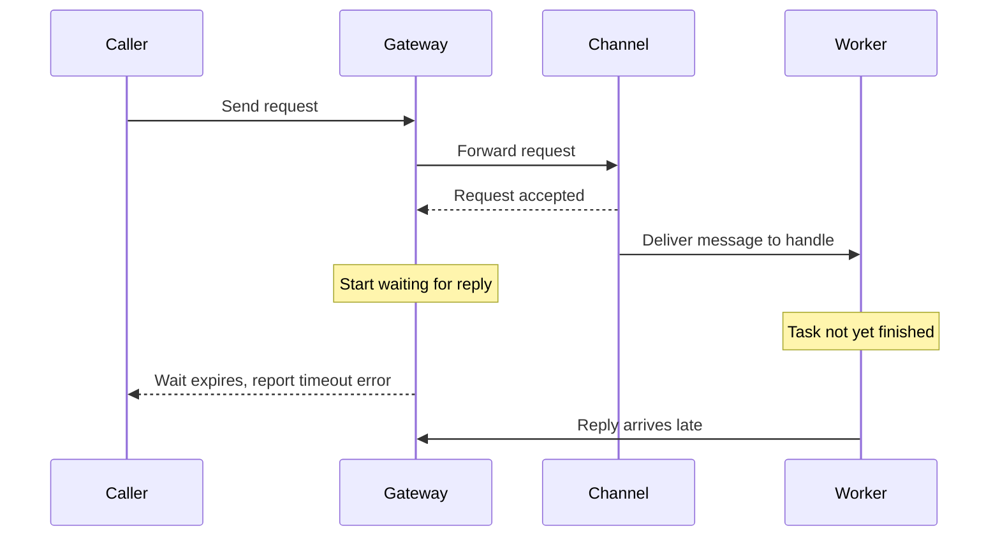

# MessageTimeoutException

## 1. Objectives and Scope

In a Spring Integration flow, a producer sends a `Message` through a `MessageChannel`, endpoints process the data, and a gateway may wait for a reply to return the result to calling Java code. When a wait times out, it is important to identify **which step was being waited on**: placing the request into the channel, receiving the reply, or calling an external system.

This lesson belongs to the **Error handling** chapter of the **SPRING_INTEGRATION_CORE** module and focuses on `MessageTimeoutException`, gateway configuration, error handling in Java DSL, and testing missing-reply behavior. After this lesson, you should be able to:

- Identify the exact exception class and read the failing message details.
- Distinguish a request-send timeout from a reply-wait timeout.
- Configure a gateway to throw an error instead of silently returning `null`.
- Design an error-handling branch, fallback reply, and suitable retry policy.
- Explain why a task can still complete after the caller has already received a timeout.

The examples use Java 17 and Spring Integration **6.2 or higher** APIs. The `errorOnTimeout` attribute on `@MessagingGateway` and `GatewayEndpointSpec` has existed since 6.2; the configurations below set timeouts explicitly so readers do not have to rely on defaults. See the [MessagingGateway API](https://docs.spring.io/spring-integration/api/org/springframework/integration/annotation/MessagingGateway.html).

## 2. What Does MessageTimeoutException Represent?

The fully qualified class name is:

```java
org.springframework.integration.MessageTimeoutException
```

Inheritance hierarchy to remember:

```text
RuntimeException
  └─ NestedRuntimeException
      └─ MessagingException
          └─ MessageDeliveryException
              └─ MessageTimeoutException
```

It is an unchecked exception belonging to the message-delivery failure group. In a gateway request–reply flow, it can represent failing to receive a reply within the allowed duration when error-on-timeout mode is enabled. Do not infer that every expired operation in Spring Integration throws this exact class.

Several constructors allow attaching the message and cause:

```java
new MessageTimeoutException("Reply was not received in time");

new MessageTimeoutException(
        requestMessage,
        "No reply received from quote lookup flow");

new MessageTimeoutException(
        requestMessage,
        "Operation did not complete within the allowed time",
        cause);
```

When analyzing an error, three useful pieces of information are `getMessage()`, `getFailedMessage()`, and `getCause()`. `getFailedMessage()` may be `null`, such as when the exception is constructed with only a descriptive string. See the [MessageTimeoutException API](https://docs.spring.io/spring-integration/api/org/springframework/integration/MessageTimeoutException.html).

Because this class extends `MessageDeliveryException`, catch order must proceed from specific to general:

```java
try {
    // Call request–reply gateway.
}
catch (MessageTimeoutException timeout) {
    // Apply policy specific to waiting timeouts.
}
catch (MessageDeliveryException deliveryFailure) {
    // Other delivery failures.
}
```

If you catch `MessageDeliveryException` first, a subsequent `MessageTimeoutException` catch clause is invalid because it is already covered by the parent branch.

## 3. Distinguishing Timeout Types and Return Outcomes

### 3.1. Channels, Templates, and Gateways Have Different Contracts

| Operation | What is being waited on | Result to distinguish when incomplete |
| --- | --- | --- |
| `queueChannel.send(message, timeout)` | Space in the queue to accept the message | May return `false`; does not automatically convert to `MessageTimeoutException` |
| `queueChannel.receive(timeout)` | A message available to retrieve | Returns `null` when no message is received |
| `messagingTemplate.send(channel, message)` | Channel accepts the message | When the channel returns `false`, the template throws `MessageDeliveryException` |
| `messagingTemplate.sendAndReceive(channel, message)` | Send request then receive reply | May return `null` if there is no reply; send failures can still be thrown |
| Request–reply gateway, `errorOnTimeout = false` | Receive reply per gateway contract | Typically returns `null` when reply wait times out |
| Request–reply gateway, `errorOnTimeout = true` | Receive reply per gateway contract | Produces `MessageTimeoutException`; error can go through configured error channel |

Channel and template contracts operate at two different layers. A `false` return on a direct send operation is not yet an exception. In `GenericMessagingTemplate`, a channel rejecting a send is translated to `MessageDeliveryException`, while receiving no message may still return `null`. See the [GenericMessagingTemplate source, Spring Framework 6.2.0](https://github.com/spring-projects/spring-framework/blob/v6.2.0/spring-messaging/src/main/java/org/springframework/messaging/core/GenericMessagingTemplate.java).

With a bounded-capacity `QueueChannel`, the send timeout only comes into play when the queue is full. A successful `send()` confirms the message entered the queue; it does not prove a consumer processed it successfully. A value of `0` on these channel operations requests an immediate attempt, whereas negative values allow unbounded waiting. See [Message Channel Implementations](https://docs.spring.io/spring-integration/reference/channel/implementations.html).

### 3.2. Request Timeout and Reply Timeout

On a gateway, two settings govern two different steps:

- **Request timeout**: allowed duration to send the request to a potentially blocking channel.
- **Reply timeout**: duration the gateway waits for a reply after control returns to the gateway.

For example, if a request sits in a queue for 400 ms and the consumer then takes 200 ms, the reply wait window may already include the queue residency time. Conversely, if all processing runs synchronously inside `send()`, that processing time happens before the gateway starts waiting for the reply.

Therefore, `replyTimeout = 500` cannot be treated as a guarantee that every gateway call finishes within 500 ms. Actual latency also depends on the send path, synchronous handlers, data conversions, and error-handling flows. See [Gateway Timeouts](https://docs.spring.io/spring-integration/reference/gateway.html#gateway-timeouts).

### 3.3. Errors or Deadlines Not Synonymous with MessageTimeoutException

An HTTP client may report a connection or read timeout; `Future.get(timeout, unit)` may throw `java.util.concurrent.TimeoutException`; a handler may fail with `MessageHandlingException`. Inspect the cause chain to know which class and component raised the error rather than classifying solely by the word "timeout" in a message string.

Similarly, a group completion timeout inside an aggregator belongs to message-group lifecycle. Depending on configuration, the group may release partial results or be discarded. Only when the caller does not receive a reply in time and the gateway applies its corresponding error policy does the caller see a timeout error at the gateway layer.

## 4. Thread Boundaries Determine the Effectiveness of Reply Timeouts

### 4.1. DirectChannel: Handler Runs on the Caller's Thread

Consider this path:

```text
Caller → Gateway → DirectChannel → Slow Handler → Reply
```

If the handler calls an external service and blocks for 5 seconds, the caller's thread is executing that call as well. The gateway has not yet regained control to begin waiting for the reply, so `replyTimeout = 500` does not interrupt the handler after half a second.

When the handler eventually returns a result, the reply may already be waiting when the gateway begins receiving. In that case the call succeeds even though total elapsed time exceeded 500 ms. This is a consequence of single-thread execution, not evidence that Spring ignores timeout settings. [Messaging Gateways](https://docs.spring.io/spring-integration/reference/gateway.html) describes this boundary clearly.

To bound network calls, configure timeouts on the network client performing I/O. If an overall deadline is required for the business operation, add a mechanism that tracks the remaining time budget across the flow.

### 4.2. QueueChannel or ExecutorChannel: Can Decouple the Processing Thread

When an asynchronous boundary exists, the caller can return to the gateway and begin waiting while the worker processes:



`ExecutorChannel` typically hands work off to an executor, though not every rejection policy preserves this boundary. For example, `CallerRunsPolicy` can make the caller execute the task when the executor is saturated. When evaluating timeouts, inspect the executor configuration and actual overload behavior. See [ExecutorChannel](https://docs.spring.io/spring-integration/reference/channel/implementations.html#channel-implementations-executorchannel).

Another point to keep clear: **timing out does not mean canceling the work**. A late reply cannot retroactively turn a call that already reported an error into a successful call.

## 5. Configuring a Gateway to Report an Error When No Reply Arrives

The example uses a quote-lookup flow. The input is a product SKU; output is simplified to a string to focus on messaging mechanics.

### 5.1. Declaring the Gateway Contract

Place the following interface in a separate Java file of the application:

```java
package example.timeout;

import org.springframework.integration.annotation.MessagingGateway;
import org.springframework.messaging.Message;

@MessagingGateway(
        defaultRequestChannel = "quoteRequests",
        defaultRequestTimeout = "100",
        defaultReplyTimeout = "500",
        errorOnTimeout = true)
public interface QuoteGateway {

    String quote(Message<String> request);
}
```

Here:

- `100` and `500` are in milliseconds.
- The method has a non-`void` return type, expressing a contract requiring a reply.
- `errorOnTimeout = true` requests reporting an error when no reply is received.
- No dedicated error channel is configured on the gateway yet, so timeout exceptions propagate to the caller.

For operations where a result is mandatory, this configuration makes the failure branch explicit. For APIs that allow "no result," you can choose a policy returning `null`, provided the caller handles that case per the defined contract. The `errorOnTimeout` mechanism is described in [MessagingGatewaySupport](https://docs.spring.io/spring-integration/api/org/springframework/integration/gateway/MessagingGatewaySupport.html).

### 5.2. Building the Flow with Java DSL

```java
package example.timeout;

import org.springframework.beans.factory.annotation.Qualifier;
import org.springframework.context.annotation.Bean;
import org.springframework.context.annotation.Configuration;
import org.springframework.core.task.TaskExecutor;
import org.springframework.integration.annotation.IntegrationComponentScan;
import org.springframework.integration.channel.ExecutorChannel;
import org.springframework.integration.config.EnableIntegration;
import org.springframework.integration.dsl.IntegrationFlow;
import org.springframework.scheduling.concurrent.ThreadPoolTaskExecutor;

@Configuration
@EnableIntegration
@IntegrationComponentScan(basePackageClasses = QuoteGateway.class)
public class QuoteFlowConfig {

    @Bean
    public ThreadPoolTaskExecutor quoteExecutor() {
        ThreadPoolTaskExecutor executor = new ThreadPoolTaskExecutor();
        executor.setCorePoolSize(2);
        executor.setMaxPoolSize(4);
        executor.setQueueCapacity(20);
        executor.setThreadNamePrefix("quote-worker-");
        return executor;
    }

    @Bean
    public ExecutorChannel quoteRequests(
            @Qualifier("quoteExecutor") TaskExecutor executor) {
        return new ExecutorChannel(executor);
    }

    @Bean
    public IntegrationFlow quoteFlow() {
        return IntegrationFlow.from("quoteRequests")
                .<String, String>transform(String::trim)
                .<String>handle(
                        (sku, headers) -> "PRICE:" + sku,
                        endpoint -> endpoint.requiresReply(true))
                .get();
    }
}
```

`@EnableIntegration` registers integration infrastructure in plain Spring configuration. `@IntegrationComponentScan` discovers the gateway interface. The executor bean lifecycle is managed by Spring; the example does not spin up a new executor per request.

The flow above normally responds immediately because it contains no slow operation. It illustrates where settings live rather than intentionally forcing a timeout. When replacing the handler with a real lookup call, configure the corresponding client's timeouts. Nor does `defaultRequestTimeout` turn wait time in the executor's queue into a task deadline.

Omitting an output channel on the final handler lets the framework use the reply channel in the request's headers to return the result. `requiresReply(true)` requires the handler to produce a result; if it returns `null`, the framework raises `ReplyRequiredException`. This mechanism detects missing results; it does not interrupt a blocked handler. See [Service Activator](https://docs.spring.io/spring-integration/reference/service-activator.html).

### 5.3. Calling the Gateway and Reading Error Context

The following snippet sits inside a method of a service injected with `QuoteGateway gateway`:

```java
Message<String> request = MessageBuilder.withPayload(" SKU-100 ")
        .setHeader("requestId", "quote-request-1001")
        .build();

try {
    String quote = gateway.quote(request);
    // Use quote.
}
catch (MessageTimeoutException timeout) {
    Message<?> failed = timeout.getFailedMessage();
    Object requestId = failed == null
            ? null
            : failed.getHeaders().get("requestId");

    // Record requestId and the status that no timely reply was received.
    // Apply the application's error-return or fallback-reply policy.
}
```

Additional imports for the calling snippet:

```java
import org.springframework.integration.MessageTimeoutException;
import org.springframework.messaging.Message;
import org.springframework.messaging.support.MessageBuilder;
```

`MessageHeaders.ID` identifies one specific message. An application-assigned `requestId` can track the same business request across multiple messages or multiple attempts. Do not assume these two identifiers share the same lifecycle.

## 6. Handling Timeouts via errorChannel and Returning a Fallback Reply

If the caller needs a controlled result, you can route gateway errors to an error-handling flow. Replace the annotation on `QuoteGateway` with the configuration below, keeping the method unchanged:

```java
@MessagingGateway(
        defaultRequestChannel = "quoteRequests",
        defaultRequestTimeout = "100",
        defaultReplyTimeout = "500",
        errorChannel = "quoteErrors",
        errorOnTimeout = true)
```

Add the following beans to `QuoteFlowConfig`, along with imports for `DirectChannel` and `MessageTimeoutException`:

```java
@Bean
public DirectChannel quoteErrors() {
    return new DirectChannel();
}

@Bean
public IntegrationFlow quoteErrorFlow() {
    return IntegrationFlow.from("quoteErrors")
            .<Throwable, String>handle((failure, headers) -> {
                if (failure instanceof MessageTimeoutException) {
                    return "QUOTE_UNAVAILABLE_TIMEOUT";
                }
                if (failure instanceof RuntimeException runtimeFailure) {
                    throw runtimeFailure;
                }
                throw new IllegalStateException(
                        "Quote flow encountered an error outside fallback policy",
                        failure);
            })
            .get();
}
```

When handling errors via messaging, `ErrorMessage` holds a `Throwable` in its payload. Therefore, the handler above accepts `Throwable` rather than assuming the payload is still a product SKU. Synchronous and asynchronous error propagation behave differently; not every exception in the system is automatically sent to the global `errorChannel` bean. See [Error Handling](https://docs.spring.io/spring-integration/reference/error-handling.html).

In this example, the gateway catches the timeout error, sends an error message to `quoteErrors`, and receives the fallback string as the result. This branch applies to errors whose direct payload is `MessageTimeoutException`. If your application has custom exception wrappers, define how to inspect and classify causes before selecting a fallback.

There are three design decisions to align on:

1. **A fallback is an explicit business state.** The string `"QUOTE_UNAVAILABLE_TIMEOUT"` is illustrative; production code should use a result type conveying both status and data source. Do not use a price of `0` to implicitly represent a timed-out service.
2. **The error branch must fulfill the reply contract.** A handler that only logs and returns `void` does not produce a fallback reply for a request–reply gateway. If the error branch also produces no reply, the gateway can continue timing out.
3. **Execution time of the error branch also counts toward caller wait time.** A slow synchronous error flow can push total elapsed time past the initial reply timeout.

Gateway source code also distinguishes between receiving no reply from the main flow and receiving no reply from the error channel. When debugging, check the message and origin of the failure to see which branch did not complete. See [MessagingGatewaySupport, version 6.5.0](https://github.com/spring-projects/spring-integration/blob/v6.5.0/spring-integration-core/src/main/java/org/springframework/integration/gateway/MessagingGatewaySupport.java).

## 7. A Gateway Inside an IntegrationFlow

Beyond gateway interfaces at the application boundary, Java DSL allows calling another flow with the `.gateway(...)` operator:

```java
@Bean
public IntegrationFlow checkoutQuoteFlow() {
    return IntegrationFlow.from("checkoutQuoteRequests")
            .gateway("quoteRequests", gateway -> gateway
                    .requestTimeout(100L)
                    .replyTimeout(500L)
                    .errorOnTimeout(true)
                    .errorChannel("quoteErrors"))
            .get();
}
```

This snippet reuses `quoteRequests` and `quoteErrors` from the prior configuration. `checkoutQuoteRequests` is the new entry point of the flow. When invoked, the request still needs an appropriate reply return path if the caller expects a reply.

The `.gateway(...)` operator establishes a request–reply boundary mid-flow. Nested gateway timeouts and outer gateway timeouts are independent configurations; they do not automatically share a single time budget. See [Operator gateway()](https://docs.spring.io/spring-integration/reference/dsl/java-gateway.html) and [GatewayEndpointSpec 6.5.0](https://github.com/spring-projects/spring-integration/blob/v6.5.0/spring-integration-core/src/main/java/org/springframework/integration/dsl/GatewayEndpointSpec.java).

For instance, if an outer gateway waits only 300 ms while an inner gateway waits 500 ms, the outer caller may give up earlier. In multi-tier designs, propagate a business deadline or allocate timeouts from remaining budget rather than putting the exact same number on every gateway.

## 8. When Does an Application Explicitly Create MessageTimeoutException?

If an application interacts directly with channels, it can explicitly convert an unsuccessful send into its own exception policy:

```java
import org.springframework.integration.MessageTimeoutException;
import org.springframework.messaging.Message;
import org.springframework.messaging.MessageChannel;

public final class RequiredMessageSender {

    public void sendRequired(
            MessageChannel channel,
            Message<?> message,
            long timeoutMillis) {

        if (timeoutMillis < 0) {
            throw new IllegalArgumentException(
                    "This example requires a finite timeout");
        }

        boolean accepted = channel.send(message, timeoutMillis);
        if (!accepted) {
            if (Thread.currentThread().isInterrupted()) {
                throw new IllegalStateException(
                        "Thread interrupted while sending message");
            }
            throw new MessageTimeoutException(
                    message,
                    "Unable to send message within allowed wait time: "
                            + timeoutMillis + " ms");
        }
    }
}
```

This is an application-written adapter. Throwing `MessageTimeoutException` stems from a choice in this code, not a rule that `MessageChannel.send()` always throws that exception.

The adapter's usage contract should also clearly scope channel types. With a bounded `QueueChannel`, a `false` return typically reflects lack of space within the wait window; a custom channel may have other rejection reasons. Thread interruption should also be distinguished from a normal wait expiration.

The adapter above only standardizes send outcomes; it does not add timeout enforcement for a synchronous handler inside a `DirectChannel`.

## 9. Finding Why No Reply Arrived Across Integration Patterns

Timeouts are often symptoms at the end of a chain. Trace the message path backward before increasing wait durations.

| Component or situation | Question to check | Adjustment direction |
| --- | --- | --- |
| Transformer or service activator | Does any branch return `null` even though the contract requires a result? | Define an output for that branch; enable reply requirement on the appropriate endpoint |
| Filter | Is a filtered-out request a valid outcome or a contract violation? | Return a rejection status via a replying branch, or configure throwing on rejection |
| Router | Do all request types have a route and a return path? | Check mappings, default route, and missing-route policy |
| Aggregator | Does the group meet release criteria? Is the correlation key right? | Check group strategy, release condition, and expired-group handling |
| QueueChannel | Is there an active consumer? Is the poller running? | Check endpoint lifecycle, poller, and backlog |
| ExecutorChannel | Are all workers busy? Are tasks being rejected? | Measure saturation, inspect queue and overload policies |
| Handler calling an external service | Does the I/O client have a finite timeout? | Set client timeouts, measure dependency latency, and classify errors |
| Error-handling branch | Does it return a reply or only log? | Complete the error flow's reply contract or deliberately propagate the error |

For example, a filter dropping invalid SKUs may be filtering accurately. Yet if the gateway promises a result for every request, the overall design still lacks a reply path for rejected cases. Returning an "invalid SKU" result lets the caller distinguish input errors from a slow service.

With an aggregator, suppose replies from three sources are needed, yet only two respond. An outer gateway may time out before the group ever releases. Align on two policies: how long the caller is willing to wait and how incomplete groups are handled. Increasing the gateway timeout alone will not resolve a group whose release condition is never met.

## 10. Tasks Keep Running, Late Replies, and Retry Policies

### 10.1. Timeouts Reflect the Caller's Observation Limit

Consider a stock-reservation command:

```text
t = 0 ms      Send reservation command.
t = 500 ms    Gateway gets no reply and reports timeout.
t = 700 ms    Worker records reservation succeeded.
t = 750 ms    Worker sends reply, but caller has stopped waiting.
```

At 500 ms, the caller knows it has not yet received confirmation. It does not have enough information to conclude the reservation failed. Therefore, automatically resending a new command can cause duplicate business side effects.

Depending on late-reply policy, a late reply can cause a warning log or a delivery exception on the reply-sending side. The `throwExceptionOnLateReply` property relates to this scenario in messaging templates; it differs from `errorOnTimeout`, which determines how a gateway reports failing to receive a reply in time. See [MessagingTemplate 6.5.0](https://github.com/spring-projects/spring-integration/blob/v6.5.0/spring-integration-core/src/main/java/org/springframework/integration/core/MessagingTemplate.java) and [GenericMessagingTemplate 6.2.0](https://github.com/spring-projects/spring-framework/blob/v6.2.0/spring-messaging/src/main/java/org/springframework/messaging/core/GenericMessagingTemplate.java).

### 10.2. Retries Must Accompany Idempotency and Time Budgets

Before retrying, answer:

1. Could the previous request have already been processed?
2. Is the same business key protected against duplicate execution?
3. Did the error stem from a lost reply, a missing consumer, or an overloaded system?
4. Is there enough remaining time to retry and still return a result to the caller?

For operations with side effects, design an idempotency key and status lookup by that key. This key must be preserved across retry attempts. A newly generated message UUID does not provide that protection automatically.

Retrying around a gateway call can resend the entire request. Retrying around a handler can re-execute the handler. These two placements create different execution scopes; choose based on the actual side effects of the repeated code.

In a saturated system, increasing retry counts can worsen the backlog. Nor is a "no consumer" error fixed by immediately retrying with the same configuration. Bound attempts, add suitable backoff, and measure retry effectiveness before expanding the policy.

### 10.3. End-to-End Request Deadlines

One design approach is for the application to attach a header such as `deadlineEpochMillis` and check remaining budget before each expensive step. This is an application-level convention; Spring Integration does not automatically turn an arbitrary header into a task-cancellation mechanism.

The budget of a single call may consist of:

```text
Delivery time
+ Time spent in queue
+ Processing and I/O time
+ Error or fallback handling time
+ Result return overhead
```

If a caller tolerates waiting only around 2 seconds, do not let each tier independently consume a full 2 seconds and then retry. Allocate time budgets across steps and reserve headroom for the return path. Final numbers should be grounded in measured latency and business SLAs.

A caller timing out does not automatically roll back a transaction running on another worker either. Cancellation, compensation, and reconciliation mechanisms must be designed explicitly for how the system executes.

## 11. Testing Timeout Behavior Without Depending on Thread.sleep

The examples below use JUnit Jupiter, Spring Context, and `spring-integration-core` in an environment with matching dependencies. This is illustrative code for a study project; it requires no extra poller or broker.

The idea is to create a `QueueChannel` with no consumer. Requests can enter the queue, yet a reply is guaranteed not to exist. Set receive timeout to `0` to test the no-reply branch immediately, avoiding measurements sensitive to schedulers or fast/slow machines.

```java
package example.timeout;

import org.junit.jupiter.api.Test;
import org.springframework.beans.factory.annotation.Qualifier;
import org.springframework.context.annotation.AnnotationConfigApplicationContext;
import org.springframework.context.annotation.Bean;
import org.springframework.context.annotation.Configuration;
import org.springframework.integration.MessageTimeoutException;
import org.springframework.integration.channel.QueueChannel;
import org.springframework.integration.config.EnableIntegration;
import org.springframework.integration.core.MessagingTemplate;
import org.springframework.integration.gateway.GatewayProxyFactoryBean;
import org.springframework.integration.gateway.RequestReplyExchanger;
import org.springframework.messaging.Message;
import org.springframework.messaging.MessageChannel;
import org.springframework.messaging.MessageDeliveryException;
import org.springframework.messaging.support.MessageBuilder;

import static org.junit.jupiter.api.Assertions.*;

class MessageTimeoutBehaviorTest {

    @Test
    void rawChannelReturnsFalseWhenFull() {
        QueueChannel queue = new QueueChannel(1);
        Message<String> first = message("first");
        Message<String> second = message("second");

        assertTrue(queue.send(first, 0));
        assertFalse(queue.send(second, 0));
    }

    @Test
    void templateConvertsUnsuccessfulSendToDeliveryException() {
        QueueChannel queue = new QueueChannel(1);
        assertTrue(queue.send(message("first"), 0));

        MessagingTemplate template = new MessagingTemplate();
        template.setSendTimeout(0);

        MessageDeliveryException failure = assertThrows(
                MessageDeliveryException.class,
                () -> template.send(queue, message("second")));

        assertFalse(failure instanceof MessageTimeoutException);
    }

    @Test
    void strictGatewayThrowsWhenNoReplyIsAvailable() {
        try (var context = new AnnotationConfigApplicationContext(
                GatewayTestConfig.class)) {

            RequestReplyExchanger gateway = context.getBean(
                    "strictGateway", RequestReplyExchanger.class);

            assertThrows(MessageTimeoutException.class,
                    () -> gateway.exchange(message("SKU-100")));

            QueueChannel requests = context.getBean(
                    "parkedRequests", QueueChannel.class);
            Message<?> queued = requests.receive(0);

            assertNotNull(queued);
            assertEquals("SKU-100", queued.getPayload());
        }
    }

    @Test
    void lenientGatewayReturnsNullWhenNoReplyIsAvailable() {
        try (var context = new AnnotationConfigApplicationContext(
                GatewayTestConfig.class)) {

            RequestReplyExchanger gateway = context.getBean(
                    "lenientGateway", RequestReplyExchanger.class);

            assertNull(gateway.exchange(message("SKU-100")));
        }
    }

    private static Message<String> message(String payload) {
        return MessageBuilder.withPayload(payload).build();
    }

    @Configuration
    @EnableIntegration
    static class GatewayTestConfig {

        @Bean
        QueueChannel parkedRequests() {
            return new QueueChannel(1);
        }

        @Bean
        GatewayProxyFactoryBean<RequestReplyExchanger> strictGateway(
                @Qualifier("parkedRequests") MessageChannel requests) {
            return gatewayFactory(requests, true);
        }

        @Bean
        GatewayProxyFactoryBean<RequestReplyExchanger> lenientGateway(
                @Qualifier("parkedRequests") MessageChannel requests) {
            return gatewayFactory(requests, false);
        }

        private GatewayProxyFactoryBean<RequestReplyExchanger> gatewayFactory(
                MessageChannel requests,
                boolean errorOnTimeout) {

            GatewayProxyFactoryBean<RequestReplyExchanger> factory =
                    new GatewayProxyFactoryBean<>(RequestReplyExchanger.class);
            factory.setDefaultRequestChannel(requests);
            factory.setDefaultRequestTimeout(0L);
            factory.setDefaultReplyTimeout(0L);
            factory.setErrorOnTimeout(errorOnTimeout);
            return factory;
        }
    }
}
```

The four tests verify four distinct contracts: the channel returns `false`, the template throws a delivery error, the strict gateway reports a timeout, and the lenient gateway returns `null`. The strict gateway test also proves the request remains in the queue after the caller received the error. Each gateway test opens a fresh context to avoid interference from another test's queue.

A timeout of `0` here checks for no reply at receive time; it does not verify waiting for a positive duration. When testing real asynchronous flows, use a latch to hold the worker and observe the caller, then release the worker inside `finally`. Do not assert "elapsed time must equal exactly 500 ms," since scheduling and machine load introduce jitter.

Integration tests worth adding when a project has live flows:

- Handler responds in time; gateway returns expected data.
- Error flow returns a fallback and preserves required request identifiers.
- Error flow produces no reply; caller does not block indefinitely.
- Reply arriving after timeout is handled according to the chosen policy.
- Resending a request with the same idempotency key does not produce duplicate side effects.
- Saturated executor still behaves within response-time goals.

## 12. Diagnostics and Observability in Operations

When encountering `MessageTimeoutException`, gather enough data to distinguish "never processed" from "processed but did not reply yet."

| Data | Purpose |
| --- | --- |
| Gateway and channel names | Identifies where the caller is waiting |
| `requestId`, correlation, or business key | Links caller, worker, and retry logs |
| Outermost exception type and cause | Distinguishes gateway timeout from client errors or branch failures |
| Configured timeout vs. actual duration | Reveals limits applied only to a single stage |
| Queue depth, busy workers, rejected tasks | Identifies insufficient capacity or congestion |
| Endpoint entry/exit logs and aggregator group state | Finds where the message stalled |
| Retry counts and late replies | Evaluates impact of the recovery policy |

Log necessary identifiers rather than full payloads or entire `failedMessage` instances, especially when requests hold sensitive data. Logging must still work when `getFailedMessage()` has no data.

Practical investigation sequence:

1. Identify who created the exception: gateway, application-written adapter, or another component.
2. Check whether the request entered the channel and whether a consumer is actually active.
3. Determine which endpoint the message reached and which thread is processing it.
4. Check branches that may produce no reply: `null`, `void`, filter, router, and aggregator.
5. Verify the reply/error path still wires properly back to the caller.
6. Assess I/O latency, backlog, and retry scope before adjusting timeouts.

The core design takeaway is: `MessageTimeoutException` indicates that a required communication step did not finish within its applicable wait window. To handle it properly, understand the API contract, thread boundaries, and business state of the request after the caller stops waiting.
