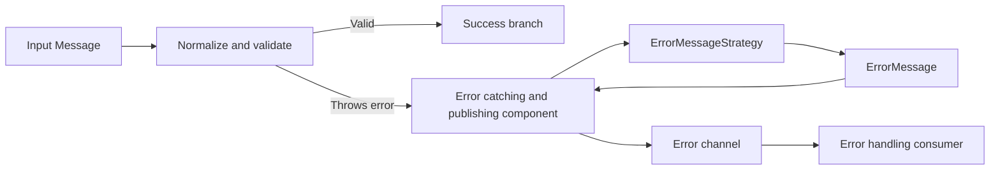

# ErrorMessageStrategy: Creating Error Messages with Complete Context

In Spring Integration Core, an error-handling branch often needs to answer three questions: which operation failed, what did the message look like at the point of failure, and what was the input message to the processing segment. `ErrorMessageStrategy` is the extension point for packaging that information into an `ErrorMessage` before the error-publishing component sends it out.

This lesson belongs to the **Error handling** chapter of the `SPRING_INTEGRATION_CORE` module. The goal is to understand the strategy contract, use default behavior, add tracking headers, and wire the strategy into a Java DSL flow. The examples use Spring Integration **6.5.x** APIs, Java 17 or higher, and JUnit Jupiter for illustrative testing. This is the example API baseline, not a requirement to change the version of the project you are studying.

## 1. The Strategy's Place in the Error Flow

Suppose the system receives an order ID as a string. The initial message has payload `" INVALID "`; a normalization step creates a new message with payload `"INVALID"`; a format-validation step throws `IllegalArgumentException`. To investigate this case, the error branch needs to retain both the input string and the normalized string.



Roles should be clearly separated:

| Component | Responsibility in the example |
| --- | --- |
| Order processing handler | Normalizes data and validates the order ID |
| Error-catching mechanism | Decides which errors are converted to the message flow |
| `ErrorMessageStrategy` | Creates an `ErrorMessage` from the exception and provided context |
| Error-publishing component | Invokes the strategy and sends the result to the configured channel |
| Error channel consumer | Records, classifies, alerts, or coordinates further handling |

`ErrorMessageStrategy` is a functional interface with the main method below. The context may be `null`; the return type must be `ErrorMessage`. This contract allows using a class or lambda when configuring the error-publishing component. [ErrorMessageStrategy Javadoc](https://docs.spring.io/spring-integration/docs/6.5.0/api/org/springframework/integration/support/ErrorMessageStrategy.html).

```java
ErrorMessage buildErrorMessage(
        Throwable failure,
        AttributeAccessor context);
```

Parameter names in the example are chosen to express intent. `failure` is the error passed in by the calling component, while `context` is where context is looked up for the current message creation.

From this boundary, creating a strategy does not yet establish retries, rollbacks, or error destinations. Those policies must be configured on the components that own them. Keep the strategy's goal small and verifiable: build the right error envelope, preserve the exception, and attach required metadata.

## 2. Reading the ErrorMessage Structure Properly

`ErrorMessage` is a `Message<Throwable>`. It has headers, an error payload, and an optional `originalMessage` property. When the payload is a `MessagingException`, the exception can also carry `failedMessage`. These two message slots serve two different checkpoints in processing. [ErrorMessage Javadoc](https://docs.spring.io/spring-framework/docs/6.2.x/javadoc-api/org/springframework/messaging/support/ErrorMessage.html).

| Location | Expected content in the order ID scenario |
| --- | --- |
| `error.getPayload()` | Exception describing the failure; typically `MessagingException` or a subclass |
| `error.getOriginalMessage()` | Input message specified by the context, with payload `" INVALID "` |
| `((MessagingException) error.getPayload()).getFailedMessage()` | Message at the validation point, with payload `"INVALID"` |
| `error.getPayload().getCause()` | Directly wrapped cause, `IllegalArgumentException` in the example |
| `error.getHeaders()` | Metadata of the error envelope, such as `traceId` and `failureService` added by the application |

In a long flow, "input" must be scoped to the component currently processing. A gateway or subflow may treat the message entering it as its own input. Do not assume `originalMessage` is always the very first message that ever appeared in the entire system.

The expected outcome in the example can be depicted as:

```text
ErrorMessage
  headers.traceId = "trace-101"
  headers.failureService = "SPRING_INTEGRATION_CORE"
  originalMessage.payload = " INVALID "
  payload = MessageHandlingException
    failedMessage.payload = "INVALID"
    cause = IllegalArgumentException
```

Keeping the wrapper exception lets error handlers access Spring Messaging details and the cause chain. Replacing the entire payload with the deepest exception can leave behind part of the context held on the wrapper. In this lesson, cause classification happens after preserving the incoming exception.

## 3. Context and Default Behavior

### 3.1. Two Context Keys to Know

`AttributeAccessor` is the attribute bag passed into the strategy by the calling component. It is not the full set of request headers. Spring Integration provides keys and helper methods to build contexts corresponding to the input message and failed message. [ErrorMessageUtils Javadoc](https://docs.spring.io/spring-integration/docs/6.5.0/api/org/springframework/integration/support/ErrorMessageUtils.html).

| API | Meaning when building context |
| --- | --- |
| `ErrorMessageUtils.INPUT_MESSAGE_CONTEXT_KEY` | Key holding the input message for the processing scope |
| `ErrorMessageUtils.FAILED_MESSAGE_CONTEXT_KEY` | Key holding the message at the point of failure |
| `ErrorMessageUtils.getAttributeAccessor(input, failed)` | Creates an accessor from the two supplied messages |

Do not hardcode the string values of these constants. When reading an optional attribute, check its type before using it. A context lacking an input message is still a case the strategy must handle.

### 3.2. What DefaultErrorMessageStrategy Does

`DefaultErrorMessageStrategy` keeps the exception as the payload. If the context contains a `Message` under `INPUT_MESSAGE_CONTEXT_KEY`, it uses that message as `originalMessage`; otherwise it creates an error envelope without an original message. The default strategy does not search the entire flow's history for an input message. [DefaultErrorMessageStrategy Javadoc](https://docs.spring.io/spring-integration/docs/6.5.0/api/org/springframework/integration/support/DefaultErrorMessageStrategy.html).

The example below creates two messages to clearly show the boundary before and after normalization:

```java
import org.springframework.core.AttributeAccessor;
import org.springframework.integration.support.DefaultErrorMessageStrategy;
import org.springframework.integration.support.ErrorMessageUtils;
import org.springframework.messaging.Message;
import org.springframework.messaging.MessageHandlingException;
import org.springframework.messaging.support.ErrorMessage;
import org.springframework.messaging.support.MessageBuilder;

Message<String> input = MessageBuilder.withPayload(" INVALID ")
        .setHeader("traceId", "trace-101")
        .build();

Message<String> failed = MessageBuilder.withPayload("INVALID")
        .setHeader("traceId", "trace-101")
        .build();

IllegalArgumentException cause =
        new IllegalArgumentException("Order id must match ORD- followed by 3 digits");

MessageHandlingException failure = new MessageHandlingException(
        failed, "Order validation failed", cause);

AttributeAccessor context =
        ErrorMessageUtils.getAttributeAccessor(input, failed);

ErrorMessage error = new DefaultErrorMessageStrategy()
        .buildErrorMessage(failure, context);

System.out.println(error.getOriginalMessage().getPayload()); // " INVALID "
System.out.println(failure.getFailedMessage().getPayload()); // "INVALID"
```

In this example, `failedMessage` is present because the application passed it into `MessageHandlingException`. Merely setting the `FAILED_MESSAGE_CONTEXT_KEY` attribute and calling the default strategy directly does not cause the strategy to mutate the exception to add `failedMessage`.

Another detail easily overlooked: headers from the original message do not automatically become headers of the error envelope just because `originalMessage` was preserved. When `traceId` is needed directly on the message sent to the error consumer, add it under an explicit convention.

## 4. Writing a Strategy That Adds Metadata

### 4.1. Example Conventions

The application's error branch needs four headers:

| Header | Value or data source |
| --- | --- |
| `failureService` | Module identifier `SPRING_INTEGRATION_CORE` |
| `failureType` | Class name of the exception received by the strategy |
| `traceId` | Tracing string taken from the input message; fallback to `failedMessage` |
| `orderRef` | Business reference ID taken using the same rule |

The last two headers are copied only if they are non-blank strings at most 128 characters long. This limit is an illustrative application policy. `failureType` represents the outermost exception, not a rule for determining the deepest cause or whether the error is retryable.

### 4.2. Implementing OrderErrorMessageStrategy

Place the class below in the same package as the configuration and tests in subsequent sections, or add the corresponding package and imports in your practice project.

```java
import java.util.HashMap;
import java.util.Map;

import org.springframework.core.AttributeAccessor;
import org.springframework.integration.support.DefaultErrorMessageStrategy;
import org.springframework.integration.support.ErrorMessageStrategy;
import org.springframework.messaging.Message;
import org.springframework.messaging.MessagingException;
import org.springframework.messaging.support.ErrorMessage;

public final class OrderErrorMessageStrategy implements ErrorMessageStrategy {

    private final DefaultErrorMessageStrategy delegate =
            new DefaultErrorMessageStrategy();

    @Override
    public ErrorMessage buildErrorMessage(
            Throwable failure, AttributeAccessor context) {

        ErrorMessage baseline = delegate.buildErrorMessage(failure, context);
        Message<?> original = baseline.getOriginalMessage();

        Message<?> metadataSource = original;
        if (metadataSource == null && failure instanceof MessagingException ex) {
            metadataSource = ex.getFailedMessage();
        }

        Map<String, Object> headers = new HashMap<>();
        headers.put("failureService", "SPRING_INTEGRATION_CORE");
        headers.put("failureType", failure.getClass().getSimpleName());

        copyTextHeader(metadataSource, headers, "traceId");
        copyTextHeader(metadataSource, headers, "orderRef");

        return new ErrorMessage(failure, headers, original);
    }

    private static void copyTextHeader(
            Message<?> source, Map<String, Object> target, String name) {

        if (source == null) {
            return;
        }

        Object value = source.getHeaders().get(name);
        if (value instanceof String text
                && !text.isBlank()
                && text.length() <= 128) {
            target.put(name, text);
        }
    }
}
```

This class makes several notable design choices:

- The delegate determines `originalMessage` according to default behavior; the custom class does not redefine its meaning.
- The output payload retains the `failure` instance itself, keeping wrappers and the cause chain intact.
- If the input message is missing, `failedMessage` is used only as a metadata source. It is not renamed to `originalMessage`.
- When the input message is present, all metadata is read from it. This illustrative version does not merge individual missing headers across multiple processing checkpoints.
- The new map holds only selected headers. It does not copy `id`, `timestamp`, `replyChannel`, `errorChannel`, or authentication details from the request.

This class is stateless across requests. A fresh map is allocated per invocation so concurrent errors never share read data. If you extend the class, avoid storing the current message or exception in fields on a singleton bean.

### 4.3. Preserving Context While Protecting Data

Not copying auth headers onto the error envelope does not mean sensitive data has been stripped. `originalMessage`, `failedMessage`, and the exception itself may still reference input data. Therefore, error consumers must control log contents, access permissions, and data retention.

For this example, logs should extract only selected fields such as `traceId`, `orderRef`, and exception type. If errors must be sent to an external system, create a dedicated DTO containing only permitted fields instead of serializing the entire `ErrorMessage` directly.

The strategy should also avoid making network calls, writing to databases, or sending alerts directly. Placing those actions in consumers helps readers of the flow see where side effects occur and how failures of those side effects are handled.

## 5. Attaching the Strategy to an Error-Publishing Component

### 5.1. Declaring the Bean Must Accompany Configuring Where It Is Used

In the example, `ErrorMessagePublisher` is the component that accepts an exception, calls the strategy, and sends the result to an error channel. It provides setters to configure the strategy, channel, and send timeout. [ErrorMessagePublisher Javadoc](https://docs.spring.io/spring-integration/docs/6.5.0/api/org/springframework/integration/core/ErrorMessagePublisher.html).

An `ErrorMessageStrategy` bean only takes effect when the error-publishing component actually uses it. The configuration below establishes this link with `setErrorMessageStrategy(...)` and specifies `orderFailures` as the destination.

### 5.2. Complete Java DSL Configuration

The example requires `org.springframework.integration:spring-integration-core` in the 6.5.x line. Java DSL is included in the core artifact. The test section below requires JUnit Jupiter; when using Spring Boot, let the corresponding BOM manage Spring versions rather than mixing arbitrary version lines.

```java
import org.springframework.beans.factory.annotation.Qualifier;
import org.springframework.context.annotation.Bean;
import org.springframework.context.annotation.Configuration;
import org.springframework.integration.channel.DirectChannel;
import org.springframework.integration.channel.QueueChannel;
import org.springframework.integration.config.EnableIntegration;
import org.springframework.integration.core.ErrorMessagePublisher;
import org.springframework.integration.dsl.IntegrationFlow;
import org.springframework.integration.support.ErrorMessageStrategy;
import org.springframework.messaging.Message;
import org.springframework.messaging.MessageChannel;
import org.springframework.messaging.MessageDeliveryException;
import org.springframework.messaging.MessageHandler;
import org.springframework.messaging.MessageHandlingException;
import org.springframework.messaging.support.MessageBuilder;

@Configuration
@EnableIntegration
public class OrderErrorConfiguration {

    @Bean
    public DirectChannel orderInput() {
        return new DirectChannel();
    }

    @Bean
    public QueueChannel acceptedOrders() {
        return new QueueChannel(20);
    }

    @Bean
    public QueueChannel orderFailures() {
        return new QueueChannel(20);
    }

    @Bean
    public ErrorMessageStrategy orderErrorMessageStrategy() {
        return new OrderErrorMessageStrategy();
    }

    @Bean
    public ErrorMessagePublisher orderErrorPublisher(
            @Qualifier("orderFailures") MessageChannel errors,
            ErrorMessageStrategy orderErrorMessageStrategy) {

        ErrorMessagePublisher publisher = new ErrorMessagePublisher();
        publisher.setChannel(errors);
        publisher.setSendTimeout(1_000);
        publisher.setErrorMessageStrategy(orderErrorMessageStrategy);
        return publisher;
    }

    @Bean
    public IntegrationFlow orderFlow(
            @Qualifier("orderInput") MessageChannel input,
            @Qualifier("acceptedOrders") MessageChannel accepted,
            ErrorMessagePublisher orderErrorPublisher) {

        return IntegrationFlow.from(input)
                .handle((MessageHandler) original -> {
                    String normalized = ((String) original.getPayload()).trim();

                    Message<String> candidate = MessageBuilder
                            .withPayload(normalized)
                            .copyHeaders(original.getHeaders())
                            .build();

                    try {
                        validate(candidate.getPayload());
                    }
                    catch (IllegalArgumentException ex) {
                        MessageHandlingException failure =
                                new MessageHandlingException(
                                        candidate, "Order validation failed", ex);

                        orderErrorPublisher.publish(original, failure);
                        return;
                    }

                    if (!accepted.send(candidate, 1_000)) {
                        throw new MessageDeliveryException(
                                candidate, "acceptedOrders rejected the message");
                    }
                })
                .get();
    }

    private static void validate(String orderId) {
        if (!orderId.matches("ORD-\\d{3}")) {
            throw new IllegalArgumentException(
                    "Order id must match ORD- followed by 3 digits");
        }
    }
}
```

The flow uses Java DSL's `.handle(MessageHandler)` overload to process the full message, not just the payload. DSL APIs allow registering handlers in a Spring-managed flow. [BaseIntegrationFlowDefinition Javadoc](https://docs.spring.io/spring-integration/docs/6.5.0/api/org/springframework/integration/dsl/BaseIntegrationFlowDefinition.html).

The flow performs these steps:

1. Receives a string message via `orderInput`.
2. Creates a new message after trimming leading and trailing whitespace.
3. Validates the `ORD-` format followed by three digits.
4. If invalid, constructs an exception carrying `candidate` and passes both `original` and `failure` to the publisher.
5. The publisher invokes the strategy and sends an `ErrorMessage` to `orderFailures`.
6. If valid, forwards the normalized message to `acceptedOrders`.

Only the format validation error is caught and converted into an error message in the example. Wrong payload types and send failures on the success branch still travel the exception path. Narrowly scoping the catch avoids accidentally treating infrastructure failures as data errors.

### 5.3. Meaning of the Error-Catching Boundary

`orderInput` is a `DirectChannel`; the handler runs synchronously with the send call. The example has an error branch because the code explicitly caught the validation exception and called the publisher. Another synchronous handler throwing an exception out will not automatically pass through this strategy simply because a strategy bean exists in the application. [Spring Integration: Error Handling](https://docs.spring.io/spring-integration/reference/6.5/error-handling.html).

When the error branch records the error successfully, `orderInput.send(...)` can return `true`. Under the example's contract, that only confirms the send and handler completed under the configured policy; business processing may have shifted to the error branch. Callers must observe business outcomes via the agreed channel or protocol.

The two `QueueChannel`s hold messages in memory for easy observation. They do not represent durable error storage. In a real application, you need consumers or pollers reading the queues; if a queue fills up, send timeouts and resulting failures need their own handling policy.

## 6. Choosing the Right ErrorMessagePublisher Overload

A subtle bug is passing the right `failedMessage` while omitting the input message. In the 6.5.0 API, the following overloads build different contexts. [ErrorMessagePublisher 6.5.0 Source Code](https://raw.githubusercontent.com/spring-projects/spring-integration/v6.5.0/spring-integration-core/src/main/java/org/springframework/integration/core/ErrorMessagePublisher.java).

| Call | Primary context supplied |
| --- | --- |
| `publish(failed, throwable)` | Failed message provided; no input message specified |
| `publish(messagingException)` | Failed message extracted from exception; no input message specified |
| `publish(input, messagingException)` | Both input message and failed message inside the exception |
| `publish(input, failed, throwable)` | Explicitly supplies both messages |
| `publish(throwable, context)` | Caller prepares an appropriate context directly |

The configuration example uses `publish(original, failure)` with `failure` declared as `MessageHandlingException`. Thus, the overload accepting `MessagingException` is selected and the input message is present in the context. Do not change this variable's type to `Throwable` without rechecking which overload Java resolves.

When the publisher receives a `Throwable` that is not yet a `MessagingException`, it may wrap it before calling the strategy. Consequently, an assertion that "the payload is literally the original business exception" only holds if you are inspecting the exact object passed to the strategy or know the call path adds no wrapper. In the main example, the wrapper is created explicitly so the relationships between objects are easy to verify.

### Distinguishing Envelope Creation from Channel Selection

The example's publisher is bound directly to `orderFailures`. Adding or keeping an `errorChannel` header on a message does not make this configured publisher dynamically pick another destination. If the application needs per-request channel selection, configure an error-publishing mechanism that supports that policy.

`MessagePublishingErrorHandler` is an `ErrorHandler` that publishes `ErrorMessage` and inherits strategy configuration capability from `ErrorMessagePublisher`. It is the right attachment point when a scheduler or execution component uses that error handler. Declaring a custom error handler also requires attaching it to the actual execution component. [MessagePublishingErrorHandler Javadoc](https://docs.spring.io/spring-integration/docs/6.5.0/api/org/springframework/integration/channel/MessagePublishingErrorHandler.html).

## 7. Using the Same Strategy at Other Error-Publishing Points

Keeping a consistent envelope convention allows consumers to read errors uniformly across multiple entry points. However, each component must be configured individually, and the actual context depends on the call site.

| Error-publishing point | How to apply |
| --- | --- |
| Application-created publisher | Call `setErrorMessageStrategy(...)` as in the example |
| Producer endpoint supporting strategy | Attach the strategy to the specific endpoint used |
| Gateway supporting strategy | Configure the strategy on the gateway alongside its error-handling policy |
| Recovery after retry | Pass the strategy into the recoverer used as the recovery callback |

`MessageProducerSupport` provides `setErrorMessageStrategy(...)` and prepares attributes for error messages. When using an adapter based on this class, check the adapter's specific configuration API and ensure you are configuring the right bean. [MessageProducerSupport Javadoc](https://docs.spring.io/spring-integration/docs/6.5.0/api/org/springframework/integration/endpoint/MessageProducerSupport.html).

Similarly, `MessagingGatewaySupport` has a setter for the strategy and builds error messages from the request and exception. With gateways, also review the request/reply contract: whether the error branch returns a fallback reply or propagates an exception back to the caller is a separate application decision. [MessagingGatewaySupport Javadoc](https://docs.spring.io/spring-integration/docs/6.5.0/api/org/springframework/integration/gateway/MessagingGatewaySupport.html).

For the 6.5.x API line, `ErrorMessageSendingRecoverer` has a constructor accepting a channel and a strategy. The recoverer runs when retries are exhausted, so it can use the same envelope convention as the publisher without coupling retry delays into the strategy. [ErrorMessageSendingRecoverer Javadoc](https://docs.spring.io/spring-integration/docs/6.5.0/api/org/springframework/integration/handler/advice/ErrorMessageSendingRecoverer.html).

```java
import org.springframework.integration.handler.advice.ErrorMessageSendingRecoverer;
import org.springframework.integration.support.ErrorMessageStrategy;
import org.springframework.messaging.MessageChannel;

// Recovery configuration snippet; attach this callback to an actual retry advice.
ErrorMessageSendingRecoverer createRecoverer(
        MessageChannel failures, ErrorMessageStrategy strategy) {

    return new ErrorMessageSendingRecoverer(failures, strategy);
}
```

The recovery configuration snippet is an independent extension option, not required to run the flow in section 5. With the 6.5.x API, this option also requires a compatible Spring Retry dependency. When moving to another version line, recheck the retry APIs before using it.

Do not both catch and manually send in a handler while also configuring another recovery layer to send the same error again without defining ownership. Before stacking layers, clearly decide which layer publishes the final error record and which layers must still throw exceptions to trigger rollback or retry.

## 8. Testing the Strategy Contract and Publishing Flow

This section provides illustrative test code for a practice project. These test snippets are lesson content; they have not been executed during the writing of this document.

### 8.1. Testing the Strategy in Isolation

The tests focus on preserving exceptions, keeping the two messages distinct, and handling missing context. No Spring context initialization is needed for these contracts.

```java
import org.junit.jupiter.api.Test;
import org.springframework.integration.support.ErrorMessageUtils;
import org.springframework.messaging.Message;
import org.springframework.messaging.MessageHandlingException;
import org.springframework.messaging.MessagingException;
import org.springframework.messaging.support.ErrorMessage;
import org.springframework.messaging.support.MessageBuilder;

import static org.junit.jupiter.api.Assertions.*;

class OrderErrorMessageStrategyTest {

    private final OrderErrorMessageStrategy strategy =
            new OrderErrorMessageStrategy();

    @Test
    void createsErrorWithoutContext() {
        IllegalStateException failure =
                new IllegalStateException("Upstream unavailable");

        ErrorMessage error = strategy.buildErrorMessage(failure, null);

        assertSame(failure, error.getPayload());
        assertNull(error.getOriginalMessage());
        assertEquals("SPRING_INTEGRATION_CORE",
                error.getHeaders().get("failureService"));
        assertFalse(error.getHeaders().containsKey("traceId"));
    }

    @Test
    void keepsOriginalAndFailedMessageDistinct() {
        Message<String> input = MessageBuilder.withPayload(" INVALID ")
                .setHeader("traceId", "trace-101")
                .setHeader("Authorization", "example-sensitive-value")
                .build();

        Message<String> failed = MessageBuilder.withPayload("INVALID")
                .setHeader("traceId", "trace-after-transform")
                .build();

        IllegalArgumentException cause =
                new IllegalArgumentException("Invalid order id");
        MessageHandlingException failure = new MessageHandlingException(
                failed, "Order validation failed", cause);

        ErrorMessage error = strategy.buildErrorMessage(failure,
                ErrorMessageUtils.getAttributeAccessor(input, failed));

        assertSame(failure, error.getPayload());
        assertSame(input, error.getOriginalMessage());
        assertSame(failed,
                ((MessagingException) error.getPayload()).getFailedMessage());
        assertSame(cause, error.getPayload().getCause());
        assertEquals("trace-101", error.getHeaders().get("traceId"));
        assertFalse(error.getHeaders().containsKey("Authorization"));
    }

    @Test
    void usesFailedMessageForMetadataWhenInputIsMissing() {
        Message<String> failed = MessageBuilder.withPayload("INVALID")
                .setHeader("traceId", "trace-failed-only")
                .build();

        MessageHandlingException failure = new MessageHandlingException(
                failed, "Order validation failed",
                new IllegalArgumentException("Invalid order id"));

        ErrorMessage error = strategy.buildErrorMessage(failure,
                ErrorMessageUtils.getAttributeAccessor(null, failed));

        assertNull(error.getOriginalMessage());
        assertSame(failure, error.getPayload());
        assertEquals("trace-failed-only", error.getHeaders().get("traceId"));
    }
}
```

The assertion verifying `Authorization` was omitted applies only to the new envelope's headers. It does not claim the entire object graph was sanitized; the test still explicitly retains `input` as `originalMessage`.

When expanding the metadata policy, add cases for wrong header types, overly long values, and concurrent calls if the strategy ever begins holding state. Every test should protect a real usage requirement rather than just counting invocations of an internal method.

### 8.2. Testing the Flow from Input to Both Output Queues

The following test uses the configuration from section 5, sending an invalid ID and then a valid ID. The assertions verify both message routing and the data an error consumer will see.

```java
import org.junit.jupiter.api.Test;
import org.springframework.context.annotation.AnnotationConfigApplicationContext;
import org.springframework.integration.channel.QueueChannel;
import org.springframework.messaging.Message;
import org.springframework.messaging.MessageChannel;
import org.springframework.messaging.MessageHandlingException;
import org.springframework.messaging.support.ErrorMessage;
import org.springframework.messaging.support.MessageBuilder;

import static org.junit.jupiter.api.Assertions.*;

class OrderErrorFlowTest {

    @Test
    void sendsInvalidAndValidOrdersToTheirExpectedChannels() {
        try (AnnotationConfigApplicationContext context =
                     new AnnotationConfigApplicationContext(
                             OrderErrorConfiguration.class)) {

            MessageChannel input =
                    context.getBean("orderInput", MessageChannel.class);
            QueueChannel failures =
                    context.getBean("orderFailures", QueueChannel.class);
            QueueChannel accepted =
                    context.getBean("acceptedOrders", QueueChannel.class);

            Message<String> invalid = MessageBuilder.withPayload(" INVALID ")
                    .setHeader("traceId", "trace-flow-101")
                    .setHeader("orderRef", "request-101")
                    .build();

            assertTrue(input.send(invalid));

            ErrorMessage error = assertInstanceOf(
                    ErrorMessage.class, failures.receive(1_000));
            MessageHandlingException failure = assertInstanceOf(
                    MessageHandlingException.class, error.getPayload());

            assertSame(invalid, error.getOriginalMessage());
            assertNotNull(failure.getFailedMessage());
            assertEquals("INVALID", failure.getFailedMessage().getPayload());
            assertInstanceOf(IllegalArgumentException.class, failure.getCause());
            assertEquals("trace-flow-101", error.getHeaders().get("traceId"));
            assertEquals("request-101", error.getHeaders().get("orderRef"));
            assertEquals("SPRING_INTEGRATION_CORE",
                    error.getHeaders().get("failureService"));
            assertNull(accepted.receive(0));
            assertNull(failures.receive(0));

            assertTrue(input.send(
                    MessageBuilder.withPayload(" ORD-123 ").build()));

            Message<?> success = accepted.receive(1_000);
            assertNotNull(success);
            assertEquals("ORD-123", success.getPayload());
            assertNull(failures.receive(0));
        }
    }
}
```

`receive(1_000)` bounds waiting for an expected message; `receive(0)` checks the queue immediately. In the illustrative flow, input processing and queue insertion run synchronously, so checking that the queue is empty right after `send(...)` completes works without `Thread.sleep(...)`.

When converting the flow to asynchronous execution, "no further messages" must be checked over an appropriate observation window. An instant empty-queue assertion at one moment does not prove background tasks will not publish additional errors afterward.

## 9. Common Design Mistakes

| Symptom | Cause to check | How to fix |
| --- | --- | --- |
| Strategy bean exists yet metadata never appears | The component actually publishing errors is not using that bean | Attach the strategy to the right publisher, gateway, or endpoint |
| `originalMessage` is `null` | Context lacked the input message or an overload without input was called | Inspect the context and parameter types when calling `publish(...)` |
| Data at failure point is unknown | Wrapper was dropped or exception was created without a message | Keep the right exception and supply `failedMessage` when available |
| Tracking headers missing on error envelope | Kept only the original message without copying needed headers | Select required headers and copy them explicitly |
| Exception on `DirectChannel` still reaches caller | No error-catching and publishing point exists on that execution path | Revisit handling policy at the handler or gateway |
| Same error appears multiple times | Multiple layers send errors or caller resends requests | Designate a single final error-publishing owner and use business keys for deduplication |
| Send succeeded yet business logic failed | Handler routed the error to a queue and returned normally | Model business outcomes separately from message send status |
| Error branch stalls under load | Consumer cannot keep up or queue is full | Check consumer throughput, capacity, timeouts, and suitable storage |
| Logs leak sensitive input data | Printed whole message or exception without checking internal data | Extract permitted fields and control where errors are stored |

If publishing the error itself fails, that secondary failure must be observable. The main example does not wrap `publisher.publish(...)` in an empty `catch` block; if sending to the error queue fails, the execution must not be treated as having recorded the error successfully.

When applying `ErrorMessageStrategy` to a new flow, first define the scope of the input message, the message at the point of failure, the metadata set to preserve, and which component owns error publishing. Then use tests to protect both the envelope contents and the actual message routing path.
