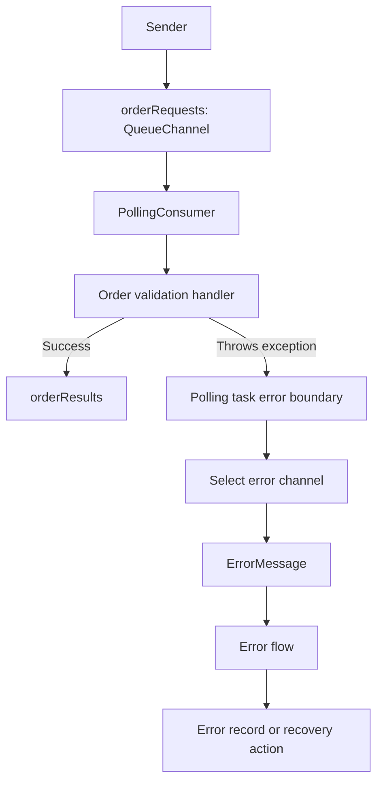

# Endpoint Error Channel

In the **SPRING_INTEGRATION_CORE** module, endpoints connect processing components to `MessageChannel`s. When designing flows with transformers, routers, filters, aggregators, or service activators, you must define both the success path of messages and where errors are received. This lesson focuses on the **error channel at an endpoint's execution boundary**, especially endpoints receiving messages via a poller.

The examples use Java 17 or higher and the Spring Integration 6.5 API as the baseline. This is a choice for the study examples; when applying to a production application, use the compatible Spring version set managed by your project.

## 1. Objectives and Prerequisites

After this lesson, you will be able to:

- Distinguish exceptions propagated to the caller from errors packaged into an `ErrorMessage`.
- Choose the right place to configure an error channel: poller, supported producer/gateway, or message header.
- Explain the error-channel selection order of `MessagePublishingErrorHandler`.
- Write an error flow that captures the failed message's context accurately.
- Test local error paths, header overrides, and synchronous execution paths.

You should already know the structure of `Message<T>`, headers, `DirectChannel`, `QueueChannel`, service activators, and how to declare an `IntegrationFlow`.

## 2. Understanding "Endpoint Error Channel" Properly

An error channel is a `MessageChannel` that receives messages describing errors. This name reflects its role in the flow; it is not a distinct channel class.

Distinguish three components:

| Component | Role |
|---|---|
| Handler | Executes processing logic, such as transforming data or calling a service |
| Endpoint | Connects the handler to an input channel; may manage polling |
| Error handler/publisher | Catches errors at a supported boundary, builds an `ErrorMessage`, and sends it to an error channel |

When the input is a `PollableChannel`, the framework uses a `PollingConsumer`. When the input is a `SubscribableChannel`, the framework uses an `EventDrivenConsumer`. Therefore, the same handler can be invoked under different execution models. [Message Endpoints Documentation](https://docs.spring.io/spring-integration/reference/6.5/endpoint.html).

The phrase "configuring an error channel for an endpoint" must be understood by endpoint type:

| Case | Appropriate configuration |
|---|---|
| Service activator reading a `QueueChannel` | Configure the error channel on the endpoint's poller |
| Handler invoked via `DirectChannel` on the sender's thread | Exception propagates up the call stack; caller, gateway, or advice must handle it |
| Inbound producer or gateway | Use the error-handling support exposed by that component |
| Wanting to specify an error destination per message | Use the `MessageHeaders.ERROR_CHANNEL` header, if the catching boundary supports resolving it |

Do not assume every endpoint has a `setErrorChannel(...)` setter, or that every consumer in Java DSL has `e.errorChannel(...)`. In the polling example of this lesson, the configuration sits inside `e.poller(...errorChannel(...))`.

## 3. Thread Boundaries Determine How Errors Are Observed

### 3.1. Synchronous Call Through DirectChannel

Consider this flow:

```text
HTTP thread -> DirectChannel -> transformer -> service activator
```

If all steps run on the HTTP thread and the handler throws an exception, the exception travels back to the caller along the call stack. Merely adding an `errorChannel` header does not cause `DirectChannel` to catch and publish errors on its own.

### 3.2. Sending to QueueChannel Then Processing via Poller

Consider this flow:

```text
HTTP thread -> QueueChannel -> send returns result
                               |
scheduler thread --------------+-> poller -> handler
```

The sender may have already finished the `send` operation by the time the handler starts running. An error in the handler later cannot be thrown back into the sender's already-finished call stack.

Spring Integration supports publishing `ErrorMessage` across asynchronous execution boundaries and framework-managed poller tasks. A successful send into a queue only confirms placing the message onto the channel; it does not confirm business processing completed. [Error Handling Documentation](https://docs.spring.io/spring-integration/reference/error-handling.html).



A `DirectChannel` inside the error flow can still be appropriate: it lets the error consumer run directly on the thread publishing the error. Asynchrony relative to the original sender comes from the queue/poller; not every channel in the error branch needs to be asynchronous.

## 4. Distinguishing Three Places to Declare an Error Destination

### 4.1. The errorChannel Header

The `MessageHeaders.ERROR_CHANNEL` header sits on the request message. With `MessagePublishingErrorHandler`, supported values are a `MessageChannel` or a `String` channel name resolvable in the application context.

Example specifying a dedicated error queue for a single request:

```java
QueueChannel requestErrors = new QueueChannel(10);

Message<OrderCommand> request = MessageBuilder
        .withPayload(new OrderCommand("ORD-101", 0))
        .setHeader(MessageHeaders.ERROR_CHANNEL, requestErrors)
        .build();

boolean accepted = orderRequests.send(request, 1_000);
```

Here, `requestErrors` is a channel object inside the same JVM. If the message must cross a broker or be serialized, do not assume this object reference can be carried across to another process.

### 4.2. The Poller's Default Error Channel

Java DSL allows declaring a bean name or channel object via `PollerSpec.errorChannel(...)`. This is the default destination of the error-handling mechanism attached to the poller, not a rule catching every exception in the application. [PollerSpec 6.5.0 API](https://docs.spring.io/spring-integration/docs/6.5.0/api/org/springframework/integration/dsl/PollerSpec.html).

```java
e -> e.poller(
        Pollers.fixedDelay(Duration.ofMillis(100))
                .maxMessagesPerPoll(1)
                .errorChannel("orderEndpointErrors"))
```

A dedicated channel lets the team owning the order flow receive errors in the right context. Other pollers can still use their own error policies.

### 4.3. The Global errorChannel

The framework creates a channel with bean name `errorChannel` as the shared error destination. The default configuration uses a `PublishSubscribeChannel` with a subscriber logging at `ERROR` level. Since Spring Integration 5.4.3, the default channel requires subscribers when sending errors. If you redefine the bean yourself, deliberately design your subscribers and acceptance policy. [Default Error Channel Documentation](https://docs.spring.io/spring-integration/reference/error-handling.html).

The global channel is a shared receiving point for errors passing through compatible error-publishing mechanisms. It is not equivalent to a `try/catch` wrapping every thread or every library.

## 5. Error Channel Selection Order

With `MessagePublishingErrorHandler` used in this lesson's polling model, the effective order can be expressed as:

```text
If failedMessage exists and has a valid errorChannel header:
    use the channel from the header
If there is no destination from the header:
    use the default error channel configured on the poller's error handler
If no custom default is configured:
    use the global errorChannel bean
```

The key takeaway is that **the destination in the failed message's header can take precedence over the poller's default channel**. This rule is implemented in the channel-resolution logic of [MessagePublishingErrorHandler in Spring Integration 6.5.0](https://github.com/spring-projects/spring-integration/blob/v6.5.0/spring-integration-core/src/main/java/org/springframework/integration/channel/MessagePublishingErrorHandler.java).

Examples:

| Header on failed message | Poller default | Selected destination |
|---|---|---|
| None | `orderEndpointErrors` | `orderEndpointErrors` |
| Valid name `customerRequestErrors` | `orderEndpointErrors` | `customerRequestErrors` |
| `QueueChannel` instance | `orderEndpointErrors` | Queue instance in header |
| None | No custom setting | Global `errorChannel` |

Some important limitations:

- If polling fails before a message exists, such as an error reading a source, there may be no `failedMessage` from which to read headers.
- A header with an invalid type or a non-existent channel name is a configuration error; do not expect the mechanism to silently fall back to the global channel.
- A component with its own error publisher may follow different rules. Do not apply the table above mechanically to every inbound adapter, gateway, or recovery callback.

In a system with per-flow authorization contracts, the development team must decide whether senders are allowed to specify an error destination. If not, reset or strip the header at the appropriate ingress point.

## 6. Reading ErrorMessage While Preserving Context

`ErrorMessage` has a `Throwable` payload. The payload is typically a `MessagingException`, with `failedMessage` describing the message at the time of failure. The `originalMessage` property of `ErrorMessage` is optional and may differ from the failed message after transformations. [ErrorMessage API](https://docs.spring.io/spring-framework/docs/6.2.x/javadoc-api/org/springframework/messaging/support/ErrorMessage.html).

Example:

```text
Message<String> containing JSON
    -> transformer produces Message<OrderCommand>
    -> service activator validates quantity and fails
```

In this situation, the failed message may contain `OrderCommand`. Do not assume `getOriginalMessage()` always contains the input JSON string, or is always non-`null`.

A defensive way to read context:

```java
static Message<?> findFailedMessage(ErrorMessage error) {
    Throwable current = error.getPayload();

    while (current != null) {
        if (current instanceof MessagingException messagingException
                && messagingException.getFailedMessage() != null) {
            return messagingException.getFailedMessage();
        }

        Throwable next = current.getCause();
        if (next == current) {
            break;
        }
        current = next;
    }

    return error.getOriginalMessage();
}
```

This method prioritizes the message at the point of failure, then falls back to the original message if available. It suits the example's typical cause chain.

To classify business causes, inspect the causes inside the wrapper. For tracing, retain both the original exception and the failed message. Logging only `getMessage()` often loses the exception type and stack trace; conversely, logging the entire payload can inadvertently leak customer data.

## 7. Complete Example: Dedicated Error Channel for a Polling Endpoint

### 7.1. Scenario

A flow receives `OrderCommand` into a queue:

- A positive quantity produces `ACCEPTED:<orderId>`.
- An invalid quantity throws `IllegalArgumentException`.
- By default, the poller routes errors to `orderEndpointErrors`.
- The error flow distills context into a `FailureRecord` and puts it into the `errorAudit` observation queue.

`errorAudit` serves in-memory illustration and testing. It is not durable error storage or a broker dead-letter queue.

The example requires `spring-integration-core` along with compatible Spring dependencies. Java DSL is already inside core; no separate DSL module is needed.

### 7.2. Java DSL Configuration

The full snippet below belongs in an `OrderErrorChannelConfig.java` file in your practice app:

```java
package example.integration;

import java.time.Duration;

import org.springframework.context.annotation.Bean;
import org.springframework.context.annotation.Configuration;
import org.springframework.integration.channel.DirectChannel;
import org.springframework.integration.channel.QueueChannel;
import org.springframework.integration.config.EnableIntegration;
import org.springframework.integration.dsl.IntegrationFlow;
import org.springframework.integration.dsl.Pollers;
import org.springframework.messaging.Message;
import org.springframework.messaging.MessageHandler;
import org.springframework.messaging.MessagingException;
import org.springframework.messaging.support.ErrorMessage;
import org.springframework.messaging.support.MessageBuilder;

@Configuration
@EnableIntegration
public class OrderErrorChannelConfig {

    public record OrderCommand(String orderId, int quantity) {
    }

    public record FailureRecord(
            String flow,
            String orderId,
            String traceId,
            String exceptionType) {
    }

    @Bean
    public QueueChannel orderRequests() {
        return new QueueChannel(100);
    }

    @Bean
    public QueueChannel orderResults() {
        return new QueueChannel(100);
    }

    @Bean
    public DirectChannel orderEndpointErrors() {
        return new DirectChannel();
    }

    @Bean
    public QueueChannel errorAudit() {
        return new QueueChannel(100);
    }

    @Bean
    public IntegrationFlow orderFlow() {
        return IntegrationFlow.from("orderRequests")
                .handle(OrderCommand.class, (order, headers) -> {
                    if (order.quantity() <= 0) {
                        throw new IllegalArgumentException(
                                "quantity must be greater than zero");
                    }
                    return "ACCEPTED:" + order.orderId();
                }, endpoint -> endpoint
                        .id("validateOrderEndpoint")
                        .poller(Pollers.fixedDelay(
                                        Duration.ofMillis(100))
                                .receiveTimeout(0)
                                .maxMessagesPerPoll(1)
                                .errorChannel("orderEndpointErrors")))
                .channel("orderResults")
                .get();
    }

    @Bean
    public IntegrationFlow orderErrorFlow() {
        MessageHandler errorConsumer = message -> {
            if (!(message instanceof ErrorMessage error)) {
                throw new IllegalArgumentException(
                        "Expected ErrorMessage");
            }

            Message<?> failed = findFailedMessage(error);
            Throwable cause = rootCause(error.getPayload());

            String orderId = "unknown";
            if (failed != null
                    && failed.getPayload() instanceof OrderCommand order) {
                orderId = order.orderId();
            }

            Object traceValue = failed == null
                    ? null
                    : failed.getHeaders().get("traceId");

            FailureRecord record = new FailureRecord(
                    "orderFlow",
                    orderId,
                    traceValue == null ? "unknown" : traceValue.toString(),
                    cause.getClass().getSimpleName());

            boolean recorded = errorAudit().send(
                    MessageBuilder.withPayload(record).build(),
                    1_000);

            if (!recorded) {
                throw new IllegalStateException(
                        "errorAudit queue is full");
            }
        };

        return IntegrationFlow.from("orderEndpointErrors")
                .handle(errorConsumer)
                .get();
    }

    static Message<?> findFailedMessage(ErrorMessage error) {
        Throwable current = error.getPayload();

        while (current != null) {
            if (current instanceof MessagingException messagingException
                    && messagingException.getFailedMessage() != null) {
                return messagingException.getFailedMessage();
            }

            Throwable next = current.getCause();
            if (next == current) {
                break;
            }
            current = next;
        }

        return error.getOriginalMessage();
    }

    static Throwable rootCause(Throwable failure) {
        Throwable current = failure;

        while (current.getCause() != null
                && current.getCause() != current) {
            current = current.getCause();
        }

        return current;
    }
}
```

`@EnableIntegration` enables Spring Integration infrastructure in the example's plain Spring configuration. Because the class uses default `@Configuration`, calling `errorAudit()` inside the class is intercepted by Spring and returns the corresponding queue bean. If switching to non-proxied bean methods, use dependency injection instead of keeping this call style.

`receiveTimeout(0)` prevents the poller from waiting when the queue is empty. `maxMessagesPerPoll(1)` limits polling to one message per cycle in the exercise. Both settings make the example easy to observe; production throughput tuning should be based on actual load.

`MessageHandler` is intentionally used so it receives the complete `ErrorMessage` envelope. With payload-typed lambdas, the parameter received is typically `Throwable`; do not confuse it with the whole message.

### 7.3. Sending a Message and Observing

In a context initialized with the configuration above:

```java
Message<OrderErrorChannelConfig.OrderCommand> request = MessageBuilder
        .withPayload(new OrderErrorChannelConfig.OrderCommand(
                "ORD-201", 0))
        .setHeader("traceId", "trace-201")
        .build();

if (!orderRequests.send(request, 1_000)) {
    throw new IllegalStateException("orderRequests queue is full");
}

Message<?> auditMessage = errorAudit.receive(3_000);

if (auditMessage == null) {
    throw new IllegalStateException("No failure record received");
}

OrderErrorChannelConfig.FailureRecord failure =
        (OrderErrorChannelConfig.FailureRecord) auditMessage.getPayload();
```

Expected output:

```text
flow          = orderFlow
orderId       = ORD-201
traceId       = trace-201
exceptionType = IllegalArgumentException
```

The sender does not receive `IllegalArgumentException` from `send` in this processing path. The exception occurs after the poller retrieves the message. The sender can still encounter errors from the send operation itself, such as the channel rejecting the message; distinguish those from business errors occurring later.

## 8. Configuring with Annotations or XML

The approaches below are **alternatives** to the `orderFlow` consumer; do not register them at the same time as the Java DSL consumer above. If multiple consumers read from `orderRequests` concurrently, each message may be picked up by a different consumer, altering the intended behavior.

### 8.1. Annotation

Inside a Spring-registered bean:

```java
import org.springframework.integration.annotation.Poller;
import org.springframework.integration.annotation.ServiceActivator;

@ServiceActivator(
        inputChannel = "orderRequests",
        outputChannel = "orderResults",
        poller = @Poller(
                fixedDelay = "100",
                receiveTimeout = "0",
                maxMessagesPerPoll = "1",
                errorChannel = "orderEndpointErrors"))
public String validateOrder(
        OrderErrorChannelConfig.OrderCommand order) {
    if (order.quantity() <= 0) {
        throw new IllegalArgumentException(
                "quantity must be greater than zero");
    }
    return "ACCEPTED:" + order.orderId();
}
```

The `@Poller.errorChannel` attribute specifies the bean name of the default error channel for the underlying `MessagePublishingErrorHandler`. If you use `@Poller("namedPoller")` to reference a `PollerMetadata`, other attributes cannot be declared simultaneously on that annotation. [@Poller 6.5.0 API](https://docs.spring.io/spring-integration/docs/6.5.0/api/org/springframework/integration/annotation/Poller.html).

### 8.2. XML

The snippet below illustrates the placement of `error-channel`. Channel beans and `orderService` are declared separately in the application context:

```xml
<int:service-activator
        id="validateOrderEndpoint"
        input-channel="orderRequests"
        output-channel="orderResults"
        ref="orderService"
        method="validateOrder">

    <int:poller
            fixed-delay="100"
            receive-timeout="0"
            max-messages-per-poll="1"
            error-channel="orderEndpointErrors"/>
</int:service-activator>
```

Here, `error-channel` sits on `<int:poller>`. The example is just an XML fragment; it requires the corresponding `int` namespace in a full configuration file.

## 9. How Far Does a Poller's Error Channel Reach?

Suppose the flow is wired like this:

```text
QueueChannel A
    -> poller P
    -> transformer
    -> DirectChannel B
    -> service activator
```

If steps after the poller still run synchronously on the same polling task, an exception from the service activator can propagate back to P's error-catching boundary. Thus, a poller's error channel does not necessarily receive errors only from the single handler method immediately adjacent to it.

If you replace B with a queue read by another poller Q:

```text
QueueChannel A -> poller P -> QueueChannel B -> poller Q -> handler
```

Once the message is placed into B, errors arising when Q processes it belong to Q's execution boundary. P's default configuration does not automatically become Q's default policy. An error header on the message, if preserved, can still influence the destination Q chooses.

Similarly, handing off to an executor or a callback outside the framework creates a boundary that must be evaluated separately. Do not assume every `CompletableFuture`, manually spawned thread, or reactive publisher is tracked to completion by the initial poller.

With a `PublishSubscribeChannel` that has an executor, the framework supports an error handler; without an executor, the channel's error handler is bypassed and exceptions are thrown back to the caller thread. [PublishSubscribeChannel Configuration](https://docs.spring.io/spring-integration/reference/6.5/channel/configuration.html).

## 10. Relationship to Gateways, Retries, and Transactions

### 10.1. Gateways Have Their Own Error Mechanism

A messaging gateway can be configured with an `errorChannel` to convert exceptions into messages and handle them per the gateway's contract, even when downstream runs synchronously. This is an explicit error-catching mechanism, not an automatic effect of `DirectChannel`.

If the gateway requires a reply, the error flow must produce a result matching the call contract or explicitly throw an error. A branch that only logs and terminates can prevent the caller from receiving an expected reply. [Messaging Gateway Error Handling](https://docs.spring.io/spring-integration/reference/6.5/gateway.html#error-handling).

Therefore, do not reuse the example's audit-only error flow directly as the reply policy of a request-reply gateway.

### 10.2. Error Channels Do Not Automatically Retry

An error channel only provides an error delivery path. It does not re-invoke the handler, increment counters, or apply backoff.

In a design with retry advice:

```text
handler fails
    -> retry per policy
    -> if still failing and exception escapes
    -> outer error-handling boundary receives it
```

With Spring Integration 6.5, `RequestHandlerRetryAdvice` supports retries and a recovery callback. The recovery callback can handle the final error, so the poller will not always still receive an exception to publish onward. [Provided Advice Classes: Retry Advice](https://docs.spring.io/spring-integration/reference/6.5/handler-advice/classes.html).

If you build message replay directly from an error flow, cap attempt counts, classify retryable errors, and use idempotency keys. Infinitely sending failed messages back into the input channel easily creates a loop.

### 10.3. Publishing an Error Does Not Mean Rollback or Redelivery

Transactions, acknowledgments, and redelivery depend on the message source, transaction manager, advice, and where errors are caught. You cannot conclude "it entered the error channel, so the message definitely rolled back."

In the example, `QueueChannel` defaults to in-memory storage. A message already removed by the poller is not automatically placed back onto the queue when the handler throws. Records in `errorAudit` are also lost when the process stops unless durable storage exists.

When integrating with external sources, check the policies of the specific adapter and transaction in use rather than inferring from error channel names.

## 11. Testing Endpoint Behavior

The tests below illustrate a practice application using the configuration from section 7. They require JUnit Jupiter, Spring Test, and the core dependency noted earlier. This is code for learners to run; the lesson does not claim these tests were executed inside this repository.

### 11.1. Cases to Prove

| Input or configuration | What to observe |
|---|---|
| Order with quantity 0, no error header | A `FailureRecord` appears in `errorAudit` |
| Failing order with header pointing to a dedicated queue | Dedicated queue receives `ErrorMessage`; default branch writes no audit for that request |
| Valid order | Success result produced and no error record written |
| Handler running directly on sender thread | Caller catches the exception; error header alone does not publish `ErrorMessage` |

### 11.2. Testing the Polling Flow and Header Precedence

Place the test class in package `example.integration` to access package-private helpers:

```java
package example.integration;

import static org.junit.jupiter.api.Assertions.assertEquals;
import static org.junit.jupiter.api.Assertions.assertNotNull;
import static org.junit.jupiter.api.Assertions.assertNull;
import static org.junit.jupiter.api.Assertions.assertTrue;

import org.junit.jupiter.api.Test;
import org.springframework.beans.factory.annotation.Autowired;
import org.springframework.beans.factory.annotation.Qualifier;
import org.springframework.integration.channel.QueueChannel;
import org.springframework.messaging.Message;
import org.springframework.messaging.MessageHeaders;
import org.springframework.messaging.support.ErrorMessage;
import org.springframework.messaging.support.MessageBuilder;
import org.springframework.test.annotation.DirtiesContext;
import org.springframework.test.context.junit.jupiter.SpringJUnitConfig;

@SpringJUnitConfig(OrderErrorChannelConfig.class)
@DirtiesContext(classMode = DirtiesContext.ClassMode.AFTER_EACH_TEST_METHOD)
class OrderErrorChannelTest {

    @Autowired
    @Qualifier("orderRequests")
    QueueChannel requests;

    @Autowired
    @Qualifier("orderResults")
    QueueChannel results;

    @Autowired
    @Qualifier("errorAudit")
    QueueChannel audit;

    @Test
    void pollingFailureGoesToEndpointErrorFlow() {
        assertTrue(requests.send(MessageBuilder
                .withPayload(new OrderErrorChannelConfig.OrderCommand(
                        "ORD-301", 0))
                .setHeader("traceId", "trace-301")
                .build(), 1_000));

        Message<?> received = audit.receive(3_000);
        assertNotNull(received);
        assertTrue(received.getPayload()
                instanceof OrderErrorChannelConfig.FailureRecord);

        var failure = (OrderErrorChannelConfig.FailureRecord)
                received.getPayload();

        assertEquals("ORD-301", failure.orderId());
        assertEquals("trace-301", failure.traceId());
        assertEquals("IllegalArgumentException",
                failure.exceptionType());
        assertNull(results.receive(0));
    }

    @Test
    void messageHeaderOverridesPollerDefault() {
        QueueChannel privateErrors = new QueueChannel(1);

        assertTrue(requests.send(MessageBuilder
                .withPayload(new OrderErrorChannelConfig.OrderCommand(
                        "ORD-302", 0))
                .setHeader(MessageHeaders.ERROR_CHANNEL, privateErrors)
                .build(), 1_000));

        Message<?> received = privateErrors.receive(3_000);
        assertNotNull(received);
        assertTrue(received instanceof ErrorMessage);

        ErrorMessage error = (ErrorMessage) received;
        Message<?> failed =
                OrderErrorChannelConfig.findFailedMessage(error);
        assertNotNull(failed);

        var command = (OrderErrorChannelConfig.OrderCommand)
                failed.getPayload();

        assertEquals("ORD-302", command.orderId());
        assertTrue(OrderErrorChannelConfig.rootCause(error.getPayload())
                instanceof IllegalArgumentException);
        assertNull(audit.receive(200));
    }

    @Test
    void validOrderUsesSuccessChannel() {
        assertTrue(requests.send(MessageBuilder
                .withPayload(new OrderErrorChannelConfig.OrderCommand(
                        "ORD-303", 2))
                .build(), 1_000));

        Message<?> received = results.receive(3_000);
        assertNotNull(received);
        assertEquals("ACCEPTED:ORD-303", received.getPayload());
        assertNull(audit.receive(200));
    }
}
```

Calls to `receive(timeout)` wait for a meaningful signal instead of sleeping a fixed duration and guessing the poller finished. Finite timeouts also prevent tests from hanging indefinitely. The context is recreated between tests to isolate queue state.

The two checks verifying no audit record occurred use a short observation window in the example. In real systems with multiple executors, add synchronization points or completion checks instead of relying purely on wait time to prove no message arrives late.

### 11.3. Testing That DirectChannel Does Not Automatically Use the Error Header

This is a standalone test requiring no application context:

```java
package example.integration;

import static org.junit.jupiter.api.Assertions.assertNull;
import static org.junit.jupiter.api.Assertions.assertThrows;

import org.junit.jupiter.api.Test;
import org.springframework.integration.channel.DirectChannel;
import org.springframework.integration.channel.QueueChannel;
import org.springframework.messaging.Message;
import org.springframework.messaging.MessageHandlingException;
import org.springframework.messaging.MessageHeaders;
import org.springframework.messaging.support.MessageBuilder;

class DirectChannelErrorTest {

    @Test
    void exceptionReturnsToSenderOnSameThread() {
        DirectChannel direct = new DirectChannel();
        QueueChannel errors = new QueueChannel(1);

        direct.subscribe(message -> {
            throw new MessageHandlingException(
                    message, new IllegalArgumentException("invalid order"));
        });

        Message<String> request = MessageBuilder
                .withPayload("ORD-304")
                .setHeader(MessageHeaders.ERROR_CHANNEL, errors)
                .build();

        assertThrows(MessageHandlingException.class,
                () -> direct.send(request));
        assertNull(errors.receive(0));
    }
}
```

This test proves the role of the error-catching boundary: having an error destination header is not enough; an actual error-handling mechanism must read the header and publish an `ErrorMessage`.

## 12. Designing Error Flows for Operations

### 12.1. Choosing Channel Types Based on Error-Receiving Needs

| Channel type | Meaning when used for an error branch |
|---|---|
| `DirectChannel` | Handled immediately on the error-publishing thread; suits short, clear handling |
| `QueueChannel` | Decouples receiving errors from processing them; needs a consumer/poller to drain the queue |
| `PublishSubscribeChannel` | Broadcasts errors to multiple subscribers, such as audit and alerting |

An error queue without a consumer will accumulate messages. A bounded queue also needs a full-queue policy. In-memory publish-subscribe does not provide durable persistence either.

### 12.2. Naming by Scope of Responsibility

Names like `orderEndpointErrors`, `paymentIngressErrors`, or `invoiceProcessingErrors` clarify which flow owns handling. Split channels by business and operational needs; there is no need to create a separate channel for every single method.

If you want local errors to also reach a central observation point, design an explicit forwarding or publish-subscribe branch. Choosing a local channel does not automatically send an extra copy to the global `errorChannel`.

### 12.3. Retaining Enough Data to Investigate

A useful error record typically includes:

- Flow or endpoint identifier.
- Business identifier, such as `orderId`.
- Correlation ID or trace ID.
- Exception type, failure timestamp, and handling status.
- Reference to the original data stored in an appropriate location.

In the example, `FailureRecord` contains only a minimal set of fields. This simplification keeps the exercise focused on the error path; real systems should add persistence and diagnostic fields as required.

### 12.4. Handling Failures in the Error Branch Itself

An error consumer can fail when writing to a database, pushing to a queue, or calling an alerting service. Have a last-resort fallback such as controlled logging, an independent error store, or operational alerting.

Do not design a loop that "always sends back to the same error channel whenever the error handler fails." Nor should you assume the error publisher will automatically keep retrying until delivery succeeds. With the `MessagePublishingErrorHandler` implementation at 6.5.0, failures when sending an error message may be logged; this mechanism is not a durable error-persistence guarantee.

## 13. Common Configuration Mistakes

| Symptom | Cause to check | How to fix |
|---|---|---|
| Handler throws an error yet error channel receives nothing | Flow runs synchronously through `DirectChannel` | Catch exception at caller or configure an appropriate gateway/advice |
| Error does not reach the poller's dedicated channel | Failed message carries a different `errorChannel` header | Check headers at the failure point and ingress policy |
| Error queue keeps growing | No consumer or consumer is too slow | Add consumers, bound queue capacity, and monitor throughput |
| Error consumer cannot extract business payload | Reading `Throwable` payload as `OrderCommand` | Find `failedMessage` inside `MessagingException` |
| `traceId` missing from error record | Read header from `ErrorMessage` by mistake or dropped header during transformation | Read from failed message and deliberately preserve correlation |
| Same error yields varying outcomes | Multiple competing consumers on a point-to-point channel | Designate one primary consumer or use appropriate fan-out |
| Error appears after a queue step and earlier poller config has no effect | Execution crossed into another polling boundary | Configure the new boundary and verify propagated headers |
| Audit succeeds yet source data is not replayed | Conflating error publishing with redelivery | Design retry, acknowledgment, and recovery separately |
| Error branch without reply stalls gateway | Using an audit-only error flow for a request-reply contract | Return a valid error response or propagate exception per contract |

## 14. Applying to Core Integration Patterns

With transformers, errors can arise when data is malformed. With routers, errors can lie in destination-selection logic or channel configuration. With filters, a message dropped by condition is not necessarily an exception: distinguish valid discards from processing failures.

With aggregators, release or timeout actions can occur at a different time and execution boundary than incoming messages. Therefore, do not assume an error channel on an upstream poller covers every lifecycle error of a message group.

When composing these patterns in Java DSL, mark every thread-handoff or buffering point and identify what catches errors at each point. Doing so lets you place error channels according to flow ownership and write tests aligned closely with the behavior you need to guarantee.

A well-designed endpoint can answer: where are exceptions caught, which channel receives the error message, what failure context remains, and which component is responsible for recovery after receiving the error.
