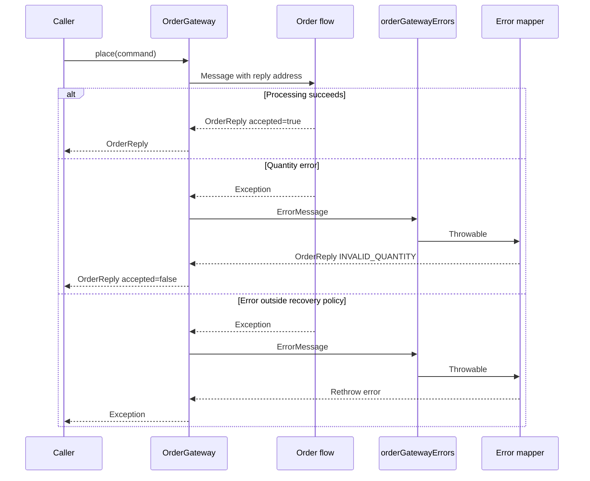

# Gateway Error Channel

## Objectives and Scope

In the **Error handling** chapter of `SPRING_INTEGRATION_CORE`, this lesson focuses on the boundary between a Java call through a gateway and the message flow. When the flow fails, should the caller receive an exception, a valid rejection reply, or merely an acknowledgment that the request was accepted? That decision determines how the error channel is designed.

After this lesson, you will be able to:

- Configure a dedicated error channel for a gateway using Java DSL or annotations.
- Convert business errors into replies matching the type declared by the gateway.
- Distinguish the gateway's `errorChannel` attribute, the header of the same name, and the global error channel.
- Read `ErrorMessage`, walk causes, and extract request details when present.
- Identify design pitfalls related to asynchronous execution, missing replies, and timeouts.

The examples use Java 17 and Spring Integration 6.5.x APIs; Spring dependencies should be managed consistently via your application's BOM. You need to understand `Message`, `MessageChannel`, service activators, and the basic structure of `IntegrationFlow`. No HTTP, JMS, or broker is needed to follow the examples.

## 1. Where Does the Gateway Place the Error-Handling Contract?

Suppose the application exposes this method:

```java
OrderReply place(OrderCommand command);
```

The application's contract in this lesson has three outcomes:

| Situation | Desired outcome at the caller | Meaning |
| --- | --- | --- |
| Valid quantity | `OrderReply` with `accepted=true` | Request accepted |
| Invalid quantity | `OrderReply` with code `INVALID_QUANTITY` | Intentional business rejection |
| Processing component encounters an unexpected outage | Exception | Cannot conclude the request succeeded |

By default, a gateway propagates downstream errors back to the caller; configuring an error channel lets you run an error-handling flow and use its result as the reply. A transformer can convert an exception into a DTO satisfying the gateway method's contract. This is an in-process messaging gateway mechanism and does not dictate HTTP status codes or external protocol response formats on its own. See [Messaging Gateways — Error Handling](https://docs.spring.io/spring-integration/reference/6.5/gateway.html#error-handling).

In the order-placement example, the error flow converts only the quantity error into a rejection result. Converting every exception into `accepted=false` would erase the distinction between bad input data and operational outages. That policy must be decided by business requirements rather than inferred from having an error channel.

## 2. Three Concepts Sharing the Name errorChannel

| Concept | Where it appears | Responsibility |
| --- | --- | --- |
| Gateway `errorChannel` attribute | `@MessagingGateway(errorChannel = "orderGatewayErrors")` or DSL | Routes errors at the gateway boundary |
| `MessageHeaders.ERROR_CHANNEL` header | On the request message | Supplies an error destination to the error-publishing mechanism handling the message |
| Bean named `errorChannel` | In the application context | Global error destination used when the error-publishing mechanism has no dedicated address |
| `MessageHeaders.REPLY_CHANNEL` header | On messages of a request–reply interaction | Supplies the reply destination |

When the standard asynchronous error-handling mechanism publishes an `ErrorMessage`, it prefers the request's `errorChannel` header; if absent, it uses the global `errorChannel` bean. The default global channel is a `PublishSubscribeChannel` with a subscriber logging at ERROR level. This rule does not mean every exception on a `DirectChannel` is automatically sent to the global channel. See [Error Handling](https://docs.spring.io/spring-integration/reference/error-handling.html).

Therefore, seeing an `errorChannel` bean in the context does not prove a gateway has a recovery policy. For the order-placement problem, we explicitly declare `orderGatewayErrors` and attach it to the gateway.

## 3. Success Flow and Error Flow



The diagram depicts the synchronous example below. A gateway typically uses a temporary reply channel per exchange, placed in the `replyChannel` header; you do not need to create a shared queue yourself to correlate replies back to individual calls. See [Messaging Gateways — Setting the Default Reply Channel](https://docs.spring.io/spring-integration/reference/gateway.html#gateway-default-reply-channel).

In this design, one request has one decisive outcome. Observation and logging components can receive copies of the event; they should not simultaneously emit competing business replies.

## 4. What Does ErrorMessage Contain?

`ErrorMessage` is a `Message<Throwable>`. The payload is typically a `MessagingException`, where `failedMessage` is the message at the point of failure. The `originalMessage` property of `ErrorMessage` is optional and may hold the message at the error-message creation point. These two messages may differ if the flow transformed the payload. See the [ErrorMessage API](https://docs.spring.io/spring-framework/docs/current/javadoc-api/org/springframework/messaging/support/ErrorMessage.html).

Example of data shape, not a mandatory structure for every error:

```text
ErrorMessage
├── payload: MessageHandlingException
│   ├── failedMessage: Message<OrderCommand>
│   └── cause: OrderRejectedException
└── originalMessage: original message if supplied
```

To read context defensively, you can use this helper inside an error handler:

```java
import org.springframework.messaging.Message;
import org.springframework.messaging.MessagingException;
import org.springframework.messaging.support.ErrorMessage;

static Message<?> findContext(ErrorMessage error) {
    for (Throwable current = error.getPayload();
         current != null;
         current = current.getCause()) {

        if (current instanceof MessagingException messaging
                && messaging.getFailedMessage() != null) {
            return messaging.getFailedMessage();
        }
    }
    return error.getOriginalMessage();
}
```

The result can be `null`. Check the payload type before casting to `OrderCommand`. If the error flow needs `requestId`, decide the data source upfront: a dedicated header, original payload, or a business exception carrying the identifier. Do not assume all request headers live directly on `ErrorMessage`.

## 5. Complete Example with Java DSL

The example below packages data types and configuration into one class for ease of reading. The classpath requires `spring-integration-core` and compatible Spring dependencies. When bringing this into a project, you can split types into separate files.

The gateway is registered directly via `IntegrationFlow.from(OrderGateway.class, ...)`. Creating a proxy from a service interface this way is described in [IntegrationFlow as a Gateway](https://docs.spring.io/spring-integration/reference/dsl/integration-flow-as-gateway.html); bean name, error channel, and timeout options are in the [GatewayProxySpec API](https://docs.spring.io/spring-integration/docs/6.5.0/api/org/springframework/integration/dsl/GatewayProxySpec.html).

```java
package demo.gateway;

import java.util.Collections;
import java.util.IdentityHashMap;
import java.util.Set;

import org.springframework.context.annotation.AnnotationConfigApplicationContext;
import org.springframework.context.annotation.Bean;
import org.springframework.context.annotation.Configuration;
import org.springframework.integration.channel.DirectChannel;
import org.springframework.integration.config.EnableIntegration;
import org.springframework.integration.dsl.IntegrationFlow;
import org.springframework.messaging.MessageChannel;
import org.springframework.messaging.MessagingException;

public class GatewayErrorDemo {

    public record OrderCommand(
            String requestId, String sku, int quantity) {
    }

    public record OrderReply(
            String requestId,
            boolean accepted,
            String code,
            String message) {
    }

    public interface OrderGateway {
        OrderReply place(OrderCommand command);
    }

    public static final class OrderRejectedException extends RuntimeException {
        private final String requestId;

        public OrderRejectedException(String requestId) {
            super("Quantity must be positive");
            this.requestId = requestId;
        }

        public String requestId() {
            return requestId;
        }
    }

    public static OrderReply process(OrderCommand command) {
        if (command.quantity() <= 0) {
            throw new OrderRejectedException(command.requestId());
        }
        if ("BROKEN".equals(command.sku())) {
            throw new IllegalStateException("Demo storage unavailable");
        }
        return new OrderReply(
                command.requestId(), true, "ACCEPTED", "Accepted");
    }

    public static OrderReply recover(Throwable failure) {
        // Walk the cause chain rather than assuming the payload is directly the business error.
        Set<Throwable> visited =
                Collections.newSetFromMap(new IdentityHashMap<>());

        for (Throwable current = failure;
             current != null && visited.add(current);
             current = current.getCause()) {

            if (current instanceof OrderRejectedException rejected) {
                return new OrderReply(
                        rejected.requestId(),
                        false,
                        "INVALID_QUANTITY",
                        "Quantity must be greater than 0");
            }
        }

        // Keep errors outside the recovery policy as exceptions.
        if (failure instanceof RuntimeException runtime) {
            throw runtime;
        }
        throw new IllegalStateException("Unrecoverable gateway failure", failure);
    }

    @Configuration
    @EnableIntegration
    public static class Config {

        @Bean
        public MessageChannel orderGatewayErrors() {
            return new DirectChannel();
        }

        @Bean
        public IntegrationFlow orderFlow() {
            return IntegrationFlow
                    .from(OrderGateway.class, gateway -> gateway
                            .beanName("orderGateway")
                            .errorChannel("orderGatewayErrors")
                            .replyTimeout(2_000))
                    .handle(OrderCommand.class,
                            (command, headers) -> process(command),
                            endpoint -> endpoint.requiresReply(true))
                    .get();
        }

        @Bean
        public IntegrationFlow orderErrorFlow() {
            return IntegrationFlow
                    .from("orderGatewayErrors")
                    .<Throwable, OrderReply>transform(GatewayErrorDemo::recover)
                    .get();
        }
    }

    public static void main(String[] args) {
        try (var context =
                new AnnotationConfigApplicationContext(Config.class)) {

            OrderGateway gateway = context.getBean(OrderGateway.class);

            System.out.println(gateway.place(
                    new OrderCommand("req-101", "BOOK", 2)));

            System.out.println(gateway.place(
                    new OrderCommand("req-102", "BOOK", 0)));

            try {
                gateway.place(new OrderCommand("req-103", "BROKEN", 1));
                throw new AssertionError("Expected a failure");
            } catch (RuntimeException failure) {
                System.out.println("Received exception: "
                        + failure.getClass().getSimpleName());
            }
        }
    }
}
```

Expected output to observe:

```text
req-101 → accepted=true, code=ACCEPTED
req-102 → accepted=false, code=INVALID_QUANTITY
req-103 → throws exception
```

Here `requestId` travels with the business exception, so the mapper does not need to cast `failedMessage`. The cause chain is still traversed because the framework may wrap the business error in a messaging exception.

`orderErrorFlow` ends with a transformer returning `OrderReply`; it does not just log and stop. The DTO matches the contract of `OrderGateway`, so the caller does not receive a `String` on the success branch and a different type on the error branch.

In DSL, `.handle(...)` is a service activator. When no output channel is configured, an endpoint producing a reply can use the `replyChannel` header; `requiresReply(true)` turns a handler returning `null` into `ReplyRequiredException`. This flag checks for the presence of a reply; it does not impose an execution timeout on the handler. See [Service Activator](https://docs.spring.io/spring-integration/reference/service-activator.html).

## 6. Variant Using @MessagingGateway

If the application prefers declaring channels explicitly by name on the interface, you can replace the example's gateway registration with an annotation:

```java
import org.springframework.integration.annotation.MessagingGateway;

@MessagingGateway(
        name = "orderGateway",
        defaultRequestChannel = "orderRequests",
        errorChannel = "orderGatewayErrors",
        defaultReplyTimeout = "2000")
public interface OrderGateway {
    OrderReply place(OrderCommand command);
}
```

The configuration for this variant requires:

```java
import org.springframework.integration.annotation.IntegrationComponentScan;

@Configuration
@EnableIntegration
@IntegrationComponentScan(basePackageClasses = OrderGateway.class)
public class OrderConfig {

    @Bean
    public MessageChannel orderRequests() {
        return new DirectChannel();
    }

    @Bean
    public MessageChannel orderGatewayErrors() {
        return new DirectChannel();
    }

    @Bean
    public IntegrationFlow orderFlow() {
        return IntegrationFlow.from("orderRequests")
                .handle(OrderCommand.class,
                        (command, headers) -> GatewayErrorDemo.process(command),
                        endpoint -> endpoint.requiresReply(true))
                .get();
    }

    @Bean
    public IntegrationFlow orderErrorFlow() {
        return IntegrationFlow.from("orderGatewayErrors")
                .<Throwable, OrderReply>transform(GatewayErrorDemo::recover)
                .get();
    }
}
```

The variant snippets reuse `OrderCommand`, `OrderReply`, and the processing method from the main example; import those types if placed outside `GatewayErrorDemo`. Use only one of the two proxy-registration approaches to avoid creating two gateway beans for the same contract.

`@IntegrationComponentScan` discovers `@MessagingGateway` interfaces; regular component scanning skips interfaces. `errorChannel` takes a channel bean name, and `defaultReplyTimeout` takes a millisecond string value. See [MessagingGateway API 6.5.0](https://docs.spring.io/spring-integration/docs/6.5.0/api/org/springframework/integration/annotation/MessagingGateway.html).

## 7. Synchronous, Asynchronous, and void Gateways

### 7.1. DirectChannel Still Processes on the Caller's Thread

`DirectChannel` delivers messages to a subscriber directly on the sending thread. `ExecutorChannel` hands work off to an executor; it typically moves processing to another thread depending on executor configuration. `QueueChannel` buffers messages for consumers to receive later. These three mechanisms create distinct execution boundaries. See [Message Channel Implementations](https://docs.spring.io/spring-integration/reference/channel/implementations.html).

In the main example, the gateway receives the exception along the call stack and applies its own error flow. Setting an `errorChannel` header when sending directly to a `DirectChannel` does not replicate gateway behavior; an error-catching and publishing mechanism must still exist at the right component.

### 7.2. A Value-Returning Gateway Can Wait for a Flow Running on Another Thread

Distinguish two questions:

1. Which thread does the downstream handler run on?
2. Is the gateway caller waiting for a result?

A method returning `OrderReply` can still block the calling thread while the handler runs via an executor. If you later adapt the example to do this, check the return paths for both replies and errors, and preserve headers needed for internal exchange.

Sending a message to a broker or handing off to a manually spawned task does not automatically preserve the full in-process request–reply contract. When adding such a boundary, specify upfront how `requestId`, wait timeouts, and reply addresses are stored.

### 7.3. void Is a One-Way Contract

Example of an event-ingestion gateway:

```java
@MessagingGateway(
        defaultRequestChannel = "orderEvents",
        errorChannel = "orderEventErrors")
public interface OrderEventGateway {
    void submit(OrderCommand command);
}
```

With a `void` gateway, since Spring Integration 5.0, the configured error channel is placed into the outgoing message's `errorChannel` header so standard asynchronous flows can route errors to the dedicated destination. See [Messaging Gateways — one-way error handling](https://docs.spring.io/spring-integration/reference/6.5/gateway.html#error-handling).

`void` does not spawn a new thread on its own. Suppose `orderEvents` is an `ExecutorChannel` backed by a thread pool; the call can return before business processing finishes. The error flow then serves observation, error persistence, or follow-up coordination; it cannot retroactively turn an already-returned call into an `OrderReply`.

If callers need to know the final outcome, design a replying contract or a status-lookup mechanism by `requestId`. Do not interpret `submit()` returning as proof that the order completed.

## 8. Timeouts, Missing Replies, and Easily Confused Outcomes

| Mechanism | What it controls | What must be designed additionally |
| --- | --- | --- |
| `requestTimeout` | Send wait time when the channel supports blocking sends | Policy when the request cannot enter the channel |
| `replyTimeout` | Wait time for a reply during the receive phase | Outcome for the caller when no reply arrives |
| `requiresReply(true)` | Whether a handler returning `null` is allowed | How `ReplyRequiredException` is handled |
| `errorOnTimeout` | Whether reply timeout becomes an error | Whether the error flow handles timeout errors |

With a slow handler running directly on the calling thread, `replyTimeout` does not interrupt the handler. With a flow running on another thread, the gateway can time out before the work completes; that work is not automatically canceled. See [Messaging Gateways — Gateway Behavior When No response Arrives](https://docs.spring.io/spring-integration/reference/6.5/gateway.html#gateway-no-response).

In the main example, `replyTimeout(2_000)` does not guarantee that `place()` always finishes within two seconds. Real network or storage operations need timeouts on the clients or components executing them.

The default of `@MessagingGateway.errorOnTimeout` in API 6.5.0 is `false`. You can declare `errorOnTimeout = true` so timeouts produce `MessageTimeoutException` or get published as an error message to the error channel. This setting does not automatically teach every error mapper how to recover from timeouts. See [MessagingGateway.errorOnTimeout API](https://docs.spring.io/spring-integration/docs/6.5.0/api/org/springframework/integration/annotation/MessagingGateway.html#errorOnTimeout()).

Three situations to distinguish when reading an error flow:

- **Returns a DTO:** produces a reply matching the business contract.
- **Returns a `Throwable`, or a message with a `Throwable` payload:** the gateway treats this as an error and can throw an exception to the caller; wrapping an exception in an `ErrorMessage` does not turn it into a success DTO.
- **Only logs, returns `void`, or ends without a reply:** does not supply a reply for a request–reply gateway. You must examine the specific wait path and timeout; do not assume the original exception will definitely be rethrown.

For gateways that must return a result, choose a clear termination for the error flow: return an appropriate DTO or let the error escape per policy. `nullChannel` can discard error notifications, yet it does not produce a business reply. See [Messaging Gateways](https://docs.spring.io/spring-integration/reference/gateway.html#error-handling).

## 9. Keeping the Reply Path Clear

`orderGatewayErrors` in the example is a `DirectChannel` with one decision-making flow. If multiple observers are needed, separate a logging or metrics branch from the reply-producing branch.

Conceptual example:

```text
orderGatewayErrors
        │
        ├── copy for logging / metrics
        │
        └── single mapper → OrderReply or exception
```

Do not register two competing handlers producing `OrderReply` on the same `DirectChannel` expecting both to run. Nor should you broadcast to multiple subscribers and let each subscriber send a reply for the same call. Channel choices must reflect the exact number of observers and the single place deciding the outcome.

Keep payloads as DTOs whenever possible so the framework can continue handling the reply path. If you manually construct a new `Message` or filter headers in extension steps, verify that `replyChannel`, `errorChannel`, and request identifiers still satisfy the contract. Losing the reply address typically manifests as a wait timeout even though business processing actually ran.

## 10. Error Flows, Retries, and Transactions

An error channel provides an error-handling route. If you want to retry an operation, configure retries on the appropriate component, such as using `RequestHandlerRetryAdvice`. Once retries are exhausted, the exception can continue to the gateway if not completely consumed by a recovery callback. See [Provided Advice Classes — Retry Advice, 6.5 branch](https://docs.spring.io/spring-integration/reference/6.5/handler-advice/classes.html).

For the order-placement example, a policy might be:

| Failure type | Chosen handling direction | Reason |
| --- | --- | --- |
| Quantity is 0 | Return `INVALID_QUANTITY` immediately | Retrying the same data will not make quantity valid |
| Transient connection error | Bounded retry on the connection operation | Likely to succeed on a subsequent attempt |
| Unexpected error | Keep exception and record context | No business rule exists for recovery |

If a recovery callback consumes the error and returns `null`, check the impact on a gateway waiting for a reply; do not assume the gateway's error flow will still receive the exception.

Nor does the mapper producing a rejection `OrderReply` automatically undo data mutations that already occurred. When adding transactions, decide whether the transaction wraps the handler, the gateway call, or another service. For flows crossing an executor, do not assume the caller thread's transaction travels with the message. See transaction boundaries of [ExecutorChannel](https://docs.spring.io/spring-integration/reference/channel/implementations.html#channel-implementations-executorchannel).

## 11. Testing the Behavior the Caller Actually Receives

For the main example, the three key cases are the success branch, business rejection, and errors outside the recovery policy. The illustrative snippet below uses JUnit Jupiter and creates a real Spring context; this is test code to include in a project, not previously executed output.

```java
package demo.gateway;

import org.junit.jupiter.api.Test;
import org.springframework.context.annotation.AnnotationConfigApplicationContext;

import static org.junit.jupiter.api.Assertions.*;

class GatewayErrorDemoTest {

    @Test
    void acceptsAValidOrder() {
        try (var context = new AnnotationConfigApplicationContext(
                GatewayErrorDemo.Config.class)) {
            var gateway = context.getBean(GatewayErrorDemo.OrderGateway.class);

            var reply = gateway.place(new GatewayErrorDemo.OrderCommand(
                    "req-ok", "BOOK", 2));

            assertTrue(reply.accepted());
            assertEquals("ACCEPTED", reply.code());
            assertEquals("req-ok", reply.requestId());
        }
    }

    @Test
    void mapsBusinessFailureToAReply() {
        try (var context = new AnnotationConfigApplicationContext(
                GatewayErrorDemo.Config.class)) {
            var gateway = context.getBean(GatewayErrorDemo.OrderGateway.class);

            var reply = gateway.place(new GatewayErrorDemo.OrderCommand(
                    "req-invalid", "BOOK", 0));

            assertFalse(reply.accepted());
            assertEquals("INVALID_QUANTITY", reply.code());
            assertEquals("req-invalid", reply.requestId());
        }
    }

    @Test
    void keepsUnexpectedFailureVisible() {
        try (var context = new AnnotationConfigApplicationContext(
                GatewayErrorDemo.Config.class)) {
            var gateway = context.getBean(GatewayErrorDemo.OrderGateway.class);

            RuntimeException failure = assertThrows(RuntimeException.class,
                    () -> gateway.place(new GatewayErrorDemo.OrderCommand(
                            "req-broken", "BROKEN", 1)));

            boolean foundStorageFailure = false;
            for (Throwable current = failure;
                 current != null;
                 current = current.getCause()) {
                if (current instanceof IllegalStateException
                        && "Demo storage unavailable".equals(
                                current.getMessage())) {
                    foundStorageFailure = true;
                    break;
                }
            }
            assertTrue(foundStorageFailure);
        }
    }
}
```

The last case does not hardcode the outermost wrapper class. It verifies what matters to the example's policy: the storage failure still appears in the cause chain and is not turned into a regular rejection result.

When extending to asynchronous flows, add the following scenarios:

| Scenario | What to observe |
| --- | --- |
| `void` gateway, handler throws on executor | Dedicated error flow receives error with the right `requestId` |
| Handler produces no reply | Gateway terminates per configured policy rather than hanging unexpectedly |
| Error mapper itself throws | Caller or observability system receives the failure |
| Two requests processed concurrently | Results do not mix up identifiers |
| Gateway times out while handler finishes late | Late-reply behavior and business state are clearly defined |

For asynchronous tests, use latches or bounded waiting utilities and always close the context/executor. Relying on fixed `Thread.sleep()` waits easily produces machine-speed-dependent tests.

## 12. Diagnosing Common Configuration Errors

| Symptom | Hypothesis to check | Action |
| --- | --- | --- |
| Error is logged yet gateway receives `null` | Error flow only observes and produces no reply | Check terminal endpoint and timeout policy |
| Gateway still throws an exception | Mapper intentionally rethrows or returns a `Throwable` payload | Verify against the chosen error contract |
| Gateway does not receive dedicated error | Wrong bean name, lost header, or unexpected execution boundary | Check configuration and message path |
| `replyTimeout` fails to bound slow call | Handler runs on the calling thread | Set timeouts on the actual slow operation |
| Multiple replies for one request | Multiple branches both produce replies | Designate a single branch to decide the outcome |
| No gateway bean from annotation | Interface was not scanned by the right mechanism | Check `@IntegrationComponentScan` and package scope |

For observing the example, useful fields are `requestId`, result code, cause type, and failed endpoint. Distinguish business rejection counts from technical failure counts so investigations do not conflate the two groups.

## 13. Practice Exercises

1. Run the example with `quantity=-1`, `quantity=1`, and `sku="BROKEN"`; record the outcome received by the caller.
2. Add a `UnknownSkuException` business error and map it to code `UNKNOWN_SKU`, keeping `requestId`.
3. Replace the mapper with a logging-only handler. Predict the request–reply behavior beforehand, then verify with a finite timeout.
4. Create a `void` gateway variant running through an executor. Use a latch to prove the error arrives at `orderEventErrors` after the send call returns.
5. Simulate a slow operation in a separate asynchronous configuration; describe both the timeout result and what happens when the operation completes late.

You have completed the exercise when you can explain a request's path through both the success and error branches, point out where the final reply is produced, and prove the caller receives the published contract.
