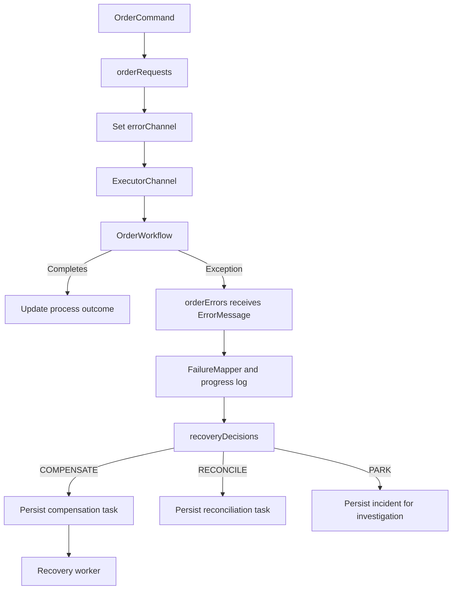

# Error Flows and Compensation

## 1. Objectives and Scope

In Spring Integration Core, an **error flow** is the message flow that receives errors, enriches context, and decides the next handling step. **Compensation** is a business action intended to offset the effects of already-completed steps when the overall process cannot proceed.

After this lesson, you will be able to:

- Identify whether an error is thrown back to the caller or converted into a message.
- Extract the failed message and process identifiers from an `ErrorMessage`.
- Separate decisions for retry, compensation, reconciliation, and routing to manual handling.
- Use channels, endpoints, and Java DSL to wire an error flow to a recovery-task store.
- Design tests for failures after business side effects have occurred, duplicate messages, and failed compensation.

The running example is an order-placement process: reserve inventory, charge payment, and then confirm shipping. The Java snippets use Java 17+ and Spring Integration 6.5 APIs; your project requires `spring-integration-core` or a corresponding starter managed by your project's dependency management. The state stores and service ports in the example are application contracts, not framework-generated features.

## 2. Three Scenarios Often Confused

Suppose order `O-014` has successfully reserved inventory and charged payment, yet the carrier rejects the shipment.

| Mechanism | What does it do? | Application in this scenario |
| --- | --- | --- |
| Retry | Re-invokes the failing operation | May retry the shipping request if the failure is transient and the call is safe to repeat |
| Transaction rollback | Aborts changes within an open transaction | May abort uncommitted local database updates |
| Compensation | Creates new business actions to offset completed effects | Refund the payment and release the reserved inventory |
| Reconciliation | Checks external state to determine the actual outcome | Query the provider when a payment charge request timed out |

An error flow can trigger these mechanisms, yet receiving an error does not automatically mean compensating. For instance, if you do not yet know whether the payment gateway captured funds, either charging again or immediately refunding can be wrong.

Compensation follows business rules: refunds can take time, incur fees, or require approval. It does not guarantee restoring all data precisely to its initial state. This is a defining characteristic of the [Compensating Transaction pattern](https://learn.microsoft.com/en-us/azure/architecture/patterns/compensating-transaction).

## 3. Where Errors Go Depends on Execution Boundaries

### 3.1. Synchronous Flow Through DirectChannel

When sending directly to a `DirectChannel`, the handler runs on the sender's thread; exceptions can propagate back along the call stack. The `errorChannel` header by itself does not turn every synchronous call into an error flow. See [Spring Integration Error Handling](https://docs.spring.io/spring-integration/reference/6.5/error-handling.html).

```java
try {
    orderRequests.send(message);
} catch (MessagingException ex) {
    // Caller is responsible per the contract of this direct call.
}
```

A `try/catch` like this only catches errors occurring before the call returns on that thread. If the flow hands work off to another thread, subsequent processing errors do not return to this catch block via the normal call stack.

### 3.2. Flow Through ExecutorChannel or a Poller

`ExecutorChannel` hands work off to an executor and does not share the sender's transaction with the handler like a synchronous chain does. See the [ExecutorChannel API](https://docs.spring.io/spring-integration/docs/6.5.0/api/org/springframework/integration/channel/ExecutorChannel.html).

When Spring Integration's error-publishing mechanism runs, receiving destinations are prioritized as follows:

1. The `MessageHeaders.ERROR_CHANNEL` header on the request being processed.
2. The default global channel with bean name `errorChannel` if that header is absent.

The global default is a `PublishSubscribeChannel` with a subscriber logging at ERROR level. It does not provide refund rules or recovery-task storage. These channel-selection rules are described in [Error Handling](https://docs.spring.io/spring-integration/reference/6.5/error-handling.html).

Framework-configured pollers and schedulers include an error-publishing mechanism; `MessagePublishingErrorHandler` is the component converting exceptions into `ErrorMessage`s sent to a channel. A custom scheduler or manually spawned thread must integrate an appropriate error handler. See the [MessagePublishingErrorHandler API](https://docs.spring.io/spring-integration/docs/6.5.0/api/org/springframework/integration/channel/MessagePublishingErrorHandler.html).

For an order-placement application, distinguish two milestones: **work accepted** and **business processing succeeded**. `send()` returning successfully after the executor accepts the task is not proof that the order completed. Task rejection due to overload must also be handled at the intake boundary.

### 3.3. Gateways Have Their Own Reply Contracts

A messaging gateway can use an `errorChannel` configured on the gateway to route errors to an error flow. For request–reply, the error flow must return a matching result or propagate an error per contract; a consumer that only logs does not produce a business reply. Returning a `Throwable` carries special meaning to a gateway. See [Messaging Gateways — Error Handling](https://docs.spring.io/spring-integration/reference/6.5/gateway.html).

If an order-intake API returns `ACCEPTED`, allow clients to query process status using a stable identifier. If the API promises the final outcome, design deadlines, error replies, and behavior while recovery is still running. A caller timeout does not by itself prove downstream business work has stopped.

## 4. Reading ErrorMessage Properly

`ErrorMessage` carries a `Throwable` payload. The payload is typically a `MessagingException`, where `failedMessage` points to the message at the point of failure. `originalMessage` is optional context at the error-creation point and may differ from a transformed message. See the [ErrorMessage API](https://docs.spring.io/spring-framework/docs/6.2.x/javadoc-api/org/springframework/messaging/support/ErrorMessage.html).

An error flow typically needs two kinds of context:

| Context | What is it used for? |
| --- | --- |
| Exception and cause chain | Technical diagnostics, classifying retryable errors |
| `processId`, `orderId`, task ID | Looking up progress and choosing business actions |
| `reservationId`, `paymentId` | Identifying specific resources to release or refund |
| Processing history and state version | Detecting duplicate messages, late errors, and races |

Do not assume headers on the error message itself copied all request headers. In the example below, we search for `failedMessage` along the cause chain, and only then fall back to `originalMessage`.

```java
import java.util.Collections;
import java.util.IdentityHashMap;
import java.util.Set;
import org.springframework.messaging.Message;
import org.springframework.messaging.MessagingException;
import org.springframework.messaging.support.ErrorMessage;

public final class FailureMessages {
    private FailureMessages() {
    }

    // Returns null when no suitable context message exists.
    public static Message<?> find(ErrorMessage error) {
        Set<Throwable> visited = Collections.newSetFromMap(
                new IdentityHashMap<Throwable, Boolean>());
        Throwable current = error.getPayload();
        while (current != null && visited.add(current)) {
            if (current instanceof MessagingException messaging
                    && messaging.getFailedMessage() != null) {
                return messaging.getFailedMessage();
            }
            current = current.getCause();
        }
        return error.getOriginalMessage();
    }
}
```

This is the example's message-selection policy, not a guarantee that the found message is always the initial request. After a transformer, the payload type may have changed. Keep process identifiers across steps, and read progress from a state store rather than inferring full history from the current payload. If you construct new messages yourself, deliberately preserve required identifiers.

When no identifier can be found, persist a diagnostic record to a manual-review branch. Do not guess `paymentId`, do not issue refunds from an exception lacking context, and do not let a cast error mask the original failure.

## 5. Making Decisions from Errors and Business Progress

In this lesson, `RECONCILE` means verifying an unclear outcome; `PARK` means saving the incident for investigation or manual handling. These are application-defined action names.

| What is known | Sensible decision |
| --- | --- |
| No external side effects yet; invalid input data | Business rejection; create no compensation |
| Transient failure; operation has an idempotency key and retry budget remains | Bounded retry |
| Inventory reserved; payment definitively declined | Create a task to release reserved inventory |
| Payment captured; shipping definitively rejected | Create a refund task and then release inventory per policy |
| Payment charge request timed out; outcome unknown | Reconcile with the payment gateway first |
| Process not found or progress data conflicts | `PARK` and emit an operational alert |
| Stale error arrives after process already finished validly | Record duplicate/late arrival per state machine; do not auto-refund |

`ErrorMessageExceptionTypeRouter` can route based on causes matching exception mappings. It helps with technical classification; compensation decisions still require business progress state. See the [ErrorMessageExceptionTypeRouter API](https://docs.spring.io/spring-integration/docs/6.5.0/api/org/springframework/integration/router/ErrorMessageExceptionTypeRouter.html).

A `TimeoutException` is not enough to conclude "payment was not captured." Similarly, a `PaymentDeclinedException` after a retry round is not enough to negate an earlier succeeded charge if the system failed to retain history and deduplication keys.

## 6. State to Persist Before Designing Compensation

A message only describes work in flight. To recover after an abrupt application stop, the process needs a durable progress log, for example:

| Field | Example | Meaning |
| --- | --- | --- |
| `processId` | `P-014` | Identifies one execution of the process |
| `orderId` | `O-014` | Identifies the business order |
| `step` | `CHARGE_PAYMENT` | Step being executed |
| `status` | `STARTED`, `SUCCEEDED`, `FAILED`, `UNKNOWN` | Step-specific status |
| `externalReference` | `PAY-812` | Reference returned by the provider |
| `idempotencyKey` | `P-014:CHARGE:v1` | Deduplication key for the operation |
| `version` | `7` | Supports conditional updates when multiple workers contend |

`STARTED` must be persisted before the external call. After receiving the outcome, persist the status and external reference. If the application crashes between the two checkpoints, a step remaining `STARTED` must be treated as requiring verification; do not assume no side effect occurred.

Example of a failure-prone gap:

```text
1. Record intent to charge with key P-014:CHARGE:v1.
2. Call payment provider.
3. Provider captured payment successfully.
4. Application crashes before saving PAY-812.
5. After restart, read the recorded intent and reconcile using the same key.
```

Saving a log in a local database does not make the HTTP call and database update a single atomic transaction. Idempotency keys, reconciliation APIs, and handling for unknown outcomes must work together to close that gap.

An error-mapping policy can be expressed with the following pseudocode. The `load`, `inspect`, and `decide` operations belong to application logic:

```text
context = find message at point of failure, fallback to originalMessage
identity = extract processId/orderId from context or look up reliable identifier
if identity is missing:
    create PARK decision with code MISSING_PROCESS_CONTEXT
else:
    snapshot = load durable progress log for identity
    if a step is STARTED/UNKNOWN with unverified external outcome:
        create RECONCILE decision
    if error arrived late or state disallows compensation:
        record diagnostics per policy, do not create compensation command
    if definitive failure occurred and completed steps need offsetting:
        create COMPENSATE decision
    if no policy matches:
        create PARK decision
```

Branches must be evaluated against the current state and version. In multi-worker systems, checking then updating state needs conditional updates or appropriate locking; merely reading a snapshot and blindly emitting compensation commands can cause race conditions.

## 7. Wiring the Error Flow with Java DSL

### 7.1. Data Contracts and Application Services

To keep the example focused on Core, the flow below calls application ports instead of coupling directly to a specific payment provider or database. Each public type is placed in its own Java file when implemented.

```java
import org.springframework.messaging.support.ErrorMessage;

public record OrderCommand(String processId, String orderId) {
}

public enum RecoveryAction {
    COMPENSATE, RECONCILE, PARK
}

public record FailureDecision(
        String decisionKey,
        String processId,
        String orderId,
        RecoveryAction action,
        String reasonCode) {
}

public interface OrderWorkflow {
    void execute(OrderCommand command);
}

public interface FailureMapper {
    FailureDecision map(ErrorMessage error);
}

public interface RecoveryInbox {
    void saveCompensation(FailureDecision decision);
    void saveReconciliation(FailureDecision decision);
    void park(FailureDecision decision);
}
```

The application provides beans implementing the last three interfaces:

- `OrderWorkflow` orchestrates forward steps and persists progress. It throws errors when unable to proceed; do not mask errors with a fake success result.
- `FailureMapper` applies the policy in section 6. Missing context or late-arriving errors must yield appropriate diagnostic decisions rather than speculative refund commands.
- `RecoveryInbox` persists decisions/tasks inside a local transaction with uniqueness constraints. Methods return only after persisting succeeds; merely enqueueing into an in-RAM collection does not satisfy this contract.

In this design, a `decisionKey` can be derived from `processId`, incident identifier, and recovery plan revision. Redeliveries of the same incident must use the same key. A legitimately new incident needs a new key; using `orderId` alone could inadvertently block future recoveries for the same order.

### 7.2. Flow Configuration

```java
import org.springframework.beans.factory.annotation.Qualifier;
import org.springframework.context.annotation.Bean;
import org.springframework.context.annotation.Configuration;
import org.springframework.integration.channel.DirectChannel;
import org.springframework.integration.config.EnableIntegration;
import org.springframework.integration.dsl.IntegrationFlow;
import org.springframework.messaging.MessageHandler;
import org.springframework.messaging.MessageHeaders;
import org.springframework.messaging.support.ErrorMessage;
import org.springframework.messaging.support.GenericMessage;
import org.springframework.scheduling.concurrent.ThreadPoolTaskExecutor;

@Configuration
@EnableIntegration
public class OrderErrorFlows {

    @Bean
    public DirectChannel orderRequests() {
        return new DirectChannel();
    }

    @Bean
    public DirectChannel orderErrors() {
        return new DirectChannel();
    }

    @Bean
    public DirectChannel recoveryDecisions() {
        return new DirectChannel();
    }

    @Bean
    public ThreadPoolTaskExecutor orderExecutor() {
        ThreadPoolTaskExecutor executor = new ThreadPoolTaskExecutor();
        executor.setCorePoolSize(2);
        executor.setMaxPoolSize(4);
        executor.setQueueCapacity(100);
        executor.setThreadNamePrefix("order-work-");
        return executor; // Spring manages bean initialization and lifecycle.
    }

    @Bean
    public IntegrationFlow orderFlow(
            @Qualifier("orderExecutor") ThreadPoolTaskExecutor executor,
            OrderWorkflow workflow) {
        return IntegrationFlow.from("orderRequests")
                .enrichHeaders(headers -> headers.header(
                        MessageHeaders.ERROR_CHANNEL, "orderErrors", true))
                .channel(channels -> channels.executor(executor))
                .handle(OrderCommand.class, (command, headers) -> {
                    workflow.execute(command);
                    return null;
                })
                .get();
    }

    @Bean
    public IntegrationFlow orderErrorIntake(
            FailureMapper mapper,
            @Qualifier("recoveryDecisions") DirectChannel decisions) {
        return IntegrationFlow.from("orderErrors")
                .handle((MessageHandler) message -> {
                    ErrorMessage error = (ErrorMessage) message;
                    FailureDecision decision = mapper.map(error);
                    boolean sent = decisions.send(new GenericMessage<>(decision));
                    if (!sent) {
                        throw new IllegalStateException(
                                "Cannot deliver recovery decision");
                    }
                })
                .get();
    }

    @Bean
    public IntegrationFlow recoveryDecisionFlow(RecoveryInbox inbox) {
        return IntegrationFlow.from("recoveryDecisions")
                .route(FailureDecision.class,
                        decision -> decision.action().name(),
                        routes -> routes
                            .subFlowMapping("COMPENSATE", flow -> flow
                                .handle((MessageHandler) message ->
                                    inbox.saveCompensation(
                                        (FailureDecision) message.getPayload())))
                            .subFlowMapping("RECONCILE", flow -> flow
                                .handle((MessageHandler) message ->
                                    inbox.saveReconciliation(
                                        (FailureDecision) message.getPayload())))
                            .subFlowMapping("PARK", flow -> flow
                                .handle((MessageHandler) message ->
                                    inbox.park(
                                        (FailureDecision) message.getPayload()))))
                .get();
    }
}
```

Channel, handler, and router syntax is built on the [Java DSL API](https://docs.spring.io/spring-integration/docs/6.5.0/api/org/springframework/integration/dsl/BaseIntegrationFlowDefinition.html). This is the flow-wiring configuration; running the application requires business beans implementing the contracts above.

Key points to read clearly in the configuration:

1. The `errorChannel` header is assigned **before** the executor-backed channel. The `true` parameter explicitly overwrites any prior header: this example has a one-way command intake contract and owns the flow's error policy. When attaching to a request–reply gateway, redesign this policy alongside the reply contract.
2. The `OrderCommand` handler returns `null` to terminate the forward branch. This flow does not supply a final result to a gateway waiting for a reply.
3. The error-receiving handler uses `MessageHandler` to access the entire `ErrorMessage`. If using a payload-typed lambda with `Throwable`, do not confuse that payload with the envelope containing `originalMessage`.
4. Converting to `FailureDecision` creates a new application message. Identifiers needed for recovery live inside the record; do not copy all transport headers from the request onto long-lived tasks.
5. The router sends the decision to the right task-persistence endpoint. Recovery workers execute compensation by reading persisted tasks at a later stage, avoiding tying up the error-handling thread in a long refund sequence.

Corresponding diagram:



### 7.3. Durability Limits of the Example

`DirectChannel` and the executor in the example are not durable queues. `RecoveryInbox` only protects work **after persistence succeeds**. The application can still stop after an external service changed state yet before the error flow finishes persisting the decision.

Therefore, the system needs a recovery source outside the immediate error path: a sweeper scanning stalled processes, a redelivery-capable command source, or a proper outbox/inbox design. When using an outbox, write the state change and the outbox record in the same local database transaction, then let a publisher relay them with deduplication. Merely adding a channel to the diagram does not provide that guarantee.

If `FailureMapper` or `RecoveryInbox` fails, having logs does not mean the task was saved. Measure persistence failures and have a mechanism to detect stalled processes. Do not configure an error-forwarding loop back to `orderErrors` infinitely.

## 8. Executing Compensation as a Stateful Process

### 8.1. Only Compensate Confirmed Effects

Given forward progress `reserve inventory → charge payment → create shipment`, a compensation plan might be:

| Completed forward step | Data to retain | Compensation action |
| --- | --- | --- |
| Reserve inventory | `reservationId`, reserved quantity | Release that specific reservation |
| Charge payment | `paymentId`, amount, currency | Refund against original transaction |
| Create shipment | `shipmentId`, processing status | Cancel if carrier still permits |

In the example, if shipping was definitively rejected before creating a shipment, the plan consists only of refund and release. If the create-shipment call timed out, verify whether the shipment was created before assuming the same plan applies.

Reversing the step order is usually a reasonable starting point, yet the actual order depends on business relationships. Some actions need priority because they hold scarce resources or face expiring cancellation windows. Compensation itself can fail and need to resume from where it stopped; these points are discussed in the [Compensating Transaction pattern](https://learn.microsoft.com/en-us/azure/architecture/patterns/compensating-transaction).

### 8.2. Compensation Task States

An application design can use the following states:

```text
PENDING -> RUNNING -> SUCCEEDED
              |
              +-> RETRY_WAIT -> RUNNING
              +-> UNKNOWN -> RECONCILIATION_PENDING
              +-> MANUAL_REQUIRED
```

`SUCCEEDED` on a refund task does not yet mean the entire process is `COMPENSATED`. Only mark the process compensated once all required actions are confirmed complete under the current plan.

A worker can execute the following algorithm. This is pseudocode for a recovery service, not a Spring Integration API:

```text
task = claim a due task using a versioned lease or claim
if task is already SUCCEEDED:
    finish handling redelivery

verify process version and compensation eligibility
load previous run result, external reference, and idempotency key

if previous result was UNKNOWN:
    create/continue reconciliation; do not blindly invoke compensation
else:
    record STARTED with the same idempotency key for this logical action
    call compensation service
    if confirmed succeeded:
        record SUCCEEDED and result reference
    if transient failure and retries allowed:
        record RETRY_WAIT, attempt count, and next attempt time
    if outcome unknown:
        record UNKNOWN and schedule reconciliation
    if non-recoverable error:
        record MANUAL_REQUIRED with reason

if all required tasks are SUCCEEDED:
    transition process to COMPENSATED via conditional update
```

An expired lease can cause another worker to pick up the task. Database locking coordinates workers, yet cannot by itself stop an external service from processing twice if the old worker's call is still in flight. For refunds, pair this with provider-side idempotency keys or a verifiable equivalent mechanism.

### 8.3. Idempotency Must Be Tied to the Business Action

Example stable keys:

```text
P-014:REFUND:PAY-812:plan-1
P-014:RELEASE:RES-377:plan-1
```

A retry of the same refund command must reuse the old key. Generating a new UUID per attempt makes the provider see distinct operations.

Two layers of deduplication must be distinguished:

- **In the task store:** uniqueness constraints prevent the same incident from creating duplicate logical tasks.
- **At the side-effect target:** the same idempotency key prevents funds from being refunded twice or the same reservation from being released twice.

For inventory, a `release(reservationId)` operation can be designed so repeated calls return the already-released state. An unconditional "add quantity back to stock" statement lacks that property.

If a provider neither supports deduplication nor exposes a reliable status-lookup API, the application must not claim guaranteed exactly-once side-effect execution. In that case, reconciliation or manual handling policies must be an explicit part of the workflow.

## 9. Combining Retry, Transactions, and Error Flows

### 9.1. Where Should Retries Sit?

Retries should wrap the smallest operation that can be safely re-invoked. Retrying the entire `OrderWorkflow` from the beginning can reserve inventory or charge payment repeatedly if earlier steps already succeeded.

In Spring Integration 6.5, `RequestHandlerRetryAdvice` supports handler retries; a recovery callback can be configured for when attempts are exhausted. If the recovery callback turns the error into a recovery result, do not simultaneously assume the final exception still travels through all outer error flows. See [Provided Advice Classes — Retry Advice](https://docs.spring.io/spring-integration/reference/6.5/handler-advice/classes.html).

Application policy should explicitly specify:

- Which errors are retried and which outcomes require reconciliation first.
- Attempt limits, deadlines, and backoff intervals.
- Who owns retries: advice, message source, or recovery worker.
- When the compensation decision is created after stopping the forward branch.

Avoid having the message source redeliver multiple times, the advice also retry multiple times, and then a worker restart the whole process again. Calculate retry budgets per business action and log enough detail to observe them.

### 9.2. Transactions Do Not Automatically Cover the Entire Diagram

In Spring's standard transaction model, transaction context is bound to a thread. A synchronous chain can share an appropriate transaction if resources support it; executor or pollable-channel boundaries must be designed separately. See [Transaction Boundaries](https://docs.spring.io/spring-integration/reference/6.5/transactions.html).

In the order example, a local transaction can update the progress log and create an outbox task together. HTTP refunds and HTTP releases still require their own recovery policies. Adding `@Transactional` to an orchestrating method does not undo already-committed effects in external systems.

Similarly, "sent to error channel" and "source transaction will roll back" are two separate matters. If a layer catches an error and returns normally, outer layers may treat processing as complete. When combining with adapters or brokers, verify acknowledgment, rollback, and redelivery behavior per the specific source configuration.

### 9.3. Do Not Let Error Handling Create Error Loops

A consumer on an error channel is also an endpoint and can fail. For example, the task-persistence database goes down. Routing that failure right back into the same branch under the same policy can cause loops or exhaust resources.

The error-handling path needs clear limits: record task-persistence failures, retain recoverable evidence, and let monitoring detect stalled processes. If a backup store exists, specify its durability and replay mechanism. In-RAM logs or uncollected logs are not a recovery queue.

## 10. Testing Recovery Behavior

### 10.1. Testing the Asynchronous Error Path

The JUnit 5 template below uses the types from sections 4 and 7. The workflow simulates having charged payment via a flag, then throws an error. The mapper in the test fixes one decision to verify channel wiring; it does not replace business-classification tests.

```java
import java.util.concurrent.CountDownLatch;
import java.util.concurrent.TimeUnit;
import java.util.concurrent.atomic.AtomicBoolean;
import java.util.concurrent.atomic.AtomicReference;
import org.junit.jupiter.api.Test;
import org.springframework.context.annotation.AnnotationConfigApplicationContext;
import org.springframework.messaging.Message;
import org.springframework.messaging.MessageChannel;
import org.springframework.messaging.support.GenericMessage;
import static org.junit.jupiter.api.Assertions.*;

class OrderErrorFlowsTest {

    @Test
    void asynchronousFailureReachesCompensationBranch() throws Exception {
        AtomicBoolean chargeRecorded = new AtomicBoolean();
        AtomicReference<FailureDecision> saved = new AtomicReference<>();
        AtomicReference<RecoveryAction> branch = new AtomicReference<>();
        CountDownLatch received = new CountDownLatch(1);

        try (var context = new AnnotationConfigApplicationContext()) {
            context.registerBean(OrderWorkflow.class, () -> command -> {
                chargeRecorded.set(true);
                throw new IllegalStateException("SHIPMENT_REJECTED");
            });
            context.registerBean(FailureMapper.class, () -> error -> {
                Message<?> failed = FailureMessages.find(error);
                if (failed == null
                        || !(failed.getPayload() instanceof OrderCommand command)) {
                    throw new IllegalStateException("Missing test command");
                }
                return new FailureDecision(
                        command.processId() + ":shipment-failure:1",
                        command.processId(), command.orderId(),
                        RecoveryAction.COMPENSATE, "SHIPMENT_REJECTED");
            });
            context.registerBean(RecoveryInbox.class, () -> new RecoveryInbox() {
                @Override
                public void saveCompensation(FailureDecision decision) {
                    record(RecoveryAction.COMPENSATE, decision);
                }

                @Override
                public void saveReconciliation(FailureDecision decision) {
                    record(RecoveryAction.RECONCILE, decision);
                }

                @Override
                public void park(FailureDecision decision) {
                    record(RecoveryAction.PARK, decision);
                }

                private void record(RecoveryAction selected, FailureDecision decision) {
                    branch.set(selected);
                    saved.set(decision);
                    received.countDown();
                }
            });
            context.register(OrderErrorFlows.class);
            context.refresh();

            MessageChannel requests = context.getBean(
                    "orderRequests", MessageChannel.class);
            assertTrue(requests.send(new GenericMessage<>(
                    new OrderCommand("P-014", "O-014"))));

            assertTrue(received.await(3, TimeUnit.SECONDS));
            assertTrue(chargeRecorded.get());
            assertEquals(RecoveryAction.COMPENSATE, branch.get());
            assertEquals("O-014", saved.get().orderId());
            assertEquals("P-014", saved.get().processId());
        }
    }
}
```

`CountDownLatch` lets the test wait with a bound for a signal rather than guessing timing with `Thread.sleep()`. `RecoveryInbox` in the test is an in-memory test double; this test does not prove durable persistence, deduplication, real refunds, or recovery after a restart.

### 10.2. Business Test Scenarios to Add

| Scenario | Evidence to verify |
| --- | --- |
| Failure before reserving inventory | No unwarranted release/refund commands |
| Payment declined after reserving inventory | Releases exact `reservationId`; no refund |
| Payment captured, shipping rejected | Exact required compensation tasks exist with matching references |
| Payment timeout | Reconciliation scheduled; no blind retry charge or refund |
| Two redeliveries of the same incident | Single logical task per uniqueness constraint |
| Refund succeeded yet app crashed before saving result | After restart, reconcile or reuse same key; do not refund again |
| Refund fails transiently | Task transitions to `RETRY_WAIT`; process not yet `COMPENSATED` |
| Two workers claim the same task | Claim/version and provider-side locks prevent duplicate side effects |
| Error flow fails to persist task | Failure signal emitted and stalled-process detection catches it |
| Missing failed message or transformed payload | Defined handling branch chosen; no cast error loses the incident |
| Error arrives after process already finished | State machine rejects invalid compensation action |

Testing a crash between an external call and updating the progress log must explicitly simulate both outcomes: external side effect already occurred and did not occur. Only testing an exception thrown before the call misses compensation's most critical gap.

## 11. Observability and Operations

A recovery record should include the process identifier, decision, failed step, reason code, external reference, attempt count, and next processing time. Keep a link to the original failure when recording additional refund or release errors; completely overwriting the root cause makes investigation harder.

Useful metrics include:

- Pending compensation task count and age of the oldest task.
- Count of `UNKNOWN` processes awaiting reconciliation.
- Decision-persistence failure count and `MANUAL_REQUIRED` incident count.
- Count of duplicate messages ignored per policy.
- Rate and duration from failure detection to compensation completion.

Use `processId` and references for log or trace lookups; avoid putting high-cardinality identifiers into metric labels. Log only data needed for recovery and diagnostics; full payment payloads typically do not belong in error logs.

## 12. Design Self-Check

Before considering an error flow capable of business recovery, answer these questions:

1. Where are exceptions caught and which component publishes the error message?
2. Does the caller receive the final outcome or merely an acknowledgment of intake?
3. Can progress still be looked up when the error message lacks the original payload?
4. What evidence confirms an external side effect actually happened?
5. Which business key do redeliveries reuse, and does the side-effect target enforce deduplication?
6. If the application crashes between an external call and state persistence, what recovers it?
7. If compensation fails or returns an unknown outcome, what state does the task enter?
8. What condition permits marking the entire process `COMPENSATED`?

In Spring Integration Core, channels and endpoints provide the path for error messages, routers express decisions, and Java DSL wires the components together. Accurately compensating business effects still depends on progress logs, deduplication keys, state-transition rules, and application-designed recovery mechanisms.
