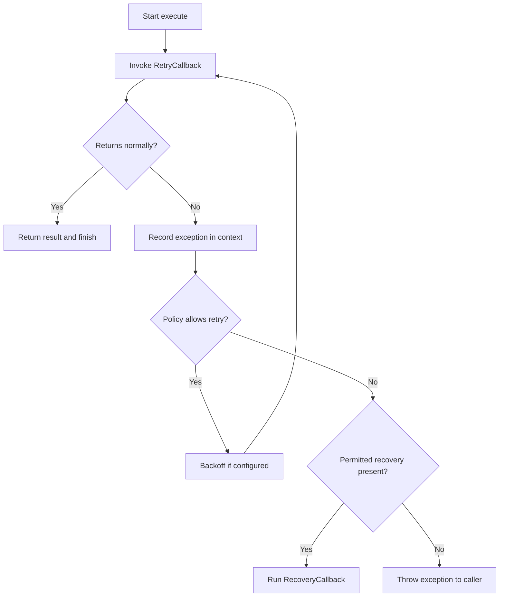
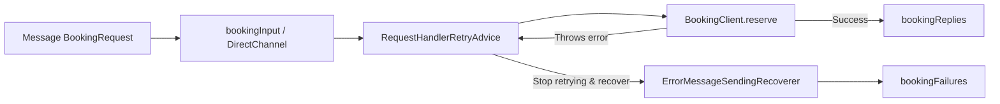

# RetryCallback

## 1. Objectives and API Scope

In the **Advice and Retries** chapter of the `SPRING_INTEGRATION_CORE` module, `RetryCallback` describes the exact unit of work permitted to be re-executed when handling a message. Understanding this boundary is foundational for attaching retry to endpoints, keeping Java DSL flows readable, and controlling success, failure, and recovery outcomes.

After this lesson, you will be able to:

- Write callbacks with explicit result and exception types.
- Read `RetryContext` to distinguish the initial invocation from retry attempts.
- Combine callbacks, retry policies, backoff, and recovery without mixing responsibilities.
- Place retry around a handler in Spring Integration and predict message routing.
- Design safe repeatable operations and test actual invocation counts.

**Version scope:** this lesson explains `org.springframework.retry.RetryCallback` in **Spring Retry 2.x**, used alongside **Spring Integration 6.5.x**. Java examples use Java 17 or later. Spring Integration 7.0 replaced the Spring Retry API with Spring Framework Core's retry support, changed the package of `RetryTemplate`, and changed the advice configuration API. Accordingly, the examples below using `setRetryTemplate(...)` belong to the 6.5.x line; consult the migration guide when working with 7.x. [Source: Changes from Spring Integration 6.5 to 7.0](https://docs.spring.io/spring-integration/reference/changes-6.5-7.0.html).

To run the integration examples, the project requires `org.springframework.integration:spring-integration-core` and `org.springframework.retry:spring-retry`. Dependency versions should be managed consistently via the project's BOM or `dependencyManagement`. The test snippets use JUnit Jupiter.

## 2. RetryCallback Is the Contract for One Attempt

The core contract of the API is:

```java
public interface RetryCallback<T, E extends Throwable> {
    T doWithRetry(RetryContext context) throws E;
}
```

`T` is the operation's result type; `E` is the exception type the callback may throw. `RetryContext` provides the state of the ongoing retry cycle. This is a functional interface that can be implemented with a lambda. [Source: RetryCallback 2.0.12 Javadoc](https://docs.spring.io/spring-retry/docs/2.0.12/apidocs/org/springframework/retry/RetryCallback.html).

Each invocation of `doWithRetry(...)` must represent **one attempt**. The callback does not need to write its own loop, count attempts, or call `Thread.sleep(...)`.

```java
RetryCallback<String, IOException> callback = context ->
        carrierClient.reserve(orderId);

String reservationId = retryTemplate.execute(callback);
```

This illustrates the contract: `carrierClient.reserve(...)` returns `String` and can throw `IOException`; `orderId` and the client are provided by the application. `IOException` is used to illustrate a checked exception, not to imply every I/O error is suitable for retry.

A callback succeeds only when it returns normally. If a remote call returns an object representing a failure and the callback returns that object as-is, an exception-based policy will not automatically infer that it must retry. The application must map recoverable errors to an appropriate exception before exiting the callback.

### Division of Responsibilities

| Component | Question It Answers | Example in a Shipping Booking Flow |
| --- | --- | --- |
| `RetryCallback` | What does each attempt do? | Call the reservation service for an order |
| `RetryTemplate` / `RetryOperations` | How are invocations orchestrated? | Invoke the callback, record errors, and return the result |
| `RetryPolicy` | Should this failure be retried? | Up to three calls, only on transient errors |
| `BackOffPolicy` | How long to wait before the next attempt? | Wait 200 ms between two calls |
| `RetryContext` | What state is the current cycle in? | Failed once; previous error was a timeout |
| `RecoveryCallback` | What to do when retries stop? | Return a pending status or publish an error |

This separation lets you change attempt counts or wait intervals without modifying business logic inside the callback.

## 3. Execution Lifecycle and Reading RetryContext

In **stateless** execution, `RetryTemplate.execute(...)` retains control across attempts. If the callback returns normally, execution completes; if it throws, the template asks the policy whether to continue. When no further attempts are allowed, the template invokes recovery if provided and permitted, or throws the error outward. [Source: RetryTemplate Javadoc](https://docs.spring.io/spring-retry/docs/2.0.12/apidocs/org/springframework/retry/support/RetryTemplate.html).



The diagram shows the normal path; early-exit mechanisms, backoff errors, and listeners can cause execution to follow another path.

### getRetryCount Is Not a 1-Based Attempt Number

In the typical Spring Retry case, `context.getRetryCount()` is `0` when the callback runs for the first time and increments after each recorded failure. To log the 1-based attempt number inside the callback, use `getRetryCount() + 1`.

| Observation Point | `getRetryCount()` | Meaning |
| --- | ---: | --- |
| Start of first callback | 0 | No failures yet |
| Start of second callback | 1 | First attempt failed |
| Start of third callback | 2 | Two prior attempts failed |
| Entering recovery after three failures | 3 | Three failures recorded |

`context.getLastThrowable()` can be `null`, especially on the first invocation. Always check before reading error details. Do not add one to the retry count inside recovery and call it the number of executions performed. [Source: RetryContext Javadoc](https://docs.spring.io/spring-retry/docs/2.0.12/apidocs/org/springframework/retry/RetryContext.html).

### maxAttempts Includes the Initial Call

In Spring Retry 2.x's builder, `maxAttempts(3)` means at most **three total calls**, equivalent to one initial call and up to two retries. `fixedBackoff(200)` uses milliseconds and waits only when transitioning to the next attempt. [Source: RetryTemplateBuilder Javadoc](https://docs.spring.io/spring-retry/docs/2.0.12/apidocs/org/springframework/retry/support/RetryTemplateBuilder.html).

```text
Attempt 1 fails -> wait 200 ms
Attempt 2 fails -> wait 200 ms
Attempt 3 succeeds -> return result
```

Thus, total wait time alone in the scenario above is about 400 ms, excluding the runtime of each call.

## 4. Standalone Example: Succeeding on the Third Call

The following example is a complete Java class. `FakeCarrierClient` simulates two connection drops and then returns a reservation code. No real network service is used in this example.

```java
import java.io.IOException;
import java.util.concurrent.atomic.AtomicInteger;

import org.springframework.retry.RetryCallback;
import org.springframework.retry.support.RetryTemplate;

public class RetryCallbackDemo {

    public static void main(String[] args) throws IOException {
        RetryTemplate template = RetryTemplate.builder()
                .maxAttempts(3)
                .fixedBackoff(200)
                .retryOn(IOException.class)
                .build();

        FakeCarrierClient client = new FakeCarrierClient();
        String orderId = "ORDER-42";

        RetryCallback<String, IOException> operation = context -> {
            Throwable previous = context.getLastThrowable();
            System.out.printf("attempt=%d, previous=%s%n",
                    context.getRetryCount() + 1,
                    previous == null
                            ? "none"
                            : previous.getClass().getSimpleName());

            return client.reserve(orderId);
        };

        String reservationId = template.execute(operation);
        System.out.println(reservationId);
    }

    static class FakeCarrierClient {
        private final AtomicInteger calls = new AtomicInteger();

        String reserve(String orderId) throws IOException {
            if (calls.incrementAndGet() <= 2) {
                throw new IOException("Temporary connection loss");
            }
            return "RESERVED-" + orderId;
        }
    }
}
```

Expected output, aside from internal library logs:

```text
attempt=1, previous=none
attempt=2, previous=IOException
attempt=3, previous=IOException
RESERVED-ORDER-42
```

`AtomicInteger` here only produces simulated client behavior. `RetryTemplate` itself orchestrates the retries; do not use a client counter as a substitute for application retry logic.

If the client always throws `IOException`, `main` ends with an exception after at most three calls because no recovery is supplied. If the client succeeds on the first try, the callback is invoked only once.

## 5. Writing Callbacks So the Template Sees the Right Errors

### Do Not Swallow Exceptions Inside the Callback

The snippet below causes the attempt to be treated as successful with result `null`:

```java
String result = retryTemplate.execute(context -> {
    try {
        return carrierClient.reserve(orderId);
    } catch (IOException ex) {
        return null;
    }
});
```

If you need to add context, log and rethrow the exception. Only translate it into a business exception type if that type preserves the original cause and aligns with the error classification policy.

```java
String result = retryTemplate.execute(context ->
        carrierClient.reserve(orderId));
```

Declaring `RetryCallback<String, IOException>` does not automatically configure retries specifically for `IOException`. The generic `E` describes Java's type contract; retry conditions are decided by `RetryPolicy` or the builder configuration.

### Classifying Errors by Recoverability

| Example Scenario | Usually Appropriate Design Decision | Condition to Check |
| --- | --- | --- |
| Connection temporarily cannot be opened | Bounded retry | Service still fits within the time budget |
| Timeout after the command was sent | Check outcome or retry with idempotency | Previous command may already have succeeded |
| Order data missing a required field | Fail immediately | Resending the same data will not fix the cause |
| Fixed invalid credentials | Fix configuration or refresh credentials by design | Retrying the same credentials will not make them valid |
| Service asks to shed load | Wait per the service contract | Respect when resending is permitted |

These are design decisions for the example, not automatic classification by the library. The client should translate protocol errors into exceptions understood by the retry layer.

### Watch Out for Exceptions Wrapped in Messaging

In an Integration flow, a business error may sit inside the `cause` chain of a messaging exception. When retrying only on `TemporaryCarrierException`, check whether the error reaching the template is wrapped. The Spring Retry builder supports `.traversingCauses()` to inspect the cause chain. [Source: RetryTemplateBuilder error classification](https://docs.spring.io/spring-retry/docs/2.0.12/apidocs/org/springframework/retry/support/RetryTemplateBuilder.html).

Do not broaden retry to every `RuntimeException` just to work around exception wrapping. That approach pulls programming bugs and data errors into the retry loop as well.

## 6. Distinguishing RetryCallback from RecoveryCallback

`RetryCallback` describes the main work on each attempt. `RecoveryCallback<T>` describes a fallback result or action when retries can no longer continue under the policy. Recovery's method is `T recover(RetryContext context) throws Exception`. [Source: RecoveryCallback Javadoc](https://docs.spring.io/spring-retry/docs/2.0.12/apidocs/org/springframework/retry/RecoveryCallback.html).

You can replace the `execute(operation)` call in Section 4's example with:

```java
String reservationIdOrPending = template.execute(
        operation,
        context -> {
            System.err.printf(
                    "Moving order %s to pending after %d failures%n",
                    orderId,
                    context.getRetryCount());
            return "PENDING-" + orderId;
        });
```

With the simulated client in Section 4, recovery is not invoked because the third attempt succeeds. To observe the recovery branch, make the client always throw `IOException`. Then the main callback runs three times and the fallback result is `PENDING-ORDER-42`.

The `PENDING-...` value indicates that reservation did not finish. In a real design, use a result type with an explicit status field instead of inferring state from a string prefix.

Three points to keep clear in the contract:

- **Not retrying an error does not mean forbidding recovery for it.** Whether to retry and whether to recover are two separate decisions; design and test both.
- **Recovery is not an extra business attempt.** If recovery calls the remote service again, the application has added another operation beyond the originally described attempt count.
- **Recovery itself can fail.** Errors when persisting a pending status or publishing an error must still reach the application's error-handling mechanism.

A recovery outcome only means the error was handled according to the recovery contract. It does not prove the original operation succeeded in the external system.

## 7. Bringing the Callback Model to a Spring Integration Endpoint

In Spring Integration 6.5.x, `RequestHandlerRetryAdvice` uses Spring Retry to wrap handler invocation. You pass a `RetryTemplate` to the advice and attach the advice to the endpoint. You do not register a `RetryCallback` bean for the framework to discover and call automatically. [Source: RequestHandlerRetryAdvice 6.5.0 Javadoc](https://docs.spring.io/spring-integration/docs/6.5.0/api/org/springframework/integration/handler/advice/RequestHandlerRetryAdvice.html).

Several lambdas look similar in syntax but serve different roles:

| Callback Type | Input | Caller and Role |
| --- | --- | --- |
| `RetryCallback<T, E>` | `RetryContext` | Called by `RetryTemplate` to execute one attempt |
| `.handle(...)` lambda | Payload and headers | Called by the endpoint to handle a message |
| `AbstractRequestHandlerAdvice.ExecutionCallback` | Not a payload/context lambda | Used by the advice to invoke the wrapped handler |
| `RecoveryCallback<T>` | `RetryContext` | Called by the template when transitioning to a permitted recovery path |

When the advice applies retry, handler invocation is handed over to the template's execution mechanism. Therefore, the handler's business logic must tolerate multiple invocations even though Java DSL shows only a single `.handle(...)` step.

### Java DSL Configuration

The configuration below uses an input channel, a reply queue, and a recovery failure queue. `BookingClient` is the port calling the shipping system; the application must supply a bean implementing this interface. The records and exception in the example are declared inside the configuration class.

```java
import org.springframework.beans.factory.annotation.Qualifier;
import org.springframework.context.annotation.Bean;
import org.springframework.context.annotation.Configuration;
import org.springframework.integration.channel.DirectChannel;
import org.springframework.integration.channel.QueueChannel;
import org.springframework.integration.config.EnableIntegration;
import org.springframework.integration.dsl.IntegrationFlow;
import org.springframework.integration.handler.advice.ErrorMessageSendingRecoverer;
import org.springframework.integration.handler.advice.RequestHandlerRetryAdvice;
import org.springframework.messaging.MessageChannel;
import org.springframework.retry.support.RetryTemplate;

@Configuration
@EnableIntegration
public class BookingFlowConfiguration {

    @Bean
    public DirectChannel bookingInput() {
        return new DirectChannel();
    }

    @Bean
    public QueueChannel bookingReplies() {
        return new QueueChannel();
    }

    @Bean
    public QueueChannel bookingFailures() {
        return new QueueChannel();
    }

    @Bean
    public RetryTemplate bookingRetryTemplate() {
        return RetryTemplate.builder()
                .maxAttempts(3)
                .fixedBackoff(100)
                .retryOn(TemporaryCarrierException.class)
                .traversingCauses()
                .build();
    }

    @Bean
    public RequestHandlerRetryAdvice bookingRetryAdvice(
            @Qualifier("bookingRetryTemplate") RetryTemplate template,
            @Qualifier("bookingFailures") MessageChannel failures) {

        RequestHandlerRetryAdvice advice = new RequestHandlerRetryAdvice();
        advice.setRetryTemplate(template);
        advice.setRecoveryCallback(new ErrorMessageSendingRecoverer(failures));
        return advice;
    }

    @Bean
    public IntegrationFlow bookingFlow(
            BookingClient client,
            @Qualifier("bookingRetryAdvice") RequestHandlerRetryAdvice advice) {

        return IntegrationFlow.from("bookingInput")
                .<BookingRequest>handle(
                        (request, headers) -> client.reserve(request),
                        endpoint -> endpoint.advice(advice))
                .channel("bookingReplies")
                .get();
    }

    public interface BookingClient {
        BookingReply reserve(BookingRequest request);
    }

    public record BookingRequest(String orderId) {
    }

    public record BookingReply(String orderId, String reservationId) {
    }

    public static class TemporaryCarrierException extends RuntimeException {
        public TemporaryCarrierException(String message) {
            super(message);
        }
    }
}
```

Execution flow:



`ErrorMessageSendingRecoverer` implements `RecoveryCallback<Object>` and sends the final error as an `ErrorMessage` to the designated channel. The payload of the error message is a `Throwable`; if it is a `MessagingException`, you can inspect `getFailedMessage()` when present. Do not cast the `ErrorMessage` payload directly to `BookingRequest`. [Source: ErrorMessageSendingRecoverer Javadoc](https://docs.spring.io/spring-integration/docs/6.5.0/api/org/springframework/integration/handler/advice/ErrorMessageSendingRecoverer.html).

In this configuration, the recoverer does not produce a fallback `BookingReply`. When the error is published successfully and the recoverer returns `null`, the handler emits no normal reply. Consequently, do not design a gateway expecting a `BookingReply` in every case merely because recovery is configured; if you want a fallback status returned, define an explicit result contract and configure accordingly.

Both `QueueChannel` beans are only for demonstration and inspection. They hold messages in memory; a real system needs a consumer for the error branch and durable persistence if data must survive process shutdown.

## 8. Retry Boundaries, Threads, and Messages

### Retry Around a Handler Does Not Re-Run the Entire Flow

Suppose a flow consists of:

```text
input -> validate data -> call carrier with retry -> save result -> output
```

An advice attached to the carrier-calling step limits retries to that handler. An error in the downstream result-saving step does not automatically cause this advice to re-run earlier steps. For reply-producing handlers, request handler advice typically wraps request handling before sending the reply downstream. [Source: Spring Integration 6.5 Handling Message Advice](https://docs.spring.io/spring-integration/reference/6.5/handler-advice/handle-message.html).

This leads to a practical layout: place data validation before the retried call, keep the remote operation inside a clearly scoped handler, and handle failures in the save step under its own contract.

If the same step already runs `RetryTemplate.execute(...)` internally and is also wrapped by an outer retry advice, invocation counts can multiply. For example, if both layers allow up to three invocations, one request can trigger up to nine calls to the external service. Choose clearly which layer owns retry for that operation.

### Stateless Retry Uses the Processing Thread

With the `DirectChannel` in the configuration above, the message-sending thread also executes the handler and bears the retry waits. Using long backoffs holds this thread longer. Stateless retry advice does not create a scheduler to dispatch each attempt onto a different thread. [Source: Retry Advice 6.5](https://docs.spring.io/spring-integration/reference/6.5/handler-advice/classes.html).

Do not infer that simply having an `errorChannel` turns every synchronous exception into an error message. Without recovery, errors over a `DirectChannel` usually propagate to the caller; channel-based error handling also depends on gateways, pollers, or asynchronous execution infrastructure. In the example, the recoverer itself explicitly sends to `bookingFailures`. [Source: Error Handling 6.5](https://docs.spring.io/spring-integration/reference/6.5/error-handling.html).

### Stateful Retry Is a Different Coordination Mechanism

With stateful retry, state must be recognized when the same work comes back again, such as after broker redelivery. In the 6.5.x line, the advice uses `RetryStateGenerator` to build this identity. The callback still describes a single attempt, but you should not assume one current call will always run all attempts on the same call stack. [Source: Stateful Configuration in Retry Advice 6.5](https://docs.spring.io/spring-integration/reference/6.5/handler-advice/classes.html).

You need a business key that stays stable across redeliveries, along with compatible rollback, redelivery, and recovery policies. A fresh `MessageHeaders.ID` generated when reconstructing a message may not represent the same piece of work. The retry callback does not configure broker redelivery on its own.

## 9. Idempotency and Shared Data in Callbacks

The most error-prone scenario is a timeout after the shipping system has already created the reservation while the application has not yet received the response. Calling again can create a second reservation. Therefore, design business identifiers before enabling retry.

For the shipping booking example, a design might look like this:

1. Build a stable operation key from `orderId` and action type.
2. Send that same key on every invocation for the same operation.
3. The shipping service records the key and returns the same result if the operation already completed.
4. When status is uncertain, query by key before creating a new operation if the service contract supports it.

Sending an `Idempotency-Key` header alone is not enough; the receiver must implement deduplication semantics and persist state per contract. Nor is `RetryContext` a durable store for business outcomes.

### Keep Inputs Stable Across Attempts

Do not generate a new order ID or operation ID inside the callback on each invocation. Prepare them outside, then pass them into the callback or keep them on the message:

```java
String operationKey = "reserve:" + orderId;

String result = retryTemplate.execute(context ->
        carrierClient.reserveWithKey(orderId, operationKey));
```

This snippet assumes the client exposes `reserveWithKey(...)` with a deduplication contract. Because the key is derived from business data, it can still be reconstructed if a new processing attempt starts after a process restart.

### Do Not Use Mutable Fields as Per-Message State

`RetryTemplate` supports concurrent execution, yet application-supplied callbacks and clients must still ensure thread safety when shared. A field like `currentOrderId` or `lastException` on a singleton service can be overwritten by another message. [Source: RetryTemplate Concurrency Characteristics](https://docs.spring.io/spring-retry/docs/2.0.12/apidocs/org/springframework/retry/support/RetryTemplate.html).

Prefer local variables, immutable payloads such as records, and data passed via parameters. Do not mutate shared collections or decrement in-memory balances before each attempt and assume retry will roll them back automatically.

## 10. Time Budgets, Nested Retries, and Transactions

Suppose `N` invocations are permitted, each bounded by `T_call`, and total backoff time is `T_backoff`. A design estimate is:

```text
T_total ≈ N × T_call + T_backoff + additional processing overhead
```

With three invocations of up to one second each and 200 ms waits between attempts, total time can approach 3.4 seconds plus overhead. Limiting the attempt count does not bound the duration of a hung call; the client still needs connect timeouts, read timeouts, or an appropriate request deadline.

Also calculate the budget across layers. One request may pass through HTTP client retry, retry advice, and broker redelivery. If each layer keeps retrying independently, generated load will exceed what someone reading a single layer's config expects.

A gateway's reply timeout also does not guarantee cancelling an in-flight network operation. Coordinate timeouts, attempt counts, wait intervals, and the response contract for the entire request.

### Transactions Do Not Automatically Roll Back Remote Systems

Advice ordering affects transaction scope. When retry wraps transaction advice, each attempt passes through the transaction advice; when transaction advice wraps retry, multiple attempts may share the same transaction scope. [Source: Advice Order in Spring Integration 6.5](https://docs.spring.io/spring-integration/reference/6.5/handler-advice/order.html).

Whether each attempt actually gets a fresh transaction also depends on propagation and any existing caller transaction. Do not conclude that reordering advice alone guarantees every attempt is isolated.

For example, writing to a database and then calling the shipping service can produce side effects across two different systems. Rolling back the local database does not automatically cancel an external reservation. Choose operation boundaries, idempotency, and business compensation or reconciliation before applying retry.

## 11. Testing the Execution Contract

The snippets below are illustrative test code for your corresponding project. At the callback layer, use a simulated client and no backoff to test behavior deterministically without real network calls.

### Testing Invocation Counts, Recovery, and Non-Retryable Errors

```java
import java.util.ArrayList;
import java.util.List;
import java.util.concurrent.atomic.AtomicInteger;

import org.junit.jupiter.api.Test;
import org.springframework.retry.support.RetryTemplate;

import static org.junit.jupiter.api.Assertions.assertEquals;
import static org.junit.jupiter.api.Assertions.assertThrows;

class RetryCallbackTest {

    private RetryTemplate template() {
        return RetryTemplate.builder()
                .maxAttempts(3)
                .noBackoff()
                .retryOn(IllegalStateException.class)
                .build();
    }

    @Test
    void returnsResultOnThirdAttempt() {
        List<Integer> retryCounts = new ArrayList<>();

        String result = template().execute(context -> {
            retryCounts.add(context.getRetryCount());
            if (retryCounts.size() < 3) {
                throw new IllegalStateException("Temporary error");
            }
            return "RESERVED";
        });

        assertEquals("RESERVED", result);
        assertEquals(List.of(0, 1, 2), retryCounts);
    }

    @Test
    void recoversAfterThreeFailedCalls() {
        AtomicInteger calls = new AtomicInteger();

        String result = template().<String, IllegalStateException>execute(
                context -> {
                    calls.incrementAndGet();
                    throw new IllegalStateException("Service unavailable");
                },
                context -> {
                    assertEquals(3, context.getRetryCount());
                    return "PENDING";
                });

        assertEquals(3, calls.get());
        assertEquals("PENDING", result);
    }

    @Test
    void doesNotRetryInvalidInput() {
        AtomicInteger calls = new AtomicInteger();

        assertThrows(IllegalArgumentException.class,
                () -> template().<String, RuntimeException>execute(context -> {
                    calls.incrementAndGet();
                    throw new IllegalArgumentException("Missing orderId");
                }));

        assertEquals(1, calls.get());
    }
}
```

The first test verifies both the result and the retry count values. The second test verifies that recovery does not increase business invocations to four. The third test omits recovery to clearly observe a non-retryable error propagating immediately after the first call.

In a real project, replace the test's `IllegalStateException` category with your domain exception such as `TemporaryCarrierException`. The two exception types in the test were chosen to separate branches clearly.

### Testing the Error Branch of a Java DSL Flow

Place the following test in the same package as `BookingFlowConfiguration` from Section 7. The client always fails; three attempts must end in one `ErrorMessage` with no success reply.

```java
import java.util.concurrent.atomic.AtomicInteger;

import org.junit.jupiter.api.Test;
import org.springframework.context.annotation.AnnotationConfigApplicationContext;
import org.springframework.integration.channel.DirectChannel;
import org.springframework.integration.channel.QueueChannel;
import org.springframework.messaging.support.ErrorMessage;
import org.springframework.messaging.support.MessageBuilder;

import static org.junit.jupiter.api.Assertions.assertEquals;
import static org.junit.jupiter.api.Assertions.assertInstanceOf;
import static org.junit.jupiter.api.Assertions.assertNull;
import static org.junit.jupiter.api.Assertions.assertTrue;

class BookingRetryFlowTest {

    @Test
    void publishesErrorAfterExhaustion() {
        AtomicInteger calls = new AtomicInteger();

        try (var context = new AnnotationConfigApplicationContext()) {
            context.registerBean(
                    BookingFlowConfiguration.BookingClient.class,
                    () -> request -> {
                        calls.incrementAndGet();
                        throw new BookingFlowConfiguration
                                .TemporaryCarrierException("Service temporarily down");
                    });
            context.register(BookingFlowConfiguration.class);
            context.refresh();

            DirectChannel input = context.getBean(
                    "bookingInput", DirectChannel.class);
            QueueChannel failures = context.getBean(
                    "bookingFailures", QueueChannel.class);
            QueueChannel replies = context.getBean(
                    "bookingReplies", QueueChannel.class);

            boolean sent = input.send(MessageBuilder.withPayload(
                    new BookingFlowConfiguration.BookingRequest("ORDER-42"))
                    .build());

            assertTrue(sent);
            assertEquals(3, calls.get());
            assertInstanceOf(ErrorMessage.class, failures.receive(1_000));
            assertNull(replies.receive(0));
        }
    }
}
```

The test uses the configuration's 100 ms backoff, resulting in two short waits. The callback tests above use `noBackoff()` to verify the main branches quickly. If you need to test complex timing policies, use a simulated clock or an appropriate hook rather than asserting wall-clock timings to within a few milliseconds.

`assertTrue(sent)` only confirms that sending completed without throwing an exception to the caller in this recovery scenario. The assertions on call count, error message, and absence of a reply are what verify the observable business outcome.

Cases to add when applying this to a real service:

| Case | What to Observe |
| --- | --- |
| Succeeds on first attempt | One call, reply emitted, no recovery message |
| Two transient errors then success | Three calls, only one success result |
| Deterministic data error | No retries; error path follows the chosen recovery contract |
| Wrapped transient exception | Still retries when cause-chain traversal is configured |
| Recovery fails to send error | Failure surfaces outward or is handled by the designed mechanism |
| Timeout after remote side effect | Does not create duplicate side effects with the same operation key |
| Multiple concurrent messages | No accidental state sharing across orders |

## 12. Observing and Diagnosing Callback Behavior

Record the business key or correlation ID, operation name, attempt sequence number, error type, and elapsed duration. Separate transient failure counts from final request failure counts: one request may generate two errors before succeeding on the third attempt.

Keep `RetryContext` scoped to the processing cycle. It is not a `Message`, does not automatically hold all headers, and should not be retained as long-lived business state. When the callback needs `orderId`, pass it via a captured variable or handler input.

| Symptom | Cause to Check |
| --- | --- |
| Runs only once even though backend errors | Callback returns normally, swallows the exception, or error is not retryable |
| More invocations than configured | Retries active simultaneously in client, handler, advice, or redelivery |
| Logs first attempt as attempt 0 | Printing `getRetryCount()` instead of the 1-based attempt number |
| Recovery ran yet caller still waits for reply | Recoverer only published the error and did not produce a fallback result |
| Exhausted errors do not reach the error channel | Check recovery, threading model, and gateway/poller configuration |
| Threads held for long periods during outages | Blocking backoff combined with overly long per-call timeouts |
| Orders processed twice | Missing stable operation key or receiver does not enforce deduplication |
| Downstream step fails without handler retrying | Advice wraps only the handler, matching the configured boundary |

When designing an endpoint with retry, define simultaneously the work of one attempt, the retryable error group, total invocation count, time budget, and recovery outcome. `RetryCallback` is where a single attempt's work is expressed; the remaining decisions must be configured and tested in the components responsible for them.
