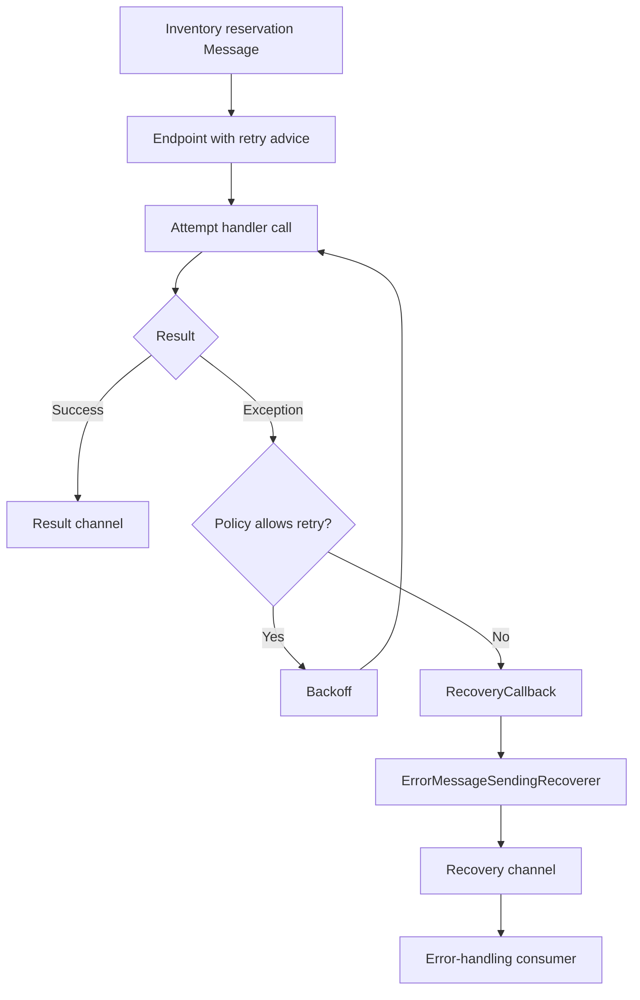

# ErrorMessageSendingRecoverer

## 1. Objectives and Scope

In the **Advice and Retries** chapter of the **SPRING_INTEGRATION_CORE** module, this lesson explains how to use `ErrorMessageSendingRecoverer` to send the final error of an endpoint into an error-handling flow. From there, you connect the core pieces: `Message`, `MessageChannel`, an endpoint with retry advice, a recovery channel, and an error-handling consumer.

After this lesson, you will be able to:

- Attach the recoverer to `RequestHandlerRetryAdvice` using Java DSL.
- Distinguish business failures, errors when sending recovery messages, and input message send outcomes.
- Retrieve the failed message to preserve correlation info and prepare for downstream handling.
- Design tests covering retry success, attempt exhaustion, and recovery send failure.

**Version scope:** the main code uses **Java 17 or later, Spring Integration 6.5.x, and Spring Retry 2.0.x**. Required dependencies are `org.springframework.integration:spring-integration-core` and `org.springframework.retry:spring-retry`; tests use JUnit Jupiter. Select concrete versions according to your application's dependency management.

Spring Integration 7.x moves retry advice to Spring Framework's retry support, with APIs such as `setRetryPolicy(...)`; do not apply this lesson's `setRetryTemplate(...)` configuration verbatim to 7.x. See [6.5 Retry Advice](https://docs.spring.io/spring-integration/reference/6.5/handler-advice/classes.html) and [7.x RequestHandlerRetryAdvice API](https://docs.spring.io/spring-integration/api/org/springframework/integration/handler/advice/RequestHandlerRetryAdvice.html).

## 2. Where Does the Recoverer Sit in the Flow?

Suppose an endpoint calls an inventory reservation service for an order. A brief connection error can be resolved on a retry. If all attempts fail, the system must record the incident for later handling.

`ErrorMessageSendingRecoverer` is a `RecoveryCallback<Object>` and extends `ErrorMessagePublisher`. With Spring Retry 2.x, its recovery method takes a `RetryContext`, publishes an error message, and returns `null` if publishing does not throw an exception. See [recoverer source in version 6.5.0](https://github.com/spring-projects/spring-integration/blob/v6.5.0/spring-integration-core/src/main/java/org/springframework/integration/handler/advice/ErrorMessageSendingRecoverer.java).

| Component | Responsibility |
| --- | --- |
| Business handler | Performs one call to the inventory reservation service |
| `RequestHandlerRetryAdvice` | Wraps execution of the advised handler |
| `RetryTemplate` | Coordinates attempts according to the retry policy and backoff |
| `ErrorMessageSendingRecoverer` | Wraps the final error into a recovery message |
| Recovery channel | Receives the error message according to the channel's semantics |
| Error-branch consumer | Records incidents, classifies them, or forwards them for handling |



The diagram depicts the example's **stateless retry**. Recovery can also be chosen after the first error if the policy forbids retrying that exception type. Whether to continue retrying and whether to allow recovery are two distinct decisions of the retry policy. See [Spring Retry 2.0.12 RetryTemplate](https://github.com/spring-retry/spring-retry/blob/v2.0.12/src/main/java/org/springframework/retry/support/RetryTemplate.java).

The recoverer does not automatically perform compensation, refunds, database writes, or create a durable queue. Those behaviors must be implemented in the error-handling branch.

## 3. What Does the Error Message Contain and Where Does It Go?

### 3.1. Error Payload and Failed Message

`ErrorMessage` is a message whose payload has type `Throwable`. Key objects to distinguish are:

| Object | Meaning During Incident Investigation |
| --- | --- |
| `errorMessage.getPayload()` | Published exception; may contain a cause chain |
| `MessagingException.getFailedMessage()` | Message attached to the handling error |
| `errorMessage.getOriginalMessage()` | Input message attached by the error-message strategy, if present |
| Headers of `ErrorMessage` | Headers of the new error message; does not copy all headers of the failed message by default |

In 6.5.0, the publisher wraps a throwable that is not yet a `MessagingException` so it can attach the failed message retrieved from context. Thus, the error payload does not necessarily have the exact exception class thrown by business code. See [ErrorMessagePublisher](https://github.com/spring-projects/spring-integration/blob/v6.5.0/spring-integration-core/src/main/java/org/springframework/integration/core/ErrorMessagePublisher.java).

Specifically, the retry advice provides the message being attempted under `ErrorMessageUtils.FAILED_MESSAGE_CONTEXT_KEY`. Meanwhile, `DefaultErrorMessageStrategy` reads `INPUT_MESSAGE_CONTEXT_KEY` to populate `originalMessage`. Using only retry advice with the default strategy does not guarantee `originalMessage` is non-`null`. See [RequestHandlerRetryAdvice](https://github.com/spring-projects/spring-integration/blob/v6.5.0/spring-integration-core/src/main/java/org/springframework/integration/handler/advice/RequestHandlerRetryAdvice.java) and [DefaultErrorMessageStrategy](https://github.com/spring-projects/spring-integration/blob/v6.5.0/spring-integration-core/src/main/java/org/springframework/integration/support/DefaultErrorMessageStrategy.java).

If the message passed through a transformer before reaching the endpoint, the failed message may carry the transformed payload. To trace from gateway to error branch, include business identifiers such as `orderId` or `correlationId` in the message contract early.

### 3.2. Choosing the Recovery Channel Explicitly

Common constructors:

```java
new ErrorMessageSendingRecoverer();
new ErrorMessageSendingRecoverer(recoveryChannel);
new ErrorMessageSendingRecoverer(recoveryChannel, errorMessageStrategy);
```

The default configuration targets the `errorChannel` bean. You can use `setChannelName(...)` to configure by name. When name resolution is needed, the recoverer must be Spring-managed or supplied with an appropriate channel resolver.

In the example, passing the recovery channel directly makes the error destination explicit. Do not assume the recoverer selects a destination from the `errorChannel` header on the input message: this publisher's destination resolution uses the configured channel or default channel name. See [the publisher's populateChannel mechanism](https://github.com/spring-projects/spring-integration/blob/v6.5.0/spring-integration-core/src/main/java/org/springframework/integration/core/ErrorMessagePublisher.java).

Error publishing for asynchronous tasks in Spring Integration has rules that check the `errorChannel` header before falling back to the global channel. That is a different context from attaching an explicit recoverer to retry advice. See [Error Handling](https://docs.spring.io/spring-integration/reference/6.5/error-handling.html).

## 4. Java DSL Example: Inventory Reservation and Error Capture

The example below uses a `DirectChannel` as input and two `QueueChannel` instances to observe outcomes. The simulated service holds a counter; each application context in the tests sends only one request.

Payload conventions:

| `orderId` | Simulated Behavior |
| --- | --- |
| `ALWAYS_FAIL` | Every call throws a transient error |
| `FLAKY` | First two calls fail, third call succeeds |
| `INVALID` | Throws an input data error, no retry |
| Any other value | Succeeds immediately |

Place the demonstration configuration in class `InventoryRecoveryConfig`:

```java
package learning.integration;

import java.util.Map;
import java.util.concurrent.atomic.AtomicInteger;

import org.springframework.beans.factory.annotation.Qualifier;
import org.springframework.context.annotation.Bean;
import org.springframework.context.annotation.Configuration;
import org.springframework.integration.channel.DirectChannel;
import org.springframework.integration.channel.QueueChannel;
import org.springframework.integration.config.EnableIntegration;
import org.springframework.integration.dsl.IntegrationFlow;
import org.springframework.integration.handler.advice.ErrorMessageSendingRecoverer;
import org.springframework.integration.handler.advice.RequestHandlerRetryAdvice;
import org.springframework.messaging.MessageChannel;
import org.springframework.retry.backoff.FixedBackOffPolicy;
import org.springframework.retry.policy.SimpleRetryPolicy;
import org.springframework.retry.support.RetryTemplate;

@Configuration(proxyBeanMethods = false)
@EnableIntegration
public class InventoryRecoveryConfig {

    public record ReserveInventory(String orderId) {
    }

    public static class TransientInventoryException extends RuntimeException {
        public TransientInventoryException(String message) {
            super(message);
        }
    }

    public static class InventoryClient {
        private final AtomicInteger attempts = new AtomicInteger();

        public String reserve(ReserveInventory request) {
            int currentAttempt = this.attempts.incrementAndGet();

            if ("INVALID".equals(request.orderId())) {
                throw new IllegalArgumentException("Invalid order ID");
            }

            if ("ALWAYS_FAIL".equals(request.orderId())
                    || ("FLAKY".equals(request.orderId()) && currentAttempt < 3)) {
                throw new TransientInventoryException(
                        "Inventory service unavailable, attempt=" + currentAttempt);
            }

            return "RESERVED:" + request.orderId();
        }

        public int attempts() {
            return this.attempts.get();
        }
    }

    @Bean
    DirectChannel inventoryRequests() {
        return new DirectChannel();
    }

    @Bean
    QueueChannel inventoryResults() {
        return new QueueChannel(10);
    }

    @Bean
    QueueChannel inventoryRecoveryChannel() {
        return new QueueChannel(10);
    }

    @Bean
    InventoryClient inventoryClient() {
        return new InventoryClient();
    }

    @Bean
    ErrorMessageSendingRecoverer inventoryRecoverer(
            @Qualifier("inventoryRecoveryChannel") MessageChannel recoveryChannel) {

        ErrorMessageSendingRecoverer recoverer =
                new ErrorMessageSendingRecoverer(recoveryChannel);
        recoverer.setSendTimeout(200);
        return recoverer;
    }

    @Bean
    RequestHandlerRetryAdvice inventoryRetryAdvice(
            ErrorMessageSendingRecoverer inventoryRecoverer) {

        SimpleRetryPolicy retryPolicy = new SimpleRetryPolicy(
                3,
                Map.of(TransientInventoryException.class, true),
                true,
                false);

        FixedBackOffPolicy backOff = new FixedBackOffPolicy();
        backOff.setBackOffPeriod(100);

        RetryTemplate retryTemplate = new RetryTemplate();
        retryTemplate.setRetryPolicy(retryPolicy);
        retryTemplate.setBackOffPolicy(backOff);

        RequestHandlerRetryAdvice advice = new RequestHandlerRetryAdvice();
        advice.setRetryTemplate(retryTemplate);
        advice.setRecoveryCallback(inventoryRecoverer);
        return advice;
    }

    @Bean
    IntegrationFlow reserveInventoryFlow(
            @Qualifier("inventoryRequests") MessageChannel requests,
            @Qualifier("inventoryResults") MessageChannel results,
            InventoryClient inventoryClient,
            RequestHandlerRetryAdvice inventoryRetryAdvice) {

        return IntegrationFlow.from(requests)
                .handle(ReserveInventory.class,
                        (payload, headers) -> inventoryClient.reserve(payload),
                        endpoint -> endpoint.advice(inventoryRetryAdvice))
                .channel(results)
                .get();
    }
}
```

### 4.1. Meaning of the Policy

The four parameters of `SimpleRetryPolicy` in the example are:

1. Maximum of **three invocations**, consisting of the initial call and two retries.
2. Only `TransientInventoryException` belongs to the retryable group.
3. `traverseCauses = true`: search for a matching exception in the cause chain when wrapped.
4. `defaultValue = false`: exception types outside the declared group are not retried.

This is the Spring Retry 2.x API semantics; see [SimpleRetryPolicy](https://docs.spring.io/spring-retry/docs/2.0.12/apidocs/org/springframework/retry/policy/SimpleRetryPolicy.html). Avoid misreading parameter `3` as three retries in addition to the initial call.

With `ALWAYS_FAIL`, the expected progression is:

```text
Attempt 1: transient error
Wait 100 ms
Attempt 2: transient error
Wait 100 ms
Attempt 3: transient error
Recovery: sends one ErrorMessage to inventoryRecoveryChannel
```

With `FLAKY`, the third attempt returns a result so the recoverer is not called. With `INVALID`, this configuration goes to recovery after one call. Not retrying an error does not automatically mean skipping recovery.

### 4.2. Advice Scope

In the configuration above, the advice is attached at `.handle(...)`. When adding transformers, routers, or other handlers, determine which endpoint owns retry. Do not assume an advice on the inventory reservation handler re-runs steps before or after it.

For example, if inventory reservation succeeds and a downstream email step fails, retry must be designed on the email step. Re-running inventory reservation could produce duplicate side effects.

The `AtomicInteger` counter is solely for demonstration. With multiple concurrent messages, per-request attempt counts should come from retry context or proper observability tools; a global counter does not represent a single order.

## 5. Reading and Processing Failed Messages

The consumer must read the error and correlation details without assuming every error message uses the same wrapper structure.

The following helper method can be placed in an error-handling class:

```java
import org.springframework.messaging.Message;
import org.springframework.messaging.MessagingException;
import org.springframework.messaging.support.ErrorMessage;

static Message<?> findFailedMessage(ErrorMessage errorMessage) {
    Throwable current = errorMessage.getPayload();

    while (current != null) {
        if (current instanceof MessagingException messagingException
                && messagingException.getFailedMessage() != null) {
            return messagingException.getFailedMessage();
        }
        current = current.getCause();
    }

    return errorMessage.getOriginalMessage();
}
```

With the queue-backed recovery channel in the example, one manual way to inspect is:

```java
Message<?> received = recoveryChannel.receive(1_000);

if (received instanceof ErrorMessage errorMessage) {
    Message<?> failed = findFailedMessage(errorMessage);

    if (failed != null) {
        Object correlationId = failed.getHeaders().get("correlationId");
        Throwable failure = errorMessage.getPayload();
        // Record the incident using correlationId and the required error details.
        // Persist the failed payload according to the application's storage contract.
    }
}
```

This is a manual receive for demonstration. In an application, an endpoint consuming a `QueueChannel` needs a poller; if using a `DirectChannel` for recovery, a subscriber is required. The sample config intentionally leaves the queue without a consumer so tests can receive messages directly.

Do not log only `errorMessage.getPayload().getMessage()`: that may omit the order ID and context needed for reprocessing. Nor should you log entire sensitive payloads. A practical incident record may include `incidentId`, order ID, error type, timestamp, endpoint name, and a reference to the original data.

### Customizing originalMessage When the Contract Requires It

If you want to attach the message being attempted by the handler as `originalMessage`, replace the recoverer bean with the variant below. Also import `ErrorMessageStrategy`, `ErrorMessageUtils`, `Message`, and `ErrorMessage`:

```java
@Bean
ErrorMessageSendingRecoverer inventoryRecoverer(
        @Qualifier("inventoryRecoveryChannel") MessageChannel recoveryChannel) {

    ErrorMessageStrategy strategy = (throwable, context) -> {
        Object candidate = context == null
                ? null
                : context.getAttribute(ErrorMessageUtils.FAILED_MESSAGE_CONTEXT_KEY);

        if (candidate instanceof Message<?> message) {
            return new ErrorMessage(throwable, message);
        }
        return new ErrorMessage(throwable);
    };

    ErrorMessageSendingRecoverer recoverer =
            new ErrorMessageSendingRecoverer(recoveryChannel, strategy);
    recoverer.setSendTimeout(200);
    return recoverer;
}
```

This variant explicitly defines `originalMessage` as the message at the advised endpoint. It does not restore the payload prior to transformers that already ran. Required headers must still be read by the consumer from the attached message or copied selectively by the strategy per your application contract.

## 6. What Does a Successful Error Send Mean?

In the main configuration, `inventoryRequests.send(message)` can return `true` even though inventory reservation failed all three times. That is because the error was handed to recovery, the callback returned `null`, and the handler does not require a reply.

Track three separate outcomes:

| Outcome | What Is Known |
| --- | --- |
| Inventory reservation succeeded | Handler produced a business outcome |
| Recovery send succeeded | Recovery channel accepted the message under the channel's semantics |
| Incident handling completed | Consumer executed and confirmed the error-handling action |

These three outcomes need separate metrics or states. With a queue, the message may still just be waiting; with a direct handling branch, the consumer may finish on the calling thread.

### 6.1. Gateways and Replies

If a gateway uses a request–reply model while the recoverer only publishes an error and returns `null`, the caller may receive no reply and wait until the configured timeout expires. If the endpoint enables `requiresReply`, returning `null` can also trigger a reply-required error.

Therefore, before attaching the recoverer to a gateway flow, lock down the contract:

- Call only acknowledges accepting work: the error branch can handle the incident asynchronously.
- Call must return a result: provide a clear business reply, such as a rejected or pending result.
- Call must receive an exception: let the error propagate to the gateway's error-handling mechanism or use an appropriate recovery callback.

An error-sending recoverer does not automatically turn into a fallback-reply mechanism for a gateway.

### 6.2. Transactions and Broker Redelivery

When recovery finishes normally, the original exception may no longer propagate to the container. Depending on transactions, acknowledgment mode, and rollback-only status, the container may treat processing as complete. Thus, you cannot assume a broker will redeliver merely because the handler once threw an exception.

If business rules require rollback or negative acknowledgment, design alongside the transaction boundary and adapter policy. Verify the case "if the incident cannot be saved, the original message must not be acknowledged."

With stateful retry, state can be preserved across redeliveries back into the endpoint. You need a stable correlation key and tests against real redelivery; that progression differs from the stateless loop in the example. See [Stateless Retry and Stateful Retry](https://docs.spring.io/spring-integration/reference/6.5/handler-advice/classes.html).

## 7. Choosing the Channel and Handling Recovery Failures

| Channel for Recovery | Characteristics to Account For |
| --- | --- |
| `DirectChannel` | Invokes consumer on the sending thread; requires subscriber; consumer errors can propagate back |
| `QueueChannel` | Buffers for later consumption; needs a poller on consuming endpoints; default queue is in memory |
| `PublishSubscribeChannel` | Suits multiple consumers receiving the incident; define behavior clearly when a subscriber fails |
| Channel or adapter to a broker | Durability, send acknowledgment, and transactions depend on the target technology's configuration |

See [Message Channel Implementations](https://docs.spring.io/spring-integration/reference/6.5/channel/implementations.html).

`QueueChannel(10)` in the example aids observation and bounds buffering. It does not create a durable dead-letter queue. When durability across restarts is needed, use a persistent message store or appropriate broker and consumer infrastructure.

`setSendTimeout(200)` limits wait time when sending on channels that support send timeouts, such as a full queue. It does not put a 200 ms timeout on the entire business logic of a `DirectChannel` subscriber.

Possible errors on the recovery branch include: full queue, missing subscriber, publish connection error, or a direct consumer throwing an exception. When publishing fails, recovery can throw the error back to the caller. Do not assume a new retry loop automatically wraps the recoverer just because the preceding handler had retry advice.

For production systems, define explicitly how to record "recovery failed": dedicated metrics, a fallback store, or propagating the exception back to the source so the source retries per contract.

## 8. Testing Behavior with JUnit 5

The class below uses the main configuration from Section 4 in the same `learning.integration` package. Each test creates a fresh context so counters and queues do not interfere across tests. This is practice test code for learners; this lesson does not claim the code was executed inside a specific project.

```java
package learning.integration;

import org.junit.jupiter.api.Test;
import org.springframework.context.annotation.AnnotationConfigApplicationContext;
import org.springframework.integration.channel.QueueChannel;
import org.springframework.integration.handler.advice.ErrorMessageSendingRecoverer;
import org.springframework.messaging.Message;
import org.springframework.messaging.MessageChannel;
import org.springframework.messaging.MessagingException;
import org.springframework.messaging.support.ErrorMessage;
import org.springframework.messaging.support.MessageBuilder;

import learning.integration.InventoryRecoveryConfig.InventoryClient;
import learning.integration.InventoryRecoveryConfig.ReserveInventory;

import static org.junit.jupiter.api.Assertions.*;

class InventoryRecoveryTest {

    private AnnotationConfigApplicationContext openContext() {
        return new AnnotationConfigApplicationContext(InventoryRecoveryConfig.class);
    }

    private Message<ReserveInventory> request(String orderId) {
        return MessageBuilder
                .withPayload(new ReserveInventory(orderId))
                .setHeader("correlationId", "corr-" + orderId)
                .build();
    }

    @Test
    void sendsOneErrorAfterThreeFailedAttempts() {
        try (var context = openContext()) {
            MessageChannel input = context.getBean(
                    "inventoryRequests", MessageChannel.class);
            QueueChannel recovery = context.getBean(
                    "inventoryRecoveryChannel", QueueChannel.class);
            QueueChannel results = context.getBean(
                    "inventoryResults", QueueChannel.class);
            InventoryClient client = context.getBean(InventoryClient.class);
            Message<ReserveInventory> request = request("ALWAYS_FAIL");

            assertTrue(input.send(request));

            ErrorMessage error = assertInstanceOf(
                    ErrorMessage.class, recovery.receive(1_000));
            MessagingException failure = assertInstanceOf(
                    MessagingException.class, error.getPayload());
            Message<?> failed = failure.getFailedMessage();

            assertNotNull(failed);
            assertEquals(request.getPayload(), failed.getPayload());
            assertEquals("corr-ALWAYS_FAIL",
                    failed.getHeaders().get("correlationId"));
            assertEquals(3, client.attempts());
            assertNull(recovery.receive(0));
            assertNull(results.receive(0));
        }
    }

    @Test
    void returnsBusinessResultWhenThirdAttemptSucceeds() {
        try (var context = openContext()) {
            MessageChannel input = context.getBean(
                    "inventoryRequests", MessageChannel.class);
            QueueChannel recovery = context.getBean(
                    "inventoryRecoveryChannel", QueueChannel.class);
            QueueChannel results = context.getBean(
                    "inventoryResults", QueueChannel.class);

            assertTrue(input.send(request("FLAKY")));

            Message<?> result = results.receive(1_000);
            assertNotNull(result);
            assertEquals("RESERVED:FLAKY", result.getPayload());
            assertEquals(3, context.getBean(InventoryClient.class).attempts());
            assertNull(recovery.receive(0));
        }
    }

    @Test
    void recoversWithoutRetryForInvalidInput() {
        try (var context = openContext()) {
            MessageChannel input = context.getBean(
                    "inventoryRequests", MessageChannel.class);
            QueueChannel recovery = context.getBean(
                    "inventoryRecoveryChannel", QueueChannel.class);
            QueueChannel results = context.getBean(
                    "inventoryResults", QueueChannel.class);

            assertTrue(input.send(request("INVALID")));

            assertInstanceOf(ErrorMessage.class, recovery.receive(1_000));
            assertEquals(1, context.getBean(InventoryClient.class).attempts());
            assertNull(results.receive(0));
        }
    }

    @Test
    void propagatesFailureWhenRecoveryQueueCannotAcceptMessage() {
        try (var context = openContext()) {
            MessageChannel input = context.getBean(
                    "inventoryRequests", MessageChannel.class);
            QueueChannel recovery = context.getBean(
                    "inventoryRecoveryChannel", QueueChannel.class);

            for (int index = 0; index < 10; index++) {
                assertTrue(recovery.send(
                        MessageBuilder.withPayload("occupied-" + index).build(),
                        0));
            }

            context.getBean(ErrorMessageSendingRecoverer.class)
                    .setSendTimeout(0);

            assertThrows(MessagingException.class,
                    () -> input.send(request("ALWAYS_FAIL")));
            assertEquals(3, context.getBean(InventoryClient.class).attempts());
            assertEquals(10, recovery.getQueueSize());
        }
    }
}
```

The key assertions verify different aspects: handler execution counts, exactly one error message emitted, correlation metadata still readable, and absence of a business result when recovery occurs.

Because the input uses a `DirectChannel`, once `send` finishes, synchronous endpoint processing has also finished. That lets the test use `receive(0)` to assert the queue is empty. With an `ExecutorChannel`, poller, or broker, use an appropriate bounded wait instead of relying on that assumption.

If you apply the custom strategy in Section 5, add assertions on `getOriginalMessage()`. If you add a gateway or transactions, add tests matching that flow's reply and acknowledgment contracts.

## 9. Taking the Recovery Branch to Production

### 9.1. Keep Enough Data for Reprocessing

An incident should link back to the original request via a stable business key. Message IDs are useful for a single send, whereas a reconstructed request may carry a different ID. Reprocessing data should have a versioned schema and contain only fields permitted for storage.

If sending incidents through a broker or store, convert them into a structured DTO: order ID, error code, timestamp, attempt count if collected, and a reference to input data. Do not rely on arbitrarily serializing an entire `Throwable` tree along with message headers.

### 9.2. Avoid Duplicate Business Execution

A timeout does not prove the external service failed to perform the operation. The service may have reserved inventory while the response was lost. Retrying or reprocessing could then create a second reservation.

Use an idempotency key tied to the business intent, such as an order's inventory-reservation operation ID. The recovery branch should persist that key so reprocessing tools continue the same intent.

### 9.3. Classification and Observability

An error-branch router can split incidents into transient errors, data errors, or errors needing manual intervention. When classifying exceptions, account for wrappers and causes; do not compare only the outermost class.

A pragmatic metric set for the example includes:

- Count of successful inventory reservations.
- Attempt count and requests sent to recovery.
- Count of failed recovery sends.
- Pending incident count and age of the oldest incident.

Avoid using order IDs as unbounded-cardinality metric labels. Order IDs belong in structured logs or incident records.

Stateless backoff holds the thread while waiting. In the three-attempt example, two 100 ms waits add at least ~200 ms of waiting time, excluding service call duration. When increasing backoff and traffic, recalculate timeout budgets and flow capacity.

## 10. Common Misconceptions

| Misconception | Correct Design |
| --- | --- |
| The recoverer publishes an error after every failed attempt | Use a retry listener to observe each failure; recovery runs when the policy stops retrying and permits recovery |
| `send()` returning `true` means inventory reservation succeeded | Determine outcomes from business messages or state |
| `originalMessage` is always populated on retry errors | Read `failedMessage` and define the error-message strategy explicitly |
| Request headers are copied completely onto the error message | Read from the failed message or copy selectively per contract |
| The `errorChannel` header always picks the recoverer's destination | Configure the recovery channel explicitly and distinguish it from other error handler mechanisms |
| An in-memory `QueueChannel` is a durable incident store | Add durable persistence or a broker according to requirements |
| Having retry eliminates the need for idempotency | Control side effects whenever the same business intent is re-executed |
| Sending recovery automatically gives the gateway a reply | Design the gateway's reply contract and test timeouts |

In the inventory reservation flow, the boundaries to make explicit are: the handler executes business logic, the retry policy governs re-attempts, the recoverer routes errors to the incident-handling branch, and the consumer owns the follow-up action. When each boundary has its own contract and tests, composing additional transformers, routers, or gateways remains controllable.
