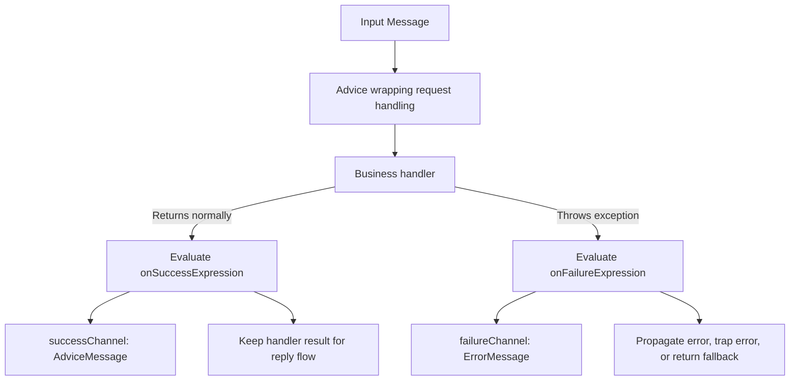

# ExpressionEvaluatingRequestHandlerAdvice

## 1. The Problem: Tracking Outcomes at an Endpoint

In the **Advice and Retries** chapter of the **SPRING_INTEGRATION_CORE** module, `ExpressionEvaluatingRequestHandlerAdvice` lets you add behavior after handling a message without mixing tracking code into business methods.

Suppose an endpoint receives a request to save an order. When processing succeeds, the system needs to emit a tracking event; when processing fails, it needs to send diagnostic details. At the same time, the caller still needs to receive a reply or an exception according to the chosen contract. The advice allows configuring these behaviors using Spring Expression Language (SpEL).

After this lesson, you will be able to:

- Attach the advice to a message handler using Java DSL.
- Read the expression input data and resulting message structure accurately.
- Choose between propagating errors, trapping errors, and returning a fallback.
- Predict event counts when combining the advice with retry and design matching tests.

The examples use the **Spring Integration 6.5** API, Java 17 or later, and JUnit Jupiter for test code. This is the API baseline for the lesson, not a mandate for the latest version. The retry section at the end uses `org.springframework.retry.support.RetryTemplate`; when moving to another Spring Integration line, check that line's retry API.

## 2. Where Does the Advice Sit in the Message Flow?

`ExpressionEvaluatingRequestHandlerAdvice` belongs to package `org.springframework.integration.handler.advice` and extends `AbstractRequestHandlerAdvice`. It has two expressions: one for successful handling and one for failed handling. Messages emitted to side channels depend on the expression evaluation results. [ExpressionEvaluatingRequestHandlerAdvice 6.5.0 Javadoc](https://docs.spring.io/spring-integration/docs/6.5.0/api/org/springframework/integration/handler/advice/ExpressionEvaluatingRequestHandlerAdvice.html).



The diagram assumes the expression evaluates to a non-`null` value and the corresponding channel is configured. Side channels do not replace the reply path automatically.

For a reply-producing handler, the request advice chain wraps `handleRequestMessage`. Therefore, "success" here describes the scope wrapped by the advice; it does not prove downstream endpoints succeeded, that the message reached an external system, or that a transaction committed. [AbstractReplyProducingMessageHandler Javadoc](https://docs.spring.io/spring-integration/docs/6.5.0/api/org/springframework/integration/handler/AbstractReplyProducingMessageHandler.html).

For example: endpoint A returns normally and A's advice emits an event. Then endpoint B fails. If you need to report "the entire order completed," emit the event at the appropriate business completion point rather than inferring it from A's success.

## 3. Which Message Do Expressions Read?

The root object of the expressions is **the input Message passed to the handler**. Thus, `payload` and `headers` describe the request. In the failure expression, the exception can be accessed via the `#exception` variable. If you configure a channel without configuring its expression, the default expression is `payload`. [Expression setter Javadoc](https://docs.spring.io/spring-integration/docs/6.5.0/api/org/springframework/integration/handler/advice/ExpressionEvaluatingRequestHandlerAdvice.html#setOnFailureExpressionString(java.lang.String)).

| Example Expression | Meaning |
| --- | --- |
| `payload` | Retrieves the request payload |
| `headers['orderId']` | Retrieves the order identifier header |
| `'ACCEPTED:' + payload` | Builds a tracking string from the request |
| `#exception.message` | Retrieves the error message in the failure expression |
| `@auditFormatter.failure(payload, #exception)` | Invokes a bean to format error details |

There is no default `#result` variable holding the handler's return value. If the request is `order-42` and the handler returns `SAVED:order-42`, the success expression `'ACCEPTED:' + payload` produces `ACCEPTED:order-42`.

If you need to process the **return value**, add an endpoint after the handler, such as a transformer or an event-publishing flow driven by the reply. Do not mutate shared payloads with temporary data just so the success expression can see the result.

For an operation that does not produce a reply, returning `null` from the method can still represent normal completion within the invocation scope. Event design must distinguish "request was handled" from "a reply was produced." Reply rules and stopping the flow on a `null` result are documented in [Reply-Producing Handler Javadoc](https://docs.spring.io/spring-integration/docs/6.5.0/api/org/springframework/integration/handler/AbstractReplyProducingMessageHandler.html#handleRequestMessage(org.springframework.messaging.Message)).

## 4. Two Side Channels Carry Two Different Structures

### 4.1. Success: AdviceMessage

A success message is an `AdviceMessage<?>`:

- `getPayload()` holds the result of the success expression.
- `getInputMessage()` provides the input Message.

Do not assume every request header is copied onto the outer success message. When you need `orderId` or `correlationId`, read from `getInputMessage().getHeaders()` or explicitly construct the required fields inside the event payload. [AdviceMessage Javadoc](https://docs.spring.io/spring-integration/docs/6.5.0/api/org/springframework/integration/message/AdviceMessage.html).

The snippet below illustrates reading a message received from the success channel:

```java
import org.springframework.integration.message.AdviceMessage;
import org.springframework.messaging.Message;

// successMessage is a Message<?> received from successChannel.
AdviceMessage<?> notice = (AdviceMessage<?>) successMessage;
Object event = notice.getPayload();
Message<?> request = notice.getInputMessage();
Object orderId = request.getHeaders().get("orderId");
```

### 4.2. Failure: ErrorMessage

A failure message is an `ErrorMessage`. Its payload is a `MessageHandlingExpressionEvaluatingAdviceException`, not directly the string returned by the failure expression. The expression result is in `getEvaluationResult()`; the request is in `getFailedMessage()`, and the underlying cause is preserved in the cause chain. Details of this structure appear in [the advice source at tag v6.5.0](https://github.com/spring-projects/spring-integration/blob/v6.5.0/spring-integration-core/src/main/java/org/springframework/integration/handler/advice/ExpressionEvaluatingRequestHandlerAdvice.java).

```java
import org.springframework.integration.handler.advice
        .ExpressionEvaluatingRequestHandlerAdvice
        .MessageHandlingExpressionEvaluatingAdviceException;
import org.springframework.messaging.support.ErrorMessage;

// failureMessage is a Message<?> received from failureChannel.
ErrorMessage notice = (ErrorMessage) failureMessage;
MessageHandlingExpressionEvaluatingAdviceException failure =
        (MessageHandlingExpressionEvaluatingAdviceException) notice.getPayload();

Object event = failure.getEvaluationResult();
Object requestPayload = failure.getFailedMessage().getPayload();
Throwable cause = failure.getCause();
```

In a consumer dedicated to handling failures from this advice, you can route by exception type and extract `evaluationResult`. If sharing a channel with other error sources, check the payload type before casting.

## 5. Exception Handling Options

All three flags below default to `false`:

| Configuration | Purpose |
| --- | --- |
| `setTrapException(true)` | Traps exceptions within the advice scope and returns `null` if no failure result is returned |
| `setReturnFailureExpressionResult(true)` | Uses the failure expression result as the request-handling return value |
| `setPropagateEvaluationFailures(true)` | Allows errors evaluating the success expression to enter exception propagation |

`propagateEvaluationFailures` is not a general business-exception propagation policy. [Error-control flags Javadoc](https://docs.spring.io/spring-integration/docs/6.5.0/api/org/springframework/integration/handler/advice/ExpressionEvaluatingRequestHandlerAdvice.html#setPropagateEvaluationFailures(boolean)).

Assuming the handler throws an exception, the failure expression succeeds, and sending to the side channel does not fail:

| `trapException` | `returnFailureExpressionResult` | Behavior for the Main Flow |
| --- | --- | --- |
| `false` | `false` | Exception is propagated |
| `true` | `false` | Returns `null`, usually producing no reply |
| `false` | `true` | Returns the failure result instead of the exception |
| `true` | `true` | Returns the failure result; returning the result takes precedence |

Sending an `ErrorMessage` to the failure channel does not by itself consume the exception. Conversely, enabling returning the failure result does not require enabling `trapException`. This decision order is visible in [doInvoke in the v6.5.0 source](https://github.com/spring-projects/spring-integration/blob/v6.5.0/spring-integration-core/src/main/java/org/springframework/integration/handler/advice/ExpressionEvaluatingRequestHandlerAdvice.java).

You must configure a failure expression if you want to use its result. Without an expression, there is no fallback value to return; the `returnFailureExpressionResult` flag does not invent a substitute value.

## 6. Java DSL Example: Tracking While Preserving the Error Contract

This example simulates saving an order:

- Request `order-42` produces reply `SAVED:order-42` and a success event.
- Requests starting with `fail:` raise an error, emit a failure event, and still propagate the exception to the caller.

In a learning application that already has the `spring-integration-core` 6.5 dependency, put the configuration below in a Java class. Side channels are queues so tests can actively pull messages; no poller is needed just to call `receive()` directly.

```java
import org.springframework.context.annotation.Bean;
import org.springframework.context.annotation.Configuration;
import org.springframework.integration.channel.DirectChannel;
import org.springframework.integration.channel.QueueChannel;
import org.springframework.integration.config.EnableIntegration;
import org.springframework.integration.dsl.IntegrationFlow;
import org.springframework.integration.handler.advice
        .ExpressionEvaluatingRequestHandlerAdvice;

@Configuration
@EnableIntegration
public class AdviceDemoConfig {

    @Bean
    public DirectChannel requests() {
        return new DirectChannel();
    }

    @Bean
    public QueueChannel replies() {
        return new QueueChannel(20);
    }

    @Bean
    public QueueChannel successEvents() {
        return new QueueChannel(20);
    }

    @Bean
    public QueueChannel failureEvents() {
        return new QueueChannel(20);
    }

    @Bean
    public ExpressionEvaluatingRequestHandlerAdvice auditAdvice() {
        ExpressionEvaluatingRequestHandlerAdvice advice =
                new ExpressionEvaluatingRequestHandlerAdvice();

        advice.setOnSuccessExpressionString("'ACCEPTED:' + payload");
        advice.setSuccessChannel(successEvents());
        advice.setOnFailureExpressionString("'REJECTED:' + payload");
        advice.setFailureChannel(failureEvents());

        advice.setTrapException(false);
        advice.setReturnFailureExpressionResult(false);
        advice.setPropagateEvaluationFailures(false);
        return advice;
    }

    @Bean
    public IntegrationFlow saveOrderFlow() {
        return IntegrationFlow.from(requests())
                .<String>handle((payload, headers) -> {
                    if (payload.startsWith("fail:")) {
                        throw new IllegalArgumentException("Cannot save order");
                    }
                    return "SAVED:" + payload;
                }, endpoint -> endpoint
                        .id("saveOrderEndpoint")
                        .advice(auditAdvice()))
                .channel(replies())
                .get();
    }
}
```

`endpoint.advice(...)` attaches the advice to the handler at the `.handle(...)` step. It does not register an interceptor for every channel in the application. The DSL accepts multiple advices in nested order. [ConsumerEndpointSpec.advice Javadoc](https://docs.spring.io/spring-integration/docs/6.5.0/api/org/springframework/integration/dsl/ConsumerEndpointSpec.html#advice(org.aopalliance.aop.Advice...)).

The configuration uses default `@Configuration` proxying for `@Bean` methods. If you change to `proxyBeanMethods = false`, switch to injecting beans as method parameters; calling bean methods directly as shown above would otherwise create unwanted extra instances.

The capacity-20 queues serve a short lab exercise. When running continuously, consumers are needed to drain events; full queues can block senders. This is not yet a durable audit storage system.

## 7. Testing Replies and Side Channels Independently

Do not only assert "there is a message on the failure channel." Verify simultaneously the caller's outcome, side-channel message type, and relationship to the request.

The class below uses JUnit Jupiter and creates the Spring context directly, without requiring Spring Boot or Spring Test annotations:

```java
import org.junit.jupiter.api.Test;
import org.springframework.context.annotation.AnnotationConfigApplicationContext;
import org.springframework.integration.channel.DirectChannel;
import org.springframework.integration.channel.QueueChannel;
import org.springframework.integration.handler.advice
        .ExpressionEvaluatingRequestHandlerAdvice
        .MessageHandlingExpressionEvaluatingAdviceException;
import org.springframework.integration.message.AdviceMessage;
import org.springframework.messaging.Message;
import org.springframework.messaging.MessagingException;
import org.springframework.messaging.support.ErrorMessage;
import org.springframework.messaging.support.MessageBuilder;

import static org.junit.jupiter.api.Assertions.*;

class AdviceDemoTest {

    @Test
    void successKeepsBusinessReplyAndPublishesInputBasedEvent() {
        try (var context = new AnnotationConfigApplicationContext(
                AdviceDemoConfig.class)) {
            DirectChannel requests = context.getBean(
                    "requests", DirectChannel.class);
            QueueChannel replies = context.getBean("replies", QueueChannel.class);
            QueueChannel successes = context.getBean(
                    "successEvents", QueueChannel.class);
            QueueChannel failures = context.getBean(
                    "failureEvents", QueueChannel.class);

            Message<String> request = MessageBuilder.withPayload("order-42")
                    .setHeader("orderId", "42")
                    .build();

            assertTrue(requests.send(request));

            Message<?> reply = replies.receive(1_000);
            assertNotNull(reply);
            assertEquals("SAVED:order-42", reply.getPayload());

            Message<?> notification = successes.receive(1_000);
            assertInstanceOf(AdviceMessage.class, notification);
            AdviceMessage<?> event = (AdviceMessage<?>) notification;
            assertEquals("ACCEPTED:order-42", event.getPayload());
            assertSame(request, event.getInputMessage());
            assertEquals("42", event.getInputMessage().getHeaders().get("orderId"));
            assertNull(failures.receive(0));
        }
    }

    @Test
    void failurePublishesErrorAndStillThrowsToDirectCaller() {
        try (var context = new AnnotationConfigApplicationContext(
                AdviceDemoConfig.class)) {
            DirectChannel requests = context.getBean(
                    "requests", DirectChannel.class);
            QueueChannel replies = context.getBean("replies", QueueChannel.class);
            QueueChannel successes = context.getBean(
                    "successEvents", QueueChannel.class);
            QueueChannel failures = context.getBean(
                    "failureEvents", QueueChannel.class);

            Message<String> request = MessageBuilder.withPayload("fail:order-42")
                    .setHeader("orderId", "42")
                    .build();

            assertThrows(MessagingException.class, () -> requests.send(request));

            Message<?> notification = failures.receive(1_000);
            assertInstanceOf(ErrorMessage.class, notification);
            ErrorMessage error = (ErrorMessage) notification;
            assertInstanceOf(MessageHandlingExpressionEvaluatingAdviceException.class,
                    error.getPayload());
            MessageHandlingExpressionEvaluatingAdviceException failure =
                    (MessageHandlingExpressionEvaluatingAdviceException)
                            error.getPayload();

            assertSame(request, failure.getFailedMessage());
            assertEquals("REJECTED:fail:order-42", failure.getEvaluationResult());
            assertNotNull(failure.getCause());
            assertNull(replies.receive(0));
            assertNull(successes.receive(0));
        }
    }
}
```

These two tests are practice code for learners to run in a matching project. They make no network calls, need no broker, and each test creates a fresh context to avoid leftover events from earlier runs.

Spring Integration's own tests likewise distinguish `AdviceMessage` from `ErrorMessage` and read the failure result through the wrapping exception. [Advice tests at tag v6.5.0](https://github.com/spring-projects/spring-integration/blob/v6.5.0/spring-integration-core/src/test/java/org/springframework/integration/handler/advice/ExpressionEvaluatingRequestHandlerAdviceTests.java).

## 8. Trapping Errors or Returning Fallbacks Intentionally

### 8.1. Trapping Errors and Ending the Branch

In the example's `auditAdvice()` bean, change the flags to:

```java
advice.setTrapException(true);
advice.setReturnFailureExpressionResult(false);
```

For failing requests, the failure event is still created, while the invocation returns `null`. No `SAVED:...` string is produced to send to `replies`.

If the endpoint requires a reply via `requiresReply(true)`, returning `null` can trigger a reply-required error at the handler layer. For a gateway awaiting a response, producing no reply can cause it to wait until its configured timeout. Therefore, choose this option only when the contract permits no reply. [requiresReply Javadoc](https://docs.spring.io/spring-integration/docs/6.5.0/api/org/springframework/integration/handler/AbstractReplyProducingMessageHandler.html#setRequiresReply(boolean)).

`requests.send(...)` returning `true` in an error-trapping flow is not proof that the order was saved. In this example, the simulated save failed; the contract only changed how failure is reported.

### 8.2. Returning a Fallback on the Reply Path

If you want the caller to receive an interpretable business outcome, replace the failure settings with:

```java
advice.setOnFailureExpressionString("'PENDING_REVIEW:' + payload");
advice.setReturnFailureExpressionResult(true);
advice.setTrapException(false);
```

Keep `failureChannel` as in the previous example. When processing `fail:order-42`:

| Where Observed | Expected Value |
| --- | --- |
| Reply payload | `PENDING_REVIEW:fail:order-42` |
| Failure message payload | The advice's exception |
| `evaluationResult` in the exception | `PENDING_REVIEW:fail:order-42` |
| Original exception propagating directly to caller | Replaced by the fallback result if the fallback branch completes |

In real systems, use a result type with explicit statuses such as `ACCEPTED`, `PENDING_REVIEW`, `REJECTED`. If a gateway method is declared to return `OrderResult`, the failure expression must also produce data matching that contract. An arbitrary string can cause a conversion error downstream in reply handling.

You can invoke a bean to create the fallback:

```java
advice.setOnFailureExpressionString(
        "@fallbackFactory.pending(payload, #exception)");
```

`fallbackFactory` must be registered as a bean in the context and `pending` must return a compatible value. Moving conditional branching, data lookups, or complex error mapping into Java makes testing clearer than writing a long expression.

## 9. Nulls and Expression Evaluation Errors

If an expression returns `null`, the advice emits no message to the corresponding channel. This differs from the handler returning `null`: one is an expression result, the other is a business result. [Expression evaluation source v6.5.0](https://github.com/spring-projects/spring-integration/blob/v6.5.0/spring-integration-core/src/main/java/org/springframework/integration/handler/advice/ExpressionEvaluatingRequestHandlerAdvice.java).

You can use a `null` result to suppress a notification, but avoid letting accidental `null` values drop error traces. For example, a failure expression reading a missing header will fail to emit the expected event if it evaluates to `null`.

If the success expression fails, do not assume it is a business error. With the example's default configuration, a success evaluation error may appear as an exception payload on the success channel. Consumers of that channel need an explicit contract if expressions are permitted to run logic that can fail. [propagateEvaluationFailures Javadoc](https://docs.spring.io/spring-integration/docs/6.5.0/api/org/springframework/integration/handler/advice/ExpressionEvaluatingRequestHandlerAdvice.html#setPropagateEvaluationFailures(boolean)).

When enabling propagation of success evaluation failures, test with the full advice chain and trap/fallback flags; do not assume the caller always receives that exact exception in every configuration. Also distinguish expression errors from errors sending to the side channel: a synchronous subscriber on the side channel can still throw its own error.

One way to reduce fragility is to build a minimal event from known fields and move audit processing to a separate consumer. Do not treat the failure expression as a reliable safety net for every error that might happen inside the success expression itself.

## 10. Ordering When Combining with Retry

Expression advice does not perform retries on its own. In 6.5, `RequestHandlerRetryAdvice` uses Spring Retry and accepts configuration via `setRetryTemplate`. [RequestHandlerRetryAdvice 6.5.0 Javadoc](https://docs.spring.io/spring-integration/docs/6.5.0/api/org/springframework/integration/handler/advice/RequestHandlerRetryAdvice.html).

Add the bean below to the configuration along with the matching imports:

```java
import org.springframework.integration.handler.advice.RequestHandlerRetryAdvice;
import org.springframework.retry.support.RetryTemplate;

@Bean
public RequestHandlerRetryAdvice retryAdvice() {
    RequestHandlerRetryAdvice advice = new RequestHandlerRetryAdvice();
    advice.setRetryTemplate(RetryTemplate.builder()
            .maxAttempts(3)
            .fixedBackoff(100)
            .build());
    return advice;
}
```

The retry example requires adding a compatible `spring-retry` dependency to the project. Spring Retry's `maxAttempts(3)` includes the initial call, allowing at most three handler invocations. No recovery callback is configured in this snippet. [Spring Integration 6.5 retry docs](https://docs.spring.io/spring-integration/reference/6.5/handler-advice/classes.html#retry-advice).

### 10.1. Expression Advice Outside Retry

Replace the endpoint's advice configuration with:

```java
endpoint.advice(auditAdvice(), retryAdvice())
```

You can visualize the call nesting as:

```text
expressionAdvice(
    retryAdvice(
        handler
    )
)
```

If the handler fails twice and succeeds on the third attempt, the expression advice sees one normal result after retries finish. If all three attempts fail, it sees the final failure.

This is the right choice when events should represent the **final outcome of a retry cycle**. This follows from the advice nesting order defined by the DSL, assuming no recovery converts errors into normal returns. [Advice ordering Javadoc](https://docs.spring.io/spring-integration/docs/6.5.0/api/org/springframework/integration/dsl/ConsumerEndpointSpec.html#advice(org.aopalliance.aop.Advice...)).

### 10.2. Expression Advice Inside Retry

Reverse the order to:

```java
endpoint.advice(retryAdvice(), auditAdvice())
```

Then every retry invocation of the handler passes through the expression advice. For a configuration that propagates errors like the main example, expected outcomes are:

| Scenario | Expression Outside Retry | Expression Inside Retry |
| --- | --- | --- |
| Succeeds immediately | 1 success event | 1 success event |
| Fails twice, succeeds on third | 1 success event | 2 failure events and 1 success event |
| All three attempts fail | 1 failure event | 3 failure events |

The table reflects predictions from the call structure; it assumes expressions always evaluate to non-`null`, event sends succeed, and no recovery callback is configured.

If the expression advice sits **inside** retry yet enables `trapException(true)` or returns a fallback, the outer retry may see a normally completed invocation on the first attempt. Once exceptions no longer escape, the retry trigger disappears as well.

If retry has a recovery callback that returns normally, an expression advice **outside** retry may take the success branch even though the handler failed on every attempt. Therefore, define clearly whether success means "handler succeeded" or "the processing chain produced a result, including recovery." That business decision should be reflected in the result's status.

## 11. failureChannel and errorChannel Are Two Mechanisms to Distinguish

`failureChannel` in this lesson is a destination to which the expression advice explicitly sends notifications. It does not automatically replace the `errorChannel` header or the application's shared `errorChannel` bean.

With a `DirectChannel`, the handler runs on the sender's thread, so untrapped exceptions can propagate directly to the caller. With executor or poller processing, the asynchronous component's error-handling mechanism may publish an `ErrorMessage` according to error-channel configuration. [6.5 Error Handling docs](https://docs.spring.io/spring-integration/reference/6.5/error-handling.html).

Consequently, a single failure can produce both a message on the advice's failure channel and a message on an outer layer's error channel. Do not count them as two independent business failures.

In operational design, you can designate one channel for diagnostics and another for deciding retries, queuing for manual intervention, or reporting failure. Use `orderId` or a stable business key to correlate events; do not equate log counts with failed order counts.

## 12. Limits When Used for Auditing and Side Effects

Suppose the save operation succeeds, while the subscriber handling the tracking event fails. If that exception causes an outer layer to re-run the handler, data may be written twice. Before letting audit failures trigger business retries, determine whether the save operation is idempotent.

Similarly, a success event emitted inside request advice can appear before an enclosing outer transaction commits. If the requirement is to publish events only after commit or persist data and events consistently, design a transaction-aware mechanism—such as storing events via an outbox in the business transaction and publishing separately. Do not treat the name `successChannel` as a durability guarantee.

For learning flows or technical tracing, expression advice fits well when events are small and the observation scope is narrow. For confirming completion of a multi-endpoint business process, model completion state in the business flow, using routers for branches and aggregators when waiting on multiple results.

When deploying to production, clarify these points in the event contract:

- Whether an event describes a single attempt or a final outcome.
- The business key used for correlation and deduplication.
- What consumers must do if they receive the same event again.
- How to handle slow or unavailable event-recording systems.

## 13. Additional Scenarios to Practice

Using the Section 6 configuration as a starting point, change only one policy at a time:

| Change | What to Observe |
| --- | --- |
| Configure success channel only, omit success expression | Event defaults to the request payload |
| Success expression is SpEL `null` | No success event even when handler succeeds |
| Enable `trapException`, keep return-failure-result `false` | No reply on the error branch if endpoint allows it |
| Enable returning failure result | Reply carries fallback and failure event can still be emitted |
| Place expression advice outside retry | Sees only the final cycle outcome under Section 10's assumptions |
| Place expression advice inside retry | Sees events per attempt |
| Enable trap when expression advice is inside retry | Count invocations to verify whether retries still happen |
| Make expression or side-channel consumer throw | Distinguish tracking errors from handler errors |

To count invocations, you can use an `AtomicInteger` in a simulated handler bean, throwing exceptions on the first two calls and returning a result on the third. Inspect both the counter and message counts on both queues. Do not use `Thread.sleep()` to guess outcomes in synchronous examples; receive messages with a timeout and inspect queues after sending completes.

Key behaviors to remember: the success expression reads the request; the two side channels carry two different structures; emitting error details and trapping exceptions are separate decisions; and advice ordering determines whether you observe individual attempts or the entire retry cycle's outcome.