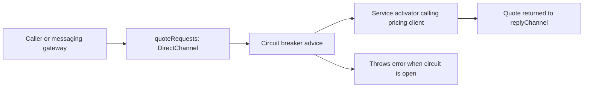
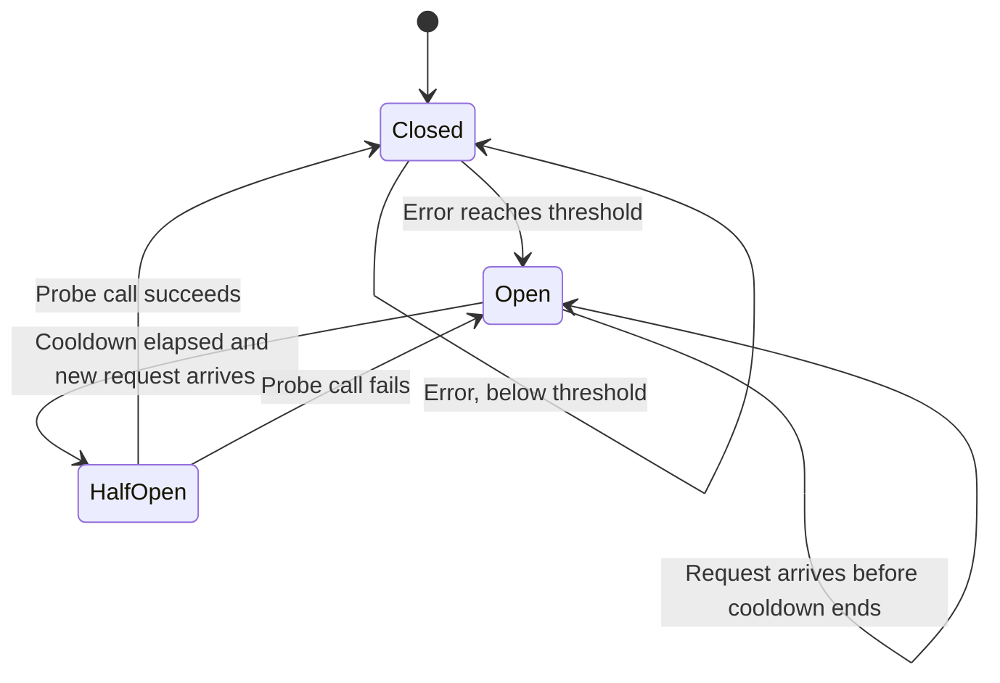

# RequestHandlerCircuitBreakerAdvice

## 1. The Problem: Stopping Calls to a Continuously Failing Service

In a Spring Integration flow, a service activator may call a pricing service, payment authorization service, or inventory lookup. When a dependency fails, each incoming message triggers yet another call that waits to connect or read data. Queues grow longer, execution threads stay blocked, and one system's failure can cascade into other systems.

`RequestHandlerCircuitBreakerAdvice` adds circuit-breaking behavior around a message handler: after a number of consecutive failures, requests arriving during a cooldown period are rejected early. Once the cooldown expires, a new request can call the handler again to probe for recovery.

In the **Advice and Retries** chapter of the **SPRING_INTEGRATION_CORE** module, this lesson aims to place this mechanism accurately into the `Message → MessageChannel → endpoint` flow, explain the impact of advice ordering, and test using actual service invocation counts. Examples use Java DSL with a simulated pricing service, requiring no network connection.

The examples target Java 17 or later and the Spring Integration 6.5.0 API as a concrete baseline. Spring Boot projects should obtain compatible versions through Boot's dependency management. Observations about implementation details below are scoped to that baseline version; do not assume every circuit breaker library behaves identically.

## 2. Where Does the Advice Sit in the Message Flow?

Consider a pricing flow:



`Message` carries the quote request in its payload and headers for reply routing. `DirectChannel` delivers the message to the endpoint on the caller's thread. The service activator passes the payload to the pricing client. The advice decides whether the protected processing runs.

For reply-producing handlers, request handler advice wraps the request-handling step. Do not interpret it as protection for every downstream endpoint, every reply-sending operation, or the entire application. Endpoint scoping is why you attach the advice close to the dependency call you want to protect. [Endpoint advice scope documentation](https://docs.spring.io/spring-integration/reference/6.5/handler-advice.html), [AbstractRequestHandlerAdvice 6.5.0 source](https://github.com/spring-projects/spring-integration/blob/v6.5.0/spring-integration-core/src/main/java/org/springframework/integration/handler/advice/AbstractRequestHandlerAdvice.java).

For instance, if a flow looks up a price and then saves an order, a circuit breaker on the price lookup step does not represent the health of the database in the order-saving step. Two dependencies may require two separate policies.

## 3. Understanding the Three States Through Observable Behavior

The state names come from electrical circuits: a **closed** circuit lets calls pass through; an **open** circuit blocks calls.

| Conceptual State | Does a New Request Call the Handler? | What Happens Next? |
| --- | --- | --- |
| Closed | Yes | Success resets the failure streak; failure increments consecutive failures |
| Open, cooldown not elapsed | No | Throws early-rejection error; dependency does not receive this call |
| Half-open, cooldown elapsed | May call again | Success recovers; failure re-opens the circuit |



This model illustrates sequential calls. The passage of cooldown time does not generate a service request on its own; a new message must pass through the endpoint. The concurrency section in Section 10 explains why this diagram does not imply only a single probe call in every situation.

## 4. Two Configuration Properties and How Failures Are Counted

| Property | Meaning | Default | Unit |
| --- | --- | --- | --- |
| `threshold` | Number of consecutive failures before opening the circuit | `5` | Failures observed by the advice |
| `halfOpenAfter` | Wait duration from the most recent failure before allowing a retry probe | `1000` | Milliseconds |

The API provides `setThreshold(int)` and `setHalfOpenAfter(long)`. When blocked, the advice throws `RequestHandlerCircuitBreakerAdvice.CircuitBreakerOpenException`, a subclass of `MessagingException`. [Javadoc 6.5.0](https://docs.spring.io/spring-integration/docs/6.5.0/api/org/springframework/integration/handler/advice/RequestHandlerCircuitBreakerAdvice.html).

Example:

```java
RequestHandlerCircuitBreakerAdvice breaker =
        new RequestHandlerCircuitBreakerAdvice();
breaker.setThreshold(2);
breaker.setHalfOpenAfter(5_000L);
```

Choose a positive `threshold` and a positive cooldown meaningful for the dependency. The value `5_000L` here is five seconds, not five thousand seconds. In real configuration, you can use `Duration.ofSeconds(5).toMillis()` to make the unit explicit.

### 4.1. Sample Progression When the Service Has Not Recovered

Suppose calls execute sequentially without retry and timestamps are recorded near when each call finishes:

| Relative Time | Event | Calls Pricing Client? | Outcome |
| --- | --- | --- | --- |
| 0 s | Request A fails | Yes | Consecutive failure count = 1 |
| 1 s | Request B fails | Yes | Failure count = 2; subsequent requests start being blocked |
| 2 s | Request C arrives | No | Rejected early |
| 4 s | Request D arrives | No | Still within cooldown measured from B |
| 6.1 s | Request E arrives, service still failing | Yes | Probe fails; starts a new cooldown |
| 7 s | Request F arrives | No | Rejected early after the failed probe |
| 11.2 s | Request G arrives, service is healthy | Yes | Succeeds; resets failure streak |

Requests rejected early are not new failed calls to the service. In the 6.5.0 implementation, the rejection branch does not update the handler's last-failure timestamp. Thus, continuous traffic while the circuit is open does not keep extending the cooldown. [RequestHandlerCircuitBreakerAdvice 6.5.0 source](https://github.com/spring-projects/spring-integration/blob/v6.5.0/spring-integration-core/src/main/java/org/springframework/integration/handler/advice/RequestHandlerCircuitBreakerAdvice.java).

### 4.2. Consecutive Failures, Not Failure Rate

With `threshold = 3`, the sequence `fail → fail → succeed → fail → fail` does not open the circuit during sequential execution. The success splits the sequence into two segments, each having only two failures.

Therefore, do not read this configuration as "open after three failures in one minute" or "open when failure rate exceeds 50%." If business requirements call for statistical windows, error filtering, or rate-based policies, choose a solution that actually provides those capabilities. [Spring Integration circuit breaker description](https://docs.spring.io/spring-integration/reference/handler-advice/classes.html#circuit-breaker-advice).

## 5. Complete Example with Java DSL

The following example registers the channel, simulated client, advice, and flow. Place the class in a Java file of the same name; the test class in Section 12 belongs to the same package, or add corresponding imports if separated.

The main code requires `org.springframework.integration:spring-integration-core` and Spring Context. In a Boot application, you can use `spring-boot-starter-integration`. Tests require JUnit Jupiter and a build setup capable of running JUnit Platform. Note that the circuit breaker configuration below does not use `RetryTemplate`.

```java
import java.math.BigDecimal;
import java.util.concurrent.atomic.AtomicInteger;

import org.springframework.context.annotation.Bean;
import org.springframework.context.annotation.Configuration;
import org.springframework.integration.channel.DirectChannel;
import org.springframework.integration.config.EnableIntegration;
import org.springframework.integration.dsl.IntegrationFlow;
import org.springframework.integration.handler.advice.RequestHandlerCircuitBreakerAdvice;

@Configuration(proxyBeanMethods = false)
@EnableIntegration
public class PricingFlowConfig {

    @Bean
    public DirectChannel quoteRequests() {
        return new DirectChannel();
    }

    @Bean
    public DemoPricingClient pricingClient() {
        return new DemoPricingClient();
    }

    @Bean
    public RequestHandlerCircuitBreakerAdvice pricingCircuitBreaker() {
        RequestHandlerCircuitBreakerAdvice advice =
                new RequestHandlerCircuitBreakerAdvice();
        advice.setThreshold(2);
        advice.setHalfOpenAfter(5_000L);
        return advice;
    }

    @Bean
    public IntegrationFlow pricingFlow(
            DirectChannel quoteRequests,
            DemoPricingClient pricingClient,
            RequestHandlerCircuitBreakerAdvice pricingCircuitBreaker) {

        return IntegrationFlow.from(quoteRequests)
                .handle(QuoteRequest.class,
                        (request, headers) -> pricingClient.quote(request),
                        endpoint -> endpoint
                                .id("pricingCall")
                                .advice(pricingCircuitBreaker))
                .get();
    }

    public record QuoteRequest(String sku) {
    }

    public record Quote(String sku, BigDecimal amount, String source) {
    }

    public static final class DemoPricingClient {

        private final AtomicInteger calls = new AtomicInteger();
        private volatile boolean failing = true;

        public Quote quote(QuoteRequest request) {
            this.calls.incrementAndGet();
            if (this.failing) {
                throw new PricingUnavailableException(
                        "Pricing service is unavailable");
            }
            return new Quote(request.sku(), new BigDecimal("125000"), "LIVE");
        }

        public void setFailing(boolean failing) {
            this.failing = failing;
        }

        public int calls() {
            return this.calls.get();
        }
    }

    public static final class PricingUnavailableException
            extends RuntimeException {

        public PricingUnavailableException(String message) {
            super(message);
        }
    }
}
```

The attachment point is `endpoint.advice(pricingCircuitBreaker)` on `.handle(...)`. Java DSL accepts a list of advices in nested order. [ConsumerEndpointSpec.advice Javadoc](https://docs.spring.io/spring-integration/docs/6.5.0/api/org/springframework/integration/dsl/ConsumerEndpointSpec.html#advice(org.aopalliance.aop.Advice...)).

The client starts in failing mode so you can immediately observe two failures followed by early rejection. Switching `setFailing(false)` simulates service recovery; do not create a new breaker bean when toggling the client's state.

### 5.1. Sending a Message and Receiving a Reply

The call below uses `MessagingTemplate` inside an initialized application context:

```java
import org.springframework.integration.core.MessagingTemplate;
import org.springframework.messaging.Message;
import org.springframework.messaging.MessageChannel;
import org.springframework.messaging.support.MessageBuilder;

MessageChannel requests = context.getBean("quoteRequests", MessageChannel.class);

MessagingTemplate template = new MessagingTemplate();
template.setReceiveTimeout(1_000L);

Message<?> reply = template.sendAndReceive(requests,
        MessageBuilder.withPayload(
                new PricingFlowConfig.QuoteRequest("SKU-42"))
                .setHeader("orderId", "ORDER-1042")
                .build());
```

Here `context` is the context containing `PricingFlowConfig`. `MessagingTemplate` sets up the reply path; the handler returns a `Quote` and the framework builds a reply message. With `DirectChannel`, processing errors may be thrown directly during `sendAndReceive`, before waiting for a reply.

`receiveTimeout` only bounds waiting for the reply. It does not cancel a pricing client blocked on the sending thread itself. When replacing the simulated client with an HTTP client, configure connect and read timeouts on the HTTP client.

A messaging gateway can expose an application API like `Quote requestQuote(QuoteRequest request)` targeting the same `quoteRequests`. Circuit breaking still belongs to the message-handling endpoint; the gateway does not add that capability merely by hiding `Message` from the caller.

## 6. Annotation Configuration as an Alternative

If you already organize endpoints with annotations, you can reference the advice bean by name:

```java
import org.springframework.integration.annotation.ServiceActivator;

@ServiceActivator(
        inputChannel = "quoteRequests",
        adviceChain = "pricingCircuitBreaker")
public PricingFlowConfig.Quote quote(PricingFlowConfig.QuoteRequest request) {
    return pricingClient.quote(request);
}
```

This method belongs to a Spring bean with an injected `pricingClient` field. The channel and `pricingCircuitBreaker` bean still need to be registered. Endpoint annotations' `adviceChain` takes advice bean names. [Annotation advice configuration docs](https://docs.spring.io/spring-integration/reference/6.5/handler-advice/advising-with-annotations.html).

This is an alternative to `.handle(...)` in Section 5. Accidentally registering both on the same `DirectChannel` creates multiple subscribers, and message dispatching can break the expected scenario.

Do not place this advice on an arbitrary POJO method and assume Spring Integration will intercept direct Java calls to that method. Calls must pass through the advised message handler.

## 7. Combining with Retry: Ordering Determines the Failure-Counting Unit

Retry addresses re-trying an operation. A circuit breaker decides whether calls to the operation should still be allowed. The two mechanisms interact through their nesting order around the handler.

The first advice is outermost; the last advice is closest to the handler. Therefore, read `.advice(a, b)` as `a(b(handler))`. [Advice ordering docs](https://docs.spring.io/spring-integration/reference/handler-advice/order.html).

### 7.1. Breaker Outside, Retry Inside

```java
// Replaces the endpoint advice config; retry is an already-created bean.
endpoint.advice(pricingCircuitBreaker, retry);
```

```text
Message
  -> circuit breaker
       -> retry
            -> call client attempt 1
            -> call client attempt 2 if retryable
            -> call client attempt 3 if retryable
```

From the nesting order: if no recovery hides the error, the breaker observes a single failure only when the entire inner retry sequence ends in an exception. If retry succeeds on the final attempt, the breaker observes a success.

Suppose `threshold = 2`, retry allows up to three calls, the client always fails, requests run sequentially, and the cooldown has not elapsed: the first request can call the client three times and contribute one failure to the breaker; the second request does the same; the third request is blocked before entering retry. Total client calls can reach six.

### 7.2. Retry Outside, Breaker Inside

```java
endpoint.advice(retry, pricingCircuitBreaker);
```

```text
Message
  -> retry
       -> circuit breaker -> call client attempt 1
       -> circuit breaker -> call client attempt 2
       -> circuit breaker -> may already reject early
```

From this nesting: each retry entering the breaker is an opportunity to check the circuit. Once two consecutive failures occur, the next retry attempt may simply receive a circuit-open error without calling the client.

If retry continues retrying `CircuitBreakerOpenException`, it may waste attempts and backoff time. When backoff is long enough to outlast the cooldown, a later retry might hit the real service again. Therefore, explicitly define your policy for circuit-open errors rather than just counting retry loop iterations.

### 7.3. Inner Recovery Can Mask Errors

Consider `breaker(retry(handler))`. If retries exhaust and recovery returns a cached `Quote` as a normal result, the outer breaker sees success. The breaker's failure streak may reset even though the pricing service is still down.

This is a consequence of where recovery sits. When designing fallbacks, decide whether the breaker should measure the health of the remote call or the final outcome the application accepts. If the goal is monitoring the dependency, let the dependency error signal pass through the breaker and handle fallback at an appropriate outer layer.

`RequestHandlerRetryAdvice` in 6.5 uses Spring Retry with `RetryTemplate`; it has its own retry, backoff, and recovery settings. In the "three calls" examples above, that count includes the initial attempt. The counts illustrate synchronous retry without recovery and without concurrent calls. [6.5 retry advice docs](https://docs.spring.io/spring-integration/reference/6.5/handler-advice/classes.html#retry-advice).

## 8. What Does the Advice Consider a Failure?

An important boundary is **exceptions thrown by the wrapped call** versus **the business meaning of returned data**.

For example, the client might receive HTTP 503 yet convert it into `QuoteResult(status = "UNAVAILABLE")` and return normally. If the error does not surface as an exception inside the advice scope, do not expect the circuit breaker to treat that `status` field as a failure.

Conversely, an input validation error such as an invalid product SKU could become an exception and add to the failure streak even when the pricing service is healthy. Do not let a burst of malformed requests act as a signal that the service is down.

A sound design for the example is:

1. Validate SKUs and input preconditions before the endpoint calling the pricing service.
2. Define the client contract: connection errors, timeouts, or service errors to track must be represented consistently.
3. Keep valid business outcomes—such as "no price for this SKU"—in an appropriate return type or routing branch.
4. If you need to count only a specific list of exceptions, evaluate a solution or customization that supports explicit exception filtering.

This class does not provide setters like `setFailureRateThreshold`, `setSlidingWindowSize`, or `setRecordExceptions`. Do not bring configuration from another circuit breaker library into this example and treat it as the `RequestHandlerCircuitBreakerAdvice` API. [Methods list in Javadoc](https://docs.spring.io/spring-integration/docs/6.5.0/api/org/springframework/integration/handler/advice/RequestHandlerCircuitBreakerAdvice.html).

## 9. Where Do Circuit-Open Errors Go?

### 9.1. Synchronous Flow with DirectChannel

In the main example, caller and handler run on the same thread. The caller may receive a `MessagingException` whose cause chain holds the original client exception. When the circuit is open, recognize that `CircuitBreakerOpenException` may appear either directly or wrapped inside an enclosing exception.

Distinguish two facts when recording outcomes:

| Outcome Group | Meaning for the Dependency |
| --- | --- |
| Client actually called and failed | One failed attempt to reach the dependency |
| Rejected by circuit breaker | The dependency did not receive this call |
| Client actually succeeded | Evidence that the dependency served the request |
| Returned fallback | Application has a substitute result; track whether the dependency was called |

With a messaging gateway, how exceptions are thrown or routed to an error flow also depends on the gateway's error configuration. Do not assume every caller receives the same outermost exception class.

### 9.2. When Processing Runs on Another Thread

With an `ExecutorChannel` or a consumer polled from a `QueueChannel`, the caller has usually already left the call stack before the handler fails. Asynchronous error handling can create an `ErrorMessage`, preferring the channel in the `errorChannel` header and falling back to the global error channel when applicable. Simply adding an error header to a message sent over a `DirectChannel` does not turn a synchronous error into an asynchronous one. [Spring Integration Error Handling docs](https://docs.spring.io/spring-integration/reference/error-handling.html).

The advice does not buffer messages waiting for the circuit to close, move messages to a dead-letter queue, or replay rejected messages on its own. To defer processing, design a durable queue or bounded redelivery mechanism. Avoid immediately sending failed messages back to the same endpoint in an unpaced loop.

In a quote flow, a fallback might be a cached price with source `CACHE` and a data timestamp. In a payment flow, returning a fake "success" value causes business corruption. A fallback result must accurately reflect whether the real operation executed.

## 10. State Scope and Limits Under Concurrency

### 10.1. State Is Keyed to the Target Handler

In the 6.5.0 source, the advice stores metadata in a map keyed by the `target` handler. Thus, multiple endpoints referencing the same advice bean does not imply they share one counter. Conversely, different messages passing through the same target affect the same state, even when payloads belong to different customers or subsystems. [Metadata storage source](https://github.com/spring-projects/spring-integration/blob/v6.5.0/spring-integration-core/src/main/java/org/springframework/integration/handler/advice/RequestHandlerCircuitBreakerAdvice.java).

Design consequence for a handler calling multiple providers: if you need to isolate failures of provider A from provider B, organize branches and handlers along the desired dependency boundaries. Do not assume changing a `providerId` header creates a separate circuit.

This state resides in the running process's memory. Ten application instances can make ten different circuit-breaking decisions. A restart also wipes in-memory failure history. Do not use it as a distributed lock to ensure only one instance calls a service.

### 10.2. Half-Open Does Not Guarantee Only One Probe Call

In the 6.5.0 implementation, checking the counter and timestamp is not coupled with an exclusive gate around the entire client call. Consequently, once the cooldown expires, multiple threads can pass the check concurrently before one call finishes. The three-state diagram describes conceptual behavior only. [doInvoke source](https://github.com/spring-projects/spring-integration/blob/v6.5.0/spring-integration-core/src/main/java/org/springframework/integration/handler/advice/RequestHandlerCircuitBreakerAdvice.java).

For example, with 20 workers and a client taking two seconds to time out: several calls may already be in flight before the second failure is recorded. Opening the circuit does not cancel those in-flight calls. Similarly, a concurrent success completing later can affect the counter while other calls are still executing.

If you need to limit concurrent in-flight calls, add concurrency limits or a bulkhead. If you need strictly one probe call in half-open, choose a mechanism whose contract supports that and test it under concurrency.

## 11. Choosing Parameters and Operational Observability

`threshold` and `halfOpenAfter` are meaningful only alongside service characteristics and business requirements.

| Factor | Question to Answer | Impact on Design |
| --- | --- | --- |
| Client timeout | How long does one failure take? | Determines how long threads and resources stay held before seeing an error |
| Consecutive failure threshold | Should a single brief blip open the circuit? | Small thresholds react fast but trip easily on transient blips |
| Cooldown period | How long does the dependency typically take to recover? | Too short causes frequent probes; too long delays detecting recovery |
| Traffic and concurrency | How many calls could already be in flight? | Requires separate thread limits or connection pool sizing |
| Retry policy | Does the breaker count individual calls or whole retry chains? | Determines actual load pushed to the service |
| Safe repeatability | Does re-calling cause duplicate side effects? | Requires idempotency keys or reconciliation on timeout |

For example, on a read-only quote API, you might start with `threshold = 3`, a five-second cooldown, a client timeout fitting the latency budget, and bounded retry. This is a starting hypothesis for practice, not a universal preset for every system. Measure under realistic traffic and simulated failures before choosing deployment values.

When observing behavior, separate at least actual client calls, client failures, circuit-open rejections, and fallback uses. Attach `orderId` or a correlation ID for tracing while avoiding turning individual order IDs into unbounded metric labels. Measure client call latency separately from total flow latency so fast rejections are not mistaken for service recovery.

The advice does not provide a built-in state-event model or full monitoring API like some dedicated circuit breaker libraries. Design instrumentation based on the capabilities of your version and client boundary; do not assume an `isOpen()` method exists to call in application code.

## 12. Testing Behavior Through a Real Flow

The tests below use `PricingFlowConfig` from Section 5. Each test creates a fresh context so circuit state does not carry over from one test to the next. No external HTTP server or service account is needed.

What must be proved is **when the client is called** and **which category of exception occurs**. Asserting only that an exception was thrown does not distinguish a failing service from an open circuit breaker rejecting early.

```java
import org.junit.jupiter.api.AfterEach;
import org.junit.jupiter.api.BeforeEach;
import org.junit.jupiter.api.Test;

import org.springframework.context.annotation.AnnotationConfigApplicationContext;
import org.springframework.integration.core.MessagingTemplate;
import org.springframework.integration.handler.advice.RequestHandlerCircuitBreakerAdvice;
import org.springframework.integration.handler.advice.RequestHandlerCircuitBreakerAdvice.CircuitBreakerOpenException;
import org.springframework.messaging.Message;
import org.springframework.messaging.MessageChannel;
import org.springframework.messaging.MessagingException;
import org.springframework.messaging.support.MessageBuilder;

import static org.junit.jupiter.api.Assertions.*;

class PricingCircuitBreakerTest {

    private AnnotationConfigApplicationContext context;
    private PricingFlowConfig.DemoPricingClient client;
    private RequestHandlerCircuitBreakerAdvice breaker;
    private MessageChannel requests;
    private MessagingTemplate template;

    @BeforeEach
    void setUp() {
        this.context = new AnnotationConfigApplicationContext(
                PricingFlowConfig.class);
        this.client = this.context.getBean(
                PricingFlowConfig.DemoPricingClient.class);
        this.breaker = this.context.getBean(
                RequestHandlerCircuitBreakerAdvice.class);
        this.requests = this.context.getBean(
                "quoteRequests", MessageChannel.class);
        this.template = new MessagingTemplate();
        this.template.setReceiveTimeout(1_000L);

        // Set before sending the test's first request.
        this.breaker.setHalfOpenAfter(60_000L);
    }

    @AfterEach
    void tearDown() {
        this.context.close();
    }

    @Test
    void rejectsWithoutCallingClientAfterTwoConsecutiveFailures() {
        assertClientFailure();
        assertClientFailure();

        MessagingException rejected = assertThrows(
                MessagingException.class, () -> requestQuote());

        assertTrue(hasCause(rejected, CircuitBreakerOpenException.class));
        assertEquals(2, this.client.calls());
    }

    @Test
    void aSuccessResetsTheConsecutiveFailureCount() {
        assertClientFailure();

        this.client.setFailing(false);
        Message<?> reply = requestQuote();
        assertNotNull(reply);
        assertInstanceOf(PricingFlowConfig.Quote.class, reply.getPayload());

        this.client.setFailing(true);
        assertClientFailure();
        // This is only the first failure since the last success.
        assertClientFailure();

        MessagingException rejected = assertThrows(
                MessagingException.class, () -> requestQuote());
        assertTrue(hasCause(rejected, CircuitBreakerOpenException.class));
        assertEquals(4, this.client.calls());
    }

    @Test
    void doesNotProbeByItselfWhenTheClientRecovers() {
        assertClientFailure();
        assertClientFailure();
        this.client.setFailing(false);

        // Client is healthy now, but the breaker's cooldown has not elapsed.
        MessagingException rejected = assertThrows(
                MessagingException.class, () -> requestQuote());

        assertTrue(hasCause(rejected, CircuitBreakerOpenException.class));
        assertEquals(2, this.client.calls());
    }

    @Test
    void aSuccessfulProbeClosesTheCircuit() throws InterruptedException {
        this.breaker.setHalfOpenAfter(100L);
        assertClientFailure();
        assertClientFailure();
        this.client.setFailing(false);

        Thread.sleep(200L);

        Message<?> reply = requestQuote();
        assertNotNull(reply);
        assertEquals(3, this.client.calls());

        // Extend cooldown to distinguish counter reset from timeout expiration.
        this.breaker.setHalfOpenAfter(60_000L);
        this.client.setFailing(true);
        assertClientFailure();
        assertEquals(4, this.client.calls());
    }

    @Test
    void aFailedProbeReopensWithoutWaitingForTwoNewFailures()
            throws InterruptedException {

        this.breaker.setHalfOpenAfter(100L);
        assertClientFailure();
        assertClientFailure();

        Thread.sleep(200L);

        // This failure comes from the client, not the early-rejection branch.
        assertClientFailure();
        assertEquals(3, this.client.calls());

        this.breaker.setHalfOpenAfter(60_000L);
        MessagingException rejected = assertThrows(
                MessagingException.class, () -> requestQuote());

        assertTrue(hasCause(rejected, CircuitBreakerOpenException.class));
        assertEquals(3, this.client.calls());
    }

    private Message<?> requestQuote() {
        return this.template.sendAndReceive(this.requests,
                MessageBuilder.withPayload(
                        new PricingFlowConfig.QuoteRequest("SKU-42"))
                        .build());
    }

    private void assertClientFailure() {
        MessagingException failure = assertThrows(
                MessagingException.class, () -> requestQuote());

        assertTrue(hasCause(failure,
                PricingFlowConfig.PricingUnavailableException.class));
        assertFalse(hasCause(failure, CircuitBreakerOpenException.class));
    }

    private static boolean hasCause(
            Throwable error, Class<? extends Throwable> expected) {

        for (Throwable current = error;
                current != null;
                current = current.getCause()) {
            if (expected.isInstance(current)) {
                return true;
            }
        }
        return false;
    }
}
```

The two recovery tests wait in real time because the public API at this baseline does not expose a clock injection point. Waiting 200 ms exceeds the 100 ms cooldown; the tests do not assert an exact millisecond delay. In CI environments with clock jitter or strict timing requirements, adjust the test strategy accordingly. Do not use `halfOpenAfter = 0` to prove open-circuit rejection during cooldown, as that removes the cooldown you need to observe.

Updating advice properties in tests serves only to steer sequential scenarios before each group of operations. Do not infer from this that you should mutate a singleton advice's configuration continuously while the application handles concurrent traffic.

The third test's name refers to how the breaker reacts when the client recovers on its own: flipping the client flag does not immediately close the circuit. To specifically verify no automatic background probe occurs after cooldown expires, add a test that sends no new message, waits past the cooldown, and verifies `calls()` remains unchanged.

## 13. Common Misconceptions

| Misconception | Consequence | How to Handle |
| --- | --- | --- |
| Treating the breaker as an HTTP client timeout | In-flight calls can still hang for a long time | Configure timeouts directly on the client |
| Reading `threshold` as errors within a time window | Wrong predictions of when the circuit opens | Use success/failure sequences to test counting behavior |
| Assuming a circuit-open error means the service was called | Dependency load and error metrics are wrong | Count actual calls at the client boundary |
| Hiding exceptions with a fallback inside the breaker | The breaker may observe continuous success | Position fallbacks according to the signal you want to measure |
| Retrying every error, including circuit-open errors | Increases latency and may retry after cooldown | Explicitly define retryable exceptions and time budgets |
| Expecting the breaker to replay blocked messages automatically | Requests are never reprocessed | Design a queue or redelivery mechanism separately |
| Assuming each tenant gets its own counter by default | One tenant's errors can affect others | Split handlers by the desired isolation boundary |
| Assuming half-open allows strictly one probe | Recovery traffic can exceed expectations | Test under concurrency and bound in-flight calls |
| Creating a new advice instance per message | Failure history never accumulates | Register and reuse the advice as an endpoint component |

## 14. Extended Practice Exercises

Start with `PricingFlowConfig`, keep sequential execution, and record both the received outcome and `client.calls()` after each step:

1. Change `threshold` to 3. Send three failing requests and then a fourth. The fourth request must be rejected without increasing client call count.
2. Insert one successful call between two groups of failures. Explain why the counter does not accumulate across that success.
3. Add bounded retry of three attempts with no recovery. Compare both advice orderings from Section 7 using actual client call counts.
4. Add a cached fallback outside the dependency-failure measurement boundary. Return a result with source `CACHE`, preserve failure telemetry, and verify the fallback is not mistaken for a successful live call.
5. Create two handlers for two simulated providers. Make one provider always fail and verify the other provider still receives requests under your chosen flow layout.
6. Use multiple threads sending concurrently after cooldown expires. Observe how many calls slip through before a probe finishes; do not default to expecting the result to be strictly one.

Your completion criterion is being able to explain the protection boundary, the unit the breaker counts, the exception path, and how rejected messages will be handled next by the business flow. A useful circuit breaker configuration always pairs with explicit error contracts, timeouts, and result-handling plans in the integration flow.