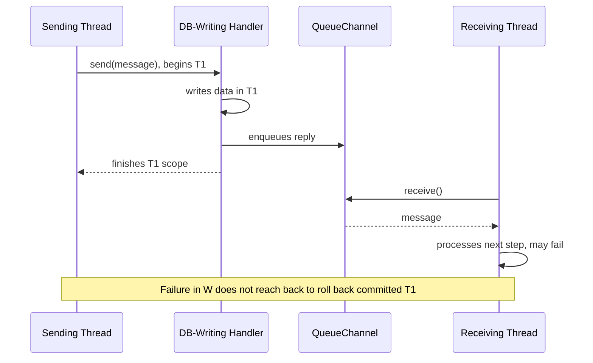

# TransactionInterceptor Advice

In the **Advice and Retries** chapter of the **SPRING_INTEGRATION_CORE** module, `TransactionInterceptor` is an advice used to place a transaction policy around a message-handling invocation. It ensures operations on managed resources commit together or roll back together while business logic stays expressed through handlers and Java DSL.

This lesson uses an order-intake flow: create an order, deduct inventory, and insert a reservation record. Through this example, you will identify where a transaction starts, which errors trigger rollback, which part retry repeats, and how behavior changes when introducing an asynchronous channel.

The examples assume **Java 17+, Spring Integration 6.5.x, Spring Framework 6.2.x**, synchronous JDBC processing, and local transactions via `PlatformTransactionManager`. The retry section uses Spring Retry 2.x. This is the API baseline for reading and practicing the examples; in real applications, use compatible versions managed by your project's BOM.

## 1. The Problem to Solve

A handler receives an `OrderCommand` and performs three steps:

1. Insert the order into `purchase_order`.
2. Decrement available quantity in `inventory`.
3. Insert a record into `reservation`.

If step 2 discovers insufficient stock after step 1 already wrote data, the application must undo the order creation. With SQL statements running independently in auto-commit mode, the database could be left with an order that has no reserved inventory.

When all three steps share the same JDBC transaction, the expectations are:

| Scenario | Order | Inventory | Reservation Record |
| --- | --- | --- | --- |
| Sufficient stock, no error | Saved | Decremented by exact quantity | Saved |
| Insufficient stock | Not saved | Unchanged | Not saved |
| Error on the final SQL statement | Not saved | Restored to prior state | Not saved |

The advice keeps transaction start, completion, and rollback outside business logic. Achieving atomicity still requires all operations to participate in the same managed resource and appropriate transaction.

## 2. What Does TransactionInterceptor Do?

`TransactionInterceptor` belongs to Spring Framework in package `org.springframework.transaction.interceptor`. Spring Integration lets you attach this interceptor to endpoints; `TransactionInterceptorBuilder` is Spring Integration's builder utility for configuring it.

You can picture execution as follows:

```text
Intercept advised call
  -> Resolve TransactionAttribute
  -> TransactionManager starts a transaction or joins an existing one
  -> Invoke wrapped processing
       -> Returns normally: complete according to transaction state
       -> Throws error: apply rollback rules
  -> Return result or propagate error to caller
```

Returning normally does not guarantee commit succeeds: the transaction might already be marked `rollback-only`, or an error may occur at commit time. If the interceptor merely joined an outer transaction, the physical commit decision still belongs to that outer boundary.

### 2.1. Four Components to Identify

| Component | Role in the Example |
| --- | --- |
| `Message<OrderCommand>` | Carries the order-creation request along with headers |
| `MessageChannel` | Delivers the message to the endpoint, affecting execution and call flow |
| Service activator handler | Performs the three JDBC operations |
| Transaction advice and transaction manager | Define the policy and manage the transaction around the call |

A message having an ID header or a gateway having a method named `submit()` does not create a transaction on its own. Transaction configuration is required at the appropriate execution boundary.

### 2.2. Choosing the Transaction Manager by Resource

In the JDBC example, `DataSourceTransactionManager` manages connections for **one `DataSource`**. `JdbcTemplate` must use that same `DataSource` to participate in the transaction. Acquiring connections outside Spring's integration can cause SQL statements to run outside the managed transaction. [DataSourceTransactionManager API](https://docs.spring.io/spring-framework/docs/6.2.0/javadoc-api/org/springframework/jdbc/datasource/DataSourceTransactionManager.html).

For JPA, choose the manager matching `EntityManagerFactory`; for JMS, examine session and listener container transactions. A JDBC transaction manager does not automatically enlist a database, a broker, and an HTTP service into a distributed transaction.

## 3. Advised Boundaries: handleRequestMessage and handleMessage

This distinction must be clear before writing configuration.

For reply-producing handlers such as `AbstractReplyProducingMessageHandler`, standard request advice wraps the internal `handleRequestMessage()` method. Sending the reply to the output channel happens outside that internal call.

`TransactionHandleMessageAdvice` extends `TransactionInterceptor` and implements the `HandleMessageAdvice` marker so it wraps `MessageHandler.handleMessage()`. As a result, its scope can span sending the reply and synchronous downstream execution. [Transaction Support for Handlers](https://docs.spring.io/spring-integration/reference/6.5/handler-advice/tx-handle-message.html).

### 3.1. When There Is No Outer Transaction

Suppose you have a synchronous flow:

```text
orderRequests (DirectChannel)
    -> persistOrder: write DB and return OrderCommand
    -> next check: throw IllegalStateException
```

The two configurations yield different outcomes:

| Advice Attached to `persistOrder` | New Transaction Scope | When Downstream Step Throws |
| --- | --- | --- |
| Standard `TransactionInterceptor` | Request handling inside the handler | DB may already commit before the reply is forwarded |
| `TransactionHandleMessageAdvice` | Entire `handleMessage()` and synchronous downstream calls within it | Error can unwind through the advice and roll back the DB |

Timeline with standard advice:

```text
handleMessage
  |-- begin transaction
  |-- handleRequestMessage: write DB
  |-- commit transaction
  |-- send reply -> downstream throws error
  `-- propagate error to sender; prior transaction already finished
```

With `TransactionHandleMessageAdvice`:

```text
begin transaction
  |-- handleMessage
  |     |-- handleRequestMessage: write DB
  |     `-- send reply -> downstream throws error
  `-- error unwinds to advice -> roll back transaction
```

These diagrams assume no outer enclosing transaction, no handler swallowing the error, and downstream running on the same thread. They do not claim every handler or every channel type shares identical behavior.

### 3.2. Meaning of the Builder's Boolean Parameter

```java
// Standard request advice.
new TransactionInterceptorBuilder()
        .transactionManager(transactionManager)
        .build();

// Creates TransactionHandleMessageAdvice.
new TransactionInterceptorBuilder(true)
        .transactionManager(transactionManager)
        .build();
```

The `true` parameter selects the advice type; it does not enable distributed transactions or force a new transaction regardless of propagation. When using `.transactionAttribute(...)`, individual transaction settings configured directly on the builder are ignored; configure all attributes on `TransactionAttribute` itself. [TransactionInterceptorBuilder API](https://docs.spring.io/spring-integration/docs/6.5.0/api/org/springframework/integration/transaction/TransactionInterceptorBuilder.html).

## 4. Java DSL Example: One Handler Writing Multiple Tables

### 4.1. Prerequisites and Schema

The application needs `spring-integration-core`, `spring-jdbc`, a database driver, and a `DataSource` configuration. The tests later also require Spring Test, JUnit Jupiter, and H2. You do not need to enable `@Transactional` annotation processing merely to use transaction advice attached directly to an endpoint.

Example schema:

```sql
create table purchase_order (
    order_id varchar(64) primary key,
    sku varchar(64) not null,
    quantity integer not null
);

create table inventory (
    sku varchar(64) primary key,
    available integer not null
);

create table reservation (
    order_id varchar(64) primary key,
    sku varchar(64) not null,
    quantity integer not null
);

insert into inventory (sku, available) values ('BOOK-01', 10);
```

### 4.2. Complete Flow Configuration

`DataSource` is supplied by the application. This small example has only one transaction manager; if an application has multiple managers, explicitly qualify the manager meant for each advice.

```java
import javax.sql.DataSource;

import org.springframework.beans.factory.annotation.Qualifier;
import org.springframework.context.annotation.Bean;
import org.springframework.context.annotation.Configuration;
import org.springframework.integration.channel.DirectChannel;
import org.springframework.integration.config.EnableIntegration;
import org.springframework.integration.dsl.IntegrationFlow;
import org.springframework.integration.transaction.TransactionInterceptorBuilder;
import org.springframework.jdbc.core.JdbcTemplate;
import org.springframework.jdbc.datasource.DataSourceTransactionManager;
import org.springframework.transaction.PlatformTransactionManager;
import org.springframework.transaction.annotation.Isolation;
import org.springframework.transaction.annotation.Propagation;
import org.springframework.transaction.interceptor.TransactionInterceptor;

@Configuration
@EnableIntegration
public class OrderFlowConfiguration {

    public record OrderCommand(String orderId, String sku, int quantity) {
        public OrderCommand {
            if (orderId == null || orderId.isBlank()
                    || sku == null || sku.isBlank() || quantity <= 0) {
                throw new IllegalArgumentException("Invalid order");
            }
        }
    }

    @Bean
    public PlatformTransactionManager transactionManager(DataSource dataSource) {
        return new DataSourceTransactionManager(dataSource);
    }

    @Bean
    public JdbcTemplate jdbcTemplate(DataSource dataSource) {
        return new JdbcTemplate(dataSource);
    }

    @Bean
    public DirectChannel orderRequests() {
        return new DirectChannel();
    }

    @Bean
    public TransactionInterceptor orderTx(
            @Qualifier("transactionManager") PlatformTransactionManager manager) {
        return new TransactionInterceptorBuilder()
                .transactionManager(manager)
                .propagation(Propagation.REQUIRED)
                .isolation(Isolation.READ_COMMITTED)
                .timeout(5)
                .build();
    }

    @Bean
    public OrderWriter orderWriter(JdbcTemplate jdbcTemplate) {
        return new OrderWriter(jdbcTemplate);
    }

    @Bean
    public IntegrationFlow orderFlow(
            OrderWriter writer,
            @Qualifier("orderTx") TransactionInterceptor txAdvice) {
        return IntegrationFlow.from("orderRequests")
                .handle(writer, "persist", endpoint -> endpoint
                        .id("persistOrder")
                        .advice(txAdvice))
                .channel("nullChannel")
                .get();
    }

    public static class OrderWriter {
        private final JdbcTemplate jdbc;

        public OrderWriter(JdbcTemplate jdbc) {
            this.jdbc = jdbc;
        }

        public OrderCommand persist(OrderCommand command) {
            jdbc.update("""
                    insert into purchase_order (order_id, sku, quantity)
                    values (?, ?, ?)
                    """, command.orderId(), command.sku(), command.quantity());

            int changed = jdbc.update("""
                    update inventory
                    set available = available - ?
                    where sku = ? and available >= ?
                    """, command.quantity(), command.sku(), command.quantity());

            if (changed != 1) {
                throw new IllegalStateException("Insufficient stock for reservation");
            }

            jdbc.update("""
                    insert into reservation (order_id, sku, quantity)
                    values (?, ?, ?)
                    """, command.orderId(), command.sku(), command.quantity());

            return command;
        }
    }
}
```

The `update ... where available >= ?` statement combines checking stock sufficiency and deducting inventory into one SQL operation. The transaction keeps all three operations as one unit; it does not replace conditional update clauses and database constraints when multiple requests run concurrently.

The flow ends at `nullChannel` because the example has no reply-processing logic yet. The handler still returns `OrderCommand`, keeping clear the difference between request handling and emitting replies.

### 4.3. Sending a Message into the Flow

The snippet below assumes `orderRequests` was injected from the application context:

```java
import org.springframework.messaging.MessageChannel;
import org.springframework.messaging.support.MessageBuilder;

// Inside a bean method or test:
MessageChannel input = orderRequests;
boolean sent = input.send(MessageBuilder
        .withPayload(new OrderFlowConfiguration.OrderCommand(
                "ORDER-1001", "BOOK-01", 3))
        .setHeader("correlationId", "checkout-1001")
        .build());
```

In this synchronous flow, insufficient stock causes `send()` to throw a message-handling exception and the transaction rolls back. The `correlationId` header helps trace requests; it does not carry a JDBC transaction across threads.

If you replace the direct call with a messaging gateway, the gateway provides a Java interface to the caller. The transaction boundary still depends on where the advice or outer transaction is placed and on the flow's execution path.

## 5. Alternative Declarations and Extending Scope

### 5.1. Attaching Advice via Annotations

When declaring endpoints with annotations, you can reference the advice bean by name:

```java
import org.springframework.integration.annotation.ServiceActivator;

@ServiceActivator(
        inputChannel = "orderRequests",
        outputChannel = "nullChannel",
        adviceChain = "orderTx")
public OrderCommand persist(OrderCommand command) {
    // Same JDBC logic as the example above.
    return command;
}
```

This is an **alternative** declaration to Java DSL's `.handle(writer, "persist", ...)` endpoint. It requires a Spring-managed bean with Integration support enabled. In this abbreviated snippet, `OrderCommand` is imported from the configuration class. Keep only one consumer for the lab; registering both simultaneously on the same `DirectChannel` alters message dispatching.

### 5.2. Wrapping Synchronous Downstream Steps in Java DSL

Java DSL provides `.transactional(manager)` and `.transactional(manager, true)`. The `true` variant uses `TransactionHandleMessageAdvice`; when detailed settings are needed, pass a pre-built interceptor via `.transactional(txAdvice)` or attach it with `.advice(txAdvice)`. [ConsumerEndpointSpec API](https://docs.spring.io/spring-integration/docs/6.5.0/api/org/springframework/integration/dsl/ConsumerEndpointSpec.html).

To observe downstream failure, replace the `orderFlow` bean from Section 4 with the configuration below; do not register both beans at once:

```java
@Bean
public IntegrationFlow orderFlow(
        OrderWriter writer,
        @Qualifier("transactionManager") PlatformTransactionManager manager) {
    return IntegrationFlow.from("orderRequests")
            .handle(writer, "persist", endpoint -> endpoint
                    .id("persistOrder")
                    .transactional(manager, true))
            .handle(OrderCommand.class, (command, headers) -> {
                throw new IllegalStateException("Error in downstream step");
            })
            .get();
}
```

With sufficient stock and no outer transaction, the expectation is that all three JDBC changes roll back when the last step throws. Then replace `.transactional(manager, true)` with `.transactional(manager)` to compare: the send call still fails, yet the operations inside `persist()` may already have committed.

If the flow was already running inside an outer transaction and the handler uses `REQUIRED`, the handler joins that transaction. In that case, physical commit may occur after the entire outer call; do not conclude from this experiment that request advice always commits before downstream in every configuration.

## 6. Propagation, Isolation, Timeout, and Rollback

### 6.1. Propagation Decides Whether to Join or Create a Transaction

| Setting | Upon Entering Advice | Design Consequence |
| --- | --- | --- |
| `REQUIRED` | Joins an active transaction; creates one if none exists | Suitable when steps must share the same commit/rollback outcome |
| `REQUIRES_NEW` | Suspends any outer transaction and starts an independent one | Inner commit can persist even if the outer transaction rolls back |
| `MANDATORY` | Requires an active transaction already exist | Useful to catch calls crossing wrong boundaries |
| `NOT_SUPPORTED` | Runs outside transactions, suspending any current one | Writes here are not covered by the outer transaction |

With `REQUIRED`, a `rollback-only` mark from a participating scope can cause the outer scope to receive `UnexpectedRollbackException` when trying to commit. `REQUIRES_NEW` uses separate resources, potentially needing a second connection while the outer transaction still holds the first; consider connection pool capacity. [Transaction Propagation](https://docs.spring.io/spring-framework/reference/6.2/data-access/transaction/declarative/tx-propagation.html).

### 6.2. Isolation and Timeout Have Scoped Applicability

`READ_COMMITTED` is an illustrative choice, not a universal answer for every business invariant. For inventory management, conditional updates, locking strategies, and conflict handling tailored to your database are still necessary.

`timeout(5)` sets the transaction timeout in seconds. It is not a mechanism guaranteed to interrupt arbitrary Java work after five seconds; timeout enforcement depends on the manager and underlying resources. When merely joining an existing transaction, do not assume timeout or isolation declared on the advice overrides the outer transaction's properties.

`readOnly(true)` signals read intent to the infrastructure; do not use it as an access-control mechanism to prevent writes.

### 6.3. Rollback Rules and Wrapped Exceptions

With the example's default transaction attribute, `RuntimeException` and `Error` trigger rollback; checked exceptions do not follow the same rule by default. Crucially, the exception must **actually escape the advised call**. If the handler catches the error and returns a normal value, the interceptor sees a successful invocation. [Spring Rollback Rules](https://docs.spring.io/spring-framework/reference/6.2/data-access/transaction/declarative/rolling-back.html).

Spring Integration may wrap business errors in messaging exceptions. Therefore, do not infer rollback outcomes solely from `throws SomeCheckedException` on a business method, and do not assume a rollback rule automatically traverses every `cause` of an exception.

When policy requires rolling back on every `Exception` escaping the advice, build an explicit attribute:

```java
import java.util.List;

import org.springframework.transaction.TransactionDefinition;
import org.springframework.transaction.interceptor.RollbackRuleAttribute;
import org.springframework.transaction.interceptor.RuleBasedTransactionAttribute;

// Inside the advice bean factory method:
RuleBasedTransactionAttribute attribute = new RuleBasedTransactionAttribute();
attribute.setPropagationBehavior(TransactionDefinition.PROPAGATION_REQUIRED);
attribute.setIsolationLevel(TransactionDefinition.ISOLATION_READ_COMMITTED);
attribute.setTimeout(5);
attribute.setRollbackRules(List.of(new RollbackRuleAttribute(Exception.class)));

TransactionInterceptor txAdvice = new TransactionInterceptorBuilder()
        .transactionManager(transactionManager)
        .transactionAttribute(attribute)
        .build();
```

This is an intentionally broad policy; for specific error types, inspect exceptions at the exact boundary. `RuleBasedTransactionAttribute` applies rollback rules and falls back to default behavior when no rule matches. [RuleBasedTransactionAttribute API](https://docs.spring.io/spring-framework/docs/6.2.0/javadoc-api/org/springframework/transaction/interceptor/RuleBasedTransactionAttribute.html).

## 7. Coordinating Transactions with Retry

Retry answers **whether to re-execute an invocation**. Transactions answer **how data changes within a scope complete**. Retry does not undo data written by an earlier attempt.

### 7.1. Retry Outside, Transaction Inside

When two advices wrap the same call point, the first listed advice is outermost. With retry placed before transaction, one attempt goes through the transaction advice; the next attempt goes through it again. [Advice Ordering](https://docs.spring.io/spring-integration/reference/6.5/handler-advice/order.html).

```text
retry
  |-- attempt 1: begin T1 -> handler fails -> roll back T1
  |-- wait backoff
  `-- attempt 2: begin T2 -> handler succeeds -> commit T2
```

For this configuration to actually give each attempt an independent transaction:

- Use standard transaction advice at the same request level as `RequestHandlerRetryAdvice`.
- Use `REQUIRED` when certain no outer transaction exists, or deliberately choose `REQUIRES_NEW` to isolate each attempt.
- Classify recoverable errors; insufficient stock or invalid input usually needs a clear business outcome rather than immediate retry.

Example adding two beans to the Section 4 configuration:

```java
import java.util.Map;

import org.springframework.dao.TransientDataAccessException;
import org.springframework.integration.handler.advice.RequestHandlerRetryAdvice;
import org.springframework.retry.backoff.ExponentialBackOffPolicy;
import org.springframework.retry.policy.SimpleRetryPolicy;
import org.springframework.retry.support.RetryTemplate;

@Bean
public TransactionInterceptor attemptTx(
        @Qualifier("transactionManager") PlatformTransactionManager manager) {
    return new TransactionInterceptorBuilder()
            .transactionManager(manager)
            .propagation(Propagation.REQUIRES_NEW)
            .timeout(5)
            .build();
}

@Bean
public RequestHandlerRetryAdvice databaseRetry() {
    SimpleRetryPolicy retryPolicy = new SimpleRetryPolicy(
            3,
            Map.of(TransientDataAccessException.class, true),
            true);

    ExponentialBackOffPolicy backoff = new ExponentialBackOffPolicy();
    backoff.setInitialInterval(100);
    backoff.setMultiplier(2.0);
    backoff.setMaxInterval(1000);

    RetryTemplate template = new RetryTemplate();
    template.setRetryPolicy(retryPolicy);
    template.setBackOffPolicy(backoff);

    RequestHandlerRetryAdvice advice = new RequestHandlerRetryAdvice();
    advice.setRetryTemplate(template);
    return advice;
}
```

Then replace the `orderFlow` bean with:

```java
@Bean
public IntegrationFlow orderFlow(
        OrderWriter writer,
        @Qualifier("databaseRetry") RequestHandlerRetryAdvice retry,
        @Qualifier("attemptTx") TransactionInterceptor tx) {
    return IntegrationFlow.from("orderRequests")
            .handle(writer, "persist", endpoint -> endpoint
                    .id("persistOrder")
                    .advice(retry, tx))
            .channel("nullChannel")
            .get();
}
```

`SimpleRetryPolicy` here permits up to **three total executions**, including the initial attempt. Argument `traverseCauses = true` enables error classification across the cause chain, useful when JDBC exceptions are wrapped inside messaging exceptions. Backoff values are in milliseconds. [SimpleRetryPolicy API](https://docs.spring.io/spring-retry/docs/2.0.11/apidocs/org/springframework/retry/policy/SimpleRetryPolicy.html), [RetryTemplate API](https://docs.spring.io/spring-retry/docs/2.0.11/apidocs/org/springframework/retry/support/RetryTemplate.html).

The example omits `RecoveryCallback`: when attempts exhaust, the error propagates outward. If you add a recovery callback that returns normally, define the reply and business status clearly. In this structure, retry recovery sits outside each attempt's transaction; persisting recovery results transactionally requires its own boundary. [Retry Advice](https://docs.spring.io/spring-integration/reference/6.5/handler-advice/classes.html).

`REQUIRES_NEW` also has trade-offs: a committed attempt can remain persisted even if an outer transaction later rolls back. Use it only when that matches the intended contract.

### 7.2. Transaction Outside, Retry Inside

```text
begin T
  |-- retry attempt 1: partial write then fail
  |-- retry attempt 2: continues in T
  `-- complete T or roll back due to error state
```

In `.advice(tx, retry)`, attempts share the outer transaction scope unless an extra boundary is introduced. Some database errors leave the transaction unable to continue; others may leave uncommitted modifications across attempts. Inner retry does not automatically create savepoints or restore initial state for the next attempt.

Outcome depends on the error, resource, and propagation. For write operations, inspect data state after the first failure rather than checking only handler invocation counts.

### 7.3. Do Not Infer Order Solely from List Position When Mixing Advice Levels

The following configuration is easy to misread:

```java
// flowTx is TransactionHandleMessageAdvice, built with builder(true).
endpoint.advice(requestRetry, flowTx);
```

On a reply-producing handler, advices implementing `HandleMessageAdvice` are applied at the `handleMessage()` level, whereas request retry still wraps `handleRequestMessage()`. Thus, list order does not mean request retry sits outside the flow-wide transaction. Swapping the two elements does not move them onto the same level either. [Handling Message Advice](https://docs.spring.io/spring-integration/reference/6.5/handler-advice/handle-message.html).

If you need to retry **an entire synchronous downstream segment**, design both layers around that same boundary—for example, via `handleMessageAdvice(...)` and a compatible interceptor supported by the API. In that case, evaluate the safety of repeating every side effect along that segment. `RequestHandlerRetryAdvice` does not automatically turn into whole-flow retry merely by being placed before a transaction advice.

## 8. How Do Channels, Threads, and Pollers Change Boundaries?

### 8.1. DirectChannel and Asynchronous Handoff Points

Standard JDBC transactions are thread-bound. `DirectChannel` invokes the consumer on the sending thread, allowing transaction context to stay active across synchronous calls. `ExecutorChannel` with an asynchronous executor switches execution to another thread; `QueueChannel` is typically polled by a consumer on a separate poll cycle. [MessageChannel Implementations](https://docs.spring.io/spring-integration/reference/6.5/channel/implementations.html).



The diagram shows one possible timing order; a consumer could even read the message before the sender's transaction commits. Putting a message onto an in-memory queue does not automatically synchronize with a JDBC commit.

`TransactionHandleMessageAdvice` can still wrap **sending** to the channel, but doing so does not extend the transaction past the handoff onto another thread. "Entire downstream" must be understood within synchronous calls and participating transactional resources. [Transaction Boundaries](https://docs.spring.io/spring-integration/reference/6.5/transactions.html#transaction-boundaries).

### 8.2. Handler Advice vs. Poller Transactions

| Location | Scope to Inspect | Verification Question |
| --- | --- | --- |
| Request advice on handler | Request handling after message receipt | Do errors roll back writes inside the handler? |
| Advice on `handleMessage()` | Handler and synchronous downstream calls | Do errors after emitting a reply still unwind through the advice? |
| Poller transaction | Poll operation and synchronous processing within configured scope | Does receiving the message actually participate in the transaction? |

A `QueueChannel` backed by an in-memory queue stores messages in a Java queue structure. A JDBC rollback does not automatically restore a message already dequeued from that queue. [QueueChannel API](https://docs.spring.io/spring-integration/docs/6.5.0/api/org/springframework/integration/channel/QueueChannel.html).

If messages must reappear after an error, select a transport and store with transactional/redelivery semantics and verify which resources the transaction manager actually manages. Do not infer from a database rollback that a message returned to its source.

Similarly, an aggregator receives multiple messages, holds state, and emits a result only on a later message or a timeout task. Do not treat the entire message-group lifecycle as one long transaction simply because an endpoint has transaction advice.

## 9. Error Handling and External Side Effects

### 9.1. Exceptions Must Unwind to the Right Boundary

In a synchronous flow, errors can propagate back to `send()` or a gateway. In an asynchronous flow, errors are typically handled on the consumer thread and routed through that endpoint's error-handling mechanism.

A message appearing on `errorChannel` is not enough to conclude a specific transaction rolled back. Determine whether the exception escaped the advised call or was converted into a normal return by a recovery callback or error handler.

In the reservation problem, distinguish:

- **Business rejection before writing:** e.g., a filter validating input structure; no need to treat it as a system failure.
- **Error inside the write unit:** let the error escape to roll back data belonging to that unit.
- **Recording failure:** logging can happen independently; failure records that must survive rollback require an appropriate persistence strategy.

If you save a failure record inside the very transaction rolling back, that record can be lost too. If you split out a separate transaction to preserve the record, accept and document its independence from business data.

### 9.2. HTTP Calls, Emails, and Event Publishing

Suppose a handler successfully calls a payment capture API and then the final SQL statement fails. Rolling back the database does not refund the charge, recall an email, or retract an event already received externally.

One design for order events is writing **the order and an outbox record in the same database transaction**, then having a separate process read the outbox to publish events. The publisher must handle succeeding at sending before marking the record sent; receivers need business keys or idempotency to tolerate duplicate messages.

`afterCommit` lets work run after commit succeeds, yet an error inside that callback cannot undo an already-committed transaction. Because a process can still crash between commit and external dispatch, a standalone callback does not satisfy durable delivery guarantees. [TransactionSynchronization.afterCommit API](https://docs.spring.io/spring-framework/docs/6.2.0/javadoc-api/org/springframework/transaction/support/TransactionSynchronization.html#afterCommit()).

This is a design consequence of resources having separate completion boundaries; choose outbox, compensation, or distributed transactions according to real system requirements.

## 10. Testing Using Database State

### 10.1. Two Foundational Tests

Mocking to assert a method ran three times does not prove rollback. The example below sends messages through the **real endpoint**, uses H2, and inspects database rows after the call completes. Place the test class in the same package as `OrderFlowConfiguration` from Section 4 and use the original flow ending at `nullChannel`.

```java
import javax.sql.DataSource;

import org.junit.jupiter.api.BeforeEach;
import org.junit.jupiter.api.Test;
import org.springframework.beans.factory.annotation.Autowired;
import org.springframework.beans.factory.annotation.Qualifier;
import org.springframework.context.annotation.Bean;
import org.springframework.context.annotation.Configuration;
import org.springframework.jdbc.core.JdbcTemplate;
import org.springframework.jdbc.datasource.embedded.EmbeddedDatabaseBuilder;
import org.springframework.jdbc.datasource.embedded.EmbeddedDatabaseType;
import org.springframework.messaging.MessageChannel;
import org.springframework.messaging.MessagingException;
import org.springframework.messaging.support.MessageBuilder;
import org.springframework.test.context.junit.jupiter.SpringJUnitConfig;

import static org.junit.jupiter.api.Assertions.assertEquals;
import static org.junit.jupiter.api.Assertions.assertThrows;
import static org.junit.jupiter.api.Assertions.assertTrue;

@SpringJUnitConfig(classes = {
        OrderFlowConfiguration.class,
        TransactionAdviceTest.DatabaseConfiguration.class
})
class TransactionAdviceTest {

    @Configuration
    static class DatabaseConfiguration {
        @Bean(destroyMethod = "shutdown")
        public org.springframework.jdbc.datasource.embedded.EmbeddedDatabase
                dataSource() {
            return new EmbeddedDatabaseBuilder()
                    .generateUniqueName(true)
                    .setType(EmbeddedDatabaseType.H2)
                    .build();
        }
    }

    @Autowired
    JdbcTemplate jdbc;

    @Autowired
    @Qualifier("orderRequests")
    MessageChannel requests;

    @BeforeEach
    void prepareDatabase() {
        jdbc.execute("""
                create table if not exists purchase_order (
                    order_id varchar(64) primary key,
                    sku varchar(64) not null,
                    quantity integer not null)
                """);
        jdbc.execute("""
                create table if not exists inventory (
                    sku varchar(64) primary key,
                    available integer not null)
                """);
        jdbc.execute("""
                create table if not exists reservation (
                    order_id varchar(64) primary key,
                    sku varchar(64) not null,
                    quantity integer not null)
                """);
        jdbc.update("delete from reservation");
        jdbc.update("delete from purchase_order");
        jdbc.update("delete from inventory");
        jdbc.update("insert into inventory (sku, available) values (?, ?)",
                "BOOK-01", 10);
    }

    @Test
    void commitsAllChangesWhenStockIsAvailable() {
        boolean sent = requests.send(MessageBuilder.withPayload(
                new OrderFlowConfiguration.OrderCommand(
                        "ORDER-OK", "BOOK-01", 3)).build());

        assertTrue(sent);
        assertEquals(1, count("purchase_order"));
        assertEquals(1, count("reservation"));
        assertEquals(7, available());
    }

    @Test
    void rollsBackOrderInsertWhenStockIsInsufficient() {
        assertThrows(MessagingException.class, () -> requests.send(
                MessageBuilder.withPayload(
                        new OrderFlowConfiguration.OrderCommand(
                                "ORDER-FAIL", "BOOK-01", 30)).build()));

        assertEquals(0, count("purchase_order"));
        assertEquals(0, count("reservation"));
        assertEquals(10, available());
    }

    private int count(String table) {
        // table only receives fixed internal table names from the tests above.
        return jdbc.queryForObject("select count(*) from " + table,
                Integer.class);
    }

    private int available() {
        return jdbc.queryForObject(
                "select available from inventory where sku = ?",
                Integer.class, "BOOK-01");
    }
}
```

Do not annotate these two test methods with `@Transactional`: a test-opened transaction can cause a `REQUIRED` handler to join it and mask the real commit boundary you need to observe. Verification queries should run after the synchronous call finishes and outside the business transaction under test.

Calling `orderWriter.persist()` directly in a test bypasses the advice attached to the endpoint. Therefore, it cannot substitute for testing through the channel.

### 10.2. Extended Scenarios to Practice

| Scenario | Setup | What to Observe |
| --- | --- | --- |
| Error on final write | Pre-insert a `reservation` row with the same `order_id`, then send order | New order is gone; stock is not decremented; old row remains |
| Downstream error, request transaction | Switch to Section 5 variant, use `.transactional(manager)` | Sender receives error; handler data already committed when no outer transaction exists |
| Downstream error, handle-message transaction | Use `.transactional(manager, true)` | Sender receives error; JDBC data inside wrapped scope rolls back |
| Transient error, retry then succeed | Inject error after first write on attempt 1 | First attempt leaves no partial rows; next attempt commits one outcome |
| Retry exhaustion | Always throw a retryable error | No leftover data from rolled-back attempts; error escapes |
| Outer transaction present | Send message inside a calling service's transaction | Observe `REQUIRED` joining the outer transaction and `REQUIRES_NEW` separating |
| Asynchronous downstream | Add a queue or async executor and make consumer fail | Consumer failure does not undo the already-committed sender transaction |

With a real database, add concurrency contention, timeouts, and commit-time failures. H2 is handy for foundational examples but does not fully represent isolation, deadlocks, and driver behavior of every database.

## 11. Diagnosing Common Configuration Issues

| Symptom | What to Check |
| --- | --- |
| Handler fails yet data remains | Is advice attached to the right endpoint; did the error happen inside or after the wrapped scope; was it caught and turned into a normal return? |
| Two SQL statements do not roll back together | Do `JdbcTemplate` and the manager share the same `DataSource`; are connections opened outside Spring's management? |
| Next retry fails immediately | Is it reusing a broken or `rollback-only` transaction; does retry wrap the transaction? |
| Changing advice order changes nothing | Are you mixing `HandleMessageAdvice` with request advice on a reply-producing handler? |
| Database rolls back yet message is not redelivered | Does the queue/message source support transactional consumption or redelivery? |
| Error appears only in worker logs | Is there a thread handoff before the error site; where is the error handler running? |
| Tests pass while production fails | Did tests accidentally open an outer transaction or call the business object directly? |
| Data saved yet event lost | Is there a failure window between DB write and event publishing across two resources? |

When further visibility is needed, enable transaction logging in your lab environment and log thread name, `orderId`, and attempt number. Inside a handler, `TransactionSynchronizationManager.isActualTransactionActive()` indicates whether the current thread is inside an active transaction; it does not prove that the database and an external system are coordinated together.

## 12. Practice Exercises

1. Run the original flow with quantity 3 and then 30 against stock of 10 using different order IDs; compare all three tables.
2. Cause a downstream error and compare `.transactional(manager)` with `.transactional(manager, true)` with no outer transaction.
3. Inject a `TransientDataAccessException` on the first attempt after inserting the order, then use `.advice(retry, tx)` with an independent transaction per attempt. Prove no partial rows remain from the first attempt.
4. Change downstream to process through a queue; determine which consumer must start a new transaction and which mechanism handles message redelivery.
5. Design an outbox table so events exist only when an order commits; explain how the receiver handles duplicate event deliveries.

After this lesson, you should be able to point out three boundaries for any specific flow: **the advised invocation**, **the executing thread**, and **the resource managed by the transaction manager**. Only from there can you determine what rolls back, what gets retried, and what needs its own delivery or compensation mechanism.
