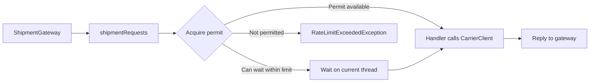

# RateLimiterRequestHandlerAdvice

## 1. The Problem: Controlling Call Rate to an Endpoint

In the **SPRING_INTEGRATION_CORE** module, an integration flow is composed of `Message`, `MessageChannel`, endpoints, and gateways. When an endpoint calls an external system, the flow must also respect that system's intake capacity and quota. The **Advice and Retries** chapter adds behavior around endpoints to fulfill these requirements.

Suppose a shipping service allows the application to look up at most 5 shipments in a one-second period. After a data sync batch, the application receives many requests concurrently. The design goal is to route every service call through a single control point that decides whether to proceed, wait briefly, or report over-limit.

`RateLimiterRequestHandlerAdvice` is a Spring Integration advice that uses Resilience4j to govern permission to invoke a handler. It extends `AbstractRequestHandlerAdvice` and has been available since Spring Integration 5.2. You can pass either a `RateLimiter` or a `RateLimiterConfig` upon construction. [RateLimiterRequestHandlerAdvice API](https://docs.spring.io/spring-integration/docs/6.5.0/api/org/springframework/integration/handler/advice/RateLimiterRequestHandlerAdvice.html).

After this lesson, you should be able to do four things:

- Identify which handler consumes quota and attach the advice in the right place.
- Choose the permit count, refresh period, and wait timeout.
- Classify permit-exhaustion errors in synchronous or asynchronous flows.
- Combine rate limiting with retry and verify actual invocation counts.

The examples use the **Spring Integration 6.5.x** API, Java 17 or later, and Resilience4j 2.x. This is the baseline for the examples, not a requirement to upgrade a project's version. When working on another branch, check matching dependencies and APIs, especially for retry.

## 2. Where Does the Advice Sit in the Message Flow?

Consider a shipment lookup flow:



In the diagram, acquiring a permit belongs to the advice wrapping the handler. `shipmentRequests` remains the channel transporting messages; the gateway still turns Java calls into message exchanges.

For reply-producing handlers in the example, request handler advice acts on the endpoint's request-handling step. It does not automatically wrap all downstream endpoints. If a subsequent write step also calls a quota-bound service, define a separate policy for that step. [Endpoint advice scope](https://docs.spring.io/spring-integration/reference/handler-advice.html).

Example advice placement:

```text
Input Message
  -> filter checking tracking number
  -> transformer normalizing request
  -> handler calling shipping service [attach rate limiter here]
  -> router classifying status
  -> handler saving result
```

Placing a filter before the external call rejects invalid requests before consuming quota. Placing the limiter on the transformer while the external call sits in another handler measures the wrong operation. Similarly, a limiter placed before a splitter only counts messages before splitting, whereas one message can produce many calls after the splitter.

The advice does not create a message queue, replay messages on its own, or decide the business outcome when rejected. Those behaviors must be expressed in your flow design.

## 3. Permits, Refresh Periods, and Wait Time

### 3.1. Three Parameters to Configure Explicitly

| Parameter | Meaning | Sample Value |
|---|---|---|
| `limitForPeriod` | Number of permits granted per period | `5` |
| `limitRefreshPeriod` | Length of one period | `Duration.ofSeconds(1)` |
| `timeoutDuration` | Maximum wait to acquire a permit for one call | `Duration.ofMillis(100)` |

These parameters belong to `RateLimiterConfig`. Setting them explicitly ensures configuration reflects the partner's quota rather than relying on library defaults. [Resilience4j RateLimiter configuration](https://resilience4j.readme.io/docs/ratelimiter).

A **permit** is permission to start one execution through the limiter. The standard advice acquires one permit per entry into the wrapped handler. An admitted handler can still fail during business execution or network calls; a consumed permit is not automatically refunded simply because the operation failed. [Resilience4j decorator and permit mechanism](https://raw.githubusercontent.com/resilience4j/resilience4j/v2.3.0/resilience4j-ratelimiter/src/main/java/io/github/resilience4j/ratelimiter/RateLimiter.java).

Therefore, define the unit of quota:

- If one handler entry corresponds to one HTTP request, the unit matches.
- If the handler loops internally to send 20 HTTP requests, one permit outside the handler does not represent those 20 requests.
- If the HTTP client retries internally, network calls can exceed the permits observed by the advice.

In the latter two cases, either split each call into its own message passing through the endpoint or move permission acquisition closer to the network call itself. That is a design choice based on how the partner accounts for quota.

### 3.2. Period-Based Limits Allow Bursts

Resilience4j organizes permits in periods. When a new period begins, the permit budget refreshes; this configuration is not a promise to space requests evenly over time. [RateLimiter refresh periods](https://resilience4j.readme.io/docs/ratelimiter).

With 5 permits per second, you can picture:

```text
Period k:       [ A B C D E ........................ ]
Period k + 1:   [ F G H I J ........................ ]
```

Five requests can all start right next to each other. If permits are consumed near the end of one period and then again at the start of the next, a short interval straddling the boundary can see many requests.

Therefore, before translating a partner quota into `limitForPeriod / limitRefreshPeriod`, verify whether the quota uses fixed periods, sliding windows, burst budgets, or minimum spacing between calls. For example, "300 requests per minute" is not enough to conclude with certainty that "5 requests per second" satisfies the API's contract.

### 3.3. `timeoutDuration` Applies Only to Acquiring a Permit

With a 100 ms wait limit, the limiter may wait when a permit can be granted within that budget. If it cannot be satisfied, the call is rejected; do not assume every rejection waits the full 100 ms.

Three kinds of durations to distinguish in design:

| Duration Type | Question It Answers |
|---|---|
| Permit wait | May handler invocation start within this window? |
| Client connect/read timeout | How long can connecting and reading from the external service take at most? |
| Whole-request budget | How much total processing time does the caller accept? |

`timeoutDuration` does not place a deadline on an HTTP request once started. If total response time must be at most 2 seconds, account for channel waits, permit waits, network calls, backoff, and retries in the design.

Setting `Duration.ZERO` fits when you want immediate rejection if no permit is available. For background work that can wait, consider a queue and retry schedule rather than letting many threads block waiting.

## 4. Complete Example with Java DSL and Gateway

### 4.1. Dependencies and Example Structure

The example requires these libraries on the classpath:

| Library | Role |
|---|---|
| `org.springframework.integration:spring-integration-core` | Channels, gateways, endpoints, Java DSL, and advice |
| `io.github.resilience4j:resilience4j-ratelimiter` | Permit-granting mechanism |
| `org.junit.jupiter:junit-jupiter`, `org.springframework:spring-test`, `org.mockito:mockito-core` | Illustrated tests below |

Use your project's dependency management to select compatible versions. In a Spring Boot application, check which dependencies are already managed by the BOM; unmanaged dependencies must declare explicit versions in the build. Only add `spring-retry` if you actually use `RequestHandlerRetryAdvice` from the Spring Integration 6.5.x branch.

The classes below reside in package `example.integration`. They form a synchronous request/reply flow using a simulated client to focus on integration behavior.

### 4.2. Client Contract

```java
package example.integration;

@FunctionalInterface
public interface CarrierClient {
    String lookup(String trackingId);
}
```

In a real application, the implementation may use an HTTP client to call the partner. Rate limiter configuration stays at the endpoint layer so the policy's position in the flow is clear.

### 4.3. Gateway for the Caller

```java
package example.integration;

import org.springframework.integration.annotation.MessagingGateway;

@MessagingGateway(defaultRequestChannel = "shipmentRequests")
public interface ShipmentGateway {
    String lookup(String trackingId);
}
```

The caller invokes `shipmentGateway.lookup("VN-001")`. The gateway creates a message with the tracking ID as payload and sets up the reply path for that call.

### 4.4. Limiter, Channel, and Flow Configuration

```java
package example.integration;

import java.time.Duration;

import io.github.resilience4j.ratelimiter.RateLimiter;
import io.github.resilience4j.ratelimiter.RateLimiterConfig;
import org.springframework.context.annotation.Bean;
import org.springframework.context.annotation.Configuration;
import org.springframework.integration.channel.DirectChannel;
import org.springframework.integration.config.EnableIntegration;
import org.springframework.integration.config.IntegrationComponentScan;
import org.springframework.integration.dsl.IntegrationFlow;
import org.springframework.integration.handler.advice.RateLimiterRequestHandlerAdvice;

@Configuration
@EnableIntegration
@IntegrationComponentScan(basePackageClasses = ShipmentGateway.class)
public class CarrierRateLimitConfiguration {

    @Bean
    public DirectChannel shipmentRequests() {
        return new DirectChannel();
    }

    @Bean
    public RateLimiter carrierRateLimiter() {
        RateLimiterConfig config = RateLimiterConfig.custom()
                .limitForPeriod(5)
                .limitRefreshPeriod(Duration.ofSeconds(1))
                .timeoutDuration(Duration.ofMillis(100))
                .build();

        return RateLimiter.of("carrier-tracking", config);
    }

    @Bean
    public RateLimiterRequestHandlerAdvice carrierRateLimitAdvice(
            RateLimiter carrierRateLimiter) {

        return new RateLimiterRequestHandlerAdvice(carrierRateLimiter);
    }

    @Bean
    public CarrierClient carrierClient() {
        return trackingId -> "IN_TRANSIT:" + trackingId;
    }

    @Bean
    public IntegrationFlow shipmentLookupFlow(
            CarrierClient carrierClient,
            RateLimiterRequestHandlerAdvice carrierRateLimitAdvice) {

        return IntegrationFlow.from("shipmentRequests")
                .handle(String.class,
                        (trackingId, headers) -> carrierClient.lookup(trackingId),
                        endpoint -> endpoint.advice(carrierRateLimitAdvice))
                .get();
    }
}
```

Details that govern the example's behavior:

1. `DirectChannel` runs processing on the caller's thread. If it must wait for a permit, the gateway call also blocks at that step.
2. The advice is attached with `endpoint.advice(...)` on the handler calling the client.
3. `RateLimiter` is a shared bean. Multiple calls entering the flow draw from that single object's budget.
4. The handler returns a result string. The flow ends at the handler and uses the reply channel provided by the gateway to respond.
5. The simulated client always succeeds when called. Permit-exhaustion errors occur before the lambda invokes `carrierClient.lookup(...)`.

Do not create a new `RateLimiter.of(...)` inside the per-message lambda. Doing so creates a fresh budget per call so messages no longer contend for the same quota.

When firing a rapid burst of requests, how many are admitted immediately or rejected also depends on timing relative to period boundaries and the 100 ms wait. Do not run a manual loop and assume the sixth request is always rejected on every run.

### 4.5. Annotation Equivalent

If the project uses annotation-driven endpoints, you can replace the `shipmentLookupFlow` bean with the method below in the configuration, keeping the client, channel, and advice beans:

```java
import org.springframework.integration.annotation.ServiceActivator;

@ServiceActivator(
        inputChannel = "shipmentRequests",
        adviceChain = "carrierRateLimitAdvice")
public String handleShipmentLookup(String trackingId) {
    return carrierClient().lookup(trackingId);
}
```

This method sits inside the `@Configuration` class from the example above with default `@Configuration` proxying enabled. The name in `adviceChain` is the advice bean name. Register only one of the two consumer styles for this use case; attaching both consumers to the same `DirectChannel` changes message dispatching. [Advising endpoints with annotations](https://docs.spring.io/spring-integration/reference/handler-advice/advising-with-annotations.html).

## 5. When Permits Are Exhausted, Where Does the Error Go?

### 5.1. Identifying the Exception with Message Context

In Spring Integration 6.5.0, the advice translates Resilience4j's `RequestNotPermitted` into `RateLimiterRequestHandlerAdvice.RateLimitExceededException`. This exception extends `MessagingException`, carries the failed message, and preserves the cause. When rejected by the limiter, the request-handling callback has not run. [Advice source](https://raw.githubusercontent.com/spring-projects/spring-integration/v6.5.0/spring-integration-core/src/main/java/org/springframework/integration/handler/advice/RateLimiterRequestHandlerAdvice.java).

At the application boundary, the exception may sit inside a wrapper chain. Classify by type rather than matching message text:

```java
import org.springframework.integration.handler.advice.RateLimiterRequestHandlerAdvice;

static boolean causedByRateLimit(Throwable error) {
    for (Throwable current = error;
            current != null;
            current = current.getCause()) {

        if (current instanceof
                RateLimiterRequestHandlerAdvice.RateLimitExceededException) {
            return true;
        }
    }
    return false;
}
```

This classification indicates the request was rejected by the application's own limiter. An HTTP `429` returned by the partner is a different situation: the request went out and the partner rejected it. When handling `429`, consider actual quota rules, other callers sharing credentials, and headers like `Retry-After` if provided by the API.

### 5.2. Synchronous Flows

With `DirectChannel`, handler exceptions propagate back to the sender along the call stack. Gateways also have mechanisms to return errors to the caller or route them via a configured error channel. Creating a bean named `errorChannel` alone does not send every synchronous flow error there automatically. [Synchronous error handling in Spring Integration](https://docs.spring.io/spring-integration/reference/error-handling.html).

For the sample flow, the caller can catch exceptions around the gateway call, inspect the cause chain, and return a "try again later" status matching the application contract. Do not turn an unexecuted call into an empty success lookup result, as the caller would lose the information needed to decide the next step.

### 5.3. Asynchronous Flows and Background Work

When introducing an `ExecutorChannel` or a poller reading a `QueueChannel`, the handler may run after the sender has already returned. Design an error flow on the asynchronous execution side. In Spring Integration's standard error handling, errors are wrapped in an `ErrorMessage`; error channel selection checks the `errorChannel` header first and then the global channel. [ErrorMessage and error channels](https://docs.spring.io/spring-integration/reference/error-handling.html).

A background job design could be:

```text
Message source
  -> bounded-capacity queue
  -> consumer
  -> limiter
  -> partner call

Error flow
  -> classify cause
  -> out of permits: schedule retry with deadline and max attempts
  -> partner transient error: apply matching retry policy
  -> invalid data: route to business handling
```

The diagram shows the extra components to build. The advice does not provide a delayed queue on its own. For brokered messages, ack, nack, rollback, or redelivery must be decided according to the adapter and transaction in use.

Avoid wiring the error flow directly back to the input without delay or attempt limits. During an overload spike, that wiring repeatedly asks for permits before the budget recovers.

## 6. Ordering with Retry Determines How Quota Is Counted

An advice chain applies in nested order: the first advice is outermost, and the last advice is closest to the handler. [Spring Integration Advice Ordering](https://docs.spring.io/spring-integration/reference/handler-advice/order.html).

Suppose a `retryAdvice` bean is configured with a retry policy suited to transient errors from `CarrierClient`. The two snippets below are two alternatives for the `.handle(...)` step of the flow.

### 6.1. Retry Outside, Rate Limiter Inside

```java
.handle(String.class,
        (trackingId, headers) -> carrierClient.lookup(trackingId),
        endpoint -> endpoint.advice(retryAdvice, carrierRateLimitAdvice))
```

Execution order reads as:

```text
Retry(
    RateLimiter(
        CarrierClient.lookup(...)
    )
)
```

If the first attempt fails and retry decides to try again, the new attempt passes through the limiter again. This design fits when quota is counted per outbound partner call.

Illustrative trace, assuming permits are available and the error is retryable:

| Attempt | Acquires Permit | Calls Partner | Outcome |
|---|---|---|---|
| 1 | Yes | Yes | Transient error |
| 2 | Yes | Yes | Transient error |
| 3 | Yes | Yes | Success |

If the second attempt fails to acquire a permit, partner calls may stop at one. What happens next depends on retry's exception classification and recovery policy.

### 6.2. Rate Limiter Outside, Retry Inside

```java
.handle(String.class,
        (trackingId, headers) -> carrierClient.lookup(trackingId),
        endpoint -> endpoint.advice(carrierRateLimitAdvice, retryAdvice))
```

Entering the endpoint acquires one permit and then runs the entire retry block inside. One message can generate multiple partner calls after a single permission grant. If the partner meters quota per HTTP request, this ordering can push actual requests above expectations.

The two outcomes above follow from advice nesting mechanics, not two different rate limiter algorithms. Choose the order according to the quota unit and verify with client call counts.

### 6.3. Error Classification and Total Time Limits

In the 6.5.x branch, `RequestHandlerRetryAdvice` uses Spring Retry and accepts a `RetryTemplate`. When configuring the policy, remember errors may be wrapped in messaging exceptions. [RequestHandlerRetryAdvice 6.5.0 source](https://raw.githubusercontent.com/spring-projects/spring-integration/v6.5.0/spring-integration-core/src/main/java/org/springframework/integration/handler/advice/RequestHandlerRetryAdvice.java).

An intentional policy must define:

- Which network or partner errors are actually retried.
- Whether `RateLimitExceededException` returns immediately or routes to deferred handling.
- Maximum attempts, backoff, and message deadline.
- Whether the HTTP client or broker has another retry layer.
- Idempotency keys or deduplication if the operation has side effects.

Budget calculation example: three attempts, each allowed 100 ms to wait for a permit and up to 800 ms for the network call, with two 200 ms backoffs, gives a preliminary budget of:

```text
3 × (100 ms + 800 ms) + 2 × 200 ms = 3,100 ms
```

This is a design budget sum, not a hard deadline guarantee; there are also executor waits, channel latency, and other processing overhead. If the caller tolerates only 2 seconds, reduce attempts or move processing to background work with a different response contract.

## 7. Sharing Limiters and Multi-Instance Deployments

### 7.1. Shared Quota Needs the Same Limiter Instance

If both a lookup API and a shipment-creation API draw from one API key's quota, pass the same `RateLimiter` bean to the advices of both endpoints. If each API has its own quota, separate limiters prevent one workload from starving the other.

Two calls creating limiters with the same name do not mean they share state:

```java
RateLimiter first = RateLimiter.of("carrier-tracking", config);
RateLimiter second = RateLimiter.of("carrier-tracking", config);
```

These are two separate objects. Names identify limiters; to share one budget within an application, reuse the same instance, such as via a Spring bean or a shared `RateLimiterRegistry`. The constructor taking a `RateLimiter` is convenient when sharing must be controlled explicitly. [Advice constructors](https://docs.spring.io/spring-integration/docs/6.5.0/api/org/springframework/integration/handler/advice/RateLimiterRequestHandlerAdvice.html).

If quota is per tenant, design how limiters are selected per tenant and how their lifecycle is managed. The standard advice accepts one fixed limiter; adding a tenant header to messages does not automatically create per-tenant quota policies.

### 7.2. Quota Across Multiple JVMs

The limiter in the example keeps state in-process. If three instances run and each allows 5 permits per second, the configured aggregate budget can reach roughly 15 per second, before accounting for bursts across period boundaries.

That follows from having three independent budgets. Using the same limiter name across three JVMs does not create a cluster-wide quota.

For a quota shared across an entire API key, consider:

| Option | Decision Required |
|---|---|
| Split budget across instances | How to adjust during autoscaling or instance shutdown? |
| Funnel calls through a controlled consumer group | Throughput capacity, availability, and backlog of that group |
| Use a shared quota coordinator | Consistency, latency, and behavior when the coordinator fails |

You cannot choose an option solely from the advice class. Base it on the partner's quota, deployment topology, and the flow's operational requirements.

## 8. Rate Limit, Concurrency, and Backlog Are Different Quantities

| Mechanism | Quantity Controlled | Example Question |
|---|---|---|
| Rate limiter | Rate at which executions are admitted to start | How many calls are allowed per period? |
| Concurrency / bulkhead limit | Number of tasks executing simultaneously | At most how many connections can call the partner at once? |
| Circuit breaker | Whether to keep calling a service showing signs of failure | When should we temporarily stop calling a failing system? |
| Retry | Re-attempting after an eligible failure | Should we call again, how many times, and after how long? |
| Queue | Where pending work waits | How many messages may wait and for how long? |

Suppose an average of 5 calls start per second and each takes 4 seconds. In steady state with sufficient resources, around 20 calls may be executing concurrently. That is Little's Law (`in-flight ≈ throughput × processing time`), showing a rate limit of 5/sec does not imply max concurrency of 5.

Likewise, if an upstream source sends 100 messages per second while the endpoint serves 5 messages per second, backlog grows by roughly 95 messages per second without load shedding. Bounded queues express intake limits, yet must define clear behavior when full.

With `DirectChannel`, permit wait time extends the sender's call. With an executor or poller, wait time occupies a worker thread. Increasing `timeoutDuration` must be evaluated alongside pool size, queue depth, and processing time; waiting longer does not create extra capacity at the partner.

If the flow returns `Mono` or another asynchronous type, determine whether the outbound call starts when the handler is called or upon subscription. Do not assume an advice around the handler invocation throttles every subscription and resubscription inside that returned publisher.

## 9. Testing Flow Behavior Without Depending on Sleep

### 9.1. Testing the Admit Path and Reject Path

A useful test proves **the client is not called when no permit is available**, while the failed message remains identifiable. Using a mock limiter lets you specify the exact "allow, reject, allow" sequence without depending on period boundary timing.

The example below creates an isolated context and sends messages through a real flow. It tests advice wiring and rejection behavior; it does not test Resilience4j's time-window algorithm.

```java
package example.integration;

import java.util.concurrent.atomic.AtomicInteger;

import io.github.resilience4j.ratelimiter.RateLimiter;
import io.github.resilience4j.ratelimiter.RequestNotPermitted;
import org.junit.jupiter.api.Test;
import org.springframework.beans.factory.annotation.Autowired;
import org.springframework.context.annotation.Bean;
import org.springframework.context.annotation.Configuration;
import org.springframework.integration.channel.DirectChannel;
import org.springframework.integration.channel.QueueChannel;
import org.springframework.integration.config.EnableIntegration;
import org.springframework.integration.dsl.IntegrationFlow;
import org.springframework.integration.handler.advice.RateLimiterRequestHandlerAdvice;
import org.springframework.messaging.MessagingException;
import org.springframework.messaging.support.GenericMessage;
import org.springframework.test.context.junit.jupiter.SpringJUnitConfig;

import static org.junit.jupiter.api.Assertions.*;
import static org.mockito.Mockito.*;

@SpringJUnitConfig(RateLimiterAdviceTest.TestConfiguration.class)
class RateLimiterAdviceTest {

    @Autowired DirectChannel limitedRequests;
    @Autowired QueueChannel limitedReplies;
    @Autowired AtomicInteger clientCalls;
    @Autowired RateLimiter limiter;

    @Test
    void denialDoesNotCallClientAndLaterMessageCanSucceed() {
        limitedRequests.send(new GenericMessage<>("VN-001"));
        assertNotNull(limitedReplies.receive(0));
        assertEquals(1, clientCalls.get());

        var rejectedMessage = new GenericMessage<>("VN-002");
        MessagingException thrown = assertThrows(MessagingException.class,
                () -> limitedRequests.send(rejectedMessage));

        var rateLimitFailure = findRateLimitFailure(thrown);
        assertSame(rejectedMessage, rateLimitFailure.getFailedMessage());
        assertInstanceOf(RequestNotPermitted.class, rateLimitFailure.getCause());
        assertEquals(1, clientCalls.get());
        assertNull(limitedReplies.receive(0));

        limitedRequests.send(new GenericMessage<>("VN-003"));
        assertNotNull(limitedReplies.receive(0));
        assertEquals(2, clientCalls.get());
        verify(limiter, times(3)).acquirePermission(1);
    }

    private static RateLimiterRequestHandlerAdvice.RateLimitExceededException
            findRateLimitFailure(Throwable error) {

        for (Throwable current = error;
                current != null;
                current = current.getCause()) {

            if (current instanceof
                    RateLimiterRequestHandlerAdvice.RateLimitExceededException failure) {
                return failure;
            }
        }
        throw new AssertionError("Rate limit error not found", error);
    }

    @Configuration
    @EnableIntegration
    static class TestConfiguration {

        @Bean
        DirectChannel limitedRequests() {
            return new DirectChannel();
        }

        @Bean
        QueueChannel limitedReplies() {
            return new QueueChannel();
        }

        @Bean
        AtomicInteger clientCalls() {
            return new AtomicInteger();
        }

        @Bean
        RateLimiter limiter() {
            RateLimiter mockLimiter = mock(RateLimiter.class);
            when(mockLimiter.getName()).thenReturn("carrier-test");
            when(mockLimiter.acquirePermission(1)).thenReturn(true, false, true);
            return mockLimiter;
        }

        @Bean
        IntegrationFlow testFlow(RateLimiter limiter, AtomicInteger clientCalls) {
            var advice = new RateLimiterRequestHandlerAdvice(limiter);

            return IntegrationFlow.from("limitedRequests")
                    .handle(String.class, (trackingId, headers) -> {
                        clientCalls.incrementAndGet();
                        return "IN_TRANSIT:" + trackingId;
                    }, endpoint -> endpoint.advice(advice))
                    .channel("limitedReplies")
                    .get();
        }
    }
}
```

The mock stubs `acquirePermission(1)` matching how Resilience4j 2.x's decorator acquires a permit. If you upgrade dependencies and the internal invocation changes, update the mock stub to match the actual API. [Permit acquisition execution path](https://raw.githubusercontent.com/resilience4j/resilience4j/v2.3.0/resilience4j-ratelimiter/src/main/java/io/github/resilience4j/ratelimiter/RateLimiter.java).

The third send is a new message explicitly sent by the test. It does not prove the advice automatically retries the second message. That distinction separates service recovery from work replay.

### 9.2. Additional Tests Based on System Requirements

| Scenario | What to Verify |
|---|---|
| Real limiter with `Duration.ZERO` | Exhausting budget rejects the request without calling the client |
| Entering a new period | Processing resumes after the budget refreshes |
| Multiple endpoints sharing a limiter | Combined calls across endpoints consume one shared budget |
| Retry outside limiter | Each eligible attempt passes through permit acquisition |
| Asynchronous flow | Errors reach the error flow and the original message can be recovered |
| Multiple instances | Total request rate observed at the partner matches the shared quota |

When testing a real limiter, control period boundaries and leave wide enough margins for CI environments. Use polling with an appropriate deadline when waiting for recovery instead of asserting a tiny sleep duration is always sufficient. Spring Integration's own tests also verify both the rejected path and the path that proceeds after waiting for a permit to refresh. [Official advice tests](https://raw.githubusercontent.com/spring-projects/spring-integration/v6.5.0/spring-integration-core/src/test/java/org/springframework/integration/handler/advice/RateLimiterRequestHandlerAdviceTests.java).

## 10. Observing and Tuning in Production

The advice exposes `getRateLimiter()`, `getMetrics()`, `setLimitForPeriod(...)`, and `setTimeoutDuration(...)`. These APIs let you access the limiter and adjust part of the running configuration. [Advice management API](https://docs.spring.io/spring-integration/docs/6.5.0/api/org/springframework/integration/handler/advice/RateLimiterRequestHandlerAdvice.html).

Metrics to view side by side when evaluating the flow:

- Permits granted and permits rejected.
- Actual calls reaching the partner, including client-internal retries.
- Gateway call latency or background job completion time.
- Waiting thread count, queue depth, and age of the oldest queued message.
- Partner error rate and HTTP `429` response rate.

Example snapshot for observation:

```java
RateLimiter.Metrics metrics = carrierRateLimitAdvice.getMetrics();
int available = metrics.getAvailablePermissions();
int waiting = metrics.getNumberOfWaitingThreads();
```

Snapshots capture a point in time and depend on the implementation; never check `available > 0` and skip acquiring a permit, as another thread may consume the budget right after your read.

When changing settings in Resilience4j, the new permit limit takes effect starting in the next period; a new timeout does not alter the wait duration already computed for threads currently waiting. [Changing RateLimiter config at runtime](https://resilience4j.readme.io/docs/ratelimiter).

Example tuning call:

```java
carrierRateLimitAdvice.setLimitForPeriod(3);
carrierRateLimitAdvice.setTimeoutDuration(Duration.ofMillis(50));
```

Reducing permits can increase rejections or grow backlog. Therefore, monitor both outbound traffic and queued work after changes. Looking only at a drop in HTTP error rates can miss a steadily growing queue.

## 11. Common Design Mistakes

| Symptom | Possible Cause | How to Investigate |
|---|---|---|
| Rate limit appears to have no effect | Creating a new limiter per message or attaching advice to the wrong endpoint | Inspect bean lifecycle and where outbound calls happen |
| Partner still reports quota exceeded | Multiple JVMs, multiple credential consumers, or client-internal retries | Count requests at the network boundary and aggregate by API key |
| Caller is slow even though client responds quickly | Threads are waiting for permits before entering the client | Measure wait time and check `timeoutDuration` |
| Many requests run concurrently | Rate limiting only controls start rate | Evaluate concurrency and processing duration separately |
| Bursts occur around period boundaries | Period-based permit replenishment mismatches partner window rules | Check quota rules and request-spacing requirements |
| One message makes multiple outbound calls for one permit | Retry is inside limiter or handler loops internally | Check advice ordering and handler implementation |
| Permit exhaustion causes a continuous loop | Error flow immediately feeds back to input | Add delay, max attempts, and a deadline |
| Error flow misses synchronous errors | Sender still runs on the same call stack | Check gateway configuration and exception handling |
| Flaky tests | Assertions depend on wall-clock boundaries | Separate wiring tests with mocks from timing tests with real limiters |

## 12. Practice Exercises

Build a flow that receives tracking IDs through a gateway, looks them up via a simulated client, and returns a status. Use the Section 4 example as your starting point.

1. Configure 2 permits per second and `Duration.ZERO`. Record actual client invocations with a counter.
2. Send several requests close together. Distinguish processed requests from requests rejected before calling the client; do not assert strict sequence indices without controlling period boundaries.
3. Change wait timeout to 150 ms and measure response times. Explain the difference using permit wait time.
4. Add a second endpoint sharing the same limiter. Verify both endpoints compete for the same budget.
5. Make the simulated client fail transiently on the first call, then add bounded retry. Swap the order of the two advices and compare permit acquisitions with client calls.
6. Design background handling when permits run out: specify where messages are held, retry intervals, deadline, and where uncompletable messages go.

Your completion criterion is being able to explain **which operation one permit represents**, **over what scope the quota is shared**, **which threads can block**, and **where messages go when they cannot be processed**. Those decisions turn `RateLimiterRequestHandlerAdvice` into a clear, well-governed part of the integration flow alongside channels, gateways, endpoints, and error policies.
