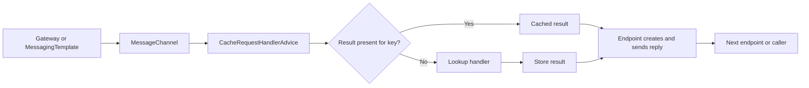

# CacheRequestHandlerAdvice

## 1. Objectives and Use Case

In the **Advice and Retries** chapter of the **SPRING_INTEGRATION_CORE** module, this lesson explains how to add caching to a message-handling endpoint. After this lesson, you will be able to attach the advice in Java DSL, design keys from payloads and headers, coordinate read flows with update flows, and verify how many times the handler actually runs.

Suppose a flow receives product lookup requests and calls a catalog system. Over a short period, many requests query the same product for the same store. When the data is reusable, we want to avoid calling the catalog system for every single message.

`CacheRequestHandlerAdvice` places that decision at the endpoint's processing boundary: look up the result by key; reuse it if present; otherwise invoke the handler and store the result. This class has existed since Spring Integration 5.2 and supports cacheable, put, and evict operations. [CacheRequestHandlerAdvice API](https://docs.spring.io/spring-integration/docs/current/api/org/springframework/integration/handler/advice/CacheRequestHandlerAdvice.html)

**Example conventions:** Java code uses Java 17 and the Spring Integration 6.5.x API. Additional configuration snippets are explicitly marked as replacements or extensions; do not combine all of them into duplicate-named beans. If your project uses Spring Boot, obtain compatible Spring versions from the project's dependency management.

## 2. Where Does the Advice Sit in the Message Flow?



For reply-producing handlers, the point wrapped by the advice is `handleRequestMessage(...)` inside the handler. Sending the reply to the next endpoint sits outside this scope. Attaching the advice to a service activator therefore does not turn an entire `IntegrationFlow` into one cached result. [Endpoint advice scope](https://docs.spring.io/spring-integration/reference/handler-advice.html)

Example:

```text
request -> validate -> cached lookup -> enrich trace -> reply
```

When lookup hits the cache, the preceding `validate` step still runs, the catalog call inside lookup is skipped, and the subsequent `enrich trace` step still receives the result. This is a natural place to separate reusable business data from per-request metadata.

A gateway only provides an interface to invoke the flow. Caching in this lesson belongs to the lookup endpoint; calling the service directly outside that endpoint bypasses the advice.

### What Result Does the Cache Store?

The stored value is the return object of the processing wrapped by the advice. If the handler returns a DTO, the cache stores that DTO. If the handler returns a `Message<?>`, the cached object may include that message's headers as well. In the 6.5.0 source, a message-builder result is even built into a message before being handed to the cache mechanism. [Advice source, version 6.5.0](https://raw.githubusercontent.com/spring-projects/spring-integration/v6.5.0/spring-integration-core/src/main/java/org/springframework/integration/handler/advice/CacheRequestHandlerAdvice.java)

Accordingly, a clean design has the lookup return an immutable DTO. Attach trace IDs, timestamps, or caller-specific metadata at an appropriate step after lookup. If caching whole reply messages, check the risk of reusing headers from an earlier request.

## 3. Distinguishing the Three Cache Operations

| Operation | Is the Handler Invoked? | Primary Effect | Example in This Lesson |
| --- | --- | --- | --- |
| `CacheableOperation` | Skips handler on a valid hit | Looks up and stores result when needed | Reading product information |
| `CachePutOperation` | Always calls handler when operation applies | Writes the newly computed result into cache | Updating and returning a new snapshot |
| `CacheEvictOperation` | Does not skip handler via cache hit | Removes one entry or an entire cache region | Renaming and invalidating the old entry |

These operations correspond semantically to Spring Framework's `@Cacheable`, `@CachePut`, and `@CacheEvict`. Combining cacheable and put on the same call usually makes intent ambiguous: one wants to reuse a result while the other wants to execute to update. In this lesson, read and update flows are separated. [Cache operation semantics](https://docs.spring.io/spring-framework/reference/integration/cache/annotations.html)

Constructing `new CacheRequestHandlerAdvice("productViews")` selects the default cacheable operation. When other operations are needed, build them with Spring Cache builders and pass them via `setCacheOperations(...)`.

## 4. Cache Keys Are Part of the Business Contract

### 4.1. Default Key

By default, the advice uses the **request payload** as the key. This is an object compared according to the cache provider's rules, not automatically converted to JSON or a string representation of the payload. With a map-backed cache, a DTO implementing value-based `equals()` and `hashCode()` lets two instances representing the same request find the same entry. [Caching advice key configuration](https://docs.spring.io/spring-integration/reference/handler-advice/classes.html#caching-advice)

If the payload also includes request timestamps or random trace IDs, the default key can create far too many entries. If the payload contains only a SKU while the result also depends on a tenant in a header, the default key lacks the data needed to distinguish stores.

### 4.2. Designing Keys Around Inputs That Truly Determine the Result

In this example, the result depends on two values:

```text
ProductKey = (tenantId, sku)
```

| Input Data | Included in Example's Key? | Reason |
| --- | --- | --- |
| `tenantId` | Yes | Each store has its own catalog data |
| `sku` | Yes | Identifies the product within the store |
| `traceId` | No | Only used for request tracing |
| `replyChannel` | No | Per-call return path |
| Message arrival time | No | Does not change the snapshot in the example contract |

If another system also varies results by language, currency, catalog version, or user permissions, include those dimensions in the key or move the step depending on them after the shared lookup. That is a business decision per system, not a fixed checklist of fields to apply mechanically.

Using a record for keys in a local cache expresses structure clearly. When moving to an out-of-JVM cache, choose key and value serialization suited to the provider and manage schema changes.

### 4.3. SpEL and Function

`setKeyExpressionString(...)` evaluates an expression with **the request Message as root**. The snippet below fits when the payload has a `sku` property:

```java
advice.setKeyExpressionString("{headers['tenantId'], payload.sku}");
```

This creates a two-element list key; no need to manually concatenate strings with separators. With Java records, using `setKeyFunction(...)` provides clearer type casting and validation:

```java
advice.setKeyFunction(message -> {
    ProductQuery query = (ProductQuery) message.getPayload();
    String tenantId = message.getHeaders().get("tenantId", String.class);
    if (tenantId == null || tenantId.isBlank()) {
        throw new IllegalArgumentException("Missing tenantId");
    }
    return new ProductKey(tenantId, query.sku());
});
```

These two approaches are alternatives. Use the exact same key contract across read, update, and eviction flows; if one flow uses a record while another uses a string or list, they will not match as the same key.

## 5. Java DSL Example: Cached Reads, Eviction on Updates

### 5.1. Required Components

The example uses `spring-integration-core` and Spring Context libraries resolved from a compatible version set. The test section in Section 6 requires JUnit Jupiter. No external cache server is needed since the example uses `ConcurrentMapCacheManager`.

`ConcurrentMapCacheManager("productViews")` pre-declares a cache region. This is a compact choice for hands-on practice; this manager does not provide TTL or size-limit settings like dedicated providers. [ConcurrentMapCacheManager API](https://docs.spring.io/spring-framework/docs/6.2.7/javadoc-api/org/springframework/cache/concurrent/ConcurrentMapCacheManager.html)

### 5.2. Complete Configuration

Place the following class in `ProductCacheConfig.java`. Both request types are Java records; `ProductKey` is shared between the cache and the simulated data store. The counter increments only when the read method actually executes.

```java
import java.util.concurrent.ConcurrentHashMap;
import java.util.concurrent.ConcurrentMap;
import java.util.concurrent.atomic.AtomicInteger;

import org.springframework.beans.factory.annotation.Qualifier;
import org.springframework.cache.CacheManager;
import org.springframework.cache.concurrent.ConcurrentMapCacheManager;
import org.springframework.cache.interceptor.CacheEvictOperation;
import org.springframework.context.annotation.Bean;
import org.springframework.context.annotation.Configuration;
import org.springframework.integration.channel.DirectChannel;
import org.springframework.integration.config.EnableIntegration;
import org.springframework.integration.dsl.IntegrationFlow;
import org.springframework.integration.handler.advice.CacheRequestHandlerAdvice;
import org.springframework.messaging.Message;
import org.springframework.messaging.MessageChannel;

@Configuration(proxyBeanMethods = false)
@EnableIntegration
public class ProductCacheConfig {

    public static final String CACHE = "productViews";

    public record ProductQuery(String sku) {}
    public record RenameProduct(String sku, String name) {}
    public record ProductKey(String tenantId, String sku) {
        public ProductKey {
            if (tenantId == null || tenantId.isBlank()
                    || sku == null || sku.isBlank()) {
                throw new IllegalArgumentException("Missing tenantId or sku");
            }
        }
    }
    public record ProductView(String tenantId, String sku, String name) {}

    public static final class ProductService {
        private final ConcurrentMap<ProductKey, String> names =
                new ConcurrentHashMap<>();
        private final AtomicInteger loads = new AtomicInteger();

        public ProductView find(String tenantId, String sku) {
            loads.incrementAndGet();
            ProductKey key = new ProductKey(tenantId, sku);
            String name = names.getOrDefault(key, "Initial name");
            return new ProductView(tenantId, sku, name);
        }

        public ProductView rename(String tenantId, RenameProduct command) {
            if (command.name() == null || command.name().isBlank()) {
                throw new IllegalArgumentException("Name must not be blank");
            }
            ProductKey key = new ProductKey(tenantId, command.sku());
            names.put(key, command.name());
            return new ProductView(tenantId, command.sku(), command.name());
        }

        public int loadCount() {
            return loads.get();
        }
    }

    @Bean
    CacheManager cacheManager() {
        return new ConcurrentMapCacheManager(CACHE);
    }

    @Bean
    ProductService productService() {
        return new ProductService();
    }

    @Bean
    MessageChannel productQueries() {
        return new DirectChannel();
    }

    @Bean
    MessageChannel productUpdates() {
        return new DirectChannel();
    }

    @Bean
    CacheRequestHandlerAdvice productCache(CacheManager manager) {
        CacheRequestHandlerAdvice advice =
                new CacheRequestHandlerAdvice(CACHE);
        advice.setCacheManager(manager);
        advice.setKeyFunction(ProductCacheConfig::cacheKey);
        return advice;
    }

    @Bean
    CacheRequestHandlerAdvice productEviction(CacheManager manager) {
        CacheEvictOperation.Builder operation = new CacheEvictOperation.Builder();
        operation.setCacheName(CACHE);
        operation.setBeforeInvocation(false);
        operation.setCacheWide(false);

        CacheRequestHandlerAdvice advice = new CacheRequestHandlerAdvice();
        advice.setCacheManager(manager);
        advice.setKeyFunction(ProductCacheConfig::cacheKey);
        advice.setCacheOperations(operation.build());
        return advice;
    }

    @Bean
    IntegrationFlow productLookupFlow(
            @Qualifier("productQueries") MessageChannel input,
            ProductService service,
            @Qualifier("productCache") CacheRequestHandlerAdvice cache) {

        return IntegrationFlow.from(input)
                .handle(ProductQuery.class,
                        (query, headers) -> service.find(
                                (String) headers.get("tenantId"),
                                query.sku()),
                        endpoint -> endpoint.advice(cache))
                .get();
    }

    @Bean
    IntegrationFlow productUpdateFlow(
            @Qualifier("productUpdates") MessageChannel input,
            ProductService service,
            @Qualifier("productEviction") CacheRequestHandlerAdvice eviction) {

        return IntegrationFlow.from(input)
                .handle(RenameProduct.class,
                        (command, headers) -> service.rename(
                                (String) headers.get("tenantId"),
                                command),
                        endpoint -> endpoint.advice(eviction))
                .get();
    }

    private static ProductKey cacheKey(Message<?> message) {
        String tenantId = message.getHeaders().get("tenantId", String.class);
        String sku;
        if (message.getPayload() instanceof ProductQuery query) {
            sku = query.sku();
        } else if (message.getPayload() instanceof RenameProduct command) {
            sku = command.sku();
        } else {
            throw new IllegalArgumentException("Unsupported payload");
        }
        if (tenantId == null || tenantId.isBlank()
                || sku == null || sku.isBlank()) {
            throw new IllegalArgumentException("Missing tenantId or sku");
        }
        return new ProductKey(tenantId, sku);
    }
}
```

The key DSL point is `endpoint -> endpoint.advice(cache)`: the advice attaches to that `.handle(...)` endpoint itself. The handler lambda performs only business work. [Java DSL handler API](https://docs.spring.io/spring-integration/docs/6.5.0/api/org/springframework/integration/dsl/BaseIntegrationFlowDefinition.html)

The advices are declared as beans so Spring manages their initialization lifecycle and provides the required context. In this configuration, caching is executed directly by the advice; `@EnableCaching` is not needed to activate the advice. If the project also uses caching annotations on other services, configure annotation support for those services separately.

Neither flow sets a fixed output channel. When using request-reply in the next section, the endpoint replies via the reply channel provided by `MessagingTemplate` for each request.

### 5.3. Expected Timeline

```text
Read   (shop-a, P-100) -> cache miss -> find() runs -> loads = 1
Read   (shop-a, P-100) -> cache hit  -> reused      -> loads = 1
Read   (shop-b, P-100) -> other key  -> find() runs -> loads = 2
Rename (shop-a, P-100) -> rename() succeeds -> evicts shop-a entry
Read   (shop-a, P-100) -> cache miss -> find() runs -> loads = 3
```

Evicting after successful execution means the handler must return normally before removing the entry. `setBeforeInvocation(true)` moves eviction to before the call; `setCacheWide(true)` switches from evicting by key to clearing the entire cache region. [CacheEvictOperation.Builder API](https://docs.spring.io/spring-framework/docs/6.2.7/javadoc-api/org/springframework/cache/interceptor/CacheEvictOperation.Builder.html)

In the example, there is only one key per product per tenant. If real systems have variants by language or currency, updating a product may need to invalidate multiple entries. Avoid clearing the entire cache across all tenants just for a small change when narrower options exist.

## 6. Testing Through the Real Endpoint

Simply asserting two replies are equal does not prove the cache is working: the service itself could return the same data each time. We must observe how many times `find()` actually runs and inspect entries under the expected keys.

Place the following test class in the same package as `ProductCacheConfig`. Each test initializes its own context so the data store, cache, and counter are isolated across tests. Sending messages via `MessagingTemplate` ensures calls traverse channels and advices; calling `service.find(...)` directly would bypass them.

```java
import org.junit.jupiter.api.Test;
import org.springframework.cache.Cache;
import org.springframework.cache.CacheManager;
import org.springframework.context.annotation.AnnotationConfigApplicationContext;
import org.springframework.integration.core.MessagingTemplate;
import org.springframework.messaging.Message;
import org.springframework.messaging.MessageChannel;
import org.springframework.messaging.MessagingException;
import org.springframework.messaging.support.MessageBuilder;

import static org.junit.jupiter.api.Assertions.*;

class ProductCacheConfigTest {

    @Test
    void repeatedRequestUsesCachedValueAndSeparatesTenants() {
        try (var context = new AnnotationConfigApplicationContext(
                ProductCacheConfig.class)) {
            var service = context.getBean(ProductCacheConfig.ProductService.class);

            var first = exchange(context, "productQueries", "shop-a",
                    new ProductCacheConfig.ProductQuery("P-100"));
            var second = exchange(context, "productQueries", "shop-a",
                    new ProductCacheConfig.ProductQuery("P-100"));

            assertEquals(first, second);
            assertEquals(1, service.loadCount());

            var anotherTenant = exchange(context, "productQueries", "shop-b",
                    new ProductCacheConfig.ProductQuery("P-100"));
            assertEquals("shop-b", anotherTenant.tenantId());
            assertEquals(2, service.loadCount());

            Cache cache = context.getBean(CacheManager.class)
                    .getCache(ProductCacheConfig.CACHE);
            assertNotNull(cache);
            assertNotNull(cache.get(new ProductCacheConfig.ProductKey(
                    "shop-a", "P-100")));
            assertNotNull(cache.get(new ProductCacheConfig.ProductKey(
                    "shop-b", "P-100")));
        }
    }

    @Test
    void successfulUpdateEvictsOnlyTheAffectedProduct() {
        try (var context = new AnnotationConfigApplicationContext(
                ProductCacheConfig.class)) {
            var service = context.getBean(ProductCacheConfig.ProductService.class);
            var query = new ProductCacheConfig.ProductQuery("P-100");

            exchange(context, "productQueries", "shop-a", query);
            exchange(context, "productQueries", "shop-b", query);
            assertEquals(2, service.loadCount());

            exchange(context, "productUpdates", "shop-a",
                    new ProductCacheConfig.RenameProduct("P-100", "New name"));

            var updated = exchange(context, "productQueries", "shop-a", query);
            assertEquals("New name", updated.name());
            assertEquals(3, service.loadCount());

            var unchanged = exchange(context, "productQueries", "shop-b", query);
            assertEquals("Initial name", unchanged.name());
            assertEquals(3, service.loadCount());
        }
    }

    @Test
    void failedUpdateKeepsExistingCacheEntry() {
        try (var context = new AnnotationConfigApplicationContext(
                ProductCacheConfig.class)) {
            var service = context.getBean(ProductCacheConfig.ProductService.class);
            var query = new ProductCacheConfig.ProductQuery("P-100");
            exchange(context, "productQueries", "shop-a", query);

            assertThrows(MessagingException.class, () ->
                    exchange(context, "productUpdates", "shop-a",
                            new ProductCacheConfig.RenameProduct("P-100", " ")));

            var result = exchange(context, "productQueries", "shop-a", query);
            assertEquals("Initial name", result.name());
            assertEquals(1, service.loadCount());
        }
    }

    private static ProductCacheConfig.ProductView exchange(
            AnnotationConfigApplicationContext context,
            String channelName, String tenantId, Object payload) {
        MessageChannel channel = context.getBean(channelName, MessageChannel.class);
        MessagingTemplate template = new MessagingTemplate(channel);
        template.setReceiveTimeout(1000);

        Message<?> reply = template.sendAndReceive(
                MessageBuilder.withPayload(payload)
                        .setHeader("tenantId", tenantId)
                        .build());
        assertNotNull(reply, "Reply must be received");
        return (ProductCacheConfig.ProductView) reply.getPayload();
    }
}
```

`MessagingTemplate` supports a constructor taking a default channel and request-reply operations. In this synchronous example, the receive timeout bounds waiting for a reply; it does not replace network timeouts on an HTTP client if the handler actually calls an external service. [MessagingTemplate API](https://docs.spring.io/spring-integration/docs/6.5.0/api/org/springframework/integration/core/MessagingTemplate.html)

The tests above are practice code for learners. Additional scenarios to cover as the system evolves include: different SKUs, missing or blank tenants, provider errors, concurrent requests, and additional input dimensions that change the outcome.

## 7. Updating Cache with CachePutOperation

If the update handler already returns the new `ProductView`, you can write that snapshot directly to the cache instead of evicting and waiting for the next read to reload it.

**Replace** the `productEviction(...)` bean in the example with the bean below; the bean name is kept unchanged so the update flow needs no rewiring. In real project code, rename it to reflect put semantics once migration is complete.

```java
@Bean
CacheRequestHandlerAdvice productEviction(CacheManager manager) {
    var operation =
            new org.springframework.cache.interceptor.CachePutOperation.Builder();
    operation.setCacheName(CACHE);

    CacheRequestHandlerAdvice advice = new CacheRequestHandlerAdvice();
    advice.setCacheManager(manager);
    advice.setKeyFunction(ProductCacheConfig::cacheKey);
    advice.setCacheOperations(operation.build());
    return advice;
}
```

With this variant, the first read leaves `loads = 1`; the update returns the new `ProductView` and writes it to the cache; the subsequent read returns the new name while `loads` remains 1. Therefore, the eviction test in Section 6 must be updated with assertions matching put behavior.

The design precondition for this option is that the handler's return value must match the read cache's schema. If the handler returns only `true`, an order ID, or an acknowledgement message, putting that into `productViews` breaks the read flow's contract. When no canonical snapshot is returned, eviction is usually easier to reason about.

## 8. condition, unless, and Two SpEL Contexts

An endpoint sometimes should cache normal requests while requests carrying a `forceRefresh` header must hit the data source. `condition` decides whether the operation applies; `unless` can prevent storing the result after execution. This distinction matters when refreshing data.

With **operation builders**, expressions execute in the Spring Cache context. The first argument of the advised method is the request message, so you can access it via `#root.args[0]`. This differs from `setKeyExpressionString(...)`, where the root object is directly the message.

| Configuration Point | How to Reference the Request |
| --- | --- |
| `advice.setKeyExpressionString(...)` | `payload`, `headers['tenantId']` |
| `CacheOperation.Builder.setCondition(...)` | `#root.args[0].payload`, `#root.args[0].headers[...]` |
| `CacheOperation.Builder.setKey(...)` if declaring key per operation | `#root.args[0]` or Spring Cache argument variables |
| `CacheableOperation.Builder.setUnless(...)` | Can use `#result` after computing the result |

This behavior comes from the advice invoking `CacheAspectSupport` with the request message as the single element in the argument array. [How the advice delegates to Spring Cache](https://raw.githubusercontent.com/spring-projects/spring-integration/v6.5.0/spring-integration-core/src/main/java/org/springframework/integration/handler/advice/CacheRequestHandlerAdvice.java)

Example **replacing the body** of the `productCache(...)` bean without creating a duplicate bean:

```java
@Bean
CacheRequestHandlerAdvice productCache(CacheManager manager) {
    var operation =
            new org.springframework.cache.interceptor.CacheableOperation.Builder();
    operation.setCacheName(CACHE);
    operation.setCondition(
            "#root.args[0].headers['forceRefresh'] != true");
    operation.setUnless("#result == null");

    CacheRequestHandlerAdvice advice = new CacheRequestHandlerAdvice();
    advice.setCacheManager(manager);
    advice.setKeyFunction(ProductCacheConfig::cacheKey);
    advice.setCacheOperations(operation.build());
    return advice;
}
```

In this configuration, when `forceRefresh` is Boolean `true`, the cacheable operation is skipped completely: the handler runs, yet the new result is not written back by this operation either. Any old entry, if present, stays intact. Thus, this is **bypassing the cache for one request**, not a complete cache refresh mechanism.

If refresh is needed, design a branch with put, or coordinate eviction and re-read according to your application's consistency requirements. Also standardize header types: a string `"true"` sent by an external system must be converted appropriately before comparing against Boolean `true`.

As for `null`, letting a provider store nulls does not make an endpoint produce a business reply on its own. A handler returning no result can lead to no reply or an error if the endpoint requires one. For "not found" outcomes, a DTO expressing an explicit status is usually easier to design and test than letting callers time out.

## 9. Combining Cache with Retry

Advices in a chain wrap each other in declaration order: the first element is outermost, and the last element is closest to the handler. [Advice Ordering in Spring Integration](https://docs.spring.io/spring-integration/reference/handler-advice/order.html)

The two snippets below illustrate attaching **already-configured** advice beans to an endpoint; they are not complete retry configurations:

```java
endpoint -> endpoint.advice(cacheAdvice, retryAdvice)
```

Corresponding structure:

```text
cache(retry(handler))
```

Under this structure, a cache hit returns the result without entering the inner retry. On a miss, retry runs attempts on the handler; if a final normal result is returned, the outer cache layer can store that result.

```java
endpoint -> endpoint.advice(retryAdvice, cacheAdvice)
```

Corresponding structure:

```text
retry(cache(handler))
```

Here, every retry attempt passes through the cache layer. The consequence to analyze is failure scope: the outer retry can see errors reading or writing the cache as well. For example, if the handler already wrote data successfully and then a cache put failed, if retry handles that error too, the next attempt may re-run a handler that already caused side effects.

These interpretations follow from advice nesting order. How retry classifies exceptions, attempt counts, wait times, and recovery behavior still depends on the project's concrete retry configuration.

### Recovery Can Become Cached Data

Suppose retry returns a fallback snapshot after all attempts fail. If cache sits outside and recovery returns normally, the fallback snapshot may be treated as a cacheable result. Subsequent callers might keep receiving fallback data even after the real source recovers.

One design option is adding a data-quality attribute to the DTO and using `unless` to avoid caching fallback results. Another option is separating the canonical snapshot cache from the policy for fallback data. The choice depends on what data users tolerate and for how long.

### Caching Does Not Guarantee Exactly-Once Execution

A result cache can lose entries due to expiration, eviction, or restarts. Two concurrent requests can also miss simultaneously. Therefore, never rely on cacheable advice as the sole mechanism to guarantee a single payment, a single inventory deduction, or a single email.

For such operations, design idempotency keyed by business IDs with an appropriate state store. Caching can support the read path; the presence of a temporary cache entry does not prove a business action ran exactly once.

## 10. Distinguishing Data-Source Errors from Cache Errors

There are at least three failure points on a cache miss request:

```text
read cache -> invoke handler -> write cache
```

If the handler throws an exception, a standard cacheable operation has no successful return value to store. If the handler catches the error and returns a DTO with an error field, that object is a normal return from a Java invocation perspective; to avoid caching it, use an explicit policy such as `unless`.

Provider errors are handled via `CacheErrorHandler`. `SimpleCacheErrorHandler` rethrows errors by default instead of ignoring them. You can configure a handler via `advice.setErrorHandler(...)`; this decides how to react to read, write, evict, and clear errors. [SimpleCacheErrorHandler API](https://docs.spring.io/spring-framework/docs/6.2.7/javadoc-api/org/springframework/cache/interceptor/SimpleCacheErrorHandler.html)

Example policy choices for a catalog system:

| Failure Point | An Acceptable Option | What to Check |
| --- | --- | --- |
| Cache read fails | Allow falling back to data source and log incident | Can the data source withstand the traffic spike? |
| Cache write fails on read | Return the freshly read snapshot and record cache write failure | Subsequent requests may keep hitting the source |
| Eviction fails after update | Propagate error or emit a repair event per consistency policy | Will stale entries keep serving users? |
| Handler update succeeds yet cache fails | Reconcile business state before retrying | Avoid repeating unsafe side effects |

These are design options, not behaviors built into the example. Swallowing all cache errors can keep responses flowing while hiding stale-data incidents. Error policies must pair with metrics, logs, and a way to detect drift.

With `DirectChannel`, execution occurs on the sender's thread; exceptions from synchronous calls can propagate back to the caller. Switching to an asynchronous flow requires reviewing how errors become `ErrorMessage`, `errorChannel`, and executor component configuration. An `errorChannel` header does not automatically turn every synchronous exception into an error message. [Error Handling in Spring Integration](https://docs.spring.io/spring-integration/reference/error-handling.html)

## 11. Concurrency, Transactions, and Stale Data

### 11.1. Multiple Requests Can Miss Simultaneously

A normal cacheable lookup can experience this execution timeline:

```text
Request A: read cache -> miss -> start calling source
Request B: read cache -> miss -> start calling source
Request A: receive result -> put
Request B: receive result -> put
```

Both requests call the source even with the same key. Spring Cache delegates many concurrency and cross-process coordination characteristics to the provider. [Cache abstraction concurrency model](https://docs.spring.io/spring-framework/reference/integration/cache/strategies.html)

If you need to limit duplicate loads, explore `CacheableOperation.Builder.setSync(true)` alongside your provider's capabilities. Synchronized caching carries constraints such as targeting a single cache, disallowing `unless`, and not composing arbitrarily with other operations; verify against your exact version. It does not automatically create a cluster-wide distributed lock. [Spring Cache sync constraints](https://docs.spring.io/spring-framework/docs/6.2.7/javadoc-api/org/springframework/cache/annotation/Cacheable.html)

When testing multiple threads, use latches or barriers to drive deliberate execution interleavings. Avoid using `sleep` and concluding a key is always loaded once.

### 11.2. Eviction Does Not Eliminate All Race Conditions

Consider a hypothetical trace with a real data store:

1. Read request A starts loading an old snapshot before writing to cache.
2. Update request B writes new data and evicts the entry.
3. A finishes and writes the old snapshot back into the cache.

B's eviction happened, yet the cache can still end up holding stale data. If the business cannot tolerate this discrepancy window, use stronger mechanisms: such as versioned keys, version checks on write, or coordinating updates with storage-layer capabilities. TTL bounds how long an entry lingers, yet does not prevent the interleaving above.

### 11.3. Handler Return Does Not Mean Transaction Commit

`setBeforeInvocation(false)` sets timing relative to the handler invocation. If the handler participates in an enclosing transaction, returning normally does not prove that transaction has committed. Check transaction advice order, commit timing, and the cache provider's transactional behavior.

Spring provides `TransactionAwareCacheDecorator` to defer certain cache operations until after commit. Operations requiring immediate effect have their own caveats, so adding the decorator cannot be treated as a blanket fix for every concurrent interleaving. [TransactionAwareCacheDecorator API](https://docs.spring.io/spring-framework/docs/6.2.7/javadoc-api/org/springframework/cache/transaction/TransactionAwareCacheDecorator.html)

The lesson's example uses an in-memory map and declares no transactions. When replacing `ProductService` with database operations, design and test this coordination against real transactions.

## 12. TTL, Cache Size, and Deployment Scope

TTL, idle expiration, and eviction policies belong to the **cache provider** configuration. `CacheRequestHandlerAdvice` has no universal TTL property covering all cache types. [Configuring expiration policies](https://docs.spring.io/spring-framework/reference/integration/cache/specific-config.html)

If you want to replace the lesson's map cache with local Caffeine, add compatible dependencies for `spring-context-support` and Caffeine, then **replace** the `cacheManager()` bean:

```java
@Bean
CacheManager cacheManager() {
    var manager =
            new org.springframework.cache.caffeine.CaffeineCacheManager(CACHE);
    manager.setCacheSpecification(
            "maximumSize=10000,expireAfterWrite=60s,recordStats");
    return manager;
}
```

`setCacheSpecification(...)` configures options using Caffeine's specification syntax. The values 10,000 entries and 60 seconds here are illustrative figures for practice. [CaffeineCacheManager API](https://docs.spring.io/spring-framework/docs/6.2.7/javadoc-api/org/springframework/cache/caffeine/CaffeineCacheManager.html)

When tuning for a real system, measure snapshot size, active key count, source latency, and staleness tolerance. Short TTLs reduce reuse windows while increasing source call frequency; long TTLs raise the bar on invalidation mechanisms.

An estimation example: if an average snapshot is ~2 KB and 10,000 keys are retained, snapshot payload data alone is roughly 20 MB by rough math. Keys, Java object headers, and cache management structures consume additional memory. Do not infer an exact memory ceiling solely from `maximumSize`.

Local caches are per-instance. If the same catalog service runs across multiple instances, one local eviction is not enough to assume every instance saw the change. Choose a shared cache, an invalidation-event mechanism, or a staleness tolerance compatible with your architecture.

## 13. Symptom-Based Diagnostics

| Symptom | Hypothesis to Test | How to Observe |
| --- | --- | --- |
| Same request always runs the handler | Payload lacks value equality; key contains trace data; TTL too short; advice attached to wrong endpoint | Log cache name and normalized key shape; track handler counter |
| Tenant B receives Tenant A's data | Key omits tenant or data varies by an unkeyed dimension | Send two requests with same SKU and different tenants and compare payloads |
| Reads still see old name after update | Eviction key differs from read key; update bypasses flow; eviction failed; race with in-flight load | Inspect cache entry by exact key type and event order |
| Read flow hits type mismatch after enabling put | Update handler returns an acknowledgement instead of a snapshot | Inspect the actual value type stored |
| Gateway waits until timeout | Handler returns null or reply is misrouted | Check reply contract and channels before blaming cache |
| Duplicate requests occur on provider errors | Retry wraps cache write after a side effect | Record each attempt, exception, and business state |
| Cache test passes yet source calls do not drop | Test only compares values or calls service directly | Send via channel and verify handler execution count |

Track at least hits, misses, source invocations, provider errors, invalidation errors, and latency on the hit path versus the miss path. When logging keys, log only appropriately sanitized fields; never dump full requests or sensitive data into logs just to diagnose caching.

## 14. Extended Practice

1. **Add catalog localization.** Add `locale` to requests and have the service return different names per locale. Update keys and tests so two locales never reuse each other's snapshot. Then decide which variants a rename must invalidate.
2. **Compare eviction vs. put.** Run the same sequence of read, update, and re-read. Record how many times the service reads from the source in both configurations and explain the difference from the execution flow.
3. **Simulate controlled provider errors.** Use a simulated cache that throws on put. Observe the difference between retry outside cache and cache outside retry when the handler tracks a side-effect counter.
4. **Verify request-specific metadata.** Add a step after lookup to attach the current request's trace ID. Send two requests sharing a key with different trace IDs, verifying business data is reused while trace metadata reflects each request.

Practice results should show both returned data and actual handler execution counts. Those two observations distinguish a properly placed cache configuration from a flow that merely happens to return identical values.