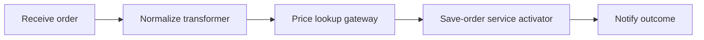

# Advice Chains on Endpoints

In Spring Integration, an **advice chain** adds cross-cutting behavior around an endpoint's message handling: timing, attempt logging, retries, or transaction management. The handler still executes business logic; the advices govern how that invocation is wrapped.

This lesson belongs to the **Advice and Retries** chapter of the `SPRING_INTEGRATION_CORE` module. The goal is to attach advices to the right endpoint, read execution order accurately, and design retry bounds in flows built with `Message`, `MessageChannel`, and Java DSL. Learners should already know how to build an `IntegrationFlow`, use service activators, and distinguish `DirectChannel` from `QueueChannel`.

**Example API baseline:** Java 17+, Spring Integration **6.5.x**, Spring Retry **2.x**; tests use JUnit Jupiter. Required dependencies are `spring-integration-core`, `spring-retry`, and `junit-jupiter` in test scope, with versions managed consistently in the project. The examples use `org.springframework.retry.support.RetryTemplate` and `setRetryTemplate(...)` from the 6.5 branch. The 7.1 documentation uses Spring Framework retry with a different configuration; verify your target version before migrating code. [6.5 retry API](https://docs.spring.io/spring-integration/reference/6.5/handler-advice/classes.html#retry-advice), [7.1 retry API](https://docs.spring.io/spring-integration/reference/7.1/handler-advice/classes.html#retry-advice).

## 1. Why Attach Advice to a Single Endpoint?

Consider an order processing flow:



Suppose the price lookup service occasionally drops connections. The design requirement is to retry the price lookup call a bounded number of times. If retry wraps too large a segment, saving the order or sending notifications might repeat when another step fails.

Request handler advice constrains the behavior to the chosen endpoint. Spring Integration documentation distinguishes this scope from poller advice, which can wrap an entire synchronous processing segment starting from a poll. [Adding Behavior to Endpoints](https://docs.spring.io/spring-integration/reference/6.5/handler-advice.html).

Before configuring, write down three things clearly:

1. **What is wrapped:** which service call, transformation, or data write?
2. **Desired outcome:** return a reply, throw an error, or route to recovery upon failure?
3. **Repeatable side effects:** which database writes, emails, charges, or state updates sit inside that scope?

An advice chain does not create a new business routing branch. For instance, to branch by order type use a router; to drop invalid messages use a filter; to convert payloads use a transformer. Advices fit behavior wrapping those steps.

## 2. Endpoints, Handlers, and Invocation Scope

A consumer endpoint connects an input channel to a handler and manages how the handler is invoked. In Java DSL, the endpoint customization callback is where `.advice(...)` is declared:

```java
.handle(priceClient, "quote",
        endpoint -> endpoint.advice(logicalTrace, retryAdvice, attemptTrace))
```

The arguments are `Advice` instances applied to the endpoint's handler. Java DSL documents this list in nested order. [ConsumerEndpointSpec.advice](https://docs.spring.io/spring-integration/docs/6.5.0/api/org/springframework/integration/dsl/ConsumerEndpointSpec.html#advice(org.aopalliance.aop.Advice...)).

For reply-producing handlers extending `AbstractReplyProducingMessageHandler`, standard request handler advice wraps the internal `handleRequestMessage()` method. Sending the reply to the output channel happens outside that scope. For non-reply-producing handlers, advice may apply around `handleMessage()`. Therefore, examine handler type and message send points rather than guessing scope solely from endpoint names. [Handling Message Advice](https://docs.spring.io/spring-integration/reference/6.5/handler-advice/handle-message.html).

For a typical reply-producing service activator, picture:

```text
input channel
  -> handleMessage(request)
       -> advice A
            -> advice B
                 -> handleRequestMessage(request)
       -> create reply and send to output channel
            -> next endpoint
```

If the next endpoint throws an exception on the same thread, that exception can still propagate back to the sender. That does not mean an advice around `handleRequestMessage()` on the earlier endpoint will catch that error: the earlier advice's callback has already finished.

| Mechanism | Interception Point to Observe | Example Use |
|---|---|---|
| Request handler advice | Processing of the advised handler | Retry a price lookup call at a service activator |
| Poller advice | Polling cycle and synchronous calls inside it | Transactions or controlling polling activity |
| `ChannelInterceptor` | Send/receive operations on a channel | Observing messages crossing a channel |
| `HandleMessageAdvice` | The `handleMessage()` call | Wrapping reply sending and synchronous downstream steps on the same call stack |

Two separate questions to answer are "where do exceptions propagate?" and "which segment does the advice callback wrap?". Those two scopes can differ.

## 3. Declaration Order Is Nesting Order

For standard advices applied at the same join point, the first element is outermost and the last element is closest to the handler. This is Spring Integration's around-advice rule. [Ordering Advices within Advice Chain](https://docs.spring.io/spring-integration/reference/6.5/handler-advice/order.html).

This declaration:

```java
endpoint.advice(logicalTrace, retryAdvice, attemptTrace);
```

Corresponds to:

```text
logicalTrace(
    retryAdvice(
        attemptTrace(
            handler(request)
        )
    )
)
```

If the handler fails twice and succeeds on the third try, `logicalTrace` runs once while `attemptTrace` runs three times. This follows directly from where the two advices sit in the example, not two special Spring modes.

| Position of a Measuring Advice | What It Observes in the Example |
|---|---|
| Outside retry | Overall outcome of one endpoint entry, including any backoff time |
| Inside retry | Outcome of each attempt and that attempt's processing duration |

A counter outside retry may record one successful request, while a counter inside records two failed attempts and one successful attempt. The two metrics answer two different questions.

Similarly, the position of an error-trapping advice affects retry: if an inner advice catches exceptions and returns a normal value, the outer retry never sees the exception. If an advice outside retry handles errors, it receives the error only after retry finishes according to policy.

## 4. A Java DSL Example Making the Full Order Observable

The example below uses a simulated price lookup client. The client fails transiently twice, then returns a result string. `EventLog` records a trace for tests; it is an in-memory illustration tool, not a logging solution for production systems.

The flow has one input `DirectChannel` and one output `QueueChannel`. No poller is needed on the output because the test actively calls `receive(...)`.

```java
package demo.integration;

import java.util.List;
import java.util.Map;
import java.util.concurrent.CopyOnWriteArrayList;
import java.util.concurrent.atomic.AtomicInteger;

import org.springframework.context.annotation.Bean;
import org.springframework.context.annotation.Configuration;
import org.springframework.integration.channel.DirectChannel;
import org.springframework.integration.channel.QueueChannel;
import org.springframework.integration.config.EnableIntegration;
import org.springframework.integration.dsl.IntegrationFlow;
import org.springframework.integration.handler.advice.AbstractRequestHandlerAdvice;
import org.springframework.integration.handler.advice.RequestHandlerRetryAdvice;
import org.springframework.messaging.Message;
import org.springframework.messaging.MessageChannel;
import org.springframework.retry.backoff.NoBackOffPolicy;
import org.springframework.retry.policy.SimpleRetryPolicy;
import org.springframework.retry.support.RetryTemplate;

@Configuration
@EnableIntegration
public class AdviceChainConfig {

    @Bean
    public MessageChannel quoteRequests() {
        return new DirectChannel();
    }

    @Bean
    public QueueChannel quoteReplies() {
        return new QueueChannel();
    }

    @Bean
    public EventLog eventLog() {
        return new EventLog();
    }

    @Bean
    public QuoteClient quoteClient() {
        return new QuoteClient();
    }

    @Bean
    public TraceAdvice logicalTrace() {
        return new TraceAdvice("logical", eventLog());
    }

    @Bean
    public TraceAdvice attemptTrace() {
        return new TraceAdvice("attempt", eventLog());
    }

    @Bean
    public RequestHandlerRetryAdvice retryAdvice() {
        Map<Class<? extends Throwable>, Boolean> retryable = Map.of(
                TransientQuoteException.class, true);

        RetryTemplate template = new RetryTemplate();
        template.setRetryPolicy(new SimpleRetryPolicy(
                3, retryable, true, false));
        template.setBackOffPolicy(new NoBackOffPolicy());

        RequestHandlerRetryAdvice advice = new RequestHandlerRetryAdvice();
        advice.setRetryTemplate(template);
        return advice;
    }

    @Bean
    public IntegrationFlow quoteFlow() {
        return IntegrationFlow.from(quoteRequests())
                .handle(quoteClient(), "quote", endpoint -> endpoint
                        .id("quoteEndpoint")
                        .advice(logicalTrace(), retryAdvice(), attemptTrace()))
                .channel(quoteReplies())
                .get();
    }

    public static final class EventLog {
        private final List<String> events = new CopyOnWriteArrayList<>();

        public void add(String event) {
            events.add(event);
        }

        public List<String> snapshot() {
            return List.copyOf(events);
        }
    }

    public static final class TraceAdvice extends AbstractRequestHandlerAdvice {
        private final String name;
        private final EventLog events;

        public TraceAdvice(String name, EventLog events) {
            this.name = name;
            this.events = events;
        }

        @Override
        protected Object doInvoke(ExecutionCallback callback,
                                  Object target,
                                  Message<?> message) throws Exception {
            events.add(name + ".enter");
            try {
                Object result = callback.execute();
                events.add(name + ".success");
                return result;
            }
            catch (Exception ex) {
                events.add(name + ".failure");
                throw ex;
            }
            finally {
                events.add(name + ".leave");
            }
        }
    }

    public static final class QuoteClient {
        private final AtomicInteger calls = new AtomicInteger();
        private volatile int failuresBeforeSuccess = 2;

        public String quote(String sku) {
            int attempt = calls.incrementAndGet();
            if (sku.isBlank()) {
                throw new IllegalArgumentException("SKU must not be blank");
            }
            if (attempt <= failuresBeforeSuccess) {
                throw new TransientQuoteException("Pricing service temporarily unavailable");
            }
            return "quote:" + sku;
        }

        public int calls() {
            return calls.get();
        }

        // Used only to select scenarios before sending a request in tests.
        public void failFirst(int count) {
            this.failuresBeforeSuccess = count;
        }
    }

    public static final class TransientQuoteException extends RuntimeException {
        public TransientQuoteException(String message) {
            super(message);
        }
    }
}
```

In `SimpleRetryPolicy(3, retryable, true, false)`:

- `3` is the **total number of attempts**, already including the initial call.
- The map allows retrying `TransientQuoteException` and its subtypes.
- `true` enables traversing the cause chain, useful when business exceptions are wrapped.
- `false` as the last argument marks unmatched exceptions as non-retryable.

The attempt-count contract and constructors are documented in [SimpleRetryPolicy API](https://docs.spring.io/spring-retry/docs/2.0.12/apidocs/org/springframework/retry/policy/SimpleRetryPolicy.html).

`NoBackOffPolicy` lets the test example avoid waiting between calls. In a configuration calling a real service, replace the backoff line with the snippet below, importing `org.springframework.retry.backoff.ExponentialBackOffPolicy`:

```java
ExponentialBackOffPolicy backoff = new ExponentialBackOffPolicy();
backoff.setInitialInterval(100);
backoff.setMultiplier(2.0);
backoff.setMaxInterval(1_000);
template.setBackOffPolicy(backoff);
```

With three attempts and the policy above, the two nominal waits are 100 ms and 200 ms. Synchronous backoff holds the thread while waiting; factor in client timeouts, concurrency, and thread limits. Spring Integration highlights this blocking trait of stateless retry. [Retry Advice](https://docs.spring.io/spring-integration/reference/6.5/handler-advice/classes.html#retry-advice).

### Custom Advice Contract

`AbstractRequestHandlerAdvice` provides `doInvoke(...)` and `ExecutionCallback`. For an advice observing a single call, call `callback.execute()` and return its result. If you write logic invoking the callback multiple times within one `doInvoke()`, use `cloneAndExecute()` for repeated invocations so AOP chain state is not corrupted; prefer `RequestHandlerRetryAdvice` when standard retry is all you need. [Custom Advice Classes](https://docs.spring.io/spring-integration/reference/6.5/handler-advice/custom.html).

In `TraceAdvice`, `finally` records leaving the scope whether it succeeded or failed. Exceptions are rethrown so the outer retry advice can decide to retry. Returning `null` from a `catch` block alters the handling outcome and can make failures appear handled.

Variables tied to a single invocation should be local variables. Advices are usually singletons, so a field like `currentMessage` or `startedAt` can be overwritten across threads. The example uses a thread-safe collection, yet traces from concurrent requests can still interleave; in real apps, include a correlation ID to read each request accurately.

## 5. Testing Call Counts, Order, and Outcomes

Each test below creates a fresh application context to isolate client state and logs. The tests use the exact configuration from the previous section and make no external service calls.

```java
package demo.integration;

import java.util.List;

import org.junit.jupiter.api.Test;
import org.springframework.context.annotation.AnnotationConfigApplicationContext;
import org.springframework.integration.channel.QueueChannel;
import org.springframework.messaging.Message;
import org.springframework.messaging.MessageChannel;
import org.springframework.messaging.MessagingException;
import org.springframework.messaging.support.MessageBuilder;

import demo.integration.AdviceChainConfig.EventLog;
import demo.integration.AdviceChainConfig.QuoteClient;

import static org.junit.jupiter.api.Assertions.*;

class AdviceChainTest {

    @Test
    void retriesTwiceThenReturnsOneReply() {
        try (var context = new AnnotationConfigApplicationContext(
                AdviceChainConfig.class)) {
            MessageChannel input = context.getBean(
                    "quoteRequests", MessageChannel.class);
            QueueChannel output = context.getBean(
                    "quoteReplies", QueueChannel.class);

            assertTrue(input.send(MessageBuilder.withPayload("SKU-01")
                    .setHeader("correlationId", "lookup-01")
                    .build()));

            Message<?> reply = output.receive(1_000);
            assertNotNull(reply);
            assertEquals("quote:SKU-01", reply.getPayload());
            assertEquals(3, context.getBean(QuoteClient.class).calls());
            assertNull(output.receive(0));

            assertEquals(List.of(
                    "logical.enter",
                    "attempt.enter", "attempt.failure", "attempt.leave",
                    "attempt.enter", "attempt.failure", "attempt.leave",
                    "attempt.enter", "attempt.success", "attempt.leave",
                    "logical.success", "logical.leave"
            ), context.getBean(EventLog.class).snapshot());
        }
    }

    @Test
    void propagatesFailureAfterThreeAttempts() {
        try (var context = new AnnotationConfigApplicationContext(
                AdviceChainConfig.class)) {
            QuoteClient client = context.getBean(QuoteClient.class);
            client.failFirst(100);
            MessageChannel input = context.getBean(
                    "quoteRequests", MessageChannel.class);
            QueueChannel output = context.getBean(
                    "quoteReplies", QueueChannel.class);

            assertThrows(MessagingException.class, () -> input.send(
                    MessageBuilder.withPayload("SKU-02").build()));

            assertEquals(3, client.calls());
            assertNull(output.receive(0));
            List<String> events = context.getBean(EventLog.class).snapshot();
            assertEquals(3L, events.stream()
                    .filter("attempt.failure"::equals).count());
            assertTrue(events.contains("logical.failure"));
            assertFalse(events.contains("logical.success"));
        }
    }

    @Test
    void doesNotRetryInvalidInput() {
        try (var context = new AnnotationConfigApplicationContext(
                AdviceChainConfig.class)) {
            MessageChannel input = context.getBean(
                    "quoteRequests", MessageChannel.class);

            assertThrows(MessagingException.class, () -> input.send(
                    MessageBuilder.withPayload(" ").build()));

            assertEquals(1, context.getBean(QuoteClient.class).calls());
        }
    }
}
```

The first test verifies three independent properties: the client was called three times, only one reply arrived, and the two advices observed their exact scopes. The next two tests distinguish retry exhaustion from non-retryable input errors. Checking only "no exception thrown" misses all of those distinctions.

`QuoteClient` uses a global counter to keep the scenario readable. It only fits a fixture sending one request per context; a real client must maintain proper state and contracts when multiple requests run concurrently.

A useful scope test when extending the example is inserting an endpoint that always throws **after** the price lookup service activator. Make the price client succeed immediately with `failFirst(0)`, send one request, and verify the price client was called only once even though the downstream error propagates to the sender. That scenario tests the advice boundary rather than merely counting retries.

## 6. Configuration via Annotations or XML

Java DSL is not the only way to declare the same structure. Annotations support `adviceChain` by bean name on endpoints such as service activators, transformers, splitters, and filters. [Advising Endpoints Using Annotations](https://docs.spring.io/spring-integration/reference/6.5/handler-advice/advising-with-annotations.html).

Using the three beans `logicalTrace`, `retryAdvice`, and `attemptTrace` from the example, you can configure a component instead of the DSL flow:

```java
import org.springframework.integration.annotation.MessageEndpoint;
import org.springframework.integration.annotation.ServiceActivator;

@MessageEndpoint
public class AnnotatedQuoteEndpoint {
    private final AdviceChainConfig.QuoteClient client;

    public AnnotatedQuoteEndpoint(AdviceChainConfig.QuoteClient client) {
        this.client = client;
    }

    @ServiceActivator(
            inputChannel = "quoteRequests",
            outputChannel = "quoteReplies",
            adviceChain = {"logicalTrace", "retryAdvice", "attemptTrace"})
    public String quote(String sku) {
        return client.quote(sku);
    }
}
```

To use this option, remove the `quoteFlow()` bean and register `AnnotatedQuoteEndpoint` via component scan or `@Bean`. Keeping both configurations leaves the input `DirectChannel` with two subscribers; requests may be dispatched between them, changing observed results away from the lesson's goal.

XML equivalent for the advice chain, assuming channels, client, advice beans, and the Spring Integration namespace are declared:

```xml
<int:service-activator id="quoteEndpoint"
                       input-channel="quoteRequests"
                       output-channel="quoteReplies"
                       ref="quoteClient"
                       method="quote">
    <int:request-handler-advice-chain>
        <ref bean="logicalTrace"/>
        <ref bean="retryAdvice"/>
        <ref bean="attemptTrace"/>
    </int:request-handler-advice-chain>
</int:service-activator>
```

All three declaration styles are alternatives for the same endpoint. Bean names identify advices in configuration; list order defines nesting.

## 7. Retry Ends: Throw Error or Recover?

The main example configures no recovery callback. Once attempts exhaust, the error propagates to the sender on the `DirectChannel`. In flows running via executors or pollers, the execution component's error-handling mechanism can publish an `ErrorMessage` to an error channel. Do not assume that adding an `errorChannel` header to a synchronous `send()` automatically turns every exception into an error message. [Error Handling](https://docs.spring.io/spring-integration/reference/6.5/error-handling.html).

To route the final error to a specific recovery channel, add to the configuration:

```java
@Bean
public QueueChannel quoteRecovery() {
    return new QueueChannel(100);
}
```

And add this before `return advice;` in `retryAdvice()`, importing `org.springframework.integration.handler.advice.ErrorMessageSendingRecoverer`:

```java
ErrorMessageSendingRecoverer recoverer =
        new ErrorMessageSendingRecoverer(quoteRecovery());
recoverer.setSendTimeout(1_000);
advice.setRecoveryCallback(recoverer);
```

`ErrorMessageSendingRecoverer` publishes the final throwable as an `ErrorMessage`. If sending to recovery succeeds, this callback returns `null`; that setup does not automatically synthesize a fallback business reply. [ErrorMessageSendingRecoverer API](https://docs.spring.io/spring-integration/docs/6.5.0/api/org/springframework/integration/handler/advice/ErrorMessageSendingRecoverer.html).

Consequences for the example:

- With a typical reply setup, the output may receive no reply after recovery.
- `logicalTrace` outside retry may record `.success` when the recovery callback finishes normally; that label then reflects only that no exception escaped.
- If the endpoint requires a reply and the result is `null`, handle the reply contract accordingly, or a missing-reply error can occur.
- If the caller uses a gateway waiting for a reply, sending the error to a separate recovery channel does not complete the gateway's request on its own; design an explicit reply or timeout.

When adding recovery, update tests for the new result contract instead of keeping tests that expect exceptions from the old config. Observable states should separate "business succeeded," "recovered," and "unhandled failure."

In the example, `quoteRecovery` is a bounded in-memory queue. In production, pair it with an appropriate consumer; for durable failure storage, use a corresponding persistent mechanism. The recovery channel name alone does not grant durability.

## 8. Combining Retry with Transactions

Two common arrangements have different meanings:

```text
retry -> transaction -> handler
transaction -> retry -> handler
```

In the first, each attempt passes through the transaction advice. In the second, the transaction advice wraps the entire retry and recovery cycle. Spring Integration's documentation uses this exact contrast to explain why ordering matters. [Ordering Advices within Advice Chain](https://docs.spring.io/spring-integration/reference/6.5/handler-advice/order.html).

However, "passing through the transaction advice on each attempt" does not guarantee a physically fresh transaction every time. If the thread already holds a transaction and propagation is `REQUIRED`, attempts can join the existing transaction. To give each attempt its own transaction, choose appropriate propagation and transaction boundaries, such as `REQUIRES_NEW` when business requirements allow.

Hypothetical example: one attempt writes to the database and fails, marking the shared transaction `rollback-only`. A subsequent attempt returning normally still cannot clear that `rollback-only` flag. Placing retry outside the transaction boundary and specifying propagation explicitly avoids misreading this outcome.

Transaction scope also depends on advice type. Standard `TransactionInterceptor` on a reply-producing handler is bounded to request handling; `TransactionHandleMessageAdvice` extends to `handleMessage()`, potentially covering synchronous downstream steps. Thread-bound transactions do not automatically cross queues or executors onto other threads. [Transaction Support](https://docs.spring.io/spring-integration/reference/6.5/handler-advice/tx-handle-message.html).

A local database transaction also does not undo a successful HTTP call. If an endpoint charges via an API and then loses the response, retry may call the API a second time. You need an idempotency contract with the receiver, such as passing the same operation key across attempts of a charge request.

## 9. Two Exceptions to Know When Reading Advice Chains

### 9.1. Mixing `HandleMessageAdvice` with Request Handler Advice

Advices implementing `HandleMessageAdvice` apply at `handleMessage()`, whereas standard advices on reply-producing handlers can apply at `handleRequestMessage()`. They attach at two different layers, so you cannot interpret the entire list using one flat nesting rule. [Handling Message Advice](https://docs.spring.io/spring-integration/reference/6.5/handler-advice/handle-message.html).

For example, listing a standard transaction advice before a `HandleMessageAdvice` does not guarantee the transaction advice runs first: the `handleMessage()` advice can wrap the outer layer. When you need tight control over this, verify join points, proxy settings, and test actual execution order. `HandleMessageAdviceAdapter` supports applying an interceptor at the `handleMessage()` scope, though extending retry across downstream steps also increases how many operations may repeat.

### 9.2. Filter Discard Branches

Filters have special behavior: by default, the discard action when the predicate returns `false` executes within the advice scope. If the synchronous discard branch throws an exception, retry on the filter may re-run that process. You can set `discardWithinAdvice(false)` in Java DSL, `discardWithinAdvice = "false"` on annotations, or `discard-within-advice="false"` in XML to move discard handling outside. [Advising Filters](https://docs.spring.io/spring-integration/reference/6.5/handler-advice/advising-filters.html).

Example scenario: a filter rejects invalid orders and routes them to a store for rejected records. If that store fails, retrying does not make invalid input valid; it merely repeats validation and discard emission. Decide whether to retry that save inside the filter's scope or on a separate endpoint along the discard branch.

With splitters, routers, or aggregators, also determine the handler's concrete side effects: a single invocation may emit multiple messages or mutate group state. Do not copy a simple lookup's retry configuration without checking what may already have occurred before the exception.

## 10. Reading Scope Misconfigurations in Operations

| Symptom | Possibility to Check | How to Verify |
|---|---|---|
| Business logic executes more times than expected | Retry at multiple layers or overly wide scope | Count invocations at each endpoint and at the outbound client |
| Transient error occurs yet does not retry | Wrong exception classification or error caught inside | Inspect the `cause` chain and return value of inner advices |
| Counter reports success while outcome went to recovery | Recovery returned normally to an outer observing advice | Record recovery as a distinct state |
| Downstream error does not re-invoke earlier endpoint | Error happened after the request handler advice callback | Inject a failure after output and recount invocations |
| Still rolls back after retry | Attempts share a transaction already marked `rollback-only` | Inspect active transactions and propagation |
| Logs from multiple requests interleave | Concurrent processing without correlation info | Include a stable request ID in per-attempt logs |

If one layer allows up to three attempts and an outer layer also allows up to three attempts, calls reaching the target system can reach nine when every attempt fails and both policies permit retrying. Therefore, inventory retries across HTTP clients, SDKs, endpoints, and broker redelivery mechanisms together.

With the sample configuration of three attempts, if each call waits up to a two-second timeout and backoffs are 100 ms then 200 ms, the time spent on three calls plus backoff is roughly up to 6.3 seconds, excluding thread scheduling, reply sending, or other processing. This is a budget calculation for the example, not a framework-enforced total timeout guarantee.

## 11. Reinforcement Exercises

1. Change to `.advice(retryAdvice(), logicalTrace(), attemptTrace())`. Predict the count of `logical.enter`, then check the event trace. In the two-failure scenario, `logicalTrace` now runs three times because it sits inside retry.
2. Make the client succeed immediately with `failFirst(0)`, then add a downstream endpoint that throws an error. Verify the price client is still called only once under the current request handler advice.
3. Add a recovery channel. Verify attempt count, `ErrorMessage` contents, absence of a reply, and behavior of an observing advice outside retry.
4. Change the transient error to an input data error. Verify the policy does not retry and does not produce a fake success reply.
5. Replace the lookup client with an operation having a simulated side effect. Record side effects by a stable request key, then verify multiple attempts do not create duplicate business records.

Once complete, learners should be able to explain which method each advice wraps, which operations may repeat, and what the caller receives when attempts are exhausted. That foundation supports composing advice chains into integration flows alongside gateways, transformers, filters, and stateful endpoints.