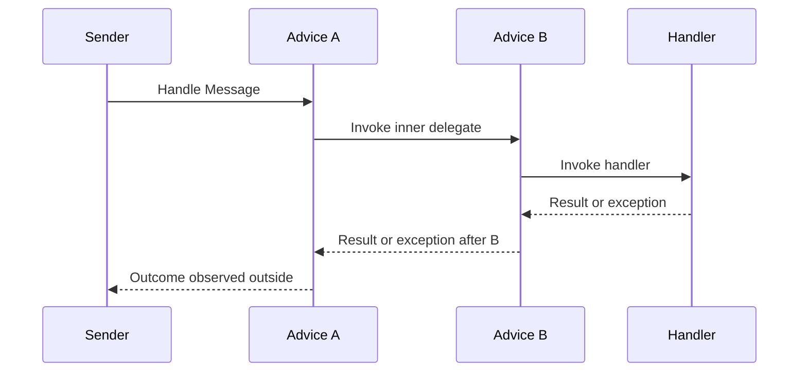

# Advice Ordering

## 1. Objectives and Scope

In the **Advice and Retries** chapter of the **SPRING_INTEGRATION_CORE** module, advice ordering determines the scope of each policy around a message-handling invocation. Given the exact same set of advices, changing their positions can change the number of transactions, error records, when recovery runs, and how many times external systems are called.

After this lesson, you will be able to:

- Read an advice list as nested call layers and predict the path of results or exceptions.
- Order retry, transaction, observation, and circuit breaker advices according to business requirements.
- Recognize cases where advices do not apply to the same method.
- Use Java DSL and event-based tests to prove execution order.

The code examples use **Java 17+, Spring Integration 6.5.x, and Spring Retry 2.x**. This is the API baseline for reading and practicing the snippets, not an assertion about your project's version. The `org.springframework.retry.*` imports below belong to Spring Retry 2.x; when using another Spring Integration release line, check the corresponding API.

Assume you already know `Message`, `MessageChannel`, service activators, and how to declare an `IntegrationFlow`. The lesson focuses on synchronous endpoint processing; stateful retry, broker redelivery, and reactive processing require considering their own lifecycles.

## 2. Foundational Rule: First Element Wraps Outermost

For advices applying to the same invocation point, this configuration:

```java
endpoint.advice(adviceA, adviceB, adviceC);
```

corresponds to the structure:

```text
A(
    B(
        C(handler)
    )
)
```

The first advice sits outermost; the last advice sits closest to the handler. This is the rule documented in [Ordering Advices within Advice Chain](https://docs.spring.io/spring-integration/reference/6.5/handler-advice/order.html).

If each advice invokes its inner delegate exactly once and the handler succeeds:

```text
A.before
  B.before
    C.before
      handler
    C.success
    C.finally
  B.success
  B.finally
A.success
A.finally
```

If the handler throws an exception, `catch` and `finally` blocks unwind from inside out. An advice may rethrow the error, convert it into a result, or re-invoke its inner delegate. Hence, ordering is far more than the order of log lines.



### 2.1. Each Layer Sees Only What Escapes the Inner Layer

Consider the structure `A(Retry(H))`:

- The handler may fail twice and succeed on the third attempt.
- Retry handles the two intermediate failures and returns the third attempt's result.
- A sees only a single successful return, provided no other error escapes retry.

With `Retry(A(H))`, A is re-invoked on each attempt, so it can observe two failures and one success.

A useful rule of thumb is: **outer advices observe the outcome of the entire inner block; retry only repeats the layers inside it**. The invocation counts below assume stateless retry running inside one synchronous call.

### 2.2. List Advices Explicitly Where Attached to the Endpoint

Java DSL provides `advice(Advice... advice)` to declare the list in nesting order. See [ConsumerEndpointSpec.advice](https://docs.spring.io/spring-integration/docs/6.5.0/api/org/springframework/integration/dsl/ConsumerEndpointSpec.html#advice(org.aopalliance.aop.Advice...)).

```java
.handle(orderService, "submit", endpoint -> endpoint
    .id("submitOrderEndpoint")
    .advice(outcomeAdvice, retryAdvice, transactionAdvice, attemptAdvice))
```

Read this configuration as:

```text
Outcome(
    Retry(
        Transaction(
            Attempt(handler)
        )
    )
)
```

Do not infer the execution chain from the declaration order of `@Bean` methods. When an explicit list is passed, read that list itself; `@Order` on beans is not a substitute for ordering the arguments. An endpoint's `order` property serves consumer ordering in applicable contexts, not the position of each advice in the list.

## 3. Determine Scope Before Analyzing Order

Consider the flow:

```text
ordersIn -> validate order -> reserve inventory -> send email -> ordersOut
```

If retry is attached only to the inventory reservation endpoint, failures in the reservation handler can re-run that handler. Do not infer that the email-sending endpoint is also retried simply because it comes downstream in the same `IntegrationFlow`.

For reply-producing handlers extending `AbstractReplyProducingMessageHandler`, standard request handler advice applies around the internal `handleRequestMessage()` call. Sending replies and downstream steps are not automatically inside that advice's scope. Poller advice or advice around `handleMessage()` can span a different region. [Adding Behavior to Endpoints](https://docs.spring.io/spring-integration/reference/6.5/handler-advice.html) illustrates the difference between retrying one endpoint and retrying from a poller.

Before drawing a nesting chain, check:

| What to Determine | Impact on Reading Configuration |
| --- | --- |
| Is the advice attached to a handler, poller, or service proxy? | Identifies the unit of work that may be re-invoked |
| Does the advice wrap `handleRequestMessage()` or `handleMessage()`? | Determines whether sending the reply sits inside scope |
| Is there a thread handoff through a channel? | Determines whether errors still unwind along the same call stack |
| Does the service already have `@Transactional` or `@Retryable` proxies? | Uncovers extra transaction or retry layers outside the endpoint list |

For instance, retry at the endpoint and retry at the service can multiply invocations: three endpoint attempts, each allowing three service calls, yield up to nine executions if both layers keep retrying. Calculate retry budgets across the entire message path.

## 4. Retry and Observation: Counting Requests or Counting Attempts?

Suppose an inventory reservation message fails twice with a transient error and succeeds on the third try. There are two ways to position an observing advice:

| Chain | Entries into Observing Advice | Meaning of Observed Data |
| --- | ---: | --- |
| `Observe -> Retry -> Handler` | 1 | Final outcome of one pass through retry |
| `Retry -> Observe -> Handler` | 3 | Outcome of each attempt |
| `Outcome -> Retry -> Attempt -> Handler` | Outcome: 1; Attempt: 3 | Tracks both overall outcome and individual attempts |

With timers, a layer outside retry usually includes backoff durations. A layer inside retry times each attempt separately, so backoff waits between attempts are excluded from that measurement.

Metric names should express the exact unit: `message.processing.duration` and `handler.attempt.duration` answer two different questions. A message that succeeds after retry still had failed attempts; keeping only one metric can hide degradation in an external system.

### 4.1. A Tracing Advice to Make Ordering Visible

Below is the class used in the practice exercise. The `sink` receives events instead of relying on log formatting:

```java
import java.util.function.Consumer;

import org.springframework.integration.handler.advice.AbstractRequestHandlerAdvice;
import org.springframework.messaging.Message;

public final class TraceAdvice extends AbstractRequestHandlerAdvice {

    private final String name;
    private final Consumer<String> sink;

    public TraceAdvice(String name, Consumer<String> sink) {
        this.name = name;
        this.sink = sink;
    }

    @Override
    protected Object doInvoke(ExecutionCallback callback,
                              Object target,
                              Message<?> message) throws Exception {
        sink.accept(name + ".before");
        try {
            Object result = callback.execute();
            sink.accept(name + ".success");
            return result;
        }
        catch (Exception ex) {
            sink.accept(name + ".failure");
            throw ex;
        }
        finally {
            sink.accept(name + ".after");
        }
    }
}
```

`callback.execute()` proceeds through the remaining layers to the handler. This is the API for custom request handler advices described in [Custom Advice Classes](https://docs.spring.io/spring-integration/reference/6.5/handler-advice/custom.html).

In the example, `sink` is assumed not to throw. If a real audit writer throws an exception after the handler already caused side effects, an outer retry can re-invoke the handler. Therefore, the reliability and error handling of advices themselves also affect flow correctness.

## 5. Retry and Transactions: Two Orders, Two Boundaries

### 5.1. Retry Outside Transaction

```text
Retry(
    Transaction(handler)
)
```

When each entry into transaction advice actually starts a fresh transaction, execution can look like:

```text
Attempt 1: begin TX1 -> handler fails -> roll back TX1
Backoff
Attempt 2: begin TX2 -> handler fails -> roll back TX2
Backoff
Attempt 3: begin TX3 -> handler succeeds -> commit TX3
Retry returns result
```

This layout fits when a database write attempt must conclude before trying again. Backoff sits outside the transaction created for that attempt.

However, **ordering retry before transaction is not enough on its own to guarantee a new physical transaction**. If propagation is `REQUIRED` and the thread already holds a transaction, the transaction advice may join the existing transaction. `REQUIRES_NEW` creates an independent transaction and suspends any outer transaction. This mechanism is explained in [Transaction Propagation](https://docs.spring.io/spring-framework/reference/data-access/transaction/declarative/tx-propagation.html).

When intentionally using `REQUIRES_NEW`, accept that a successful attempt may commit independently even if outer work later rolls back. While suspending an outer transaction, the system may also need an extra connection for the inner transaction. This is a business consistency and resource decision, not just a retry optimization.

### 5.2. Transaction Outside Retry

```text
Transaction(
    Retry(handler)
)
```

With a fresh transaction wrapping the whole block:

```text
begin TX
  Attempt 1: handler fails
  Backoff
  Attempt 2: handler fails
  Backoff
  Attempt 3: handler returns result
commit or roll back TX
```

This setup can hold connections and locks across all wait intervals. If an operation marks the transaction `rollback-only`, a subsequent attempt returning normally does not clear that status. Depending on resources and participating transaction layers, completion can result in rollback or `UnexpectedRollbackException`.

Not every exception caught by retry automatically marks an outer transaction `rollback-only`. Inspect which layer sees the exception and what resources did. By default, transaction advice inspects exceptions escaping its boundary to apply rollback rules; rollback configuration can change that. See [Rolling Back a Declarative Transaction](https://docs.spring.io/spring-framework/reference/data-access/transaction/declarative/rolling-back.html).

### 5.3. Comparison by Observable Failures

| Scenario | `Retry -> Transaction -> Handler` | `Transaction -> Retry -> Handler` |
| --- | --- | --- |
| Handler throws a retryable error | Attempt's transaction can complete before the next attempt | Retry handles the error while still inside the outer transaction scope |
| Transaction advice throws at commit | Outer retry can observe it; whether it retries depends on classification | Commit occurs after retry returned, so inner retry does not handle this commit error |
| Backoff | Outside the transaction created per attempt | Inside the transaction wrapping retry |
| Recovery invoked by retry | Outside the transaction advice sitting inside retry | Inside the scope of the transaction advice wrapping retry |

If a transaction was joined from outside rather than created here, physical commit timing may sit outside both layers under examination. Do not infer commit behavior solely from the order of bean names.

## 6. Java DSL Example: Each Attempt Reserves Stock in Its Own Transaction

Requirement: handle an inventory reservation command; retry only transient data errors, up to three total attempts. Each attempt uses an independent transaction. Upon success, send the result to a `QueueChannel`.

Relevant dependencies are `spring-integration-core`, `spring-tx`, and `spring-retry`; tests use JUnit Jupiter. The configuration class below expects the application to supply an `InventoryService` implementation and a `PlatformTransactionManager` for the resource used by the service.

```java
import java.util.Map;

import org.springframework.beans.factory.annotation.Qualifier;
import org.springframework.context.annotation.Bean;
import org.springframework.context.annotation.Configuration;
import org.springframework.dao.TransientDataAccessException;
import org.springframework.integration.channel.QueueChannel;
import org.springframework.integration.config.EnableIntegration;
import org.springframework.integration.dsl.IntegrationFlow;
import org.springframework.integration.handler.advice.RequestHandlerRetryAdvice;
import org.springframework.integration.transaction.TransactionInterceptorBuilder;
import org.springframework.retry.backoff.ExponentialBackOffPolicy;
import org.springframework.retry.policy.SimpleRetryPolicy;
import org.springframework.retry.support.RetryTemplate;
import org.springframework.transaction.PlatformTransactionManager;
import org.springframework.transaction.annotation.Propagation;
import org.springframework.transaction.interceptor.TransactionInterceptor;

@Configuration
@EnableIntegration
public class ReservationFlowConfiguration {

    public record ReserveCommand(String reservationId,
                                 String sku,
                                 int quantity) {
    }

    public record ReserveResult(String reservationId, String status) {
    }

    public interface InventoryService {
        ReserveResult reserve(ReserveCommand command);
    }

    @Bean
    public RequestHandlerRetryAdvice reserveRetry() {
        SimpleRetryPolicy policy = new SimpleRetryPolicy(
            3,
            Map.of(TransientDataAccessException.class, true),
            true);

        ExponentialBackOffPolicy backoff = new ExponentialBackOffPolicy();
        backoff.setInitialInterval(100);
        backoff.setMultiplier(2.0);
        backoff.setMaxInterval(1000);

        RetryTemplate template = new RetryTemplate();
        template.setRetryPolicy(policy);
        template.setBackOffPolicy(backoff);

        RequestHandlerRetryAdvice advice = new RequestHandlerRetryAdvice();
        advice.setRetryTemplate(template);
        return advice;
    }

    @Bean
    public TransactionInterceptor reserveTx(
            PlatformTransactionManager transactionManager) {
        return new TransactionInterceptorBuilder(false)
            .transactionManager(transactionManager)
            .propagation(Propagation.REQUIRES_NEW)
            .build();
    }

    @Bean
    public QueueChannel reserveReplies() {
        return new QueueChannel();
    }

    @Bean
    public IntegrationFlow reserveFlow(
            InventoryService inventoryService,
            @Qualifier("reserveRetry") RequestHandlerRetryAdvice retry,
            @Qualifier("reserveTx") TransactionInterceptor transaction) {
        return IntegrationFlow.from("reserveRequests")
            .handle(ReserveCommand.class,
                (command, headers) -> inventoryService.reserve(command),
                endpoint -> endpoint
                    .id("reserveEndpoint")
                    .advice(retry, transaction))
            .channel("reserveReplies")
            .get();
    }
}
```

Details to read alongside the advice ordering:

- `SimpleRetryPolicy(3, ...)` allows up to **three executions including the initial call**, not one initial call plus three retries. See [SimpleRetryPolicy](https://docs.spring.io/spring-retry/docs/2.0.12/apidocs/org/springframework/retry/policy/SimpleRetryPolicy.html).
- `traverseCauses = true` enables searching for retryable exceptions down the cause chain, useful when business errors are wrapped by messaging exceptions. Unmatched errors are not automatically retried.
- With three consecutive failures under the policy above, expected backoffs are 100 ms then 200 ms. There is no recovery callback, so the final error escapes outward.
- `TransactionInterceptorBuilder(false)` creates standard transaction advice; `true` selects `TransactionHandleMessageAdvice`, which has a different scope. See [TransactionInterceptorBuilder](https://docs.spring.io/spring-integration/docs/6.5.0/api/org/springframework/integration/transaction/TransactionInterceptorBuilder.html).
- The service must access resources enlisted with the matching transaction manager. A database transaction does not automatically undo sent HTTP requests or emails.

`reserveReplies` is the channel receiving results after the handler, not a guarantee that an error sending the reply would be retried by request handler retry. Transaction and retry scope here covers the endpoint's request handling invocation.

Applications should use `reservationId` as a business key to prevent duplicate reservations when a request succeeded yet the caller missed the response and resent it. Advice ordering decides where retries occur; idempotency controls the side effects of retrying or redelivering messages.

## 7. Recovery and Error-Handling Advices Can Change What Outer Layers See

### 7.1. Recovery Sits Inside Retry's Orchestration

Consider two chains when the handler fails all attempts:

```text
Retry(Transaction(handler))
  -> final attempt's transaction completes
  -> retry invokes recovery
```

```text
Transaction(Retry(handler))
  -> retry invokes recovery
  -> outer transaction then proceeds to completion
```

If recovery must write a durable record after attempts rolled back, do not assume it already has an appropriate transaction. You can invoke a recovery service through a `REQUIRES_NEW` proxy, use explicit transactions, or send to a flow with an explicitly designed durable store.

If recovery returns normally, an advice outside retry may observe a normal return even though the handler never succeeded. Metrics or audits must then distinguish `SUCCESS`, `RECOVERED`, and `FAILED` per business convention. Do not use "no exception thrown" as the sole proof of business success.

For example, `ErrorMessageSendingRecoverer` is provided to send errors to a channel after retry stops; this is an explicitly configured recovery behavior presented in [Provided Advice Classes](https://docs.spring.io/spring-integration/reference/6.5/handler-advice/classes.html).

### 7.2. Inner Advices That Catch and Swallow Errors Can Stop Retry Immediately

Suppose `Fallback` catches handler errors and returns a substitute value:

```text
Retry(Fallback(handler))
```

If fallback returns normally right after the first failure, retry receives no error to trigger the next attempt. With the reverse structure:

```text
Fallback(Retry(handler))
```

fallback can handle the final failure after retry has used all permitted attempts.

`ExpressionEvaluatingRequestHandlerAdvice` has a `trapException` option. When enabled, errors from the wrapped segment can be trapped instead of rethrown. When retry needs to see the error, keep rethrowing behavior in layers inside retry. Also account for `null` results and `requiresReply`: trapping an error does not synthesize a valid reply on its own.

The position of an expression-evaluating advice also determines how often expressions run:

| Relative Position | When Handler Fails Twice Then Succeeds |
| --- | --- |
| `ExpressionAdvice -> Retry -> Handler` | May record only the final successful outcome |
| `Retry -> ExpressionAdvice -> Handler`, errors rethrown | May run the failure expression twice and the success expression once |

Avoid sending each attempt's error to the same destination meant for "final unrecoverable errors requiring intervention" unless you want multiple alerts for one message. If the advice sits inside a transaction and emits an audit event successfully before commit, that record proves only that the handler returned at that moment.

### 7.3. `errorChannel` Is Not an Automatic Catch-All Layer Around Every Call

With `DirectChannel`, unhandled errors typically propagate on the same thread to the sender. Setting an `errorChannel` header alone does not automatically intercept every exception on a synchronous `send()` call. Gateways, pollers, executors, and recoverers each route errors to channels according to their own contexts. See [Error Handling](https://docs.spring.io/spring-integration/reference/6.5/error-handling.html).

When a downstream endpoint runs on another thread, its errors do not unwind as Java exceptions back into a request handler advice that already finished on the earlier thread. Design error paths and retry units on the side actually executing that work.

## 8. Retry and Circuit Breaker: Which Unit Is the Breaker Counting?

The two chains below behave differently:

```text
CircuitBreaker(Retry(handler))
```

```text
Retry(CircuitBreaker(handler))
```

In this hypothetical example, the breaker starts closed with a threshold of two consecutive failures, retry allows three attempts, the handler always fails, and there is no recovery. Assume insufficient time passes for the breaker to allow probing again.

| Chain | Progression on the First Message |
| --- | --- |
| `CircuitBreaker -> Retry -> Handler` | Handler may run three times; if retry throws the final error, the outer breaker records one failure |
| `Retry -> CircuitBreaker -> Handler` | First two attempts call the handler and open the breaker; the next attempt may reject immediately without calling the handler |

These numbers follow from nesting structure under the stated assumptions. `RequestHandlerCircuitBreakerAdvice`'s consecutive failure counting, circuit opening, and cooldown probing are described in [Circuit Breaker Advice](https://docs.spring.io/spring-integration/reference/6.5/handler-advice/classes.html#circuit-breaker-advice).

If the breaker sits inside retry, avoid letting the retry policy keep looping pointlessly on circuit-open exceptions. If the breaker sits outside retry and recovery converts failures into normal returns, the breaker may receive no failure signal. Decide whether the breaker protects per external call or per overall retried handling outcome.

## 9. Important Exception: `HandleMessageAdvice` Can Apply at Another Call Layer

The "first element wraps outermost" rule applies among advices that actually wrap the same invocation point.

For reply-producing handlers, Spring Integration separates objects implementing `HandleMessageAdvice` to apply around `handleMessage()`. Remaining standard advices apply around `handleRequestMessage()`. When mixing both groups, the overall declaration order in the list may not match reading a single flat chain. This exception is explicitly noted in [Handling Message Advice](https://docs.spring.io/spring-integration/reference/6.5/handler-advice/handle-message.html).

Conceptual example:

```java
endpoint.advice(ordinaryTransactionAdvice, handleMessageAdvice);
```

For a reply-producing handler in this situation, the actual structure can be:

```text
handleMessageAdvice
  -> handleMessage()
       -> ordinaryTransactionAdvice
            -> handleRequestMessage()
       -> send reply
```

Do not conclude the transaction advice sits outermost merely because it was listed first. For non-reply-producing handlers, the documentation notes that advice chain ordering is preserved in the corresponding case.

`TransactionHandleMessageAdvice` is designed to extend transactions around message handling and synchronous downstream steps; standard transaction advice wraps only internal request handling. See [Transaction Support](https://docs.spring.io/spring-integration/reference/6.5/handler-advice/tx-handle-message.html).

When you need to control ordering across all of `handleMessage()`, you may need explicit AOP configuration on the handler bean or version-appropriate `handleMessageAdvice` mechanisms. Handler bean names can be derived from endpoint IDs with a `.handler` suffix per the documentation. Verify actual proxies and scope rather than merely reordering beans in the list.

Even with a broader scope, a thread-bound transaction does not cross asynchronous boundaries automatically. Introducing an `ExecutorChannel` or a `QueueChannel` consumer into the flow must be treated as a change to transaction and error-handling design.

## 10. Practice: Proving the Chain with Events

The goal is to verify `OUTCOME -> RETRY -> ATTEMPT -> HANDLER` when the handler succeeds on the third attempt. Place the `TraceAdvice` class from Section 4 in the same package as the test class below. The example uses JUnit Jupiter and needs no database.

```java
import java.util.ArrayList;
import java.util.List;
import java.util.Locale;
import java.util.concurrent.atomic.AtomicInteger;

import org.junit.jupiter.api.Test;
import org.springframework.context.annotation.AnnotationConfigApplicationContext;
import org.springframework.context.annotation.Bean;
import org.springframework.context.annotation.Configuration;
import org.springframework.integration.channel.QueueChannel;
import org.springframework.integration.config.EnableIntegration;
import org.springframework.integration.dsl.IntegrationFlow;
import org.springframework.integration.handler.advice.RequestHandlerRetryAdvice;
import org.springframework.messaging.Message;
import org.springframework.messaging.MessageChannel;
import org.springframework.messaging.support.GenericMessage;
import org.springframework.retry.backoff.NoBackOffPolicy;
import org.springframework.retry.policy.SimpleRetryPolicy;
import org.springframework.retry.support.RetryTemplate;

import static org.junit.jupiter.api.Assertions.assertEquals;
import static org.junit.jupiter.api.Assertions.assertNotNull;
import static org.junit.jupiter.api.Assertions.assertTrue;

class AdviceOrderTest {

    @Test
    void outcomeRunsOnceAndAttemptRunsThreeTimes() {
        try (var context = new AnnotationConfigApplicationContext(TestConfig.class)) {
            TestConfig config = context.getBean(TestConfig.class);
            MessageChannel input = context.getBean("traceInput", MessageChannel.class);
            QueueChannel output = context.getBean("traceOutput", QueueChannel.class);

            assertTrue(input.send(new GenericMessage<>("order-42")));

            Message<?> reply = output.receive(0);
            assertNotNull(reply);
            assertEquals("ORDER-42", reply.getPayload());
            assertEquals(3, config.calls.get());
            assertEquals(List.of(
                "OUTCOME.before",
                "ATTEMPT.before", "HANDLER.1", "ATTEMPT.failure", "ATTEMPT.after",
                "ATTEMPT.before", "HANDLER.2", "ATTEMPT.failure", "ATTEMPT.after",
                "ATTEMPT.before", "HANDLER.3", "ATTEMPT.success", "ATTEMPT.after",
                "OUTCOME.success", "OUTCOME.after"
            ), config.events);
        }
    }

    @Configuration
    @EnableIntegration
    static class TestConfig {

        final List<String> events = new ArrayList<>();
        final AtomicInteger calls = new AtomicInteger();

        @Bean
        public TraceAdvice outcomeTrace() {
            return new TraceAdvice("OUTCOME", events::add);
        }

        @Bean
        public TraceAdvice attemptTrace() {
            return new TraceAdvice("ATTEMPT", events::add);
        }

        @Bean
        public RequestHandlerRetryAdvice traceRetry() {
            RetryTemplate template = new RetryTemplate();
            template.setRetryPolicy(new SimpleRetryPolicy(3));
            template.setBackOffPolicy(new NoBackOffPolicy());

            RequestHandlerRetryAdvice advice = new RequestHandlerRetryAdvice();
            advice.setRetryTemplate(template);
            return advice;
        }

        @Bean
        public QueueChannel traceOutput() {
            return new QueueChannel();
        }

        @Bean
        public IntegrationFlow tracedFlow() {
            return IntegrationFlow.from("traceInput")
                .handle(String.class, (payload, headers) -> {
                    int attempt = calls.incrementAndGet();
                    events.add("HANDLER." + attempt);
                    if (attempt < 3) {
                        throw new IllegalStateException("temporary failure");
                    }
                    return payload.toUpperCase(Locale.ROOT);
                }, endpoint -> endpoint.advice(
                    outcomeTrace(), traceRetry(), attemptTrace()))
                .channel("traceOutput")
                .get();
        }
    }
}
```

In this test, the default input is created as a `DirectChannel`; `send()` runs the handler on the same thread before returning. `traceOutput` simply holds the reply for later inspection. Therefore, `ArrayList` suffices for this test harness, and no `Thread.sleep()` is needed to wait for the handler.

`SimpleRetryPolicy(3)` in the test intentionally retries all default-matched exceptions to highlight ordering. In production code, classify exceptions as in the inventory reservation example instead of copying this broad policy.

### 10.1. Variants to Compare During Practice

| Change | What to Observe or Verify |
| --- | --- |
| Move `outcomeTrace()` after `traceRetry()` | That advice is invoked on every attempt |
| Make handler always fail with no recovery | Three handler calls occur and the final error escapes to the synchronous sender |
| Add recovery returning a fallback result | Advice outside retry may log `.success`; add a business marker to identify recovery |
| Change policy not to retry `IllegalStateException` | Handler runs only once, proving classification acts independently of order |
| Add real transactions and transient data errors | Measure begin, rollback, commit counts and which rows actually persist |
| Move a downstream segment to an executor | Verify errors on the executor side are not retried in the completed synchronous region |

When verifying transactions, use a transaction manager and resource with real rollback behavior. A self-written `TX.begin` log list does not prove a new physical transaction existed or data rolled back.

## 11. Choosing Ordering from Business Requirements

One approach applicable to many flows:

1. **Pick the retryable unit.** Identify the handler or group of operations permitted to run multiple times and any associated side effects.
2. **Draw invocation boundaries.** Mark request handler, `handleMessage()`, service proxies, pollers, and thread handoffs.
3. **Determine state to refresh.** For instance, whether each attempt needs a new transaction or joins the caller's transaction.
4. **Place observers.** Track whole-retry outcomes outside; track individual attempts inside. Define recovery status explicitly.
5. **Follow exception paths.** Find layers that might swallow errors, translate types, throw new errors, or run recovery; cross-check exception classification policies.
6. **Verify via behavior.** Count handler executions, event order, error-channel outputs, and post-commit or post-rollback data state.

For example, the requirement "one final outcome record per message, each database attempt in an independent transaction" suggests:

```text
Observe final outcome
  -> Retry
       -> Per-attempt transaction
            -> Observe attempt
                 -> Handler
```

This structure still requires an accurate exception policy, matching propagation, and a way to distinguish recovery. If the requirement shifts to "limit actual calls to the external system," the position of circuit breakers and resource limiters must be evaluated per attempt.

## 12. Common Misconceptions

| Misconception | Correct Reading or Design |
| --- | --- |
| First advice is closest to the handler | First advice wraps outermost when advices apply to the same invocation point |
| Retry re-runs the entire flow | Retry re-runs only the region inside its actual scope |
| Placing retry before transaction always creates a new transaction | Must account for existing transactions, propagation, and transaction manager |
| Handler returning means commit happened | Commit may occur after the handler returns or at an outer boundary |
| Recovery running means the initial business action succeeded | Recovery is a fallback outcome after failure, with its own business meaning |
| Attaching `errorChannel` automatically catches synchronous errors | Needs error routing at the corresponding gateway, task, poller, or recoverer |
| Every advice in the list shares the same scope | `HandleMessageAdvice` can separate onto `handleMessage()` on reply-producing handlers |
| Reordering only changes log order | Can change transactions, callback frequency, real call counts, and what outer layers observe |

When reading an advice chain, always be able to explain three things: **which layer wraps which, which work can repeat, and which exceptions still escape outward**. From there, advice ordering becomes an explainable design decision verifiable through message-flow behavior.