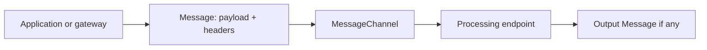

# Message and GenericMessage

In the **Message** chapter of the **SPRING_INTEGRATION_CORE** module, this lesson explains the unit of data that travels through a Spring Integration flow: `Message<T>`. Understanding this structure is the foundation for connecting `MessageChannel`, endpoints, gateways, and Java DSL; it also helps design transformers, routers, filters, aggregators, error handling, and integration flow testing.

The focus is on how data is represented with `Message` and how messages are created using `GenericMessage`. Other components are mentioned to clarify how they use messages.

## 1. Why Does an Integration Flow Need Message?

Suppose a sales system receives an order. The pricing department needs the order data; the routing step needs to know the ingestion source; the tracking step needs an ID to correlate processing runs. If all of these are passed as separate parameters, each step easily becomes coupled to a different method signature.

A message bundles the data into a common envelope:

```text
Message<OrderPlaced>
├── payload: OrderPlaced
│   ├── orderId: "ORD-2048"
│   └── total: 250000
└── headers
    ├── id: UUID generated by the framework
    ├── timestamp: time the envelope was created
    ├── sourceSystem: "checkout"
    └── businessEventId: "EVT-9001"
```

The payload carries the content to be processed. Headers carry the accompanying context. One step may only care about the payload; another step may read headers without needing to understand the entire business structure.

For example, a router selects a branch based on `sourceSystem`, while a transformer converts `OrderPlaced` into a request sent to the warehouse. Both still work with the same data exchange format.



In the diagram, the message is the data being exchanged; the channel transfers the data; the endpoint performs the processing. Creating a new `GenericMessage` only instantiates a Java object. To have an execution flow, the application must also connect the receiving and processing components.

## 2. The Message<T> Contract

`Message<T>` belongs to the `org.springframework.messaging` package of Spring Framework and is used by Spring Integration as the message contract. The simplified form of the interface is:

```java
public interface Message<T> {
    T getPayload();
    MessageHeaders getHeaders();
}
```

`T` represents the payload type. `getHeaders()` returns `MessageHeaders`. The interface provides read methods, with no `setPayload()` or `setHeaders()`. See [Javadoc Message](https://docs.spring.io/spring-framework/docs/current/javadoc-api/org/springframework/messaging/Message.html).

When the payload type is known, application code reads the data directly:

```java
import org.springframework.messaging.Message;
import org.springframework.messaging.support.GenericMessage;

Message<String> request = new GenericMessage<>("ORD-2048");
String orderId = request.getPayload();
```

Variables, parameters, and return types should be declared as `Message<T>` when the logic only needs the read contract. `GenericMessage<T>` is appropriate at the instantiation site. This allows handlers to process other `Message` implementations without depending on a concrete class.

### 2.1. The Meaning of Message<?> at the Receiving Boundary

A generic handler typically accepts `Message<?>`, because the payload type is not known at compile time. In that case, the data must be validated before use:

```java
static void consume(Message<?> message) {
    Object payload = message.getPayload();

    if (!(payload instanceof String orderId)) {
        throw new IllegalArgumentException("Payload must be an order ID");
    }

    System.out.println("Processing " + orderId);
}
```

The pattern matching syntax in the example requires Java 17 or higher. When choosing a Spring version, the JDK requirements of that version must still be met.

Do not cast `(Message<String>) message` and treat it as if the payload were verified. Generics do not replace data validation at the input boundary; an unsafe cast can cause the failure to surface only when reading the payload.

## 3. Choosing Data for Payload and Headers

A useful design criterion is: data describing the business event or request belongs in the payload; information supporting transport, tracing, and orchestration belongs in the headers.

| Data | Suggested Location | Reason |
| --- | --- | --- |
| Order ID, total amount, product list | Payload | It is the content of the order placement event |
| Ingestion source such as `checkout` | `sourceSystem` header | Can help select the processing branch |
| Application-issued event ID | `businessEventId` header per application contract | Links envelopes of the same event |
| Time the customer actually placed the order | `occurredAt` field in payload | It is business time, which may differ from message creation time |
| Reply destination | Standard `replyChannel` header when used by the flow | It is request/reply exchange information |

This is a design choice for the sales example, not a rule forcing every system to use the same schema. If an event ID is a required part of an external integration contract, it should be placed where that contract specifies, rather than defaulting to storing it only in an internal header.

Avoid converting the payload to a JSON string too early when steps within the same JVM still need typed operations. You can keep DTOs in the internal flow and then convert to a transport format at the boundary communicating with external systems.

Placing a value in a header also requires agreement on name, type, meaning, and behavior when missing. The `businessEventId` header in this lesson is defined by the application itself; naming it that does not automatically enable duplicate processing prevention.

## 4. Instantiating with GenericMessage

`GenericMessage<T>` is the common implementation in `org.springframework.messaging.support`. The passed-in payload must not be `null`. Three constructors have different behaviors regarding headers. See [Javadoc GenericMessage](https://docs.spring.io/spring-framework/docs/current/javadoc-api/org/springframework/messaging/support/GenericMessage.html).

### 4.1. Passing Only the Payload

```java
import org.springframework.messaging.Message;
import org.springframework.messaging.support.GenericMessage;

Message<String> message = new GenericMessage<>("Order accepted");

String payload = message.getPayload();
System.out.println(payload);
```

This approach is suitable when the input does not yet need custom metadata.

### 4.2. Passing Payload and a Headers Map

```java
import java.util.HashMap;
import java.util.Map;

import org.springframework.messaging.Message;
import org.springframework.messaging.support.GenericMessage;

Map<String, Object> suppliedHeaders = new HashMap<>();
suppliedHeaders.put("sourceSystem", "checkout");
suppliedHeaders.put("schemaVersion", 1);

Message<String> message =
        new GenericMessage<>("ORD-2048", suppliedHeaders);

suppliedHeaders.put("sourceSystem", "admin");

System.out.println(message.getHeaders().get("sourceSystem"));
// checkout
```

The constructor taking `Map<String, Object>` copies the entries into the message's headers. Modifying an entry in the input map after creation does not change the corresponding entry in the message.

This is a shallow copy: if a header value is a mutable object, that object can still be shared. The examples in the immutability section will clarify this distinction.

### 4.3. Passing Payload and MessageHeaders

```java
import java.util.Map;

import org.springframework.messaging.Message;
import org.springframework.messaging.MessageHeaders;
import org.springframework.messaging.support.GenericMessage;

MessageHeaders sharedHeaders =
        new MessageHeaders(Map.<String, Object>of("sourceSystem", "checkout"));

Message<String> first = new GenericMessage<>("before", sharedHeaders);
Message<String> second = new GenericMessage<>("after", sharedHeaders);

System.out.println(first.getHeaders() == second.getHeaders());
// true
```

The overload taking `MessageHeaders` uses the provided instance directly. In this example, the two envelopes share both headers and message ID. Therefore, do not choose that overload assuming each call creates a new set of metadata.

| Constructor | Main Behavior |
| --- | --- |
| `GenericMessage(payload)` | Creates a message with default headers |
| `GenericMessage(payload, Map<String, Object>)` | Copies the map entries and creates a new `MessageHeaders` |
| `GenericMessage(payload, MessageHeaders)` | Directly uses the existing headers instance |

The difference also depends on the static type of the argument. If the same headers object is passed through a variable of type `Map<String, Object>`, Java selects the `Map` overload. Express your intent explicitly rather than relying on changing variable types to control message identity.

### 4.4. Null Payload Is an Input Error

```java
new GenericMessage<String>(null);
// Throws IllegalArgumentException on instantiation.
```

If a business operation has a "not found" result, define a clear representation, such as a result DTO with a status. An endpoint not producing an output message is an orchestration decision different from creating a message with a `null` payload.

## 5. Reading Headers and Distinguishing Identifier Types

With the default construction path via payload or `Map`, Spring generates `id` and `timestamp` headers. The public constructor `MessageHeaders(Map)` generates these values, overwriting any entries with the same names in the input map. Do not use `id` as a business-managed field. See [Javadoc MessageHeaders](https://docs.spring.io/spring-framework/docs/current/javadoc-api/org/springframework/messaging/MessageHeaders.html).

| Header | Type or Value Form | Meaning to Distinguish |
| --- | --- | --- |
| `id` | `UUID` | Message envelope identifier |
| `timestamp` | `Long` in epoch milliseconds | Time default headers were created |
| `replyChannel` | Channel reference or channel name in appropriate configuration | Hint for where to send the reply |
| `errorChannel` | Channel reference or channel name in appropriate configuration | Error handling destination info |
| `businessEventId` | `String` in this example | Application-issued event identifier |

Reading headers with the expected type:

```java
import java.util.UUID;

UUID envelopeId = message.getHeaders().getId();
Long createdAt = message.getHeaders().getTimestamp();

String source =
        message.getHeaders().get("sourceSystem", String.class);
Integer schemaVersion =
        message.getHeaders().get("schemaVersion", Integer.class);
```

The typed getter helps detect values of the wrong type; it is not a converter from string `"1"` to integer `1`. A header may be missing, so consuming logic must handle `null` values according to the flow's contract.

In the sales system, the following may coexist:

- `orderId`: which order is being referred to.
- `businessEventId`: which occurrence of the order's event.
- `id`: which message envelope is carrying the data at a given step.

One order can emit multiple events. One event can be represented by multiple envelopes after transformation or re-ingestion from an external system. When designing idempotency, choose keys based on business semantics and state storage mechanisms; having only a UUID on the message is not enough to guarantee an effect occurs only once.

## 6. Envelope Immutability Is Not Deep Immutability

With a standard `GenericMessage`, the application cannot replace the payload reference via a setter. `MessageHeaders` also blocks direct mutation operations like `put()`, `remove()`, or `clear()`. However, the payload and individual header values may still be mutable objects. The [Spring Integration Message documentation](https://docs.spring.io/spring-integration/reference/message.html) clearly distinguishes this limitation.

### 6.1. A Mutable Payload Can Still Change

```java
import java.util.ArrayList;
import java.util.List;

import org.springframework.messaging.Message;
import org.springframework.messaging.support.GenericMessage;

List<String> skuCodes = new ArrayList<>(List.of("SKU-1"));
Message<List<String>> message = new GenericMessage<>(skuCodes);

skuCodes.add("SKU-2");

System.out.println(message.getPayload());
// [SKU-1, SKU-2]
```

The message holds a reference to the passed-in list. When the producer modifies the list, a consumer reading the same object can observe the new data. If processing branches run in parallel, synchronization issues or execution-order-dependent results can also occur.

One way to protect a list of strings is to create an unmodifiable copy before wrapping it:

```java
Message<List<String>> snapshot =
        new GenericMessage<>(List.copyOf(skuCodes));
```

Here `String` is immutable. If the elements are mutable DTOs, copying only the list does not protect the contents of each individual DTO.

Similarly, a Java `record` only fixes the references of its components. A record containing a `List`, array, or mutable object still needs its own copying policy. The complete example later uses a compact constructor to copy the list of product codes.

### 6.2. The Headers Map Is Copied, but Values Can Be Shared

```java
import java.util.ArrayList;
import java.util.List;
import java.util.Map;

import org.springframework.messaging.Message;
import org.springframework.messaging.support.GenericMessage;

List<String> tags = new ArrayList<>(List.of("web"));

Message<String> tagged = new GenericMessage<>(
        "ORD-2048",
        Map.<String, Object>of("tags", tags)
);

tags.add("priority");

System.out.println(tagged.getHeaders().get("tags"));
// [web, priority]
```

The `tags` entry was copied into the headers, but the entry's value still points to the same list. A safer design in this case is to pass `List.copyOf(tags)` as the header value.

After sending a message, the producer should treat the data as handed over. When mutable data must be used, clearly define who owns the object, when it is copied, and the possibility of multiple consumers accessing it concurrently.

### 6.3. Modifying Headers Directly Will Fail

```java
message.getHeaders().put("sourceSystem", "mobile");
// UnsupportedOperationException
```

To add or change metadata, build a message carrying the new state. Knowing that headers implement `Map` does not mean that map permits modification.

## 7. Creating New Messages with MessageBuilder

Constructors are suitable for creating simple messages. When adding metadata or transforming the payload, a builder expresses intent more clearly.

The examples below use **`org.springframework.messaging.support.MessageBuilder`** from Spring Framework. Spring Integration also has a builder in its own package; verify imports when copying code. The behaviors described here follow the [Spring Framework MessageBuilder Javadoc](https://docs.spring.io/spring-framework/docs/current/javadoc-api/org/springframework/messaging/support/MessageBuilder.html).

### 7.1. Keeping the Payload, Adding Headers

```java
import org.springframework.messaging.Message;
import org.springframework.messaging.support.MessageBuilder;

Message<String> original = MessageBuilder.withPayload("ORD-2048")
        .setHeader("sourceSystem", "checkout")
        .build();

Message<String> enriched = MessageBuilder.fromMessage(original)
        .setHeader("validationStage", "accepted")
        .build();
```

Here `enriched` has the new header, while `original` retains its old state. Both messages still share the same payload reference; the builder does not automatically clone business data.

If there are no changes, do not rely on `fromMessage(original).build()` to expect a new object. When you need a new envelope with a specific payload, use `withPayload(...)` and explicitly select the headers to carry over.

### 7.2. Changing the Payload Type and Carrying Over Metadata

```java
Message<Integer> lengthMessage =
        MessageBuilder.withPayload(original.getPayload().length())
                .copyHeaders(original.getHeaders())
                .setHeader("processingStep", "measure")
                .build();
```

`withPayload(...)` establishes the new type as `Integer`. `copyHeaders(...)` carries over metadata, without overwriting `id` and `timestamp`. Do not use this approach to preserve the old envelope identifier.

In application code that manually builds messages like above, metadata must be selected proactively. If you only call `new GenericMessage<>(newPayload)`, custom headers from the input are not carried over automatically.

Do not generalize that every endpoint has the same header-copying rules. When using a framework transformer or DSL, check the output contract and header propagation mechanism of that specific endpoint.

### 7.3. Choosing the Order of Setting and Copying Headers

```java
Message<String> routed = MessageBuilder.withPayload("ORD-2048")
        .copyHeaders(original.getHeaders())
        .setHeader("targetSystem", "warehouse")
        .build();
```

In the example, the warehouse routing decision is applied after the copy step. Conversely, `copyHeadersIfAbsent(...)` preserves values already set on the builder earlier. `setHeader(name, null)` removes the corresponding header.

When crossing out of an integration boundary, you may want to carry over only allowlisted headers instead of copying all of them. For instance, an internal callback or a reference to a channel is not suitable data to send verbatim to an external system.

## 8. Complete Example: Receiving an Order and Creating a Confirmation Message

The following example illustrates an in-JVM internal flow:

1. Create an order payload and wrap it with `GenericMessage`.
2. Send it through a `DirectChannel`.
3. The handler checks the payload type and creates a message containing a confirmation string.
4. Put the result into a `QueueChannel` for the application to read.

`DirectChannel` invokes subscribers on the sender's thread. `QueueChannel` uses a queue to hold messages waiting to be received. These two mechanisms are described at [DirectChannel](https://docs.spring.io/spring-integration/api/org/springframework/integration/channel/DirectChannel.html) and [QueueChannel](https://docs.spring.io/spring-integration/api/org/springframework/integration/channel/QueueChannel.html).

### 8.1. Prerequisites

The classpath needs `org.springframework.integration:spring-integration-core` and compatible transitive dependencies, including `spring-messaging`. For Spring Boot projects with dependency management, use versions managed by a compatible BOM.

The code uses Java 17 or higher syntax; the actual JDK must meet the requirements of the Spring version being used. The example instantiates channels and registers a handler in plain Java to observe envelopes, without needing to set up a Boot application.

### 8.2. Source Code

```java
import java.math.BigDecimal;
import java.util.List;
import java.util.Map;
import java.util.Objects;

import org.springframework.integration.channel.DirectChannel;
import org.springframework.integration.channel.QueueChannel;
import org.springframework.messaging.Message;
import org.springframework.messaging.support.GenericMessage;
import org.springframework.messaging.support.MessageBuilder;

public class MessageEnvelopeDemo {

    public record OrderPlaced(
            String orderId,
            BigDecimal total,
            List<String> skuCodes) {

        public OrderPlaced {
            Objects.requireNonNull(orderId, "orderId");
            Objects.requireNonNull(total, "total");
            skuCodes = List.copyOf(skuCodes);
        }
    }

    public static void main(String[] args) {
        DirectChannel input = new DirectChannel();
        QueueChannel output = new QueueChannel(10);

        input.subscribe(message -> {
            if (!(message.getPayload() instanceof OrderPlaced order)) {
                throw new IllegalArgumentException(
                        "Payload must be of type OrderPlaced");
            }

            String businessEventId = message.getHeaders()
                    .get("businessEventId", String.class);

            if (businessEventId == null) {
                throw new IllegalArgumentException(
                        "Missing businessEventId");
            }

            Message<String> confirmation = MessageBuilder
                    .withPayload("Order received " + order.orderId())
                    .copyHeaders(message.getHeaders())
                    .setHeader("processingStage", "accepted")
                    .build();

            if (!output.send(confirmation, 0)) {
                throw new IllegalStateException(
                        "Result queue is full");
            }
        });

        OrderPlaced order = new OrderPlaced(
                "ORD-2048",
                new BigDecimal("250000"),
                List.of("SKU-1", "SKU-2")
        );

        Message<OrderPlaced> request = new GenericMessage<>(
                order,
                Map.<String, Object>of(
                        "sourceSystem", "checkout",
                        "businessEventId", "EVT-9001")
        );

        if (!input.send(request)) {
            throw new IllegalStateException(
                    "Failed to send input message");
        }

        Message<?> result = output.receive(0);

        if (result == null) {
            throw new IllegalStateException(
                    "No result message available");
        }

        System.out.println(result.getPayload());
        System.out.println(result.getHeaders()
                .get("businessEventId", String.class));
        System.out.println(result.getHeaders()
                .get("processingStage", String.class));
    }
}
```

Expected output:

```text
Order received ORD-2048
EVT-9001
accepted
```

### 8.3. Reading the Example's Behavior

The handler is a `MessageHandler` provided as a lambda. It receives the input envelope, extracts `OrderPlaced` to construct the confirmation text, and builds an envelope with a `String` payload.

The `businessEventId` header is preserved across the result creation step so the application can correlate two representations of the same event. `processingStage` is added only to the result; the input message is not modified in place.

`receive(0)` reads immediately and returns `null` if no data is available yet. In this flow, the handler runs synchronously during `input.send(request)`; the result is placed onto the queue before the application calls `receive(0)`, provided the preceding steps succeed.

The queue has a capacity of 10 and the send step uses a timeout of 0, so the example explicitly fails if the queue is full. A queued channel also does not automatically create a consumer or make all steps run on another thread; this example reads the result right on the `main` thread.

The handler code does not actively mutate the payload or headers of the received message. The product list is also copied when constructing the record, so modifying an external input list does not alter the list inside `OrderPlaced`.

## 9. How Does Message Relate to Endpoints, Gateways, and Java DSL?

The same envelope can be used in many ways within a flow:

| Component | Relationship with Message |
| --- | --- |
| MessageChannel | Receives a message to deliver to a handler or hold for retrieval |
| Transformer | Produces an output data representation, possibly changing the payload type |
| Router | Selects a destination based on payload or headers |
| Filter | Decides whether a message proceeds based on a condition |
| Aggregator | Groups multiple messages by correlation rules and completes a group |
| Gateway | Provides a method-call interface to connect the application to the flow |
| Java DSL | Describes how flow steps are wired using Java configuration |

This table is a role map for reading subsequent lessons. In the current lesson, what to track at each boundary is: what type the payload has, which headers must exist, and which step creates a new envelope.

For example, when transforming from `OrderPlaced` to a warehouse request, the order ID still needs to exist in the business data. The event ID used for tracking also needs to be preserved per the agreement. Observing only the output string while ignoring metadata can result in a flow that returns the right content but loses the ability to correlate processing steps.

## 10. Data Messages and ErrorMessage

`ErrorMessage` is a specialized class extending `GenericMessage<Throwable>`, used to represent error information. The error object resides in the payload, unlike a business payload containing a failure status field. See [Javadoc ErrorMessage](https://docs.spring.io/spring-framework/docs/current/javadoc-api/org/springframework/messaging/support/ErrorMessage.html).

```java
import org.springframework.messaging.support.ErrorMessage;

ErrorMessage errorMessage = new ErrorMessage(
        new IllegalArgumentException("Invalid order")
);

Throwable failure = errorMessage.getPayload();
System.out.println(failure.getMessage());
```

Instantiating `ErrorMessage` only represents the error as data. Where it is sent requires corresponding handling. Do not assume that adding an `errorChannel` header automatically catches every exception: how errors are detected, caught, and routed depends on the executing components of the flow.

The `DirectChannel` example above does not configure a separate error-routing mechanism. If the handler throws an exception, the synchronous send may fail with an exception; the application should not continue assuming a successful confirmation was produced.

## 11. Common Pitfalls

| Pitfall | Consequence | How to Handle |
| --- | --- | --- |
| Passing `null` for the payload of `GenericMessage` | Fails immediately on creation | Define a result type or a policy to emit no output |
| Calling `getHeaders().put(...)` | `UnsupportedOperationException` | Use a builder to represent the new state |
| Assuming wrapping a mutable DTO is safe to share | Consumers may see mutated data | Use immutable data or ownership-scoped copies |
| Using message ID as the event ID across all steps | Loses correlation when new envelopes are created | Issue a separate business identifier per contract |
| Using the `MessageHeaders` overload expecting a new ID | May retain the old headers instance | Choose the right constructor or builder for the purpose |
| Creating a new message solely from the transformed payload | Drops custom headers | Explicitly select metadata to forward |
| Casting `Message<?>` without checking the payload | Type error at the usage step | Validate data at the receiving boundary |
| Assuming having a message means there is a broker and durable storage | Misjudging system characteristics | Check actual channel, adapter, and storage configuration |

Do not log the entire envelope by default if the payload or headers contain sensitive data. For the order example, you can log `orderId`, `businessEventId`, and the processing step name per the application's logging policy, rather than dumping the entire business object into a single string.

## 12. Observing and Testing the Message Contract

A useful test should verify content meaningful to the flow. For the order reception example, the observation points are:

- The output payload is a confirmation string with the right order ID.
- `businessEventId` remains `EVT-9001` after the transformation step.
- `processingStage` appears on the output and was not added to the input.
- Wrong payload types or missing event IDs are handled according to the chosen contract.
- The case of no output is distinguished from valid output.

Do not assert that every new message has the same ID, or that two business-equivalent messages must be completely equal. The envelope identifier and creation timestamp are technical metadata; when testing business requirements, compare the necessary fields.

If you need to test the immutability of a payload containing a collection, you can keep a reference to the list used for instantiation, mutate that list, and observe the payload. Expectations should reflect the DTO's policy: sharing data or keeping a snapshot. With `OrderPlaced` in the example, the list is copied during construction.

These observation points help connect envelope knowledge to flow testing later, when transformers, routers, or aggregators are involved.

## 13. The JVM Boundary and External Systems

An internal `GenericMessage` does not automatically become a Kafka, AMQP, or HTTP message. At the communication boundary, adapters and conversion configurations determine how the payload is represented, which headers are mapped, and what delivery guarantees exist.

Therefore, a payload DTO does not have to be JSON just to pass through an internal channel. Conversely, the fact that an object works inside the JVM does not guarantee it can be sent verbatim to another system.

When designing the boundary for sending warehouse requests, separately define the data schema, content type, event ID, business timestamp, and allowlisted headers. This is the application's integration contract; creating a `GenericMessage` is a step in representing data within that contract.
