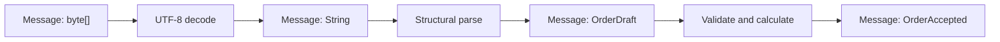

# Payload in Message

In the **Message** chapter of the **SPRING_INTEGRATION_CORE** module, the payload is the data that the components of a message flow need to process. Understanding the payload helps you connect Message, MessageChannel, endpoints, and gateways into a flow with a clear data contract, while knowing where to transform, validate, or reject data.

This lesson focuses on the content of a message: what a payload can be, how to create and read it, the limits of generics, how to avoid mutating shared data, and how to track payload types through the Java DSL. The hands-on example uses orders to illustrate transformers, filters, and testing.

## 1. Where Does the Payload Sit in a Message?

You can picture a message as having two parts:

```text
Message<T>
├── payload: T         the data to be processed
└── headers            metadata for exchanging and processing the message
```

The `org.springframework.messaging.Message<T>` interface provides two main accessor methods:

```java
T getPayload();
MessageHeaders getHeaders();
```

`T` is the type of the payload, not the type of the entire message. For instance, `Message<String>` is a message whose payload has type `String`. [Reference: Message API](https://docs.spring.io/spring-framework/docs/current/javadoc-api/org/springframework/messaging/Message.html).

In the order example:

| Information | Location Chosen in This Lesson | Reason |
| --- | --- | --- |
| Order ID, quantity, unit price | Payload | It is the business data to be computed |
| Correlation ID for a single processing run | `traceId` header | Supports flow observability |
| Message ingestion source | `sourceSystem` header | Provides integration context |
| Total amount after processing | Result payload | It is the business result needed by the receiver |

This is a design choice for the illustrative scenario. An order ID can also be placed in a header for routing or lookup, but business data needs an authoritative source to avoid two conflicting copies.

A payload can also contain multiple fields. "One message has one payload" does not mean the payload can only hold a single simple value.

## 2. Common Payload Types

Spring Integration does not force flows to use a single business format. You choose the appropriate representation at each segment and use transformers when the representation needs to change. [Reference: Transformer](https://docs.spring.io/spring-integration/reference/6.5/transformer.html).

| Payload Type | Illustrative Scenario | What Must Be Agreed Upon with the Receiver |
| --- | --- | --- |
| `String` | A line of order data | Syntax, delimiter, meaning of each field |
| `byte[]` | Data received from a transport boundary | Binary format or charset if it is text |
| DTO, POJO, or record | Parsed order | Required fields, units, business rules |
| `Map<String, Object>` | Flexible data from an external system | Key names and actual types of each value |
| `List<OrderLine>` | A group of line items | Whether one message carries the whole list or needs to be split into multiple messages |
| `File` or `Resource` | Reference to a document | Access permissions, lifetime, party responsible for reading |
| `InputStream` | Streamed content | Who reads, who closes, and whether it can be re-read |

The table above lists design possibilities; a specific adapter still has its own input constraints. Having a valid Java object is not enough to conclude that every outbound adapter can send it.

For example, `File` holds a reference to a file, not a snapshot of the entire file's contents. If the file is modified before the consumer reads it, the data the consumer receives may differ from when the message was created. For a transaction that must preserve the exact document at ingestion time, the development team must choose an appropriate content snapshot or versioning mechanism.

## 3. Creating and Retrieving the Payload

### 3.1. Creating with GenericMessage

The standalone example below uses a simple type to clarify the structure:

```java
import org.springframework.messaging.Message;
import org.springframework.messaging.support.GenericMessage;

public class PayloadBasics {

    public static void main(String[] args) {
        Message<String> message =
                new GenericMessage<>("ORD-42,2,125000");

        String payload = message.getPayload();

        System.out.println(payload);
        System.out.println(payload.getClass().getSimpleName());
    }
}
```

Output:

```text
ORD-42,2,125000
String
```

`GenericMessage` accepts the payload on instantiation; its constructors require a non-`null` payload. [Reference: GenericMessage API](https://docs.spring.io/spring-framework/docs/current/javadoc-api/org/springframework/messaging/support/GenericMessage.html).

### 3.2. Creating with MessageBuilder

When metadata needs to be added, a builder clearly expresses both content and headers:

```java
import org.springframework.messaging.Message;
import org.springframework.messaging.support.MessageBuilder;

Message<String> message = MessageBuilder
        .withPayload("ORD-42,2,125000")
        .setHeader("traceId", "trace-001")
        .setHeader("sourceSystem", "partner-a")
        .build();

String rawOrder = message.getPayload();
Object traceId = message.getHeaders().get("traceId");
```

This lesson uses `org.springframework.messaging.support.MessageBuilder`; pay attention to imports when the IDE suggests multiple classes with the same name.

`withPayload(...)` starts a builder with a given payload. `fromMessage(...)` initializes a builder based on an existing message. Both operations serve message construction; they are not business data parsers. [Reference: MessageBuilder API](https://docs.spring.io/spring-framework/docs/current/javadoc-api/org/springframework/messaging/support/MessageBuilder.html).

### 3.3. Reading from Message<?>

At a boundary where the data type is not yet known, check the actual type before using it:

```java
static String requireText(Message<?> message) {
    Object payload = message.getPayload();

    if (payload instanceof String text) {
        return text;
    }

    throw new IllegalArgumentException(
            "Expected String payload, got: "
                    + payload.getClass().getName());
}
```

This function proactively rejects out-of-contract data. Failing fast helps pinpoint errors at the receiving step, rather than letting them surface late during a calculation or field access.

## 4. Generics Describe the Contract, Not Validation

Declaring `Message<OrderDraft>` lets the compiler verify payload usage in typed Java code. However, a cast does not turn a string into a DTO.

Conceptually wrong example:

```java
Message<?> incoming = new GenericMessage<>("ORD-42,2,125000");

// Does not parse the string, does not create an OrderDraft object:
OrderDraft draft = (OrderDraft) incoming.getPayload();
```

If `OrderDraft` is the record from the hands-on example below, this cast throws `ClassCastException` because the actual object is still a `String`.

With collections, checking `payload instanceof List<?>` only tells you it is a list. This check does not prove every element is an `OrderDraft`. Avoid using an unchecked cast to treat `List<Map<String, Object>>` as `List<OrderDraft>`.

A data contract needs at least three layers:

1. **Representation type:** string, byte array, DTO, or list.
2. **Structure:** required fields and the type of each field.
3. **Semantics:** quantity greater than zero, currency unit for unit price, time zone for timestamps.

A payload with the right Java type can still be invalid in business terms. For example, `OrderDraft("ORD-42", -2, new BigDecimal("125000"))` has all fields populated, yet is not a valid order under this lesson's rules.

## 5. Absence of Data Differs from a Null Payload

Distinguish the following cases:

| Case | Meaning to Clarify |
| --- | --- |
| `new GenericMessage<>(null)` | Invalid for `GenericMessage`'s constructor |
| Payload is an empty string | A payload object exists, though it may violate the business contract |
| Payload is an empty list | A list exists; business rules decide whether to accept it |
| Handler produces no reply | No reply message is emitted from that step |
| Order not found | A business outcome that needs to be modeled |

For example, a lookup result can be represented with a DTO:

```java
public record OrderLookupResult(String orderId, boolean found) {
}
```

The result `new OrderLookupResult("ORD-404", false)` clearly communicates what happened without needing a `null` payload.

For a transformer, returning `null` is an error because the transformation step must produce a result. A service activator may produce no reply when configured to allow it; that is endpoint behavior, not a valid message with a `null` payload. [Reference: Transformer return rules](https://docs.spring.io/spring-integration/reference/6.5/transformer.html).

If you want to discard invalid data, use a filter with an explicit rejection policy. Do not use `return null` inside a transformer to implicitly act as a filter.

## 6. An Immutable Message Does Not Make the Whole Payload Immutable

With normal `GenericMessage` usage, you cannot replace the payload reference via a setter. However, the object that the payload points to can still change. Multiple consumers can access the same payload instance. [Reference: Message immutability](https://docs.spring.io/spring-integration/reference/message.html).

### 6.1. Example of Data Changing After Sending

```java
import java.util.ArrayList;
import java.util.List;

import org.springframework.messaging.Message;
import org.springframework.messaging.support.MessageBuilder;

List<String> orderIds = new ArrayList<>();
orderIds.add("ORD-42");

Message<List<String>> message =
        MessageBuilder.withPayload(orderIds).build();

orderIds.add("ORD-99");

System.out.println(message.getPayload());
// [ORD-42, ORD-99]
```

The message still holds the same payload reference, but the list contents changed. The builder does not perform a deep copy of the entire business object graph.

In an audit logging branch, the list might be read before the mutation; in a slower processing branch, the same message might be read after the mutation. In that case, the two branches observe two different states of the same input data.

### 6.2. Creating a Snapshot When Needed

For a list containing `String`s, you can create an unmodifiable copy:

```java
List<String> source = new ArrayList<>();
source.add("ORD-42");

Message<List<String>> snapshot =
        MessageBuilder.withPayload(List.copyOf(source)).build();

source.add("ORD-99");

System.out.println(snapshot.getPayload());
// [ORD-42]
```

`List.copyOf(...)` creates a list that forbids adding, removing, or replacing elements through the list API. It does not deep-copy element objects. If elements are POJOs with setters, the internal state of those POJOs can still change. [Reference: List and unmodifiable lists](https://docs.oracle.com/en/java/javase/17/docs/api/java.base/java/util/List.html).

One option for modeling orders:

```java
import java.math.BigDecimal;
import java.util.List;

public record OrderLine(String sku, int quantity, BigDecimal unitPrice) {
}

public record OrderBatch(String batchId, List<OrderLine> lines) {

    public OrderBatch {
        lines = List.copyOf(lines);
    }
}
```

The two records above belong in separate Java files if declared `public`. In this design, the components of `OrderLine` provide no state-mutating operations; `OrderBatch` copies the input list. If array fields or mutable objects are added later, the snapshot boundary must be revisited.

For `byte[]`, consider copying the array when ownership is unclear. For `InputStream`, establish a resource lifecycle convention; copying a stream reference does not create an independent readable data source.

## 7. Changing Representation Requires an Actual Processing Step

### 7.1. A Single Content Item Can Pass Through Multiple Types

Example transformation chain at an integration boundary:



Each arrow changing representation requires logic or a suitable converter. Renaming a channel, attaching a header, or casting in Java does not parse the data.

For example, the following DSL snippet decodes bytes into text:

```java
import java.nio.charset.StandardCharsets;

// Snippet inserted into an IntegrationFlow:
.transform(byte[].class,
        bytes -> new String(bytes, StandardCharsets.UTF_8))
```

After this step, the payload is a `String`, not yet a DTO. If the input is JSON, a JSON parsing step is still needed; if the input is CSV, a parser matching the CSV contract is needed.

### 7.2. contentType Provides Metadata

A message may contain a JSON string:

```java
import org.springframework.messaging.Message;
import org.springframework.messaging.MessageHeaders;
import org.springframework.messaging.support.MessageBuilder;
import org.springframework.util.MimeTypeUtils;

Message<String> jsonMessage = MessageBuilder
        .withPayload("{\"orderId\":\"ORD-42\",\"quantity\":2}")
        .setHeader(MessageHeaders.CONTENT_TYPE,
                MimeTypeUtils.APPLICATION_JSON)
        .build();

System.out.println(jsonMessage.getPayload().getClass().getSimpleName());
// String
```

The `contentType` header can help converters choose how to process the data. To obtain a DTO, a component that performs the conversion and an appropriate target type configuration are still required. Do not assume every endpoint automatically parses JSON merely because this header is present. [Reference: MessageConverter API](https://docs.spring.io/spring-framework/docs/6.2.x/javadoc-api/org/springframework/messaging/converter/MessageConverter.html).

In a concrete application, the framework may support conversion at configured points. When designing a flow, identify those exact points instead of relying on implicit conversion assumptions on every channel.

### 7.3. Distinguishing Four Operations

| Operation | Example | Result |
| --- | --- | --- |
| Type cast | `(OrderDraft) value` | Creates no new business data; valid only if the object is compatible |
| Text decoding | `new String(bytes, UTF_8)` | Converts bytes to characters |
| Structural parsing | Reading a string into a DTO | Builds a data model according to input syntax |
| Serialization | Writing a DTO to JSON or bytes | Creates a representation for storage or transmission |

Practical rule: write the input type and output type next to each step. If you cannot describe how the output type is produced from the input type, the flow is missing a conversion step or has an unclear contract.

## 8. Payload Flowing Through Spring Integration Components

### 8.1. Channels Transport Messages

A channel delivers a message to the next component according to the mechanism of the chosen channel type. For example, `DirectChannel` dispatches on the calling thread, `QueueChannel` holds messages for a receiver to pull, and `PublishSubscribeChannel` broadcasts to subscribers. Do not treat switching channels as proof that the payload was converted in type or deep-copied. [Reference: Message Channel Implementations](https://docs.spring.io/spring-integration/reference/6.5/channel/implementations.html).

In the hands-on exercise, the input channel receives `Message<String>`; after the first transformer, the subsequent segment of the flow receives an `OrderDraft` payload. The transformer itself performs this change.

### 8.2. Endpoints View the Payload According to Their Role

DSL operators express integration patterns such as `transform`, `filter`, `route`, `split`, `aggregate`, and `handle`. For lambdas processing payloads, specify the type explicitly when needed to help the framework determine the input. [Reference: DSL Basics](https://docs.spring.io/spring-integration/reference/6.5/dsl/java-basics.html).

You can draw up a design table for an order flow:

| Step | Expected Input Payload | Decision or Output Data |
| --- | --- | --- |
| Parsing transformer | `String` | Produces `OrderDraft` |
| Quantity filter | `OrderDraft` | Accepts or rejects the same data |
| Region router | DTO with a region field | Selects destination channel |
| Batch aggregator | Messages belonging to the same batch | Aggregated result defined by the processor |
| Service activator | Normalized DTO | Executes business logic or produces a reply |

The router and aggregator rows are extended design examples, not components configured in the hands-on code below. In particular, do not infer that the output payload of every aggregator has the same type; read the contract of the processor in use.

### 8.3. Gateways Can Hide the Message API from Business Code

A gateway allows callers to work with a business interface while the infrastructure handles message exchange. Thus, the caller might only pass a DTO even though the flow internally processes messages with payloads and headers. [Reference: Messaging Gateways](https://docs.spring.io/spring-integration/reference/6.5/gateway.html).

When designing a gateway for a use case, agree on the payload at the entry point and the result type the caller needs. If the gateway accepts a DTO directly, the flow may not need a string parsing step like the example in this lesson.

## 9. Hands-On: From Order String to Result Payload

### 9.1. Example Contract

The example targets **Java 17+ and the Spring Integration 6.5 API**. The project needs the `org.springframework.integration:spring-integration-core` dependency along with compatible Spring dependencies. Use a BOM or the project's dependency management mechanism to keep versions aligned. The illustrative tests use JUnit Jupiter.

The input has a simple format:

```text
orderId,quantity,unitPrice
ORD-42,2,125000
```

Chosen contract:

- Actual input data contains only a single value line, with no header line.
- There are exactly three fields; the order ID must not contain commas.
- The order ID after trimming leading and trailing whitespace must not be empty.
- Quantity must be an integer greater than zero.
- Unit price is a non-negative decimal number, using a dot if there is a fractional part.
- Unit price and total amount in the example are both denominated in VND.

This is a minimal string protocol for learning purposes. `split(",")` is not a full CSV parser supporting quoted values and embedded commas.

Target flow:

```text
rawOrderInput
  Message<String>
        |
        v
  parseOrder: String -> OrderDraft
        |
        v
  filter: quantity > 0
        |
        v
  OrderDraft -> OrderAccepted
        |
        v
acceptedOrders
  Message<OrderAccepted>
```

### 9.2. Complete Configuration

Save the following example as `PayloadFlowConfig.java` in your practice project. The lesson code is for illustration only; there is no requirement to add Java files to this content repository.

```java
import java.math.BigDecimal;

import org.springframework.context.annotation.Bean;
import org.springframework.context.annotation.Configuration;
import org.springframework.integration.channel.DirectChannel;
import org.springframework.integration.channel.QueueChannel;
import org.springframework.integration.config.EnableIntegration;
import org.springframework.integration.dsl.IntegrationFlow;

@Configuration
@EnableIntegration
public class PayloadFlowConfig {

    public record OrderDraft(
            String orderId,
            int quantity,
            BigDecimal unitPrice) {
    }

    public record OrderAccepted(
            String orderId,
            int quantity,
            BigDecimal totalAmount) {
    }

    @Bean
    public DirectChannel rawOrderInput() {
        return new DirectChannel();
    }

    @Bean
    public QueueChannel acceptedOrders() {
        return new QueueChannel(20);
    }

    @Bean
    public IntegrationFlow orderPayloadFlow() {
        return IntegrationFlow.from("rawOrderInput")
                .transform(String.class, PayloadFlowConfig::parseOrder)
                .filter(OrderDraft.class,
                        draft -> draft.quantity() > 0,
                        spec -> spec.throwExceptionOnRejection(true))
                .transform(OrderDraft.class, draft ->
                        new OrderAccepted(
                                draft.orderId(),
                                draft.quantity(),
                                draft.unitPrice().multiply(
                                        BigDecimal.valueOf(draft.quantity()))))
                .channel("acceptedOrders")
                .get();
    }

    static OrderDraft parseOrder(String raw) {
        String[] fields = raw.split(",", -1);

        if (fields.length != 3) {
            throw new IllegalArgumentException(
                    "Order must have exactly 3 fields");
        }

        String orderId = fields[0].strip();
        if (orderId.isEmpty()) {
            throw new IllegalArgumentException(
                    "orderId must not be blank");
        }

        int quantity = Integer.parseInt(fields[1].strip());
        BigDecimal unitPrice = new BigDecimal(fields[2].strip());

        if (unitPrice.signum() < 0) {
            throw new IllegalArgumentException(
                    "unitPrice must not be negative");
        }

        return new OrderDraft(orderId, quantity, unitPrice);
    }
}
```

The overloads accepting `Class` declare the payload type at each step. The signatures of DSL operations are described in the [BaseIntegrationFlowDefinition API](https://docs.spring.io/spring-integration/docs/6.5.0/api/org/springframework/integration/dsl/BaseIntegrationFlowDefinition.html).

### 9.3. Reading the Configuration by Data Contract

The first transformer converts a string into `OrderDraft`. This is an actual business object creation step, not a cast. The parser is responsible for checking the field count, order ID, and numeric syntax.

The filter checks the condition `quantity > 0`. The example intentionally places this rule in a filter to show that a successfully constructed DTO can still be rejected. With `throwExceptionOnRejection(true)`, rejection is a processing error; another option is configuring a discard channel for rejected messages. [Reference: Filter rejection policy](https://docs.spring.io/spring-integration/reference/6.5/filter.html).

The final transformer computes the total amount and creates `OrderAccepted`. With input `ORD-42,2,125000`, the business result is:

```text
OrderAccepted[
    orderId=ORD-42,
    quantity=2,
    totalAmount=250000
]
```

This is a readable representation of the result fields. Receivers should use the object and its accessors; do not use the DTO's `toString()` string as an external exchange contract.

The transformers in the example return a payload, letting the framework build the output message and forward appropriate metadata. When returning a complete `Message` directly from a transformer, you must proactively supply the headers needed by subsequent steps. [Reference: Propagating headers through Message](https://docs.spring.io/spring-integration/reference/message.html).

In this example, there is no custom header filtering configuration, so the test below expects `traceId` to accompany the result. Do not assume "every header is always preserved" across all flows and configurations.

### 9.4. Anticipated Failure Points

| Input | Detection Step | Expected Outcome in the Example |
| --- | --- | --- |
| `ORD-42,2,125000` | Passes through the entire flow | Produces `OrderAccepted` with total `250000` |
| `ORD-42,0,125000` | Filter | Rejected, no successful output |
| `ORD-42,abc,125000` | Parser | Quantity parsing error |
| `ORD-42,2,-1` | Parser | Negative unit price error |
| `ORD-42,2` | Parser | Field count error |
| Payload outside the string protocol | Receiving/conversion boundary | Must be rejected or intentionally converted |

Because the input in the configuration is a `DirectChannel`, errors occurring in synchronous endpoints can propagate back to the `send(...)` call as a messaging exception. If switched to an asynchronous boundary, the error-handling path must be redesigned and retested; do not continue assuming the sender will catch the same exception at the same site.

Do not infinitely retry a syntactically invalid message against the same parser. In a real system, diagnostic information can be persisted or the message can be routed to a data repair flow; distinguish data errors from transient infrastructure failures.

## 10. Testing the Payload Contract

The tests below create a fresh application context for each case, send a message into the channel, and receive the result from the queue. No external broker or service is required.

Place the test class in the same package as `PayloadFlowConfig`:

```java
import java.math.BigDecimal;

import org.junit.jupiter.api.Test;
import org.springframework.context.annotation.AnnotationConfigApplicationContext;
import org.springframework.integration.channel.QueueChannel;
import org.springframework.messaging.Message;
import org.springframework.messaging.MessageChannel;
import org.springframework.messaging.MessagingException;
import org.springframework.messaging.support.MessageBuilder;

import static org.junit.jupiter.api.Assertions.*;

class PayloadFlowTest {

    @Test
    void convertsPayloadAndPreservesTraceId() {
        try (var context =
                     new AnnotationConfigApplicationContext(
                             PayloadFlowConfig.class)) {

            MessageChannel input =
                    context.getBean("rawOrderInput", MessageChannel.class);
            QueueChannel output =
                    context.getBean("acceptedOrders", QueueChannel.class);

            Message<String> request = MessageBuilder
                    .withPayload("ORD-42,2,125000")
                    .setHeader("traceId", "trace-001")
                    .build();

            assertTrue(input.send(request, 1000));

            Message<?> reply = output.receive(1000);
            assertNotNull(reply);

            var payload = assertInstanceOf(
                    PayloadFlowConfig.OrderAccepted.class,
                    reply.getPayload());

            assertEquals("ORD-42", payload.orderId());
            assertEquals(2, payload.quantity());
            assertEquals(0,
                    new BigDecimal("250000")
                            .compareTo(payload.totalAmount()));

            assertEquals("trace-001",
                    reply.getHeaders().get("traceId"));

            assertEquals("ORD-42,2,125000",
                    request.getPayload());
        }
    }

    @Test
    void rejectsZeroQuantityWithoutSuccessfulOutput() {
        try (var context =
                     new AnnotationConfigApplicationContext(
                             PayloadFlowConfig.class)) {

            MessageChannel input =
                    context.getBean("rawOrderInput", MessageChannel.class);
            QueueChannel output =
                    context.getBean("acceptedOrders", QueueChannel.class);

            Message<String> request = MessageBuilder
                    .withPayload("ORD-42,0,125000")
                    .build();

            assertThrows(MessagingException.class,
                    () -> input.send(request, 1000));

            assertNull(output.receive(0));
        }
    }

    @Test
    void rejectsMalformedQuantityWithoutSuccessfulOutput() {
        try (var context =
                     new AnnotationConfigApplicationContext(
                             PayloadFlowConfig.class)) {

            MessageChannel input =
                    context.getBean("rawOrderInput", MessageChannel.class);
            QueueChannel output =
                    context.getBean("acceptedOrders", QueueChannel.class);

            Message<String> request = MessageBuilder
                    .withPayload("ORD-42,abc,125000")
                    .build();

            assertThrows(MessagingException.class,
                    () -> input.send(request, 1000));

            assertNull(output.receive(0));
        }
    }
}
```

The three scenarios verify different guarantees:

- A valid flow returns the right payload type, the right values, and preserves the requested metadata.
- A DTO with zero quantity is blocked before producing a successful result.
- Syntactically invalid data does not leak through to the business output.

Comparing the total amount with `compareTo(...)` in the test checks numerical value, avoiding `BigDecimal` scale differences interfering with the goal of this test.

`receive(0)` works in the two error cases because upstream endpoints run synchronously and each case has a fresh queue. If switched to asynchronous processing, test using a completion signal or an appropriately bounded wait mechanism; do not draw conclusions from a queue being temporarily empty.

These test snippets are illustrative code for learners to run in a practice project. Having code in the documentation does not imply the tests were executed during the authoring of this lesson.

## 11. Designing Payloads for Integration Boundaries

In the order scenario, a normalized DTO keeps pricing calculation code independent of each partner's string syntax. If Partner B changes field positions, only Partner B's transformation step needs updating while keeping the `OrderDraft` contract for internal processing.

When sending data across a process boundary, a clear exchange contract is required. Illustrative example:

```json
{
  "schemaVersion": 1,
  "orderId": "ORD-42",
  "quantity": 2,
  "unitPrice": 125000,
  "currency": "VND"
}
```

From this example, the integration team needs to decide:

| Issue | Question That Must Be Answered |
| --- | --- |
| Currency unit | Does the value include tax, and are fractional amounts allowed? |
| Version compatibility | How do older consumers handle new fields and new versions? |
| Missing data | If `currency` is missing, default or reject? |
| Sensitive information | Does all personal data need to be sent into every branch? |
| Payload size | Should large content be sent inline or via a managed reference? |
| Reprocessing | Is the data sufficient to reprocess without relying on lost mutable state? |

These are design suggestions for the illustrative scenario, not fields that Spring Integration automatically adds to a payload.

For large documents, external references can reduce memory pressure, but lifetime and access permissions must be managed. For streams, clearly specify which consumer owns the resource. For parallel processing branches, prefer stable data or copies per agreed ownership rules.

When logging payload errors, usually only the data type, business identifier, and correlation ID are needed to locate the failure. Choosing appropriate diagnostic data avoids pushing full customer details into logs.

## 12. Misconceptions to Recognize

| Misconception | Correct Understanding and Handling |
| --- | --- |
| Payload is always JSON | Payload is a Java object per the flow segment's contract; JSON is one possible representation |
| `Message<T>` sanitizes input data | Generics support typing; parsing and validation are still required |
| Setting `contentType` produces a DTO | A converter or transformer is needed to perform the conversion |
| Message is immutable so mutating a list payload is safe | The list and mutable elements can still be shared |
| Creating another message yields a deep copy | Clarify exactly what is copied |
| One list payload equals multiple messages | A list is still a single payload; if multiple messages are needed, design a splitter step |
| Returning `null` from a transformer drops the message | Use a filter and define how rejected messages are handled |
| Switching channels changes the data type | The type only changes when an actual processing/conversion step runs |
| An in-memory DTO can be sent across any system | A transport contract and corresponding adapter support are required |

After this lesson, you should be able to read the payload type at each segment of a flow, identify which step produces new data, and explain what happens to out-of-contract data. In the constructed example, the core path is `String -> OrderDraft -> OrderAccepted`; the filter decides whether to accept the data, while channels connect the processing steps.
