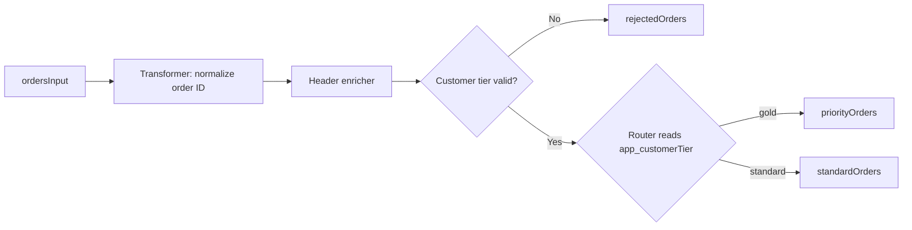

# MessageHeaders in Spring Integration

## 1. Objectives and Context

In the **Message** chapter of the **SPRING_INTEGRATION_CORE** module, `MessageHeaders` is where metadata accompanying the payload lives. When a flow receives an order, metadata can indicate where the request came from, which processing group it belongs to, and which channel should receive the reply. Endpoints read this information to coordinate without embedding all integration details into business objects.

After this lesson, you will be able to:

- Read headers with type checking and distinguish required headers from optional ones.
- Create a message with new headers using a builder while leaving the input message unchanged.
- Distinguish message IDs, business keys, and correlation keys.
- Use header enrichers, transformers, filters, and routers in the Java DSL.
- Recognize the impact of headers on gateways, aggregators, error handling, and sending data to external systems.
- Write tests for header values, types, and presence at various points in a flow.

The examples use `spring-messaging`, `spring-integration-core`, and JUnit Jupiter for testing. Library versions should be managed consistently across the project. No broker, HTTP server, or database is needed to practice the flow in this lesson.

## 2. Payload Carries Data, Headers Provide Processing Context

A simple message can be viewed as follows:

```text
Message<String>
├── payload: "ORD-1001"
└── headers
    ├── id: UUID managed by the framework
    ├── timestamp: message creation time, when provided
    ├── app_requestId: "req-42"
    ├── app_customerTier: "gold"
    └── app_source: "checkout"
```

In a real application, the payload could be an `Order` containing the order ID, line items, and total amount. `app_requestId` helps locate steps belonging to the same request; `app_customerTier` helps a router choose a processing branch.

Placing data in a header is a design choice. For instance, customer tier may already belong to the business object; when a router needs it, the system can promote a normalized value to a header. Determine the authoritative source of truth and avoid having the payload say `gold` while the header says `standard`.

A useful rule of thumb: data needed to understand business content belongs in the payload; metadata serving transport, coordination, or flow observability usually fits in headers. Business keys can appear in both places if there is a clear synchronization rule.

## 3. Reading `MessageHeaders` with Proper Types

`org.springframework.messaging.MessageHeaders` provides a `Map<String, Object>` interface. Keys are strings; values can have various Java types. This is a Spring Messaging abstraction used by Spring Integration. Implementing `Map` does not mean the application is allowed to mutate the map via `put`, `remove`, or `clear`. [MessageHeaders Javadoc](https://docs.spring.io/spring-framework/docs/current/javadoc-api/org/springframework/messaging/MessageHeaders.html)

### 3.1. Three Common Ways to Read

```java
import java.util.UUID;

import org.springframework.messaging.Message;
import org.springframework.messaging.MessageHeaders;

public class HeaderReader {

    public String describe(Message<?> message) {
        MessageHeaders headers = message.getHeaders();

        Object rawTier = headers.get("app_customerTier");
        String requestId = headers.get("app_requestId", String.class);
        UUID messageId = headers.getId();
        Long createdAt = headers.getTimestamp();

        return "messageId=" + messageId
                + ", requestId=" + requestId
                + ", tier=" + rawTier
                + ", createdAt=" + createdAt;
    }
}
```

- `get(name)` returns `Object`, suitable when you need to inspect the type yourself.
- `get(name, type)` checks whether the existing value matches the requested type.
- Getters such as `getId()` or `getTimestamp()` clearly express the meaning of standard headers.

A missing header returns `null`. When the value has an incompatible type, the typed getter throws `IllegalArgumentException`; it does not automatically convert the string `"3"` to the number `3`. The type contract must be agreed upon at input. [Typed header reading API](https://docs.spring.io/spring-framework/docs/current/javadoc-api/org/springframework/messaging/MessageHeaders.html#get(java.lang.Object,java.lang.Class))

### 3.2. Validating Required Headers at the Boundary

```java
import org.springframework.messaging.Message;

public class RequiredHeaders {

    public static String requireRequestId(Message<?> message) {
        String value = message.getHeaders()
                .get("app_requestId", String.class);

        if (value == null || value.isBlank()) {
            throw new IllegalArgumentException("Missing app_requestId");
        }
        return value;
    }
}
```

If data comes from a transport that might return `List<String>` or a numeric type differing from the internal contract, normalize it in the adapter or an upstream endpoint. Pushing type guessing down into every service makes errors surface late and hard to trace back to the source.

## 4. Map Immutability Is Not Deep Immutability

The following code is invalid with a standard `MessageHeaders`:

```java
message.getHeaders().put("app_source", "billing");
// UnsupportedOperationException
```

When wanting to change headers, the application creates a resulting message. However, not being able to alter the map structure does not prevent a mutable object stored inside a header from being modified:

```java
import java.util.ArrayList;
import java.util.List;

import org.springframework.messaging.Message;
import org.springframework.messaging.support.MessageBuilder;

List<String> labels = new ArrayList<>();
labels.add("created");

Message<String> message = MessageBuilder.withPayload("ORD-1001")
        .setHeader("app_labels", labels)
        .build();

labels.add("changed-after-build");

// The List object referenced in the header has also changed.
Object observed = message.getHeaders().get("app_labels");
```

The builder does not provide automatic deep copying for arbitrary objects. When a message is broadcast to multiple consumers, sharing an `ArrayList` and mutating it in one branch can cause another branch to observe the changed state. This characteristic also applies to mutable payloads. [Message immutability model](https://docs.spring.io/spring-integration/reference/message.html#message-headers)

You can create an immutable snapshot before placing a value into a header:

```java
Message<String> safeMessage = MessageBuilder.withPayload("ORD-1001")
        .setHeader("app_labels", List.copyOf(labels))
        .build();
```

`List.copyOf` protects the list structure. If an element is a mutable object, that element itself still needs its own management rules. For metadata, small and easily controlled values like `String`, `Integer`, `Long`, `Boolean`, and `UUID` are usually more convenient than a complex object graph.

## 5. Header Groups to Recognize

### 5.1. Common Spring Messaging Headers

| Constant in `MessageHeaders` | Key | Common Type | Meaning |
| --- | --- | --- | --- |
| `ID` | `id` | `UUID` | Message identifier, managed by the framework |
| `TIMESTAMP` | `timestamp` | `Long` | Message creation time in epoch milliseconds, when present |
| `REPLY_CHANNEL` | `replyChannel` | `MessageChannel` or `String` | Reply destination in flows supporting request/reply |
| `ERROR_CHANNEL` | `errorChannel` | `MessageChannel` or `String` | Error handling destination when error-emitting mechanisms use this header |
| `CONTENT_TYPE` | `contentType` | Usually `MimeType` or MIME string per converter contract | Describes the representation of the content |

Use constants instead of string literals when accessing standard headers. For `contentType`, the header value describes the content; it does not automatically turn a POJO into JSON if an appropriate transformer or converter is missing. [MessageHeaders constants](https://docs.spring.io/spring-framework/docs/current/javadoc-api/org/springframework/messaging/MessageHeaders.html)

### 5.2. Spring Integration Headers

The following constants belong to `org.springframework.integration.IntegrationMessageHeaderAccessor`:

| Constant | Key | Type | Role |
| --- | --- | --- | --- |
| `CORRELATION_ID` | `correlationId` | `Object` | Links messages belonging to the same group |
| `SEQUENCE_NUMBER` | `sequenceNumber` | `Integer` | Position in a sequence, typically starting at 1 |
| `SEQUENCE_SIZE` | `sequenceSize` | `Integer` | Size of the sequence when known |
| `PRIORITY` | `priority` | `Integer` | Priority metadata for components that support it |
| `EXPIRATION_DATE` | `expirationDate` | `Long` | Expiration timestamp in epoch milliseconds |
| `DUPLICATE_MESSAGE` | `duplicateMessage` | `Boolean` | Duplicate marker per idempotent receiver configuration |

They can be read using constants:

```java
import org.springframework.integration.IntegrationMessageHeaderAccessor;

Object correlationId = message.getHeaders().get(
        IntegrationMessageHeaderAccessor.CORRELATION_ID);

Integer sequenceNumber = message.getHeaders().get(
        IntegrationMessageHeaderAccessor.SEQUENCE_NUMBER, Integer.class);
```

The mere presence of a header does not automatically activate behavior. `priority` requires a component such as `PriorityChannel`; `expirationDate` requires an expiration-checking policy; `duplicateMessage` requires duplicate detection and handling. A `DirectChannel` does not automatically reorder messages just because a priority header is present. [Spring Integration headers](https://docs.spring.io/spring-integration/api/org/springframework/integration/IntegrationMessageHeaderAccessor.html), [Meaning of expirationDate and priority](https://docs.spring.io/spring-integration/reference/message.html)

### 5.3. Application Headers and Usage Contracts

The `app_` prefix in this lesson is an illustrative application convention, not a Spring requirement.

| Header | Type | Creation Source | Policy in the Example |
| --- | --- | --- | --- |
| `app_requestId` | `String` | Request entry point | Preserved end-to-end for log lookup |
| `app_customerTier` | `String` | Verified customer data | Accepts only `gold` or `standard` |
| `app_source` | `String` | Calling system or entry endpoint | Added only if not already present |
| `app_orderId` | `String` | Normalized payload | Recomputed and overwrites the old value |
| `app_internalToken` | `String` | Internal component, if truly needed | Stripped before any untrusted boundary |

For every header driving a business decision, document its name, type, whether it is required, its trusted source, and which components may overwrite it. Do not treat a value sent from outside as verified information just because it shares the name of an internal header.

## 6. Creating and Replacing Headers with `MessageBuilder`

The code snippets consistently use Spring Messaging's builder:

```java
import org.springframework.messaging.support.MessageBuilder;
```

Spring Integration also has `org.springframework.integration.support.MessageBuilder`. Both classes have many similar methods but are not the same class; check imports when examples or projects use specialized APIs.

### 6.1. Creating the Initial Message

```java
import org.springframework.messaging.Message;
import org.springframework.messaging.support.MessageBuilder;

Message<String> original = MessageBuilder.withPayload("ORD-1001")
        .setHeader("app_requestId", "req-42")
        .setHeader("app_customerTier", "gold")
        .build();
```

### 6.2. Creating a Result with Modified Headers

```java
Message<String> enriched = MessageBuilder.fromMessage(original)
        .setHeader("app_source", "checkout")
        .setHeaderIfAbsent("app_customerTier", "standard")
        .build();
```

`enriched` has `app_source=checkout`, while `app_customerTier` remains `gold`. `original` does not get `app_source` added. Copying headers does not deep-copy individual values.

| Builder Operation | Usage |
| --- | --- |
| `setHeader(name, value)` | Sets or overwrites a modifiable header; a `null` value removes that header |
| `setHeaderIfAbsent(name, value)` | Adds a value when not already present |
| `copyHeaders(map)` | Copies and may overwrite copyable headers with the same name |
| `copyHeadersIfAbsent(map)` | Copies when the builder does not yet have a corresponding value |
| `removeHeader(name)` | Removes a removable header |
| `removeHeaders(patterns)` | Removes headers matching supported names or patterns |

`id` and `timestamp` are special headers managed by the framework, not business metadata for the application to reassign arbitrarily. [MessageBuilder API](https://docs.spring.io/spring-framework/docs/current/javadoc-api/org/springframework/messaging/support/MessageBuilder.html), [Spring Integration read-only headers](https://docs.spring.io/spring-integration/reference/message.html#read-only-headers)

If replacing the payload, you can carry headers along using a new builder:

```java
import java.util.Locale;

Message<String> normalized = MessageBuilder
        .withPayload(original.getPayload().toLowerCase(Locale.ROOT))
        .copyHeaders(original.getHeaders())
        .build();
```

Deciding which headers remain valid after transformation is the flow's responsibility. For example, a `contentType` describing XML is no longer valid when the payload has been converted to a different representation.

### 6.3. Distinguishing Three Types of Identifiers

| Identifier | Example | Scope |
| --- | --- | --- |
| Message ID | `MessageHeaders.ID` | A single specific message |
| Business key | `app_orderId=ORD-1001` | An order across multiple events and processing attempts |
| Correlation key | `correlationId` or custom correlation key | Messages that need to be coordinated as a group |

With the standard builder, when creating a modified result message, do not expect the old ID to be preserved; the timestamp also reflects the creation of the resulting message when generated. The builder may return the original message if no changes were made, so do not claim every `build()` call generates a new ID. The timestamp getter should handle the possibility of `null` when the message creation mechanism does not provide one.

To link logs across multiple steps, preserve an `app_requestId` per the application contract. To prevent duplicate business processing, choose a key reflecting the business operation, such as `orderId + eventType + eventVersion`; do not use a new message ID generated on each retry as an idempotency key.

## 7. Enriching Headers in the Java DSL

A header enricher is designed for adding or computing metadata. The snippets below are segments wired inside an `IntegrationFlow`.

### 7.1. Static Values and Overwrite Policy

```java
.enrichHeaders(headers -> headers
        .header("app_source", "checkout", false)
        .header("app_processingMode", "validated", true))
```

Here `false` preserves `app_source` if already present; `true` replaces `app_processingMode` with the endpoint's value. By default, the header enricher does not overwrite existing headers. Specifying the argument explicitly helps readers understand each header's policy. [HeaderEnricher](https://docs.spring.io/spring-integration/api/org/springframework/integration/transformer/HeaderEnricher.html)

### 7.2. Values Computed from the Message

When the payload is a normalized order ID:

```java
.enrichHeaders(headers -> headers
        .headerExpression("app_orderId", "payload", true))
```

`header` takes a literal value; `headerExpression` evaluates a SpEL expression at processing time. Writing `.header("app_orderId", "payload")` puts the literal string `"payload"` into the header. Inside a header enricher expression, `payload` and `headers` are accessible. [HeaderEnricherSpec](https://docs.spring.io/spring-integration/api/org/springframework/integration/dsl/HeaderEnricherSpec.html)

Use SpEL for short, clear computations. For logic that calls multiple services, checks permissions, or handles multiple error cases, use a bean to keep the flow configuration readable. [Header enricher configuration](https://docs.spring.io/spring-integration/reference/content-enrichment.html#header-enricher)

### 7.3. Removing Temporary Headers

```java
.headerFilter("app_internalToken", "app_debugContext")
```

A header filter removes metadata from the resulting message; it does not drop the entire message. Conversely, a message filter decides whether a message proceeds. With patterns, verify the exact API and configuration of the version in use; do not apply a broad wildcard when request/reply headers still need to be retained. [Header Filter](https://docs.spring.io/spring-integration/reference/transformer.html#header-filter)

## 8. How Do Headers Pass Through Endpoints?

In standard endpoints, a method's return type affects header propagation rules:

| Endpoint and Return Value | Behavior to Remember |
| --- | --- |
| Transformer returns a payload | Framework builds the result message and propagates input headers per transformer rules |
| Transformer returns `Message<?>` | The method is responsible for preparing all headers that need to be retained |
| Service activator returns a payload | Framework wraps the payload and propagates headers from the request |
| Service activator returns `Message<?>` | Framework typically adds request headers missing from the result; headers already in the result take precedence |

Therefore, merely omitting a header from the message returned by a service activator does not necessarily make that header disappear from the flow. Use a header filter when the goal is to remove metadata. [Service Activator header rules](https://docs.spring.io/spring-integration/reference/service-activator.html#service-activator-and-method-return-type)

Example of a transformer building its own `Message` while preserving context:

```java
import java.util.Locale;

import org.springframework.integration.annotation.Transformer;
import org.springframework.messaging.Message;
import org.springframework.messaging.support.MessageBuilder;

public class OrderIdTransformer {

    @Transformer
    public Message<String> normalize(Message<String> input) {
        String output = input.getPayload().trim()
                .toUpperCase(Locale.ROOT);

        return MessageBuilder.withPayload(output)
                .copyHeaders(input.getHeaders())
                .setHeader("app_normalized", true)
                .build();
    }
}
```

This is a handler method that can be registered in a flow. Annotations alone do not form a running application unless the class is registered and connected to channels. When a transformer returns a new message and forgets to copy `replyChannel` or `errorChannel`, context needed by downstream steps can be lost. [Transformer and result message headers](https://docs.spring.io/spring-integration/reference/transformer.html)

### Reading Headers via Method Parameters

A method invoked by an endpoint can also declare:

```java
import org.springframework.messaging.handler.annotation.Header;

public class ReceiptService {

    public String createReceipt(
            String orderId,
            @Header("app_requestId") String requestId,
            @Header(value = "app_source", required = false) String source) {

        return orderId + ":" + requestId + ":"
                + (source == null ? "unknown" : source);
    }
}
```

`@Header` requires the header to exist by default. Optional headers use `required=false` and the parameter must accept `null`; avoid using primitives if you want to represent a missing value. This is an endpoint binding mechanism, distinct from calling getters directly on `MessageHeaders`. [@Header Javadoc](https://docs.spring.io/spring-framework/docs/current/javadoc-api/org/springframework/messaging/handler/annotation/Header.html)

## 9. Hands-On: Routing Orders Using Headers

### 9.1. Flow Requirements

The input is an order ID as a string. The flow normalizes the ID, creates metadata, and then selects one of three destinations:

- `gold`: routed to `priorityOrders`.
- `standard`: routed to `standardOrders`.
- Missing or invalid `app_customerTier`: routed to `rejectedOrders` via the filter's discard channel.

The name `priorityOrders` only describes the business branch; this channel is an ordinary `QueueChannel`, not one that sorts by the `priority` header.



### 9.2. Complete Configuration

```java
import java.util.Locale;

import org.springframework.context.annotation.Bean;
import org.springframework.context.annotation.Configuration;
import org.springframework.integration.channel.DirectChannel;
import org.springframework.integration.channel.QueueChannel;
import org.springframework.integration.config.EnableIntegration;
import org.springframework.integration.dsl.IntegrationFlow;

@Configuration
@EnableIntegration
public class OrderHeadersConfig {

    @Bean
    public DirectChannel ordersInput() {
        return new DirectChannel();
    }

    @Bean
    public QueueChannel priorityOrders() {
        return new QueueChannel();
    }

    @Bean
    public QueueChannel standardOrders() {
        return new QueueChannel();
    }

    @Bean
    public QueueChannel rejectedOrders() {
        return new QueueChannel();
    }

    @Bean
    public IntegrationFlow orderHeadersFlow() {
        return IntegrationFlow.from("ordersInput")
                .transform(String.class,
                        value -> value.trim().toUpperCase(Locale.ROOT))
                .enrichHeaders(headers -> headers
                        .header("app_source", "checkout", false)
                        .headerExpression("app_orderId", "payload", true))
                .filter(
                        "headers['app_customerTier'] == 'gold' "
                                + "or headers['app_customerTier'] == 'standard'",
                        spec -> spec.discardChannel("rejectedOrders"))
                .route("headers['app_customerTier']", spec -> spec
                        .channelMapping("gold", "priorityOrders")
                        .channelMapping("standard", "standardOrders"))
                .get();
    }
}
```

In this configuration, `DirectChannel` invokes endpoints on the sending thread. The three `QueueChannel`s store results to be received in tests; no endpoint is polling these queues, so no poller configuration is needed.

The `app_orderId` header is computed after the normalization step, so it matches the resulting payload. `app_source` uses a policy that preserves existing values, helping safeguard the calling source set by a trusted system.

The filter validates before the router so unsupported values go to a clear destination. In a real application, checks for empty order IDs, customer authorization, and data limits must be added according to the business contract.

### 9.3. Testing Header Values and Preservation

Place the configuration class and the test class below in the same package, or import the configuration class from your project's package. The test uses JUnit Jupiter and starts a Spring context directly.

```java
import org.junit.jupiter.api.Test;
import org.springframework.context.annotation.AnnotationConfigApplicationContext;
import org.springframework.integration.channel.QueueChannel;
import org.springframework.messaging.Message;
import org.springframework.messaging.MessageChannel;
import org.springframework.messaging.support.MessageBuilder;

import static org.junit.jupiter.api.Assertions.*;

public class OrderHeadersTest {

    @Test
    void routesGoldAndKeepsRequestContext() {
        try (AnnotationConfigApplicationContext context =
                     new AnnotationConfigApplicationContext(
                             OrderHeadersConfig.class)) {

            MessageChannel input = context.getBean(
                    "ordersInput", MessageChannel.class);
            QueueChannel priority = context.getBean(
                    "priorityOrders", QueueChannel.class);
            QueueChannel standard = context.getBean(
                    "standardOrders", QueueChannel.class);
            QueueChannel rejected = context.getBean(
                    "rejectedOrders", QueueChannel.class);

            Message<String> request = MessageBuilder
                    .withPayload(" ord-1001 ")
                    .setHeader("app_requestId", "req-42")
                    .setHeader("app_customerTier", "gold")
                    .setHeader("app_orderId", "legacy-value")
                    .build();

            assertTrue(input.send(request));
            Message<?> result = priority.receive(1000);

            assertNotNull(result);
            assertEquals("ORD-1001", result.getPayload());
            assertEquals("ORD-1001", result.getHeaders()
                    .get("app_orderId", String.class));
            assertEquals("req-42", result.getHeaders()
                    .get("app_requestId", String.class));
            assertEquals("checkout", result.getHeaders()
                    .get("app_source", String.class));
            assertEquals("gold", result.getHeaders()
                    .get("app_customerTier", String.class));

            assertEquals(" ord-1001 ", request.getPayload());
            assertEquals("legacy-value", request.getHeaders()
                    .get("app_orderId", String.class));
            assertFalse(request.getHeaders().containsKey("app_source"));

            assertNull(standard.receive(0));
            assertNull(rejected.receive(0));
        }
    }
}
```

The test targets the observable contract: correct branch, correct metadata, correct header overwrite, and unchanged input. There is no need to pin a UUID or assert strictly increasing timestamps, since two messages can be created within the same millisecond.

Extend your practice with the following cases:

| Input | Expected Outcome |
| --- | --- |
| `app_customerTier=standard` | Received only in `standardOrders` |
| Missing `app_customerTier` | Received in `rejectedOrders` |
| `app_customerTier=bronze` | Received in `rejectedOrders` |
| Existing `app_source=mobile` | Result still has `mobile` |
| Existing wrong `app_orderId` | Result uses normalized ID from payload |
| Reading a numeric header as `String` via typed getter | Detects type mismatch instead of silently converting |

## 10. `replyChannel` and Gateways

In request/reply, `replyChannel` tells an endpoint where to send the result when there is no explicit output channel and no remaining routing slip destination. A gateway can create a temporary reply channel to bridge the result back to the method call. This header value is not always a bean name; it can be a channel object. [replyChannel rules](https://docs.spring.io/spring-integration/reference/message.html)

You can observe that mechanism without declaring a gateway interface yet. In a configuration with `@EnableIntegration`, add a flow:

```java
@Bean
public DirectChannel receiptInput() {
    return new DirectChannel();
}

@Bean
public IntegrationFlow receiptFlow() {
    return IntegrationFlow.from("receiptInput")
            .handle(String.class,
                    (orderId, headers) -> "ACCEPTED:" + orderId)
            .get();
}
```

And send a request with a reply address:

```java
QueueChannel replies = new QueueChannel();

Message<String> request = MessageBuilder.withPayload("ORD-1001")
        .setReplyChannel(replies)
        .build();

// receiptInput is the DirectChannel bean in the configuration above.
receiptInput.send(request);
Message<?> reply = replies.receive(1000);
// Expected payload: "ACCEPTED:ORD-1001"
```

Here there is no output channel after the service activator, so the reply goes to the channel in the header. When a flow already has an explicit output destination, do not assume the reply is also automatically sent to the header channel.

If an intermediate transformer constructs a new message and drops `replyChannel`, the gateway may fail to receive the expected result or raise an error because no reply destination can be resolved. When debugging request/reply, inspect the headers right before the endpoint that produces the reply.

## 11. Correlation and Sequence in Splitter–Aggregator

Suppose an order has three line items. A standard splitter typically produces child messages with the same correlation ID and sequence metadata so the default aggregator knows the group and when all elements have arrived.

| Child Message Payload | Illustrative `correlationId` | `sequenceNumber` | `sequenceSize` |
| --- | --- | --- | --- |
| Line item A | C | 1 | 3 |
| Line item B | C | 2 | 3 |
| Line item C | C | 3 | 3 |

`C` is a symbol for the group key, not a recommendation to use a fixed string. In a standard split flow, the correlation key is typically tied to the ID of the split message; do not automatically assume it is the business order ID.

The default aggregator relies on correlation and sequence headers to group messages and waits for the group to complete according to its release strategy. If a filter is added that drops line item B before the aggregator, the group may still expect three items while receiving only two. The flow needs a corresponding design: filter before splitting when appropriate, use a different release strategy, emit compensating data, or configure a timeout and partial-result policy. [Aggregator and filter before grouping](https://docs.spring.io/spring-integration/reference/aggregator.html)

When computing a group key from business data, ensure the key separates scopes properly. Two different customers who both have order ID `1001` should not be grouped together if they belong to different tenants. A composite key like `tenantId + orderId + batchId` may be more appropriate, depending on the data model.

Do not overwrite `correlationId`, `sequenceNumber`, or `sequenceSize` merely for logging convenience in a segment using splitter–aggregator. Use dedicated application headers for observability needs.

## 12. `errorChannel` and Error Context

`errorChannel` only takes effect when the error-handling component uses an error-message publishing mechanism. With a synchronous flow over `DirectChannel`, processing errors usually throw back to the thread calling `send`; setting the `errorChannel` header does not automatically turn every exception into an error message. With asynchronous processing or a poller configured with error publishing, the framework can send an `ErrorMessage` to the destination in the header, or to the default error destination if configured accordingly. [Error Handling](https://docs.spring.io/spring-integration/reference/error-handling.html)

Example of declaring an error destination by channel name:

```java
Message<String> request = MessageBuilder.withPayload("ORD-1001")
        .setHeader("app_requestId", "req-42")
        .setErrorChannelName("orderErrors")
        .build();
```

`orderErrors` must be resolvable in the execution context. The flow still needs an appropriate mechanism to catch and publish errors; the builder snippet only attaches metadata.

The payload of `ErrorMessage` is a `Throwable`. When the error is a `MessagingException` and has a failed message, business context can be extracted from the failed message:

```java
import org.springframework.messaging.Message;
import org.springframework.messaging.MessagingException;
import org.springframework.messaging.support.ErrorMessage;

public class FailureContextReader {

    public String requestIdOf(ErrorMessage error) {
        Throwable cause = error.getPayload();

        if (cause instanceof MessagingException) {
            Message<?> failed = ((MessagingException) cause)
                    .getFailedMessage();
            if (failed != null) {
                return failed.getHeaders()
                        .get("app_requestId", String.class);
            }
        }
        return null;
    }
}
```

This is a common context-reading case, not exhaustive coverage of all ways errors can be wrapped. If an exception is wrapped across multiple layers, inspect the cause chain appropriately. Do not assume all headers from the original message are copied directly onto the `ErrorMessage`'s own headers.

## 13. When Headers Cross a Transport or Message Store

The fact that in-memory headers accept Java objects does not mean those objects can travel across every protocol. HTTP, JMS, AMQP, or Kafka boundaries have their own mapping rules and supported type sets.

For instance, an HTTP header might enter Spring Messaging as a list of values, whereas internal logic expects a `String`. Define the header mapper, the set of propagated headers, and the type conversion step. Do not assume every custom header will automatically appear with the exact same name and type in the remote system. [HTTP Header Mappings](https://docs.spring.io/spring-integration/reference/http/header-mapping.html)

With a message store, persistence depends on the serializer and implementation. Some stores may drop non-serializable headers; a channel object inside `replyChannel` is also not an address that can be arbitrarily restored in another process. [Message Store and header serializability](https://docs.spring.io/spring-integration/reference/message-store.html)

Spring Integration provides `HeaderChannelRegistry` and supports converting channel headers into reference strings. This mechanism uses a registry with a registration lifecycle; that string does not automatically become a durable reply address across all nodes or after a restart. For flows that must survive restarts, design reply destinations and correlation at the system level. [Header enricher and channel registry](https://docs.spring.io/spring-integration/reference/content-enrichment.html#header-enricher)

At a system boundary, a header contract should specify:

- Which names are allowed to be sent or received.
- Internal types, transport types, and conversion rules.
- Headers that only have meaning within the process and must not be sent externally.
- Fields that must be masked when logging or stripped from the message before the next step.

Selective logging of `messageId`, `app_requestId`, and necessary order IDs makes lookup easier than printing the entire map, while avoiding leaking tokens or customer data into logs.

## 14. Common Errors and Diagnostic Checks

| Symptom | Cause to Check | How to Handle |
| --- | --- | --- |
| `UnsupportedOperationException` when setting a header | Directly mutating `MessageHeaders` | Use a builder or header enricher |
| Typed getter throws `IllegalArgumentException` | Actual value differs from expected type | Validate and normalize at the start of the flow |
| Header keeps old value after enricher | Non-overwriting policy is in effect | Set `overwrite=true` for headers that must be recomputed |
| Header disappears after transformer | Transformer returns a new message without keeping needed metadata | Copy intentionally or have the transformer return a payload |
| Removed header reappears after service activator | Request headers are merged into the reply | Use a header filter after the endpoint |
| Gateway receives no reply | Missing or wrongly replaced `replyChannel`; wrong output target | Inspect headers and destination at the reply-producing endpoint |
| Aggregator waits indefinitely | Wrong group key, wrong sequence, or an item was dropped | Check correlation, release strategy, and timeout policy |
| Priority set but ordering unchanged | Current channel does not handle priority | Choose a supporting channel and check the send/receive model |
| Header exists in JVM but is lost after storing or sending | Mapper or serializer does not support it | Check transport and store contracts |
| Branches see unexpected metadata changes | Sharing mutable header values | Create snapshots and avoid mutating shared objects |

When troubleshooting a flow, trace the same `app_requestId` across endpoints and inspect the headers owned by each step individually. For each transformation, know which values are added, kept, overwritten, or removed. This helps catch discrepancies right where they occur rather than seeing only the downstream symptoms in a router, gateway, or aggregator.
