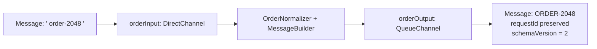

# MessageBuilder

## 1. Objectives and Role in Spring Integration Core

In an integration flow, business data often needs to travel alongside information such as a request ID, ingestion source, data version, or reply destination channel. `MessageBuilder` helps package that data into a `Message<T>` and build the next message when a processing step needs to change the payload or headers.

After this lesson, you will be able to:

- Choose the right `MessageBuilder` from Spring Integration and distinguish it from the same-named class in Spring Framework.
- Create a message from a payload or from an existing message; determine header overwrite rules.
- Explain why copying a message does not mean deep-copying the payload.
- Preserve proper metadata when writing transformers, wiring the Java DSL, and preparing messages for an aggregator.
- Test payload, headers, and structural independence of messages.

The examples use Java 17 or higher and APIs from Spring Integration 6.4.x. This is an illustrative baseline for the lesson, not version information for the current project. Flow-running examples require `spring-integration-core` along with compatibly versioned Spring dependencies; tests use JUnit Jupiter.

## 2. What Does MessageBuilder Create?

You can picture a message as having two parts:

```text
Message<T>
├── payload: T                 data to be processed
└── headers: MessageHeaders    metadata in name → value form
```

`Message<T>` provides `getPayload()` and `getHeaders()`. For ordinary messages created by a builder, to change the enclosing data, we build a new result rather than mutating the sent message. This prevents endpoints from accidentally altering a message structure that another endpoint is using.

`MessageBuilder<T>` is a message preparation utility. It does not send messages, create endpoints, or register flows. After `build()`, handing the message to the next step is the responsibility of a `MessageChannel`, gateway, or processing endpoint.

### Two Classes with the Same Name

| Class | Scope of Use | Key Point to Remember |
| --- | --- | --- |
| `org.springframework.messaging.support.MessageBuilder` | Spring Framework messaging abstraction | Creates messages and performs general header operations. |
| `org.springframework.integration.support.MessageBuilder` | Spring Integration | Adds convenience methods such as `setCorrelationId`, `setSequenceNumber`, `setSequenceSize`, `setPriority`. |

This lesson consistently uses the import:

```java
import org.springframework.integration.support.MessageBuilder;
import org.springframework.messaging.Message;
```

An IDE may auto-select the Spring Framework import. When `setCorrelationId()` is not recognized, check the package before changing your design. Both classes work with `org.springframework.messaging.Message`; the difference lies in the builder API. See [Spring Integration MessageBuilder Javadoc](https://docs.spring.io/spring-integration/docs/6.4.9/api/org/springframework/integration/support/MessageBuilder.html) and [Spring Framework Javadoc](https://docs.spring.io/spring-framework/docs/6.2.12/javadoc-api/org/springframework/messaging/support/MessageBuilder.html).

## 3. Two Starting Points: withPayload and fromMessage

### 3.1. Creating the First Message with withPayload

```java
import org.springframework.integration.support.MessageBuilder;
import org.springframework.messaging.Message;

Message<String> request = MessageBuilder
        .withPayload("order-2048")
        .setHeader("sourceSystem", "web-store")
        .setHeader("requestId", "req-8701")
        .setHeader("schemaVersion", 1)
        .build();

String orderId = request.getPayload();
String source = request.getHeaders().get("sourceSystem", String.class);
Integer version = request.getHeaders().get("schemaVersion", Integer.class);
```

`withPayload("order-2048")` determines the payload type as `String`, so the result is `Message<String>`. Header values can have various types; retrieving with `get(name, Class)` expresses the type expected by the processing code.

The payload must be non-`null`. If there is no business result, express that situation in the endpoint's contract or with an appropriate data type. Do not use `withPayload(null)` as a substitute for deciding whether to emit a message.

### 3.2. Keeping the Payload, Changing Headers with fromMessage

```java
Message<String> audited = MessageBuilder
        .fromMessage(request)
        .setHeader("audited", true)
        .build();

// request does not automatically get the "audited" header.
// audited has the same payload and adds metadata from the verification step.
```

`fromMessage(request)` takes the existing payload and headers as the starting point. Subsequent operations on the builder do not mutate `request`'s header map.

If you need a result whose payload has a different type, start fresh with `withPayload(newPayload)` and choose the headers to forward. A builder created from `Message<String>` is not a tool for converting the payload into an arbitrary type.

### 3.3. Changing the Payload, Keeping Required Metadata

```java
Message<Integer> lengthMessage = MessageBuilder
        .withPayload(request.getPayload().length())
        .copyHeaders(request.getHeaders())
        .setHeader("operation", "measure-order-id")
        .build();
```

The result has a payload of type `Integer`. Standard headers such as `requestId` and `sourceSystem` are forwarded. In another problem, changing the payload from JSON to a business object can make `contentType` or old format metadata invalid; the header policy must go hand in hand with the data transformation.

## 4. Setting, Copying, and Removing Headers

### 4.1. Common Operations

| Method | Effect on Ordinary Headers | When to Use |
| --- | --- | --- |
| `setHeader(name, value)` | Sets or overwrites a value; `null` means removing the header. | The endpoint is responsible for determining the final value. |
| `setHeaderIfAbsent(name, value)` | Sets only when no value exists yet. | Adding defaults while keeping existing choices. |
| `copyHeaders(map)` | Copies and overwrites matching names. | The copy source has precedence. |
| `copyHeadersIfAbsent(map)` | Copies only missing names. | The copy source provides fallback values. |
| `removeHeader(name)` | Removes an ordinary header by name. | Stripping metadata that is no longer appropriate. |
| `removeHeaders(patterns...)` | Removes by simple name patterns, e.g., `tmp_*`. | Cleaning up a group of headers following a naming convention. |

These rules do not allow overwriting read-only system headers like `id` and `timestamp`. Patterns in `removeHeaders` are simple name patterns with `*`, not regular expressions. Operation details are in [BaseMessageBuilder 6.4.9 source code](https://raw.githubusercontent.com/spring-projects/spring-integration/v6.4.9/spring-integration-core/src/main/java/org/springframework/integration/support/BaseMessageBuilder.java).

### 4.2. Operation Order Determines the Final Value

```java
import java.util.Map;
import org.springframework.integration.support.MessageBuilder;
import org.springframework.messaging.Message;

Map<String, Object> defaults = Map.of(
        "region", "VN",
        "schemaVersion", 1);

Message<String> first = MessageBuilder.withPayload("order-2048")
        .setHeader("region", "SG")
        .copyHeaders(defaults)
        .build();
// region = "VN": copyHeaders overwrites the previous value.

Message<String> second = MessageBuilder.withPayload("order-2048")
        .setHeader("region", "SG")
        .copyHeadersIfAbsent(defaults)
        .build();
// region = "SG", schemaVersion = 1.

Message<String> third = MessageBuilder.withPayload("order-2048")
        .copyHeaders(defaults)
        .setHeader("region", "SG")
        .build();
// region = "SG": the last setHeader call wins.
```

A readable practical convention is to copy input context first, and then explicitly set the headers owned by the endpoint. If a value is only a default, use the `IfAbsent`-suffixed method to express intent.

### 4.3. Removing Headers Intentionally

```java
Message<String> cleaned = MessageBuilder.fromMessage(request)
        .removeHeader("debugToken")
        .removeHeaders("tmp_*", "debug_*")
        .setHeader("obsoleteFlag", null)
        .build();
```

The removal list must fit the flow's contract. Removing all headers can drop `replyChannel`, correlation information, or metadata needed by downstream adapters. At the boundary sending data to an external system, you can build a new message and set only the headers belonging to the exchange contract.

## 5. Message Immutability and the Limits of Copying

For ordinary messages in this lesson, the headers structure is protected after construction:

```java
// Do not use to update metadata:
request.getHeaders().put("audited", true);
// Throws UnsupportedOperationException.
```

However, the object pointed to by the payload or a header value may still be mutable. The builder does not automatically deep-copy business objects. The [Message and MessageHeaders documentation](https://docs.spring.io/spring-integration/reference/6.4/message.html) clearly distinguishes envelope immutability from the mutability of inner data.

```java
import java.util.ArrayList;
import java.util.List;
import org.springframework.integration.support.MessageBuilder;
import org.springframework.messaging.Message;

List<String> items = new ArrayList<>(List.of("SKU-10"));

Message<List<String>> original = MessageBuilder
        .withPayload(items)
        .build();

Message<List<String>> branch = MessageBuilder.fromMessage(original)
        .setHeader("branch", "inventory")
        .build();

items.add("SKU-20");

// Both original and branch observe two elements.
// original.getPayload() == branch.getPayload() is true.
```

If two branches both process `items`, one branch mutating the list can affect the other branch. In this situation, you can use `List.copyOf(items)` when building the message; remember that elements inside the list still need their own immutability policy.

For DTOs, prefer values that do not change after the message is emitted. A `record` with a `List` field does not automatically make that list immutable either. For a header holding a `Map`, the same requirement applies to the map and nested values inside.

A builder holds state while preparing data. Create a builder locally per operation; avoid keeping a shared builder in a singleton or sharing it across threads.

## 6. Message ID, Timestamp, and Business Identifiers

`MessageHeaders.ID` and `MessageHeaders.TIMESTAMP` are technical metadata managed by the framework. With the default configuration, a newly created message receives its own ID and creation time; `copyHeaders` is not a way to force it to reuse the old ID.

Three types of identifiers should be separated in design:

| Identifier | Example | Purpose |
| --- | --- | --- |
| Message ID | Value of `MessageHeaders.ID` | Identifies a technical message. |
| Business key | `orderId = order-2048` | Identifies an order across its business lifecycle. |
| Request or group key | `requestId`, `correlationId` | Traces a request or correlates messages per the flow's convention. |

Do not use Message ID in place of a business key that must remain stable across multiple transformations. Similarly, `correlationId` used for an aggregator group does not automatically replace a tracing system.

Also do not claim that every call to `build()` allocates a distinct message. In the default implementation, `fromMessage(existing).build()` may return the original message if there were no changes and no custom read-only headers need handling. Therefore, calling `fromMessage(...).build()` alone to force a copy is a false assumption; see [the build implementation in BaseMessageBuilder](https://docs.spring.io/spring-integration/api/org/springframework/integration/support/BaseMessageBuilder.html).

In tests, when changing a header to an actually new value, you can verify that the original message retains the old value. Do not require the output timestamp to be strictly greater than the input timestamp: two messages can be created within the same millisecond.

## 7. Flow-Control Headers

### 7.1. replyChannel and errorChannel

```java
import org.springframework.integration.channel.QueueChannel;
import org.springframework.integration.support.MessageBuilder;
import org.springframework.messaging.Message;

QueueChannel replies = new QueueChannel();
QueueChannel failures = new QueueChannel();

Message<String> command = MessageBuilder.withPayload("order-2048")
        .setReplyChannel(replies)
        .setErrorChannel(failures)
        .setHeader("requestId", "req-8701")
        .build();
```

This snippet only prepares the message and control metadata. It has not sent the message and has not created consumers for the two queues.

`replyChannel` can be used by a reply-producing endpoint when no suitable explicit output configuration exists. `errorChannel` provides a destination for the framework's error-publishing mechanism. Setting this header alone does not automatically turn every exception into an error message.

For example, a handler running synchronously via `DirectChannel` usually throws errors back to the caller. With asynchronous processing or a poller configured with error publishing, the framework can send an `ErrorMessage` to the error channel. Exact behavior depends on the endpoint and error-handling configuration; see [Error Handling](https://docs.spring.io/spring-integration/reference/6.4/error-handling.html).

Within a single JVM, a header can hold a `MessageChannel` reference. When crossing a broker or process boundary, do not assume this reference can be serialized and used directly at the receiver. Header mapping and reply mechanisms must be designed for the respective protocol.

### 7.2. Correlation and Sequence for Aggregator

```java
import java.util.UUID;
import org.springframework.integration.support.MessageBuilder;
import org.springframework.messaging.Message;

String groupId = "order-2048:" + UUID.randomUUID();

Message<String> itemOne = MessageBuilder.withPayload("SKU-10")
        .setCorrelationId(groupId)
        .setSequenceNumber(1)
        .setSequenceSize(2)
        .build();

Message<String> itemTwo = MessageBuilder.withPayload("SKU-20")
        .setCorrelationId(groupId)
        .setSequenceNumber(2)
        .setSequenceSize(2)
        .build();
```

The two messages belong to the same group processing run; sequence numbering starts at 1 and the expected group size is 2. The random suffix in the example helps distinguish separate processing runs of the same order.

With the default aggregator, `correlationId` is used for grouping and sequence size information assists the release decision. The snippet above only prepares the inputs; an aggregator endpoint and appropriate configuration are still required. A splitter can usually generate sequence metadata for you, so you do not need to set it manually if the flow already handles it properly. See [Aggregator: correlation and release](https://docs.spring.io/spring-integration/reference/6.4/aggregator.html).

If a filter drops an item after the sequence has been created while the release condition still waits for the entire original group, the group may never complete. During design, clarify how dropped items, timeouts, and release conditions are handled.

## 8. Complete Example: Normalizing Order IDs with a Transformer

The example's requirement is to receive a string order ID, trim leading and trailing whitespace, convert to uppercase, and mark the post-processing data version. The `requestId` header must be preserved to correlate input and output; headers matching `tmp_*` only serve the ingestion step and must be removed.



### 8.1. Transformer Responsible for the Output Message

Place the following class in `OrderNormalizer.java` in your practice project:

```java
import java.util.Locale;

import org.springframework.integration.support.MessageBuilder;
import org.springframework.integration.transformer.MessageTransformationException;
import org.springframework.integration.transformer.Transformer;
import org.springframework.messaging.Message;

public final class OrderNormalizer implements Transformer {

    @Override
    public Message<?> transform(Message<?> input) {
        if (!(input.getPayload() instanceof String rawOrderId)) {
            throw new MessageTransformationException(
                    input, "OrderNormalizer requires a String payload");
        }

        String normalizedOrderId = rawOrderId.strip()
                .toUpperCase(Locale.ROOT);

        return MessageBuilder.withPayload(normalizedOrderId)
                .copyHeaders(input.getHeaders())
                .removeHeaders("tmp_*")
                .setHeader("processedBy", "order-normalizer")
                .setHeader("schemaVersion", 2)
                .setHeaderIfAbsent("sourceSystem", "unknown")
                .build();
    }
}
```

The builder order here expresses data ownership:

1. Create the normalized payload.
2. Forward input metadata.
3. Remove temporary metadata.
4. Write values decided by this endpoint: `processedBy`, `schemaVersion`.
5. Add `sourceSystem` if the sender did not supply a value.

The payload remains a string representing the order ID, so the example has no transport-format conversion step. Rules for validating IDs or rejecting empty strings can belong to a separate filter, depending on the business contract.

With a transformer returning a complete `Message`, application code is responsible for building the full output message. If you only created `MessageBuilder.withPayload(normalizedOrderId).build()` here, headers like `requestId` and `replyChannel` would not be preserved as intended. When a transformer returns only the payload, the framework has a mechanism to forward input headers. This is an important difference to remember when changing a method from returning a payload to returning a `Message`; see [transformer header propagation rules](https://docs.spring.io/spring-integration/reference/6.4/transformer.html).

### 8.2. Wiring with the Java DSL

Place the following configuration in `OrderFlowConfiguration.java`, in the same package as `OrderNormalizer`:

```java
import org.springframework.context.annotation.Bean;
import org.springframework.context.annotation.Configuration;
import org.springframework.integration.channel.DirectChannel;
import org.springframework.integration.channel.QueueChannel;
import org.springframework.integration.config.EnableIntegration;
import org.springframework.integration.dsl.IntegrationFlow;

@Configuration
@EnableIntegration
public class OrderFlowConfiguration {

    @Bean
    public DirectChannel orderInput() {
        return new DirectChannel();
    }

    @Bean
    public QueueChannel orderOutput() {
        return new QueueChannel();
    }

    @Bean
    public OrderNormalizer orderNormalizer() {
        return new OrderNormalizer();
    }

    @Bean
    public IntegrationFlow orderFlow() {
        return IntegrationFlow.from(orderInput())
                .transform(orderNormalizer())
                .channel(orderOutput())
                .get();
    }
}
```

`DirectChannel` delivers messages to the transformer on the calling thread in this configuration. The output `QueueChannel` holds results for test code to call `receive()`. No poller is needed to read results directly via `receive()`; only if attaching a polling consumer endpoint to the queue does that endpoint need a polling configuration.

`.transform(orderNormalizer())` declares the transformation endpoint; `MessageBuilder` appears only inside the result-building logic. This separation makes it easy to test the transformation in isolation without starting the entire flow. See [Transformers in Java DSL](https://docs.spring.io/spring-integration/reference/6.4/dsl/java-transformers.html).

If a step only adds headers without other transformation logic, the DSL's `enrichHeaders` can express intent more directly. When writing a custom transformer like the example, the builder lets you clearly control both the payload and headers in one place.

## 9. Testing the Message Contract

Tests should focus on what the endpoint promises: the processed payload, preserved headers, replaced headers, and removed headers. Do not compare the entire `MessageHeaders` if the goal does not involve auto-generated IDs and timestamps.

The class below uses the two Java classes from the previous section. This is test code for learners to run in a project with JUnit Jupiter:

```java
import java.util.Map;

import org.junit.jupiter.api.Test;
import org.springframework.context.annotation.AnnotationConfigApplicationContext;
import org.springframework.integration.channel.DirectChannel;
import org.springframework.integration.channel.QueueChannel;
import org.springframework.integration.support.MessageBuilder;
import org.springframework.messaging.Message;

import static org.junit.jupiter.api.Assertions.*;

class MessageBuilderLessonTest {

    @Test
    void shouldNormalizePayloadAndPreserveRequiredHeaders() {
        QueueChannel replies = new QueueChannel();
        Message<String> input = MessageBuilder
                .withPayload("  order-2048  ")
                .setHeader("requestId", "req-8701")
                .setHeader("sourceSystem", "web-store")
                .setHeader("schemaVersion", 1)
                .setHeader("tmp_probe", "local-debug")
                .setReplyChannel(replies)
                .build();

        Message<?> output = new OrderNormalizer().transform(input);

        assertEquals("ORDER-2048", output.getPayload());
        assertEquals("req-8701", output.getHeaders().get("requestId"));
        assertEquals("web-store", output.getHeaders().get("sourceSystem"));
        assertEquals(2, output.getHeaders().get("schemaVersion"));
        assertEquals("order-normalizer",
                output.getHeaders().get("processedBy"));
        assertFalse(output.getHeaders().containsKey("tmp_probe"));
        assertSame(replies, output.getHeaders().getReplyChannel());

        assertEquals("  order-2048  ", input.getPayload());
        assertEquals(1, input.getHeaders().get("schemaVersion"));
        assertEquals("local-debug", input.getHeaders().get("tmp_probe"));
        assertNotSame(input, output);
    }

    @Test
    void shouldKeepExplicitValueWhenCopyingDefaults() {
        Message<String> message = MessageBuilder.withPayload("order-2048")
                .setHeader("region", "SG")
                .copyHeadersIfAbsent(Map.of(
                        "region", "VN",
                        "schemaVersion", 1))
                .build();

        assertEquals("SG", message.getHeaders().get("region"));
        assertEquals(1, message.getHeaders().get("schemaVersion"));
    }

    @Test
    void shouldCarryMessageThroughConfiguredFlow() {
        try (var context = new AnnotationConfigApplicationContext(
                OrderFlowConfiguration.class)) {
            DirectChannel input = context.getBean(
                    "orderInput", DirectChannel.class);
            QueueChannel output = context.getBean(
                    "orderOutput", QueueChannel.class);

            boolean accepted = input.send(MessageBuilder
                    .withPayload("  order-2048  ")
                    .setHeader("requestId", "req-8701")
                    .build());

            assertTrue(accepted);
            Message<?> result = output.receive(1_000);
            assertNotNull(result);
            assertEquals("ORDER-2048", result.getPayload());
            assertEquals("req-8701", result.getHeaders().get("requestId"));
            assertEquals("unknown", result.getHeaders().get("sourceSystem"));
        }
    }
}
```

The first test also proves that the input message structure is not mutated. `assertSame` specifically for the `replyChannel` header shows that an in-JVM channel reference is preserved; it does not prove that the payload or every header was deep-copied.

The flow test uses a finite timeout to avoid hanging indefinitely if there is an output configuration error. Since the current flow processes synchronously and places the result into the queue, no sleep time is needed before receiving.

## 10. Advanced Headers: readOnlyHeaders and Message Creation Policies

`id` and `timestamp` always belong to the group of read-only system headers in the default builder. Spring Integration also provides the `readOnlyHeaders(...)` API to prevent certain custom headers from being brought into the message during copying. For example, starting from a new payload and ignoring `debugToken` from the source:

```java
Message<String> outgoing = MessageBuilder
        .withPayload(request.getPayload())
        .readOnlyHeaders("debugToken")
        .copyHeaders(request.getHeaders())
        .build();
```

In this example, the policy is set before the copy operation. Do not treat adding `readOnlyHeaders` after `fromMessage` as a guaranteed removal of an already-loaded header; if the goal is to remove an existing header, express it explicitly using the appropriate removal operation during construction.

An application can also apply a message creation policy through `MessageBuilderFactory`. Configuration applied to the framework's factory does not mean every static `MessageBuilder.withPayload(...)` call in application code automatically picks up that policy. When consistent policy is needed across multiple endpoints, standardize how builders are obtained as well. Refer to [Spring Integration's MessageBuilderFactory abstraction](https://docs.spring.io/spring-integration/reference/message.html#message-builder-factory).

Within the scope of this lesson, `removeHeader`, `removeHeaders`, or creating a new message with selected headers is usually sufficient to express metadata forwarding requirements.

## 11. Common Errors and How to Identify Causes

| Symptom | Common Cause | How to Handle |
| --- | --- | --- |
| Cannot call `setCorrelationId` or `setPriority` | Accidentally imported Spring Framework's builder. | Check the `org.springframework.integration.support` package. |
| `UnsupportedOperationException` when updating headers | Mutating `message.getHeaders()` directly. | Use a builder and accept the resulting message. |
| Newly set value is replaced by old value | Calling `copyHeaders` after `setHeader`. | Swap the order or use `copyHeadersIfAbsent`. |
| `requestId` lost after transformer | Returning a new message without forwarding required headers. | Define the header policy when creating the result. |
| One branch changing payload affects another branch | Two messages reference the same mutable object. | Use immutable data or copy according to business needs. |
| Gateway receives no reply | Reply header lost or reply destination misconfigured. | Inspect the path of `replyChannel` and output channels. |
| Aggregator waits forever for a group | Missing or wrong correlation, sequence size, or dropped item. | Cross-check metadata of the whole group against the release strategy. |
| `errorChannel` is set yet caller still gets an exception | Handler is running synchronously and errors throw back to caller. | Check execution model and error-handling config of the endpoint or gateway. |
| Idempotency key changes at every step | Using Message ID as a business key. | Choose a business key or request key with an appropriate lifecycle. |

## 12. Choosing Operations by Requirement

| Need | How to Start | Header Policy to Define |
| --- | --- | --- |
| Emit an initial event or command | `withPayload(payload)` | Add only metadata needed for the flow contract. |
| Keep payload, add processing trace | `fromMessage(input)` | Explicitly list headers the endpoint is allowed to change. |
| Change payload, continue the same flow | `withPayload(newPayload)` | Copy then update or remove obsolete headers. |
| Fill in default values | Builder appropriate for the payload | Use `setHeaderIfAbsent` or `copyHeadersIfAbsent`. |
| Transition to a different exchange contract | `withPayload(outboundPayload)` | Select headers needed by the receiver. |
| Prepare items for an aggregator | Builder for each item | Same correlation group; sequence consistent with release logic. |

When writing a new processing step, be able to state three things before calling `build()`: what data the output payload represents, which headers are forwarded, and which headers are decided by that step. These three decisions help messages preserve the right meaning as they pass through channels, endpoints, gateways, and enterprise integration patterns.
