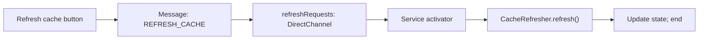

# Messages Without a Payload

In the **Message** chapter of the **SPRING_INTEGRATION_CORE** module, "a message without a payload" should be understood in terms of business intent: the sender only wants to trigger an action, such as refreshing a cache or requesting a data resync. When using Spring's standard Message classes, the message must still have a non-`null` payload.

This lesson focuses on how to represent that signal, route it through a MessageChannel to an endpoint using the Java DSL, and distinguish **no business data**, **empty payload**, and **no reply message**. This is foundational for designing gateways, transformers, filters, and integration flows with clear contracts.

## 1. A Non-Null Payload Is a Requirement of Standard Messages

A `Message<T>` encapsulates two parts: payload and headers. The payload represents the content; headers provide context for processing and transporting the message. See [Spring Integration's Message model](https://docs.spring.io/spring-integration/reference/message.html).

With `GenericMessage<T>`, the payload passed to the constructor must not be `null`. Adding headers does not change this requirement. See [GenericMessage's contract](https://docs.spring.io/spring-framework/docs/current/javadoc-api/org/springframework/messaging/support/GenericMessage.html).

The following attempts fail to create a valid Message:

```java
import java.util.Map;

import org.springframework.messaging.support.GenericMessage;
import org.springframework.messaging.support.MessageBuilder;

// Standalone lines illustrating invalid inputs.
// When executed, they are rejected with IllegalArgumentException.
new GenericMessage<String>(null);

new GenericMessage<String>(
        null,
        Map.of("operation", "REFRESH_CACHE"));

MessageBuilder.<String>withPayload(null).build();
```

`MessageBuilder` provides `withPayload(...)` to initialize a Message from a payload and `fromMessage(...)` to build from an existing Message. It does not provide a way to omit the payload by setting only headers. See [MessageBuilder API](https://docs.spring.io/spring-framework/docs/current/javadoc-api/org/springframework/messaging/support/MessageBuilder.html).

Declaring `Message<Void>` does not solve the issue either: `new GenericMessage<Void>(null)` still violates the constructor's precondition. A `void` return type of a handler method is a different concept from a Message's payload type.

## 2. Distinguishing Cases Often Loosely Called "Empty"

| Case | Is There a Valid Message? | Meaning to Express |
| --- | --- | --- |
| `new GenericMessage<String>(null)` | No | Invalid input payload |
| `MessageBuilder.withPayload("").build()` | Yes | Payload is a zero-length string |
| `MessageBuilder.withPayload(new byte[0]).build()` | Yes | Payload is a zero-length byte array |
| Payload is an empty list | Yes | A list result exists, with zero elements |
| Payload is the signal `"REFRESH_CACHE"` | Yes | A request to perform an action, without business records |
| `QueueChannel.receive(0)` returns `null` | No Message was received in that call | No message is ready to be retrieved |
| Service activator ends with `void` | Input Message still exists | No reply Message is created |
| Service activator returns `null`, missing reply allowed | Input Message still exists | Processing branch ends with no reply |

The constructor rows follow [GenericMessage](https://docs.spring.io/spring-framework/docs/current/javadoc-api/org/springframework/messaging/support/GenericMessage.html); receive and reply behaviors are presented in [Message Channel Implementations](https://docs.spring.io/spring-integration/reference/channel/implementations.html) and [Service Activator](https://docs.spring.io/spring-integration/reference/service-activator.html), respectively.

The distinction to keep in mind during design:

- **Empty payload**: a Message object exists, the payload exists, and it holds a valid empty value.
- **No Message**: the receive operation or processing branch does not produce a Message object.
- **Business signal**: the Message holds a value describing a request, even if it contains no records such as orders or customers.

For example, "queried and found 0 orders" can be represented by an empty list. "Query result has not arrived yet" needs to be modeled by protocol or flow state. These two situations lead to different business decisions.

## 3. Choosing a Payload for Signal-Only Messages

Suppose an administrator clicks a **Refresh cache** button. The user does not need to enter data; the system already knows which cache to refresh via a dedicated processing flow.

A simple contract might be:

```java
import org.springframework.messaging.Message;
import org.springframework.messaging.support.MessageBuilder;

Message<String> request = MessageBuilder
        .withPayload("REFRESH_CACHE")
        .setHeader("triggerSource", "admin-ui")
        .setHeader("requestId", "refresh-001")
        .build();
```

In this design:

- `"REFRESH_CACHE"` describes the action.
- `triggerSource` serves to observe what triggered it.
- `requestId` is an application-defined correlation ID; setting this header alone does not create a duplicate-prevention mechanism.

The names `triggerSource` and `requestId` are custom headers for the example, not mandatory standard Spring Integration names. Only include information whose interpretation the participating components have agreed upon.

### 3.1. Strings, Enums, and Command Objects

| Option | Fits the Need | Consideration |
| --- | --- | --- |
| Fixed string such as `"REFRESH_CACHE"` | Illustrative flows or simple protocols | Allowed values and spelling must be agreed upon |
| Enum such as `RefreshSignal.INSTANCE` | Java components sharing a typed contract | Needs a representation convention when leaving the JVM |
| Command object with explicit fields | Action with parameters, scope, or version | Validity of each field must be defined |
| `""` or `new byte[0]` | Receiver contract explicitly defines empty content | Action meaning usually has to come from the channel or metadata |
| `new Object()` | Very small internal experiments | Does not convey intent and is hard to formalize as an exchange contract |

Example of an enum carrying no additional data:

```java
public enum RefreshSignal {
    INSTANCE
}
```

The `RefreshSignal.INSTANCE` payload still exists; its value acts as a signal. This is an application design choice, not a framework "null payload" type.

When a request acquires business parameters, a command object can be used:

```java
public record RefreshCacheCommand(String cacheName, boolean force) {
}
```

If the receiver needs `cacheName` to decide which cache to refresh, placing that field on the command keeps the contract easy to read and validate. Primary data for the action should not be pushed into headers merely to maintain the appearance of a "payloadless message."

## 4. Java DSL Flow Calling a No-Argument Method

Spring Integration supports service activators invoking methods with no arguments. The endpoint still receives a Message; the business method simply does not need to read its contents. In the Java DSL, `.handle(bean, "methodName")` expresses a service activator. See [Service Activator configuration](https://docs.spring.io/spring-integration/reference/service-activator.html).

Example flow:



The sample below uses Java 17 or higher and the `IntegrationFlow.from(...)` API. The project needs the `spring-integration-core` dependency along with compatible Spring dependencies. The example instantiates a Spring Context directly, requiring no Spring Boot.

```java
package example;

import java.util.concurrent.atomic.AtomicInteger;

import org.springframework.context.annotation.AnnotationConfigApplicationContext;
import org.springframework.context.annotation.Bean;
import org.springframework.context.annotation.Configuration;
import org.springframework.integration.channel.DirectChannel;
import org.springframework.integration.config.EnableIntegration;
import org.springframework.integration.dsl.IntegrationFlow;
import org.springframework.messaging.Message;
import org.springframework.messaging.MessageChannel;
import org.springframework.messaging.support.MessageBuilder;

public class RefreshFlowExample {

    public static class CacheRefresher {

        private final AtomicInteger refreshCount = new AtomicInteger();

        public void refresh() {
            // Replace with the application's cache refresh operation.
            refreshCount.incrementAndGet();
        }

        public int refreshCount() {
            return refreshCount.get();
        }
    }

    @Configuration(proxyBeanMethods = false)
    @EnableIntegration
    public static class FlowConfiguration {

        @Bean
        public DirectChannel refreshRequests() {
            return new DirectChannel();
        }

        @Bean
        public CacheRefresher cacheRefresher() {
            return new CacheRefresher();
        }

        @Bean
        public IntegrationFlow refreshFlow(
                DirectChannel refreshRequests,
                CacheRefresher cacheRefresher) {

            return IntegrationFlow
                    .from(refreshRequests)
                    .handle(cacheRefresher, "refresh")
                    .get();
        }
    }

    public static void main(String[] args) {
        try (AnnotationConfigApplicationContext context =
                     new AnnotationConfigApplicationContext(
                             FlowConfiguration.class)) {

            Message<String> request = MessageBuilder
                    .withPayload("REFRESH_CACHE")
                    .setHeader("triggerSource", "admin-ui")
                    .setHeader("requestId", "refresh-001")
                    .build();

            MessageChannel input = context.getBean(
                    "refreshRequests", MessageChannel.class);

            boolean sent = input.send(request);

            CacheRefresher refresher =
                    context.getBean(CacheRefresher.class);

            System.out.println("sent=" + sent);
            System.out.println("refreshCount="
                    + refresher.refreshCount());
        }
    }
}
```

The flow-building API is described in [IntegrationFlow](https://docs.spring.io/spring-integration/docs/current/api/org/springframework/integration/dsl/IntegrationFlow.html). Expected console output of the example:

```text
sent=true
refreshCount=1
```

`DirectChannel` invokes the handler on the sender's execution thread. Therefore, in this example, the counter increment completes before `send(...)` returns. See [DirectChannel](https://docs.spring.io/spring-integration/reference/channel/implementations.html#channel-implementations-directchannel).

There are three distinct contracts to recognize:

1. Channel `refreshRequests` receives cache refresh requests.
2. Method `refresh()` takes no parameters from the Message.
3. `refresh()` returns `void`, so the endpoint ends without producing a reply.

The counter is simply observable state for illustration and testing. In an application, the side effect might be reloading reference data or calling another service.

Because `refresh()` does not inspect the payload, the flow currently treats any Message sent to this channel as a trigger request. If the channel has multiple producers or needs to validate the signal type, add validation at the entry boundary; the filter section below illustrates one way.

## 5. A No-Argument Gateway Must Still Create a Payload

A no-argument gateway by default has the semantics of receiving a Message from a `PollableChannel`. To use it to send a signal, a `payloadExpression` must be provided. A `void` method with a payload expression is a send-only operation. See [Invoking No-Argument Methods](https://docs.spring.io/spring-integration/reference/gateway.html#gateway-no-args).

```java
package example;

import org.springframework.integration.annotation.Gateway;
import org.springframework.integration.annotation.MessagingGateway;

@MessagingGateway
public interface CacheRefreshGateway {

    @Gateway(
            requestChannel = "refreshRequests",
            payloadExpression = "'REFRESH_CACHE'")
    void refresh();
}
```

To generate the proxy, add `@IntegrationComponentScan(basePackageClasses = CacheRefreshGateway.class)` to the configuration registered in the context, importing `org.springframework.integration.annotation.IntegrationComponentScan`. Use the same flow from section 4.

Calling `gateway.refresh()` takes no data from the caller yet still sends a Message with the string payload `"REFRESH_CACHE"`. The single quotes inside the SpEL expression denote a string literal; omitting them changes how the expression is parsed.

`void` describes a contract that does not wait for a business reply. With `DirectChannel`, the handler still runs on the thread calling the gateway; switching to asynchronous processing requires designing the corresponding channel and execution mechanism.

## 6. No Reply Is a Flow State

A service activator can consume an input Message and finish. If the method returns `null` and the endpoint allows a missing reply, no output Message is created. This case differs from constructing a Message containing a `null` payload. `void` behavior also finishes without emitting a reply. See [Service Activator](https://docs.spring.io/spring-integration/reference/service-activator.html).

### 6.1. Choosing an Endpoint by Purpose

| Purpose | Suitable Component | Expected Outcome |
| --- | --- | --- |
| Perform a side effect and finish | Service activator with a `void` method | No reply |
| Convert a signal into another command | Transformer | Valid converted result |
| Keep or drop requests conditionally | Filter | Message proceeds or is discarded |
| Require a handler to produce a reply | Handler supporting `requiresReply=true` | Missing reply becomes an error |
| Discard an already produced result | `nullChannel` | Message is sent to the discard destination |

A transformer returning `null` causes a `MessageTransformationException`; use a filter for message-dropping decisions. See [Transformer return rules](https://docs.spring.io/spring-integration/reference/transformer.html).

Example adding a filter to the flow in section 4:

```java
return IntegrationFlow
        .from(refreshRequests)
        .<String>filter(signal -> "REFRESH_CACHE".equals(signal))
        .handle(cacheRefresher, "refresh")
        .get();
```

In this snippet, a non-matching string payload is dropped by the filter and `refresh()` is not called. You can configure a discard channel to observe rejected requests or enable throwing an exception per the flow's contract. See [Filter](https://docs.spring.io/spring-integration/reference/filter.html).

The example only checks the signal string on a channel with an agreed payload type. It does not replace authorization checks for invoking administrative actions.

### 6.2. When a Reply Is Required

For handlers capable of producing a reply, `requiresReply=true` turns failing to produce a reply into a `ReplyRequiredException`. This flag checks the processing outcome; it does not synthesize a fallback payload. See [AbstractReplyProducingMessageHandler](https://docs.spring.io/spring-integration/docs/current/api/org/springframework/integration/handler/AbstractReplyProducingMessageHandler.html) and [ReplyRequiredException](https://docs.spring.io/spring-integration/docs/current/api/org/springframework/integration/handler/ReplyRequiredException.html).

Example configuration for a service whose method returns a result:

```java
// lookupService and the findStatus method are provided by the application.
// findStatus returns a status object or null.
return IntegrationFlow
        .from("statusRequests")
        .handle(lookupService, "findStatus",
                endpoint -> endpoint.requiresReply(true))
        .channel("statusReplies")
        .get();
```

If business logic needs to report "not found", represent that outcome with an explicit status object. If business logic treats a missing result as a contract violation, keep the error-reporting behavior.

### 6.3. nullChannel Is a Destination for Valid Messages

`nullChannel` is a special channel for discarding unneeded messages or results. It is not a tool for constructing a Message with a `null` payload. See [Special Channels](https://docs.spring.io/spring-integration/reference/channel/special-channels.html).

For example, if a method returns a result that the flow intentionally discards, the flow can end with:

```java
// resultProducingService.execute must produce a valid result.
return IntegrationFlow
        .from("maintenanceRequests")
        .handle(resultProducingService, "execute")
        .channel("nullChannel")
        .get();
```

Placing `nullChannel` after a step that produces no output does not conjure a new Message to send to this channel.

### 6.4. Keeping the Request-Reply Contract Consistent

If a gateway declares a value-returning type yet the processing path ends with no reply, the caller may wait until timeout. Set a finite timeout according to requirements and the version's configuration; do not use waiting time as a business outcome. With a synchronous channel, the reply timeout is also not an execution time limit on a handler occupying the calling thread. See [GatewayProxyFactoryBean](https://docs.spring.io/spring-integration/docs/current/api/org/springframework/integration/gateway/GatewayProxyFactoryBean.html).

In the cache refresh problem, you can choose among:

- Fire-and-forget API: gateway returns `void`, tracking processing via status or events.
- Result-returning API: handler returns an object such as `RefreshResult`, gateway receives that exact result type.
- Long-running task: return a job ID per an explicit contract and provide a mechanism to query status.

When designing branches that combine into an aggregator, also specify which branches actually emit a result Message. A branch ending silently does not contribute an element to the group; do not assume it sent a "null element."

## 7. Testing the Signal Message Contract

Tests should verify both Message validity and the flow's side effects. Checking only that `send(...)` returns `true` is not enough to express the cache refresh requirement.

The sample below uses JUnit Jupiter and the `RefreshFlowExample` class from section 4. This is test code for learners to add to their project; build and test-running commands are not part of the example setup.

```java
package example;

import org.junit.jupiter.api.Test;

import org.springframework.context.annotation.AnnotationConfigApplicationContext;
import org.springframework.integration.channel.QueueChannel;
import org.springframework.messaging.Message;
import org.springframework.messaging.MessageChannel;
import org.springframework.messaging.support.GenericMessage;
import org.springframework.messaging.support.MessageBuilder;

import static org.junit.jupiter.api.Assertions.assertEquals;
import static org.junit.jupiter.api.Assertions.assertNotNull;
import static org.junit.jupiter.api.Assertions.assertNull;
import static org.junit.jupiter.api.Assertions.assertThrows;
import static org.junit.jupiter.api.Assertions.assertTrue;

class PayloadlessMessageTest {

    @Test
    void nullPayloadIsRejected() {
        assertThrows(IllegalArgumentException.class,
                () -> new GenericMessage<String>(null));

        assertThrows(IllegalArgumentException.class,
                () -> MessageBuilder.<String>withPayload(null).build());
    }

    @Test
    void emptyValuesAreStillPayloads() {
        Message<String> text =
                MessageBuilder.withPayload("").build();

        Message<byte[]> bytes =
                MessageBuilder.withPayload(new byte[0]).build();

        assertNotNull(text.getPayload());
        assertEquals("", text.getPayload());

        assertNotNull(bytes.getPayload());
        assertEquals(0, bytes.getPayload().length);
    }

    @Test
    void signalInvokesServiceWithoutProducingReply() {
        try (AnnotationConfigApplicationContext context =
                     new AnnotationConfigApplicationContext(
                             RefreshFlowExample.FlowConfiguration.class)) {

            QueueChannel replies = new QueueChannel();

            Message<String> request = MessageBuilder
                    .withPayload("REFRESH_CACHE")
                    .setHeader("requestId", "test-refresh-001")
                    .setReplyChannel(replies)
                    .build();

            MessageChannel input = context.getBean(
                    "refreshRequests", MessageChannel.class);

            assertTrue(input.send(request));

            RefreshFlowExample.CacheRefresher refresher =
                    context.getBean(
                            RefreshFlowExample.CacheRefresher.class);

            assertEquals(1, refresher.refreshCount());
            assertNull(replies.receive(0));
        }
    }

    @Test
    void emptyQueueReturnsNoMessage() {
        QueueChannel channel = new QueueChannel();

        Message<?> received = channel.receive(0);

        assertNull(received);
    }
}
```

In the flow test, `DirectChannel` has already finished invoking the handler before checking the counter and reply queue. Therefore, `receive(0)` is appropriate for confirming there is no reply once the synchronous flow has completed; no sleep time is needed.

`receive(0)` immediately inspects the queue state. A returned `null` means no Message was received, so do not proceed to call `received.getPayload()`. See [QueueChannel behavior](https://docs.spring.io/spring-integration/reference/channel/implementations.html).

If replaced with an asynchronous channel, wait for a bounded completion condition before asserting that the business side effect has occurred. A single observation of an empty queue does not prove an asynchronous task has finished.

## 8. Common Design Mistakes

| Practice | Problem | How to Adjust |
| --- | --- | --- |
| Using `withPayload(null)` and adding only headers | Message is rejected before entering the flow | Choose a non-null signal payload |
| Using `Message<Void>` to represent a signal | The type parameter does not make the constructor accept null | Use a signal type with a concrete value |
| Sending `""` when the receiver needs a meaningful command | Not enough information to determine the action | Standardize a command or a dedicated channel |
| Having a transformer return null to drop a Message | Violates the transformer contract | Use a filter |
| No-arg gateway missing a payload expression for sending | Does not express flow-triggering intent | Configure `payloadExpression` |
| Gateway expects a result while final endpoint returns void | Reply contract is not satisfied | Return an explicit result or choose a send-only API |
| Assuming `nullChannel` means a null payload | Confuses a discard destination with Message content | Send only valid Messages to the channel |
| Using `receive(0) == null` to conclude an async task succeeded | Only proves the queue has no data yet | Track completion and error status |
| Assuming a small payload automatically prevents duplicates | Payload size does not determine idempotency | Design keys and duplicate-request handling |

The API rules in the table were cited in their respective sections. Adjustments regarding command contracts, state observation, and duplicate handling are design guidance applied to the example.

## 9. Hands-On Exercises

1. Run the cache refresh example and send two signals in a row. Confirm `refreshCount` increments twice even though there is no record data in the request.
2. Add a filter accepting only `"REFRESH_CACHE"`. Send `"UNKNOWN"` and confirm the handler does not run.
3. Replace the string payload with an enum. Update the producer and filter to share the same typed contract.
4. Create a handler version returning `RefreshResult`. Design a gateway with the corresponding return type and configure an appropriate timeout.
5. Switch the input channel to an asynchronous mechanism. Add a way to wait for completion in tests and a place to observe errors.
6. Add `cacheName` to the command. Identify which field is action data and which fields serve correlation and observability.

The goal to achieve is a flow you can explain clearly: **which Message is sent, what the payload means, which action the endpoint performs, and whether a reply Message is needed**.
