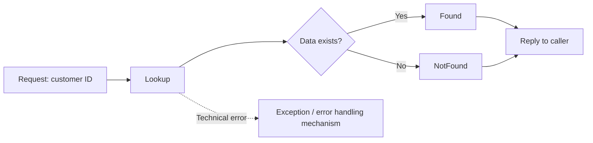

# Null Payload and NullPayload

## 1. Objectives and Scope

In the **Message** chapter of the **SPRING_INTEGRATION_CORE** module, this lesson explains how to represent absent data while keeping the message contract clear. The content connects to designing flows with `Message`, `MessageChannel`, endpoints, gateways, and the Java DSL; it also shows the impact on transformers, filters, routers, aggregators, error handling, and testing.

After this lesson, you will be able to:

- Distinguish a `null` payload, no message, no reply, and a valid payload representing an empty result.
- Define a custom sentinel when needed, and understand the limitations of the name `NullPayload`.
- Design a request–reply flow that explicitly answers the "data not found" case.
- Choose the right behavior to terminate a flow, discard a message, or raise an error.

The examples use Java 17 and Spring Integration 6.4 APIs, without Spring Boot. Illustrative code requires `spring-integration-core`; tests require JUnit Jupiter. Spring libraries must belong to a compatible version set managed by the project.

> **Clarifying the name:** Spring Integration does not provide a standard class named `NullPayload` to automatically replace every `null` payload. The sentinel carrying this name in this lesson is an **application-defined** type. Checking the [Spring Integration API index](https://docs.spring.io/spring-integration/api/allclasses-index.html) also shows no standard type by that name; do not infer an import statement solely from the lesson title.

## 2. The Payload Contract: An Object Must Exist

A Message is viewed as an envelope:

```text
Message<T>
├── payload: T
└── headers: MessageHeaders
```

With standard message creation using `GenericMessage` or `MessageBuilder`, the payload must not be `null`. The Javadoc states this condition clearly; `GenericMessage`'s constructor enforces it with an assertion. Thus the error happens upon creating the message, before the message is sent to a channel. See [GenericMessage contract](https://docs.spring.io/spring-framework/docs/6.1.x/javadoc-api/org/springframework/messaging/support/GenericMessage.html) and [constructor source code](https://raw.githubusercontent.com/spring-projects/spring-framework/v6.2.0/spring-messaging/src/main/java/org/springframework/messaging/support/GenericMessage.java).

```java
import org.springframework.messaging.Message;
import org.springframework.messaging.support.GenericMessage;
import org.springframework.messaging.support.MessageBuilder;

// Both approaches below are invalid: throw IllegalArgumentException.
Message<String> invalid1 = new GenericMessage<String>(null);
Message<String> invalid2 = MessageBuilder.<String>withPayload(null).build();
```

The two lines above are **two independent failure scenarios**. If run as a single block, the first line throws an exception so the second line will not execute.

An object containing no elements can still be a payload:

```java
import java.util.List;
import org.springframework.messaging.Message;
import org.springframework.messaging.support.MessageBuilder;

Message<String> emptyText = MessageBuilder.withPayload("").build();
Message<byte[]> emptyBytes = MessageBuilder.withPayload(new byte[0]).build();
Message<List<String>> emptyList =
        MessageBuilder.withPayload(List.<String>of()).build();
```

Here there are three concrete values: a zero-length string, a zero-length array, and a list with no elements. Business meaning depends on the contract between sender and receiver. For example, an empty list can be a valid query result; it does not by itself mean the query failed.

The non-`null` precondition applies to the **outer payload object**. It does not automatically validate every property inside a DTO. If a required field is missing, the application still needs separate validation.

## 3. States Easily Confused with One Another

| Situation | Does a Valid Message Proceed? | How to Understand It |
|---|---|---|
| Creating `GenericMessage<>(null)` | No | Violates the message creation precondition |
| `QueueChannel.receive(0)` returns `null` | No message received on that call | No envelope available to read a payload from |
| Service activator returns `null`, missing reply allowed | No reply produced at that endpoint | Processing branch finishes |
| Service activator returns `null`, reply required | No reply produced; error raised | Violates the endpoint's contract |
| Message contains an application-defined sentinel | Yes | The special object is still a payload |
| Message contains `List.of()` | Yes | The list exists but has no elements |
| Sending a valid message to `nullChannel` | Message is delivered to the discard sink | Not a mechanism for creating a `null` payload |
| DTO has `status = NOT_FOUND` | Yes | The business outcome is explicitly represented |

Example of reading an empty queue:

```java
import org.springframework.integration.channel.QueueChannel;
import org.springframework.messaging.Message;

QueueChannel inbox = new QueueChannel();
Message<?> received = inbox.receive(0);

if (received == null) {
    // No message received; do not call received.getPayload().
}
```

The return value of `receive(timeout)` can be `null` when the timeout expires or the thread is interrupted. This is the contract of the receive operation, not a received payload. See [PollableChannel.receive](https://docs.spring.io/spring-framework/docs/current/javadoc-api/org/springframework/messaging/PollableChannel.html).

This distinction helps ask the right diagnostic question: "Failed to build an envelope", "no envelope received", or "received an envelope with an intentional empty result"?

## 4. NullPayload as an Application-Defined Sentinel

A sentinel is a concrete value agreed upon by participating parties to represent a special state. If an internal protocol needs to distinguish "a message reporting absent data" from "emitting no message", you can define your own enum:

```java
package example.integration;

public enum NullPayload {
    INSTANCE
}
```

Creating and receiving a message with that type:

```java
import org.springframework.messaging.Message;
import org.springframework.messaging.support.MessageBuilder;
import example.integration.NullPayload;

Message<NullPayload> absent =
        MessageBuilder.withPayload(NullPayload.INSTANCE)
                .setHeader("reason", "NO_VALUE")
                .build();

boolean isAbsenceMarker =
        absent.getPayload() == NullPayload.INSTANCE; // true
```

`NullPayload.INSTANCE` is an existing enum object. `getPayload()` returns that exact object, not `null`. Spring does not automatically discard the message, turn it into an error, or unwrap it into an absent value.

When using this sentinel, the contract should clearly answer:

1. Does the sentinel mean not found, data not yet available, or result not applicable?
2. Which consumers receive and handle the sentinel type?
3. Under what schema is it serialized across process boundaries?
4. Do statistics and aggregation steps count it as a result or not?

A handler expecting only `Customer` does not automatically know how to handle a `NullPayload` sentinel. Handle the absent-data branch before that step or use a shared result type. Avoid relying on implicit type conversion to mask an incomplete input contract.

Names like `NoCustomerFound` or `NoSnapshotAvailable` usually express intent better than `NullPayload` when representing a business state. A generic sentinel works best when its meaning is tightly scoped within an internal protocol.

## 5. Endpoint Returning Null Differs from a Message with a Null Payload

When a service activator returns `null` or `void`, the framework produces no reply if the endpoint permits it. With `requiresReply = true`, the lack of a result leads to `ReplyRequiredException`. See [Service Activator](https://docs.spring.io/spring-integration/reference/6.4/service-activator.html).

The three flows below isolate the differences. They use the `example.integration.NullPayload` enum from the previous section; the named input channels are created by the Java DSL when registering the flows.

```java
package example.integration;

import org.springframework.context.annotation.Bean;
import org.springframework.context.annotation.Configuration;
import org.springframework.integration.config.EnableIntegration;
import org.springframework.integration.dsl.IntegrationFlow;

@Configuration
@EnableIntegration
public class NullBehaviorConfiguration {

    @Bean
    public IntegrationFlow optionalReplyFlow() {
        return IntegrationFlow.from("optionalInput")
                .handle(String.class,
                        (payload, headers) -> null,
                        endpoint -> endpoint.requiresReply(false))
                .get();
    }

    @Bean
    public IntegrationFlow requiredReplyFlow() {
        return IntegrationFlow.from("requiredInput")
                .handle(String.class,
                        (payload, headers) -> null,
                        endpoint -> endpoint.requiresReply(true))
                .get();
    }

    @Bean
    public IntegrationFlow sentinelReplyFlow() {
        return IntegrationFlow.from("sentinelInput")
                .handle(String.class,
                        (payload, headers) -> NullPayload.INSTANCE,
                        endpoint -> endpoint.requiresReply(true))
                .get();
    }
}
```

When testing the flows, set a `replyChannel` on the request to observe the outcome:

| Input | Expected Outcome |
|---|---|
| `optionalInput` | Handler is invoked, no reply |
| `requiredInput` | Throws `ReplyRequiredException` |
| `sentinelInput` | Reply has payload `NullPayload.INSTANCE` |

`requiresReply(true)` governs whether the handler produces a result; it does not verify whether the result contains business data. Because the sentinel is non-`null`, it satisfies the reply requirement. This mechanism is implemented in [AbstractReplyProducingMessageHandler](https://raw.githubusercontent.com/spring-projects/spring-integration/v6.4.0/spring-integration-core/src/main/java/org/springframework/integration/handler/AbstractReplyProducingMessageHandler.java).

The last flow has no fixed output channel. When the request carries a `replyChannel` header, the reply goes to that channel. If you call a result-producing flow without providing a place to receive the result, a reply-routing error is a separate issue from whether the payload represents absent data.

### Transformer and Filter

A transformer is used to produce an output from an input; do not use `return null` as a way to filter out messages. The documentation specifies that a transformer returning `null` throws `MessageTransformationException`; unlike a service activator, it cannot be configured to allow a missing reply. See [Transformer](https://docs.spring.io/spring-integration/reference/6.4/transformer.html).

The following example is a **flawed design snippet**, not a flow to put into an application:

```java
IntegrationFlow.from("namesInput")
        .transform(String.class,
                name -> name.isBlank() ? null : name.trim())
        .channel("namesOutput")
        .get();
```

If the requirement is to process only non-blank names, use a filter followed by a transformer:

```java
IntegrationFlow.from("namesInput")
        .filter(String.class,
                name -> !name.isBlank(),
                filter -> filter.discardChannel("rejectedNames"))
        .transform(String.class, String::trim)
        .channel("namesOutput")
        .get();
```

This snippet must be registered as a bean and requires consumers configured for `namesOutput` and `rejectedNames`. The filter decides whether to proceed or discard; the discard channel allows observing the rejected branch. In a request–reply call, the discard branch must also be designed if the caller is waiting for an answer. See [Filter and discard channel](https://docs.spring.io/spring-integration/reference/6.4/filter.html).

## 6. Designing an Explicit Lookup Result

Suppose a system looks up customers by ID. There are two normal business outcomes:

- Found: return the customer ID and name.
- Not found: still return the queried ID along with the corresponding status.

A database connection failure is a different situation. Turning every error into "not found" leads callers to make wrong decisions, such as creating duplicate records thinking the data does not exist yet.

Below is a standalone configuration using in-memory data. Two records form a closed set of outcomes, avoiding using `Object` for both customers and a generic marker.

```java
package example.integration;

import java.util.Map;
import java.util.Objects;

import org.springframework.context.annotation.Bean;
import org.springframework.context.annotation.Configuration;
import org.springframework.integration.config.EnableIntegration;
import org.springframework.integration.dsl.IntegrationFlow;

@Configuration
@EnableIntegration
public class LookupConfiguration {

    public sealed interface LookupResult permits Found, NotFound {
        String customerId();
    }

    public record Found(String customerId, String displayName)
            implements LookupResult {
        public Found {
            Objects.requireNonNull(customerId, "customerId");
            Objects.requireNonNull(displayName, "displayName");
        }
    }

    public record NotFound(String customerId) implements LookupResult {
        public NotFound {
            Objects.requireNonNull(customerId, "customerId");
        }
    }

    @Bean
    public IntegrationFlow customerLookupFlow() {
        Map<String, String> customers = Map.of("C-001", "Lan");

        return IntegrationFlow.from("customerLookupInput")
                .handle(String.class, (customerId, headers) -> {
                    String name = customers.get(customerId);
                    if (name == null) {
                        return new NotFound(customerId);
                    }
                    return new Found(customerId, name);
                }, endpoint -> endpoint.requiresReply(true))
                .get();
    }
}
```

In the example, `Map.get()` can return `null` inside Java logic. That value is converted into `NotFound` before becoming the handler's result. The payload rule does not force every local variable in the application to be non-`null`.



A router in a subsequent step can branch on the `Found` and `NotFound` types. Example business logic after receiving the reply:

```java
static void showResult(LookupConfiguration.LookupResult result) {
    if (result instanceof LookupConfiguration.Found found) {
        System.out.println("Customer: " + found.displayName());
    } else if (result instanceof LookupConfiguration.NotFound missing) {
        System.out.println("Customer not found " + missing.customerId());
    }
}
```

Place this illustrative method in the application's result-consuming class; pass in the actual result received from the flow.

When sending the result over JSON or a broker, publish a corresponding schema, such as:

```json
{
  "status": "NOT_FOUND",
  "customerId": "C-404"
}
```

The external schema does not need to expose internal Java class names. Conversion between records and JSON must be configured per the chosen contract; a sealed interface does not automatically configure polymorphism for every serializer.

## 7. Impact on Gateways and Callers

A gateway with a value-returning method expresses a request–reply expectation. If the flow stops at a service activator returning `null`, the gateway does not receive a "message with an empty payload"; it is missing a reply.

You can use the following interface for the lookup flow:

```java
package example.integration;

import org.springframework.integration.annotation.MessagingGateway;

@MessagingGateway(
        defaultRequestChannel = "customerLookupInput",
        defaultReplyTimeout = "1000")
public interface CustomerGateway {
    LookupConfiguration.LookupResult find(String customerId);
}
```

To use this interface as a bean, enable gateway scanning with `@IntegrationComponentScan` in the configuration for the package containing `CustomerGateway`, and register `LookupConfiguration`. The tests below use channels directly so they do not depend on the gateway scanning step.

With a synchronous object return type, timing out can cause the gateway to return `null`, depending on timeout handling configuration. Do not use that value as definitive proof that "the customer does not exist." Moreover, `replyTimeout` does not forcibly terminate a synchronous handler running on the calling thread over `DirectChannel`. See [Gateway when no reply is received](https://docs.spring.io/spring-integration/reference/6.4/gateway.html).

In this design, `NotFound` is an intentional business answer. A missing reply should be logged as a communication failure. If the operation only sends a command without requiring a return result, the gateway contract can use `void`, paired with success or error tracking appropriate to business requirements.

## 8. NullChannel and Protocol-Specific Null Mechanisms

### NullChannel Is a Message Discard Sink

`nullChannel` receives a message and discards it. It does not replace the payload with `null` and does not represent a "not found" result. For ordinary payloads, it can be used as the terminal target of a branch where the application intentionally keeps no result. See [Special Channels](https://docs.spring.io/spring-integration/reference/6.4/channel/special-channels.html).

Example bean configuration for a terminal branch:

```java
@Bean
public IntegrationFlow discardCompletedFlow() {
    return IntegrationFlow.from("completedInput")
            .channel("nullChannel")
            .get();
}
```

If a request–reply branch is routed here without another reply mechanism, the caller still receives no reply. Intentionally discarding a message and replying "no data" must be decided separately in the design.

### KafkaNull Has Its Own Semantics

Spring for Apache Kafka has the `KafkaNull` type for handling Kafka `null` values; for example, tombstones for log compaction. With the `KafkaTemplate.send(Message<?>)` API, this marker represents a Kafka `null` value inside a Spring Message with a non-`null` payload. This is a convention supported by the Kafka component, not a general sentinel for all flows. See [Kafka tombstones and KafkaNull](https://docs.spring.io/spring-kafka/reference/kafka/tombstones.html).

Do not replace a failed lookup result with `KafkaNull` just because its name contains "Null". At a protocol boundary, map application state to the right external semantics: "no data", "delete record", and "no reply" can lead to three completely different actions.

Similarly, `@Payload(required = false)` on a parameter resolution mechanism does not disable `GenericMessage`'s constructor precondition. When seeing a method receive a `null` parameter, examine the adapter and parameter binding mechanism rather than inferring that the original message had a Java `null` payload.

## 9. Choosing a Representation by Business Requirement

| Requirement | Suitable Representation | What Must Be Agreed Upon |
|---|---|---|
| Querying multiple records, no results | Empty list | Whether this counts as a successful outcome |
| Looking up a single record | `Found` / `NotFound` or a status DTO | Caller handles both outcomes |
| Reporting an event carrying no extra data | Event or command type with clear meaning | What this message asks the receiver to do |
| Internal protocol needing an absent-value marker | Application-defined sentinel | Consumers, schema, and marker-handling rules |
| Rejecting inputs failing conditions | Filter and appropriate discard branch | Whether reply, metrics, or audit trail is needed |
| One-way task completed | Terminal endpoint emitting no reply | Caller has no request–reply expectation |
| Output required yet handler cannot produce one | Raise an error; `requiresReply(true)` can be used | Retry and recovery policy |

Do not use an empty string as a catch-all substitute for every no-data outcome. For example, an empty customer name can be a data quality error, whereas `NotFound` means something entirely different.

`Optional.empty()` is a non-`null` Java object, but that alone is not enough to choose it as a communication contract. Determine how consumers, serializers, and endpoints handle `Optional`. A result type with an explicit status is usually easier to expose to non-Java systems.

### When a Router or Aggregator Is Involved

Suppose a request needs to query three sources A, B, and C. The design expects one result from each source before aggregating:

```text
A -> Found
B -> NotFound
C -> Found
```

If B emits no message because its handler returned `null`, the aggregation group may never satisfy a "wait for all three results" release condition. If B sends a sentinel and the release condition counts every message, the group may reach the count yet the calculation step must know how to exclude or interpret the sentinel.

This is a consequence of the **application-chosen aggregation condition**, not a rule that every aggregator always waits for three messages. For this problem, each source should return a result type containing `sourceId`, status, and corresponding data. The design also needs a policy for unresponsive sources, because a valid `NotFound` cannot substitute for a source timeout.

## 10. Test Samples for the Core Contracts

The test class below uses the three Java files presented earlier: `NullPayload.java`, `NullBehaviorConfiguration.java`, and `LookupConfiguration.java`, all in the `example.integration` package. Both configurations are loaded into the Spring context; no gateway proxy is needed for these checks.

The illustrative flows use the direct input channels created by the DSL. Since synchronous processing finishes before `send()` returns, `receive(0)` suffices to observe the reply without waiting via `Thread.sleep()`. For asynchronous flows, use finite timeouts and appropriate test synchronization.

```java
package example.integration;

import org.junit.jupiter.api.AfterEach;
import org.junit.jupiter.api.BeforeEach;
import org.junit.jupiter.api.Test;

import org.springframework.context.annotation.AnnotationConfigApplicationContext;
import org.springframework.integration.channel.QueueChannel;
import org.springframework.integration.handler.ReplyRequiredException;
import org.springframework.messaging.Message;
import org.springframework.messaging.MessageChannel;
import org.springframework.messaging.support.GenericMessage;
import org.springframework.messaging.support.MessageBuilder;

import static org.junit.jupiter.api.Assertions.*;

class NullPayloadSemanticsTest {

    private AnnotationConfigApplicationContext context;

    @BeforeEach
    void openContext() {
        context = new AnnotationConfigApplicationContext(
                NullBehaviorConfiguration.class,
                LookupConfiguration.class);
    }

    @AfterEach
    void closeContext() {
        context.close();
    }

    @Test
    void cannotCreateMessageWithNullPayload() {
        assertThrows(IllegalArgumentException.class,
                () -> new GenericMessage<String>(null));

        assertThrows(IllegalArgumentException.class,
                () -> MessageBuilder.<String>withPayload(null).build());
    }

    @Test
    void optionalNullResultProducesNoReply() {
        QueueChannel replies = new QueueChannel();

        assertTrue(input("optionalInput")
                .send(request("C-404", replies)));

        assertNull(replies.receive(0));
    }

    @Test
    void requiredNullResultRaisesAnError() {
        QueueChannel replies = new QueueChannel();

        assertThrows(ReplyRequiredException.class,
                () -> input("requiredInput")
                        .send(request("C-404", replies)));

        assertNull(replies.receive(0));
    }

    @Test
    void sentinelIsARealReplyPayload() {
        QueueChannel replies = new QueueChannel();

        assertTrue(input("sentinelInput")
                .send(request("C-404", replies)));

        Message<?> reply = replies.receive(0);
        assertNotNull(reply);
        assertSame(NullPayload.INSTANCE, reply.getPayload());
    }

    @Test
    void unknownCustomerGetsAnExplicitNotFoundReply() {
        QueueChannel replies = new QueueChannel();

        assertTrue(input("customerLookupInput")
                .send(request("C-404", replies)));

        Message<?> reply = replies.receive(0);
        assertNotNull(reply);
        assertEquals(new LookupConfiguration.NotFound("C-404"),
                reply.getPayload());
    }

    @Test
    void knownCustomerGetsAFoundReply() {
        QueueChannel replies = new QueueChannel();

        assertTrue(input("customerLookupInput")
                .send(request("C-001", replies)));

        Message<?> reply = replies.receive(0);
        assertNotNull(reply);
        assertEquals(new LookupConfiguration.Found("C-001", "Lan"),
                reply.getPayload());
    }

    private MessageChannel input(String name) {
        return context.getBean(name, MessageChannel.class);
    }

    private Message<String> request(String id, QueueChannel replies) {
        return MessageBuilder.withPayload(id)
                .setReplyChannel(replies)
                .build();
    }
}
```

The decisive point of the sentinel test is checking **both the envelope and the payload**: the reply exists and the payload is indeed the marker. Checking only that `send()` returns `true` does not prove there is a business result or a reply.

These tests are practice code for the lesson. They are not a report that the test suite was executed in a specific project.

## 11. Diagnosing When Data Seems to Disappear

| Symptom | Where to Inspect | How to Handle |
|---|---|---|
| `IllegalArgumentException` during message creation | Value passed to builder or constructor | Choose a meaningful payload or do not emit a message per contract |
| Handler runs yet no reply arrives | Return value and `requiresReply` | Separate absent-data results from flow-termination behavior |
| `ReplyRequiredException` | Endpoint requires a reply but returned `null` | Fix the contract or result-producing logic |
| Transformer throws `MessageTransformationException` | Transformation branch returns `null` | Return a valid result; move dropping to a filter |
| Marker received yet consumer handles it wrongly | Input type and branching logic | Handle the marker before steps expecting only business data |
| Gateway waits then gets no result | Branch returning `null`, discard, timeout, or reply path | Trace the path of both request and reply |
| Aggregation group fails to release | Missing results and release condition | Design per-source results together with an expiration policy |

Start at the boundaries where state changes: data returned from a repository, handler result, output channel, and then the reply receiver. For the lookup example, customer ID and request ID are sufficient to connect those points without logging the entire payload.

The error path also depends on execution boundaries. With `DirectChannel`, exceptions can propagate back to the sending thread; do not assume every exception automatically appears on `errorChannel`. With pollers or asynchronous flows, examine the corresponding error-handling mechanism configuration. See [Spring Integration Error Handling](https://docs.spring.io/spring-integration/reference/6.4/error-handling.html).

## 12. Rules to Keep in Mind When Designing

- A standard payload must be an existing object; that object can still represent an empty result.
- `null` from a receive operation and `null` from a handler belong to two different contracts.
- An application-created sentinel has semantics only when both producer and consumer understand it.
- An explicit `NotFound` result preserves the request–reply contract without simulating a Java `null` payload.
- Choose how to terminate, discard, reply, or report errors according to business requirements; test the absent-data branches as well.
