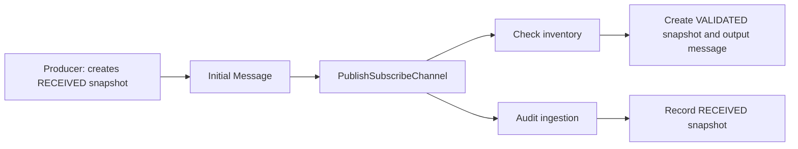

# Immutable Message

In the **Message** chapter of the **SPRING_INTEGRATION_CORE** module, immutability is the foundation for passing data between endpoints without one processing step accidentally modifying another step's input. When designing flows across MessageChannel, gateways, and the Java DSL, you must distinguish the immutability of the message envelope from the immutability of the inner data.

This lesson uses an order-processing scenario to explain that boundary, how to build the next message, and how to keep data stable when a flow involves transformers, routers, filters, or multiple branches. Snippets using `record` require Java 17 or higher; Spring examples use APIs from `spring-integration-core` and `spring-messaging`, with versions managed by the project.

## 1. Learning Objectives

After this lesson, you will be able to:

- Explain accurately which parts of a standard message cannot be modified after initialization.
- Identify payloads and header values that remain mutable even while inside a message.
- Use `MessageBuilder` to modify output contents while preserving the input message.
- Design DTOs containing collections or arrays without exposing mutable data.
- Distinguish a message's ID from business identifiers and correlation info across the flow.
- Write tests demonstrating both envelope immutability and business data stability.

## 2. "Immutable" Starts with the Message Envelope

The `Message<T>` API provides two fundamental accessor methods: `getPayload()` and `getHeaders()`. The interface has no `setPayload(...)` or `setHeaders(...)` methods. The payload holds the data to be processed; headers hold metadata serving transport, routing, and message processing. See [Message API](https://docs.spring.io/spring-framework/docs/current/javadoc-api/org/springframework/messaging/Message.html).

For standard messages created via `GenericMessage` or the default builder, the usage model is:

```text
Message<OrderSnapshot>
├── payload ───────────► OrderSnapshot object
└── headers ───────────► MessageHeaders
                         ├── tenantId  ──► "shop-vn"
                         ├── traceId   ──► "trace-001"
                         └── ...
```

If an endpoint needs to change the payload or add a header, it builds an output message with the desired contents. The original message continues to represent that endpoint's input.

However, the arrows in the diagram are **object references**. Keeping a reference unchanged does not mean the referenced object automatically becomes immutable.

| Layer to Inspect | Guarantee with Standard Messages | Application's Responsibility |
| --- | --- | --- |
| Message envelope | Provides no message-level setter to swap payload/headers | Build an output message when contents must change |
| `MessageHeaders` structure | Cannot add, remove, or replace key-value pairs directly via the Map API | Use a builder or appropriate endpoint |
| Payload object | Not automatically frozen or deep-copied | Choose an immutable model or control write ownership |
| Object stored inside a header | Not automatically frozen or deep-copied | Avoid sharing mutable values across consumers |
| Objects nested inside payload/headers | Not automatically protected across the whole data tree | Inspect collections, elements, arrays, and external resources |

Distinguishing the envelope from inner data is core to Spring Integration's immutability contract. The official documentation also notes that multiple consumers may access the same payload or header value concurrently; the application decides whether those objects are immutable. See [Message in Spring Integration](https://docs.spring.io/spring-integration/reference/message.html).

## 3. Changing Headers by Building the Next Message

### 3.1. Direct Operations on MessageHeaders Are Rejected

The complete example below illustrates both the invalid operation and how to create an output:

```java
import org.springframework.integration.support.MessageBuilder;
import org.springframework.messaging.Message;

public class ImmutableMessageDemo {

    public static void main(String[] args) {
        Message<String> incoming = MessageBuilder
                .withPayload("order-001")
                .setHeader("stage", "RECEIVED")
                .build();

        try {
            incoming.getHeaders().put("stage", "VALIDATED");
        }
        catch (UnsupportedOperationException ex) {
            System.out.println("Cannot modify headers structure directly");
        }

        Message<String> outgoing = MessageBuilder
                .fromMessage(incoming)
                .setHeader("stage", "VALIDATED")
                .build();

        System.out.println(incoming.getHeaders().get("stage"));
        System.out.println(outgoing.getHeaders().get("stage"));
        System.out.println(incoming.getPayload());
        System.out.println(outgoing.getPayload());
    }
}
```

Expected output:

```text
Cannot modify headers structure directly
RECEIVED
VALIDATED
order-001
order-001
```

`MessageHeaders` implements `Map<String, Object>` to support lookups, yet mutating operations like `put`, `putAll`, `remove`, and `clear` throw `UnsupportedOperationException`. Do not infer mutability merely because a type implements `Map`. See [MessageHeaders API](https://docs.spring.io/spring-framework/docs/current/javadoc-api/org/springframework/messaging/MessageHeaders.html).

### 3.2. The Builder Is a Construction-Time Object

In the example, `setHeader(...)` changes the builder's configuration. It is not a setter on `incoming`.

`MessageBuilder.fromMessage(incoming)` takes the input's payload and uses its headers as the baseline for building the result. `withPayload(...)` starts from a specified payload. This lesson consistently uses `org.springframework.integration.support.MessageBuilder`; Spring Framework also has a same-named class in another package. See [Spring Integration MessageBuilder API](https://docs.spring.io/spring-integration/api/org/springframework/integration/support/MessageBuilder.html).

An easy habit to adopt is creating a builder scoped to a single processing step:

```java
public Message<?> markValidated(Message<?> incoming) {
    return MessageBuilder.fromMessage(incoming)
            .setHeader("validated", true)
            .removeHeader("validationHint")
            .build();
}
```

Do not place a shared builder in a singleton field for concurrent requests to mutate. Temporary state used to build a result should belong to that specific processing run.

## 4. An Immutable Message Can Still Hold Mutable Data

### 4.1. Two Different Messages Can Share One Payload

The snippet below intentionally uses `ArrayList` to expose the issue:

```java
import java.util.ArrayList;
import java.util.List;

import org.springframework.integration.support.MessageBuilder;
import org.springframework.messaging.Message;

public class SharedPayloadDemo {

    public static void main(String[] args) {
        List<String> items = new ArrayList<>(List.of("BOOK"));
        List<String> checks = new ArrayList<>(List.of("received"));

        Message<List<String>> original = MessageBuilder
                .withPayload(items)
                .setHeader("checks", checks)
                .build();

        Message<List<String>> branch = MessageBuilder
                .fromMessage(original)
                .setHeader("branch", "inventory")
                .build();

        System.out.println(original == branch);
        System.out.println(original.getPayload() == branch.getPayload());

        branch.getPayload().add("PEN");
        checks.add("inventory-checked");

        System.out.println(original.getPayload());
        System.out.println(original.getHeaders().get("checks"));
    }
}
```

Expected output:

```text
false
true
[BOOK, PEN]
[received, inventory-checked]
```

What happened in the example:

1. Adding the `branch` header gave the output message different metadata from the input.
2. Both messages still point to the same `items` instance.
3. Calling `add("PEN")` mutated the exact list serving as `original`'s payload.
4. The external `checks` variable also still points to the object used as the header value.

Neither `setPayload(...)` nor `headers.put(...)` was called in the last two mutations. The bug occurred through shared objects.

### 4.2. Copying a Map Does Not Mean Copying Its Values

With the `new GenericMessage<>(payload, headersMap)` constructor, the input map's entries are copied. Therefore, adding a key to `headersMap` afterward does not add that key to the message. However, if a map value is an `ArrayList`, copying the map structure does not deep-copy that list.

By contrast, the constructor taking `MessageHeaders` directly uses the exact headers instance passed in. Read the exact overload when evaluating data sharing. See [GenericMessage API](https://docs.spring.io/spring-framework/docs/current/javadoc-api/org/springframework/messaging/support/GenericMessage.html).

### 4.3. Data Types That Require Attention

| Data Placed in a Message | Situation Prone to Unintended Mutation | How to Design for That Situation |
| --- | --- | --- |
| `ArrayList` or `HashMap` | Producer keeps a reference and keeps updating it | Take a snapshot at the send boundary; protect elements too |
| DTO with setters | One branch mutates state on the input DTO | Return a new DTO or a branch-specific copy |
| `byte[]` | Code overwrites part of the buffer | Copy at ownership boundaries; do not expose internal arrays |
| `Date` or nested mutable objects | Getter returns a still-mutable object | Switch to an appropriate value type or defensive copy |
| Entity managed by an ORM | Entity state changes with transactions or other code | Convert data to be sent into a snapshot DTO |
| `File`, `Path`, or `InputStream` | Off-heap content changes; stream is read or closed | Define lifecycle, access rights, and what content must be captured |

A `Path` can be a stable value object while the file content at that path continues to change. "Snapshot of the resource name" and "snapshot of the resource data" are two different requirements.

## 5. Designing an Order Payload as a Snapshot

### 5.1. Records Do Not Automatically Protect Collections

Java describes `record` as a shallowly immutable data carrier. When a component is a reference to a collection, that collection still needs appropriate handling. A compact constructor can validate data and perform defensive copies. See [Record API](https://docs.oracle.com/en/java/javase/17/docs/api/java.base/java/lang/Record.html).

Therefore, writing only:

```java
record UnsafeOrder(String orderId, List<String> items) {
}
```

is not enough to guarantee `items` will not change. The caller creating the record can still retain the original list and call `add(...)`.

### 5.2. Snapshot Model for the Running Example

Place the following in `OrderSnapshot.java` during practice:

```java
import java.util.List;
import java.util.Objects;

public record OrderSnapshot(
        String orderId,
        List<Line> lines,
        String status) {

    public OrderSnapshot {
        orderId = Objects.requireNonNull(orderId, "orderId");
        lines = List.copyOf(Objects.requireNonNull(lines, "lines"));
        status = Objects.requireNonNull(status, "status");
    }

    public OrderSnapshot withStatus(String nextStatus) {
        return new OrderSnapshot(orderId, lines, nextStatus);
    }

    public record Line(String sku, int quantity) {

        public Line {
            sku = Objects.requireNonNull(sku, "sku");
            if (quantity <= 0) {
                throw new IllegalArgumentException("quantity must be greater than 0");
            }
        }
    }
}
```

This model fits the example because:

- `orderId` and `status` are `String`s.
- `Line` contains only `String` and `int`.
- `lines` is converted into a list that forbids adding, removing, or replacing elements.
- `withStatus(...)` creates another snapshot rather than mutating the input snapshot.

`List.copyOf(...)` rejects `null` elements and does not deep-copy elements. If `Line` were replaced by a class with setters, the model would need to be re-evaluated. Moreover, `Collections.unmodifiableList(source)` is a view that blocks modification through the view yet still reflects changes made to `source`; do not use it as an independent snapshot of an input collection. See [List and unmodifiable lists](https://docs.oracle.com/en/java/javase/17/docs/api/java.base/java/util/List.html).

Usage example:

```java
List<OrderSnapshot.Line> draftLines = new ArrayList<>();
draftLines.add(new OrderSnapshot.Line("BOOK", 1));

OrderSnapshot received =
        new OrderSnapshot("order-001", draftLines, "RECEIVED");

draftLines.add(new OrderSnapshot.Line("PEN", 2));

OrderSnapshot validated = received.withStatus("VALIDATED");

System.out.println(received.lines().size()); // 1
System.out.println(received.status());       // RECEIVED
System.out.println(validated.status());      // VALIDATED
```

This usage snippet requires importing `java.util.ArrayList` and `java.util.List`. While the constructor runs, the caller must ensure the input list is not being concurrently mutated by another thread; a defensive copy cannot turn a racy read into a consistent snapshot.

### 5.3. For Arrays, Protect Both Input and Output

If a payload needs to hold binary data, wrap the array in a type with a clear contract:

```java
import java.util.Objects;

public final class BinarySnapshot {

    private final byte[] bytes;

    public BinarySnapshot(byte[] bytes) {
        this.bytes = Objects.requireNonNull(bytes, "bytes").clone();
    }

    public byte[] bytes() {
        return bytes.clone();
    }
}
```

Copying in the constructor prevents the caller from mutating the passed-in array. Copying in the getter prevents consumers from obtaining the internal array to overwrite it. Copying in only one of the two places leaves one access direction exposed.

This is a choice for requirements that need a binary snapshot. For large data or streaming, design lifecycle and ownership explicitly to avoid excessive copying.

## 6. Two Ways to Build Output Messages

The examples in this section use `OrderSnapshot` from section 5, `Message` and `MessageBuilder` introduced earlier, and `java.util.List`.

### 6.1. Keep the Payload, Change Metadata

```java
Message<OrderSnapshot> received = MessageBuilder
        .withPayload(new OrderSnapshot(
                "order-001",
                List.of(new OrderSnapshot.Line("BOOK", 1)),
                "RECEIVED"))
        .setHeader("tenantId", "shop-vn")
        .setHeader("traceId", "trace-001")
        .build();

Message<OrderSnapshot> routed = MessageBuilder
        .fromMessage(received)
        .setHeader("route", "inventory")
        .build();
```

`routed` has the `route` header, while `received` does not. Both messages share the payload snapshot, which is safe because the example's data model does not allow mutating that snapshot.

### 6.2. Change the Payload, Keep Required Metadata

```java
OrderSnapshot nextPayload =
        received.getPayload().withStatus("VALIDATED");

Message<OrderSnapshot> validated = MessageBuilder
        .withPayload(nextPayload)
        .copyHeaders(received.getHeaders())
        .setHeader("validatedBy", "order-validator")
        .build();
```

After this step:

```text
received
  payload.status = RECEIVED
  tenantId       = shop-vn
  traceId        = trace-001

validated
  payload.status = VALIDATED
  tenantId       = shop-vn
  traceId        = trace-001
  validatedBy    = order-validator
```

Choose `fromMessage(...)` when you want to keep the payload; choose `withPayload(...)` when there is a different output payload. Both approaches must account for which metadata needs to be retained.

In a request-reply flow through a gateway, control headers like `replyChannel` or `errorChannel` may need to be preserved. Calling `new GenericMessage<>(nextPayload)` manually while forgetting metadata can cause downstream steps to lose reply or error-handling information.

At boundaries sending to external systems, identify protocol headers and the boundary's transmission policy. Do not treat copying all headers in an internal example as a default rule for every outbound adapter.

### 6.3. Build Is Not a Deep-Copy Command

Do not use the following snippet to request a deep copy:

```java
Message<?> candidate = MessageBuilder.fromMessage(received).build();
```

The builder may return the original message if nothing changed and the implementation's reuse conditions are met. Even when a new message is produced, the payload is not cloned because of that. The `build()` documentation describes this reuse behavior. See [BaseMessageBuilder API](https://docs.spring.io/spring-integration/api/org/springframework/integration/support/BaseMessageBuilder.html#build()).

A requirement that "each branch owns its own mutable object" must be solved by application-level copying or data transformation logic.

## 7. Message ID and Business Identifiers

An order can pass through many different messages. Therefore, do not use the envelope's ID in place of the order's identifier.

| Value | Meaning in the Example Design |
| --- | --- |
| `MessageHeaders.ID` | Technical identifier of the created message |
| `MessageHeaders.TIMESTAMP` | Creation time of the message per the framework's mechanism |
| `orderId` in payload | Order identifier across processing steps |
| `traceId` in header | Value proactively propagated by the application to trace a flow |
| `eventId` if the model needs it | Identifier of a business event, per an application-designed contract |

With the default builder and normal message creation, `id` and `timestamp` are managed by the framework; they are not copied like ordinary business headers. Do not reassign them manually to pretend every step is the same message. You can read more about read-only header rules in [the Message documentation](https://docs.spring.io/spring-integration/reference/message.html#message-headers).

Two messages created very close together can have the exact same timestamp at millisecond resolution. Do not write tests requiring the output timestamp to be strictly greater than the input timestamp.

When duplicate prevention is needed, choose a key by business meaning, such as an `eventId` kept stable across retries. Rebuilding a message can generate a different technical ID while still processing the same event.

The `correlationId` header in splitter/aggregator patterns also carries message-grouping semantics. An application's tracing needs are not a reason to arbitrarily overwrite the correlation key used by the grouping mechanism.

## 8. Why Do Multiple Branches Make the Problem Clearer?

Suppose an order-ingestion event is sent to both an inventory-check branch and an audit-trail branch:



`PublishSubscribeChannel` distributes messages to subscribers. When using an executor, processing can happen asynchronously. See [MessageChannel implementations](https://docs.spring.io/spring-integration/reference/channel/implementations.html#channel-publishsubscribechannel).

The desired design in the example is for the audit-trail branch to record the exact data that was ingested, regardless of whether the inventory branch runs before or after it.

If the inventory branch calls a setter on a shared payload, the audit branch may observe the status already changed to `VALIDATED`. Even when running sequentially on a single thread, the outcome can still depend on subscriber order. With multiple threads, read/write races also appear.

Creating another envelope for each branch does not solve the problem if every envelope still points to the same mutable object. Conversely, multiple branches can share an immutable snapshot without copying the entire data structure for every read.

Immutability stabilizes observed data. It does not by itself guarantee completion order, atomicity of database writes, or that a side effect happens only once. Those requirements still need their own design.

## 9. Applying It in the Java DSL

### 9.1. Transformer Returning a New Payload

The following configuration example uses `OrderSnapshot` from section 5 and sends the result into a queue for observation. Place the classes in the same package when practicing:

```java
import org.springframework.context.annotation.Bean;
import org.springframework.context.annotation.Configuration;
import org.springframework.integration.channel.QueueChannel;
import org.springframework.integration.config.EnableIntegration;
import org.springframework.integration.dsl.IntegrationFlow;

@Configuration
@EnableIntegration
public class ImmutableOrderFlowConfiguration {

    @Bean(name = "orders.output")
    public QueueChannel ordersOutput() {
        return new QueueChannel(10);
    }

    @Bean
    public IntegrationFlow immutableOrderFlow() {
        return IntegrationFlow.from("orders.input")
                .<OrderSnapshot, OrderSnapshot>transform(
                        order -> order.withStatus("VALIDATED"))
                .enrichHeaders(headers ->
                        headers.header("validatedBy", "order-validator"))
                .channel("orders.output")
                .get();
    }
}
```

`orders.input` is the input channel referenced by name in the DSL. After loading the configuration into a Spring context, send a `Message<OrderSnapshot>` to this channel and read the result from `orders.output` to observe the flow.

In the example, the transformer receives a payload and returns another `OrderSnapshot`. The header enricher adds metadata to the output; no step needs to mutate the incoming message's headers directly. The Java DSL uses `IntegrationFlow` to represent endpoints and channels; `transform(...)` represents a transformer endpoint. See [Java DSL](https://docs.spring.io/spring-integration/reference/dsl.html) and [Transformer](https://docs.spring.io/spring-integration/reference/transformer.html).

Do not apply the following style when `MutableOrder` is a DTO with setters:

```java
// Example to avoid in a shared-input flow.
.transform(MutableOrder.class, order -> {
    order.setStatus("VALIDATED");
    return order;
})
```

Even though the endpoint creates an output envelope, the setter call modified an object that other parties may still be holding.

### 9.2. Relationship with the Remaining Endpoints

| Component | How to Apply Snapshot Thinking |
| --- | --- |
| Transformer | Compute a result from the input and return an output payload or message |
| Router | Read data to choose a path; avoid mutating the payload while deciding |
| Filter | Read data to decide acceptance; avoid hiding side effects in the predicate |
| Aggregator | Build an aggregated result from inputs; avoid mutating component snapshots directly |
| Gateway | Transfer data across the flow boundary with a clear payload and metadata contract |
| Error-handling flow | Keep input data stable enough for diagnosis or creating a retry request |

This table describes design choices for application logic, not a claim that every endpoint always creates a new message.

If an error handler holds only a reference to a mutable payload, data logged later may differ from the data at the moment the error occurred. When investigation or replay is needed, specify which data must be a snapshot and when that snapshot is created.

## 10. Testing the Important Guarantees

The following JUnit Jupiter example uses the lesson's `OrderSnapshot` model. This is illustrative code for learners to practice in a project with JUnit; it does not need to spin up a Spring context to demonstrate the data contract.

```java
import java.util.ArrayList;
import java.util.List;

import org.junit.jupiter.api.Test;
import org.springframework.integration.support.MessageBuilder;
import org.springframework.messaging.Message;

import static org.junit.jupiter.api.Assertions.*;

class ImmutableOrderMessageTest {

    @Test
    void changingOutputHeadersKeepsInputUnchanged() {
        OrderSnapshot order = new OrderSnapshot(
                "order-001",
                List.of(new OrderSnapshot.Line("BOOK", 1)),
                "RECEIVED");

        Message<OrderSnapshot> input = MessageBuilder
                .withPayload(order)
                .setHeader("stage", "RECEIVED")
                .setHeader("traceId", "trace-001")
                .build();

        Message<OrderSnapshot> output = MessageBuilder
                .fromMessage(input)
                .setHeader("stage", "VALIDATED")
                .build();

        assertNotSame(input, output);
        assertSame(input.getPayload(), output.getPayload());
        assertEquals("RECEIVED", input.getHeaders().get("stage"));
        assertEquals("VALIDATED", output.getHeaders().get("stage"));
        assertEquals("trace-001", output.getHeaders().get("traceId"));

        assertThrows(
                UnsupportedOperationException.class,
                () -> input.getHeaders().put("stage", "BROKEN"));
    }

    @Test
    void orderSnapshotDoesNotExposeTheOriginalList() {
        List<OrderSnapshot.Line> draft = new ArrayList<>();
        draft.add(new OrderSnapshot.Line("BOOK", 1));

        OrderSnapshot input =
                new OrderSnapshot("order-001", draft, "RECEIVED");

        draft.add(new OrderSnapshot.Line("PEN", 2));

        OrderSnapshot output = input.withStatus("VALIDATED");

        assertEquals(1, input.lines().size());
        assertEquals("RECEIVED", input.status());
        assertEquals("VALIDATED", output.status());
        assertEquals(input.lines(), output.lines());

        assertThrows(
                UnsupportedOperationException.class,
                () -> input.lines().add(new OrderSnapshot.Line("ERASER", 1)));
    }
}
```

The two tests answer two distinct questions: does the envelope keep the input stable when metadata changes, and does the payload model isolate itself from mutations to the source collection.

For a real flow, you can add a test sending a message via `orders.input`, receiving at `orders.output` with a finite timeout, and checking the payload and business metadata. For parallel branches, use test synchronization mechanisms when ordering needs control; avoid relying on `Thread.sleep(...)` to prove there is no unintended shared mutable data.

## 11. Limitations and Practical Choices

### 11.1. The Message Interface Does Not Lock Down Every Implementation

Do not interpret "Immutable Message" as a Java language guarantee across every class implementing `Message`.

Spring Integration has `MutableMessage` for special cases where the message or headers can be modified after creation. That type demands strict control over sharing across components, threads, or in-memory message stores. For standard flows in this lesson, use the default immutable message. See [MutableMessage API](https://docs.spring.io/spring-integration/api/org/springframework/integration/support/MutableMessage.html).

Similarly, infrastructure-oriented accessor APIs or custom implementations are not an excuse for business code to break contracts that other endpoints rely on.

### 11.2. No Need to Deep-Copy Everything at Every Step

One strategy for an order flow is:

1. At the data ingestion boundary, convert still-mutable data into an appropriate snapshot.
2. Let read-only steps share that snapshot.
3. When business state changes, create an output snapshot.
4. When having to call a library requiring mutable data, create separate data for that call.
5. Before broadcasting results to other consumers, re-establish the data ownership contract.

This focuses copying where it matters. Creating a new message to add a small header does not require cloning an entire large payload that is already immutable.

If data cannot be copied conveniently, such as a single-read stream, the design must clearly specify which consumer owns reading and closing the stream. Do not treat the ability to place a stream inside a message as a guarantee that multiple branches can read it independently.

## 12. Misconceptions to Avoid

| Misconception | What to Re-Examine |
| --- | --- |
| "There are no setters so inner data definitely cannot change" | Whether getters expose mutable objects |
| "The header map is unmodifiable so all header values are safe" | Whether values are lists, maps, or DTOs that still have setters |
| "`fromMessage` clones the entire message" | Whether payload and header values still share references |
| "`record` automatically provides deep immutability" | Whether components contain collections, arrays, or mutable objects |
| "Each subscriber having its own envelope is enough" | Whether the envelopes all point to the same mutable data |
| "Every endpoint must always create a new message" | Whether the endpoint actually changes contents or just forwards/reads data |
| "Message ID is the order ID" | Whether a technical identifier is being misused as a business key |
| "Immutability solves all multithreading issues" | Whether state outside messages and side effects are controlled |

When designing a processing step, clearly identify the inputs it may read, the temporary data it owns, and the new results it emits. With Spring Integration, keeping the envelope immutable is the starting point; keeping payloads and metadata stable according to the business contract is what makes integration flows predictable and testable.
