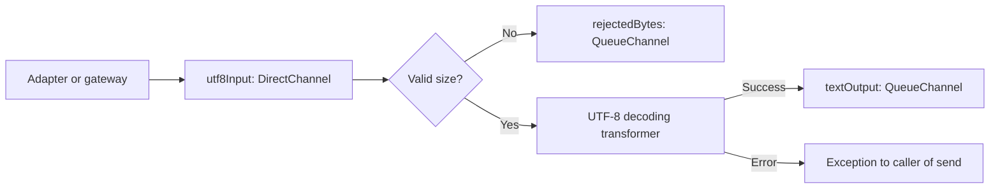

# Message with Byte Array

In Spring Integration Core, `Message<byte[]>` represents a message whose payload is a byte array. This data type commonly appears at integration boundaries: data read from a file, content received from another system, binary documents, or undecoded text. Channels transport the message, while endpoints decide how to inspect, convert, or process those bytes.

This lesson belongs to the **Message** chapter and focuses on how to create and use `Message<byte[]>` in a Spring Integration flow. After learning it, you will be able to:

- Create messages containing a byte array and declare necessary metadata using headers.
- Distinguish bytes from text, choose an explicit charset, and handle invalidly encoded data.
- Avoid unintended mutations when multiple components hold references to the same array.
- Build and test a Java DSL flow consisting of channels, a filter, and a transformer for byte data.

## 1. A Byte Array Describes How Data Is Stored, Not What It Means

`Message<T>` has two main parts: a payload of type `T` and a set of headers. With `Message<byte[]>`, `T` is the primitive array type `byte[]`; each element stores one byte. Headers add information such as content type, sending source, or request ID. This is the payload and metadata model of [Message in Spring Integration](https://docs.spring.io/spring-integration/reference/message.html).

For example, two messages both have a `byte[]` payload yet carry different meanings:

| Actual Payload | Information Needed | Appropriate Handling |
| --- | --- | --- |
| UTF-8 encoded Vietnamese text | Charset and text type | Decode to `String` before processing content |
| UTF-8 JSON content | Charset, JSON format, data contract | Decode and parse with an appropriate JSON processor |
| PNG image | Content type or file format | Keep bytes or pass to an image-reading library |
| GZIP data | Compression algorithm and post-decompression format | Decompress first, then interpret content |
| Partner-specific binary message | Field layout, lengths, byte order | Read according to protocol specification |

Declaring `Message<byte[]>` does not prove the inner data is UTF-8, JSON, an image, or Java-serialized data. Those facts must live in the contract between producer and consumer.

The following types are not interchangeable either:

| Payload Type | Characteristics |
| --- | --- |
| `byte[]` | A primitive byte array already present in memory |
| `Byte[]` | Array of wrapper objects; may contain `null` elements |
| `String` | Text already represented as Java characters |
| `ByteBuffer` | Buffer carrying state such as position and limit |
| `InputStream` | Data source that must be read, with lifecycle and consumption state |

A consumer expecting `byte[]` must be designed for that type. When converting from another type, use an explicit conversion step rather than assuming a channel automatically reads streams, unwraps `Byte[]`, or decodes text.

## 2. Creating `Message<byte[]>` and Setting Headers

### 2.1. Creating a Minimal Message

`GenericMessage` is suitable when you only need to wrap a payload:

```java
import java.nio.charset.StandardCharsets;

import org.springframework.messaging.Message;
import org.springframework.messaging.support.GenericMessage;

byte[] body = "New order".getBytes(StandardCharsets.UTF_8);
Message<byte[]> message = new GenericMessage<>(body);

int byteCount = message.getPayload().length;
```

The short snippets in this lesson can be placed inside a Java method. Two complete classes in the Java DSL and testing sections are presented separately below.

The payload of `GenericMessage` must be non-`null`. An empty array `new byte[0]` is still a structurally valid payload; the application decides whether to accept it. Constructor contracts are described in the [GenericMessage Javadoc](https://docs.spring.io/spring-framework/docs/current/javadoc-api/org/springframework/messaging/support/GenericMessage.html).

### 2.2. Using a Builder When Metadata Is Needed

```java
import java.nio.charset.StandardCharsets;

import org.springframework.messaging.Message;
import org.springframework.messaging.MessageHeaders;
import org.springframework.messaging.support.MessageBuilder;

byte[] receivedBytes = "New order".getBytes(StandardCharsets.UTF_8);

Message<byte[]> message = MessageBuilder
        .withPayload(receivedBytes.clone())
        .setHeader(MessageHeaders.CONTENT_TYPE, "text/plain;charset=UTF-8")
        .setHeader("sourceSystem", "order-service")
        .setHeader("requestId", "REQ-2026-001")
        .build();

String requestId = message.getHeaders().get("requestId", String.class);
Object contentType = message.getHeaders().get(MessageHeaders.CONTENT_TYPE);
```

Here, `contentType` is set as a string to keep the example simple and consistent. In another application, this header value might be an object representing a MIME type; consumers must follow the header's type contract and avoid arbitrarily casting every value to `String`.

`requestId` and `sourceSystem` are application-defined headers. Setting a header does not convert the payload: the string `text/plain;charset=UTF-8` only declares how the sender interprets the data. A transformer must still actually decode the byte array.

`MessageHeaders.ID` identifies a message instance, not a payload checksum or a durable business key. When needing to track a request across multiple transformations, use an application-managed business ID or `requestId`.

## 3. Structurally Immutable Message, Yet the Byte Array Can Still Be Mutated

There is no `setPayload()` method on `Message`, yet the object referenced by the payload can still be mutable. With a byte array, modifying an array element changes the data observed by consumers:

```java
byte[] shared = new byte[] {65, 66}; // Two ASCII bytes: A, B.
Message<byte[]> message = new GenericMessage<>(shared);

shared[0] = 90; // Change A to Z.

System.out.println(message.getPayload()[0]); // 90
System.out.println(message.getPayload() == shared); // true
```

This mutates the contents of the same array, not the message's payload reference. The [Message documentation](https://docs.spring.io/spring-integration/reference/message.html) clearly distinguishes structural message immutability from mutability of the payload and header values.

### 3.1. Copying at Data Ownership Boundaries

If the caller might reuse or modify a buffer after sending, create a copy before wrapping it in a message:

```java
Message<byte[]> snapshot = MessageBuilder
        .withPayload(shared.clone())
        .setHeader("requestId", "REQ-SNAPSHOT")
        .build();

shared[0] = 88;
// snapshot still preserves contents at clone() time, provided no one mutates its payload.
```

`clone()` suffices to copy the entire contents of a `byte[]` because elements are primitive values. However, a consumer could still call `snapshot.getPayload()[0] = ...`. Copying establishes independence from the source array; the convention not to mutate payloads after handover still needs to be followed.

If an endpoint must transform an array, create a result array rather than mutating the input array in place:

```java
byte[] changed = message.getPayload().clone();
changed[0] = 67;

Message<byte[]> result = MessageBuilder
        .withPayload(changed)
        .copyHeaders(message.getHeaders())
        .setHeader("processingStep", "replace-first-byte")
        .build();
```

This example assumes a non-empty payload. Real processing code must verify that condition before accessing the first element.

### 3.2. Copying a Message Does Not Mean Deep-Copying the Payload

`MessageBuilder.fromMessage(message)` builds a message based on an existing message. Do not treat this call as an automatic request to clone the byte array. Similarly, copying headers does not deep-copy mutable objects stored inside headers.

A useful working rule is: the producer hands over stable data; endpoints read input data; an endpoint needing changes produces new output data. This rule is especially necessary when there is asynchronous processing or multiple branches receiving the same data. Even a synchronous flow can be affected if an endpoint mutates an array and a subsequent endpoint or retry logic reuses that array.

## 4. Converting Between Bytes and Text with an Explicit Charset

### 4.1. Encoding and Decoding Are Two Opposite Directions

```java
String original = "Chào";

// Encoding: text -> bytes.
byte[] encoded = original.getBytes(StandardCharsets.UTF_8);

// Decoding: bytes -> text.
String decoded = new String(encoded, StandardCharsets.UTF_8);

System.out.println(original.length()); // 4 UTF-16 code units in this example.
System.out.println(encoded.length);    // 5 UTF-8 bytes.
System.out.println(decoded);           // Chào
```

`String` length and byte count after encoding measure two different things. `String.length()` counts UTF-16 code units; it does not even always equal the number of user-perceived characters. When limiting binary message size, check `payload.length`. These API semantics are described in the [String Javadoc](https://docs.oracle.com/en/java/javase/21/docs/api/java.base/java/lang/String.html).

Use overloads taking a `Charset` or charset name rather than relying on the default charset. If the partner sends UTF-8, the receiver decodes UTF-8; picking a charset based on the host machine cannot substitute for this contract.

### 4.2. Conversions Often Confused

```java
byte[] bytes = "Chào".getBytes(StandardCharsets.UTF_8);

String wrong = bytes.toString();
// Form like [B@..., not text content.

String right = new String(bytes, StandardCharsets.UTF_8);
```

`Arrays.toString(bytes)` lets you inspect numeric values in the array; it does not decode text. Base64, meanwhile, is a text representation capable of recovering the original bytes, used when the receiver requires binary data to pass through a text field:

```java
import java.util.Base64;

String base64 = Base64.getEncoder().encodeToString(bytes);
byte[] restored = Base64.getDecoder().decode(base64);
```

Base64 does not identify the charset of the original content, does not parse JSON, and is not security encryption. Do not add a Base64 step when both sides can transmit raw bytes directly; it inflates size and adds conversion work.

### 4.3. Choosing a Policy for Invalid Bytes

`new String(bytes, StandardCharsets.UTF_8)` replaces invalid byte sequences with replacement characters per this constructor's behavior. Therefore, producing a `String` does not prove the input data was valid UTF-8. See the `Charset`-accepting constructor contract in the [String Javadoc](https://docs.oracle.com/en/java/javase/21/docs/api/java.base/java/lang/String.html).

If corrupted data must not be accepted, use `CharsetDecoder` with `CodingErrorAction.REPORT`. The Java DSL section below implements this choice. A decoder is created per conversion because `CharsetDecoder` is not thread-safe across concurrent threads, per the [CharsetDecoder Javadoc](https://docs.oracle.com/en/java/javase/21/docs/api/java.base/java/nio/charset/CharsetDecoder.html).

Spring Integration also has `ObjectToStringTransformer`: for a `byte[]` payload, this transformer decodes the content using the configured charset. You can use `new ObjectToStringTransformer("UTF-8")` inside `.transform(...)` when that conversion behavior fits. This built-in transformer does not replace the strict UTF-8 validation requirement in the example below. See [ObjectToStringTransformer](https://docs.spring.io/spring-integration/api/org/springframework/integration/transformer/ObjectToStringTransformer.html).

## 5. Java DSL Flow: Receive Bytes, Filter Size, Decode UTF-8

### 5.1. Contract of the Example Flow

Suppose an adapter or gateway sends UTF-8 text into channel `utf8Input`. The flow's contract is:

- Input payload is `byte[]`, containing one complete UTF-8 text message.
- Accepted length is from 1 to 65,536 bytes, i.e., at most 64 KiB.
- Empty or oversized arrays go to `rejectedBytes` and retain payload type `byte[]`.
- Correctly sized data that is invalid UTF-8 causes a decoding error.
- Valid data is converted into a `String` payload and placed into `textOutput`.



This is a flow for agreed UTF-8 text. It does not auto-detect images, compressed data, or a partner's charset. If multiple formats share an entry point, classify them before the decoding step.

### 5.2. Complete Configuration

The example uses the Java DSL API of Spring Integration 6 or higher. Libraries `spring-integration-core` and `spring-context` are required; choose a JDK and Spring version compatible with your project. When using Spring Boot, manage library versions via Boot's BOM instead of mixing Spring versions arbitrarily.

Place the illustrative configuration class in `example/integration/ByteMessageConfiguration.java`:

```java
package example.integration;

import java.nio.ByteBuffer;
import java.nio.charset.CharacterCodingException;
import java.nio.charset.CodingErrorAction;
import java.nio.charset.StandardCharsets;

import org.springframework.context.annotation.Bean;
import org.springframework.context.annotation.Configuration;
import org.springframework.integration.channel.DirectChannel;
import org.springframework.integration.channel.QueueChannel;
import org.springframework.integration.config.EnableIntegration;
import org.springframework.integration.dsl.IntegrationFlow;

@Configuration
@EnableIntegration
public class ByteMessageConfiguration {

    static final int MAX_BYTES = 64 * 1024;

    @Bean
    public DirectChannel utf8Input() {
        return new DirectChannel();
    }

    @Bean
    public QueueChannel textOutput() {
        return new QueueChannel(10);
    }

    @Bean
    public QueueChannel rejectedBytes() {
        return new QueueChannel(10);
    }

    @Bean
    public IntegrationFlow utf8TextFlow() {
        return IntegrationFlow.from("utf8Input")
                .filter(byte[].class,
                        bytes -> bytes.length > 0
                                && bytes.length <= MAX_BYTES,
                        endpoint -> endpoint.discardChannel("rejectedBytes"))
                .transform(byte[].class,
                        ByteMessageConfiguration::decodeUtf8)
                .channel("textOutput")
                .get();
    }

    private static String decodeUtf8(byte[] bytes) {
        try {
            return StandardCharsets.UTF_8.newDecoder()
                    .onMalformedInput(CodingErrorAction.REPORT)
                    .onUnmappableCharacter(CodingErrorAction.REPORT)
                    .decode(ByteBuffer.wrap(bytes))
                    .toString();
        }
        catch (CharacterCodingException ex) {
            throw new IllegalArgumentException(
                    "Payload is not valid UTF-8 text", ex);
        }
    }
}
```

`@EnableIntegration` initializes the required infrastructure when using plain Spring configuration. Both `QueueChannel`s are bounded to 10 messages so the example does not accumulate unboundedly. In this lesson, caller or test code reads directly from them; no background endpoint consumes the two queues yet.

### 5.3. Understanding How Each Step Changes the Message

| Step | Incoming Payload | Result |
| --- | --- | --- |
| `utf8Input` | `byte[]` | Delivers message to consumer on the sending thread |
| Size filter | `byte[]` | Passes along or routes original message to discard channel |
| UTF-8 transformer | `byte[]` | Produces `String` payload result or throws an exception |
| `textOutput` | `String` | Holds result message for receiver to pull |

Overloads taking `byte[].class` declare the payload type processed by the lambda. If you want to handle the whole message to read headers, choose an overload for `Message` rather than assuming the lambda parameter defaults to a message. How the Java DSL binds lambdas and endpoints is explained in [DSL Basics](https://docs.spring.io/spring-integration/reference/dsl/java-basics.html).

The transformer returns `String`, so Spring Integration builds the output message and propagates application headers per transformer mechanics. This example relies on that to preserve `requestId`. If returning a custom `Message`, explicitly decide its headers per [transformer rules](https://docs.spring.io/spring-integration/reference/transformer.html).

When the payload changes, check metadata semantics too. Headers such as the byte length of the current payload or a payload checksum may no longer hold true after conversion. If needing to keep the original length, name it to reflect input byte count, such as `originalByteLength`, rather than a name easily mistaken for current data length.

### 5.4. Sending a Message and Reading the Result

The snippet below illustrates caller code once a Spring context contains the configuration above:

```java
MessageChannel input = context.getBean("utf8Input", MessageChannel.class);
QueueChannel output = context.getBean("textOutput", QueueChannel.class);

Message<byte[]> request = MessageBuilder
        .withPayload("Hello from Spring Integration"
                .getBytes(StandardCharsets.UTF_8))
        .setHeader(MessageHeaders.CONTENT_TYPE, "text/plain;charset=UTF-8")
        .setHeader("requestId", "REQ-001")
        .build();

input.send(request);

Message<?> response = output.receive(1_000);
if (response == null) {
    throw new IllegalStateException("No result within timeout");
}

String text = (String) response.getPayload();
String requestId = response.getHeaders().get("requestId", String.class);
```

`MessageChannel` is in `org.springframework.messaging`; the remaining imports correspond to the builder and configuration examples above. The test class in a later section shows full context initialization.

The flow puts results into a fixed queue, so `response` is retrieved manually here. If replaced with a request/reply gateway returning `String`, design a reply path suitable for the gateway; do not expect the gateway to automatically receive from this fixed queue. A `void`-returning gateway can act as a one-way entry point, though the application must still consume the result queues.

## 6. Distinguishing Rejection, Decoding Errors, and Transport Errors

### 6.1. Filter Rejection Is Not Transformer Failure

The filter in the example only checks size. When the condition fails, `discardChannel("rejectedBytes")` receives the rejected message. This is a branch for handling rule-violating data, not an `ErrorMessage`.

If rejection needs to be treated as an exception, configure `throwExceptionOnRejection(true)` per the flow's policy. Clearly decide whether the caller receives an error or a consumer processes rejected data. These options are described in [Filter](https://docs.spring.io/spring-integration/reference/filter.html).

### 6.2. `DirectChannel` Keeps Errors on the Synchronous Call Path

`utf8Input` is a `DirectChannel`, so steps before the output queue run on the thread calling `send()`. Decoding errors can be wrapped by the framework in `MessagingException` and propagated back to the caller. An `errorChannel` header does not automatically turn every exception of a synchronous `send()` call into a dispatched error message.

When using `ExecutorChannel` or a polled queue consumer, errors occur on the processing thread and require corresponding error-handling configuration. In the framework's error-publishing mechanism, the payload of `ErrorMessage` is a `Throwable`, not a byte array. Details on synchronous vs. asynchronous error handling are in [Error Handling](https://docs.spring.io/spring-integration/reference/error-handling.html).

| Scenario in the Example | Where to Observe |
| --- | --- |
| Empty array | `rejectedBytes` |
| Array longer than 64 KiB | `rejectedBytes` |
| Invalid UTF-8 byte sequence, valid size | Exception at caller of `input.send(...)` |
| Valid UTF-8 bytes | Message with `String` payload at `textOutput` |
| Output queue or discard queue full | Sending may block per send step's timeout config |

`send()` returning `true` is not a certification of business success. With a filter, a message accepted and routed to the discard channel can still cause the send call to succeed. With a queue, a successful send may only mean the message was enqueued.

UTF-8 errors and size violations are data errors. Resending those exact bytes usually yields the same outcome; retrying helps only when the cause can change, such as an external resource being temporarily unavailable.

## 7. Testing Byte Array Flow Behavior

The following tests use JUnit 5, plain Spring configuration, and in-process queues. Add `junit-jupiter` in test scope; no broker, external file, or `Thread.sleep()` is needed for this synchronous flow.

Place the illustrative class in the same package as the configuration, at `example/integration/ByteMessageFlowTest.java` in test sources:

```java
package example.integration;

import java.nio.charset.CharacterCodingException;
import java.nio.charset.StandardCharsets;

import org.junit.jupiter.api.AfterEach;
import org.junit.jupiter.api.BeforeEach;
import org.junit.jupiter.api.Test;
import org.springframework.context.annotation.AnnotationConfigApplicationContext;
import org.springframework.integration.channel.QueueChannel;
import org.springframework.messaging.Message;
import org.springframework.messaging.MessageChannel;
import org.springframework.messaging.MessageHeaders;
import org.springframework.messaging.MessagingException;
import org.springframework.messaging.support.GenericMessage;
import org.springframework.messaging.support.MessageBuilder;

import static org.junit.jupiter.api.Assertions.*;

class ByteMessageFlowTest {

    private AnnotationConfigApplicationContext context;
    private MessageChannel input;
    private QueueChannel output;
    private QueueChannel rejected;

    @BeforeEach
    void setUp() {
        context = new AnnotationConfigApplicationContext(
                ByteMessageConfiguration.class);
        input = context.getBean("utf8Input", MessageChannel.class);
        output = context.getBean("textOutput", QueueChannel.class);
        rejected = context.getBean("rejectedBytes", QueueChannel.class);
    }

    @AfterEach
    void tearDown() {
        if (context != null) {
            context.close();
        }
    }

    @Test
    void decodesVietnameseTextAndPreservesApplicationHeaders() {
        String expected = "Đơn hàng đã được tiếp nhận";
        Message<byte[]> request = MessageBuilder
                .withPayload(expected.getBytes(StandardCharsets.UTF_8))
                .setHeader(MessageHeaders.CONTENT_TYPE,
                        "text/plain;charset=UTF-8")
                .setHeader("requestId", "REQ-001")
                .build();

        assertTrue(input.send(request));

        Message<?> result = output.receive(0);
        assertNotNull(result);
        assertInstanceOf(String.class, result.getPayload());
        assertEquals(expected, result.getPayload());
        assertEquals("REQ-001", result.getHeaders().get("requestId"));
        assertEquals("text/plain;charset=UTF-8",
                result.getHeaders().get(MessageHeaders.CONTENT_TYPE));
        assertNull(rejected.receive(0));
    }

    @Test
    void routesEmptyAndOversizedArraysToDiscardChannel() {
        byte[][] invalidSizes = {
                new byte[0],
                new byte[ByteMessageConfiguration.MAX_BYTES + 1]
        };

        for (byte[] bytes : invalidSizes) {
            assertTrue(input.send(new GenericMessage<>(bytes)));

            Message<?> discarded = rejected.receive(0);
            assertNotNull(discarded);
            assertInstanceOf(byte[].class, discarded.getPayload());
            assertArrayEquals(bytes, (byte[]) discarded.getPayload());
            assertNull(output.receive(0));
        }
    }

    @Test
    void reportsMalformedUtf8ToSynchronousCaller() {
        byte[] malformed = {(byte) 0xC3, (byte) 0x28};

        MessagingException failure = assertThrows(
                MessagingException.class,
                () -> input.send(new GenericMessage<>(malformed)));

        assertInstanceOf(CharacterCodingException.class, rootCause(failure));
        assertNull(output.receive(0));
        assertNull(rejected.receive(0));
    }

    @Test
    void boundaryCopyProtectsMessageFromSourceBufferChanges() {
        String expected = "Chào";
        byte[] source = expected.getBytes(StandardCharsets.UTF_8);
        Message<byte[]> snapshot = MessageBuilder
                .withPayload(source.clone())
                .build();

        source[0] = (byte) 'X';

        assertNotSame(source, snapshot.getPayload());
        assertTrue(input.send(snapshot));

        Message<?> result = output.receive(0);
        assertNotNull(result);
        assertEquals(expected, result.getPayload());
    }

    private static Throwable rootCause(Throwable failure) {
        Throwable current = failure;
        while (current.getCause() != null) {
            current = current.getCause();
        }
        return current;
    }
}
```

The tests verify four distinct requirements: Vietnamese text is preserved accurately; size rules have a discard path; malformed encoding raises an error; and a boundary copy is independent of the source buffer. Use `assertArrayEquals` when comparing array contents, because calling `equals()` directly on arrays does not compare byte by byte.

`receive(0)` retrieves a message without waiting. This works because the processing steps in the example complete synchronously before `send()` returns successfully. If changing the topology to asynchronous processing, wait with a bounded timeout or an appropriate test synchronization mechanism; do not keep assuming the message is already in the queue.

## 8. Binary Data Requires Processing Steps in the Right Order

The UTF-8 decoding flow above is just one case of `Message<byte[]>`. In a general flow, a router can select a consumer based on a validated content type or the sending source's protocol:

| Data Contract | Suggested Processing Chain |
| --- | --- |
| UTF-8 text | Size check → UTF-8 decode → text processing |
| UTF-8 JSON | Size check → configured JSON decode/parse → business validation |
| GZIPped UTF-8 text | Input check → bounded decompression → UTF-8 decode |
| Image or PDF | Size and format check → keep bytes or hand to suitable library |
| Structured binary data | Framing check → protocol parse → construct business object |

Sender-supplied headers are a declaration about the data; if the source is not sufficiently trusted, the consumer must validate contents against the respective format. Checking the compressed data size also does not bound the decompressed size, so both stages need separate limits.

If a system uses Java serialization, that process differs from `String.getBytes(...)`. Spring Integration has transformers for serialization, but they must be chosen per the format contract and data source; do not pass an arbitrary byte array directly into Java object deserialization. Restoring Java objects also requires allowlisted classes and a trusted data source. See transformation categories in [Transformer](https://docs.spring.io/spring-integration/reference/transformer.html).

## 9. Size, Queues, and Message Boundaries

### 9.1. `byte[]` Holds the Entire Payload in Memory

A message containing `byte[]` typically keeps the entire array on the heap. Cloning arrays, decoding to `String`, and other conversion steps can create additional copies coexisting for a time.

For example, a queue holding 200 messages of 5 MiB each already holds roughly 1,000 MiB just in byte arrays. That figure excludes headers, Java objects, and intermediate data. Therefore, consider per-message byte limits, queue capacity, and consumer throughput together.

A size filter inside the flow only controls which data proceeds; by the time the filter runs, the byte array has already been allocated. To limit memory at ingestion, enforce read or message-size limits at the adapter/protocol before assembling data into a large array. For large data, pass a resource reference or use streaming reads if the endpoint supports it and resource lifecycles are clearly managed.

The two queues in the example are illustrative buffers. If there is no reader and a queue fills up, the flow can block at the send step. In production, provide consumers, timeouts, and backpressure policies suited to processing requirements.

### 9.2. One Byte Read Is Not Necessarily One Complete Message

With stream-oriented protocols, the boundary of a single read does not necessarily match the business message boundary. Framing is needed—such as length prefixes or escaped delimiters—before constructing a complete message to decode.

UTF-8 characters can span multiple bytes. If you arbitrarily slice an array and decode each fragment separately, a character can be split in half. When chunked processing is mandatory, use a stateful decoder aligned with the byte stream or reassemble enough bytes before decoding.

An aggregator helps collect related messages, yet grouping does not automatically solve byte ordering, duplicate chunks, or missing chunks. To reconstruct a message from multiple messages, define correlation, sequence numbers, completeness conditions, timeouts, and payload concatenation. Do this only when the protocol genuinely splits one message into multiple parts.

### 9.3. Observing Flows with Appropriate Metadata

Useful logs for binary messages usually include `requestId`, content type, byte count, and processing step name. Calling `payload.toString()` does not reveal the inner text; logging the entire payload can bloat logs or leak data unnecessary for diagnosis.

When needing to check whether two payloads have identical contents, compute a checksum/hash per application convention. That is a content-identification tool, not an automatic guarantee of message origin or authenticity.

## 10. Common Errors and How to Handle Them

| Symptom | Common Cause | How to Handle |
| --- | --- | --- |
| Logs show something like `[B@...` | Calling `toString()` on `byte[]` | Decode when certain it is text; for binary, log metadata or a suitable representation |
| Vietnamese text is garbled | Producer and consumer use different charsets | Pin charset in the contract and specify it explicitly when encoding/decoding |
| Replacement characters appear without an exception | Using decoding that substitutes invalid bytes | Use a decoder with `REPORT` if corrupted data must be rejected |
| Data changes after message creation | Same array mutated by producer or an endpoint | Copy at boundaries and do not mutate handed-over payloads |
| Filter rejects yet caller sees `send()` succeed | Confusing message delivery with business outcome | Observe the discard channel or configure an explicit exception policy |
| Header says UTF-8 yet content is unreadable | Header neither validates nor converts data | Inspect actual bytes and the sender's contract |
| Memory grows with many messages | Large payloads, accumulating queues, or too many copies | Bound inputs, queues, and regulate processing rate |
| Individual chunks fail to decode | Splitting mid-character or incomplete framing | Complete message framing or use a stateful decoder properly |

The anchor to keep throughout design is the data contract: `Message<byte[]>` indicates the payload is held as bytes; headers and protocol define how to interpret them; transformers perform the conversion; channels and error-handling mechanisms decide where both data and errors go. When that contract is clear, combining gateways, routers, filters, or aggregators into larger integration flows becomes far more consistent.
