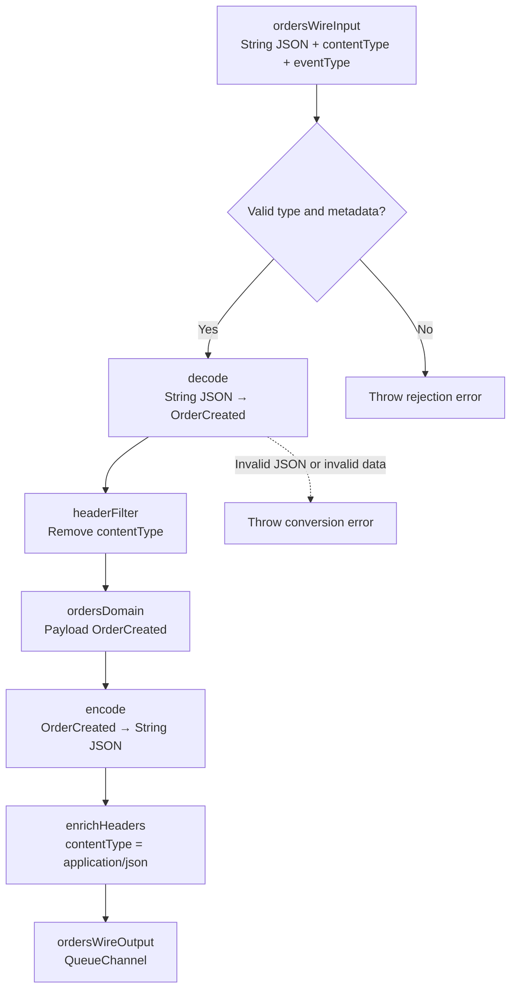

# Message Type and Content Type

In Spring Integration, the Java type of a payload, the data representation format, and the business meaning of a message are distinct pieces of information. Distinguishing them helps you choose the right transformer, configure channels, route messages, and pinpoint conversion failures.

This lesson belongs to the **Message** chapter of the **SPRING_INTEGRATION_CORE** module, focusing on the data contract between `Message`, `MessageChannel`, and endpoints. Examples use Java 17+, Spring Integration 6.5.x, Spring Messaging 6.2.x, and Jackson 2; these are API baselines for the examples, not a project upgrade requirement.

## 1. Practical Problem: Same `String`, Different Formats

An order-ingestion flow might receive three payloads:

```text
{"orderId":"DH-101","total":150000}
<order><orderId>DH-101</orderId><total>150000</total></order>
Order DH-101 has total amount 150000
```

All three can be stored in a `String`. However, a JSON parser can only process a suitable JSON representation. Looking solely at `payload.getClass()`, an endpoint does not know whether to use a JSON parser, an XML parser, or plain-text processing.

Conversely, the same JSON can reside in a `String` or a `byte[]`. Two payloads with different Java types can represent the same JSON content.

After this lesson, you should be able to do three things:

- Accurately identify whether you are discussing payload type, MIME type, or business message type.
- Choose data conversion points and keep headers consistent with the payload at each stage.
- Design a Java DSL flow with clear input contracts, decoding steps, and error reporting.

## 2. Four Layers of Information to Distinguish

| Information Layer | Question Answered | Examples |
| --- | --- | --- |
| Message envelope | Which object carries payload and headers? | `Message<T>`, `GenericMessage<T>`, `ErrorMessage` |
| Java payload type | What object exists in memory? | `String`, `byte[]`, `OrderCreated` |
| Content type | In what format is the content represented or exchanged? | `application/json`, `application/xml`, `text/plain` |
| Business message type | What does the message mean to the system? | `order.created`, `order.cancelled`, `payment.requested` |

The phrase **message type** must be interpreted in context. In Java code, an author may mean `Message<OrderCreated>` or the payload type. In inter-service contracts, they may mean a command or an event. Avoid using a vague header named `type` to replace all of the layers above.

### 2.1. Message<T> Is Not Synonymous with a Transport Format

`Message<T>` provides a payload and a set of headers. The type parameter `T` declares a Java contract; it is not a serialization directive.

```java
import org.springframework.messaging.Message;
import org.springframework.messaging.support.MessageBuilder;

record OrderCreated(String orderId) {}

Message<OrderCreated> message =
        MessageBuilder.withPayload(new OrderCreated("DH-101")).build();

Class<?> payloadType = message.getPayload().getClass();
// payloadType is OrderCreated.class.
```

The object above has not become JSON. Similarly, `GenericMessage<String>` does not mean plain text: the string inside could be JSON, XML, or another format. The `Message` structure and payload role are described in [Spring Integration — Message](https://docs.spring.io/spring-integration/reference/6.5/message.html).

`ErrorMessage` is a specialized message envelope for errors, with a `Throwable` payload. Do not identify an error message by setting `contentType=error`.

### 2.2. Generics Do Not Replace Knowing the Target Type When Deserializing

At runtime, `ArrayList<OrderCreated>` and `ArrayList<String>` both appear as the same `ArrayList` class. Therefore, passing only `List.class` to a JSON mapper is not enough to describe the element type.

With Jackson 2, full type information can be passed:

```java
import com.fasterxml.jackson.core.type.TypeReference;
import com.fasterxml.jackson.databind.ObjectMapper;
import java.util.List;

ObjectMapper mapper = new ObjectMapper();

List<OrderCreated> orders = mapper.readValue(
        "[{\"orderId\":\"DH-101\"}]",
        new TypeReference<List<OrderCreated>>() {}
);
```

This is information about the target object model. The MIME type `application/json` cannot tell you whether to create `OrderCreated`, `Customer`, or `List<OrderCreated>`.

## 3. Content Type Is Metadata About Format

### 3.1. Standard Header Inside Spring Messaging

In `Message`, use the constant:

```java
MessageHeaders.CONTENT_TYPE
```

This header name's value is `contentType`. It differs from HTTP's `Content-Type` spelling. When passing through an adapter, mapping between the internal header and the protocol header depends on the adapter and header mapper; do not manually add a `Content-Type` key in an internal message assuming every converter will read it. The constant is defined in [MessageHeaders](https://docs.spring.io/spring-framework/docs/6.2.x/javadoc-api/org/springframework/messaging/MessageHeaders.html).

Example creating a JSON message:

```java
import org.springframework.messaging.Message;
import org.springframework.messaging.MessageHeaders;
import org.springframework.messaging.support.MessageBuilder;
import org.springframework.util.MimeTypeUtils;

Message<String> jsonMessage = MessageBuilder
        .withPayload("{\"orderId\":\"DH-101\",\"total\":150000}")
        .setHeader(MessageHeaders.CONTENT_TYPE, MimeTypeUtils.APPLICATION_JSON)
        .setHeader("eventType", "order.created")
        .setHeader("schemaVersion", "1")
        .build();
```

Here:

- The actual payload is `String`.
- `contentType` describes JSON.
- `eventType` is an application-defined header describing business semantics.
- `schemaVersion` is an application-defined header selecting the contract version.

The last two headers are not standard mechanisms auto-generated by Spring Integration in this example.

### 3.2. Header Value Can Be MimeType or String

Do not cast directly:

```java
// Unsafe if the producer set the header as a String.
MimeType type = (MimeType) message.getHeaders().get(MessageHeaders.CONTENT_TYPE);
```

Use a resolver to handle both representations:

```java
import org.springframework.messaging.converter.DefaultContentTypeResolver;
import org.springframework.util.MimeType;

DefaultContentTypeResolver resolver = new DefaultContentTypeResolver();
MimeType type = resolver.resolve(jsonMessage.getHeaders());
```

`DefaultContentTypeResolver` reads a `MimeType` or a string parseable into a `MimeType`. If the header is missing and no default is configured, the result is `null`. A malformed MIME string can throw an exception when parsed. See [DefaultContentTypeResolver](https://docs.spring.io/spring-framework/docs/6.2.x/javadoc-api/org/springframework/messaging/converter/DefaultContentTypeResolver.html).

Do not compare using the following expression:

```java
"application/json".equals(
        message.getHeaders().get(MessageHeaders.CONTENT_TYPE)
)
```

This expression can return `false` if the header is a `MimeType` object. It also fails to express MIME parameter handling policy. Resolve first and then compare type/subtype, or use MIME matching appropriate to the contract.

### 3.3. Common Payload and Content Type Pairs

| Java Payload | Content Type | What to Know |
| --- | --- | --- |
| `String` containing JSON | `application/json` | Needs a JSON parser to build business objects |
| `byte[]` containing JSON | `application/json` | Needs byte-representation handling and JSON parsing |
| `String` containing XML | `application/xml` | Cannot use a JSON parser |
| `String` containing text | `text/plain` | Can be processed directly as text |
| `byte[]` containing a PNG image | `image/png` | Do not decode with a text converter |
| `OrderCreated` | Unset in this lesson's internal contract | Already a Java model, not yet serialized to JSON |

A system might keep `application/json` on a POJO to ask a downstream converter to serialize it to JSON. When choosing that approach, document clearly that it represents the intended exchange format. The presence of the header does not prove the object in memory is already a JSON string or JSON bytes.

This lesson chooses an easy-to-observe contract: **JSON at the boundary uses the JSON content type; internal Java models drop the JSON representation header; only after serialization is the header set again on the output**.

## 4. Setting a Header Does Not Convert the Payload

This is an incorrect example if the goal is to produce JSON:

```java
Message<OrderCreated> mislabeled = MessageBuilder
        .withPayload(new OrderCreated("DH-101"))
        .setHeader(MessageHeaders.CONTENT_TYPE, MimeTypeUtils.APPLICATION_JSON)
        .build();

// Payload is still OrderCreated; no serialization step has occurred.
```

Similarly, changing the header of an XML string to `application/json` does not turn XML content into JSON. The consumer simply receives a false claim about the data.

Distinguish these operations:

| Operation | Changes Payload Contents? | Typical Tool |
| --- | --- | --- |
| Adding or changing content type | No | `MessageBuilder`, header enricher |
| Converting DTO to JSON | Yes | JSON transformer, JSON message converter |
| Converting JSON to DTO | Yes | JSON transformer, JSON message converter |
| Selecting a processing branch | Does not convert by itself | Router |
| Accepting or rejecting a message | Does not convert by itself | Filter |
| Restricting a channel's payload type | May invoke conversion on mismatch | Datatype channel with configured converter |

Do not use `toString()` of a record or POJO as a JSON serializer. A string like `OrderCreated[orderId=DH-101]` is not JSON.

## 5. Content Type, Charset, and byte[]

`String` is character data in Java. Charsets come into play when converting between character data and bytes:

```java
import java.nio.charset.StandardCharsets;

String json = "{\"customerName\":\"Nguyễn An\"}";
byte[] wire = json.getBytes(StandardCharsets.UTF_8);
String decoded = new String(wire, StandardCharsets.UTF_8);
```

A header cannot fix a decoding error that has already happened. If an adapter read bytes with the wrong charset, resetting `contentType` later cannot restore the original Vietnamese name.

For plain text, `text/plain;charset=UTF-8` can describe character encoding. For JSON exchanged between systems, RFC 8259 requires UTF-8 and defines no charset parameter for the `application/json` media type; contracts should explicitly specify UTF-8 at boundaries. See [RFC 8259, sections 8.1 and 11](https://www.rfc-editor.org/rfc/rfc8259.html).

A JSON parser reading `byte[]` directly may have its own encoding detection rules. Do not infer that every parser decodes according to the charset written in the header.

If the contract requires failing on invalid UTF-8 bytes, use a decoder in error-reporting mode before parsing:

```java
import java.nio.ByteBuffer;
import java.nio.charset.CodingErrorAction;
import java.nio.charset.StandardCharsets;

String jsonText = StandardCharsets.UTF_8.newDecoder()
        .onMalformedInput(CodingErrorAction.REPORT)
        .onUnmappableCharacter(CodingErrorAction.REPORT)
        .decode(ByteBuffer.wrap(wire))
        .toString();
```

This snippet can throw `CharacterCodingException`; the endpoint must feed that error into the flow's error-handling policy. If the data is compressed, decompression must also happen before decoding and parsing; `contentType` does not replace decompression.

## 6. Where Does Conversion Happen?

### 6.1. Converter Is a Mechanism, Transformer Is a Step in the Flow

`MessageConverter` has two primary directions:

```java
Object fromMessage(Message<?> message, Class<?> targetClass);

Message<?> toMessage(Object payload, MessageHeaders headers);
```

A converter may examine both target type and content type. A `null` return typically indicates the converter does not support that case, allowing a composite converter to try the next option. Data errors within a supported conversion can still throw exceptions. See [MessageConverter](https://docs.spring.io/spring-framework/docs/6.2.x/javadoc-api/org/springframework/messaging/converter/MessageConverter.html).

A transformer is the endpoint representing data change in a flow. You can use a standard Spring Integration transformer or a Java method calling a mapper/converter. Declaring this step explicitly reveals the boundary between exchange data and the business model.

### 6.2. Not Every Converter Reads Content Type

`org.springframework.messaging.converter.SimpleMessageConverter` mainly wraps or unwraps payloads when types already match and ignores content type. It does not parse JSON into DTOs. Do not confuse this class with similarly named converters in another protocol's library. See [SimpleMessageConverter](https://docs.spring.io/spring-framework/docs/6.2.x/javadoc-api/org/springframework/messaging/converter/SimpleMessageConverter.html).

With Jackson 2, you can use:

```java
import org.springframework.messaging.converter.MappingJackson2MessageConverter;

MappingJackson2MessageConverter converter =
        new MappingJackson2MessageConverter();

// Requires resolving a supported content type.
converter.setStrictContentTypeMatch(true);

Object converted = converter.fromMessage(jsonMessage, OrderCreated.class);
if (!(converted instanceof OrderCreated order)) {
    throw new IllegalArgumentException("No suitable conversion available");
}

// order is a Java object, no longer a JSON string.
```

`MappingJackson2MessageConverter` is a Jackson 2-based converter. `setStrictContentTypeMatch(true)` enforces matching content types; it does not replace schema validation or business rules. See [MappingJackson2MessageConverter](https://docs.spring.io/spring-framework/docs/6.2.x/javadoc-api/org/springframework/messaging/converter/MappingJackson2MessageConverter.html) and [AbstractMessageConverter](https://docs.spring.io/spring-framework/docs/6.2.x/javadoc-api/org/springframework/messaging/converter/AbstractMessageConverter.html).

If a `String` output is needed instead of `byte[]`, explicitly configure `setSerializedPayloadClass(String.class)` on converters supporting this option; do not infer the output payload type from the MIME type.

### 6.3. Endpoints Can Perform Parameter Conversion

An endpoint accepting `OrderCreated` can have the infrastructure convert from JSON when the argument resolver, converter, and classpath align. Spring Integration 6.5 provides `ConfigurableCompositeMessageConverter` for this, including a Jackson 2 converter when Jackson is on the classpath.

Therefore, do not claim that Spring Integration always auto-converts JSON or never converts it. Determine **which component is invoking the converter**, which converters are registered, and what the target type is.

Content-type conversion via this mechanism does not apply to SpEL method invocations; those have their own Java type conversion mechanism. A gateway declaring Java types is also not enough to describe the entire JSON contract across every boundary. See [Message Endpoints — Content Type Conversion](https://docs.spring.io/spring-integration/reference/6.5/endpoint.html#content-type-conversion).

### 6.4. Datatype Channels Check Java Types

A channel can call `setDatatypes(OrderCreated.class)` to restrict payload types. This is an assignable Java type check, not a MIME or JSON schema check.

When a payload does not match, the channel may attempt a converter per configuration. A datatype channel's default converter involves `integrationConversionService`; do not assume it will automatically parse JSON solely because an `application/json` header is present. See [Configuring Message Channels — Datatype Channel Configuration](https://docs.spring.io/spring-integration/reference/6.5/channel/configuration.html).

In the next example, JSON is parsed before being sent to a channel typed with `OrderCreated`. That way the channel expresses the internal contract rather than hiding the parsing step.

## 7. Java DSL Example: From JSON to Internal Model and Back to JSON

### 7.1. Contract of the Example

The application receives an order-creation event under these conditions:

| Component | Accepted Value |
| --- | --- |
| Input payload | `String` containing a JSON object |
| MIME type | Type/subtype is `application/json` |
| `eventType` | String `order.created` |
| `schemaVersion` | String `1` |
| Business data | `orderId` non-blank, `total` non-negative |
| Internal payload | `OrderCreated` |
| Output payload | JSON `String` with `contentType=application/json` |

The example intentionally rejects `byte[]`, JSON arrays, or vendor media types such as `application/vnd.example.order+json`. If a real contract allows those forms, add corresponding admission policies and converters.

The filter validates payload class and metadata. The JSON parser together with the record constructor validate contents. These two checks do not replace each other.



### 7.2. Complete Configuration

The example below is independent of the single-field record in earlier snippets. Place it in `OrderTypeFlow.java` during practice. The classpath needs `spring-integration-core`, `spring-context`, and `jackson-databind` along with transitive dependencies; manage compatible versions via the application's BOM.

```java
package example.integration;

import java.math.BigDecimal;

import com.fasterxml.jackson.core.JsonProcessingException;
import com.fasterxml.jackson.databind.DeserializationFeature;
import com.fasterxml.jackson.databind.ObjectMapper;

import org.springframework.context.annotation.Bean;
import org.springframework.context.annotation.Configuration;
import org.springframework.integration.channel.DirectChannel;
import org.springframework.integration.channel.QueueChannel;
import org.springframework.integration.config.EnableIntegration;
import org.springframework.integration.dsl.IntegrationFlow;
import org.springframework.messaging.Message;
import org.springframework.messaging.MessageHeaders;
import org.springframework.messaging.converter.DefaultContentTypeResolver;
import org.springframework.messaging.converter.MessageConversionException;
import org.springframework.util.MimeType;
import org.springframework.util.MimeTypeUtils;

@Configuration
@EnableIntegration
public class OrderTypeFlow {

    public static final String EVENT_TYPE = "eventType";
    public static final String SCHEMA_VERSION = "schemaVersion";

    @Bean
    public DirectChannel ordersWireInput() {
        // Leave datatype unset so the filter can observe the original payload.
        return new DirectChannel();
    }

    @Bean
    public DirectChannel ordersDomain() {
        DirectChannel channel = new DirectChannel();
        channel.setDatatypes(OrderCreated.class);
        return channel;
    }

    @Bean
    public QueueChannel ordersWireOutput() {
        return new QueueChannel();
    }

    @Bean
    public OrderJsonCodec orderJsonCodec() {
        ObjectMapper mapper = new ObjectMapper()
                .enable(DeserializationFeature.FAIL_ON_TRAILING_TOKENS);
        return new OrderJsonCodec(mapper);
    }

    @Bean
    public IntegrationFlow decodeOrders(OrderJsonCodec codec) {
        return IntegrationFlow.from("ordersWireInput")
                .filter(codec, "supports",
                        spec -> spec.throwExceptionOnRejection(true))
                .transform(codec, "decode")
                .headerFilter(MessageHeaders.CONTENT_TYPE)
                .channel("ordersDomain")
                .get();
    }

    @Bean
    public IntegrationFlow encodeOrders(OrderJsonCodec codec) {
        return IntegrationFlow.from("ordersDomain")
                .transform(codec, "encode")
                .enrichHeaders(headers -> headers.header(
                        MessageHeaders.CONTENT_TYPE,
                        MimeTypeUtils.APPLICATION_JSON,
                        true))
                .channel("ordersWireOutput")
                .get();
    }

    public record OrderCreated(String orderId, BigDecimal total) {
        public OrderCreated {
            if (orderId == null || orderId.isBlank()) {
                throw new IllegalArgumentException("orderId must not be blank");
            }
            if (total == null || total.signum() < 0) {
                throw new IllegalArgumentException(
                        "total must be present and non-negative");
            }
        }
    }

    public static final class OrderJsonCodec {

        private final ObjectMapper mapper;
        private final DefaultContentTypeResolver resolver =
                new DefaultContentTypeResolver();

        public OrderJsonCodec(ObjectMapper mapper) {
            this.mapper = mapper;
        }

        public boolean supports(Message<?> message) {
            if (!(message.getPayload() instanceof String)) {
                return false;
            }
            if (!"order.created".equals(
                    message.getHeaders().get(EVENT_TYPE))) {
                return false;
            }
            if (!"1".equals(
                    message.getHeaders().get(SCHEMA_VERSION))) {
                return false;
            }

            try {
                MimeType mime = resolver.resolve(message.getHeaders());
                return mime != null
                        && "application".equalsIgnoreCase(mime.getType())
                        && "json".equalsIgnoreCase(mime.getSubtype());
            }
            catch (IllegalArgumentException invalidMimeType) {
                return false;
            }
        }

        public OrderCreated decode(Message<?> message) {
            if (!supports(message)) {
                throw new MessageConversionException(
                        message, "Message does not match input contract");
            }

            try {
                OrderCreated order = mapper.readValue(
                        (String) message.getPayload(),
                        OrderCreated.class);

                if (order == null) {
                    throw new MessageConversionException(
                            message, "JSON must contain an OrderCreated object");
                }
                return order;
            }
            catch (JsonProcessingException failure) {
                throw new MessageConversionException(
                        message,
                        "Failed to decode OrderCreated from JSON",
                        failure);
            }
        }

        public String encode(Message<OrderCreated> message) {
            try {
                return mapper.writeValueAsString(message.getPayload());
            }
            catch (JsonProcessingException failure) {
                throw new MessageConversionException(
                        message,
                        "Failed to encode OrderCreated to JSON",
                        failure);
            }
        }
    }
}
```

`decode(Message<?> message)` takes the entire message and parses the payload itself; the example does not rely on automatic conversion of JSON parameters into DTOs. Configuring `FAIL_ON_TRAILING_TOKENS` forbids a second JSON value trailing after the first object.

The two flows connect through `ordersDomain`. The example performs a round-trip conversion to observe the data contract. In a real application, business processing can be placed between decoding and encoding.

### 7.3. Why Are headerFilter and overwrite Present?

When a transformer returns only a payload, many headers from the input message are propagated forward. Consequently, after `decode`, the header describing JSON can still remain even though the payload is now a record.

`.headerFilter(MessageHeaders.CONTENT_TYPE)` strips the header at the boundary entering the Java model per the lesson's contract. On the outbound side, the header enricher uses `true` to allow overwriting any prior value with the actual newly created format.

Do not try to modify the map via `message.getHeaders().put(...)`: standard message headers are read-only structures. Also do not assume omitting a header in a manually built message suffices at every endpoint; check the endpoint's header propagation rules. Returning a payload, returning a `Message`, and header filters are covered in [Spring Integration — Transformer](https://docs.spring.io/spring-integration/reference/6.5/transformer.html).

The application headers `eventType` and `schemaVersion` are preserved across the round trip because the data remains the same event type. If a business step produces a new event, update the type and version accordingly.

### 7.4. Sending and Receiving in a Standalone Context

This is a hands-on snippet to run with the configuration above, not already-executed output:

```java
import org.springframework.context.annotation.AnnotationConfigApplicationContext;
import org.springframework.messaging.Message;
import org.springframework.messaging.MessageChannel;
import org.springframework.messaging.MessageHeaders;
import org.springframework.messaging.PollableChannel;
import org.springframework.messaging.converter.DefaultContentTypeResolver;
import org.springframework.messaging.support.MessageBuilder;
import org.springframework.util.MimeTypeUtils;

try (var context =
        new AnnotationConfigApplicationContext(OrderTypeFlow.class)) {

    MessageChannel input =
            context.getBean("ordersWireInput", MessageChannel.class);
    PollableChannel output =
            context.getBean("ordersWireOutput", PollableChannel.class);

    Message<String> request = MessageBuilder
            .withPayload("{\"orderId\":\"DH-101\",\"total\":150000}")
            .setHeader(MessageHeaders.CONTENT_TYPE, "application/json")
            .setHeader(OrderTypeFlow.EVENT_TYPE, "order.created")
            .setHeader(OrderTypeFlow.SCHEMA_VERSION, "1")
            .build();

    input.send(request);
    Message<?> result = output.receive(1000);

    if (result == null || !(result.getPayload() instanceof String)) {
        throw new IllegalStateException("Missing JSON String output");
    }

    var mime = new DefaultContentTypeResolver()
            .resolve(result.getHeaders());

    if (!MimeTypeUtils.APPLICATION_JSON.equals(mime)) {
        throw new IllegalStateException("Output content type is incorrect");
    }

    System.out.println(result.getPayload());
}
```

Place the practice snippet inside a Java method in the same package as `OrderTypeFlow`, or import the configuration from the corresponding package. The `QueueChannel` at the end only holds results for `receive`; the example declares no polling consumer there, so no poller is needed.

Do not test JSON by requiring the output string to be character-for-character identical to the input string: whitespace, numeric representation, or property ordering may change. When writing tests, parse the output to compare business values and check headers separately.

## 8. Choosing the Right Routing Criteria

A router can rely on multiple criteria, yet each criterion solves a different need:

| Need | Suitable Criterion | Example |
| --- | --- | --- |
| Choosing a parser for exchange data | Normalized content type | JSON to JSON parser, XML to XML parser |
| Choosing a handler after decoding | Java payload type | `OrderCreated` to order processing |
| Choosing a business workflow before decoding | Event type plus contract version | `order.created` vs. `order.cancelled` |
| Classifying by data values | Business attributes | High-total orders to approval branch |

`PayloadTypeRouter` routes by payload type; `HeaderValueRouter` can route by a selected header value. These two routers do not mean the same thing. See [Router Implementations](https://docs.spring.io/spring-integration/reference/6.5/router/implementations.html).

If both JSON and XML are `String`s, routing on `String.class` cannot separate them. If `OrderCreated` and `OrderCancelled` both use JSON, routing on `application/json` cannot separate the two business flows either.

When routing by content type, resolve to `MimeType` and map to an application-controlled format key. Matching raw strings directly can produce unintended branches due to MIME parameters.

Example rule for choosing a target type during decoding:

```text
application/json + order.created + schemaVersion=1
    -> OrderCreatedV1

application/json + order.cancelled + schemaVersion=1
    -> OrderCancelledV1
```

This is an application-designed contract registry, not an automatic inference feature from `contentType`.

## 9. Content Type Does Not Replace Schema and Versioning

The following message may be syntactically valid JSON:

```json
{"customerId":"KH-01","active":true}
```

Even so, it does not fit the example's `OrderCreated` model. Therefore, distinguish:

1. **Valid metadata:** declares a supported format and message type.
2. **Valid syntax:** the parser can read the JSON.
3. **Valid structure:** fields map according to the model and mapper policy.
4. **Valid business semantics:** values satisfy workflow conditions.

`application/json` only describes format. A payload with a JSON content type can still be an object, array, string, number, or `null`; the endpoint's contract must specify which forms are permitted.

Systems may use specialized media types like `application/vnd.example.order+json` to convey additional meaning. However, the `+json` suffix does not automatically determine a Java class, nor does it guarantee every existing converter accepts that media type. Agree on supported formats and verify converter configuration.

Spring Integration has built-in JSON transformers created via `Transformers.fromJson(...)` or `Transformers.toJson(...)`. They are suitable when declaring conversion steps directly in the DSL. See [Java DSL — Transformers](https://docs.spring.io/spring-integration/reference/6.5/dsl/java-transformers.html).

When using JSON transformers that support type metadata such as `JsonHeaders.TYPE_ID` or `JsonHeaders.RESOLVABLE_TYPE`, distinguish them from content type. Type metadata can participate in selecting a Java model per transformer configuration; see [JsonToObjectTransformer](https://docs.spring.io/spring-integration/docs/6.5.0/api/org/springframework/integration/json/JsonToObjectTransformer.html). At service boundaries, map allowlisted business type codes to known DTOs rather than accepting arbitrary class names supplied by senders.

The example in this lesson calls `mapper.readValue(..., OrderCreated.class)` directly, so the target type is explicitly specified at the decode step. If expanding to support multiple events, replace the fixed class with a registry of pre-declared entries.

## 10. Classifying Errors and How They Travel Through the Flow

### 10.1. Which Error Appears at Which Step?

| Situation | Detection Point in the Example | Expected Behavior |
| --- | --- | --- |
| Missing content type | `supports` filter | Rejected before parsing |
| Malformed MIME syntax | Resolver inside filter | Filter returns `false`, endpoint throws rejection error |
| Content type is XML yet body is JSON | Filter | Rejected per declared contract |
| Content type is JSON yet body is XML | JSON parser | Conversion error |
| `byte[]` JSON sent to a String-accepting contract | Filter | Rejected due to payload type |
| Wrong `eventType` or version | Filter | Rejected due to contract type |
| Valid JSON yet negative `total` | Constructor during deserialization | Mapping error, wrapped as a conversion error |
| JSON payload is `null` | Check after `readValue` | Conversion error |
| Two concatenated JSON objects | JSON parser with trailing tokens config | Conversion error |

A valid header only helps choose how to process. The parser and data validation step determine whether the content actually conforms.

The example chooses `throwExceptionOnRejection(true)` so callers see rejected inputs. If the design wants to collect rejected data, configure a discard channel and a dedicated consumer. Clearly decide rejection behavior; do not assume every filter throws exceptions. See [Spring Integration — Filter](https://docs.spring.io/spring-integration/reference/6.5/filter.html).

### 10.2. DirectChannel Does Not Automatically Send Every Error to errorChannel

In the illustrative configuration, both flows process on the message-sending thread across `DirectChannel`s. Errors raised before placing the result into the final queue are thrown back to the `input.send(request)` call.

The existence of an `errorChannel` bean or header does not automatically turn every synchronous error into an error message. With asynchronous processing via an executor or a polled consumer, examine the error handler mechanism of the component running the task. Gateways also have their own error-handling policies. See [Spring Integration — Error Handling](https://docs.spring.io/spring-integration/reference/6.5/error-handling.html).

Once an `ErrorMessage` is created, its error payload is typically a `MessagingException` that may hold `failedMessage`. This information helps identify which stage failed, especially when the payload was transformed along the way. See [ErrorMessage](https://docs.spring.io/spring-framework/docs/6.2.x/javadoc-api/org/springframework/messaging/support/ErrorMessage.html).

Do not infinitely retry the same syntactically invalid JSON or unsupported version. Those errors require fixing the data or the contract. Retrying helps only when the cause can change, such as a target resource being temporarily unavailable.

## 11. Observing and Verifying the Data Contract

When a flow encounters an error, gather information right at the conversion boundary:

- Actual payload class, such as `java.lang.String` or `byte[]`.
- Resolved `contentType` value and the case of a missing header.
- Business type, contract version, and target Java type.
- Name of the endpoint or channel detecting the error and the root cause.
- Business correlation ID if processing stages need to be linked.

Do not log only `message.getClass()`: `GenericMessage` does not tell you whether the payload is JSON or a DTO. For sensitive data, log type, length, and correlation ID instead of the entire contents.

A contract test suite for the example should include the following cases:

| Test Data | Outcome to Verify |
| --- | --- |
| Valid JSON, MIME header as String | Produces JSON String output with accurate order data |
| Valid JSON, MIME header as MimeType | Equivalent behavior to String form |
| Missing or wrong content type | Rejected, no successful output |
| JSON with right MIME yet invalid syntax | Throws conversion error and preserves root cause |
| JSON missing orderId or negative total | Does not produce a valid business object |
| JSON array or null | Not accepted as an OrderCreated |
| Wrong event type or schemaVersion | Rejected per contract |
| At ordersDomain after header filter | Payload is OrderCreated, contentType is gone |
| At ordersWireOutput | Payload is String, contentType is application/json |

To test the internal boundary in isolation, split out a test for the decode flow and replace the downstream consumer with a result-collecting channel. Do not write fragile test criteria that depend on how a JSON serializer orders properties.

When a discrepancy is found, troubleshoot in order: identify the current payload type, check metadata, identify which converter was actually invoked, and then compare the target model against the data. This order clearly separates mislabeling errors, conversion errors, and business contract errors.
