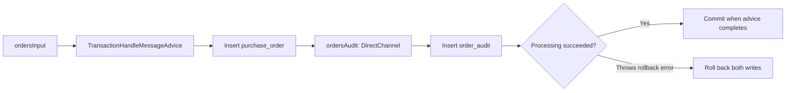

# TransactionInterceptor in Spring Integration

## 1. Objectives and use case

In the **Transaction support** chapter of the **SPRING_INTEGRATION_CORE** module, this lesson explains how to define transaction boundaries in a message flow using `TransactionInterceptor`. The focus is on knowing which operations are committed together, which errors can trigger a rollback, and what happens when a message is handed off to another execution thread.

After this lesson, you will be able to:

- Distinguish between the interceptor, the transaction manager, and the resources participating in a transaction.
- Configure transaction advice for endpoints and pollers using Java DSL.
- Choose between scoping a single handler or the synchronous downstream flow behind the handler.
- Predict the effects of propagation, exceptions, error handling, and retries.
- Write tests that observe database state after commit or rollback.

Running scenario: receive an `OrderCommand`, insert a record into `purchase_order`, and then insert a record into `order_audit`. The business rule requires that both records either exist together or neither exists if the audit processing step fails.

The examples use Spring Integration 6.x APIs, Java 17 or later, and synchronous JDBC. The Spring Integration reference links correspond to the 6.5 branch. Use a compatible version set managed by your project or Spring Boot; do not arbitrarily mix Spring Framework and Spring Integration versions.

## 2. What does TransactionInterceptor actually do?

`org.springframework.transaction.interceptor.TransactionInterceptor` belongs to **Spring Framework**. It is an AOP `MethodInterceptor` that brings the intercepted invocation under Spring's transaction management mechanism. Spring Integration provides advice attachment points to use that mechanism in messaging endpoints and pollers. [Javadoc TransactionInterceptor](https://docs.spring.io/spring-framework/docs/6.2.x/javadoc-api/org/springframework/transaction/interceptor/TransactionInterceptor.html).

Three roles need to be kept separate:

| Component | Role in the order example |
|---|---|
| `TransactionInterceptor` | Wraps the invocation, applies transaction attributes and completion rules |
| `PlatformTransactionManager` | Manages the actual transaction on the JDBC resource |
| `TransactionAttribute` | Describes propagation, isolation, timeout, read-only, and rollback rules |
| `JdbcTemplate` and `DataSource` | Perform data access capable of participating in that transaction |

The pseudocode below illustrates the **idea**, not how to implement an interceptor yourself:

```text
read transaction attributes of the invocation
obtain the appropriate transaction manager
start or join a transaction according to propagation
try:
    execute the wrapped invocation
    request successful completion
catch error:
    decide rollback according to error type and rollback rules
    rethrow the error to the caller
finally:
    restore the caller's context
```

"Successful completion" does not necessarily mean a physical commit at this location: the interceptor may be participating in an outer transaction. Final commit authority in that case belongs to the outer boundary.

### 2.1. The same thread still needs the same transactional resource

`DataSourceTransactionManager` manages a JDBC `DataSource` and binds the transactional connection to the current thread. `JdbcTemplate` uses Spring's connection retrieval mechanism to participate. Therefore, the transaction manager and `JdbcTemplate` in this lesson must use the same `DataSource`. Acquiring a connection manually from another source can cause SQL statements to run outside the intended transaction. [Javadoc DataSourceTransactionManager](https://docs.spring.io/spring-framework/docs/6.2.x/javadoc-api/org/springframework/jdbc/datasource/DataSourceTransactionManager.html).

You cannot assume that a JDBC interceptor will roll back the database, HTTP calls, and email sending operations together. The scope of the wrapped invocation and the set of resources capable of rolling back are two separate concerns.

## 3. Three places to set transaction boundaries

A message flow can receive messages from code calling a gateway, from `MessageChannel.send(...)`, from an adapter, or from a poller. For flows actively invoked by the application, you can place the transaction on the outer service using standard Spring mechanisms. For pollers, you must place transaction advice on the polling task if you want to include the receive operation as well. [Transaction support in message flows](https://docs.spring.io/spring-integration/reference/6.5/transactions.html#transactions-understanding).

| Starting point | Scope to reason about | When appropriate |
|---|---|---|
| Outer service calling gateway/channel | From when the service starts the transaction until the service call ends | The use-case boundary already lives in the application layer |
| Advice on an endpoint | The endpoint invocation wrapped by the advice | Need to start a transaction at a specific step in the flow |
| Advice on a poller | The polling task and synchronous processing are wrapped | Need to include `receive()` of a transactional resource in the same unit of work |

Merely declaring a `TransactionInterceptor` bean does not make an endpoint transactional. You must attach that bean to the appropriate execution point. Similarly, merely adding `@EnableTransactionManagement` does not automatically create transaction advice for every poller.

## 4. Distinguishing advice for a single handler from advice for the downstream flow

This is the most important distinction when using `TransactionInterceptor` with Spring Integration.

### 4.1. Standard TransactionInterceptor

For reply-producing handlers in the `AbstractReplyProducingMessageHandler` family, standard request-handler advice wraps `handleRequestMessage()`. Sending the reply to the next step happens outside the scope of that internal invocation.

The following example is a condensed configuration; `transactionManager` is an already injected bean:

```java
TransactionInterceptor handlerTx = new TransactionInterceptorBuilder()
        .transactionManager(transactionManager)
        .propagation(Propagation.REQUIRED)
        .build();
```

If there is no outer transaction, the handler may already commit before the reply processing step begins. Do not conclude that simply because the channels are `DirectChannel`, standard advice on the first handler automatically encompasses all subsequent steps.

### 4.2. TransactionHandleMessageAdvice

`TransactionHandleMessageAdvice` is a variant of `TransactionInterceptor` that implements `HandleMessageAdvice`. It wraps `handleMessage()`, including forwarding the reply to the synchronous downstream flow. You can create this variant with the `TransactionInterceptorBuilder(true)` constructor. The `true` value selects the **advice scope**, not a switch to enable or disable transactions. [Transaction support for handlers](https://docs.spring.io/spring-integration/reference/6.5/handler-advice/tx-handle-message.html).

```java
TransactionInterceptor flowTx = new TransactionInterceptorBuilder(true)
        .transactionManager(transactionManager)
        .propagation(Propagation.REQUIRED)
        .build();
```

The declared type of both variables is `TransactionInterceptor`, but the actual object types created are different. When reading configuration, inspect the builder constructor, not just the return type of the `@Bean` method.

Comparison diagram, assuming no outer transaction:

```text
Standard advice on handler A:
  BEGIN -> A.handleRequestMessage() -> COMMIT
                                       |
                                       +-> send reply -> handler B

TransactionHandleMessageAdvice on handler A:
  BEGIN -> A.handleMessage()
             -> A.handleRequestMessage()
             -> send reply via DirectChannel
             -> handler B
         <- return to A
  COMMIT or ROLLBACK
```

If an outer transaction already wraps the `send()` call, synchronous steps can still participate in that same transaction even if the internal advice only wraps handler A. You must inspect the entire call stack rather than looking at a single configuration in isolation.

### 4.3. Scope comparison table

| Configuration | Wrapped point | Key consequence |
|---|---|---|
| Builder without `true`, attached to reply-producing handler | Internal request-handling call | Does not automatically extend a new boundary to reply processing |
| Builder with `true`, attached to handler | `handleMessage()` | Includes downstream processing that remains within the synchronous call |
| Interceptor on poller | Advised polling task | Can wrap the receive operation before invoking the handler |

For handlers that do not produce replies, the advice attachment point may already be `handleMessage()` from the start. Do not mechanically apply conclusions about `handleRequestMessage()` to every implementation. [Handling Message Advice mechanism](https://docs.spring.io/spring-integration/reference/6.5/handler-advice/handle-message.html).

## 5. The channel determines how far the transaction travels

`DirectChannel` invokes the handler on the sender's thread. Because of this, downstream calls can remain within the same transactional call stack. The channel itself does not create a transaction and does not turn the payload into a rollback-capable resource. [DirectChannel and transactions](https://docs.spring.io/spring-integration/reference/channel/implementations.html#channel-implementations-directchannel).



Changing `ordersAudit` to an `ExecutorChannel` causes the audit handler to run through an executor; there is no guarantee that the sender thread's JDBC transaction context is propagated to the receiving thread. The fact that an executor might occasionally run on the caller thread due to a rejection policy does not create a reliable transactional design either. [ExecutorChannel](https://docs.spring.io/spring-integration/reference/6.5/channel/implementations.html#channel-implementations-executorchannel).

With `QueueChannel`, the `send()` operation places the message into a queue. The consumer running later is no longer part of the current processing call. The sender's transaction only completes when the interceptor returns; it does not necessarily commit right at the enqueue statement. However, errors occurring later in the consumer do not automatically roll back the transaction already completed on the sender side.

Similar boundaries appear when spawning threads manually, using `@Async`, or offloading work to a deferred task. Headers containing a message ID or correlation ID help with business tracking, not with carrying a JDBC transaction context.

## 6. Java DSL example: order and audit in the same transaction

### 6.1. Preparing dependencies and database tables

The example requires `spring-integration-core`, `spring-jdbc`, and Spring's transaction infrastructure. When using Spring Boot, you can use `spring-boot-starter-integration` together with `spring-boot-starter-jdbc`; configure an appropriate JDBC driver and `DataSource`. The test suite later on also uses H2, JUnit Jupiter, and `spring-test`.

The application needs to provide a `DataSource` and a `JdbcTemplate` using that `DataSource`. In a Boot application with appropriate JDBC auto-configuration, these two beans are typically created from datasource configuration. The example below explicitly declares the transaction manager to clearly show the managed resource.

Minimal schema:

```sql
create table purchase_order (
    order_id varchar(64) primary key,
    quantity integer not null
);

create table order_audit (
    order_id varchar(64) primary key,
    event_type varchar(64) not null
);
```

Both tables are intentionally simplified to observe rollback behavior. In a real application, migrations and data constraints must reflect the system's domain model.

### 6.2. Complete flow configuration

Place the example classes in package `example.integration`. `failAfterAudit` is simply a flag to simulate failure for learning purposes.

```java
package example.integration;

import javax.sql.DataSource;

import org.springframework.beans.factory.annotation.Qualifier;
import org.springframework.context.annotation.Bean;
import org.springframework.context.annotation.Configuration;
import org.springframework.integration.channel.DirectChannel;
import org.springframework.integration.config.EnableIntegration;
import org.springframework.integration.dsl.IntegrationFlow;
import org.springframework.integration.transaction.TransactionInterceptorBuilder;
import org.springframework.jdbc.core.JdbcTemplate;
import org.springframework.jdbc.datasource.DataSourceTransactionManager;
import org.springframework.transaction.PlatformTransactionManager;
import org.springframework.transaction.annotation.Isolation;
import org.springframework.transaction.annotation.Propagation;
import org.springframework.transaction.interceptor.TransactionInterceptor;

@Configuration(proxyBeanMethods = false)
@EnableIntegration
public class OrderFlowConfiguration {

    public record OrderCommand(
            String orderId,
            int quantity,
            boolean failAfterAudit) {
    }

    @Bean
    PlatformTransactionManager orderTransactionManager(DataSource dataSource) {
        return new DataSourceTransactionManager(dataSource);
    }

    @Bean
    TransactionInterceptor orderFlowTx(
            @Qualifier("orderTransactionManager")
            PlatformTransactionManager transactionManager) {

        return new TransactionInterceptorBuilder(true)
                .transactionManager(transactionManager)
                .propagation(Propagation.REQUIRED)
                .isolation(Isolation.READ_COMMITTED)
                .timeout(10)
                .readOnly(false)
                .build();
    }

    @Bean
    DirectChannel ordersInput() {
        return new DirectChannel();
    }

    @Bean
    DirectChannel ordersAudit() {
        return new DirectChannel();
    }

    @Bean
    IntegrationFlow orderFlow(
            JdbcTemplate jdbc,
            @Qualifier("orderFlowTx") TransactionInterceptor transactionAdvice) {

        return IntegrationFlow.from("ordersInput")
                .handle(OrderCommand.class, (order, headers) -> {
                    if (order.quantity() <= 0) {
                        throw new IllegalArgumentException(
                                "quantity must be positive");
                    }

                    jdbc.update(
                            "insert into purchase_order(order_id, quantity) "
                                    + "values (?, ?)",
                            order.orderId(), order.quantity());

                    return order;
                }, endpoint -> endpoint.advice(transactionAdvice))
                .channel("ordersAudit")
                .handle(OrderCommand.class, (order, headers) -> {
                    jdbc.update(
                            "insert into order_audit(order_id, event_type) "
                                    + "values (?, ?)",
                            order.orderId(), "ORDER_ACCEPTED");

                    if (order.failAfterAudit()) {
                        throw new IllegalStateException(
                                "Simulated failure after audit insert");
                    }

                    return order.orderId();
                })
                .get();
    }
}
```

This flow has advice attached explicitly via `.advice(transactionAdvice)`, so it does not need `@EnableTransactionManagement` just to make that advice work. If you add a service using `@Transactional`, the application needs the corresponding annotation-processing support.

### 6.3. Sending a Message and receiving the reply

The snippet below runs in application code that already has a reference to the `ordersInput` bean:

```java
import example.integration.OrderFlowConfiguration.OrderCommand;
import org.springframework.integration.channel.QueueChannel;
import org.springframework.integration.support.MessageBuilder;
import org.springframework.messaging.Message;

QueueChannel replies = new QueueChannel(1);

Message<OrderCommand> request = MessageBuilder
        .withPayload(new OrderCommand("ORD-1001", 2, false))
        .setReplyChannel(replies)
        .build();

ordersInput.send(request);
Message<?> reply = replies.receive(0);
```

You must provide a `replyChannel` in this invocation because the final handler returns `orderId`. Without an output channel or reply channel, sending the reply may fail, producing an error unrelated to the business scenario being tested.

`QueueChannel` here only collects the final result for the calling code to read after `send()` returns. It does not sit between the two database writes. Enqueuing the reply still happens before the interceptor finishes committing; a reply in memory is not a guarantee that the commit definitely succeeded. In this test, evaluate success after `send()` returns normally and verify the persisted data.

### 6.4. Execution sequence of the two scenarios

When there is no outer transaction and `failAfterAudit=false`:

1. The advice starts a JDBC transaction.
2. The first handler inserts the order and returns `OrderCommand`.
3. `ordersAudit` invokes the second handler immediately on the current thread.
4. The second handler inserts the audit record and sends the reply.
5. The call stack returns to the advice; the transaction manager commits.

When `failAfterAudit=true`, the exception is thrown **after both INSERT statements have already executed**. The error unwinds through the synchronous call back to the advice, causing both writes to roll back. This is a stronger scenario than throwing an error before the first SQL statement, because it proves that data already written inside the transaction is undone.

If you replace the builder with `new TransactionInterceptorBuilder()` and there is no outer transaction, the order insert may commit before the audit is processed. The outcome upon failure then no longer satisfies the requirement that both exist together or neither exists.

## 7. Choosing transaction attributes

### 7.1. Propagation

| Propagation | Core meaning | Consequence when designing flows |
|---|---|---|
| `REQUIRED` | Join an existing transaction; create a new one if none exists | Suitable when steps belong to the same business unit of work |
| `REQUIRES_NEW` | Create an independent transaction, suspending the outer one if present | Inner step can commit even if the outer step rolls back |
| `MANDATORY` | Require an already existing transaction | Detects calls violating the expected boundary |
| `SUPPORTS` | Join if one exists; do not require creating a transaction | Not sufficient to guarantee two writes always share a transaction |

In the order example, changing the audit step to `REQUIRES_NEW` alters the atomicity requirement. If the audit commits independently and the outer step fails afterward, the audit record can still remain. If the new transaction needs an additional connection while the outer transaction is still holding one, you must also account for connection pool sizing.

With `REQUIRED`, an inner step marking the transaction rollback-only can cause the outer step to receive `UnexpectedRollbackException` when attempting to commit, even if the original error was caught in between. Catching an exception does not clear the rollback-only state. [Transaction propagation](https://docs.spring.io/spring-framework/reference/data-access/transaction/declarative/tx-propagation.html).

### 7.2. Isolation, timeout, and read-only

The example sets `READ_COMMITTED` to make the isolation choice explicit. The actual choice depends on the database, contention levels, and business invariants; it does not replace unique constraints or concurrency control strategies.

`timeout(10)` specifies the transaction timeout in **seconds**, unlike channel APIs whose timeouts typically use milliseconds. A transaction timeout is not a timer that can forcibly interrupt arbitrary HTTP calls, loops, or threads. Timeout enforcement capability depends on the transaction manager and resource operations.

`readOnly(true)` is an attribute for read-only transactions and resource-level optimizations; do not use it as an authorization mechanism to forbid writes. Since the order flow performs INSERTs, use `readOnly(false)`.

Attributes such as isolation and timeout must be evaluated together with propagation. When joining an existing transaction, you cannot assume that inner declared values will establish a new isolation level or deadline. [Javadoc TransactionDefinition](https://docs.spring.io/spring-framework/docs/6.2.x/javadoc-api/org/springframework/transaction/TransactionDefinition.html).

## 8. Rollback rules and exceptions in messaging

With Spring's default transaction attributes, `RuntimeException` and `Error` trigger rollback; standard checked exceptions do not automatically trigger rollback. You can configure explicit rollback rules. [Default rollback rules](https://docs.spring.io/spring-framework/reference/data-access/transaction/declarative/rolling-back.html).

However, in a message flow, a business exception may be wrapped in a `MessageHandlingException` or another `MessagingException`. The rollback decision applies to the exception that the transaction advice actually receives. Therefore, you should not read a method signature with `throws IOException` and conclude that the flow will definitely commit just because `IOException` is a checked exception.

### 8.1. Explicit TransactionAttribute configuration

If you want to roll back on any `Exception` observed by the advice, you can replace the `orderFlowTx` bean with the following configuration:

```java
@Bean
TransactionInterceptor orderFlowTx(
        @Qualifier("orderTransactionManager")
        PlatformTransactionManager transactionManager) {

    RuleBasedTransactionAttribute attributes =
            new RuleBasedTransactionAttribute();
    attributes.setPropagationBehavior(
            TransactionDefinition.PROPAGATION_REQUIRED);
    attributes.setIsolationLevel(
            TransactionDefinition.ISOLATION_READ_COMMITTED);
    attributes.setTimeout(10);
    attributes.setReadOnly(false);
    attributes.getRollbackRules().add(
            new RollbackRuleAttribute(Exception.class));

    return new TransactionInterceptorBuilder(true)
            .transactionManager(transactionManager)
            .transactionAttribute(attributes)
            .build();
}
```

Additional imports:

```java
import org.springframework.transaction.TransactionDefinition;
import org.springframework.transaction.interceptor.RollbackRuleAttribute;
import org.springframework.transaction.interceptor.RuleBasedTransactionAttribute;
```

`RuleBasedTransactionAttribute` evaluates rules by exception type and closeness in the inheritance hierarchy. A rule targeting a business exception does not automatically search for that exception across the entire `cause` chain. If you need a no-rollback exception for a specific error, you must inspect the exact exception at the advice boundary. [Javadoc RuleBasedTransactionAttribute](https://docs.spring.io/spring-framework/docs/6.2.x/javadoc-api/org/springframework/transaction/interceptor/RuleBasedTransactionAttribute.html).

Once `.transactionAttribute(attributes)` is passed, the builder uses that attribute object; individual builder attribute setters do not act as an extra layer to override it. Place the entire policy into `attributes` to avoid misleading configuration. [Javadoc TransactionInterceptorBuilder](https://docs.spring.io/spring-integration/api/org/springframework/integration/transaction/TransactionInterceptorBuilder.html).

### 8.2. Swallowing errors changes the transaction outcome

Error-prone example:

```java
try {
    writeAudit(order);
}
catch (RuntimeException ex) {
    log.warn("Audit failed for {}", order.orderId(), ex);
}
return order.orderId();
```

If no exception escapes and no component has marked the transaction rollback-only, the advice can complete successfully. Logging does not request a rollback. When the audit is a mandatory requirement of the order, the error must reach the transaction decision boundary or an appropriate mechanism must mark the transaction for rollback.

## 9. Placing TransactionInterceptor on a poller

### 9.1. Why advice on a handler may be too late

A poller calls `receive()` before passing the message to the handler. If `receive()` interacts with a transactional resource, a boundary starting at the handler will not cover the prior receive operation. Placing transaction advice on the poller allows the receive operation to participate in the same unit of work. [Poller transaction support](https://docs.spring.io/spring-integration/reference/6.5/transactions.html#transactions-poller).

The additional example below is a **separate consumer**, not a replacement for the synchronous flow in section 6. It receives from an in-memory queue and inserts the order:

```java
import java.time.Duration;

import org.springframework.integration.channel.QueueChannel;
import org.springframework.integration.dsl.Pollers;

@Bean
QueueChannel queuedOrders() {
    return new QueueChannel(100);
}

@Bean
IntegrationFlow queuedOrderFlow(
        JdbcTemplate jdbc,
        @Qualifier("orderTransactionManager")
        PlatformTransactionManager transactionManager) {

    return IntegrationFlow.from("queuedOrders")
            .handle(OrderCommand.class, (order, headers) -> {
                jdbc.update(
                        "insert into purchase_order(order_id, quantity) "
                                + "values (?, ?)",
                        order.orderId(), order.quantity());

                if (order.failAfterAudit()) {
                    throw new IllegalStateException("Simulated polling failure");
                }

                return null;
            }, endpoint -> endpoint.poller(
                    Pollers.fixedDelay(Duration.ofSeconds(1))
                            .maxMessagesPerPoll(1)
                            .transactional(transactionManager)))
            .get();
}
```

You can place these `@Bean` methods into `OrderFlowConfiguration` to reuse the `OrderCommand` type and existing imports. The consumer snippet intentionally returns `null` because there is no request-reply contract here.

`.transactional(transactionManager)` on the **poller** creates transaction advice for the polling task. If you already have an interceptor with a custom policy, the API also has an overload accepting a `TransactionInterceptor`. Do not confuse this with `.advice(...)` or `.transactional(...)` on the **endpoint** configuration, because their wrapping positions differ. [Javadoc PollerSpec](https://docs.spring.io/spring-integration/api/org/springframework/integration/dsl/PollerSpec.html).

### 9.2. Rolling back the database does not automatically return the message to the queue

`queuedOrders` in the example is an in-memory `QueueChannel`. If the handler throws an error, the INSERT can roll back, but removing the message from a plain in-memory queue is not automatically undone by the JDBC transaction manager.

To re-receive a message after an error, you need a mechanism with corresponding support, such as a channel backed by a transactional message store participating in the proper resource, or a message broker configured for transactional receive and redelivery. Each option has its own prerequisites; adding transaction advice does not supply those prerequisites automatically.

`maxMessagesPerPoll(1)` keeps the example to one message per polling run. Do not interpret a message-count limit parameter as a guarantee that an arbitrary business batch will commit atomically.

Pollers also do not cover every inbound adapter. Adapters that receive messages via a broker's listener mechanism have transaction boundaries governed by the listener/container and adapter configuration. [Roles of PollingConsumer and SourcePollingChannelAdapter](https://docs.spring.io/spring-integration/reference/6.5/polling-consumer.html).

## 10. Error channels do not replace rollback policies

For synchronous flows invoked directly via `MessageChannel.send()` or `MessagingTemplate`, exceptions are thrown back to the caller. In the section 6 example, this error path allows errors from the audit step to reach the transaction advice.

For asynchronous processing or polling tasks, errors are commonly sent as an `ErrorMessage` to the appropriate error channel. Error channels help observe or organize error handling; they do not reconfigure propagation or the scope of transaction advice. [Error handling in Spring Integration](https://docs.spring.io/spring-integration/reference/6.5/error-handling.html).

When analyzing a flow with an error handler or recovery advice, trace three questions:

1. Does the exception pass through the transaction interceptor before being converted into an error message?
2. Does recovery return a normal result while the transaction is still open?
3. Is the error handler executing within the same transaction, after rollback, or in a new transaction?

If recovery occurs inside the transaction and converts the error into a normal result, the transaction advice may no longer see an error to roll back. If the transaction has already rolled back before publishing the error, handling the `ErrorMessage` cannot undo that rollback result.

Do not expect that adding an `errorChannel` header to every synchronous request will automatically replace the exception-throwing behavior of `send()`.

## 11. Combining retry with transaction advice

When the database reports a transient error, retries may be needed. What must be decided first is **what part to retry** and **which transaction each attempt uses**.

Two wrapping orders have different meanings:

```text
Retry outside transaction:
  attempt 1 -> start T1 -> process -> error -> roll back T1
  attempt 2 -> start T2 -> process -> succeed -> commit T2

Transaction outside retry:
  start T1
    attempt 1 -> error
    attempt 2 -> still in T1
  complete T1, which may already be marked rollback-only
```

The first diagram assumes there is no outer transaction forcing retries to rejoin the same transaction. Simply placing retry outside a `REQUIRED` advice does not guarantee a new transaction if the caller is still holding an active transaction.

`RequestHandlerRetryAdvice` handles retries at the request handler; it does not automatically retry the entire downstream flow. Advices of type `HandleMessageAdvice` are also applied at a different invocation layer than request-handler advice, so execution order cannot be determined solely from the position of two beans in a list. You must check the actual interception scope. [Retry advice](https://docs.spring.io/spring-integration/reference/6.5/handler-advice/classes.html#retry-advice), [where HandleMessageAdvice applies](https://docs.spring.io/spring-integration/reference/6.5/handler-advice/handle-message.html).

For the order flow, a design decision might be to retry the entire "insert order and audit" unit from outside the transaction boundary. In that case, additionally verify that transient errors leave no partial records and that a successful attempt produces only one valid outcome. For side effects that cannot be rolled back, idempotency is required before allowing retries.

## 12. Testing commit and rollback with real data

A test that only checks "an exception was thrown" does not prove database rollback. You must observe the database state after the transaction boundary ends.

The following example uses an in-memory H2 database and Spring Test. Do not put `@Transactional` on the test: a test-level transaction can wrap the flow and mask whether the flow's transaction started or ended in the wrong place. This is test code for learners to run in a project with the stated dependencies; the results below are the expected outcomes of the example.

```java
package example.integration;

import javax.sql.DataSource;

import example.integration.OrderFlowConfiguration.OrderCommand;
import org.junit.jupiter.api.BeforeEach;
import org.junit.jupiter.api.Test;
import org.springframework.beans.factory.annotation.Autowired;
import org.springframework.beans.factory.annotation.Qualifier;
import org.springframework.context.annotation.Bean;
import org.springframework.context.annotation.Configuration;
import org.springframework.integration.channel.DirectChannel;
import org.springframework.integration.channel.QueueChannel;
import org.springframework.integration.support.MessageBuilder;
import org.springframework.jdbc.core.JdbcTemplate;
import org.springframework.jdbc.datasource.embedded.EmbeddedDatabaseBuilder;
import org.springframework.jdbc.datasource.embedded.EmbeddedDatabaseType;
import org.springframework.messaging.Message;
import org.springframework.messaging.MessagingException;
import org.springframework.test.context.junit.jupiter.SpringJUnitConfig;

import static org.junit.jupiter.api.Assertions.assertEquals;
import static org.junit.jupiter.api.Assertions.assertNotNull;
import static org.junit.jupiter.api.Assertions.assertNull;
import static org.junit.jupiter.api.Assertions.assertThrows;
import static org.junit.jupiter.api.Assertions.assertTrue;

@SpringJUnitConfig(classes = {
        OrderFlowConfiguration.class,
        OrderFlowTransactionTest.DatabaseConfiguration.class
})
class OrderFlowTransactionTest {

    @Configuration(proxyBeanMethods = false)
    static class DatabaseConfiguration {

        @Bean(destroyMethod = "shutdown")
        org.springframework.jdbc.datasource.embedded.EmbeddedDatabase dataSource() {
            return new EmbeddedDatabaseBuilder()
                    .generateUniqueName(true)
                    .setType(EmbeddedDatabaseType.H2)
                    .build();
        }

        @Bean
        JdbcTemplate jdbcTemplate(DataSource dataSource) {
            return new JdbcTemplate(dataSource);
        }
    }

    @Autowired
    @Qualifier("ordersInput")
    DirectChannel ordersInput;

    @Autowired
    JdbcTemplate jdbc;

    @BeforeEach
    void prepareDatabase() {
        jdbc.execute("create table if not exists purchase_order ("
                + "order_id varchar(64) primary key, quantity integer not null)");
        jdbc.execute("create table if not exists order_audit ("
                + "order_id varchar(64) primary key, event_type varchar(64) not null)");
        jdbc.update("delete from order_audit");
        jdbc.update("delete from purchase_order");
    }

    @Test
    void commitsOrderAndAuditTogether() {
        QueueChannel replies = new QueueChannel(1);

        assertTrue(ordersInput.send(request(
                new OrderCommand("ORD-OK", 3, false), replies)));

        Message<?> reply = replies.receive(0);
        assertNotNull(reply);
        assertEquals("ORD-OK", reply.getPayload());
        assertEquals(1, countOrders("ORD-OK"));
        assertEquals(1, countAudits("ORD-OK"));
    }

    @Test
    void rollsBackBothWritesWhenDownstreamFails() {
        QueueChannel replies = new QueueChannel(1);

        assertThrows(MessagingException.class, () -> ordersInput.send(request(
                new OrderCommand("ORD-FAIL", 3, true), replies)));

        assertEquals(0, countOrders("ORD-FAIL"));
        assertEquals(0, countAudits("ORD-FAIL"));
        assertNull(replies.receive(0));
    }

    private Message<OrderCommand> request(
            OrderCommand command, QueueChannel replies) {
        return MessageBuilder.withPayload(command)
                .setReplyChannel(replies)
                .build();
    }

    private int countOrders(String orderId) {
        return jdbc.queryForObject(
                "select count(*) from purchase_order where order_id = ?",
                Integer.class, orderId);
    }

    private int countAudits(String orderId) {
        return jdbc.queryForObject(
                "select count(*) from order_audit where order_id = ?",
                Integer.class, orderId);
    }
}
```

Expected results:

| Scenario | Order record count | Audit record count | Caller outcome |
|---|---:|---:|---|
| Success | 1 | 1 | `send()` returns normally, reply received |
| Error after audit INSERT | 0 | 0 | Receives `MessagingException`, no successful reply |

The rollback test checks `MessagingException` because errors from a handler may be wrapped by the framework. When diagnosing the root cause, inspect the `cause` chain to locate the intentionally thrown `IllegalStateException`.

A helpful experiment to understand scope: change only the builder constructor in the configuration to the no-arg constructor and re-run the rollback test. Without an outer transaction, the test can detect that the order record remains after the downstream error. Do not alter the assertions to accept wrong data; explain why the transaction boundary changed.

For versions using `ExecutorChannel` or a poller, wait on a bounded completion signal before checking the database. Do not use the result immediately after enqueuing as proof that the consumer has finished running.

## 13. Non-JDBC side effects and post-commit design

Suppose an HTTP call step is added after inserting the audit record. The following sequence of events can happen:

```text
insert order inside transaction
HTTP call succeeds, external system has processed it
JDBC transaction fails on commit
database rolls back, external system keeps the HTTP result
```

This follows from the fact that HTTP is not part of the JDBC resource managed by the manager in the example. Expanding the wrapped invocation with `TransactionHandleMessageAdvice` does not provide an undo operation for external systems.

Two design approaches to choose from depending on requirements:

- If you only need to perform an action after the transaction outcome, use appropriate transaction synchronization and design how to handle failures in the post-commit action.
- If you need to durably persist the intent to emit an event, write an outbox record within the same database transaction, then use another process to send and retry it. Consumers must handle duplicates based on business ID or event ID.

The outbox suggestion here is a design option for the example scenario, not a built-in behavior of `TransactionInterceptor`. Post-commit callbacks also cannot roll back already committed data if sending the notification fails. When there is no real transactional resource, `PseudoTransactionManager` only supports the synchronization lifecycle; it does not provide rollback capability for databases, files, or HTTP. [Transaction synchronization and pseudo transactions](https://docs.spring.io/spring-integration/reference/6.5/transactions.html#transaction-synchronization).

## 14. Diagnosing common issues

| Symptom | What to check first | Appropriate resolution |
|---|---|---|
| Interceptor bean exists but database still commits statement by statement | Is the advice actually attached to the endpoint/poller? | Place the advice at the right execution boundary |
| Audit fails but order still remains | Which advice did the builder create? Is there an outer transaction? | Use `handleMessage()` scope or a service transaction wrapping the use case |
| Changing channels causes rollback to behave differently | Is there an enqueue or thread handoff between the two writes? | Design staged transactions and durable delivery mechanisms |
| INSERT does not participate in the expected transaction | Is JDBC using the right datasource/connection? | Align the manager and how resources are accessed |
| Error caught yet commit still fails | Did an inner step mark the transaction rollback-only? | Clarify policies across transaction scopes |
| Database rolls back but message is not redelivered | Does the queue support transactions/redelivery? | Configure an appropriate transactional store or broker |
| Retried multiple times yet only one failed transaction occurs | In what order do retry and transaction actually wrap each other? | Place retry attempts outside the transaction boundary that needs to be recreated |
| Tests always pass green but production leaves partial data | Does the test have an outer transaction or only assert exceptions? | Inspect the database after the flow's transaction finishes |

During local diagnosis, you can enable Spring transaction logs and logs for the manager in use. Record the `orderId`, thread name, endpoint starting the advice, and root exception. These details help distinguish "handler ran" from "transaction committed."

## 15. Applying to flows with transformers, routers, filters, and aggregators

Transaction advice does not change the business semantics of endpoints. When extending a flow, inspect the actual message path:

- **Transformer** returns a new payload but can still proceed synchronously. Where the advice starts determines whether forwarding the reply stays inside the boundary.
- **Router** selects branches; each branch must be evaluated according to its own channel and resources. A branch running through an executor does not automatically inherit the JDBC transaction of a synchronous branch.
- **Filter** rejecting a message can be a normal processing outcome. If the business requirement is that rejection must roll back prior writes, an explicit failure mechanism is needed; do not assume rollback just because the message was discarded.
- **Aggregator** may wait for multiple messages arriving at different times. Do not hold a JDBC transaction open across the entire time a group is being formed. Design group state persistence separately from the transaction when processing/emitting the result.
- **Gateway** expresses a request-reply contract. If an outer service starts a transaction and calls a synchronous gateway, account for the outer transaction when evaluating `REQUIRED` endpoint advice.

When designing, mark the transaction start point on the flow diagram, mark every enqueue or thread-handoff point, and list the resources that the transaction manager actually manages. Finally, introduce a deliberate error after the last write and observe the data after the call finishes. These three actions verify the intended boundary rather than inferring it from endpoint names.
