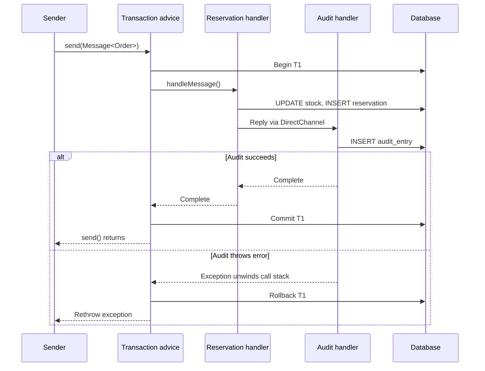

# Transaction advice

## 1. Objectives and context

In the **SPRING_INTEGRATION_CORE** module, transaction advice helps place transaction boundaries on the right endpoints of a message flow. This lesson belongs to the **Transaction support** chapter and focuses on how to combine `Message`, `MessageChannel`, service activators, and Java DSL to decide which operations commit or roll back together.

After this lesson, you will be able to:

- Distinguish advice around a single handler's processing from advice wrapping the entire `handleMessage()` call.
- Choose a transaction manager according to the resource used by the flow.
- Configure transaction advice using Java DSL and the `adviceChain` attribute.
- Explain how channels, propagation, error handling, and retries affect transactions.
- Test database state after the flow succeeds or fails at a downstream endpoint.

The examples use synchronous processing, JDBC, and APIs available in Spring Integration 6.x. Use the BOM of the Spring Boot/Spring Integration version selected by your project to manage dependencies; do not arbitrarily mix versions of Spring Framework, Spring Integration, and testing libraries.

To run the examples, you need a Java version supporting `record`, along with `spring-integration-core`, `spring-jdbc`, and `spring-tx`; for testing, add `spring-test`, JUnit Jupiter, and H2. A real application must provide a `DataSource`; the test section below supplies a dedicated H2 database.

## 2. The problem: the same flow does not guarantee the same transaction

Suppose a flow receives an inventory reservation request:

```text
Message<Order>
    -> reserve stock and insert reservation
    -> write audit entry for the reservation
    -> finish
```

If the audit step fails, the business requirement is to undo both the stock deduction and the reservation record. Connecting two service activators with a channel only describes the message path. Transaction boundaries also depend on where the transaction starts, the type of advice, how handoffs occur between endpoints, and the participating resources.

**Transaction advice** is AOP advice that uses Spring's transaction mechanism to wrap an invocation: obtaining or creating a transaction according to propagation, executing the call, and then deciding commit/rollback. If it only joins an existing transaction, completing the physical transaction still belongs to the outer scope. Spring Integration provides the advice attachment points; the framework does not replace Spring's transaction manager. [Reference on the transaction model in message flows](https://docs.spring.io/spring-integration/reference/transactions.html).

Roles to keep separate:

| Component | Responsibility |
| --- | --- |
| `Message<Order>` | Carries the processing request and routing/reply headers |
| `DirectChannel` | Dispatches the message to a subscriber on the sender's thread |
| Service activator | Invokes a business method and may produce a reply |
| Transaction advice | Selects the invocation scope wrapped by a transaction |
| `PlatformTransactionManager` | Manages begin, commit, and rollback on the corresponding resource |
| `JdbcTemplate` | Executes SQL using Spring's transaction-aware connection retrieval mechanism |

Message headers are not a place to store a JDBC transaction to pass arbitrarily across threads.

## 3. Two types of advice with different scopes

### 3.1. Standard `TransactionInterceptor`

For reply-producing handlers extending `AbstractReplyProducingMessageHandler`, standard advice in the request handler advice chain wraps `handleRequestMessage()`. Sending the reply to the next endpoint happens after that scope. If the advice opens a transaction itself, the transaction may already commit before the next endpoint runs. [Spring Integration transaction advice documentation](https://docs.spring.io/spring-integration/reference/handler-advice/tx-handle-message.html).

Model when there is no outer transaction:

```text
handleMessage()
    begin T1
        handleRequestMessage(): reserve stock
    commit T1
    send reply via DirectChannel
        audit endpoint: throws error
```

The audit failure cannot undo T1, which has already committed.

If an outer transaction already exists and the advice uses `REQUIRED`, the outcome also depends on that outer boundary. Therefore, you cannot conclude that every configuration using the standard interceptor puts downstream steps outside the transaction.

### 3.2. `TransactionHandleMessageAdvice`

`TransactionHandleMessageAdvice` is an extension of `TransactionInterceptor` indicating that the advice should be applied to `MessageHandler.handleMessage()`. For reply-producing handlers, this scope includes sending the reply and synchronous downstream calls remaining on the call stack. [TransactionHandleMessageAdvice API](https://docs.spring.io/spring-integration/docs/current/api/org/springframework/integration/transaction/TransactionHandleMessageAdvice.html).

```text
begin T1
    handleMessage()
        handleRequestMessage(): reserve stock
        send reply via DirectChannel
            audit endpoint: write audit
commit T1
```

If the audit endpoint throws an exception eligible for rollback and the exception returns to the advice before T1 completes, the JDBC changes participating in T1 are rolled back.



The downstream scope here has limits: the advice does not propagate a transaction to another thread, does not reach backward to wrap endpoints that already ran before it, and does not bring HTTP, email, or arbitrary databases into the same transaction.

## 4. Resources and channels determine rollback capability

### 4.1. Using the right transaction manager

In the JDBC example, `DataSourceTransactionManager` manages a `DataSource` and binds the transactional connection to the current thread. `JdbcTemplate` automatically uses Spring's appropriate connection retrieval mechanism. Two handlers using the same `JdbcTemplate` on the same thread will be able to participate in this transaction together. [DataSourceTransactionManager API](https://docs.spring.io/spring-framework/docs/current/javadoc-api/org/springframework/jdbc/datasource/DataSourceTransactionManager.html).

| Primary resource | Common choice | What to verify |
| --- | --- | --- |
| JDBC on a single `DataSource` | `DataSourceTransactionManager` or `JdbcTransactionManager` | Do the DAOs use the same resource and are connections transaction-aware? |
| JPA | `JpaTransactionManager` | Does the EntityManager belong to the managed persistence unit? |
| JMS | `JmsTransactionManager` or listener transaction configuration | Which message consumption/sending scope actually participates? |
| Multiple resources requiring atomic commit | JTA/XA if infrastructure supports it | Are all involved resources enlisted in the distributed transaction? |

Do not use a local JDBC transaction manager and treat database writes plus broker sends as a single atomic commit. When not using distributed transactions, define how recovery works between steps, such as an outbox combined with an idempotent consumer.

If multiple transaction managers exist in the application context, explicitly specify the manager for the advice via dependency injection rather than leaving manager selection implicit.

### 4.2. Channels and execution boundaries

| Forwarding mechanism | Impact on an active imperative transaction |
| --- | --- |
| `DirectChannel` | Subscriber handler runs on the sender's thread; can continue using the current transaction |
| `PublishSubscribeChannel` without executor | Subscribers are invoked synchronously; must also account for error propagation and each branch's resources |
| `ExecutorChannel` | Can offload processing to an executor thread; no guarantee of inheriting the sender's transaction |
| `QueueChannel` | Enqueueing and consumer processing are two separate calls; do not assume the producer's transaction wraps the consumer |
| Remote gateway or HTTP call | Does not carry a local JDBC transaction across to another system |

Channel types have distinct sending, buffering, and dispatching characteristics. In particular, the success of `QueueChannel.send()` indicates that the message was accepted into the queue per the channel contract, not that downstream consumer processing has completed. [MessageChannel implementations](https://docs.spring.io/spring-integration/reference/channel/implementations.html).

With an in-memory queue, a JDBC rollback also does not automatically remove an enqueued message or put a received message back on the queue. If a queue uses a transaction-aware message store, separately verify the participation of the store and transaction manager.

## 5. Complete example: reserving stock and writing audit in the same transaction

### 5.1. Java DSL configuration

Place the following class in package `com.example.integration`. Both business operations use the same `JdbcTemplate`; the channel connecting the two flows is a `DirectChannel`.

```java
package com.example.integration;

import javax.sql.DataSource;

import org.springframework.beans.factory.annotation.Qualifier;
import org.springframework.context.annotation.Bean;
import org.springframework.context.annotation.Configuration;
import org.springframework.integration.channel.DirectChannel;
import org.springframework.integration.config.EnableIntegration;
import org.springframework.integration.dsl.IntegrationFlow;
import org.springframework.integration.transaction.TransactionInterceptorBuilder;
import org.springframework.jdbc.core.JdbcTemplate;
import org.springframework.jdbc.datasource.DataSourceTransactionManager;
import org.springframework.transaction.PlatformTransactionManager;
import org.springframework.transaction.annotation.Isolation;
import org.springframework.transaction.annotation.Propagation;
import org.springframework.transaction.interceptor.TransactionInterceptor;

@Configuration(proxyBeanMethods = false)
@EnableIntegration
public class OrderTxConfig {

    public record Order(long orderId, String sku, int units,
                        boolean failAudit) {

        public Order {
            if (orderId <= 0 || sku == null || sku.isBlank() || units <= 0) {
                throw new IllegalArgumentException("Invalid order");
            }
        }
    }

    @Bean
    JdbcTemplate jdbcTemplate(DataSource dataSource) {
        return new JdbcTemplate(dataSource);
    }

    @Bean
    PlatformTransactionManager orderTransactionManager(DataSource dataSource) {
        return new DataSourceTransactionManager(dataSource);
    }

    @Bean
    TransactionInterceptor orderTxAdvice(
            @Qualifier("orderTransactionManager")
            PlatformTransactionManager transactionManager) {

        return new TransactionInterceptorBuilder(true)
                .transactionManager(transactionManager)
                .propagation(Propagation.REQUIRED)
                .isolation(Isolation.READ_COMMITTED)
                .timeout(10)
                .build();
    }

    @Bean
    DirectChannel ordersIn() {
        return new DirectChannel();
    }

    @Bean
    DirectChannel afterReserve() {
        return new DirectChannel();
    }

    @Bean
    ReservationService reservationService(JdbcTemplate jdbc) {
        return new ReservationService(jdbc);
    }

    @Bean
    AuditService auditService(JdbcTemplate jdbc) {
        return new AuditService(jdbc);
    }

    @Bean
    IntegrationFlow reserveFlow(
            ReservationService reservationService,
            @Qualifier("orderTxAdvice") TransactionInterceptor advice) {

        return IntegrationFlow.from("ordersIn")
                .handle(reservationService, "reserve",
                        endpoint -> endpoint.advice(advice))
                .channel("afterReserve")
                .get();
    }

    @Bean
    IntegrationFlow auditFlow(AuditService auditService) {
        return IntegrationFlow.from("afterReserve")
                .handle(auditService, "append")
                .get();
    }

    public static class ReservationService {

        private final JdbcTemplate jdbc;

        public ReservationService(JdbcTemplate jdbc) {
            this.jdbc = jdbc;
        }

        public Order reserve(Order order) {
            int changed = jdbc.update(
                    """
                    update stock
                       set available = available - ?
                     where sku = ? and available >= ?
                    """,
                    order.units(), order.sku(), order.units());

            if (changed != 1) {
                throw new IllegalStateException("Insufficient stock");
            }

            jdbc.update(
                    """
                    insert into reservation(order_id, sku, units)
                    values (?, ?, ?)
                    """,
                    order.orderId(), order.sku(), order.units());

            return order;
        }
    }

    public static class AuditService {

        private final JdbcTemplate jdbc;

        public AuditService(JdbcTemplate jdbc) {
            this.jdbc = jdbc;
        }

        public void append(Order order) {
            jdbc.update(
                    "insert into audit_entry(order_id, event_type) values (?, ?)",
                    order.orderId(), "RESERVED");

            if (order.failAudit()) {
                throw new IllegalStateException("Simulated audit failure");
            }
        }
    }
}
```

The `true` argument to `TransactionInterceptorBuilder` requests creating a `TransactionHandleMessageAdvice`, even though the return type of `build()` is `TransactionInterceptor`. The builder also lets you specify the manager and transaction attributes. [TransactionInterceptorBuilder API](https://docs.spring.io/spring-integration/api/org/springframework/integration/transaction/TransactionInterceptorBuilder.html).

In the example:

1. `ordersIn.send(message)` invokes the reservation handler on the sender's thread.
2. The advice opens T1 if the thread does not already have a compatible transaction.
3. The `reserve()` method updates stock and inserts the reservation.
4. The handler sends the reply via `afterReserve`, calling `append()` directly on that call stack.
5. If the audit succeeds, the advice completes T1; if the audit fails, the exception unwinds to the advice and triggers rollback.
6. `append()` returns `void`, so this branch finishes without needing a reply channel at the end of the flow.

Two `IntegrationFlow` beans can still participate in one transaction: splitting flow declarations does not automatically create a new transaction boundary.

### 5.2. Concise DSL variant

When only default attributes are needed, you can replace the endpoint configuration in `reserveFlow` with:

```java
.handle(reservationService, "reserve",
        endpoint -> endpoint.transactional(transactionManager, true))
```

In this snippet, `transactionManager` must be a manager injected into the flow declaration method. This is an alternative to `endpoint.advice(advice)`; you do not need to attach both to manage the same scope.

The boolean argument chooses the advice type: `false` is the standard interceptor, `true` is `TransactionHandleMessageAdvice`. The `.transactional()` overload without a boolean uses the standard interceptor; do not assume by default that it wraps downstream steps. [ConsumerEndpointSpec API](https://docs.spring.io/spring-integration/api/org/springframework/integration/dsl/ConsumerEndpointSpec.html).

### 5.3. Annotation-based variant

If the endpoint is declared with annotations instead of DSL, you can reference the advice bean by name:

```java
@ServiceActivator(
        inputChannel = "ordersIn",
        outputChannel = "afterReserve",
        adviceChain = "orderTxAdvice")
public Order reserve(Order order) {
    return reservationService.reserve(order);
}
```

The illustration assumes `Order` and `reservationService` are already declared/injected and `org.springframework.integration.annotation.ServiceActivator` is imported. The bean containing the method must be Spring-managed and messaging annotations must be enabled.

Choose only one way to register the reservation endpoint. If you both keep `reserveFlow` and add the annotated endpoint to the same `ordersIn`, you have added a second subscriber to the `DirectChannel`; that is not how you add another transaction layer to the same endpoint.

## 6. Testing commit and rollback with real data

A mock transaction manager can verify commit/rollback calls, but it does not prove that the SQL statements of both handlers participate in the same transaction. For the example's requirement, checking the database after `send()` completes directly reflects the business outcome.

Place the following test class in the same package as `OrderTxConfig`. Do not add `@Transactional` to the test: a transaction opened by the test can mask mistakes in scoping the advice.

```java
package com.example.integration;

import javax.sql.DataSource;

import org.junit.jupiter.api.BeforeEach;
import org.junit.jupiter.api.Test;
import org.springframework.beans.factory.annotation.Autowired;
import org.springframework.beans.factory.annotation.Qualifier;
import org.springframework.context.annotation.Bean;
import org.springframework.context.annotation.Configuration;
import org.springframework.jdbc.core.JdbcTemplate;
import org.springframework.jdbc.datasource.embedded.EmbeddedDatabaseBuilder;
import org.springframework.jdbc.datasource.embedded.EmbeddedDatabaseType;
import org.springframework.messaging.MessageChannel;
import org.springframework.messaging.MessageHandlingException;
import org.springframework.messaging.support.MessageBuilder;
import org.springframework.test.context.junit.jupiter.SpringJUnitConfig;

import static org.junit.jupiter.api.Assertions.assertEquals;
import static org.junit.jupiter.api.Assertions.assertThrows;
import static org.junit.jupiter.api.Assertions.assertTrue;

@SpringJUnitConfig(classes = {
        OrderTxConfig.class,
        OrderTxAdviceTest.DatabaseConfig.class
})
class OrderTxAdviceTest {

    @Configuration(proxyBeanMethods = false)
    static class DatabaseConfig {

        @Bean(destroyMethod = "shutdown")
        DataSource dataSource() {
            return new EmbeddedDatabaseBuilder()
                    .generateUniqueName(true)
                    .setType(EmbeddedDatabaseType.H2)
                    .build();
        }
    }

    @Autowired
    @Qualifier("ordersIn")
    MessageChannel ordersIn;

    @Autowired
    JdbcTemplate jdbc;

    @BeforeEach
    void resetData() {
        jdbc.execute("""
                create table if not exists stock (
                    sku varchar(40) primary key,
                    available integer not null
                )
                """);
        jdbc.execute("""
                create table if not exists reservation (
                    order_id bigint primary key,
                    sku varchar(40) not null,
                    units integer not null
                )
                """);
        jdbc.execute("""
                create table if not exists audit_entry (
                    order_id bigint primary key,
                    event_type varchar(40) not null
                )
                """);

        jdbc.update("delete from audit_entry");
        jdbc.update("delete from reservation");
        jdbc.update("delete from stock");
        jdbc.update("insert into stock(sku, available) values (?, ?)",
                "BOOK-01", 10);
    }

    @Test
    void commitsBothHandlers() {
        var order = new OrderTxConfig.Order(101L, "BOOK-01", 3, false);

        assertTrue(ordersIn.send(MessageBuilder.withPayload(order).build()));

        assertEquals(7, available());
        assertEquals(1, countReservations());
        assertEquals(1, countAuditEntries());
    }

    @Test
    void rollsBackWhenDownstreamFails() {
        var order = new OrderTxConfig.Order(102L, "BOOK-01", 3, true);

        MessageHandlingException exception = assertThrows(
                MessageHandlingException.class,
                () -> ordersIn.send(MessageBuilder.withPayload(order).build()));

        assertTrue(exception.getCause() instanceof IllegalStateException);
        assertEquals(10, available());
        assertEquals(0, countReservations());
        assertEquals(0, countAuditEntries());
    }

    private int available() {
        return jdbc.queryForObject(
                "select available from stock where sku = ?",
                Integer.class, "BOOK-01");
    }

    private int countReservations() {
        return jdbc.queryForObject(
                "select count(*) from reservation", Integer.class);
    }

    private int countAuditEntries() {
        return jdbc.queryForObject(
                "select count(*) from audit_entry", Integer.class);
    }
}
```

Expected results when initial stock is 10:

| Case | Stock after processing | Reservation | Audit |
| --- | ---: | ---: | ---: |
| Reserve 3 units, audit succeeds | 7 | 1 | 1 |
| Reserve 3 units, audit throws error | 10 | 0 | 0 |

The key point is that the audit intentionally inserts a row **before** throwing the error. Final counts of 0 prove that this write was also undone.

Comparison exercise: change `new TransactionInterceptorBuilder(true)` to `new TransactionInterceptorBuilder(false)` and re-run the failure test without an outer transaction. With H2 and this configuration, stock is expected to remain 7, reservation to be 1, and audit to be 1: the reservation already committed before sending the reply, and the audit insert ran on an auto-commit connection. The test expecting rollback will fail and expose the difference in advice scope.

This is test code for learners to run in a project with the corresponding dependencies; expected outcomes are not claims that the snippets were executed inside this document.

## 7. Propagation and actual commit timing

`REQUIRED` is the right choice for the example because operations need to be grouped into a single unit of work. When an outer transaction already exists, the inner scope typically joins the same physical transaction; exiting the advice does not mean the database has committed. `REQUIRES_NEW` creates an independent physical transaction and may require an additional connection while the outer transaction still holds its resource. [Spring Framework: Transaction Propagation](https://docs.spring.io/spring-framework/reference/data-access/transaction/declarative/tx-propagation.html).

| Propagation | Design question to answer |
| --- | --- |
| `REQUIRED` | Do these operations need to succeed together with the outer work? |
| `REQUIRES_NEW` | Is it acceptable for inner data to commit even if the outer work rolls back? |
| `MANDATORY` | Must this endpoint only be invoked when a transaction already exists? |
| `SUPPORTS` | Is running without a transaction still valid? |
| `NOT_SUPPORTED` | Is there an intentional need to separate this operation from the current transaction? |
| `NESTED` | Do the manager and driver support savepoints for partial rollback? |

If you want the audit record to always exist even when reserving stock fails, that is a different requirement from the example. You can design an independent audit transaction, but you must accept and clearly represent the audit state for a rolled-back operation.

Other attributes must also be understood in terms of the underlying resource:

- `isolation` controls the isolation level supported by the transaction manager/database; it does not replace unique constraints or conditional updates.
- Transaction `timeout` is not an overall deadline for every network call in the flow.
- `readOnly` should not be treated as an authorization mechanism to forbid data writes.

When an advice joins an existing transaction, the attributes of the outer transaction may determine the actual effective behavior. Check the manager configuration rather than looking only at the attributes on a child endpoint.

## 8. Rollback rules and exceptions seen by the advice

With the default configuration of the interceptor in the example, `RuntimeException` and `Error` lead to rollback; checked exceptions do not have the same behavior by default. The decision is based on the exception exiting the scope wrapped by the advice. [Spring Framework: Rolling Back a Declarative Transaction](https://docs.spring.io/spring-framework/reference/data-access/transaction/declarative/rolling-back.html).

There are two common points of confusion:

1. A handler's error may be wrapped by Spring Integration into a runtime `MessagingException`. In that case, the original checked exception is no longer the direct exception type observed by the interceptor.
2. Catching an exception and returning normally can cause the advice to see a successful execution. However, if a component has already marked the transaction rollback-only, catching the exception will not return the transaction to a committable state.

When explicit rules are needed for the advice, you can provide a `RuleBasedTransactionAttribute`. The following example requests rollback for any `Exception` reaching the interceptor:

```java
import java.util.List;

import org.springframework.integration.transaction.TransactionInterceptorBuilder;
import org.springframework.transaction.PlatformTransactionManager;
import org.springframework.transaction.TransactionDefinition;
import org.springframework.transaction.interceptor.RollbackRuleAttribute;
import org.springframework.transaction.interceptor.RuleBasedTransactionAttribute;
import org.springframework.transaction.interceptor.TransactionInterceptor;

TransactionInterceptor rollbackOnException(
        PlatformTransactionManager transactionManager) {

    var attributes = new RuleBasedTransactionAttribute();
    attributes.setPropagationBehavior(
            TransactionDefinition.PROPAGATION_REQUIRED);
    attributes.setTimeout(10);
    attributes.setRollbackRules(
            List.of(new RollbackRuleAttribute(Exception.class)));

    return new TransactionInterceptorBuilder(true)
            .transactionManager(transactionManager)
            .transactionAttribute(attributes)
            .build();
}
```

`RuleBasedTransactionAttribute` supports rollback and no-rollback rules by exception type. [RuleBasedTransactionAttribute API](https://docs.spring.io/spring-framework/docs/current/javadoc-api/org/springframework/transaction/interceptor/RuleBasedTransactionAttribute.html).

Once a complete `TransactionAttribute` is provided to the builder, configure propagation, isolation, timeout, and rollback rules on that object itself. Do not mix it with the corresponding builder setters and expect the two configuration sources to merge.

A message with payload `"FAILED"` is just data unless another mechanism marks a failure. Similarly, a filter discarding a message under normal configuration can be a valid completion, not an implicit rollback signal.

## 9. Endpoint transaction advice differs from poller transactions

Suppose the input source is a queue and the endpoint must `receive()` the message before invoking the handler:

```text
poller -> receive() -> handler -> downstream
```

Advice placed on the handler starts after the message has already been retrieved. It does not automatically cover the prior `receive()`. If the requirement is to roll back receiving from a transaction-capable source as well, an appropriate transaction boundary must be placed on the poller or on the adapter/listener's consumption mechanism. [Poller Transaction Support](https://docs.spring.io/spring-integration/reference/transactions.html#transaction-poller).

Additional configuration example for a polling consumer:

```java
@Bean
IntegrationFlow queuedReserveFlow(
        ReservationService reservationService,
        @Qualifier("orderTransactionManager")
        PlatformTransactionManager transactionManager) {

    return IntegrationFlow.from("transactionalOrdersQueue")
            .handle(reservationService, "reserve",
                    endpoint -> endpoint.poller(
                            Pollers.fixedDelay(1000)
                                    .maxMessagesPerPoll(1)
                                    .transactional(transactionManager)))
            .channel("afterReserve")
            .get();
}
```

This snippet requires importing `org.springframework.integration.dsl.Pollers`, the domain types from the previous example, and declaring a `transactionalOrdersQueue` bean of type `PollableChannel`. It illustrates **where** to place the transaction; whether a message can be re-received after rollback still depends on the queue/message store source.

`.transactional(transactionManager)` on `PollerSpec` wraps the polling task, which is a different location from `.transactional(transactionManager, true)` on the handler configuration. [PollerSpec API](https://docs.spring.io/spring-integration/api/org/springframework/integration/dsl/PollerSpec.html).

Do not interpret `maxMessagesPerPoll(1)` as a retry or dead-letter policy. This property limits the number of messages the poller processes per run, whereas redelivery must be designed around the message source.

## 10. Handling errors while preserving transaction correctness

With `DirectChannel` in the example, exceptions travel back to the caller of `send()`. When moving to asynchronous processing, Spring Integration provides a mechanism to represent errors as an `ErrorMessage` and route them to an appropriate error channel; this does not reconnect the producer's local transaction. [Spring Integration: Error Handling](https://docs.spring.io/spring-integration/reference/error-handling.html).

Establish the order between the two steps:

```text
Error detected
    -> exception exits transaction advice
    -> rollback completes
    -> handle error notification in an outer scope
```

If an advice or handler **inside** the transaction boundary catches the error and returns normally, the outer transaction advice may no longer see the error to apply rollback rules. Therefore, a "log/save the error and continue" policy must be paired with an explicit decision: whether business data should be committed, rolled back, or has already been marked rollback-only.

Design bug example inside a service:

```java
try {
    jdbc.update("insert into audit_entry(order_id, event_type) values (?, ?)",
            order.orderId(), "RESERVED");
    externalAction.run();
}
catch (RuntimeException exception) {
    logger.warn("Processing failed", exception);
    // Do not rethrow: the outer scope may see the processing as successful.
}
```

This is illustrative code with `jdbc`, `order`, `externalAction`, and `logger` provided by the service. If the requirement is to roll back when `externalAction` fails, let the error escape or intentionally mark rollback-only. A JDBC rollback still does not undo external side effects that `externalAction` may have already produced.

## 11. Combining retries and multiple advices

Retries must answer two separate questions: which unit of work is repeated, and which transaction does each attempt use?

```text
Retry outside transaction:
    attempt 1 -> T1 -> error -> rollback
    attempt 2 -> T2 -> success -> commit

Transaction outside retry:
    T1 -> attempt 1 fails -> attempt 2 retries -> T1 completes
```

In the first pattern, each attempt gets an independent transaction only when it is not rejoined into an already active outer transaction, or when appropriate propagation is used. In the second pattern, the prior attempt may have already turned T1 into rollback-only or left the persistence context unsuitable to continue.

`RequestHandlerRetryAdvice` targets the handler's operation by default. Stateful retry relies on the caller resending the message; it does not mean an arbitrary `QueueChannel` will automatically redeliver. Retry configuration must match the project's library version. [Retry advice in Spring Integration 6.5](https://docs.spring.io/spring-integration/reference/6.5/handler-advice/classes.html).

In particular, do not look only at the order `endpoint.advice(retryAdvice, txAdvice)` and assume retry wraps the entire downstream transaction. For reply-producing handlers, advice implementing `HandleMessageAdvice` applies at the `handleMessage()` level, whereas standard request advice applies at `handleRequestMessage()`; ordering between the two levels is not preserved like a single flat chain. [Handling Message Advice](https://docs.spring.io/spring-integration/reference/handler-advice/handle-message.html).

If the business needs to retry the entire reservation-and-audit unit, an easy-to-scope approach is placing the retry loop outside the synchronous flow invocation so each flow call begins/completes its transaction before the next attempt. Add error classification policies, attempt limits, and deduplication; out-of-stock errors should not be retried like transient connection errors.

## 12. Applying to other core components

Transaction advice is a boundary-setting tool, not a replacement for the semantics of each Enterprise Integration Pattern:

| Component | Question when inside a transaction scope |
| --- | --- |
| Transformer | Does it only transform the payload or also write data? Mutated Java state is not undone by a JDBC rollback |
| Router | Is the chosen branch still synchronous and using resources belonging to the current transaction? |
| Filter | Is a discarded message valid processing or must it throw an error to request rollback? |
| Aggregator | Do adding a message to a group and releasing the group happen in the same call? Do the store and release time participate in the transaction? |
| Gateway | Is the call synchronous, wrapped by an outer transaction, and converting errors to replies? |
| Outbound adapter | Are side effects on the target system inside a transaction managed by the manager? |

For example, an aggregator can receive multiple messages at different times before releasing a result. You cannot keep a JDBC transaction open for the entire time a group is waiting just by attaching advice to an endpoint.

For publishing events after saving an order, you can use a single JDBC transaction to write both business data and an outbox record. A separate process reads the outbox to publish events; consumers use a business key to prevent duplicate processing. This is a design choice when long-running work or remote side effects must be separated from a short database transaction.

## 13. Diagnosing by actual boundaries

| Symptom | What to check |
| --- | --- |
| Downstream fails yet upstream data remains | Does the advice use `TransactionHandleMessageAdvice`? Did the transaction commit before sending the reply? |
| Only one table is rolled back | Do both DAOs use the same resource managed by the manager? Are connections created manually outside Spring's mechanism? |
| Switching to an executor changes rollback behavior | Did the processing thread change? Does the consumer have its own transaction? |
| Error is logged yet transaction still commits | Was the exception caught and turned into a normal result before reaching the advice? |
| `UnexpectedRollbackException` occurs | Did a participating scope mark rollback-only and then the error was caught outside? |
| Database rolls back but message does not return to queue | Does the receive source/message store actually support and participate in transactions? |
| Test always rolls back even with wrong advice config | Is the test opening a transaction via `@Transactional` and masking the endpoint's boundary? |

To observe behavior during practice, check the thread and transaction status at the start of both services:

```java
Thread.currentThread().getName();

TransactionSynchronizationManager.isActualTransactionActive();
```

You need to import `org.springframework.transaction.support.TransactionSynchronizationManager`. A `true` value is a diagnostic clue; it does not prove two operations use the same physical transaction or the right `DataSource`. Combine this information with transaction manager logs and post-processing database state.

You can extend the example with three independent variations: replace the intermediate `DirectChannel` with an asynchronous mechanism and an appropriate consumer; add a caller that opens an outer `REQUIRED` transaction; or design the audit to use a separate transaction. Before each change, write down which data is allowed to remain after an error and use assertions to verify the chosen boundary.
