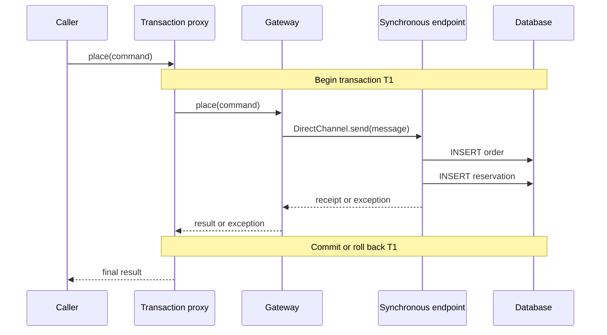

# Flow transaction boundaries

## 1. Objectives and scope

In the **SPRING_INTEGRATION_CORE** module, this lesson belongs to the **Transaction support** chapter and focuses on how to determine the commit and rollback scope of a message flow. Building on `Message`, `MessageChannel`, endpoints, gateways, and Java DSL, learners need to distinguish a business flow from an actual transaction.

After this lesson, you will be able to:

- Point out where a transaction starts and ends on a flow diagram.
- Explain why changing a `DirectChannel` to an `ExecutorChannel` or `QueueChannel` can change consistency.
- Choose where to place a transaction: a facade calling a gateway, a poller, or endpoint advice.
- Predict the impact of transformers, routers, filters, aggregators, and error flows on processing outcomes.
- Design verification scenarios using committed data, rather than looking only at send-success notifications.

This lesson uses the **imperative** model, with JDBC transactions managed by `PlatformTransactionManager`. The examples use Java 17 or later and Java DSL in the Spring Integration 6/7 API style. For reactive flows, the transaction context is managed via reactive mechanisms; do not mechanically apply the thread-based reasoning from this lesson.

## 2. A transaction boundary is an execution and resource scope

Suppose an order creation request passes through:

```text
gateway → orderInput → insert order → reservationInput → insert reservation
```

The business requirement is: if reserving stock fails, the order record must also be rolled back.

A transaction boundary must answer four questions:

| Question | Concrete example |
| --- | --- |
| Who opens the transaction? | The proxy of `OrderFacade.place()` |
| What work runs within that scope? | Calling the gateway, inserting the order, inserting the reservation |
| Which resources participate? | JDBC connection from the DataSource managed by the transaction manager |
| Who decides completion? | The transaction interceptor when the facade method completes |

In Spring imperative transactions, the context is bound to the executing thread. A synchronous flow can continue using the existing context; handing off work to another thread does not automatically carry the transaction along. Spring Integration provides integration points with Spring's transaction infrastructure, including pollers and advices. [Spring Integration: Transaction Support](https://docs.spring.io/spring-integration/reference/transactions.html)

Distinguish **the logical boundary of a flow** from **the transaction boundary**. A diagram with ten endpoints may run inside one transaction, multiple independent transactions, or no transaction at all. The number of endpoints does not decide this.

Even when all endpoints run on the same thread, you must still verify:

1. A transaction has been opened and has not yet completed.
2. Data access code uses a resource participating in the right transaction manager.
3. Propagation configuration does not intentionally split the scope.
4. Errors propagate to the place that decides rollback according to the configured rules.

For example, an HTTP call sending a payment request remains an effect outside the JDBC rollback scope. The fact that the call occurs on the same thread as SQL operations does not turn the payment system into part of the database transaction.

## 3. Tracing threads across channel types

`DirectChannel` invokes the handler on the sender's thread. `ExecutorChannel` delegates work to an executor and therefore provides no guarantee of sharing a transaction between sender and handler. `QueueChannel` buffers messages for a receiver to fetch later; a successful send only confirms placing the message into the queue. [Spring Integration: Configuring Message Channels](https://docs.spring.io/spring-integration/reference/channel/configuration.html), [Message Channel Implementations](https://docs.spring.io/spring-integration/reference/channel/implementations.html)

| Configuration | What to examine when determining boundaries |
| --- | --- |
| `DirectChannel` | Handler runs on the current call stack; check the caller's transaction |
| `ExecutorChannel` | Define a separate transaction for the worker's task |
| Standard `QueueChannel` | Separates the producer's transaction from the consumer's transaction |
| `PublishSubscribeChannel` without executor | Subscribers are usually invoked synchronously; also check dispatch and error settings |
| `PublishSubscribeChannel` with executor | Do not treat all branches as sharing a single transaction |
| `RendezvousChannel` | Sender waits for handoff; waiting does not prove both sides share a transaction |

An executor may have a mode that runs tasks directly on the caller thread in certain situations. Therefore, observing the same thread name once is not enough to conclude that an asynchronous design guarantees an end-to-end transaction.

### 3.1. Synchronous flow



Returning from the gateway to the facade is not yet the moment the facade's transaction completes. The transaction interceptor still has to process scope completion; commit failures can also occur after the method body has returned.

### 3.2. Flow with asynchronous handoff

```text
Thread A:
  BEGIN T1
    insert order
    ExecutorChannel.send(message) → executor accepts task
    facade continues remaining work
  COMMIT T1

Thread B:
  process message
    reservation fails
    report worker error
```

The handoff point is where downstream work is no longer covered by the sender's transaction. **This does not mean transaction T1 commits immediately during the `send()` call**: T1 still finishes at the scope that opened it. Two threads can interleave, so the worker may even fail before T1 commits while still not sharing T1.

To roll back the worker's operations, a valid transaction must be opened or joined on the worker side. That transaction does not automatically undo a producer transaction that has already committed.

## 4. Example: placing the transaction outside a synchronous gateway

The following example simulates inserting an order and a reservation into the same database. The facade itself opens the transaction, and the entire flow is invoked synchronously before the facade completes.

### 4.1. Prerequisites

The application needs:

- `spring-integration-core`, `spring-jdbc`, `spring-tx`, and an appropriate database driver.
- A configured `DataSource`.
- The two tables below created.
- The Java types placed in the same package `demo.tx`, with each public type in its own file.

Configuration classes are loaded into the Spring context via the application's configuration mechanism. The example explicitly declares the transaction manager and `JdbcTemplate` using the same DataSource.

```sql
CREATE TABLE demo_order (
    order_id VARCHAR(64) PRIMARY KEY,
    quantity INTEGER NOT NULL
);

CREATE TABLE demo_reservation (
    order_id VARCHAR(64) PRIMARY KEY,
    quantity INTEGER NOT NULL,
    FOREIGN KEY (order_id) REFERENCES demo_order(order_id)
);
```

### 4.2. Data types and gateway

```java
package demo.tx;

public record OrderCommand(String orderId, int quantity) {
    public OrderCommand {
        if (orderId == null || orderId.isBlank() || quantity <= 0) {
            throw new IllegalArgumentException("Invalid order details");
        }
    }
}
```

```java
package demo.tx;

public record OrderReceipt(String orderId, String status) {
}
```

```java
package demo.tx;

import org.springframework.integration.annotation.MessagingGateway;

@MessagingGateway(defaultRequestChannel = "orderInput")
public interface OrderGateway {
    OrderReceipt place(OrderCommand command);
}
```

The gateway creates a message from the Java call. The example does not configure an error flow to convert exceptions into a normal result.

### 4.3. Facade holding the business scope

```java
package demo.tx;

import org.springframework.transaction.annotation.Transactional;

public class OrderFacade {

    private final OrderGateway gateway;

    public OrderFacade(OrderGateway gateway) {
        this.gateway = gateway;
    }

    @Transactional(transactionManager = "orderTxManager")
    public OrderReceipt place(OrderCommand command) {
        return gateway.place(command);
    }
}
```

Callers must invoke the Spring-managed `OrderFacade` bean. If the object is instantiated with `new` outside the container or calls its own method via `this` in default proxy mode, the annotation may not be intercepted. [Spring Framework: Using @Transactional](https://docs.spring.io/spring-framework/reference/data-access/transaction/declarative/annotations.html)

### 4.4. Java DSL configuration

```java
package demo.tx;

import javax.sql.DataSource;

import org.springframework.beans.factory.annotation.Qualifier;
import org.springframework.context.annotation.Bean;
import org.springframework.context.annotation.Configuration;
import org.springframework.integration.annotation.IntegrationComponentScan;
import org.springframework.integration.channel.DirectChannel;
import org.springframework.integration.config.EnableIntegration;
import org.springframework.integration.dsl.IntegrationFlow;
import org.springframework.jdbc.core.JdbcTemplate;
import org.springframework.jdbc.datasource.DataSourceTransactionManager;
import org.springframework.transaction.PlatformTransactionManager;
import org.springframework.transaction.annotation.EnableTransactionManagement;

@Configuration
@EnableIntegration
@EnableTransactionManagement
@IntegrationComponentScan(basePackageClasses = OrderGateway.class)
public class OrderFlowConfig {

    @Bean
    public PlatformTransactionManager orderTxManager(DataSource dataSource) {
        return new DataSourceTransactionManager(dataSource);
    }

    @Bean
    public JdbcTemplate orderJdbc(DataSource dataSource) {
        return new JdbcTemplate(dataSource);
    }

    @Bean
    public DirectChannel orderInput() {
        return new DirectChannel();
    }

    @Bean
    public DirectChannel reservationInput() {
        return new DirectChannel();
    }

    @Bean
    public OrderFacade orderFacade(OrderGateway gateway) {
        return new OrderFacade(gateway);
    }

    @Bean
    public IntegrationFlow orderFlow(
            @Qualifier("orderInput") DirectChannel orderInput,
            @Qualifier("reservationInput") DirectChannel reservationInput,
            JdbcTemplate orderJdbc) {

        return IntegrationFlow.from(orderInput)
                .handle(OrderCommand.class, (command, headers) -> {
                    orderJdbc.update(
                            "INSERT INTO demo_order(order_id, quantity) VALUES (?, ?)",
                            command.orderId(), command.quantity());
                    return command;
                })
                .channel(reservationInput)
                .handle(OrderCommand.class, (command, headers) -> {
                    // Simulate reservation rule to observe rollback.
                    if (command.quantity() > 100) {
                        throw new IllegalStateException("Insufficient stock to reserve");
                    }

                    orderJdbc.update(
                            "INSERT INTO demo_reservation(order_id, quantity) VALUES (?, ?)",
                            command.orderId(), command.quantity());

                    return new OrderReceipt(command.orderId(), "RESERVED");
                })
                .get();
    }
}
```

`@IntegrationComponentScan` registers the gateway interface. `@EnableTransactionManagement` enables annotation processing on the facade bean.

In an application with multiple DataSources or multiple `JdbcTemplate` beans, add appropriate qualifiers at injection points to select the right resource.

### 4.5. Predicting the outcome

| Call through facade bean | Result outside proxy | Data after transaction completes |
| --- | --- | --- |
| `place(new OrderCommand("O-101", 2))` | Receives `RESERVED` receipt | Both order and reservation records exist |
| `place(new OrderCommand("O-102", 150))` | Receives exception | No `O-102` order; no reservation |
| Call with an existing `orderId` | Receives data access error | New call's transaction fails; old data remains |

In the `O-102` case, the first INSERT statement ran, but was not committed. The exception from the reservation step travels back through the channels, gateway, and facade to the transaction interceptor.

By default, `RuntimeException` and `Error` trigger rollback; checked exceptions require explicit rules. Evaluate based on the exception actually reaching the interceptor, because handler errors may be wrapped by the framework in a messaging exception. [Spring Framework: Rolling Back a Declarative Transaction](https://docs.spring.io/spring-framework/reference/data-access/transaction/declarative/rolling-back.html)

This is an atomic simulation of two write operations. It does not yet model inventory contention, duplicate prevention, or calling a payment system.

## 5. Does putting @Transactional on a handler cover downstream steps?

Suppose the flow is:

```text
DirectChannel
  → createOrder() with @Transactional
  → reservation handler
  → return result
```

If there is no outer transaction, the proxy can open T1 upon entering `createOrder()`, then commit T1 when that method finishes. Only afterward does the endpoint send the result to the reservation handler. An error in the reservation step arrives too late to roll back T1.

Conversely, in the facade example, if `createOrder()` uses `REQUIRED` propagation, it joins the transaction already opened by the facade; the outer scope remains active while subsequent endpoints run.

The same issue appears with advice on a reply-producing handler: a standard `TransactionInterceptor` in the request handler advice chain may wrap only internal request handling. `TransactionHandleMessageAdvice` wraps `handleMessage()`, including forwarding the result to the synchronous downstream flow. [Spring Integration: Transaction Support for Message Handlers](https://docs.spring.io/spring-integration/reference/handler-advice/tx-handle-message.html)

### 5.1. Opening a transaction from an endpoint with appropriate advice

This is an **alternative** to placing the transaction at the facade. The advice declaration can be placed in the configuration class:

```java
@Bean
public TransactionInterceptor flowTransactionAdvice(
        @Qualifier("orderTxManager") PlatformTransactionManager txManager) {

    return new TransactionInterceptorBuilder(true)
            .transactionManager(txManager)
            .propagation(Propagation.REQUIRED)
            .build();
}
```

Additional imports:

```java
import org.springframework.integration.transaction.TransactionInterceptorBuilder;
import org.springframework.transaction.annotation.Propagation;
import org.springframework.transaction.interceptor.TransactionInterceptor;
```

Apply this advice to the first endpoint that should serve as the starting point. The example below is a standalone flow reusing the data types, tables, and `orderJdbc` bean above:

```java
@Bean
public IntegrationFlow advisedOrderFlow(
        JdbcTemplate orderJdbc,
        @Qualifier("flowTransactionAdvice") TransactionInterceptor txAdvice) {

    return IntegrationFlow.from("advisedOrderInput")
            .handle(OrderCommand.class, (command, headers) -> {
                orderJdbc.update(
                        "INSERT INTO demo_order(order_id, quantity) VALUES (?, ?)",
                        command.orderId(), command.quantity());
                return command;
            }, endpoint -> endpoint.advice(txAdvice))
            .handle(OrderCommand.class, (command, headers) -> {
                if (command.quantity() > 100) {
                    throw new IllegalStateException("Insufficient stock to reserve");
                }
                orderJdbc.update(
                        "INSERT INTO demo_reservation(order_id, quantity) VALUES (?, ?)",
                        command.orderId(), command.quantity());
                return new OrderReceipt(command.orderId(), "RESERVED");
            })
            .get();
}
```

This flow must be invoked in a request/reply manner, such as via a gateway with `defaultRequestChannel = "advisedOrderInput"`. Do not send directly and omit reply handling when the final handler returns a result.

The builder's `true` argument creates the advice variant for `handleMessage`. It does not make transactions cross executors or queues. Explicitly configuring the transaction manager also avoids selecting the wrong manager when the application has multiple beans. [TransactionInterceptorBuilder API](https://docs.spring.io/spring-integration/api/org/springframework/integration/transaction/TransactionInterceptorBuilder.html), [TransactionHandleMessageAdvice API](https://docs.spring.io/spring-integration/docs/current/api/org/springframework/integration/transaction/TransactionHandleMessageAdvice.html)

When choosing between a facade and endpoint advice, pick the starting point that accurately expresses the business unit of work and can be observed clearly. There is no need to open a new transaction on every endpoint simply because advice can be configured.

## 6. Poller: bringing the message receive operation into the boundary

For a consumer reading from a queue, there are two distinct operations:

```text
receive message → process message
```

If a transaction is opened only inside the processing method, `receive()` has already happened beforehand. When the receive source supports transactions, a poller transaction allows receiving and synchronous processing to sit within the same unit of work. [Spring Integration: Message Endpoints — Transaction Support](https://docs.spring.io/spring-integration/reference/endpoint.html#transaction-support)

### 6.1. Transactional poller example

Place the following beans in the configuration class. They reuse `OrderCommand`, `orderJdbc`, `orderTxManager`, and the two tables from the earlier example:

```java
@Bean
public QueueChannel queuedOrders() {
    return new QueueChannel(100);
}

@Bean
public IntegrationFlow queuedOrderFlow(
        QueueChannel queuedOrders,
        JdbcTemplate orderJdbc,
        @Qualifier("orderTxManager") PlatformTransactionManager txManager) {

    return IntegrationFlow.from(queuedOrders)
            .handle(message -> {
                OrderCommand command = (OrderCommand) message.getPayload();

                orderJdbc.update(
                        "INSERT INTO demo_order(order_id, quantity) VALUES (?, ?)",
                        command.orderId(), command.quantity());

                if (command.quantity() > 100) {
                    throw new IllegalStateException("Insufficient stock to reserve");
                }

                orderJdbc.update(
                        "INSERT INTO demo_reservation(order_id, quantity) VALUES (?, ?)",
                        command.orderId(), command.quantity());
            }, endpoint -> endpoint.poller(
                    Pollers.fixedDelay(Duration.ofMillis(500))
                            .maxMessagesPerPoll(1)
                            .receiveTimeout(0)
                            .transactional(txManager)))
            .get();
}
```

Additional imports:

```java
import java.time.Duration;
import org.springframework.integration.channel.QueueChannel;
import org.springframework.integration.dsl.Pollers;
```

The handler used here is a one-way consumer that produces no reply. The poller opens a transaction on the poll execution thread; an error in the handler causes the JDBC transaction to fail.

`transactional(txManager)` attaches transaction advice to the polling task. `maxMessagesPerPoll(1)` keeps the example easy to observe, and `receiveTimeout(0)` does not wait when the queue is empty. The maximum number of messages per scheduled poll is not a declaration of a business batch transaction. [PollerSpec API](https://docs.spring.io/spring-integration/api/org/springframework/integration/dsl/PollerSpec.html)

### 6.2. Important limitation of the example

`new QueueChannel(100)` uses an in-memory queue. Once the poller pulls a message out, a database rollback **does not automatically return the message to the queue**.

For the message `OrderCommand("O-201", 150)`, the expected outcome is:

1. The message is taken from the queue.
2. The order INSERT runs inside the poller's transaction.
3. The handler throws an exception.
4. The INSERT is rolled back.
5. The message does not automatically reappear in the queue merely because `.transactional(txManager)` is configured.

This is why you must separately evaluate the ability to roll back **business data** and the ability to recover **received messages**. For redelivery, the storage source and receive operation must support an appropriate mechanism.

## 7. Durable queues: chaining local transactions

When durable handoff is needed, one option is a JDBC-backed queue using `JdbcChannelMessageStore`. This requires the Spring Integration schema, a database-specific query provider, and a transaction manager managing the corresponding DataSource. Simply adding a message store bean that the queue does not actually use will not change the queue's properties. [Spring Integration: JDBC Message Store](https://docs.spring.io/spring-integration/reference/jdbc/message-store.html)

Desired model when the message store and business tables participate in the same JDBC transaction:

```text
Producer — transaction T1:
  write intake data
  enqueue message into JDBC-backed queue
  COMMIT T1

Consumer — poller transaction T2:
  receive/remove message from JDBC-backed queue
  write processing data
  COMMIT T2 or ROLLBACK T2
```

This is still **two transactions**. If T2 rolls back, removing the message can be rolled back together with the processing data when the configuration and store mechanism support it. T1, once committed, is not undone along with it.

With this design, verify:

- Whether the DataSource used by the message store is the same resource managed by the poller's transaction manager.
- Whether message retrieval actually happens inside the transaction.
- Whether the serialization mechanism supports the payload and headers to be stored.
- When processing fails repeatedly, whether the message is retried or routed to an error-handling channel.
- How the impact of duplicate messages is controlled using business keys or idempotent operations.

If the database and broker are two separate resources, a local JDBC transaction does not automatically make both atomic. One architectural option is the transactional outbox: write business data and an event record in the same database transaction, then have another process forward the event. The forwarding process may resend upon failure, so the receiving side still needs proper deduplication. [Spring: Outbox Pattern Strategies](https://spring.io/blog/2023/10/24/a-use-case-for-transactions-adapting-to-transactional-outbox-pattern/)

Business state examples should clearly reflect two stages: `ACCEPTED` after T1 and `RESERVED` after T2. Do not return `RESERVED` solely based on the producer having placed the message in the queue.

## 8. Propagation and transaction managers change boundaries

Two endpoints running on the same thread can still belong to different scopes due to propagation:

| Propagation | Effect when crossing the intercepted method |
| --- | --- |
| `REQUIRED` | Joins a matching existing transaction; opens one if none exists |
| `REQUIRES_NEW` | Suspends the outer transaction and executes in an independent physical transaction |
| `NOT_SUPPORTED` | Executes outside a transaction, suspending an existing transaction if supported |
| `NESTED` | Typically uses savepoints when supported by the transaction manager and resource |

`REQUIRES_NEW` is not a way to "pass a transaction to another thread." It creates an independent scope where the call is handled. The inner transaction can commit and then the outer transaction can roll back. With `REQUIRED`, the rollback-only state of an inner scope can cause the outer scope to end with `UnexpectedRollbackException`. [Spring Framework: Transaction Propagation](https://docs.spring.io/spring-framework/reference/data-access/transaction/declarative/tx-propagation.html)

For example, audit requirements must be clarified before choosing propagation:

```text
T1:
  insert order
  call AuditService through proxy:
    T2 with REQUIRES_NEW:
      insert "attempted to create order"
      COMMIT T2
  reservation fails
  ROLLBACK T1
```

Having the "attempted to create order" record remain makes sense if the audit needs to record attempt traces. If the audit text is "order created successfully," this same configuration records an incorrect business state.

You must also read the transaction manager names. For instance, if one endpoint uses the manager for DataSource A and another writes to DataSource B, staying on the same thread is not enough to conclude that both databases commit atomically. The scope of guarantees depends on the resources actually being managed.

## 9. Exceptions, errorChannel, and rollback decisions

### 9.1. Distinguishing synchronous errors from asynchronous error notifications

In a synchronous call stack, exceptions can propagate back to the caller. With asynchronous processing, the framework can publish an `ErrorMessage` to an error channel according to configuration. Receiving an error message does not mean the producer's transaction is still open. [Spring Integration: Error Handling](https://docs.spring.io/spring-integration/reference/error-handling.html)

Example: the producer already committed the `ACCEPTED` state, and the worker failed while reserving stock. An error flow can update the order to `RESERVATION_FAILED` in a separate transaction. That is a business state transition after failure, not a rollback of T1.

### 9.2. Turning exceptions into replies changes what the caller observes

A gateway can route errors to an error flow and receive a business reply back. When that reply is a normal object, the facade can complete normally even though a processing step failed. [Spring Integration: Messaging Gateways — Error Handling](https://docs.spring.io/spring-integration/reference/gateway.html#gateway-error-handling)

Therefore, define the contract clearly:

| Meaning of the error | Required behavior |
| --- | --- |
| The unit of data writes must be canceled | Let an appropriate exception reach the transaction interceptor or intentionally mark rollback-only |
| The request is rejected, but the rejection must be recorded | Return a rejection result and design a transaction to persist that state |
| Producer committed, consumer failed | Use retry, failure states, or compensation per design |

You cannot assume every normally returning call definitely committed: a participant may have marked rollback-only, or the commit itself may fail. Conversely, merely logging an error and returning normally does not request a rollback.

### 9.3. Retries must be placed at the right scope

Compare two structures:

```text
A. Retry outside transaction:
   attempt 1 → BEGIN T1 → error → ROLLBACK T1
   attempt 2 → BEGIN T2 → success → COMMIT T2

B. Transaction outside retry:
   BEGIN T1
     attempt 1 → error
     attempt 2 → continue inside T1
   complete T1
```

Structure B can continue inside a transaction already marked rollback-only or holding resources after an error. Besides advice ordering, determine whether the advice wraps a single handler, all of `handleMessage()`, or a poll cycle. A recovery callback returning a normal result can also alter the exception path. [Spring Integration: Provided Advice Classes — Retry Advice](https://docs.spring.io/spring-integration/reference/handler-advice/classes.html#retry-advice)

Before enabling retries for the order example, define how to detect an already processed order and how to handle a reply lost after data committed. Primary keys prevent inserting two rows with the same ID, yet the application must still interpret the redelivery into an appropriate business outcome.

## 10. Where do transformers, routers, filters, and aggregators sit in the boundary?

| Component | What to analyze |
| --- | --- |
| Transformer | Transforming a payload does not open a transaction; data writes inside still need a valid scope |
| Router | Trace each branch's channel; a branch with an executor can detach from the caller's transaction |
| Filter | Discarding a message may be normal completion; configure rejection behavior per business requirements |
| Aggregator | Distinguish the transaction receiving each message from the one releasing the whole group |
| Service activator | Determine whether the transaction wraps the service method or also sending replies downstream |
| Gateway | Determine whether requests are synchronous or asynchronous and how errors map to exceptions or replies |

An easily misunderstood filter example:

```text
BEGIN T1
  insert order
  filter evaluates false and ends processing normally
COMMIT T1
```

If business rules require that discarding the message means canceling the order, express that through an explicit error contract or state transition. Do not infer rollback from the shape of a diagram.

An aggregator stores messages by group and releases them when a condition is met. Messages arriving at different times are not automatically combined into a single transaction spanning from the first message. Check the message store type and release execution path; timeout-triggered releases may belong to a different execution than message arrival. [Spring Integration: Aggregator](https://docs.spring.io/spring-integration/reference/aggregator.html)

Example group with three order lines:

```text
message 1 → save group in T1 → COMMIT
message 2 → save group in T2 → COMMIT
message 3 → save group and release in current scope
```

If post-release processing fails, you cannot assume T1 and T2, already committed, will roll back. Design group recovery, redelivery, and protection against duplicate business side effects.

## 11. External side effects and post-commit callbacks

A flow may write via JDBC while also moving files, sending emails, or calling APIs. Sharing the same thread does not give those side effects rollback capability.

Post-commit callbacks are useful for running an action only when the database succeeds. However, if the callback fails, the already committed database does not revert to its previous state. Transaction synchronization only coordinates execution timing; it does not turn non-transactional resources into transactional ones. [Spring Integration: Transaction Synchronization](https://docs.spring.io/spring-integration/reference/transactions.html#transaction-synchronization)

Scenario to anticipate:

```text
COMMIT order succeeds
  → process stops before sending email
  → order exists without an email sent
```

If the action must be retried after a crash, persist the intent in a durable store within the appropriate transaction. A simple callback does not replace durable work persistence and recovery.

Similarly, a `PseudoTransactionManager` used to trigger callbacks based on processing outcomes does not provide JDBC rollback capability like a real transaction manager.

## 12. Practicing boundary verification

This section describes scenarios learners can run on the example; do not assume every configuration has been pre-executed.

### 12.1. Observation matrix

| Change or operation | Observations to collect | Expected result |
| --- | --- | --- |
| Facade + direct channel, quantity = 2 | Caller result and both tables | Both records exist |
| Facade + direct channel, quantity = 150 | Exception and query on a connection after caller finishes | No new order |
| Direct gateway call with no outer transaction | Data after reservation-step error | First INSERT may have autocommitted |
| Change channel between steps to executor | Thread, commit timing, data after worker error | Shared rollback is no longer guaranteed |
| Transactional poller + in-memory queue | Database and messages remaining in queue | Database rolls back; message does not return automatically |
| Poller + suitable transactional store | Receive operation and SQL after rollback | Message can be re-received per store mechanism |
| Open transaction only on first write step | Service method completion point and downstream error | First step may already commit |
| `handleMessage` advice + synchronous downstream | Downstream error and data | Rolled back together within advice scope |

When testing executor configurations, use a controlled synchronization mechanism such as a latch to cleanly separate "producer completed transaction" from "worker started processing." Arbitrary sleeps make outcomes depend on machine speed.

### 12.2. Logging to locate split points

You can add the following helper to your practice code:

```java
import org.springframework.transaction.support.TransactionSynchronizationManager;

static void traceBoundary(String step) {
    System.out.printf(
            "step=%s thread=%s txActive=%s txName=%s%n",
            step,
            Thread.currentThread().getName(),
            TransactionSynchronizationManager.isActualTransactionActive(),
            TransactionSynchronizationManager.getCurrentTransactionName());
}
```

Place calls before the gateway, inside each handler, and on the worker. Include `orderId` or a correlation ID in application logs to correlate records belonging to the same request.

`txActive=true` indicates that an actual transaction is active on the thread at the point of observation; it does not prove all resources are enlisted or that two points belong to the same physical transaction. Do not use the transaction name as a unique identifier.

### 12.3. Checking data after the scope finishes

Do not let an automatic test transaction mask the boundary you want to observe:

- Call the proxied facade and query the data again after the call finishes.
- For asynchronous flows, wait on a deterministic completion condition and read using an appropriate transaction/connection.
- Observe both database state and message state.
- Distinguish "row not visible because it hasn't committed yet" from "row was rolled back."
- When testing retries, count business side effects using a stable key, not just log counts.

If you want to actively control the scope in practice exercises, you can use `TransactionTemplate` to wrap synchronous gateway calls. This is the programmatic option for imperative transactions. [Spring Framework: Programmatic Transaction Management](https://docs.spring.io/spring-framework/reference/data-access/transaction/programmatic.html)

Do not place `@Transactional` on a `@Bean` method returning an `IntegrationFlow` expecting every future message to have a transaction. That method executes when constructing the configuration, whereas individual message processing happens later.

## 13. How to define boundaries before implementing a flow

For each new flow, write a concrete contract, such as:

> After the API returns RESERVED, the database must contain both the order and the reservation record. If reserving stock fails in the synchronous flow, no new order may exist.

Then mark each aspect in order:

1. **Starting point:** call through a proxied facade, transaction advice, poller, or transaction-configured listener.
2. **Execution threads:** where the same call stack continues, where handoffs occur, and where callbacks run later.
3. **Resources:** databases, message stores, brokers, files, and external APIs; which manager governs which resource.
4. **Error path:** whether exceptions reach the interceptor or are turned into normal results by recovery/error flows.
5. **Completion point:** where the caller receives results after commit, or where the producer only confirms intake.
6. **Recovery:** where messages are redelivered from, which effects may duplicate, and which require compensation.

A good boundary description can be read as a sentence: "The facade opens JDBC transaction T1; both handlers execute synchronously and write to the same DataSource; reservation errors propagate out of the proxy so the entire order creation rolls back." For asynchronous flows, describe T1 and T2 separately along with the business state linking them.
