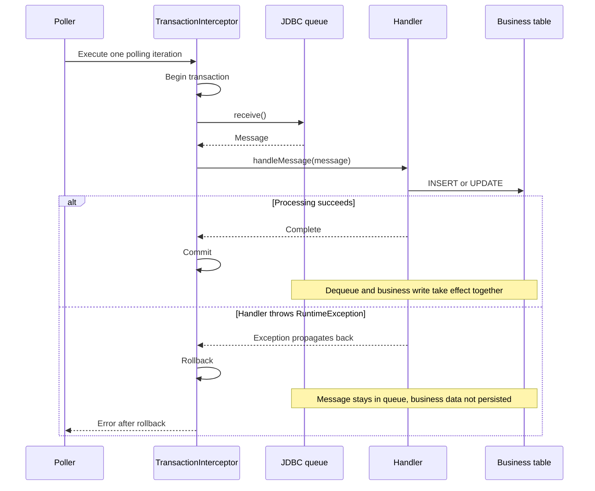

# Transactions on pollers

Transactions on pollers allow starting a transaction **before receiving a message** and completing it after synchronous processing finishes. As a result, receiving from a transaction-capable resource can commit or roll back together with participating business updates.

In Spring Integration Core, this mechanism connects `Message`, `MessageChannel`, endpoints, and Java DSL to data consistency requirements. Declaring a poller as transactional only establishes the transaction boundary; actual guarantees still depend on the transaction manager, resources, and how the flow crosses threads.

## 1. The problem: message received, but business processing fails

Suppose a queue holds request `ORDER-1001`. A poller retrieves the request, inserts an intake record into the database, and then invokes a business validation step. The final step throws an error.

Two separate changes must be considered:

1. The message has been removed from the queue.
2. The business record has been written to the database.

If `@Transactional` is placed only on the business processing method, the transaction usually begins after the poller has already received the message. The database may roll back, but the prior receive operation is not necessarily in the same transaction. If the source is an in-memory queue, the retrieved message will not automatically return.

The desired boundary is:

```text
BEGIN
  receive() from a transaction-capable queue
  process the message on the same thread
  write data via a transaction-participating resource
COMMIT on success
ROLLBACK when an error matching rollback rules escapes
```

Spring Integration provides transaction advice on pollers to wrap the receive and forwarding operation itself. This is why configuring a transaction on the poller has a different meaning than wrapping only a service at the end of the flow. [Poller Transaction Support reference](https://docs.spring.io/spring-integration/reference/transactions.html#poller-transaction-support).

## 2. Where do pollers sit in a flow?

Both common endpoint types can use a poller:

| Endpoint | Where does the poller receive from? | Example |
| --- | --- | --- |
| `SourcePollingChannelAdapter` | A `MessageSource` | Reading rows via a JDBC inbound adapter, polling files via a file inbound adapter |
| `PollingConsumer` | A `PollableChannel` | A service activator receiving from a `QueueChannel` |

A `DirectChannel` dispatches messages directly to subscribers; a service activator receiving from this channel type does not need a poller. With a `QueueChannel`, a consuming endpoint needs an explicit poller or an appropriate default poller. [Message Endpoints reference](https://docs.spring.io/spring-integration/reference/endpoint.html).

Three units must be kept distinct:

- **Scheduled trigger firing:** the trigger allowing the polling task to run.
- **Receive-and-forward iteration:** receiving one `Message` and processing/forwarding it synchronously.
- **Business batch:** could be a payload containing a list of multiple items inside a single `Message`.

In a typical imperative flow, the poller's advice wraps each receive-and-forward iteration. For example, with `maxMessagesPerPoll(3)`, `REQUIRED`, and no outer transaction, the sequence can be:

```text
Single trigger firing:
  transaction A: receive M1 -> process M1 -> commit
  transaction B: receive M2 -> process M2 -> commit
  transaction C: receive M3 -> error -> rollback
```

Rolling back C does not undo the commits of A and B. `maxMessagesPerPoll` limits the number of polling iterations per cycle; it does not define an atomic transaction for the whole cycle. Conversely, if a single receive returns a `Message<List<Order>>`, processing that list can still belong to the same receive-and-forward iteration. How advice is placed inside the loop can be seen in [AbstractPollingEndpoint 6.5.10 source](https://github.com/spring-projects/spring-integration/blob/v6.5.10/spring-integration-core/src/main/java/org/springframework/integration/endpoint/AbstractPollingEndpoint.java).

## 3. Transaction lifecycle

The following diagram assumes the JDBC queue and business table use the same `DataSource`, the same transaction manager, synchronous processing, and runtime errors propagating outward:



The deciding factor is not the number of endpoints. Trace the execution path from `receive()` to the end point: which resources participate, which thread executes, and whether exceptions return to the transaction advice.

## 4. Practicing Java DSL with a JDBC queue

### 4.1. Objectives and prerequisites for running the example

The example uses Spring Integration 6.5.x APIs, Java 17 or later, and compatible Spring Framework versions. When placed in a Spring Boot project, use the version set managed by your project's BOM and avoid mixing Spring versions arbitrarily.

Required dependencies on the classpath:

| Dependency | Role |
| --- | --- |
| `org.springframework.integration:spring-integration-core` | Channels, endpoints, Java DSL |
| `org.springframework.integration:spring-integration-jdbc` | `JdbcChannelMessageStore` and sample schema |
| `org.springframework:spring-jdbc` | `JdbcTemplate`, embedded database, JDBC transaction manager |
| `com.h2database:h2` | Database for the lab |
| `org.junit.jupiter:junit-jupiter` | Test snippet below |
| `org.awaitility:awaitility` | Waiting for asynchronous conditions in tests |

The example creates an in-memory H2 database. The store uses JDBC so it can participate in rollback, but this database does not retain data after shutdown. To verify recovery after a process stops, you need a persistent database that does not reinitialize the schema on every run.

`JdbcChannelMessageStore` requires a query provider matching the database and the required tables before endpoints start. [JDBC Message Store reference](https://docs.spring.io/spring-integration/reference/jdbc/message-store.html).

### 4.2. Complete configuration

Place the configuration below in your application's lab package. `orderInbox` is the request-receiving queue; `pollerErrors` is only used to collect errors during testing. The worker has `autoStartup(false)` so the test can explicitly control when it runs.

```java
import javax.sql.DataSource;
import java.time.Duration;
import java.util.concurrent.atomic.AtomicBoolean;

import org.springframework.beans.factory.annotation.Qualifier;
import org.springframework.context.annotation.Bean;
import org.springframework.context.annotation.Configuration;
import org.springframework.integration.channel.QueueChannel;
import org.springframework.integration.config.EnableIntegration;
import org.springframework.integration.dsl.IntegrationFlow;
import org.springframework.integration.dsl.Pollers;
import org.springframework.integration.jdbc.store.JdbcChannelMessageStore;
import org.springframework.integration.jdbc.store.channel.H2ChannelMessageStoreQueryProvider;
import org.springframework.integration.store.MessageGroupQueue;
import org.springframework.jdbc.core.JdbcTemplate;
import org.springframework.jdbc.datasource.DataSourceTransactionManager;
import org.springframework.jdbc.datasource.embedded.EmbeddedDatabase;
import org.springframework.jdbc.datasource.embedded.EmbeddedDatabaseBuilder;
import org.springframework.jdbc.datasource.embedded.EmbeddedDatabaseType;
import org.springframework.transaction.PlatformTransactionManager;
import org.springframework.transaction.support.TransactionSynchronizationManager;

@Configuration
@EnableIntegration
public class PollerTransactionConfig {

    @Bean(destroyMethod = "shutdown")
    public EmbeddedDatabase dataSource() {
        EmbeddedDatabase database = new EmbeddedDatabaseBuilder()
                .generateUniqueName(true)
                .setType(EmbeddedDatabaseType.H2)
                .addScript("classpath:org/springframework/integration/jdbc/schema-h2.sql")
                .build();

        new JdbcTemplate(database).execute("""
                create table order_audit (
                    order_id varchar(64) primary key
                )
                """);
        return database;
    }

    @Bean
    public JdbcTemplate jdbcTemplate(DataSource dataSource) {
        return new JdbcTemplate(dataSource);
    }

    @Bean
    public PlatformTransactionManager transactionManager(DataSource dataSource) {
        return new DataSourceTransactionManager(dataSource);
    }

    @Bean
    public JdbcChannelMessageStore orderStore(DataSource dataSource) {
        JdbcChannelMessageStore store = new JdbcChannelMessageStore(dataSource);
        store.setChannelMessageStoreQueryProvider(
                new H2ChannelMessageStoreQueryProvider());
        store.setRegion("poller-tx-lab");
        return store;
    }

    @Bean
    public QueueChannel orderInbox(JdbcChannelMessageStore orderStore) {
        return new QueueChannel(new MessageGroupQueue(orderStore, "orders"));
    }

    @Bean
    public QueueChannel pollerErrors() {
        return new QueueChannel(100);
    }

    @Bean
    public LabOrderHandler orderHandler(JdbcTemplate jdbcTemplate) {
        return new LabOrderHandler(jdbcTemplate);
    }

    @Bean
    public IntegrationFlow orderFlow(
            @Qualifier("orderInbox") QueueChannel orderInbox,
            LabOrderHandler orderHandler,
            PlatformTransactionManager transactionManager) {

        return IntegrationFlow.from(orderInbox)
                .handle(orderHandler, "accept", endpoint -> endpoint
                        .id("orderWorker")
                        .autoStartup(false)
                        .poller(Pollers.fixedDelay(Duration.ofSeconds(1))
                                .maxMessagesPerPoll(1)
                                .receiveTimeout(0)
                                .transactional(transactionManager)
                                .errorChannel("pollerErrors")))
                .get();
    }

    public static class LabOrderHandler {

        private final JdbcTemplate jdbcTemplate;
        private final AtomicBoolean fail = new AtomicBoolean(true);

        public LabOrderHandler(JdbcTemplate jdbcTemplate) {
            this.jdbcTemplate = jdbcTemplate;
        }

        public void setFail(boolean value) {
            this.fail.set(value);
        }

        public void accept(String orderId) {
            if (!TransactionSynchronizationManager.isActualTransactionActive()) {
                throw new IllegalStateException("Handler requires an active transaction");
            }

            jdbcTemplate.update(
                    "insert into order_audit(order_id) values (?)", orderId);

            if (fail.get()) {
                throw new IllegalStateException("Simulated error after INSERT");
            }
        }
    }
}
```

`QueueChannel` here receives a `MessageGroupQueue` backed by a JDBC store. The bean name `orderInbox` and the group ID `orders` serve two different purposes: the bean name wires the configuration; the group ID identifies the message group inside the store. If you need to re-read a persisted queue after restart, the group ID and region must stay consistent. [MessageGroupQueue reference](https://github.com/spring-projects/spring-integration/blob/v6.5.10/spring-integration-core/src/main/java/org/springframework/integration/store/MessageGroupQueue.java).

The script `org/springframework/integration/jdbc/schema-h2.sql` resides in the Spring Integration JDBC JAR and contains the `INT_CHANNEL_MESSAGE` table. You do not need to guess the table structure in this lab. In real deployments, manage schemas with your project's migration tool. [Spring Integration 6.5.10 H2 Schema](https://github.com/spring-projects/spring-integration/blob/v6.5.10/spring-integration-jdbc/src/main/resources/org/springframework/integration/jdbc/schema-h2.sql).

### 4.3. Reading the configuration by behavior

When `orderInbox.send(new GenericMessage<>("ORDER-1001"))` is called, the request is written to the store. In this example, the send occurs outside the consumer's transaction; the poller transaction starts on the subsequent receive iteration.

Key configuration points mean:

- `.transactional(transactionManager)` adds transaction advice to the polling task. `@Transactional` on the handler is not needed to start the transaction in this example.
- `JdbcTemplate`, the store, and `DataSourceTransactionManager` use the same `DataSource` instance, allowing both receive and business write operations to use a Spring-managed connection in the same transaction.
- `.maxMessagesPerPoll(1)` makes each receive easy to observe.
- `.receiveTimeout(0)` instructs receive not to wait when the channel is empty; this wait timeout is distinct from the delay between cycles.
- The handler returns `void` and is the final endpoint, so no reply channel needs to be configured.
- `setFail(true)` triggers an error after the `INSERT` statement so undoing both changes can be observed.

`Pollers` builds the poller specification for an endpoint, while `transactional(...)`, `receiveTimeout(...)`, and `errorChannel(...)` configure different aspects of the polling task. [Pollers DSL reference](https://docs.spring.io/spring-integration/reference/dsl/java-pollers.html) and [PollerSpec 6.5.10](https://github.com/spring-projects/spring-integration/blob/v6.5.10/spring-integration-core/src/main/java/org/springframework/integration/dsl/PollerSpec.java).

## 5. Testing rollback and reprocessing

The following JUnit snippet verifies the observable effects: after a failure, the database has no record and the queue still holds the request; when failure is disabled, the same request is processed successfully.

```java
import java.time.Duration;

import org.junit.jupiter.api.Test;
import org.springframework.context.Lifecycle;
import org.springframework.context.annotation.AnnotationConfigApplicationContext;
import org.springframework.integration.channel.QueueChannel;
import org.springframework.jdbc.core.JdbcTemplate;
import org.springframework.messaging.Message;
import org.springframework.messaging.support.ErrorMessage;
import org.springframework.messaging.support.GenericMessage;

import static org.awaitility.Awaitility.await;
import static org.junit.jupiter.api.Assertions.assertEquals;
import static org.junit.jupiter.api.Assertions.assertInstanceOf;
import static org.junit.jupiter.api.Assertions.assertNotNull;
import static org.junit.jupiter.api.Assertions.assertTrue;

class PollerTransactionTest {

    @Test
    void rollbackKeepsMessageAndLaterPollCanCommit() {
        try (var context = new AnnotationConfigApplicationContext(
                PollerTransactionConfig.class)) {

            QueueChannel inbox = context.getBean("orderInbox", QueueChannel.class);
            QueueChannel errors = context.getBean("pollerErrors", QueueChannel.class);
            JdbcTemplate jdbc = context.getBean(JdbcTemplate.class);
            var handler = context.getBean(
                    PollerTransactionConfig.LabOrderHandler.class);
            Lifecycle worker = context.getBean("orderWorker", Lifecycle.class);

            assertTrue(inbox.send(new GenericMessage<>("ORDER-1001")));
            assertEquals(1, inbox.getQueueSize());

            try {
                worker.start();
                Message<?> error = errors.receive(5_000);
                worker.stop();

                assertNotNull(error);
                assertInstanceOf(ErrorMessage.class, error);
                assertEquals(0, jdbc.queryForObject(
                        "select count(*) from order_audit", Integer.class));
                assertEquals(1, inbox.getQueueSize());

                handler.setFail(false);
                worker.start();

                await().atMost(Duration.ofSeconds(5)).untilAsserted(() -> {
                    assertEquals(1, jdbc.queryForObject(
                            "select count(*) from order_audit", Integer.class));
                    assertEquals(0, inbox.getQueueSize());
                });
            }
            finally {
                worker.stop();
            }
        }
    }
}
```

Do not put `@Transactional` on the test method and assume the poller joins the test's transaction: the worker runs on another thread. The test must also wait on a completion condition rather than waiting only until `send()` returns.

Two key snapshots to verify:

| Point in time | Requests in queue | Rows in `order_audit` |
| --- | ---: | ---: |
| After send, worker not yet started | 1 | 0 |
| After receiving error, worker stopped | 1 | 0 |
| After successful processing | 0 | 1 |

You can extend the exercise by changing just the `orderInbox` bean to `new QueueChannel()` and re-running the failure case. Expected outcome: the database still rolls back, but the queue size becomes 0, causing the message-retention assertion to fail. This experiment helps separate transaction configuration from the receive source's rollback capability.

## 6. Choosing a transaction manager per resource

The transaction manager determines which resources are managed. A handler having an active transaction does not automatically make every library or connection inside the handler join that transaction.

| Resource setup | Behavior to evaluate |
| --- | --- |
| JDBC queue and business table sharing a `DataSource` managed by a JDBC transaction manager | Receive and update can occur in the same local transaction as in the example |
| Default in-memory `QueueChannel` and JDBC database | Database can roll back; default queue does not undo the dequeue |
| JMS managed by `JmsTransactionManager` and separate JDBC writes | No atomic commit guarantee across both JMS and JDBC from a JMS transaction alone |
| Two databases using two independent local transaction managers | Two independent commits; no automatic distributed transaction is formed |
| Reading a file then calling HTTP | No universal rollback mechanism to undo file reads or HTTP side effects |

Whether a resource is durable and whether it can participate in a transaction are two separate properties to check. A store that persists data across restarts does not prove that its receive operation participates in the active transaction.

If atomicity across multiple resources is required, evaluate a coordinator supporting them, such as JTA/XA when infrastructure and resources support it. For external service interactions, outbox, idempotency, or business-level compensation are usually required. The table above shows how to analyze the example's guarantee scope, not a universal promise for every adapter.

## 7. Thread boundaries and flow components

### 7.1. Synchronous flow

A processing path like the following can continue using the poller's transaction if endpoints do not switch threads or explicitly alter the transaction:

```text
JDBC queue
  -> transactional poller
  -> transformer
  -> DirectChannel
  -> router
  -> service activator
  -> JDBC update
```

A transformer or router does not create a new transaction merely by being an endpoint. What to trace is whether the call continues on the transaction-carrying thread and whether the resources participate in that transaction.

### 7.2. Asynchronous handoff

Consider another flow:

```text
transaction A on polling thread:
  receive -> ExecutorChannel.send() -> handoff succeeds -> commit A

executor thread:
  handler -> error
```

An exception on the executor thread does not travel back to transaction A, which has already completed. An intermediate `QueueChannel` likewise separates the producer's send from the subsequent consumer's receive. If each side has a transaction, they are separate transactions that must be analyzed individually.

With an intermediate queue backed by a transactional store, you can commit the durable handoff in transaction A and consume it in transaction B. That provides stage-by-stage recovery, but does not merge two stages into a single transaction. [Transaction Boundaries reference](https://docs.spring.io/spring-integration/reference/transactions.html#transaction-boundaries).

Do not confuse `poller.taskExecutor(...)` with an `ExecutorChannel` placed mid-flow. A poller's task executor can run the entire advised polling task on a worker thread; the transaction starts there. Any transaction on the scheduler or on a thread calling `send()` is not propagated across to the worker because of it.

### 7.3. Filters, aggregators, and gateways

Previously learned components must also be interpreted through transaction semantics:

| Component | What to observe |
| --- | --- |
| Filter discarding a message normally | Not proceeding does not imply an exception; the receive operation may commit |
| Router branching synchronously | The processing branch can remain in the current transaction if it stays on the same thread |
| Aggregator holding messages for group completion | Different polling iterations do not automatically share one transaction merely because of a shared correlation ID |
| Gateway inside the flow | Check the request/reply path and error conversion; an error turned into a normal result may no longer roll back the outer transaction |

For example, a filter dropping an expired request may be a valid business outcome where consumption should commit. If the request should be retried instead, design an explicit error branch or rollback condition.

## 8. Transaction attributes and timeouts

The transaction advice defaults work well in many cases, but understand them before tuning:

| Attribute | Meaning in a poller |
| --- | --- |
| `REQUIRED` | Joins an existing transaction or creates a new one; background pollers normally have no sender transaction |
| Isolation | Depends on the database and transaction manager; `DEFAULT` uses the resource's default level |
| Timeout | Bounds the transaction as supported by the manager/resource; transaction timeout values are in seconds |
| `readOnly` | Hint/mode for supporting resources; flows that delete from a JDBC queue or write business data must be configured appropriately for writes |
| Rollback rules | Determines which exception types cause the transaction to roll back |

You can replace `.transactional(transactionManager)` in the example with a specifically configured `TransactionInterceptor`:

```java
import org.springframework.integration.transaction.TransactionInterceptorBuilder;
import org.springframework.transaction.annotation.Isolation;
import org.springframework.transaction.annotation.Propagation;
import org.springframework.transaction.interceptor.TransactionInterceptor;

// transactionManager is an already injected bean.
TransactionInterceptor txAdvice = new TransactionInterceptorBuilder()
        .transactionManager(transactionManager)
        .propagation(Propagation.REQUIRED)
        .isolation(Isolation.DEFAULT)
        .timeout(10)
        .readOnly(false)
        .build();

// In the poller configuration, use .transactional(txAdvice)
// instead of .transactional(transactionManager).
```

Do not add both configuration styles to the same poller. The builder creates transaction advice from familiar Spring attributes. [TransactionInterceptorBuilder 6.5.10 reference](https://github.com/spring-projects/spring-integration/blob/v6.5.10/spring-integration-core/src/main/java/org/springframework/integration/transaction/TransactionInterceptorBuilder.java).

`receiveTimeout(500)` is the receive wait time in milliseconds, `fixedDelay(Duration.ofSeconds(1))` is the polling schedule, and `timeout(10)` on transaction advice is the transaction timeout in seconds. A transaction timeout is not an automatic mechanism to abort arbitrary Java code or HTTP requests; external calls still need their own client- and resource-level timeouts.

If an inner service uses `REQUIRES_NEW`, it can commit its own transaction even if the poller transaction later rolls back. The result can be that the request stays in the queue while the record created by that service already exists. Use that configuration only when you understand the impact of independent commits and reprocessing. [Transaction Propagation reference](https://docs.spring.io/spring-framework/reference/data-access/transaction/declarative/tx-propagation.html).

## 9. Exceptions, rollback, and error channels

### 9.1. Exceptions must reach the transaction advice

With the example's default transaction advice, `RuntimeException` and `Error` trigger rollback. Checked exceptions do not share the same rule at the transaction layer automatically. In messaging, business exceptions can also be wrapped by endpoints into `MessagingException`, which is a runtime exception; evaluate the exception actually exiting the polling task rather than looking only at a business method's signature. [Spring Framework rollback rules reference](https://docs.spring.io/spring-framework/reference/data-access/transaction/declarative/rolling-back.html).

The following code produces a different outcome than intended if nothing else has marked rollback-only:

```java
public void accept(String orderId) {
    try {
        jdbcTemplate.update(
                "insert into order_audit(order_id) values (?)", orderId);
        validateOrder(orderId);
    }
    catch (RuntimeException exception) {
        logger.warn("Failed to process order {}", orderId, exception);
        // The method completes normally here.
    }
}
```

The transaction advice may see a successful execution and commit, even though an error was logged. If the policy is to roll back, let an appropriate exception propagate out, or intentionally mark rollback-only. If you want to record the failure and consume the message, design that as an explicit business outcome.

### 9.2. Error channels serve the error-handling path

In the sample configuration, the exception passes through the transaction interceptor, the transaction rolls back, and then the polling task's error handler sends an `ErrorMessage` to `pollerErrors`. Receiving an `ErrorMessage` does not prove all resources rolled back; tests must still inspect queue and database state.

An error channel also does not automatically create retries, move the original message to a dead-letter queue, or reach back into an already rolled-back transaction. For asynchronous flows, errors are reported via messages rather than thrown back to the original sending thread. [Error Handling reference](https://docs.spring.io/spring-integration/reference/error-handling.html).

In the lab, `pollerErrors` is a queue for the test to actively read. In a production application, you need an error-handling consumer and a policy for when the error channel fills up; if errors merely accumulate, workers can become blocked by the error reporting path itself.

## 10. Retries and poison messages

Rollback only decides to undo participating resources. In the example, the request is seen again on the next poll because removing it from the JDBC queue rolled back; that is not yet a bounded retry policy.

A permanently invalid request can be fetched, fail, and return repeatedly. You must decide the attempt limit, backoff delay, and how to isolate it from the main processing flow.

Advice ordering directly affects the retry scope:

```text
Retry outside transaction:
  attempt 1 -> BEGIN -> receive + handle -> ROLLBACK
  attempt 2 -> BEGIN -> receive + handle -> COMMIT
```

This model requires a receive source capable of recovering after rollback. If retry only wraps the handler, every attempt may stay inside the transaction already opened by the poller. A failure passing through an inner transactional service can mark the transaction rollback-only, preventing a later succeeding attempt from committing.

`RequestHandlerRetryAdvice` is designed for message handler advice; do not attach it to a poller assuming it will retry `receive()`. If you need to retry the entire polling task, choose an interceptor suited to the polling invocation and verify advice ordering explicitly. This section describes how to analyze retry scope, not a requirement to add retry to the lab configuration.

For messages that exhaust retries, a quarantine design can run inside the final processing transaction: consume from the source, write the message and failure reason to a quarantine location participating in the same transaction, and complete successfully. Details depend on resources and business policy.

Merely copying the error message from the error channel after rollback to another queue does not remove the original from the source. The next poll may pick it up again. Likewise, an attempt counter inside the rolled-back transaction itself can be undone with the transaction and never persistently increment.

## 11. Synchronization and non-database side effects

A flow may need to rename a file after commit or send a notification once data is persisted. Spring Integration supports transaction synchronization with `beforeCommit`, `afterCommit`, and `afterRollback` hooks.

Keep two kinds of guarantees distinct:

- Callbacks are invoked according to the transaction outcome.
- External side effects can be undone atomically along with the transaction.

Synchronization provides the first capability. For example, a post-commit callback renaming a file can fail after the database has already committed; the callback cannot reverse that commit. `PseudoTransactionManager` supports callbacks for flows without a real transactional resource, but it does not turn files or HTTP into ACID resources. [Transaction Synchronization and Pseudo Transactions reference](https://docs.spring.io/spring-integration/reference/transactions.html#transaction-synchronization).

If event emission must survive a crash between database commit and HTTP delivery, you can write an outbox record in the same business transaction and have another flow emit it. The emitting flow must support retries; the receiving side needs a business-level idempotency key when duplicates are possible.

The primary key `order_audit.order_id` in the example only helps detect duplicate requests. By itself it does not form a complete idempotency policy: if every duplicate is treated as an error requiring rollback, the duplicate message may keep returning indefinitely.

## 12. Scenarios to verify yourself

Beyond the rollback case in the example, the following cases help evaluate a specific flow's design:

| Scenario | Outcome to observe |
| --- | --- |
| Handler succeeds | Queue is consumed and business data is committed |
| Handler fails after JDBC write | With sample config, queue keeps request and business table has no new row |
| Replace with in-memory queue | JDBC write rolls back, but message is not automatically returned to queue |
| Catch error and return normally | Can commit if transaction was not marked rollback-only |
| Add `ExecutorChannel` before failing step | Error on later thread does not roll back the already handed-off transaction |
| Set `maxMessagesPerPoll(3)` and fail third message | Previously committed transactions of earlier messages keep their results |
| Switch to durable database, stop process before commit | Verify recovery against actual transaction and database configuration |
| Send the same order ID again | Observe idempotency policy and duplicate-request handling |

When diagnosing, record the message ID or business key, thread name, processing start/end timestamps, and full exception. You can enable `org.springframework.transaction` logging at an appropriate level to observe transactions; a log line from the handler is not enough to confirm the commit finished.

## 13. Design checklist

Before concluding that a poller guarantees consistency, answer four questions:

1. Is `receive()` inside the transaction advice?
2. Do the receive source and write operations participate in the right transaction manager?
3. Does the processing path stay synchronous until the commit point?
4. Do errors reach the transaction advice and match rollback rules?

Setting the right boundary turns a single receive and processing step into a consistent unit for participating resources. Recovery after rollback, after restart, and when calling external systems still needs to be verified with corresponding test scenarios.
