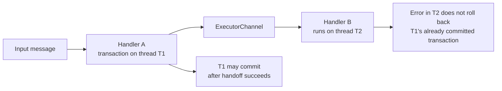

# Transactions on handlers

## 1. Objectives and scope

In the **Transaction support** chapter of the **SPRING_INTEGRATION_CORE** module, this lesson explains how to place a transaction boundary on a handler in a Spring Integration flow. It connects Message, MessageChannel, endpoints, gateways, and Java DSL to a practical requirement: when message processing fails, which data changes must be rolled back?

After this lesson, you will be able to:

- Attach transaction advice to a service activator or an advice-supporting endpoint.
- Distinguish a transaction wrapping only request handling from one wrapping the entire synchronous downstream flow.
- Predict the effects of propagation, exceptions, and thread handoffs.
- Choose the appropriate transaction location when a flow includes routers, filters, aggregators, or external system calls.
- Design tests based on committed data rather than relying solely on whether an exception occurred.

The examples use the **imperative** model, JDBC, and Java DSL with `IntegrationFlow`. The main configuration uses APIs available in Spring Integration 6.x; your project should use compatible Spring versions managed by its dependency management. Because the examples use Java records, Java 17 or later is required in a Spring Integration 6.x environment. Do not apply this thread-bound transaction model directly to reactive flows.

## 2. The problem: the handler succeeds, yet the overall flow fails

Consider an order creation flow:

```text
Message<OrderCommand>
    -> DirectChannel
    -> handler A: write orders table
    -> DirectChannel
    -> handler B: write order_audit table and possibly throw an error
    -> end
```

There are at least two distinct business requirements:

| Requirement | Required boundary |
|---|---|
| Saving the order is an independent step; errors in later steps are handled separately | Transaction for handler A's processing |
| The order and audit record must succeed together | Transaction wrapping A and B on the same synchronous processing chain |
| Receiving a message from a transactional source and updating data must be confirmed together | Must evaluate both inbound/poller transactions and resource coordination capability |

Asking "does the handler have a transaction?" is not enough. You must specify **where the transaction starts, which operations it wraps, and who decides the final commit**.

A `Message` carrying business headers such as `orderId` or `correlationId` does not carry a JDBC transaction. Nor does transaction advice make every side effect in a flow rollback-capable.

## 3. Two advice scopes to distinguish

### 3.1. Standard TransactionInterceptor

For reply-producing handlers in the `AbstractReplyProducingMessageHandler` family, standard request handler advice wraps internal request processing. Conceptually:

```text
handleMessage(message)
    |
    +-- transaction advice
    |      begin or join transaction
    |      handleRequestMessage(message)
    |      commit/rollback if advice owns transaction
    |
    +-- send reply to output channel
           invoke synchronous downstream handlers
```

If there is no outer transaction and propagation is `REQUIRED`, a new transaction created by the advice may already commit before the downstream handler starts running.

### 3.2. TransactionHandleMessageAdvice

`TransactionHandleMessageAdvice` wraps `handleMessage()`. For reply-producing handlers, this scope includes sending the result to the output channel. Downstream handlers invoked synchronously before `handleMessage()` returns can participate in the same transaction.

```text
transaction advice
    begin or join transaction
    handleMessage(message)
        handleRequestMessage(message)
        send reply
            synchronous downstream handler
    commit/rollback if advice owns transaction
```

`new TransactionInterceptorBuilder(true)` creates this advice type; `false` creates a standard `TransactionInterceptor`. See [Transaction Support for handlers](https://docs.spring.io/spring-integration/reference/handler-advice/tx-handle-message.html).

### 3.3. Conditions of the comparison

The two diagrams above assume the advice is creating a new transaction. If the advice joins an existing transaction, exiting the advice call does not yet mean a physical commit.

| Scenario | Consequence |
|---|---|
| Standard advice, no outer transaction | New transaction ends before downstream reply dispatch |
| Standard advice with `REQUIRED`, outer transaction still active | Same-thread downstream can still remain in the outer transaction |
| `TransactionHandleMessageAdvice`, synchronous downstream | Advice scope includes downstream processing before returning |
| Switching to another thread | The current imperative transaction does not follow the message automatically |
| Handler without reply-producing mechanism | Standard advice applies to `handleMessage()`; do not assume a separate reply phase as in the diagrams above |

Advice characteristics for different handler types are described in [Handling Message Advice](https://docs.spring.io/spring-integration/reference/handler-advice/handle-message.html).

## 4. Complete example: two flows with two transaction scopes

### 4.1. Setup

The example below has two input channels:

- `localOrders`: standard advice on the order-writing handler.
- `atomicOrders`: advice wrapping `handleMessage()` at the same position.

Each message carries an `OrderCommand`. The `failAfterAudit` flag is used solely to simulate an error after the audit insert statement has run.

To bring this example into a test project, include compatible dependencies:

| Artifact | Purpose |
|---|---|
| `org.springframework.integration:spring-integration-core` | Endpoints, channels, advice, and Java DSL |
| `org.springframework:spring-jdbc` | `JdbcTemplate`, JDBC transaction manager, embedded database builder |
| `com.h2database:h2` | Embedded database for the example |
| `org.junit.jupiter:junit-jupiter` | Tests in the later section |

`spring-tx` is used through Spring's transaction infrastructure; declare it directly if required by your project's dependency conventions. Spring Integration's JDBC adapter module is not needed because the handlers in the example call `JdbcTemplate` directly.

### 4.2. Payload and business logic

Place the following classes in the same package, e.g., `example.integration.tx`.

```java
package example.integration.tx;

public record OrderCommand(String orderId, boolean failAfterAudit) {
}
```

```java
package example.integration.tx;

import org.springframework.jdbc.core.JdbcTemplate;

public class OrderWriter {

    private final JdbcTemplate jdbc;

    public OrderWriter(JdbcTemplate jdbc) {
        this.jdbc = jdbc;
    }

    public OrderCommand insertOrder(OrderCommand command) {
        jdbc.update(
                "insert into orders(order_id) values (?)",
                command.orderId());
        return command;
    }

    public OrderCommand insertAudit(OrderCommand command) {
        jdbc.update(
                "insert into order_audit(order_id) values (?)",
                command.orderId());

        if (command.failAfterAudit()) {
            throw new IllegalStateException("Simulated error after writing audit");
        }

        return command;
    }
}
```

Both methods return the payload so the service activator forwards the message to the next step. Returning the payload alone does not confirm that the transaction has committed.

### 4.3. Database, transaction manager, and flows

```java
package example.integration.tx;

import javax.sql.DataSource;

import org.springframework.beans.factory.annotation.Qualifier;
import org.springframework.context.annotation.Bean;
import org.springframework.context.annotation.Configuration;
import org.springframework.integration.channel.DirectChannel;
import org.springframework.integration.config.EnableIntegration;
import org.springframework.integration.dsl.IntegrationFlow;
import org.springframework.integration.transaction.TransactionInterceptorBuilder;
import org.springframework.jdbc.core.JdbcTemplate;
import org.springframework.jdbc.datasource.DataSourceTransactionManager;
import org.springframework.jdbc.datasource.embedded.EmbeddedDatabase;
import org.springframework.jdbc.datasource.embedded.EmbeddedDatabaseBuilder;
import org.springframework.jdbc.datasource.embedded.EmbeddedDatabaseType;
import org.springframework.messaging.MessageChannel;
import org.springframework.transaction.PlatformTransactionManager;
import org.springframework.transaction.annotation.Propagation;
import org.springframework.transaction.interceptor.TransactionInterceptor;

@Configuration
@EnableIntegration
public class HandlerTransactionConfig {

    @Bean(destroyMethod = "shutdown")
    public EmbeddedDatabase dataSource() {
        return new EmbeddedDatabaseBuilder()
                .generateUniqueName(true)
                .setType(EmbeddedDatabaseType.H2)
                .build();
    }

    @Bean
    public JdbcTemplate jdbcTemplate(DataSource dataSource) {
        JdbcTemplate jdbc = new JdbcTemplate(dataSource);
        jdbc.execute("""
                create table orders (
                    order_id varchar(64) primary key
                )
                """);
        jdbc.execute("""
                create table order_audit (
                    order_id varchar(64) primary key
                )
                """);
        return jdbc;
    }

    @Bean
    public PlatformTransactionManager orderTxManager(DataSource dataSource) {
        return new DataSourceTransactionManager(dataSource);
    }

    @Bean
    public OrderWriter orderWriter(JdbcTemplate jdbcTemplate) {
        return new OrderWriter(jdbcTemplate);
    }

    @Bean
    public TransactionInterceptor requestOnlyTx(
            @Qualifier("orderTxManager") PlatformTransactionManager manager) {

        return new TransactionInterceptorBuilder(false)
                .transactionManager(manager)
                .propagation(Propagation.REQUIRED)
                .build();
    }

    @Bean
    public TransactionInterceptor downstreamTx(
            @Qualifier("orderTxManager") PlatformTransactionManager manager) {

        return new TransactionInterceptorBuilder(true)
                .transactionManager(manager)
                .propagation(Propagation.REQUIRED)
                .build();
    }

    @Bean
    public MessageChannel localOrders() {
        return new DirectChannel();
    }

    @Bean
    public MessageChannel atomicOrders() {
        return new DirectChannel();
    }

    @Bean
    public IntegrationFlow localOrderFlow(
            @Qualifier("localOrders") MessageChannel input,
            OrderWriter writer,
            @Qualifier("requestOnlyTx") TransactionInterceptor txAdvice) {

        return IntegrationFlow.from(input)
                .handle(writer, "insertOrder",
                        endpoint -> endpoint
                                .id("insertOrderLocally")
                                .advice(txAdvice))
                .handle(writer, "insertAudit")
                .channel("nullChannel")
                .get();
    }

    @Bean
    public IntegrationFlow atomicOrderFlow(
            @Qualifier("atomicOrders") MessageChannel input,
            OrderWriter writer,
            @Qualifier("downstreamTx") TransactionInterceptor txAdvice) {

        return IntegrationFlow.from(input)
                .handle(writer, "insertOrder",
                        endpoint -> endpoint
                                .id("insertOrderAtomically")
                                .advice(txAdvice))
                .handle(writer, "insertAudit")
                .channel("nullChannel")
                .get();
    }
}
```

The implicit channels between DSL steps here are direct channels, with no executor or queue in between. Each input channel has only one registered flow.

`nullChannel` receives the final result so the example has a clear endpoint. The example does not use a queue reply as proof of commit; tests will wait for the synchronous call to finish and then query the database.

Creating schemas directly in a bean is only for the lab. Real applications should use a dedicated schema migration process.

### 4.4. Why do both SQL statements participate in the same transaction?

`DataSourceTransactionManager` manages a `DataSource`. `JdbcTemplate` acquires connections through Spring's transaction-aware mechanism and can therefore use the connection bound to the current thread. In the example, both handlers use the same `JdbcTemplate` and the same `DataSource` managed by the manager. See [Controlling Database Connections](https://docs.spring.io/spring-framework/reference/data-access/jdbc/connections.html).

If handler B is replaced with code that obtains a connection manually outside that mechanism, or uses a different datasource, the flow name `atomicOrderFlow` is no longer enough to assert that both writes roll back together.

### 4.5. Expected outcomes when there is no outer transaction

Each row below assumes the database initially has no matching records and non-transactional connections use auto-commit, as with the embedded database in the example.

| Channel | `failAfterAudit` | Call outcome | `orders` row count | `order_audit` row count |
|---|---:|---|---:|---:|
| `localOrders` | `false` | Succeeds | 1 | 1 |
| `localOrders` | `true` | Throws exception | 1 | 1 |
| `atomicOrders` | `false` | Succeeds | 1 | 1 |
| `atomicOrders` | `true` | Throws exception | 0 | 0 |

In `localOrders` when an error occurs:

1. The advice opens a transaction for `insertOrder`.
2. The order insert statement executes successfully.
3. The transaction commits before the result is sent to handler B.
4. `insertAudit` runs outside that transaction; the insert statement is auto-committed.
5. The exception thrown after the insert statement cannot undo the two already committed changes.

In `atomicOrders` when an error occurs:

1. The advice opens a transaction before invoking handler A.
2. A inserts the order and sends the result synchronously to B.
3. B inserts the audit record using the transaction-participating connection.
4. The exception from B propagates back up to the advice.
5. The advice rolls back; both writes are undone.

This is a consequence of the wrapping location and resource configuration in the example. Do not generalize this into a rule that every downstream step of any handler is automatically transactional.

## 5. Ways to declare transactions on handlers

### 5.1. Java DSL: transactional and advice

You can pass a configured interceptor into the endpoint:

```java
.handle(writer, "insertOrder",
        endpoint -> endpoint.transactional(txAdvice))
```

Or use the concise form with a specific manager:

```java
// Standard advice: request-handling scope of a reply-producing handler.
.handle(writer, "insertOrder",
        endpoint -> endpoint.transactional(orderTxManager))

// Advice wrapping handleMessage(): includes synchronous downstream.
.handle(writer, "insertOrder",
        endpoint -> endpoint.transactional(orderTxManager, true))
```

These two forms are **alternatives**; do not combine both to wrap a handler twice.

`transactional(true)` also exists and requires a mechanism to locate an appropriate transaction manager. Passing the manager explicitly avoids ambiguity when the application has multiple managers. The overloads are described in [ConsumerEndpointSpec](https://docs.spring.io/spring-integration/api/org/springframework/integration/dsl/ConsumerEndpointSpec.html).

Use the builder when you need to specify propagation, isolation, timeout, or explicit rollback rules. If you pass `transactionAttribute(...)`, individual builder setters are ignored; configure everything on the attribute object itself. See [TransactionInterceptorBuilder](https://docs.spring.io/spring-integration/api/org/springframework/integration/transaction/TransactionInterceptorBuilder.html).

### 5.2. Annotation: adviceChain

When configuring an endpoint with annotations, you can reference the advice bean by name:

```java
@ServiceActivator(
        inputChannel = "orders.in",
        outputChannel = "orders.saved",
        adviceChain = "downstreamTx")
public OrderCommand save(OrderCommand command) {
    return writer.insertOrder(command);
}
```

This snippet illustrates an alternative configuration: the method belongs to a Spring-managed bean, `writer` is injected, and the channels and `downstreamTx` bean must be declared. Do not register both this endpoint and the main flow on the same channel for comparison testing.

`adviceChain` belongs to `org.springframework.integration.annotation.ServiceActivator`. Its scope depends on the **advice type** the bean points to; the name `downstreamTx` itself creates no special behavior.

### 5.3. @Transactional on a business service

Another option is placing the transaction on the service:

```java
public class OrderApplicationService {

    private final OrderWriter writer;

    public OrderApplicationService(OrderWriter writer) {
        this.writer = writer;
    }

    @Transactional(transactionManager = "orderTxManager")
    public OrderCommand saveOrderAndAudit(OrderCommand command) {
        writer.insertOrder(command);
        writer.insertAudit(command);
        return command;
    }
}
```

This approach requires the service to be a Spring bean, transactional annotation infrastructure enabled via `@EnableTransactionManagement` or equivalent configuration, and calls passing through the proxy.

If the endpoint simply calls `saveOrderAndAudit`, both writes belong to the method's transaction. Handlers located after the method returns are not automatically placed inside the new transaction opened by this method.

In proxy mode, `this.saveOrderAndAudit(...)` within the same bean bypasses the proxy and therefore does not trigger the annotation as an external bean call would. See [Using @Transactional](https://docs.spring.io/spring-framework/reference/data-access/transaction/declarative/annotations.html).

Attaching `TransactionInterceptor` directly to an endpoint as in the main example does not require `@EnableTransactionManagement` just for that advice to work. Both approaches use the same transaction infrastructure, but at different configuration points.

## 6. Propagation and who owns the commit

### 6.1. REQUIRED: create new or join

`REQUIRED` is suitable when steps must share a transaction. In the main example:

- If the caller has no transaction, the advice creates a new one.
- If the caller already opened a compatible transaction on the same thread and manager, the advice joins it.
- When joining, the advice does not perform a physical commit immediately when the handler returns.

Consequently, if the caller uses `TransactionTemplate` around the entire `send()` to `localOrders`, handler B can still run inside the outer transaction, even though handler A's advice only wraps request processing.

```java
TransactionTemplate template = new TransactionTemplate(orderTxManager);

template.executeWithoutResult(status -> {
    localOrders.send(MessageBuilder
            .withPayload(new OrderCommand("ORDER-OUTER", true))
            .build());
});
```

In the example configuration, the error from B escapes the callback, causing the outer transaction to roll back both writes.

### 6.2. REQUIRES_NEW and NESTED

| Propagation | Meaning with respect to outer transaction | When to consider |
|---|---|---|
| `REQUIRED` | Joins current transaction or creates a new one | Updates must succeed together |
| `REQUIRES_NEW` | Suspends outer transaction, uses an independent physical transaction | Data genuinely needs to commit independently |
| `NESTED` | May use a savepoint within the same physical transaction if manager supports it | Rolling back part of JDBC work |
| `MANDATORY` | Requires an existing transaction | Catching calls made outside a required boundary |

`REQUIRES_NEW` is not a default way to make "transactions safer": an independently committed write can remain after the outer transaction rolls back. The inner transaction may also need an extra connection while the outer transaction's connection is still held.

A `REQUIRED` branch marking rollback-only can cause the outer transaction to receive `UnexpectedRollbackException` when trying to commit, even if outer code caught the initial exception. See [Transaction Propagation](https://docs.spring.io/spring-framework/reference/data-access/transaction/declarative/tx-propagation.html).

## 7. Rollback: at which boundary must exceptions be evaluated?

### 7.1. Default rules and wrapped exceptions

With default transaction attributes, `RuntimeException` and `Error` trigger rollback; checked exceptions do not automatically share that rule. Applications can configure different rules.

In Spring Integration, a business exception may be wrapped in `MessagingException` or `MessageHandlingException` before reaching the transaction advice. Therefore, do not look only at a service's `throws` signature to conclude whether the transaction will commit or roll back. Inspect the exception actually passing through the interceptor.

A checked exception thrown inside a `@Transactional` service can also be observed by the service's transaction interceptor **before** the messaging layer wraps the error. Once that transaction has committed, an outer wrapper cannot reverse that commit.

Rollback rules must be placed at the exact boundary the application intends to control. See [Rolling Back a Declarative Transaction](https://docs.spring.io/spring-framework/reference/data-access/transaction/declarative/rolling-back.html).

### 7.2. Explicit rollback rule configuration for advice

This is an alternative to the `downstreamTx` bean if any `Exception` passing through the advice must cause a rollback:

```java
@Bean
public TransactionInterceptor rollbackOnExceptionTx(
        @Qualifier("orderTxManager") PlatformTransactionManager manager) {

    RuleBasedTransactionAttribute attributes =
            new RuleBasedTransactionAttribute();

    attributes.setPropagationBehavior(
            TransactionDefinition.PROPAGATION_REQUIRED);
    attributes.setTimeout(10);
    attributes.getRollbackRules()
            .add(new RollbackRuleAttribute(Exception.class));

    return new TransactionInterceptorBuilder(true)
            .transactionManager(manager)
            .transactionAttribute(attributes)
            .build();
}
```

Additional imports:

```java
import org.springframework.transaction.TransactionDefinition;
import org.springframework.transaction.interceptor.RollbackRuleAttribute;
import org.springframework.transaction.interceptor.RuleBasedTransactionAttribute;
```

Then attach `rollbackOnExceptionTx` to the target endpoint. This rule only evaluates exceptions exiting through the advice; it does not recover exceptions that code already converted into successful results.

Timeout in the example is in seconds per transaction configuration. It does not guarantee immediately aborting a hanging HTTP call; resource and communication timeouts must be configured appropriately on their own.

### 7.3. Catching an error and returning normally

```java
public OrderCommand saveIgnoringFailure(OrderCommand command) {
    try {
        return writer.insertAudit(command);
    }
    catch (RuntimeException ex) {
        return command;
    }
}
```

If an error is caught in code inside the transaction advice, the advice may simply see the method return normally. Unless the transaction was marked rollback-only by another component, there is no basis to expect a rollback.

When the business requirement demands undoing changes, let an appropriate error cross the transaction boundary or establish an explicit rollback-only design. Logging an exception does not substitute for propagating the error to the transaction interceptor.

## 8. Channels, gateways, and thread boundaries

### 8.1. Synchronous downstream

`DirectChannel` invokes subscribers on the sender's thread. Therefore, it can preserve the transaction context while calls stay within the advice's scope.

In the imperative model of this lesson, necessary conditions to extend a transaction across multiple endpoints include:

1. The advice or caller is still holding an active transaction.
2. Steps run on the same thread.
3. Resource-access operations actually participate in that transaction.

Channel and thread characteristics are described in [Message Channel Implementations](https://docs.spring.io/spring-integration/reference/channel/implementations.html).

### 8.2. Asynchronous handoff



An `ExecutorChannel` with a truly asynchronous executor, a `QueueChannel` processed later by a consumer, or manually spawned threads all create situations requiring a new transaction boundary. No header copying turns them into a cross-thread JDBC transaction. See [Transaction Boundaries](https://docs.spring.io/spring-integration/reference/transactions.html#transaction-boundaries).

If B needs a transaction, you can attach transaction advice at B to protect B's work. The application then has two separate transactions; the gap between the two steps must be addressed through delivery, retry, and idempotency design.

Do not rely on an executor occasionally running on the caller thread under load to guarantee atomicity.

### 8.3. Queues are not inherently rollback-capable resources

An in-memory `QueueChannel` does not automatically undo enqueue/dequeue operations alongside a database transaction. The following situation can happen:

```text
Insert order inside transaction
    -> enqueue message into in-memory queue
    -> next step throws error
    -> database rolls back
    -> message in queue still exists or was already picked up by consumer
```

For channels using a transactional message store, both the poller configuration and the corresponding transaction manager must be aligned so receive/delete operations belong to the transaction. See [Configuring Message Channels](https://docs.spring.io/spring-integration/reference/channel/configuration.html).

Thus, attaching a transaction on the handler after the poller has already received the message is not enough to claim that receiving the message can also roll back.

### 8.4. Gateways do not determine atomicity solely by return type

Gateways let callers interact with flows through Java methods. Inspect the actual channels, execution threads, and active transactions.

A gateway calling a synchronous flow can participate in the caller's transaction. A gateway returning a `Future`, a flow through an executor, or a queued branch does not extend the caller's transaction until background tasks finish.

A reply-wait timeout also does not mean the task on another thread was canceled or data was rolled back.

## 9. Error handling and retries when handlers are transactional

### 9.1. errorChannel is the error-processing route

With `DirectChannel`, exceptions typically unwind along the call stack to the sender. With work executed by an executor or poller, the framework can emit an `ErrorMessage` to an error channel.

Receiving an `ErrorMessage` does not prove rollback occurred. Conversely, routing an error to a channel and treating handling as successful can alter the outer component's decision. See [Error Handling](https://docs.spring.io/spring-integration/reference/error-handling.html).

To analyze, trace the exception path:

```text
handler fails
    -> does transaction advice see the error or a recovery result?
    -> does the new transaction roll back or is the outer transaction marked?
    -> does the error reach caller/container or get handled by the error route?
```

If recovery runs after a separate transaction has rolled back, recovery can report business failure without preserving the old transaction. If recovery hides the error before the advice sees it, the outcome can differ.

### 9.2. Ordering of retries and transactions

Two nesting orders have different meanings:

```text
Retry
    Transaction for attempt 1 -> rollback
    Transaction for attempt 2 -> commit
```

```text
Transaction
    Retry attempt 1 -> error
    Retry attempt 2 -> success
    attempt to commit shared transaction
```

In the first model, ensure each attempt actually gets a new transaction. If an outer transaction remains active and the advice uses `REQUIRED`, each retry iteration may simply rejoin that same transaction.

The second model can hold locks across backoff periods or continue using a transaction already marked rollback-only. Do not assume a succeeding retry means a successful commit.

`RequestHandlerRetryAdvice` typically acts at the request-processing scope. When combining it with `TransactionHandleMessageAdvice` on a reply-producing handler, the two advices can apply at two different invocation levels. Therefore, merely reversing bean order in `adviceChain` does not necessarily produce the desired nesting order.

If you need to retry an entire downstream segment in a fresh transaction, place an explicit retry boundary outside, or use an advice mechanism wrapping `handleMessage()` appropriately and test both scope and ordering. Do not treat a library version's default attempt count as a business requirement. Retry and recovery capabilities are described in [Provided Advice Classes](https://docs.spring.io/spring-integration/reference/handler-advice/classes.html).

## 10. Handler transactions in integration patterns

### 10.1. Transformers and filters

Pure data-transforming transformers should generally run before a transactional region to reduce how long connections are held. If a transformer writes to a database, it needs a transaction boundary just like any business step with side effects.

A filter returning `false` to drop a message is a valid flow-control outcome. Without an exception or rollback-only marker, the transaction can commit updates performed before the filter. Thus:

```text
Insert order -> filter drops message
```

does not mean:

```text
Insert order -> roll back order
```

If the requirement is "if rejected, do not persist data," place validation before the write step or explicitly design how failure is signaled at the transaction boundary.

### 10.2. Routers and branches

A router selects a processing branch; it does not create cross-system transactions. A synchronous branch writing to the same database can join the current transaction, while a branch calling an external API still produces its own side effects.

If a message goes to multiple branches, inspect each branch for executors, queues, or `REQUIRES_NEW` transactions. One failing branch cannot undo data that another branch already committed independently.

### 10.3. Aggregators

An aggregator typically holds multiple messages arriving at different times. A transaction from a single handler invocation does not automatically span the entire lifetime of a group.

When using a database-backed message group store, design transactions for updating group state and for processing when the group is released. Sharing a correlation key is not sharing a transaction.

### 10.4. HTTP, JMS, and the transactional outbox

A JDBC transaction cannot recall an already sent email or an HTTP command already applied by an external system. If a handler inserts an order, calls a payment service, and encounters a timeout, rolling back the database is not enough to conclude the payment never happened.

Similarly, JMS receive transactions depend on inbound/listener or poller configuration. JDBC transaction advice attached to a handler does not automatically turn JMS consumption and database writes into a distributed transaction. See [JMS Support — Transactions](https://docs.spring.io/spring-integration/reference/jms.html).

One design option for an "order created" event is:

```text
Transaction at handler:
    insert orders
    insert outbox
    commit both in the same database

Event publishing flow:
    read outbox
    send to broker
    update delivery status
```

This is an application of the outbox pattern to the problem, not a feature that appears automatically when calling `transactional(true)`. The publishing flow can still send duplicates if the process stops after sending to the broker but before marking it sent. Consumers need idempotency, such as a unique event ID and an appropriate unique constraint.

## 11. Testing with data after the transaction ends

### 11.1. What to check?

Tests must verify both messaging outcomes and database state:

- Success: expected data is committed.
- Internal/downstream failure: the right subset of data is rolled back.
- Standard advice: changes outside its scope are reflected accurately.
- With an outer transaction: `REQUIRED` participation behavior is confirmed.

Do not place `@Transactional` on the test class below. A transaction opened by the test framework can cause both flows to join the outer transaction and hide the difference under observation.

### 11.2. Integration test suite for the main configuration

The tests use a fresh context and database for each run, without mocking the transaction manager.

```java
package example.integration.tx;

import org.junit.jupiter.api.AfterEach;
import org.junit.jupiter.api.BeforeEach;
import org.junit.jupiter.api.Test;

import org.springframework.context.annotation.AnnotationConfigApplicationContext;
import org.springframework.jdbc.core.JdbcTemplate;
import org.springframework.messaging.MessageChannel;
import org.springframework.messaging.support.MessageBuilder;
import org.springframework.transaction.PlatformTransactionManager;
import org.springframework.transaction.support.TransactionTemplate;

import static org.junit.jupiter.api.Assertions.assertEquals;
import static org.junit.jupiter.api.Assertions.assertThrows;
import static org.junit.jupiter.api.Assertions.assertTrue;

class HandlerTransactionTest {

    private AnnotationConfigApplicationContext context;
    private JdbcTemplate jdbc;

    @BeforeEach
    void start() {
        context = new AnnotationConfigApplicationContext(
                HandlerTransactionConfig.class);
        jdbc = context.getBean(JdbcTemplate.class);
    }

    @AfterEach
    void stop() {
        if (context != null) {
            context.close();
        }
    }

    @Test
    void atomicFlowCommitsBothWritesOnSuccess() {
        assertTrue(send("atomicOrders",
                new OrderCommand("ORDER-OK", false)));

        assertCounts(1, 1);
    }

    @Test
    void ordinaryAdviceDoesNotUndoAlreadyCommittedWrites() {
        assertThrows(RuntimeException.class,
                () -> send("localOrders",
                        new OrderCommand("ORDER-LOCAL-FAIL", true)));

        assertCounts(1, 1);
    }

    @Test
    void handleMessageAdviceRollsBackBothWritesOnDownstreamFailure() {
        assertThrows(RuntimeException.class,
                () -> send("atomicOrders",
                        new OrderCommand("ORDER-ATOMIC-FAIL", true)));

        assertCounts(0, 0);
    }

    @Test
    void outerTransactionAlsoCoversTheSynchronousDownstream() {
        PlatformTransactionManager manager = context.getBean(
                "orderTxManager", PlatformTransactionManager.class);
        TransactionTemplate outer = new TransactionTemplate(manager);

        assertThrows(RuntimeException.class,
                () -> outer.executeWithoutResult(status ->
                        send("localOrders",
                                new OrderCommand("ORDER-OUTER-FAIL", true))));

        assertCounts(0, 0);
    }

    private boolean send(String channelName, OrderCommand command) {
        MessageChannel channel =
                context.getBean(channelName, MessageChannel.class);

        return channel.send(MessageBuilder.withPayload(command).build());
    }

    private void assertCounts(int orders, int audits) {
        assertEquals(
                Integer.valueOf(orders),
                jdbc.queryForObject(
                        "select count(*) from orders", Integer.class));

        assertEquals(
                Integer.valueOf(audits),
                jdbc.queryForObject(
                        "select count(*) from order_audit", Integer.class));
    }
}
```

Assertions use `RuntimeException` to focus on transaction outcomes without depending on version-specific wrapper details. When testing error contracts, add assertions for the root cause and failed message.

For synchronous flows in the example, the `send()` call has completed or thrown an exception before the test queries the database. The final test only reads after `TransactionTemplate` finishes handling the error.

### 11.3. Extending tests while keeping goals clear

You can build additional independent variations:

| Variation | What to confirm |
|---|---|
| Remove advice from `atomicOrders` | Result no longer guarantees both writes roll back together |
| Change advice to `false` | Behavior matches `localOrders` when no outer transaction exists |
| Insert `ExecutorChannel` between A and B | Worker error does not automatically roll back A's committed transaction |
| B catches exception and returns payload | Result reflects the recovery policy accurately |
| Have B use a different datasource | A's JDBC transaction manager does not automatically manage that datasource |
| Add outbox event on same datasource | Order and outbox either exist together or roll back together |

For asynchronous variants, synchronize tests with a latch or bounded wait mechanism, collect errors via the appropriate error route, and query data after the worker finishes. Do not use a fixed `sleep` duration as proof that a task is done.

## 12. Diagnosing common misconceptions

| Symptom | What to inspect |
|---|---|
| A has advice, yet order remains when B fails | Does the advice wrap request handling or `handleMessage()`? Is there an outer transaction? |
| Used `true`, yet worker error does not undo A | Is there an executor, queue, or custom thread between the two handlers? |
| Transaction is active, yet one write does not roll back | Which datasource/connection does the statement use and does it actually participate in that manager? |
| Test always rolls back both flows | Is the test framework opening an outer transaction? |
| Error is logged, yet database still commits | At what level was the error caught, recovered, or converted into a normal result? |
| Caught the error, yet still hit `UnexpectedRollbackException` | Did a participant in the shared transaction mark rollback-only? |
| Database rolled back, yet queued message still runs | Is the queue a transactional resource participating in the right transaction? |
| Adding `REQUIRES_NEW` leaves data after whole-flow failure | Was an independent commit intentionally created? |
| Calling `@Transactional` service has no effect | Does the call go through a proxy, is there self-invocation, and is annotation infrastructure enabled? |
| Received success reply, yet caller fails on commit | Was the reply sent before the advice finished completing the transaction? |

When observing for diagnosis, you can record the state at A and B:

```java
import org.springframework.transaction.support.TransactionSynchronizationManager;

boolean active =
        TransactionSynchronizationManager.isActualTransactionActive();
String threadName = Thread.currentThread().getName();
```

This pair of values helps detect context loss across thread handoffs. It does not replace verifying data: two steps both reporting an active transaction can still belong to two different transactions or access two different resources.

## 13. Practicing boundary design for an order-intake flow

Apply the concepts above to the requirement:

```text
Gateway receives order
    -> transformer normalizes data
    -> filter discards invalid data
    -> insert orders
    -> insert outbox
    -> finish request processing
```

An implementable design:

1. Normalize and validate data before holding a database connection.
2. Attach transaction advice wrapping `handleMessage()` at the `orders` insert step if the `outbox` insert step is a synchronous downstream endpoint.
3. Use the same datasource and transaction-aware JDBC access mechanism for both tables.
4. Let outbox-write errors escape to the transaction advice.
5. Evaluate database success only after the transaction boundary completes.
6. Separate the event-publishing flow from the outbox with its own redelivery and deduplication policy.

The completion criterion for the lab is data evidence: the success path creates both the order and the outbox entry; an error after the first write leaves no order record; resending the message produces no unintended duplicate business outcome.

When choosing the final boundary, describe it in concrete operational terms, such as "insert order and outbox in a single JDBC transaction on the same datasource," and then cross-check it against the flow's channels, threads, propagation, and exception paths.
