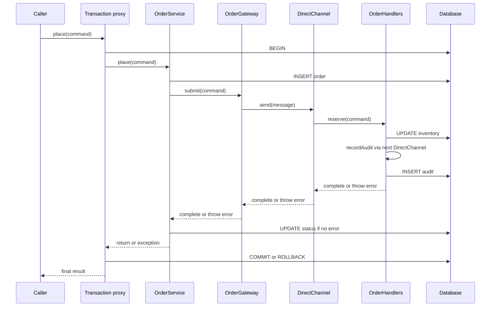

# Transactions with DirectChannel

## 1. Problem and objectives

In the **SPRING_INTEGRATION_CORE** module, an integration flow is composed from `Message`, `MessageChannel`, endpoints, gateways, and Java DSL. When a flow updates data across multiple endpoints, you must clearly define which operations must commit together or roll back together.

Consider an order-placing workflow:

1. Create the order.
2. Deduct inventory quantity.
3. Write an audit record for the order.
4. Transition the order to confirmed status.

If the audit step fails, the business requirement is that the order must not be saved and inventory must not be reduced. This lesson uses `DirectChannel` to connect synchronous processing steps together with Spring-managed JDBC transactions to fulfill that requirement.

After this lesson, you should be able to explain where a transaction starts, where it ends, why an exception can trigger rollback, and which changes to the flow break the atomicity guarantee.

The scope is imperative Java flows using local transactions on a single `DataSource`. Reactive transactions and distributed transaction coordination require separate mechanisms.

## 2. DirectChannel preserves the thread; it does not create a transaction

`DirectChannel` dispatches messages directly to a subscriber on the thread calling `send()`. The handler is invoked before the send call returns. This is the basis on which operations on both sides of the channel can participate in an active transaction. [DirectChannel documentation](https://docs.spring.io/spring-integration/reference/channel/implementations.html#channel-implementations-directchannel)

Distinguish the responsibilities:

| Component | Responsibility in the example |
| --- | --- |
| `DirectChannel` | Dispatches the message synchronously to a handler |
| Spring's transaction interceptor | Wraps an invocation scope, starts or joins a transaction, and decides transaction completion |
| `DataSourceTransactionManager` | Manages transactions on JDBC connections of a `DataSource` |
| `JdbcTemplate` | Executes SQL by acquiring connections via Spring's resource-management mechanism |

Merely declaring `new DirectChannel()` and calling `send()` does not create a transaction. The starting point can be a `@Transactional` service, a `TransactionTemplate`, a poller transaction, or endpoint advice. Spring Integration allows using Spring transactions to wrap application-invoked flows. [Transactions in message flows](https://docs.spring.io/spring-integration/reference/7.0/transactions.html)

With JDBC, the transaction manager binds a connection to the current thread. `JdbcTemplate` uses a compatible connection-retrieval mechanism to participate in that transaction. Staying on the same thread while accessing a different `DataSource` or manually opening an unmanaged connection can still cause operations to run outside the intended transaction. [DataSourceTransactionManager](https://docs.spring.io/spring-framework/docs/current/javadoc-api/org/springframework/jdbc/datasource/DataSourceTransactionManager.html)

You can picture the required relationship as follows:

```text
Transaction already opened
    + downstream runs within active invocation scope
    + accesses the right managed resource
    + does not split into an independent transaction
    + errors are handled per rollback rules
    => JDBC changes can complete together
```

Staying on the same thread is an important prerequisite of this model; by itself, it is not enough to prove the entire business operation is atomic.

## 3. Seeing transaction boundaries through the call stack



In the diagram, the gateway and handlers are invoked nested on the same thread. When writing the audit record throws an error and the error exits `OrderService.place()`, the transaction interceptor can roll back both order creation and inventory deduction.

Two milestones must not be confused:

- `send()` completing indicates that the corresponding synchronous processing path has returned.
- The transaction only finishes when execution passes the end of the outer transaction scope. After `send()`, the service may still update more data or throw an error.

Therefore, the final handler finishing does not mean the database has committed. Even when the service body returns normally, a commit-time failure can still cause the proxied call to fail.

## 4. Example: placing an order through a gateway and two DirectChannels

### 4.1. Setup conditions

The snippets below share the package `example.directtx`. Each `public` class or interface belongs in its own Java file.

Compatible dependencies from the same version set are required:

| Purpose | Dependency |
| --- | --- |
| Channels, gateway, and Java DSL | `org.springframework.integration:spring-integration-core` |
| JDBC | `org.springframework:spring-jdbc` |
| Transactions | `org.springframework:spring-tx` |
| Spring Test for the test example | `org.springframework:spring-test` |
| JUnit Jupiter | `org.junit.jupiter:junit-jupiter` |
| Embedded database for tests | `com.h2database:h2` |

Use your project's dependency management to align Spring versions. The code uses `record` and text blocks; choose a JDK matching the Spring version in use.

The main configuration accepts a `DataSource` from the application. The test section below supplies an H2 `DataSource` so the example can be placed into a test project without external database configuration.

### 4.2. Payload and gateway

```java
package example.directtx;

public record PlaceOrder(String orderId, String sku, int quantity) {

    public PlaceOrder {
        if (orderId == null || orderId.isBlank()) {
            throw new IllegalArgumentException("orderId must not be blank");
        }
        if (sku == null || sku.isBlank()) {
            throw new IllegalArgumentException("sku must not be blank");
        }
        if (quantity <= 0) {
            throw new IllegalArgumentException("quantity must be positive");
        }
    }
}
```

```java
package example.directtx;

import org.springframework.integration.annotation.MessagingGateway;

@MessagingGateway(defaultRequestChannel = "orders.input")
public interface OrderGateway {

    void submit(PlaceOrder command);
}
```

The gateway turns the Java call into a message with a `PlaceOrder` payload. With a path made entirely of `DirectChannel`s, a `void` return type does not make the call asynchronous: the caller still waits for synchronous processing to finish.

The example does not declare a dedicated `errorChannel` on the gateway so error propagation back to the caller follows default behavior. [Error handling at messaging gateways](https://docs.spring.io/spring-integration/reference/gateway.html)

### 4.3. Service opening the business transaction

```java
package example.directtx;

import org.springframework.jdbc.core.JdbcTemplate;
import org.springframework.transaction.annotation.Transactional;

public class OrderService {

    private final JdbcTemplate jdbc;
    private final OrderGateway gateway;

    public OrderService(JdbcTemplate jdbc, OrderGateway gateway) {
        this.jdbc = jdbc;
        this.gateway = gateway;
    }

    @Transactional(transactionManager = "transactionManager")
    public void place(PlaceOrder command) {
        jdbc.update("""
                insert into purchase_order (id, sku, quantity, state)
                values (?, ?, ?, 'NEW')
                """,
                command.orderId(), command.sku(), command.quantity());

        gateway.submit(command);

        jdbc.update("""
                update purchase_order
                set state = 'CONFIRMED'
                where id = ?
                """,
                command.orderId());
    }
}
```

Callers must obtain `OrderService` from Spring and invoke it through the proxied bean. Instantiating it manually with `new OrderService(...)` and calling it directly will not trigger the transaction annotation.

In default proxy mode, one method on the same instance calling another via `this` also does not trigger the interceptor merely because the target method has `@Transactional`. If an outer transaction already exists, that transaction may still be active; the point is that an internal self-call does not create a new annotation scope. [Proxy mechanism of @Transactional](https://docs.spring.io/spring-framework/reference/data-access/transaction/declarative/annotations.html)

### 4.4. Two handlers accessing the same database

```java
package example.directtx;

import org.springframework.jdbc.core.JdbcTemplate;

public class OrderHandlers {

    private final JdbcTemplate jdbc;

    public OrderHandlers(JdbcTemplate jdbc) {
        this.jdbc = jdbc;
    }

    public PlaceOrder reserve(PlaceOrder command) {
        int updated = jdbc.update("""
                update inventory
                set available = available - ?
                where sku = ? and available >= ?
                """,
                command.quantity(), command.sku(), command.quantity());

        if (updated != 1) {
            throw new InsufficientStockException(command.sku());
        }

        return command;
    }

    public void recordAudit(PlaceOrder command) {
        jdbc.update("""
                insert into order_audit (order_id, action)
                values (?, 'STOCK_RESERVED')
                """,
                command.orderId());
    }

    public static class InsufficientStockException
            extends RuntimeException {

        public InsufficientStockException(String sku) {
            super("Insufficient stock for " + sku);
        }
    }
}
```

`reserve()` returns the payload so the flow moves to the next step. `recordAudit()` returns `void` and ends the one-way flow.

The stock deduction combines the check condition and the update into one SQL statement. Do not read the quantity into Java and subtract there, because two concurrent requests could read the same stale value. Correctness under concurrency still depends on the database and actual isolation level, which must be tested on the target RDBMS.

The handlers do not need to open a new transaction themselves in this example: they execute JDBC within the scope already opened by `OrderService.place()`.

### 4.5. Java DSL configuration

```java
package example.directtx;

import javax.sql.DataSource;

import org.springframework.context.annotation.Bean;
import org.springframework.context.annotation.Configuration;
import org.springframework.integration.channel.DirectChannel;
import org.springframework.integration.config.EnableIntegration;
import org.springframework.integration.config.IntegrationComponentScan;
import org.springframework.integration.dsl.IntegrationFlow;
import org.springframework.jdbc.core.JdbcTemplate;
import org.springframework.jdbc.datasource.DataSourceTransactionManager;
import org.springframework.transaction.PlatformTransactionManager;
import org.springframework.transaction.annotation.EnableTransactionManagement;

@Configuration(proxyBeanMethods = false)
@EnableIntegration
@EnableTransactionManagement
@IntegrationComponentScan(basePackageClasses = OrderGateway.class)
public class DirectOrderConfig {

    @Bean(name = "orders.input")
    public DirectChannel ordersInput() {
        DirectChannel channel = new DirectChannel();
        channel.setFailover(false);
        return channel;
    }

    @Bean(name = "orders.reserved")
    public DirectChannel ordersReserved() {
        DirectChannel channel = new DirectChannel();
        channel.setFailover(false);
        return channel;
    }

    @Bean
    public PlatformTransactionManager transactionManager(
            DataSource dataSource) {

        return new DataSourceTransactionManager(dataSource);
    }

    @Bean
    public JdbcTemplate jdbcTemplate(DataSource dataSource) {
        return new JdbcTemplate(dataSource);
    }

    @Bean
    public OrderService orderService(
            JdbcTemplate jdbc, OrderGateway gateway) {

        return new OrderService(jdbc, gateway);
    }

    @Bean
    public OrderHandlers orderHandlers(JdbcTemplate jdbc) {
        return new OrderHandlers(jdbc);
    }

    @Bean
    public IntegrationFlow orderFlow(OrderHandlers handlers) {
        return IntegrationFlow.from("orders.input")
                .handle(handlers, "reserve")
                .channel("orders.reserved")
                .handle(handlers, "recordAudit")
                .get();
    }
}
```

`@IntegrationComponentScan` registers the gateway proxy from the interface. The two service activator endpoints in the DSL invoke `reserve()` and `recordAudit()` in turn.

Each channel in the example has exactly one subscriber. Disabling failover reflects the choice to let handler errors return to the caller, avoiding falling back to an alternate handler if another subscriber is added later. With multiple subscribers, `DirectChannel` distributes messages point-to-point rather than executing all handlers as a business chain. [Configuring DirectChannel](https://docs.spring.io/spring-integration/reference/channel/configuration.html)

### 4.6. Expected outcomes

Suppose SKU `SKU-1` starts with an inventory of 10:

| Case | Order | Stock after call | Audit |
| --- | --- | --- | --- |
| Order 2 items, all steps succeed | One `CONFIRMED` order | 8 | One record |
| Order 99 items | Newly created order not saved | 10 | No record |
| Order 2 items, audit write fails | Newly created order not saved | 10 | No record for failed order |

These results describe an actually completed transaction. To verify, read the database after the call through the service proxy finishes.

## 5. Testing commit and rollback with H2

Mocking handlers only shows that a method was called or threw an error. To verify atomicity, run the flow with the real transaction manager and database in the test.

The following class reuses the classes from section 4. Test methods are not annotated with `@Transactional`, so the service's transaction can commit or roll back right inside the call under test.

```java
package example.directtx;

import javax.sql.DataSource;

import org.junit.jupiter.api.BeforeEach;
import org.junit.jupiter.api.Test;
import org.springframework.beans.factory.annotation.Autowired;
import org.springframework.context.annotation.Bean;
import org.springframework.context.annotation.Configuration;
import org.springframework.dao.DataIntegrityViolationException;
import org.springframework.jdbc.core.JdbcTemplate;
import org.springframework.jdbc.datasource.embedded.EmbeddedDatabase;
import org.springframework.jdbc.datasource.embedded.EmbeddedDatabaseBuilder;
import org.springframework.jdbc.datasource.embedded.EmbeddedDatabaseType;
import org.springframework.test.context.junit.jupiter.SpringJUnitConfig;

import static org.junit.jupiter.api.Assertions.assertEquals;
import static org.junit.jupiter.api.Assertions.assertThrows;
import static org.junit.jupiter.api.Assertions.assertTrue;

@SpringJUnitConfig(classes = {
        DirectOrderConfig.class,
        DirectOrderFlowTest.DatabaseConfig.class
})
class DirectOrderFlowTest {

    @Configuration(proxyBeanMethods = false)
    static class DatabaseConfig {

        @Bean(destroyMethod = "shutdown")
        EmbeddedDatabase dataSource() {
            return new EmbeddedDatabaseBuilder()
                    .generateUniqueName(true)
                    .setType(EmbeddedDatabaseType.H2)
                    .build();
        }
    }

    @Autowired
    OrderService service;

    @Autowired
    JdbcTemplate jdbc;

    @BeforeEach
    void prepareDatabase() {
        jdbc.execute("drop table if exists order_audit");
        jdbc.execute("drop table if exists purchase_order");
        jdbc.execute("drop table if exists inventory");

        jdbc.execute("""
                create table inventory (
                    sku varchar(40) primary key,
                    available integer not null check (available >= 0)
                )
                """);

        jdbc.execute("""
                create table purchase_order (
                    id varchar(40) primary key,
                    sku varchar(40) not null,
                    quantity integer not null,
                    state varchar(20) not null
                )
                """);

        jdbc.execute("""
                create table order_audit (
                    order_id varchar(40) primary key,
                    action varchar(40) not null,
                    foreign key (order_id) references purchase_order(id),
                    constraint reject_test_order
                        check (order_id <> 'O-FAIL')
                )
                """);

        jdbc.update("""
                insert into inventory (sku, available)
                values ('SKU-1', 10)
                """);
    }

    @Test
    void commitsWhenEveryStepSucceeds() {
        service.place(new PlaceOrder("O-OK", "SKU-1", 2));

        assertCountsAndStock("O-OK", 1, 1, 8);
        assertEquals("CONFIRMED", jdbc.queryForObject("""
                select state from purchase_order where id = ?
                """, String.class, "O-OK"));
    }

    @Test
    void rollsBackOrderWhenStockIsInsufficient() {
        RuntimeException failure = assertThrows(
                RuntimeException.class,
                () -> service.place(
                        new PlaceOrder("O-NO-STOCK", "SKU-1", 99)));

        assertTrue(causedBy(
                failure, OrderHandlers.InsufficientStockException.class));

        assertCountsAndStock("O-NO-STOCK", 0, 0, 10);
    }

    @Test
    void rollsBackOrderAndStockWhenAuditInsertFails() {
        RuntimeException failure = assertThrows(
                RuntimeException.class,
                () -> service.place(
                        new PlaceOrder("O-FAIL", "SKU-1", 2)));

        assertTrue(causedBy(
                failure, DataIntegrityViolationException.class));

        assertCountsAndStock("O-FAIL", 0, 0, 10);
    }

    private void assertCountsAndStock(
            String orderId,
            int expectedOrders,
            int expectedAudits,
            int expectedStock) {

        int orders = jdbc.queryForObject("""
                select count(*) from purchase_order where id = ?
                """, Integer.class, orderId).intValue();

        int audits = jdbc.queryForObject("""
                select count(*) from order_audit where order_id = ?
                """, Integer.class, orderId).intValue();

        int stock = jdbc.queryForObject("""
                select available from inventory where sku = 'SKU-1'
                """, Integer.class).intValue();

        assertEquals(expectedOrders, orders);
        assertEquals(expectedAudits, audits);
        assertEquals(expectedStock, stock);
    }

    private static boolean causedBy(
            Throwable failure, Class<? extends Throwable> type) {

        for (Throwable current = failure;
                current != null;
                current = current.getCause()) {

            if (type.isInstance(current)) {
                return true;
            }
        }
        return false;
    }
}
```

The `reject_test_order` constraint is just a way to intentionally trigger an SQL error at the final endpoint in the test environment. It is not an ordering rule to put into a production schema.

The third test distinguishes between two critical configurations:

- If in the same transaction, the audit error removes the newly created order and restores inventory to 10.
- If inventory deduction committed in a separate transaction, stock could remain 8 even though the order call reported an error.

Walking the `cause` chain keeps the test independent of whether the business error sits directly on the outside or is wrapped by Spring Integration in a messaging exception.

The tests share a database inside the application context; keep them running sequentially with this setup. When testing concurrency, use separate data and synchronization per scenario.

H2 illustrates transaction boundaries. To verify locking, isolation, or SQL-specific behavior, also run scenarios against the same database engine used in production.

## 6. Exception rules govern rollback

Under Spring's typical default configuration, a `RuntimeException` or `Error` exiting the intercepted scope leads to rollback; checked exceptions require matching rules. You can configure `rollbackFor` and `noRollbackFor`. [Rollback rules](https://docs.spring.io/spring-framework/reference/data-access/transaction/declarative/rolling-back.html)

Example when a checked exception directly crosses the service boundary:

```java
@Transactional(rollbackFor = BusinessRejectedException.class)
public void place(PlaceOrder command)
        throws BusinessRejectedException {
    // Business operation that may throw BusinessRejectedException.
}
```

This is an annotation illustration; `BusinessRejectedException` is an application-defined checked exception.

In a messaging flow, a checked error may be wrapped into a runtime exception. Therefore, inspect the exception type actually passing through the transaction interceptor rather than looking only at handler method signatures. Behavior is also governed by the rollback rules configured for the application.

### 6.1. Catching an error and returning normally

Consider this variant of the service:

```java
@Transactional
public void place(PlaceOrder command) {
    jdbc.update("""
            insert into purchase_order (id, sku, quantity, state)
            values (?, ?, ?, 'NEW')
            """,
            command.orderId(), command.sku(), command.quantity());

    try {
        gateway.submit(command);
    }
    catch (RuntimeException failure) {
        // Merely acknowledge the error and continue.
    }
}
```

In the example configuration, the handlers do not have their own transaction interceptors. If the service swallows the error and the transaction has not been marked rollback-only, the outer interceptor may see the method complete normally and commit. Then the `NEW` order and updates performed before the error can be persisted.

When a business failure should cause a rollback, normally let the exception exit the transactional method. If you catch the error to add context, rethrow an appropriate exception. Only mark rollback-only explicitly when the design genuinely needs the method to finish normally while still aborting the transaction.

### 6.2. Once rollback-only, catching the error cannot save the transaction

If an inner service has `@Transactional(propagation = REQUIRED)`, joins the current transaction, and marks it rollback-only, catching the error outside does not clear that flag. When the outer scope attempts to commit, it may receive `UnexpectedRollbackException`. [Propagation REQUIRED and rollback-only](https://docs.spring.io/spring-framework/reference/data-access/transaction/declarative/tx-propagation.html)

Thus, the statement "once the exception is caught, the transaction will commit" is also untrue across configurations. Trace which transaction interceptor saw the error and what state the transaction is in.

## 7. Gateways, errorChannel, and filters can change the error path

### 7.1. Error flows do not replace transaction rules

In a synchronous flow, errors can propagate up the call stack to the sender. When sending directly through `MessageChannel` or `MessagingTemplate`, exceptions are thrown to the caller; declaring a global `errorChannel` does not automatically turn every synchronous error into an error message. [Spring Integration error handling](https://docs.spring.io/spring-integration/reference/error-handling.html)

A gateway can be configured to route errors to an error flow and turn them into a normal result. If the error flow completes without propagating failure back to the transaction boundary, the caller can proceed and commit if the transaction was not marked rollback-only. [Error flows on gateways](https://docs.spring.io/spring-integration/reference/gateway.html)

For example, an `OrderResult.rejected(...)` result is a normal return value to the transaction interceptor. If business rules require canceling already written data, the application must have a corresponding rollback mechanism, such as letting an exception escape or intentionally marking rollback-only.

When inspecting a flow, trace both the main message path and the error-handling path. A log line in an error handler does not prove the transaction rolled back.

### 7.2. A filter discarding a message is not necessarily an error

Suppose the service already created an order, and then a filter discards the message because a limit was exceeded. If the filter merely discards and completes normally, a one-way gateway may return without an exception. The earlier order creation can still commit.

If rejection must cancel the entire business operation, represent rejection as an error at the transaction boundary. Illustrative DSL snippet:

```java
.filter(PlaceOrder.class,
        command -> command.quantity() <= 100,
        spec -> spec.throwExceptionOnRejection(true))
```

Place this filter before the inventory deduction step in the flow if the limit of 100 is the chosen business rule. In the main example, the error must continue propagating back to `OrderService.place()`.

Another option is performing validation before inserting the order. The choice depends on whether validation uses only input data or needs to read database state inside the same transaction.

## 8. Does placing a transaction on the first handler cover downstream steps?

You cannot conclude that solely from all channels being `DirectChannel`.

Suppose the caller has not opened a transaction, and only the `reserve()` method is annotated with `@Transactional`:

```text
Endpoint invokes proxy of reserve()
    BEGIN
    reserve() updates inventory
    reserve() returns payload
    COMMIT

Endpoint sends payload to output channel
    recordAudit() starts
    recordAudit() encounters an error
```

The method's transaction can end when the method returns, before the endpoint sends the reply to the next step. If the first transaction has already committed, an error in `recordAudit()` cannot undo that commit.

When you need to start a transaction right at an endpoint and include synchronous downstream steps, Spring Integration provides `TransactionHandleMessageAdvice`. It wraps `handleMessage()`, unlike transaction advice that only wraps internal request handling. [Endpoint transaction advice scope](https://docs.spring.io/spring-integration/reference/handler-advice/tx-handle-message.html)

In Java DSL, an illustrative configuration snippet is:

```java
.handle(handlers, "reserve",
        endpoint -> endpoint.transactional(txManager, true))
.channel("orders.reserved")
.handle(handlers, "recordAudit")
```

Here `txManager` is a transaction manager available in the configuration method. The `true` parameter selects the advice type wrapping `handleMessage()`. [ConsumerEndpointSpec.transactional API](https://docs.spring.io/spring-integration/api/org/springframework/integration/dsl/ConsumerEndpointSpec.html)

The scope started at this endpoint does not automatically include operations the caller performed before sending the message. If the caller already inserted the order outside a transaction, adding advice on `reserve()` does not bring that insert into the new transaction.

In the order-placing example, opening the transaction at `OrderService.place()` wraps order creation, the inventory-deduction and audit flow, and the status update after the gateway.

## 9. Changes that break the original atomic scope

### 9.1. Adding an ExecutorChannel or QueueChannel

For example, replacing the intermediate channel with a handoff path to a worker:

```text
Calling thread:
  BEGIN
  create order
  send message to worker
  update status
  finish service and complete transaction

Worker thread:
  receive message
  deduct inventory
  write audit
```

The imperative transaction bound to the calling thread does not automatically follow the message to the worker. A queue channel whose consumer polls on another thread creates the same issue. [Transaction boundaries](https://docs.spring.io/spring-integration/reference/transactions.html)

Do not assume the transaction necessarily commits right on the line sending to the executor or queue. The outer transaction can still continue until its configured end point. What is lost is the guarantee that the worker executes in the same physical transaction as the caller.

Having the caller wait for a result from the worker also does not automatically share the connection or transaction with the other thread. For the worker to update the database transactionally, establish the worker's own transaction and design a consistent relationship between the two sides.

Avoid relying on an executor occasionally running tasks on the caller thread when overloaded. Load-dependent behavior cannot be the basis for business guarantees.

### 9.2. Using REQUIRES_NEW at one step

`REQUIRES_NEW` creates an independent physical transaction, suspending the outer transaction. The inner step can commit and then the outer transaction can roll back. Staying on the same thread does not merge two transactions into one. [Propagation REQUIRES_NEW](https://docs.spring.io/spring-framework/reference/data-access/transaction/declarative/tx-propagation.html)

In the order-placing problem, if the audit is written in an independent transaction, an audit record can exist for an operation that never committed. That may suit an attempt log, but it is unsuitable if the audit table must reflect only succeeded orders.

In addition, an independent transaction may require an extra connection and end up waiting on resources locked by the outer transaction. Design according to concrete data relationships.

### 9.3. Adding an aggregator or delayed processing

An aggregator can store messages while waiting for a complete group. The current receive finishes before enough messages arrive; releasing the group can happen in another call or via a timeout.

Therefore, do not treat all receives of a group as belonging to the first caller's transaction merely because surrounding channels are `DirectChannel`. Define separate transactions for saving the group and for processing the released result.

### 9.4. Calling HTTP, sending email, or writing files

A JDBC rollback cannot recall an already sent email, undo an HTTP request already applied, or automatically restore an overwritten file.

If the example is extended with order notifications, one option is writing an outbox record in the same transaction as the order, then having another process read the outbox to send. Design retries and deduplication for the notification-publishing step.

Running a callback after commit reduces the risk of notifying for an uncommitted order, but a standalone callback does not guarantee delivery if the application stops abruptly. Durability requirements must be addressed in storage and delivery design.

## 10. Multiple subscribers and failover require separate consideration

By default, `DirectChannel` has load-balancing and failover behavior. When one subscriber fails, the dispatcher can try the next subscriber if failover is enabled. [Dispatcher configuration](https://docs.spring.io/spring-integration/reference/channel/configuration.html)

Business-wise dangerous example:

```text
Subscriber A:
  already wrote partial data
  then throws error

Dispatcher:
  tries subscriber B

Subscriber B:
  returns success
```

If A's error does not pass through a transaction interceptor marking rollback-only and does not exit the outer scope, changes before the error may remain in the committed transaction. If the transaction is already rollback-only, B's success cannot make it committable again.

Failover does not create a savepoint or undo a prior subscriber's work. Nor does it mean retrying the whole transaction.

For the sequence "deduct inventory then write audit," connect endpoints via consecutive channels as in the example. Do not register both as competing subscribers on the same `DirectChannel` expecting both to always execute in order.

## 11. Observing transactions while debugging

You can place the following observation snippet in the service and each handler while investigating a flow:

```java
import org.springframework.transaction.support.TransactionSynchronizationManager;

System.out.printf(
        "thread=%s, txActive=%s, txName=%s%n",
        Thread.currentThread().getName(),
        TransactionSynchronizationManager.isActualTransactionActive(),
        TransactionSynchronizationManager.getCurrentTransactionName());
```

In the main example, all steps must run on the same thread with an active transaction during processing.

However, merely seeing `txActive=true` or the same transaction name does not prove every SQL statement uses the same resource. Check `DataSource`, transaction manager, propagation, and database state after the call finishes. If deeper analysis is needed, enable transaction and connection management logs in your development environment.

A useful diagnostic sequence:

1. Verify whether the call passes through the `OrderService` proxy.
2. Identify which write operations happen after the transaction opens.
3. Trace threads across the gateway, channels, and each handler.
4. Check whether all JDBC access uses the right `DataSource`.
5. Look for `REQUIRES_NEW`, `NOT_SUPPORTED`, executors, queues, or async tasks inside the service.
6. Follow exceptions through gateways, advice, error flows, and `catch` blocks.
7. Query data after the proxied call completes to distinguish commit, rollback, or independently committed work.

## 12. When should you use TransactionTemplate?

If you want the transaction scope visible right in code or do not want to rely on method-level interception, you can use `TransactionTemplate`. Spring provides a callback API to execute a block of code inside a transaction. [Programmatic transaction management](https://docs.spring.io/spring-framework/reference/data-access/transaction/programmatic.html)

The following example is an alternative service body, assuming `txManager`, `jdbc`, `gateway`, and `command` are already provided:

```java
import org.springframework.transaction.support.TransactionTemplate;

TransactionTemplate tx = new TransactionTemplate(txManager);

tx.executeWithoutResult(status -> {
    jdbc.update("""
            insert into purchase_order (id, sku, quantity, state)
            values (?, ?, ?, 'NEW')
            """,
            command.orderId(), command.sku(), command.quantity());

    gateway.submit(command);

    jdbc.update("""
            update purchase_order
            set state = 'CONFIRMED'
            where id = ?
            """,
            command.orderId());
});
```

You must still satisfy the same conditions on threads, resources, and exceptions. Wrapping `send()` with a template does not carry a transaction across an executor or turn an HTTP call into a JDBC transaction.

When the callback joins an existing transaction under default propagation, the outer scope still decides when the physical transaction completes. There is no need to use both the annotation and the template for the same boundary without a specific reason.

## 13. Choosing a design based on business requirements

| Requirement | Design direction |
| --- | --- |
| Order creation, inventory deduction, and audit must succeed together in one database | Outer service transaction, synchronous flow via `DirectChannel` |
| Start transaction at an endpoint and include synchronous downstream | Advice wrapping `handleMessage()`, clearly verify start point |
| Need to offload thread for slow processing | Separate worker transaction and consistency mechanism between steps |
| Need durable notification after saving order | Write outbox in same transaction, publish notification via separate process |
| Need to save attempt logs even when business fails | Design an independent log transaction; review locking and data relationships |
| Need to wait for multiple messages or multiple systems to complete | Establish per-step transaction boundaries and suitable orchestration |

A long synchronous transaction holds database resources throughout the call path. For operations with slow I/O, consider lock duration, connection pool sizing, and timeouts. Choose `DirectChannel` when you need a synchronous execution model and matching atomic boundary, while keeping work inside the transaction concise.

## 14. Self-check questions

- Who opens the transaction in the example, and does the transaction end before or after the `CONFIRMED` status update?
- Why can a gateway returning `void` still propagate errors synchronously back to the service?
- If `@Transactional` is placed only on `reserve()`, is the audit operation guaranteed to be in the same transaction?
- Why can catching an error in the service persist the `NEW` order, whereas in another configuration it leads to `UnexpectedRollbackException`?
- If `orders.reserved` is replaced with a queue having its own poller, what happens to the original transaction?
- Which test in the lesson detects that inventory deduction committed before writing the audit record?
- If all database updates roll back yet an email was already sent, what is the system's actual atomic boundary?

To answer accurately, draw the transaction scope wrapping the calls, mark every thread handoff, and indicate which exception actually passes through the transaction interceptor.
