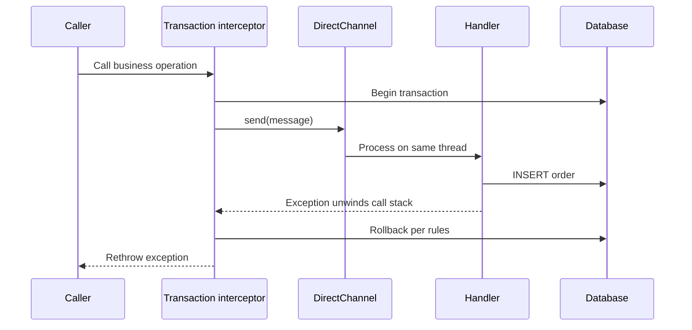

# Rollback and error channels

In the **Transaction support** chapter of the **SPRING_INTEGRATION_CORE** module, this lesson connects knowledge of `Message`, `MessageChannel`, endpoints, gateways, and Java DSL to a practical requirement: when message processing fails, what state must data revert to and who must receive the error?

After this lesson, you will be able to define rollback scope, configure error routes for pollers, read error messages, and test database outcomes. The examples use imperative transactions with JDBC; reactive transactions have their own context-propagation model.

## 1. Three outcomes to observe separately

Suppose an order intake flow consists of: receiving an `OrderCommand`, inserting the order into the database, validating business conditions, and completing. The validation step throws an exception after the `INSERT` statement has already executed.

Three questions must be answered:

| Question | Governing mechanism | Evidence to inspect |
| --- | --- | --- |
| Does the newly inserted row still exist? | Transaction manager and participating resources | Query the database after the transaction finishes |
| Does the sender receive an exception? | Call stack, gateway, and sync/async boundaries | Exception at call site or gateway result |
| Does the system receive error details? | Error handler, error channel, and error-handling endpoint | `ErrorMessage`, logs, or incident records |

One outcome is not enough to prove the other two. In the order example, an error log entry can still appear when the record committed; a rolled-back record also does not guarantee the message was redelivered.

Design every flow with three explicit commitments: **data**, **caller feedback**, and **error recording**.

## 2. Transaction boundaries follow execution scope

### 2.1. Synchronous flow over DirectChannel

`DirectChannel` invokes the handler directly on the thread sending the message. Therefore, a transaction opened on the caller side can wrap downstream operations if they use properly managed resources. [Spring Integration: DirectChannel](https://docs.spring.io/spring-integration/reference/channel/implementations.html#directchannel).



The diagram assumes no intermediate layer catches and suppresses the exception. `DirectChannel` preserves synchronous execution; the transaction manager is the component that manages commit and rollback.

Even on the same thread, two JDBC operations using two different `DataSource` instances do not form an atomic transaction. Specify which transaction manager governs which resource.

### 2.2. Handoff to another thread

When a consumer runs on another thread via an executor or a separate poller, the producer's imperative transaction does not follow the message automatically. For transactional consumer processing, open a transaction on the consumer side. [Spring Integration: Transaction Boundaries](https://docs.spring.io/spring-integration/reference/transactions.html#transaction-boundaries).

```text
Thread A, transaction TX-A:
  write intake state
  send message to queue
  continue work and complete TX-A

Thread B, transaction TX-B if configured:
  receive message
  write processing data
  error occurs -> roll back TX-B
```

TX-B failing does not automatically reverse TX-A, which has already committed. A successful `send()` to an in-memory queue only confirms that the queue accepted the message.

Handoff is not an instant commit command either: TX-A finishes when its transaction scope ends. The producer may still execute additional statements after `send()`.

| Component | Characteristic to account for in design |
| --- | --- |
| `DirectChannel` | Handler usually runs in sender call stack; suitable for keeping one synchronous processing scope |
| `ExecutorChannel` with truly async executor | Handler runs on worker; must define worker's transaction |
| `QueueChannel` with separate polling consumer | Producer enqueues first, consumer processes later; two scopes must be analyzed independently |
| Queue backed by JDBC message store | Can include message retrieval in the consumer's transaction if configured properly |

Do not infer solely from channel names. Draw the actual threads, where transactions open, and participating resources, especially when an executor has special execution behavior.

## 3. Conditions for an exception to cause rollback

### 3.1. The transaction interceptor must observe the failure

With typical default configuration for Spring declarative transactions, `RuntimeException` and `Error` lead to rollback; checked exceptions require matching rules. Applications can override these defaults. [Spring Framework: Rolling Back a Declarative Transaction](https://docs.spring.io/spring-framework/reference/data-access/transaction/declarative/rolling-back.html).

Example business method that must roll back when order validation throws a checked exception:

```java
@Transactional(
    transactionManager = "orderTx",
    rollbackFor = InvalidOrderException.class
)
public void process(OrderCommand command) throws InvalidOrderException {
    repository.insert(command);
    validator.validate(command);
}
```

This snippet assumes the method is called through a Spring proxy and `repository` uses a resource managed by `orderTx`. In standard proxy mode, an internal call `this.process(...)` does not pass through the transactional proxy.

In Integration endpoints, business exceptions may be wrapped in `MessagingException`. When configuring rollback rules, evaluate the exception actually crossing the transaction interceptor of the scope under analysis. Do not look only at the `throws` declaration of a method nested deep inside a handler.

### 3.2. Catching an exception and returning normally

```java
public void storeAndValidate(OrderCommand command) {
    repository.insert(command);
    try {
        validator.validate(command);
    }
    catch (InvalidOrderException ex) {
        log.warn("Invalid order: {}", command.id(), ex);
        // The method completes normally.
    }
}
```

If the enclosing transaction has not been marked rollback-only, this code can lead to a commit. Logging does not change transaction status. If the requirement is to undo changes, let the error propagate to the transaction management boundary or use an explicitly designed rollback-only mechanism.

### 3.3. Exception caught yet transaction still rolls back

An inner service using `PROPAGATION_REQUIRED` can join the outer transaction and mark the shared transaction rollback-only. Catching the exception in the outer service does not clear that flag; when attempting to commit, it may receive `UnexpectedRollbackException`. [Spring Framework: Transaction Propagation](https://docs.spring.io/spring-framework/reference/data-access/transaction/declarative/tx-propagation.html).

```text
Outer transaction starts
  -> call inner service via proxy
     -> inner service fails, shared transaction marked rollback-only
  -> outer service catches error and returns
  -> outer transaction ends: cannot commit successfully
```

Therefore, when reading code with `catch`, determine whether the error was caught **before or after** a transactional interceptor observed it.

## 4. What information does ErrorMessage carry?

In message-based error handling, the payload of an `ErrorMessage` is a `Throwable`. Commonly it is a `MessagingException` containing `failedMessage` and a `cause` chain; depending on the error source, `originalMessage` may also be present. [Spring Integration: Error Handling](https://docs.spring.io/spring-integration/reference/error-handling.html).

```text
ErrorMessage
  payload: MessageHandlingException or another Throwable
    failedMessage: Message being processed when the error occurred, if available
    cause: Underlying exception
  originalMessage: Original message if provided by the error creation strategy
```

After a transformer, the message at the failure point may carry a different payload than the input message. During diagnosis, preserve both the business identifier and the processing step name, rather than assuming every error holds the original request intact.

A helper you can use in an error-observing endpoint:

```java
import org.springframework.messaging.Message;
import org.springframework.messaging.MessagingException;
import org.springframework.messaging.support.ErrorMessage;

public final class ErrorContext {
    private ErrorContext() {
    }

    public static Message<?> failedMessage(ErrorMessage error) {
        Throwable current = error.getPayload();
        while (current != null) {
            if (current instanceof MessagingException messaging
                    && messaging.getFailedMessage() != null) {
                return messaging.getFailedMessage();
            }
            Throwable next = current.getCause();
            if (next == current) {
                break;
            }
            current = next;
        }
        return error.getOriginalMessage();
    }
}
```

The return value can still be `null`, for example when an error occurs before a message is retrieved. Incident-recording endpoints must handle that case. If the error occurred during commit, the message context aids tracing but does not prove all changes were successfully reverted.

## 5. Choosing an error channel and understanding where errors originate

With `MessagePublishingErrorHandler`, the channel in the failed message's `errorChannel` header takes precedence; if absent, the error handler's default error channel is used. That default can be configured explicitly, such as via poller configuration; if uncustomized, the framework uses the global `errorChannel` channel. [MessagePublishingErrorHandler API](https://docs.spring.io/spring-integration/docs/current/api/org/springframework/integration/channel/MessagePublishingErrorHandler.html).

Example routing errors separately for a single request:

```java
Message<OrderCommand> message = MessageBuilder
    .withPayload(new OrderCommand("ORDER-009", true))
    .setHeader(MessageHeaders.ERROR_CHANNEL, "orderErrors")
    .build();
```

The header is just metadata used by components that publish errors. When calling `DirectChannel.send()` directly, synchronous exceptions still propagate back to the caller; this header does not automatically wrap every handler in a `try/catch` block. [Spring Integration: Synchronous Error Handling](https://docs.spring.io/spring-integration/reference/error-handling.html).

The default error channel is a `PublishSubscribeChannel` with a logging subscriber. The name `errorChannel` itself does not require error handling to run on another thread: a channel registering direct subscribers can invoke them synchronously. [Spring Integration: Default Error Channel](https://docs.spring.io/spring-integration/reference/error-handling.html).

Once a message goes to `orderErrors`, do not assume it simultaneously appears on the global channel. If centralized observation is needed, explicitly design a forwarding step or shared recording.

## 6. Java DSL example: poller rolls back JDBC then forwards error

### 6.1. Objectives and components

We build a small flow:

```text
orderInbox [in-memory QueueChannel]
  -> poller opens JDBC transaction
  -> OrderWriter.store()
       INSERT processed_orders
       if failAfterInsert = true: throw IllegalStateException
  -> commit or rollback

Error escaping the protected task
  -> error handler
  -> orderErrors [QueueChannel for tests to receive ErrorMessage]
```

Required dependencies in a Spring Boot application with a compatible BOM:

- `org.springframework.boot:spring-boot-starter-integration`.
- `org.springframework.boot:spring-boot-starter-jdbc`.
- `com.h2database:h2` for the lab database.
- `org.springframework.boot:spring-boot-starter-test` for testing.

No `@Transactional` annotation is needed on `OrderWriter` in this example: the transaction is placed on the poller. `PollerSpec` supports both `.transactional(...)` and `.errorChannel(...)` to configure those two responsibilities. [PollerSpec API](https://docs.spring.io/spring-integration/api/org/springframework/integration/dsl/PollerSpec.html).

### 6.2. Illustrative application

```java
package example.integration;

import java.io.Serializable;
import java.time.Duration;
import javax.sql.DataSource;

import org.springframework.beans.factory.annotation.Qualifier;
import org.springframework.boot.SpringApplication;
import org.springframework.boot.autoconfigure.SpringBootApplication;
import org.springframework.context.annotation.Bean;
import org.springframework.integration.channel.QueueChannel;
import org.springframework.integration.config.EnableIntegration;
import org.springframework.integration.dsl.IntegrationFlow;
import org.springframework.integration.dsl.Pollers;
import org.springframework.jdbc.core.JdbcTemplate;
import org.springframework.jdbc.support.JdbcTransactionManager;
import org.springframework.transaction.PlatformTransactionManager;

@SpringBootApplication
@EnableIntegration
public class RollbackErrorDemo {
    public static void main(String[] args) {
        SpringApplication.run(RollbackErrorDemo.class, args);
    }

    public record OrderCommand(String id, boolean failAfterInsert)
            implements Serializable {
    }

    @Bean
    public PlatformTransactionManager orderTx(DataSource dataSource) {
        return new JdbcTransactionManager(dataSource);
    }

    @Bean
    public InitializingBean demoSchema(JdbcTemplate jdbc) {
        return () -> jdbc.execute("""
            create table if not exists processed_orders (
                order_id varchar(80) primary key,
                processing_state varchar(30) not null
            )
            """);
    }

    @Bean
    public QueueChannel orderInbox() {
        return new QueueChannel(100);
    }

    @Bean
    public QueueChannel orderErrors() {
        return new QueueChannel(100);
    }

    @Bean
    public OrderWriter orderWriter(JdbcTemplate jdbc) {
        return new OrderWriter(jdbc);
    }

    @Bean
    public IntegrationFlow orderFlow(
            @Qualifier("orderInbox") QueueChannel inbox,
            @Qualifier("orderErrors") QueueChannel errors,
            @Qualifier("orderTx") PlatformTransactionManager tx,
            OrderWriter writer) {
        return IntegrationFlow.from(inbox)
            .handle(writer, "store", endpoint -> endpoint.poller(
                Pollers.fixedDelay(Duration.ofMillis(100))
                    .receiveTimeout(0)
                    .maxMessagesPerPoll(1)
                    .transactional(tx)
                    .errorChannel(errors)))
            .get();
    }

    public static final class OrderWriter {
        private final JdbcTemplate jdbc;

        public OrderWriter(JdbcTemplate jdbc) {
            this.jdbc = jdbc;
        }

        public void store(OrderCommand command) {
            jdbc.update("""
                insert into processed_orders(order_id, processing_state)
                values (?, ?)
                """, command.id(), "PROCESSED");

            if (command.failAfterInsert()) {
                throw new IllegalStateException(
                    "Simulated error after INSERT: " + command.id());
            }
        }
    }
}
```

`JdbcTemplate` and `orderTx` share the same `DataSource`, so the `INSERT` statement joins the poller's transaction. Limiting to one message per poll cycle keeps the example easy to trace; it does not make an in-memory queue rollback-capable.

Initializing the schema in code is only for lab practice. In real applications, use your project's migration mechanism and adjust connection settings per environment.

### 6.3. Order of rollback and error publishing

For the standard imperative poller in the example, the execution model can be read as:

```text
Error handler protects the task
  Transaction interceptor
    receive()
    invoke downstream handler
  Transaction interceptor completes commit/rollback
Error handler handles exception escaping outward
```

This is an interpretation of the execution structure from `AbstractPollingEndpoint` source: the polling task is advised and then executed inside an error-protecting executor. Thus, for the business error here, JDBC rollback happens before the error notification is delivered to `orderErrors`. [Spring Integration source: AbstractPollingEndpoint](https://raw.githubusercontent.com/spring-projects/spring-integration/v7.1.1/spring-integration-core/src/main/java/org/springframework/integration/endpoint/AbstractPollingEndpoint.java).

A consumer reading `orderErrors` and merely logging cannot turn an already rolled-back JDBC transaction back into a commit. If the standard configuration is replaced with custom advice or a custom error handler, re-analyze the task-wrapping order.

### 6.4. Testing real outcomes

The test below intentionally does not put `@Transactional` on the test class. The poller has a transaction on its own thread; a test transaction does not wrap it. [Spring Framework: Test-managed Transactions](https://docs.spring.io/spring-framework/reference/testing/testcontext-framework/tx.html).

```java
package example.integration;

import java.time.Duration;

import org.junit.jupiter.api.Test;
import org.springframework.beans.factory.annotation.Autowired;
import org.springframework.beans.factory.annotation.Qualifier;
import org.springframework.boot.test.context.SpringBootTest;
import org.springframework.integration.channel.QueueChannel;
import org.springframework.jdbc.core.JdbcTemplate;
import org.springframework.messaging.Message;
import org.springframework.messaging.MessagingException;
import org.springframework.messaging.support.ErrorMessage;
import org.springframework.messaging.support.MessageBuilder;

import static org.awaitility.Awaitility.await;
import static org.junit.jupiter.api.Assertions.*;

@SpringBootTest(
    classes = RollbackErrorDemo.class,
    properties = {
        "spring.datasource.url=jdbc:h2:mem:rollback_error_demo;DB_CLOSE_DELAY=-1",
        "spring.datasource.username=sa",
        "spring.datasource.password="
    }
)
class RollbackErrorDemoTest {
    @Autowired
    @Qualifier("orderInbox")
    QueueChannel inbox;

    @Autowired
    @Qualifier("orderErrors")
    QueueChannel errors;

    @Autowired
    JdbcTemplate jdbc;

    @Test
    void rollsBackFailedOrderAndCommitsSuccessfulOrder() {
        jdbc.update("delete from processed_orders");

        var bad = new RollbackErrorDemo.OrderCommand("FAIL-009", true);
        assertTrue(inbox.send(MessageBuilder.withPayload(bad).build(), 1000));

        Message<?> notification = errors.receive(5000);
        ErrorMessage error = assertInstanceOf(ErrorMessage.class, notification);
        MessagingException failure = assertInstanceOf(
            MessagingException.class, error.getPayload());

        assertNotNull(failure.getFailedMessage());
        assertEquals(bad, failure.getFailedMessage().getPayload());
        assertTrue(hasCause(error.getPayload(), IllegalStateException.class));
        assertEquals(0, count("FAIL-009"));
        assertEquals(0, inbox.getQueueSize());

        var good = new RollbackErrorDemo.OrderCommand("OK-009", false);
        assertTrue(inbox.send(MessageBuilder.withPayload(good).build(), 1000));

        await().atMost(Duration.ofSeconds(5)).untilAsserted(
            () -> assertEquals(1, count("OK-009")));
        assertNull(errors.receive(0));
    }

    private int count(String id) {
        return jdbc.queryForObject(
            "select count(*) from processed_orders where order_id = ?",
            Integer.class, id);
    }

    private static boolean hasCause(Throwable error, Class<?> type) {
        Throwable current = error;
        while (current != null) {
            if (type.isInstance(current)) {
                return true;
            }
            Throwable next = current.getCause();
            if (next == current) {
                break;
            }
            current = next;
        }
        return false;
    }
}
```

The assertions verify distinct commitments:

| Observation | Meaning in the experiment |
| --- | --- |
| `ErrorMessage` received | The poller's error-reporting route works |
| `failedMessage` matches the failed command sent | The error can be linked to the business request |
| No `FAIL-009` row remains | The write statement rolled back |
| Input queue is empty | The in-memory queue does not automatically restore retrieved messages |
| `OK-009` row exists | The success branch actually committed |

A test that only checks logs or exceptions misses at least one commitment. For asynchronous branches, awaiting a bounded condition tests based on observable outcomes rather than guessing timings with `Thread.sleep()`.

## 7. Synchronous variant: caller manages the transaction

To contrast with the poller example, you can add a direct input sharing `OrderWriter`:

```java
@Bean
public DirectChannel directOrders() {
    return new DirectChannel();
}

@Bean
public IntegrationFlow directOrderFlow(
        @Qualifier("directOrders") DirectChannel direct,
        OrderWriter writer) {
    return IntegrationFlow.from(direct)
        .handle(writer, "store")
        .get();
}
```

This snippet requires importing `org.springframework.integration.channel.DirectChannel`. The caller can use `TransactionTemplate` to wrap the send call:

```java
TransactionTemplate template = new TransactionTemplate(orderTx);

template.executeWithoutResult(status -> {
    directOrders.send(MessageBuilder.withPayload(
        new OrderCommand("DIRECT-009", true)).build());
});
```

Here `orderTx` and `directOrders` are injected beans; also import `org.springframework.transaction.support.TransactionTemplate`, and use the `OrderCommand` type from the demo application.

An exception escaping the callback causes the JDBC transaction to roll back in this configuration. There is no automatic step delivering errors to `orderErrors` as with the poller. If the caller wants both to know about the failure and to record the incident, it can catch the error **outside** the `executeWithoutResult(...)` call, once the transaction scope has finished, and then run the chosen recording mechanism.

This comparison also helps uncover configuration mistakes: the same handler writes via JDBC, yet whether a transaction exists and where errors go both depend on where the flow starts.

## 8. Gateways turning errors into results: inspect the transaction scope carefully

A messaging gateway can be configured with an `errorChannel` to turn downstream exceptions into business replies. If no dedicated error channel is configured, the gateway propagates errors back to the caller by default according to its unwrapping rules. [Spring Integration: Gateway Error Handling](https://docs.spring.io/spring-integration/reference/gateway.html#error-handling).

Suppose the desired contract is returning `OrderResult` for both valid and rejected orders:

```java
@MessagingGateway(
    defaultRequestChannel = "orderRequests",
    errorChannel = "orderGatewayErrors"
)
public interface OrderGateway {
    OrderResult submit(OrderCommand command);
}
```

In this variant, `orderRequests` is a request/reply flow channel and `orderGatewayErrors` must have an endpoint producing an appropriate `OrderResult`. Do not connect the `void`-returning `OrderWriter.store()` example as-is to this gateway expecting a result.

Compare two synchronous designs:

| Transaction location | Where error turns into `OrderResult` | Outcome to predict |
| --- | --- | --- |
| Transaction wraps gateway call | Gateway handles error completely before returning to outer transaction | Outer transaction may commit if not rollback-only |
| Downstream service opens its own transaction via proxy | Service throws error through its own interceptor before gateway handles it | Service transaction may already roll back, even though caller receives a normal result |

This is an analysis of two specific structures, not a rule that gateways always prevent rollback. If an inner service marked the shared transaction rollback-only, the first case can still end with `UnexpectedRollbackException`.

When a rejection response must be returned after rollback, a clear layout is letting the transactional service finish rolling back first, and then having the boundary layer translate the error into the response type. Keeping the data commitment in the service and the response commitment at the gateway makes each part easy to test clearly.

## 9. Error-handling advice can alter transaction outcomes

Two configurations deserve special attention:

- `ExpressionEvaluatingRequestHandlerAdvice` with `trapException=true`: the advice can handle the error and stop propagating it.
- `RequestHandlerRetryAdvice` with a normally completing recovery callback: after exhausting attempts, the error can be turned into a recovery result instead of propagating further.

These behaviors are described in [Spring Integration: Provided Advice Classes](https://docs.spring.io/spring-integration/reference/handler-advice/classes.html).

Consider a transaction wrapping outside the handler:

```text
Transaction interceptor
  -> handler advice
       -> handler throws exception
       -> advice logs or recovers and returns normally
  -> transaction interceptor sees the call complete
```

If not rollback-only, the transaction can commit. Sending an `ErrorMessage` from recovery does not automatically request a rollback.

Conversely, if the exception has already exited the transactional interceptor before being recovered, that transaction has already reached a failed outcome. The same recovery channel with different advice placement can yield different data states.

Before adding retries, decide whether each attempt gets a new transaction or shares one. A transaction already marked rollback-only does not become valid again because a later attempt succeeds. For errors that invalidate a transaction, usually structure things so the next attempt gets a fresh usable transaction; verify how advices actually wrap each other.

## 10. Rollback, retry, and redelivery are three distinct things

- **Rollback** undoes changes made by transactional participants.
- **Retry** re-executes an operation according to a retry policy.
- **Redelivery** delivers the message again from a source or storage infrastructure.

In the example, the database rolls back, but the default `QueueChannel` stores messages in memory and does not participate in JDBC transactions. Because the consumer already took the message out, it does not automatically reappear. Queue-style channels need a persistent message store or durable source when designs require surviving failures. [Spring Integration: QueueChannel](https://docs.spring.io/spring-integration/reference/channel/implementations.html#queuechannel).

If using `JdbcChannelMessageStore`, you can design message retrieval and business data updates within a suitable JDBC transaction. When rolling back the store's message retrieval, the message remains available to be received again. This requires the Integration schema, a database-matching query provider, and transactional poller configuration. [Spring Integration: JDBC Message Store](https://docs.spring.io/spring-integration/reference/jdbc/message-store.html).

An alternative design for the experiment:

```text
Producer
  -> store OrderCommand in JDBC-backed channel

Consumer, transaction TX-C:
  retrieve message from JDBC-backed channel
  insert processed_orders
  if success: commit both changes
  if failure: roll back both changes
```

This model requires the queue operation and business operation to genuinely participate in the same transaction or an equivalent coordination mechanism. Two independent databases do not gain atomicity merely because both use JDBC.

If a message always fails, infinite redelivery will cause a loop. Production designs need attempt limits, backoff delays, and a quarantine destination. With a durable quarantine destination, clearly decide when to persist the failed message and when to acknowledge the source message; logging once does not replace that persistence step.

## 11. Designing error flows by error type

Incidents can be divided into errors needing business review, recoverable resource errors, and unclassified errors. `ErrorMessageExceptionTypeRouter` inspects the exception cause chain, avoiding total reliance on the outermost wrapper class. [Spring Integration: Routing and Error Handling](https://docs.spring.io/spring-integration/reference/router/implementations.html#routing-and-error-handling).

Example configuration to place in a dedicated error flow:

```java
@Bean
public IntegrationFlow classifiedErrors() {
    return IntegrationFlow.from("classifiedErrorInput")
        .routeByException(router -> router
            .channelMapping(IllegalArgumentException.class, "reviewErrors")
            .channelMapping(TransientDataAccessException.class, "retryCandidates")
            .defaultOutputChannel("unclassifiedErrors"))
        .get();
}
```

This snippet requires importing `org.springframework.dao.TransientDataAccessException`. Target channels must be configured with consumers; `retryCandidates` is only a classification destination name and does not itself perform retries. To use this with the sample poller, replace the poller's default error channel with `classifiedErrorInput` and provide full endpoints on each branch.

For the order application, a useful incident record might include:

| Field | Example |
| --- | --- |
| Business ID | `FAIL-009` |
| Flow and failing step | `orderFlow / orderWriter.store` |
| Technical error type | `IllegalStateException` |
| Error category code | `POST_INSERT_VALIDATION_FAILED` |
| Timestamp, attempt count | Used to coordinate retries and detect loops |
| Reference to message for reprocessing | Key to a durable store record if available |

Do not use the fact that an error handler ran as confirmation of a commit. If transaction outcomes must be tracked, record the outcome at a point that has transaction completion status, and correlate by business ID.

## 12. Error recording, synchronization, and non-database side effects

### 12.1. Error records can roll back together with the transaction

If an endpoint writes to an audit table inside the very transaction that is failing, the audit record can also roll back. Depending on requirements, choose an independent audit transaction, off-database logging, or persisting the incident after the main transaction finishes.

`REQUIRES_NEW` creates an independent physical transaction when applied via appropriate Spring transaction infrastructure. It can preserve an audit record even when the outer transaction rolls back, but consider connection pool sizing and lock-wait risk against the outer transaction. [Spring Framework: REQUIRES_NEW](https://docs.spring.io/spring-framework/reference/data-access/transaction/declarative/tx-propagation.html#tx-propagation-requires-new).

With `orderErrors` in the example, the error consumer receives the message after the poller's transaction rolls back; if that consumer needs to write to the database transactionally, open an appropriate transaction scope for that write operation itself. Do not assume the consumer is still inside the old transaction.

### 12.2. Post-rollback callbacks do not undo external systems

Spring Integration supports transaction synchronization to run operations based on commit/rollback outcomes. `PseudoTransactionManager` can trigger corresponding callbacks, but it does not provide real resource rollback. [Spring Integration: Transaction Synchronization](https://docs.spring.io/spring-integration/reference/transactions.html#transaction-synchronization).

For example, after a JDBC rollback, an input file can be moved to an inspection directory. That is a follow-up operation triggered by the transaction outcome. If a file was already uploaded to an external server or an email was already sent, a JDBC rollback does not recall that side effect.

For workflows that must update data and then emit events, one design option is writing an outbox record in the same transaction as the business data. A sender reads the outbox after commit, manages retries, and marks sent. This approach still requires duplicate handling on the receiving side; the error channel serves to report and coordinate incidents within the chosen design.

An error in an `afterCommit` step cannot revert an already committed transaction back to rollback. If the callback can fail, provide a way to observe and re-execute that task independently.

## 13. Diagnosing by symptom

| Symptom | Hypothesis to check | Verification approach |
| --- | --- | --- |
| Error notification exists yet data remains | No transaction, error was swallowed, or write hit another resource | Identify where transaction opens, manager, `DataSource`, and catch locations |
| DirectChannel send fails yet no error message appears | Caller is receiving exception synchronously | Observe exception at `send()` and actual configured publisher |
| Database rolls back yet message is not redelivered | In-memory input queue or source lacks redelivery configuration | Check queue type, receive transaction, and source policy |
| Caller received intake confirmation yet downstream failed | Handed off to another thread | Distinguish intake acknowledgment from final processing outcome |
| Gateway returns business error yet `UnexpectedRollbackException` occurs | An inner scope marked the shared transaction rollback-only | Inspect propagation and exception path across proxies |
| Retry branch still fails after an apparently succeeding attempt | Transaction was already marked rollback-only | Inspect retry/transaction advice ordering and per-attempt scope |
| Error consumer hangs or throws further errors | Error queue full, missing consumer, or error flow itself fails | Check capacity, timeouts, subscribers, and error storage destination |
| Async test leaves leftover data after test ends | Test transaction does not wrap worker | Check consumer transactions and test data isolation |

Analysis checklist for a specific message:

1. Locate the business ID and message at the endpoint where the error originated.
2. Trace the execution path to the error point, marking threads and transactions.
3. Determine which exception exits each transactional interceptor.
4. Check database state after transactions have finished.
5. Identify what created the `ErrorMessage`, which channel receives it, and whether it is durably recorded.
6. Check whether the source message still exists, was acknowledged, or will be redelivered.

Once the design is complete, write a testable commitment statement, such as: "If processing `OrderCommand` fails after `INSERT`, no processed order row exists; an error notification containing the order ID is created; redelivery follows the configured source mechanism." Each clause of that statement needs its own evidence.
