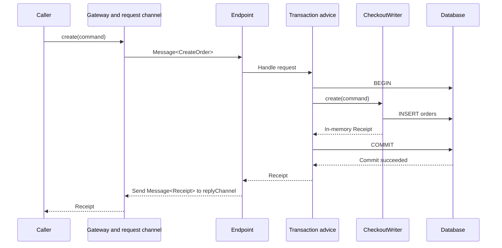

# Committing before sending a reply

In the **Transaction support** chapter of the **SPRING_INTEGRATION_CORE** module, this lesson addresses a specific requirement: emit a success reply only after the transaction containing the business changes has committed. We use the core Spring Integration building blocks—`Message`, `MessageChannel`, service activators, messaging gateways, and Java DSL—to place the transaction at the exact right position.

The running example is an order creation flow. A `CREATED` reply means the order has been successfully persisted in the primary database. An instantiated Java object or an executed SQL statement is not enough to fulfill that promise.

## 1. Desired outcomes and scope

After this lesson, you will be able to:

- Distinguish creating a result, flushing, committing, and sending a reply.
- Choose transaction advice for reply-producing endpoints.
- Recognize when an outer transaction invalidates the assumption that "handler completion means committed."
- Inspect database state at the exact moment a reply is emitted.
- Handle the scenario where data committed, yet the reply did not reach the caller.

The examples use imperative Java flows with JDBC, thread-bound transactions, and a single `DataSource`. Do not apply the thread-based reasoning directly to Reactor flows using reactive transaction managers.

### 1.1. Ordering guarantee

Notation:

- `C`: business transaction commits successfully.
- `R`: endpoint starts sending the success reply to the channel.
- `D`: caller actually receives the reply.

The design must guarantee:

```text
C completes → R starts → D, if delivery succeeds
```

If commit fails, a `CREATED` reply must not be emitted. However, `C` completing does not guarantee `D` will occur: the application or network may fail in between. These are two separate requirements: commit/reply ordering versus result delivery.

### 1.2. Easily confused milestones

| Observed milestone | What happened | Enough to say "committed"? |
| --- | --- | --- |
| Creating `Receipt` | A result object exists in memory | No |
| `JdbcTemplate.update()` returns | SQL statement executed in current context | No, if transaction is still open |
| JPA/Hibernate flush | Changes synchronized to DB inside transaction | No |
| Exiting an inner `REQUIRED` scope | Local scope completed | Not necessarily; outer transaction may still be open |
| Physical transaction commits successfully | DB accepted transaction completion | Yes, within the scope and guarantees of that DB |
| `MessageChannel.send()` succeeds | Channel accepted or processed message per channel type | Does not itself prove another DB committed |

Spring distinguishes logical transactions from physical transactions; a `REQUIRED` scope can share the caller's physical transaction. Therefore, you must determine who actually owns the commit. [Spring Framework: Transaction Propagation](https://docs.spring.io/spring-framework/reference/data-access/transaction/declarative/tx-propagation.html)

## 2. Why can a reply appear too early?

A reply-producing endpoint performs two groups of work:

1. Invoke the request-handling logic to obtain a result.
2. Use that result to build and send the reply.

Advice placement determines whether the transaction wraps the second group as well. In Spring Integration, a standard `TransactionInterceptor` in the request handler advice chain only wraps the request-handling portion of `AbstractReplyProducingMessageHandler`. `TransactionHandleMessageAdvice` wraps `handleMessage()`, thus including synchronous downstream processing within the same invocation. [Spring Integration: Transaction Support for handler advice](https://docs.spring.io/spring-integration/reference/handler-advice/tx-handle-message.html)

The two structures below are pseudocode illustrating boundaries, not APIs to copy.

### 2.1. Wrapping the entire message handling

```text
BEGIN
    result = process_request()
    send_reply(result)
COMMIT
```

With an in-memory reply queue or an independent consumer, the result may already be observed before the commit happens. If the commit subsequently fails, the consumer has received a success notification that no longer matches business state.

A synchronous gateway wired entirely with `DirectChannel`s may still have to wait for the request-sending call stack to return before the gateway method itself returns. Thus, you cannot conclude that every gateway always returns early. What must be controlled here is **when the reply message is emitted**, including when other consumers or channels participate.

### 2.2. Wrapping request processing

```text
BEGIN
    result = process_request()
COMMIT
send_reply(result)
```

This structure satisfies the requirement when the scope above truly completes the physical transaction of the business changes. Creating `result` before commit is normal; publishing it externally must wait for commit.

Design consequence: steps that must be atomic with order creation must reside inside the transaction-wrapped processing portion. Steps after the commit boundary cannot roll back already completed changes.

## 3. Choosing the right advice in Java DSL

| Configuration | Primary scope | Meaning for this problem |
| --- | --- | --- |
| `new TransactionInterceptorBuilder(false)` | Creates standard `TransactionInterceptor` | Used for the request-handling portion of a reply-producing endpoint |
| `new TransactionInterceptorBuilder(true)` | Creates `TransactionHandleMessageAdvice` | Includes synchronous downstream processing; reply may be sent before commit |
| `endpoint.transactional(txManager, false)` | Selects standard advice with default transaction attributes | Shorthand when no extra customization is needed |
| `endpoint.transactional(txManager, true)` | Selects `TransactionHandleMessageAdvice` | Suitable when the intent is to expand transaction scope |
| `endpoint.handleMessageAdvice(...)` | Wraps `handleMessage()` | Must also account for reply-sending behavior within scope |

The boolean above selects the **advice type**, not "enable/disable transactions." The builder resides in package `org.springframework.integration.transaction`. [TransactionInterceptorBuilder API](https://docs.spring.io/spring-integration/api/org/springframework/integration/transaction/TransactionInterceptorBuilder.html), [ConsumerEndpointSpec API](https://docs.spring.io/spring-integration/api/org/springframework/integration/dsl/ConsumerEndpointSpec.html)

In this lesson, we create advice with `false` and attach it via `.advice(...)`. Do not simultaneously wrap the whole flow in a larger outer transaction and assume the inner scope will commit independently.

`TransactionHandleMessageAdvice` remains useful for the requirement "a downstream error must roll back the entire flow." That is a different business-scope choice from publishing results after commit. [TransactionHandleMessageAdvice API](https://docs.spring.io/spring-integration/api/org/springframework/integration/transaction/TransactionHandleMessageAdvice.html)

## 4. Example: returning CREATED only after saving the order has committed

### 4.1. Prerequisites for running the example

The classes below belong to package `example.checkout`; place each `public` type in its corresponding Java file when practicing.

The application needs:

- Java supporting `record` and text blocks, such as Java 17 for a compatible Spring stack.
- `spring-integration-core`, `spring-jdbc`, and a JDBC driver.
- A `DataSource` bean pointing to the target DB.
- Spring versions managed consistently via BOM or your application's version set.

The example intentionally uses JDBC to make transaction boundaries clear. There is no outer transaction when sending a request into the flow. Section 5 explains what to do when that condition changes.

Minimal schema:

```sql
CREATE TABLE orders (
    request_id  VARCHAR(80) PRIMARY KEY,
    total_minor BIGINT NOT NULL CHECK (total_minor > 0),
    status      VARCHAR(20) NOT NULL
);
```

`request_id` is provided by the caller to track a single request. The primary key prevents creating two rows with the same ID; this constraint alone is not yet a protocol for returning results on retries.

### 4.2. Request and reply payloads

```java
package example.checkout;

public record CreateOrder(String requestId, long totalMinor) {
}
```

```java
package example.checkout;

public record Receipt(String requestId, String status) {
}
```

The reply contains only materialized values. If porting this example to JPA, return a DTO rather than relying on accessing lazy associations after the transaction has ended.

### 4.3. Data-writing logic

```java
package example.checkout;

import org.springframework.jdbc.core.JdbcTemplate;

public class CheckoutWriter {

    private final JdbcTemplate jdbc;

    public CheckoutWriter(JdbcTemplate jdbc) {
        this.jdbc = jdbc;
    }

    public Receipt create(CreateOrder command) {
        if (command.requestId() == null
                || command.requestId().isBlank()
                || command.totalMinor() <= 0) {
            throw new IllegalArgumentException("Invalid order request");
        }

        jdbc.update("""
                INSERT INTO orders (request_id, total_minor, status)
                VALUES (?, ?, ?)
                """,
                command.requestId(),
                command.totalMinor(),
                "CREATED");

        return new Receipt(command.requestId(), "CREATED");
    }
}
```

`create()` does not send any messages itself. It only writes data and supplies a result to the endpoint. Do not catch DB errors to return a substitute success `Receipt`.

In more complex business logic, inventory reservation and order insertion in the same DB must execute within this transaction scope if they must succeed or roll back together.

### 4.4. Gateway for the caller

```java
package example.checkout;

import org.springframework.integration.annotation.MessagingGateway;

@MessagingGateway(
        defaultRequestChannel = "checkoutRequests",
        defaultReplyTimeout = "5000")
public interface CheckoutGateway {

    Receipt create(CreateOrder command);
}
```

The gateway turns a Java call into a message exchange. With a final endpoint having no explicit output channel, replies route to the request's `replyChannel`; the gateway can provide a temporary reply channel. [Spring Integration: Messaging Gateways](https://docs.spring.io/spring-integration/reference/gateway.html)

The timeout value here bounds how long the gateway waits for a reply. It does not turn every synchronous step into work that automatically aborts after five seconds.

### 4.5. Flow and transaction configuration

```java
package example.checkout;

import javax.sql.DataSource;

import org.springframework.beans.factory.annotation.Qualifier;
import org.springframework.context.annotation.Bean;
import org.springframework.context.annotation.Configuration;
import org.springframework.integration.annotation.IntegrationComponentScan;
import org.springframework.integration.channel.DirectChannel;
import org.springframework.integration.config.EnableIntegration;
import org.springframework.integration.dsl.IntegrationFlow;
import org.springframework.integration.transaction.TransactionInterceptorBuilder;
import org.springframework.jdbc.core.JdbcTemplate;
import org.springframework.jdbc.datasource.DataSourceTransactionManager;
import org.springframework.transaction.PlatformTransactionManager;
import org.springframework.transaction.annotation.Propagation;
import org.springframework.transaction.interceptor.TransactionInterceptor;

@Configuration
@EnableIntegration
@IntegrationComponentScan(basePackageClasses = CheckoutGateway.class)
public class CheckoutFlowConfiguration {

    @Bean
    public DirectChannel checkoutRequests() {
        return new DirectChannel();
    }

    @Bean
    public JdbcTemplate checkoutJdbc(DataSource dataSource) {
        return new JdbcTemplate(dataSource);
    }

    @Bean
    public PlatformTransactionManager checkoutTxManager(DataSource dataSource) {
        return new DataSourceTransactionManager(dataSource);
    }

    @Bean
    public CheckoutWriter checkoutWriter(
            @Qualifier("checkoutJdbc") JdbcTemplate jdbc) {
        return new CheckoutWriter(jdbc);
    }

    @Bean
    public TransactionInterceptor commitBeforeReplyAdvice(
            @Qualifier("checkoutTxManager")
            PlatformTransactionManager transactionManager) {

        return new TransactionInterceptorBuilder(false)
                .transactionManager(transactionManager)
                .propagation(Propagation.REQUIRED)
                .build();
    }

    @Bean
    public IntegrationFlow checkoutFlow(
            CheckoutWriter checkoutWriter,
            @Qualifier("commitBeforeReplyAdvice")
            TransactionInterceptor commitBeforeReplyAdvice) {

        return IntegrationFlow.from("checkoutRequests")
                .handle(checkoutWriter, "create",
                        endpoint -> endpoint
                                .advice(commitBeforeReplyAdvice)
                                .requiresReply(true))
                .get();
    }
}
```

Three details determine the example's behavior:

1. `JdbcTemplate` and the transaction manager use the same `DataSource`.
2. Standard advice wraps the call to `CheckoutWriter.create()`.
3. There is no outer transaction, so `REQUIRED` creates a new transaction and completes it before the endpoint proceeds to send the reply.

`@EnableTransactionManagement` is not needed solely to use advice configured explicitly like this. If you choose to use `@Transactional` on the service instead, enable annotation-processing infrastructure and ensure calls go through the Spring proxy.

`requiresReply(true)` detects the case where the handler produces no result. It is not a commit operation and does not turn post-commit reply creation/sending failures into a business rollback.

### 4.6. Execution sequence on success



This is the sequence for the illustrative configuration under the stated conditions. If commit throws an error, the advice does not return a successful result to the endpoint to proceed down the normal reply branch.

Caller usage:

```java
Receipt receipt = checkoutGateway.create(
        new CreateOrder("checkout-2026-001", 125_000L));
```

In this configuration, the `CREATED` value is emitted after the commit of the corresponding `orders` row. If a transformer is added after the service activator, that transformer runs after the commit boundary; an error in it does not erase the persisted order.

## 5. When an outer transaction exists

This is a condition to check before reusing the configuration.

Suppose the caller is wrapped in a transaction:

```java
@Transactional
public Receipt createAndContinue(CreateOrder command) {
    Receipt receipt = checkoutGateway.create(command);
    performAnotherDatabaseUpdate();
    return receipt;
}
```

If the endpoint uses `REQUIRED`, the order creation joins the outer transaction on the same resource. The flow may have already emitted the reply while that transaction is still open; an error in `performAnotherDatabaseUpdate()` can still trigger a rollback.

Do not equate "the outer method's proxy has not returned yet" with "no internal reply has been emitted." A subscriber or downstream step may have already observed that reply.

There are three design paths:

| Business requirement | Approach |
| --- | --- |
| Order creation is an independent unit that must commit before the endpoint's reply | Let the endpoint own a new transaction, or use `REQUIRES_NEW` after accepting independence |
| Order creation must roll back together with the caller's subsequent updates | Keep the outer transaction; defer publishing success until after the outer commit |
| Caller may receive an accepted status and track the outcome later | Design an async API with clear tracking IDs and statuses |

If choosing an independent transaction, change the propagation line in the advice:

```java
.propagation(Propagation.REQUIRES_NEW)
```

`REQUIRES_NEW` uses a separate physical transaction. With a transaction manager that supports it, the outer transaction is suspended; the inner transaction can commit even if the outer transaction later rolls back. It may also require an extra connection while the outer transaction's connection is still held. `NESTED` based on savepoints is not equivalent to an independent physical commit. [Spring Framework: Transaction Propagation](https://docs.spring.io/spring-framework/reference/data-access/transaction/declarative/tx-propagation.html)

Applied to the example: if order creation is an inseparable part of a payment-deduction workflow inside the outer transaction, switching to `REQUIRES_NEW` just to get an early reply breaks business atomicity.

## 6. Other boundary-placement options

### 6.1. Transaction on a proxied service

A service bean with `@Transactional` can replace endpoint advice. The endpoint calls the service through the proxy; if the service owns the physical transaction, the proxy completes the transaction before returning the result to the endpoint.

You must enable transaction management, choose the right transaction manager, and avoid self-invocation like `this.create(...)` when relying on default proxying. This approach is still governed by propagation rules: `REQUIRED` can join an outer transaction. [Spring Framework: Using @Transactional](https://docs.spring.io/spring-framework/reference/data-access/transaction/declarative/annotations.html)

Choose one place that makes transaction ownership clear. Stacking both annotations and endpoint advice without a clear purpose makes commit boundaries hard to read.

### 6.2. TransactionTemplate inside a handler

For an orchestration handler needing boundaries visible directly in code, use `TransactionTemplate`. This is the callback mechanism managing the transaction lifecycle for imperative code. [Spring Framework: Programmatic Transaction Management](https://docs.spring.io/spring-framework/reference/data-access/transaction/programmatic.html)

The alternative example below intentionally creates an independent transaction:

```java
package example.checkout;

import org.springframework.transaction.PlatformTransactionManager;
import org.springframework.transaction.TransactionDefinition;
import org.springframework.transaction.support.TransactionTemplate;

public class IndependentCheckoutService {

    private final CheckoutWriter writer;
    private final TransactionTemplate transaction;

    public IndependentCheckoutService(
            CheckoutWriter writer,
            PlatformTransactionManager transactionManager) {
        this.writer = writer;
        this.transaction = new TransactionTemplate(transactionManager);
        this.transaction.setPropagationBehavior(
                TransactionDefinition.PROPAGATION_REQUIRES_NEW);
    }

    public Receipt create(CreateOrder command) {
        return transaction.execute(status -> writer.create(command));
    }
}
```

To practice this variant, register the service as a `@Bean` with `CheckoutWriter` and `checkoutTxManager`, and have the endpoint invoke that service. Remove the transaction advice on the endpoint in this variant so the boundary lives in one place.

The point to inspect is when `execute()` returns, not when the `writer.create()` callback returns. With the independent transaction above, transaction completion occurs between those two points. If you change the template to `REQUIRED` and join an outer transaction, the same conclusion about physical commit no longer holds. [TransactionTemplate API](https://docs.spring.io/spring-framework/docs/current/javadoc-api/org/springframework/transaction/support/TransactionTemplate.html)

### 6.3. afterCommit when waiting for an outer transaction is required

If the outer transaction must be kept, an action that publishes the outcome can be designed to run after commit via transaction synchronization.

`beforeCommit()` can still be followed by a rollback. `afterCommit()` is invoked after a successful commit; exceptions from it can reach the caller but cannot reverse the committed transaction. Data-access code running after commit needs a new transaction boundary if another commit is desired. [TransactionSynchronization API](https://docs.spring.io/spring-framework/docs/current/javadoc-api/org/springframework/transaction/support/TransactionSynchronization.html)

Do not simply move reply sending into a callback while ignoring the gateway lifecycle. If a gateway is waiting for a reply while the callback only runs after the gateway-wrapping method returns and the outer transaction commits, the design creates a deadlock cycle:

```text
outer method waits for gateway
gateway waits for reply
reply waits for afterCommit
afterCommit waits for outer method to finish
```

Change the contract to return the result after the outer transaction completes, or use an appropriate asynchronous model. A post-commit callback also does not durably persist the intent to send if the process stops before the callback executes.

## 7. MessageChannel and thread boundaries

In imperative flows, the transaction context is typically bound to the thread. Handing off to a worker via a queue or executor does not automatically carry the sending thread's transaction to the processing thread. The sender's transaction still completes according to its own scope without waiting for all downstream asynchronous work. [Spring Integration: Transaction Boundaries](https://docs.spring.io/spring-integration/reference/transactions.html#transaction-boundaries)

| Channel position | What to evaluate for commit/reply |
| --- | --- |
| `DirectChannel` before handler | Handler runs on sending thread; can join existing transaction |
| `QueueChannel` before handler | Receiving poller/consumer needs its own transaction if business requires it |
| `ExecutorChannel` before handler | Processing thread does not automatically inherit caller thread's imperative transaction |
| In-memory queue after handler | Message can be picked up immediately by another consumer; must be sent after commit if it represents a success reply |
| Channel backed by transactional resource | Inspect the specific transaction manager and resource; do not infer from channel name |

A standard `QueueChannel` holds messages in memory; `send()` can return immediately once the message is placed into the queue. That does not automatically tie the queue to a JDBC transaction. `DirectChannel` dispatches on the sending thread. [Spring Integration: Message Channel Implementations](https://docs.spring.io/spring-integration/reference/channel/implementations.html)

Therefore, adding a queue does not automatically create a "commit barrier." Merely adding an executor to switch threads also does not prove the DB finished its transaction before a reply was published.

If a transactional poller is needed to combine receiving a request and updating the DB, evaluate the poller's transaction ownership as well. A `REQUIRED` advice on the handler may be participating in that larger scope.

## 8. Failures before and after commit

| Failure point | Determinable state | Desired reply behavior |
| --- | --- | --- |
| Validation before data write | No new order | Do not emit `CREATED` |
| SQL failure in handler | Transaction follows error/rollback rules | Do not emit `CREATED` |
| Transaction marked rollback-only | In-memory result cannot be treated as committed success | Do not emit `CREATED` |
| Error before actual commit | No confirmation of successful commit | Do not emit `CREATED` |
| Connection lost at commit time | DB outcome may be uncertain | Do not assert success or guarantee order was not created |
| Reply creation/conversion fails after commit | Order may already be durably persisted | Report delivery error; do not promise order rolled back |
| Reply send fails after commit | Data committed; caller may not have received it | Look up or perform controlled retry by request ID |

Do not call rollback again on a `TransactionStatus` after `commit()` has ended by throwing an exception; the transaction manager is responsible for completion/cleanup. At the same time, a failure in the post-commit phase does not mean the DB rolled back. [PlatformTransactionManager API](https://docs.spring.io/spring-framework/docs/current/javadoc-api/org/springframework/transaction/PlatformTransactionManager.html)

### 8.1. Do not turn every exception into success

In synchronous flows, errors usually propagate to the caller. With asynchronous processing, error mechanisms based on `ErrorMessage` and `errorChannel` must be configured properly. Do not assume every `DirectChannel.send()` call automatically sends errors to the global `errorChannel`. [Spring Integration: Error Handling](https://docs.spring.io/spring-integration/reference/error-handling.html)

If an error flow produces a fallback reply, the payload must accurately represent failure or an indeterminate state. Do not reuse `Receipt(..., "CREATED")` for errors to avoid misleading the caller.

When retrying, distinguish uncommitted business errors from post-commit reply-delivery errors. Blindly re-running order creation can cause extra side effects or duplicate key failures.

### 8.2. Commit failure does not always guarantee a known DB outcome

For example, the DB may have recorded the commit, yet the connection drops before the application receives confirmation. The application may observe an exception without knowing for sure whether the order exists.

An appropriate contract allows querying by `request_id`, comparing request contents, and returning the persisted result. Do not rely solely on "an exception occurred so no data exists" to decide to send a fresh create command.

## 9. Testing right at reply emission time

Checking the DB after `gateway.create()` returns is not enough to detect a reply emitted before commit. By the time the test runs its query, the transaction may have already ended.

You must observe **right during the reply-sending operation**. `ChannelInterceptor.preSend()` is a suitable check point: it executes before the channel actually sends the message. [Spring Integration: Channel Interceptors](https://docs.spring.io/spring-integration/reference/channel/interceptors.html)

### 9.1. Integration test with an independent connection

The following example uses:

- Configuration and classes from section 4.
- JUnit Jupiter, `spring-test`, and H2 in test dependencies.
- A dedicated H2 DB for the test context.
- The raw `DataSource`, not a transaction-aware proxy, to open an independent observation connection.

Do not place `@Transactional` on this test class or test method. A test-managed transaction can cause `REQUIRED` advice to join the test transaction and alter the exact condition being tested. [Spring Framework: Test-managed Transactions](https://docs.spring.io/spring-framework/reference/testing/testcontext-framework/tx.html)

```java
package example.checkout;

import java.sql.Connection;
import java.sql.PreparedStatement;
import java.sql.ResultSet;
import java.sql.SQLException;
import java.util.concurrent.atomic.AtomicBoolean;

import javax.sql.DataSource;

import org.junit.jupiter.api.BeforeEach;
import org.junit.jupiter.api.Test;

import org.springframework.beans.factory.annotation.Autowired;
import org.springframework.beans.factory.annotation.Qualifier;
import org.springframework.context.annotation.Bean;
import org.springframework.context.annotation.Configuration;
import org.springframework.integration.channel.QueueChannel;
import org.springframework.jdbc.core.JdbcTemplate;
import org.springframework.jdbc.datasource.embedded.EmbeddedDatabase;
import org.springframework.jdbc.datasource.embedded.EmbeddedDatabaseBuilder;
import org.springframework.jdbc.datasource.embedded.EmbeddedDatabaseType;
import org.springframework.messaging.Message;
import org.springframework.messaging.MessageChannel;
import org.springframework.messaging.MessagingException;
import org.springframework.messaging.support.ChannelInterceptor;
import org.springframework.messaging.support.MessageBuilder;
import org.springframework.test.context.junit.jupiter.SpringJUnitConfig;

import static org.junit.jupiter.api.Assertions.*;

@SpringJUnitConfig(classes = {
        CheckoutFlowConfiguration.class,
        CommitBeforeReplyTest.DatabaseConfiguration.class
})
class CommitBeforeReplyTest {

    @Autowired
    @Qualifier("checkoutRequests")
    MessageChannel requests;

    @Autowired
    DataSource dataSource;

    @BeforeEach
    void cleanDatabase() {
        new JdbcTemplate(dataSource).update("DELETE FROM orders");
    }

    @Test
    void committedRowIsVisibleBeforeReplySend() {
        QueueChannel replies = new QueueChannel();
        AtomicBoolean observed = new AtomicBoolean();

        replies.addInterceptor(new ChannelInterceptor() {
            @Override
            public Message<?> preSend(
                    Message<?> message, MessageChannel channel) {
                Receipt receipt = (Receipt) message.getPayload();

                assertEquals(1, countCommittedRows(receipt.requestId()));
                observed.set(true);
                return message;
            }
        });

        boolean accepted = requests.send(MessageBuilder
                .withPayload(new CreateOrder("req-001", 125_000L))
                .setReplyChannel(replies)
                .build());

        assertTrue(accepted);
        assertTrue(observed.get());

        Message<?> reply = replies.receive(0);
        assertNotNull(reply);
        assertEquals(new Receipt("req-001", "CREATED"),
                reply.getPayload());
    }

    @Test
    void databaseFailureDoesNotProduceSuccessReply() {
        new JdbcTemplate(dataSource).update("""
                INSERT INTO orders (request_id, total_minor, status)
                VALUES (?, ?, ?)
                """, "req-duplicate", 10_000L, "CREATED");

        QueueChannel replies = new QueueChannel();

        assertThrows(MessagingException.class, () ->
                requests.send(MessageBuilder
                        .withPayload(new CreateOrder(
                                "req-duplicate", 20_000L))
                        .setReplyChannel(replies)
                        .build()));

        assertNull(replies.receive(0));
        assertEquals(1, countCommittedRows("req-duplicate"));
    }

    @Test
    void replyFailureDoesNotUndoCommittedOrder() {
        QueueChannel replies = new QueueChannel();

        replies.addInterceptor(new ChannelInterceptor() {
            @Override
            public Message<?> preSend(
                    Message<?> message, MessageChannel channel) {
                throw new IllegalStateException(
                        "Simulated reply transport failure");
            }
        });

        assertThrows(MessagingException.class, () ->
                requests.send(MessageBuilder
                        .withPayload(new CreateOrder(
                                "req-reply-failed", 30_000L))
                        .setReplyChannel(replies)
                        .build()));

        assertNull(replies.receive(0));
        assertEquals(1, countCommittedRows("req-reply-failed"));
    }

    private int countCommittedRows(String requestId) {
        try (Connection connection = dataSource.getConnection()) {
            connection.setAutoCommit(true);
            connection.setTransactionIsolation(
                    Connection.TRANSACTION_READ_COMMITTED);

            try (PreparedStatement statement = connection.prepareStatement(
                    "SELECT COUNT(*) FROM orders WHERE request_id = ?")) {
                statement.setString(1, requestId);

                try (ResultSet result = statement.executeQuery()) {
                    if (!result.next()) {
                        throw new IllegalStateException("Missing count result");
                    }
                    return result.getInt(1);
                }
            }
        }
        catch (SQLException exception) {
            throw new IllegalStateException(
                    "Cannot inspect committed data", exception);
        }
    }

    @Configuration
    static class DatabaseConfiguration {

        @Bean(destroyMethod = "shutdown")
        EmbeddedDatabase dataSource() {
            EmbeddedDatabase database = new EmbeddedDatabaseBuilder()
                    .generateUniqueName(true)
                    .setType(EmbeddedDatabaseType.H2)
                    .build();

            new JdbcTemplate(database).execute("""
                    CREATE TABLE orders (
                        request_id VARCHAR(80) PRIMARY KEY,
                        total_minor BIGINT NOT NULL CHECK (total_minor > 0),
                        status VARCHAR(20) NOT NULL
                    )
                    """);

            return database;
        }
    }
}
```

In the first test, the observation connection is opened directly from the H2 DB with `READ_COMMITTED` isolation. It does not use the `JdbcTemplate` bound to the request-processing transaction. Thus, the test verifies reading committed data rather than accidentally reading the writer's own uncommitted changes.

In the second test, the existing row must remain and no success reply is emitted for the duplicate write. This tests an SQL error inside the handler; it does not specifically simulate a physical failure in `Connection.commit()`.

In the third test, the reply-sending error is triggered after the writer has completed its transaction. The assertion about the row remaining in the DB proves the exact business consequence that must be handled when the caller receives a post-commit exception.

### 9.2. Scenarios to add in real-world adoption

| Scenario | What to verify |
| --- | --- |
| Error in `beforeCommit()` using a test transaction synchronization | No success reply is emitted when the pre-commit phase fails |
| Commit failure simulated in transaction manager or JDBC driver | Does not proceed down success branch; resources cleaned up properly |
| Caller opens an outer transaction with `REQUIRED` | Observe the difference between scope exit and physical commit |
| Endpoint switched to `REQUIRES_NEW` | Order persists after caller transaction rolls back, if that is the chosen contract |
| Reply consumer runs on another thread | `CREATED` is not observed before the order commits |
| Resend same `request_id` after lost reply | Reconcile and return previous result per idempotency policy |
| Run against production DB engine | Verify isolation behavior and commit error handling of the real DB |

Do not use `sleep()` to "wait for commit to finish" as a success criterion. Checks must attach to a deterministic observation point, such as a reply-sending callback or transaction synchronization.

## 10. The post-commit gap: idempotency and outbox

In the example, the process can stop between two steps:

```text
DB committed
    ↓
Process stops
    ↓
Reply not yet emitted
```

The caller did not receive the reply, yet the order already exists. Design how to retrieve the outcome:

1. The caller sends a stable request ID.
2. The application stores enough information to identify the request and its result.
3. Upon receiving the same ID again, the application reconciles business data.
4. If it is the same already completed request, return the stored result.
5. If the same ID has different contents, report a conflict per the API contract.

In the section 4 example, `request_id` currently serves only as a unique key. The current handler throws an error on duplicate inserts; returning the previous result requires adding lookup and reconciliation logic. Do not catch every `DuplicateKeyException` and assume both requests have identical payloads.

If the result must be durably delivered to a broker or another flow, you can write an outbox record **in the same transaction as the order**, and let a relay send it later:

```text
Business transaction:
    INSERT orders
    INSERT outbox
COMMIT

Relay:
    read committed outbox
    send message
    record delivery outcome
```

The outbox durably preserves the intent to emit a message across a post-commit process stop; the relay still needs retries and duplicate-message handling. It does not automatically turn a synchronous HTTP reply into exactly-once delivery. [Spring: Outbox Pattern Strategies](https://spring.io/blog/2023/10/24/a-use-case-for-transactions-adapting-to-transactional-outbox-pattern/)

## 11. How to read a flow to determine guarantees

When inspecting a real flow, trace one concrete request:

1. Identify which persisted data a success reply promises.
2. Point out the transaction manager and resource holding that data.
3. Determine which scope owns the physical commit, including caller or poller transactions.
4. Place the reply emission after that commit.
5. Inspect every step that could emit results early: output channels, reply channels, wire taps, or direct message sends inside services.
6. Observe DB state right when the reply is emitted using an independent connection.
7. Design the outcome for when commit succeeds but the caller never receives the reply.

For this lesson's flow, the path to read is: `Message<CreateOrder>` → `checkoutRequests` → request handling inside advice → commit → `Message<Receipt>` to `replyChannel`. This guarantee rests on the exact transaction scope and execution conditions described, rather than merely having an annotation or a channel in the configuration.
