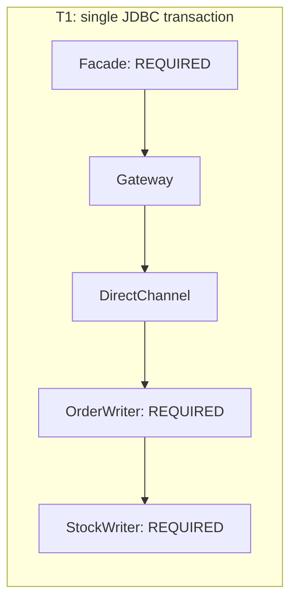
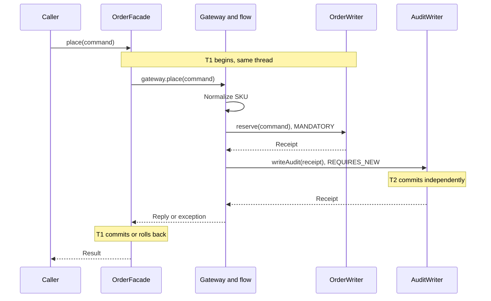

# Transaction propagation in Spring Integration

## 1. Objectives and scope

In the **Transaction support** chapter of the **SPRING_INTEGRATION_CORE** module, transaction propagation answers the question: when an endpoint invokes a subsequent transactionally configured operation, does that operation join the existing transaction, open another transaction, or run outside any transaction?

Suppose an order flow consists of gateway → transformer → inventory-reserving service activator → audit-writing service activator. If the last step fails, how must the order, inventory, and audit records change? The answer depends on propagation at each boundary, how the flow uses `MessageChannel`, and the resources managed by the transaction manager.

After this lesson, you will be able to:

- Read and choose among Spring's seven `Propagation` modes.
- Distinguish physical transactions, logical scopes, and savepoints.
- Determine where transactions begin and end in flows using gateways or pollers.
- Apply `@Transactional` and transaction advice in Java DSL.
- Predict commit/rollback outcomes upon errors, thread switches, or asynchronous processing.
- Design verification checks using database state after the call completes.

The examples use Java 17 or later, Spring Integration Java DSL, and JDBC with `JdbcTransactionManager`. These are imperative flows using thread-bound transactions. For reactive transactions, context and configuration use separate mechanisms; do not apply the thread-based model below directly.

## 2. Three questions to keep separate

| Concept | Question resolved | Example |
| --- | --- | --- |
| Propagation | Which transaction does this operation use when called? | `REQUIRED` joins an active transaction. |
| Isolation | How do concurrent transactions observe each other's changes? | `READ_COMMITTED`. |
| Rollback rules | Which outcomes or exceptions cause the transaction to roll back? | `rollbackFor = BusinessException.class`. |

Propagation does not replace the other two settings. Choosing `REQUIRES_NEW` creates an independent transaction; it does not guarantee the operation succeeds, eliminate lock contention, or combine external resources into a shared transaction.

Merely declaring an annotation on a method is also not enough. You need a transaction manager, a transaction-application mechanism, and calls actually passing through that mechanism.

## 3. Physical transactions and logical scopes

### 3.1. Do not count transactions by endpoint count

A **physical transaction** is the actual resource transaction, such as a transaction on a JDBC connection. A **logical scope** is the scope managed by a transaction interceptor around an invocation.

For example, a facade has `REQUIRED` and then calls two beans that also have `REQUIRED`. With the same transaction manager and the same thread, three logical scopes can share a single physical transaction `T1`.



An inner method returning normally does not mean data has committed. When it only participates in `T1`, the decision to complete the physical transaction still belongs to the outer scope. Spring also tracks rollback-only across logical scopes; a participating scope can make the entire shared transaction uncommittable. See [Spring Framework Transaction Propagation](https://docs.spring.io/spring-framework/reference/data-access/transaction/declarative/tx-propagation.html).

### 3.2. Conditions for participating in the same JDBC transaction

Within the scope of this lesson, verify all of the following together:

1. The invocation is still on the thread holding an active transaction.
2. The selected transaction manager manages the exact resource being used.
3. Data-access code acquires connections via Spring's transaction-aware mechanism.
4. Propagation permits joining and the call passed through the interceptor.

`JdbcTemplate` uses Spring's connection-retrieval mechanism. Manually calling `dataSource.getConnection()` and operating on it as a standalone connection can prevent code from joining the intended transaction. For JDBC, `DataSourceTransactionManager` binds a connection per `DataSource` to the thread; `JdbcTransactionManager` extends this mechanism and adds exception translation at commit/rollback time. Refer to [DataSourceTransactionManager](https://docs.spring.io/spring-framework/docs/current/javadoc-api/org/springframework/jdbc/datasource/DataSourceTransactionManager.html) and [JdbcTransactionManager](https://docs.spring.io/spring-framework/docs/current/javadoc-api/org/springframework/jdbc/support/JdbcTransactionManager.html).

Two managers managing two different databases do not automatically form a shared atomic transaction simply because both use `REQUIRED`. Explicitly identify each manager's resource before concluding that operations will commit or roll back together.

## 4. Seven propagation modes

In the table, "transaction exists" means a transaction recognized by the selected manager in the current context.

| Mode | No existing transaction | Existing transaction |
| --- | --- | --- |
| `REQUIRED` | Creates a new one. | Joins it. |
| `REQUIRES_NEW` | Creates a new one. | Suspends existing transaction, creates a new one. |
| `NESTED` | Creates a new one like `REQUIRED`. | Creates a nested scope, typically using a savepoint. |
| `SUPPORTS` | Runs without a resource transaction. | Joins it. |
| `MANDATORY` | Throws an exception. | Joins it. |
| `NOT_SUPPORTED` | Runs outside a transaction. | Suspends existing transaction. |
| `NEVER` | Runs outside a transaction. | Throws an exception. |

These are the contracts of the [Propagation enum](https://docs.spring.io/spring-framework/docs/current/javadoc-api/org/springframework/transaction/annotation/Propagation.html). Suspension and nested support also depend on the transaction manager.

### 4.1. `REQUIRED`: a shared business unit of work

Choose `REQUIRED` when steps must succeed together or fail together, such as creating an order and deducting inventory in one database.

```text
T1 begins
  insert order_request
  deduct inventory
  save shipping details
T1 commits or rolls back everything
```

The business condition is that all three changes belong to one unit of work. Putting three `REQUIRED` annotations on three beans does not guarantee that if the first bean already ended its transaction before the next bean is called.

For instance, if a flow has no outer transaction and calls three service proxies sequentially, each service may open and close its own transaction. Place an outer boundary at a facade, poller, or advice wrapping the portion of the flow that must be atomic.

### 4.2. `REQUIRES_NEW`: a result with an independent lifecycle

Choose `REQUIRES_NEW` when inner data makes sense even if the outer business operation fails, such as recording that a processing attempt occurred.

```text
T1: create order, reserve inventory
  suspend T1
  T2: write audit "RESERVATION_ATTEMPT"
  T2 commits
  resume T1
T1 rolls back because a later step fails

Outcome: audit exists; order and inventory changes do not exist.
```

Independence applies only to the transaction. If `T2` throws an exception and it propagates across `T1`'s boundary, `T1`'s rollback rules can still cause `T1` to roll back.

When designing an independent audit, determine:

- **Semantics:** recording "processing attempted" differs from "order placed successfully."
- **Data:** `T2` should not depend on records only newly created and uncommitted inside `T1`.
- **Resources:** `T1`'s connection may remain held while `T2` needs another connection.

In particular, if the audit table has a foreign key to an uncommitted order, the inner transaction may block waiting on data or locks held by the suspended transaction. The connection pool can also be exhausted when many workers hold outer connections while waiting for inner connections. Size for actual concurrency, nesting depth, and execution time; do not use `REQUIRES_NEW` as a default for every endpoint.

### 4.3. `NESTED`: partial rollback inside the same physical transaction

With JDBC supporting savepoints, you can model it as:

```text
T1 begins
  create main order
  savepoint S1
    attempt to write gift item
    business error
  roll back to S1
  continue completing main order
T1 commits
```

The gift item is discarded while work before the savepoint can be kept. If `T1` rolls back later, even succeeded nested operations roll back. There is no independent commit at the end of a nested scope.

The condition to continue after an error is that the error must be handled **after exiting the nested boundary**, so the interceptor rolls back to the savepoint. If the exception continues escaping the outer scope, the outer transaction can still roll back. Certain database errors also leave the transaction unable to continue; savepoints do not recover from every kind of error.

An implementation example is a separate `GiftWriter` bean with a method `@Transactional(transactionManager = "orderTxManager", propagation = Propagation.NESTED)`, called by an outer bean through a proxy. Do not swap `REQUIRES_NEW` for `NESTED` merely to reduce connection count: the two options make different data commitments.

With JPA, distinguish JDBC savepoints from managed entity state inside the persistence context. Do not infer that a manager supports all nested operations from the annotation name alone; verify the specific manager, driver, and data-access technology.

### 4.4. The remaining four modes in endpoint design

| Mode | Useful design meaning | Key reminder |
| --- | --- | --- |
| `MANDATORY` | Requires the caller to own the unit of work, e.g., inventory writer. | Does not open a transaction to patch an under-configured caller. |
| `SUPPORTS` | Allows joining if the caller already has a transaction. | Does not guarantee the operation always runs inside a transaction. |
| `NOT_SUPPORTED` | Temporarily runs a segment outside the current transaction, e.g., a deliberately separated I/O step. | Does not automatically release locks held by the outer transaction. |
| `NEVER` | Detects accidental invocation inside a transaction. | Does not suspend; it enforces a precondition. |

With `SUPPORTS`, transaction synchronization can still be active even without an actual resource transaction. Therefore, distinguish `isSynchronizationActive()` from `isActualTransactionActive()` when observing the system. Details on transaction attributes are in [TransactionDefinition](https://docs.spring.io/spring-framework/docs/current/javadoc-api/org/springframework/transaction/TransactionDefinition.html).

## 5. How do channels and gateways affect propagation?

### 5.1. Propagation is not carried by message headers

In local JDBC transactions, adding headers like `transactionId`, `correlationId`, or `transactional=true` does not move a transaction to another thread. Headers can serve observability and business correlation; they do not carry connections or commit/rollback authority.

| Component | Transaction-related behavior |
| --- | --- |
| `DirectChannel` | Invokes handler on sending thread, allowing continuation of an existing transaction. |
| `ExecutorChannel` | Can offload processing to another thread; does not rely on sender's transaction. |
| `QueueChannel` with poller consumer | Sender and consumer have separate executions; poller needs its own transaction boundary. |
| `PublishSubscribeChannel` | Inspect executor configuration and how subscribers handle errors. |
| Request/reply gateway | Waiting for a reply does not guarantee processing uses the same thread or transaction. |

See [MessageChannel Implementations](https://docs.spring.io/spring-integration/reference/channel/implementations.html) to check dispatch mechanics. Do not rely on an executor occasionally running on the caller thread to guarantee atomicity.

With asynchronous flows, successful message handoff can let the sending-side transaction complete while downstream is still processing. A channel does not automatically commit a facade right at the `send()` line; the facade still finishes at its own transaction boundary. What is lost across the thread boundary is automatic downstream participation in the sender's transaction.

### 5.2. Contracts when changing channels

Suppose the facade has `T1`, while the writer uses `MANDATORY`:

```text
Facade(T1) → gateway → DirectChannel → writer(MANDATORY)
                                          joins T1

Facade(T1) → gateway → ExecutorChannel → worker thread
                                           writer(MANDATORY)
                                           fails if worker has not opened a transaction
```

If `MANDATORY` is changed to `REQUIRED` on the worker, the writer can open `T2`. That gives the writer a local transaction, but it does not restore atomicity between `T1` and `T2`.

Routers, filters, transformers, and aggregators also do not decide propagation themselves. Check which thread they run on, what scope advice wraps, and whether there are waits, message persistence, or executor handoffs. A filter dropping a message without throwing an exception does not implicitly mean rollback.

## 6. Complete example: placing an order, reserving stock, and independent audit

### 6.1. Contract of the example

The flow uses a gateway and synchronous steps. `OrderFacade.place()` owns `T1`; the writer must participate via `MANDATORY`; the audit opens `T2` via `REQUIRES_NEW`.



The `failAfterAudit` flag only illustrates a failure after the audit step. In real systems, this step corresponds to real business checks or fault-injection mechanisms in test environments.

### 6.2. Schema for H2 used in practice

```sql
create table inventory (
    sku varchar(64) primary key,
    available integer not null check (available >= 0)
);

create table order_request (
    order_id varchar(64) primary key,
    sku varchar(64) not null,
    quantity integer not null check (quantity > 0)
);

create table audit_event (
    audit_id bigint generated by default as identity primary key,
    order_id varchar(64) not null,
    event_code varchar(64) not null
);

insert into inventory(sku, available) values ('BOOK', 10);
```

`audit_event.order_id` intentionally has no foreign key to `order_request`. The audit must be able to persist the correlation ID even when the order-creation transaction rolls back. Run DDL and seed data before calling the facade; do not mix DDL into the order-placing transaction.

### 6.3. Configuration and beans

Place the following snippet in a dedicated package `example.tx`; you can save it as `PropagationDemoConfig.java` in a practice application. You need Spring Integration Core, Spring JDBC, Spring transaction/AOP dependencies, a database driver, and a configured `DataSource` bean. Business classes are declared directly as beans to avoid relying on component scanning for services.

```java
package example.tx;

import java.util.Locale;
import javax.sql.DataSource;

import org.springframework.context.annotation.Bean;
import org.springframework.context.annotation.Configuration;
import org.springframework.integration.annotation.IntegrationComponentScan;
import org.springframework.integration.annotation.MessagingGateway;
import org.springframework.integration.channel.DirectChannel;
import org.springframework.integration.config.EnableIntegration;
import org.springframework.integration.dsl.IntegrationFlow;
import org.springframework.jdbc.core.JdbcTemplate;
import org.springframework.jdbc.support.JdbcTransactionManager;
import org.springframework.transaction.PlatformTransactionManager;
import org.springframework.transaction.annotation.EnableTransactionManagement;
import org.springframework.transaction.annotation.Propagation;
import org.springframework.transaction.annotation.Transactional;

@Configuration
@EnableIntegration
@EnableTransactionManagement
@IntegrationComponentScan(basePackageClasses = PropagationDemoConfig.class)
public class PropagationDemoConfig {

    public record PlaceOrder(
            String orderId, String sku, int quantity, boolean failAfterAudit) {
    }

    public record Receipt(
            String orderId, String sku, int quantity, boolean failAfterAudit) {
    }

    @MessagingGateway(defaultRequestChannel = "orderInput")
    public interface OrderGateway {
        Receipt place(PlaceOrder command);
    }

    @Bean
    public PlatformTransactionManager orderTxManager(DataSource dataSource) {
        return new JdbcTransactionManager(dataSource);
    }

    @Bean
    public JdbcTemplate jdbcTemplate(DataSource dataSource) {
        return new JdbcTemplate(dataSource);
    }

    @Bean
    public DirectChannel orderInput() {
        return new DirectChannel();
    }

    @Bean
    public OrderWriter orderWriter(JdbcTemplate jdbc) {
        return new OrderWriter(jdbc);
    }

    @Bean
    public AuditWriter auditWriter(JdbcTemplate jdbc) {
        return new AuditWriter(jdbc);
    }

    @Bean
    public OrderFacade orderFacade(OrderGateway gateway) {
        return new OrderFacade(gateway);
    }

    @Bean
    public IntegrationFlow orderFlow(
            DirectChannel orderInput,
            OrderWriter orderWriter,
            AuditWriter auditWriter) {

        return IntegrationFlow.from(orderInput)
                .transform(PlaceOrder.class, command -> new PlaceOrder(
                        command.orderId(),
                        command.sku().trim().toUpperCase(Locale.ROOT),
                        command.quantity(),
                        command.failAfterAudit()))
                .handle(orderWriter, "reserve")
                .handle(auditWriter, "writeAudit")
                .handle(Receipt.class, (receipt, headers) -> {
                    if (receipt.failAfterAudit()) {
                        throw new IllegalStateException("Failure after audit");
                    }
                    return receipt;
                })
                .get();
    }

    public static class OrderFacade {
        private final OrderGateway gateway;

        public OrderFacade(OrderGateway gateway) {
            this.gateway = gateway;
        }

        @Transactional(transactionManager = "orderTxManager")
        public Receipt place(PlaceOrder command) {
            if (command.quantity() <= 0) {
                throw new IllegalArgumentException("Quantity must be positive");
            }
            return gateway.place(command);
        }
    }

    public static class OrderWriter {
        private final JdbcTemplate jdbc;

        public OrderWriter(JdbcTemplate jdbc) {
            this.jdbc = jdbc;
        }

        @Transactional(
                transactionManager = "orderTxManager",
                propagation = Propagation.MANDATORY)
        public Receipt reserve(PlaceOrder command) {
            jdbc.update("""
                    insert into order_request(order_id, sku, quantity)
                    values (?, ?, ?)
                    """, command.orderId(), command.sku(), command.quantity());

            int updated = jdbc.update("""
                    update inventory
                    set available = available - ?
                    where sku = ? and available >= ?
                    """, command.quantity(), command.sku(), command.quantity());

            if (updated != 1) {
                throw new IllegalStateException("SKU missing or stock insufficient");
            }

            return new Receipt(command.orderId(), command.sku(),
                    command.quantity(), command.failAfterAudit());
        }
    }

    public static class AuditWriter {
        private final JdbcTemplate jdbc;

        public AuditWriter(JdbcTemplate jdbc) {
            this.jdbc = jdbc;
        }

        @Transactional(
                transactionManager = "orderTxManager",
                propagation = Propagation.REQUIRES_NEW)
        public Receipt writeAudit(Receipt receipt) {
            jdbc.update("""
                    insert into audit_event(order_id, event_code)
                    values (?, ?)
                    """, receipt.orderId(), "RESERVATION_ATTEMPT");
            return receipt;
        }
    }
}
```

All practice calls must fetch the bean from `ApplicationContext`, such as `context.getBean(PropagationDemoConfig.OrderFacade.class)`. Calling `new OrderFacade(...)` manually bypasses the transaction proxy.

In this example, no gateway `errorChannel` is configured, no executor is added, and no queue is crossed. Therefore, errors in the synchronous flow return to the facade. A `Receipt` returned from a handler only indicates that step completed; callers outside the facade only receive a successful result after the facade's transaction interceptor completes committing.

### 6.4. Predicting results before running

Each row below starts with inventory at 10 books and the other two tables empty.

| Call | `order_request` after completion | `inventory.available` | Audit count |
| --- | --- | --- | --- |
| Order 2 books, `failAfterAudit=false` | Order present. | 8 | 1 |
| Order 20 books | No order. | 10 | 0 |
| Order 2 books, `failAfterAudit=true` | No order. | 10 | 1 |

In the second row, the SQL insert ran but was rolled back along with `T1` due to insufficient stock. Audit was not called yet. In the third row, audit committed in `T2` before the final step threw an exception, so `T1`'s rollback does not delete that audit record.

If the requirement changes to "audit must exist only when the order succeeds and must roll back with the order," you can switch audit to `REQUIRED` in this synchronous structure. If the audit must also capture failures occurring before the audit step, add a recording point at the error boundary; the current example does not cover that case automatically.

## 7. Why does catching an exception still produce `UnexpectedRollbackException`?

Consider two different beans, both using `REQUIRED` and the same manager:

```text
outer() opens T1
  try:
    call inner() through proxy
      inner() throws RuntimeException
      inner's interceptor marks T1 rollback-only
  catch:
    outer logs and continues
outer() returns normally
outer's interceptor attempts to commit T1
  → rolls back and reports UnexpectedRollbackException
```

Catching the exception in `outer()` does not clear the rollback-only status. When a mandatory order step fails, the right behavior is usually letting the order fail and preserving the failure cause. If a step is allowed to fail independently, design an independent or nested boundary appropriately up front.

Not every caught exception leads to this error. If an exception is handled right inside the method before crossing a transaction interceptor, the interceptor may never see it; conversely, another resource or code path may still have marked the transaction uncommittable. Trace exactly which boundary each exception crosses.

With typical default rollback settings, `RuntimeException` and `Error` trigger rollback; checked exceptions do not trigger rollback automatically. You can declare `rollbackFor` per business contract. If the application changed global rollback rules, evaluate that configuration. In a flow, also check the exception actually received by the interceptor, as errors may be wrapped in a messaging exception. See [Spring rollback rules](https://docs.spring.io/spring-framework/reference/data-access/transaction/declarative/rolling-back.html).

## 8. Poller: opening a transaction on the consumer side

Flows started by a scheduler or poller typically have no facade on the caller thread to provide a transaction. The poller is the right place to put a transaction wrapping the receive operation and synchronous downstream processing.

Here is an additional configuration using `PlaceOrder` and `OrderWriter` from the example above. The `pendingOrders` bean is an in-memory queue, mainly for observing thread boundaries.

```java
import org.springframework.beans.factory.annotation.Qualifier;
import org.springframework.context.annotation.Bean;
import org.springframework.integration.channel.QueueChannel;
import org.springframework.integration.dsl.IntegrationFlow;
import org.springframework.integration.dsl.Pollers;
import org.springframework.integration.transaction.TransactionInterceptorBuilder;
import org.springframework.transaction.PlatformTransactionManager;
import org.springframework.transaction.annotation.Propagation;
import org.springframework.transaction.interceptor.TransactionInterceptor;

// These @Bean methods reside in a @Configuration class.
@Bean
public QueueChannel pendingOrders() {
    return new QueueChannel(100);
}

@Bean
public TransactionInterceptor pollTransaction(
        @Qualifier("orderTxManager") PlatformTransactionManager manager) {
    return new TransactionInterceptorBuilder()
            .transactionManager(manager)
            .propagation(Propagation.REQUIRED)
            .build();
}

@Bean
public IntegrationFlow pendingOrdersFlow(
        QueueChannel pendingOrders,
        PropagationDemoConfig.OrderWriter writer,
        @Qualifier("pollTransaction") TransactionInterceptor pollTransaction) {

    return IntegrationFlow.from(pendingOrders)
            .handle(writer, "reserve", endpoint -> endpoint
                    .poller(Pollers.fixedDelay(500)
                            .maxMessagesPerPoll(1)
                            .transactional(pollTransaction)))
            .channel("nullChannel")
            .get();
}
```

This snippet assumes the producer already supplied a `PlaceOrder` with normalized SKU and valid quantity. Transaction advice is attached to the **poller**, so the writer's `MANDATORY` finds the transaction opened by the poller. It does not join any transaction the producer might have used when enqueuing. Configuration APIs are in [PollerSpec](https://docs.spring.io/spring-integration/api/org/springframework/integration/dsl/PollerSpec.html).

An in-memory `QueueChannel` does not restore a retrieved message merely because a JDBC transaction rolls back. A transactional poller only rolls back receiving if the source or message store itself supports transactions and is configured to participate in the right resource. With durable queues/stores, separately verify atomicity between message retrieval and business updates. [Spring Integration Transaction Support](https://docs.spring.io/spring-integration/reference/transactions.html) explains the special role of transactions wrapping `receive()`.

If the writer forwards to an `ExecutorChannel`, work on the new thread again needs its own transaction boundary. You cannot extend the poller's transaction simply by adding `REQUIRED` to a method on the worker.

## 9. Transaction advice in Java DSL: mind the wrapping scope

`@Transactional` on a service bean normally wraps only that bean's method. If the method returns a payload and then the endpoint sends the payload downstream, the transaction opened by the method may already end before downstream runs.

When you need to start a transaction right at a handler and wrap the synchronous downstream segment as well, Spring Integration provides `TransactionHandleMessageAdvice`. Passing `true` to the builder creates this advice type:

```java
import org.springframework.integration.transaction.TransactionInterceptorBuilder;
import org.springframework.transaction.annotation.Propagation;
import org.springframework.transaction.interceptor.TransactionInterceptor;

TransactionInterceptor flowTransaction = new TransactionInterceptorBuilder(true)
        .transactionManager(manager)
        .propagation(Propagation.REQUIRED)
        .build();

// Inside an @Bean IntegrationFlow; both channels are declared DirectChannels.
return IntegrationFlow.from(rawInput)
        .handle(PropagationDemoConfig.PlaceOrder.class,
                (payload, headers) -> payload,
                endpoint -> endpoint.advice(flowTransaction))
        .channel(validatedInput)
        .handle(writer, "reserve")
        .channel("nullChannel")
        .get();
```

This is an alternative configuration option for the start-of-flow boundary, not a requirement to add advice to every bean in the facade example. `manager`, `rawInput`, `validatedInput`, and `writer` are beans injected into the configuration method.

A standard `TransactionInterceptor` placed in the request-handler advice chain has a narrower scope: for reply-producing handlers, it wraps internal request handling and does not automatically include forwarding the reply down the flow. Choosing the right advice type is just as important as choosing propagation. See [Transaction Support for handler advice](https://docs.spring.io/spring-integration/reference/handler-advice/tx-handle-message.html) and [TransactionInterceptorBuilder](https://docs.spring.io/spring-integration/api/org/springframework/integration/transaction/TransactionInterceptorBuilder.html).

Even handle-message advice only covers downstream segments still running within the synchronous call. It does not carry transactions across an executor or queue to another consumer.

## 10. Proxies, join settings, and error handling

### 10.1. Self-invocation bypasses propagation in proxy mode

Incorrect expectation when using default proxying:

```java
@Transactional(transactionManager = "orderTxManager")
public void process() {
    this.saveAudit();
}

@Transactional(
        transactionManager = "orderTxManager",
        propagation = Propagation.REQUIRES_NEW)
public void saveAudit() {
    // Calling directly via this does not pass through the transaction proxy.
}
```

The annotation on `saveAudit()` is not applied to this direct call. If an independent transaction is needed, extract audit into another bean and invoke the Spring-injected bean, like `AuditWriter` in the main example. A programmatic alternative is `TransactionTemplate` with explicitly configured propagation.

Examples in this lesson use public methods on non-`final` classes and invoke Spring-managed beans. Default mechanisms and self-invocation limits are described in [Using @Transactional](https://docs.spring.io/spring-framework/reference/data-access/transaction/declarative/annotations.html); callback-based management is in [Programmatic Transaction Management](https://docs.spring.io/spring-framework/reference/data-access/transaction/programmatic.html).

### 10.2. Inner attributes do not automatically upgrade an outer transaction

If `T1` already exists and a `REQUIRED` method joins it, declaring a higher isolation level on that method does not convert the active physical transaction into one with the new isolation level. Likewise, timeout and read-only on a participating scope do not implicitly override the outer transaction's characteristics.

When incompatible join configurations must be rejected, consider `setValidateExistingTransaction(true)` on an appropriate manager. When an independent transaction with its own attributes is genuinely needed, evaluate `REQUIRES_NEW` against business requirements and resource cost, rather than using it just to make inner annotations take effect.

### 10.3. Error flows are not remote rollback commands

With `DirectChannel`, exceptions typically travel back up the call stack to the caller. With asynchronous processing or scheduled pollers, errors can be wrapped into an `ErrorMessage` and sent to `errorChannel`. This error routing is described in [Spring Integration Error Handling](https://docs.spring.io/spring-integration/reference/error-handling.html).

To deduce transaction outcomes, determine when the error meets the transaction interceptor:

- If the error exits `T1`'s scope and matches rollback rules, `T1` rolls back.
- If recovery turns the error into a normal reply before the interceptor sees the error, the transaction can commit if not marked rollback-only.
- If a participating bean already marked rollback-only, a successful reply does not make the transaction valid again.
- If the error is handled only after the sending transaction has committed, the error flow cannot roll back that completed transaction.

In the audit example, no recovery is configured to swallow post-audit errors. If recovery is added, clearly define whether it represents a successful or failed business outcome before changing the commit contract.

## 11. Practicing data-outcome verification

### 11.1. Behavior matrix to observe

| Scenario | What to verify after the call |
| --- | --- |
| `REQUIRED` joins and a later step fails | Changes in the shared transaction are rolled back. |
| `REQUIRES_NEW` succeeds, outer transaction fails | Data from the new transaction still exists. |
| `REQUIRES_NEW` fails, caller handles error at proper boundary | Evaluate outer transaction outcome separately. |
| `NESTED` fails and is handled outside nested scope | Work after savepoint is discarded; work before can still commit. |
| `NESTED` succeeds then outer transaction rolls back | Nested data is also rolled back. |
| `MANDATORY` without a transaction | Error occurs before the business method body. |
| `NEVER` invoked inside a transaction | Call is rejected. |
| Replace direct with executor | Check consumer thread and transaction, not just `send()` result. |

Do not check only "whether an exception occurred." Re-read the database after the transaction boundary has actually finished, using an appropriate observation connection or transaction.

### 11.2. Two representative assertions for the order example

These are JUnit 5 excerpts for a fixture that loaded `PropagationDemoConfig`, an H2 `DataSource` bean, and the schema from section 6. Each test must clear old data, seed `BOOK=10`, and retrieve `facade` and `jdbc` from the context. Do not wrap this test in an outer transaction, so `facade.place()` actually finishes its transaction before the assertions.

```java
import static org.junit.jupiter.api.Assertions.assertEquals;
import static org.junit.jupiter.api.Assertions.assertThrows;

import org.junit.jupiter.api.Test;

// facade: PropagationDemoConfig.OrderFacade, obtained from ApplicationContext.
// jdbc: JdbcTemplate sharing the same DataSource.

@Test
void failureAfterAuditRollsBackOrderButKeepsAudit() {
    assertThrows(RuntimeException.class, () -> facade.place(
            new PropagationDemoConfig.PlaceOrder("O-101", " book ", 2, true)));

    assertEquals(0, jdbc.queryForObject(
            "select count(*) from order_request where order_id = ?",
            Integer.class, "O-101").intValue());

    assertEquals(10, jdbc.queryForObject(
            "select available from inventory where sku = ?",
            Integer.class, "BOOK").intValue());

    assertEquals(1, jdbc.queryForObject(
            "select count(*) from audit_event where order_id = ?",
            Integer.class, "O-101").intValue());
}

@Test
void insufficientStockRollsBackBeforeAudit() {
    assertThrows(RuntimeException.class, () -> facade.place(
            new PropagationDemoConfig.PlaceOrder("O-102", "BOOK", 20, false)));

    assertEquals(0, jdbc.queryForObject(
            "select count(*) from order_request where order_id = ?",
            Integer.class, "O-102").intValue());

    assertEquals(10, jdbc.queryForObject(
            "select available from inventory where sku = ?",
            Integer.class, "BOOK").intValue());

    assertEquals(0, jdbc.queryForObject(
            "select count(*) from audit_event where order_id = ?",
            Integer.class, "O-102").intValue());
}
```

In the exception assertions, the outer type may be a messaging exception. When verifying the exact business cause, add assertions on the cause chain. Data assertions are what prove the transaction contracts of both scenarios.

### 11.3. Observing threads and transaction status

You can temporarily log state at the facade, writer, and audit:

```java
import org.springframework.transaction.support.TransactionSynchronizationManager;

System.out.printf("thread=%s, actualTx=%s, synchronization=%s, name=%s%n",
        Thread.currentThread().getName(),
        TransactionSynchronizationManager.isActualTransactionActive(),
        TransactionSynchronizationManager.isSynchronizationActive(),
        TransactionSynchronizationManager.getCurrentTransactionName());
```

Matching thread names or `actualTx=true` does not prove two points share the same physical transaction. Combine transaction logs, connection details when needed, and data results. For async, use a bounded wait mechanism in tests; a fixed sleep easily reads data too early.

## 12. How to choose for a real flow

Before adding annotations, write out the data contract as concrete clauses: "order creation and inventory reservation must roll back together"; "attempt audit must remain even if order creation fails"; "message retrieval and business writes must be atomic if resources permit." From there, establish an outer boundary for each unit of work.

A useful design sequence:

1. List every operation with side effects and its underlying resource.
2. Map all thread switches, queues, executors, and remote calls.
3. Choose where transactions start: facade, poller, or handler advice.
4. Use `REQUIRED` or `MANDATORY` for steps needing the same unit of work.
5. Split out `REQUIRES_NEW` only when an independent outcome makes sense; use `NESTED` only when partial rollback is appropriate and supported.
6. Verify exception paths, recovery, and commit timing.
7. Verify with final database state, including failure scenarios.

An HTTP request, email send, or file rename is not undone merely by JDBC transaction propagation. Likewise, transaction synchronization does not turn non-transactional resources into transactional ones. When you need both to persist business data and to reliably publish events, you can design an outbox: write the event record in the same database transaction, then let another process publish and handle redelivery under an idempotency contract.

Propagation is a decision at each execution boundary. When reading a flow, always tie each decision to a specific thread, transaction manager, resource, and error-handling path; that is the basis for accurately predicting which data remains after a processing run.
