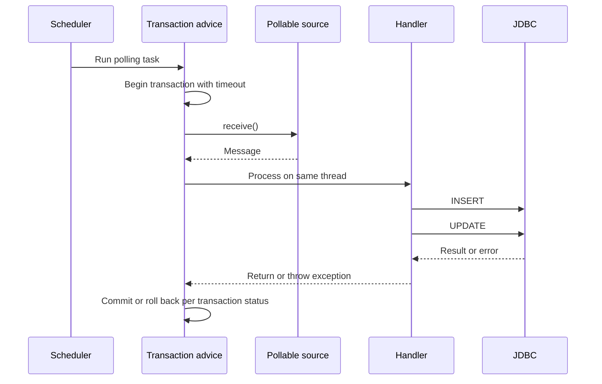

# Transaction timeout in Spring Integration

## Objectives and scope

In the `SPRING_INTEGRATION_CORE` module, this lesson belongs to the **Transaction support** chapter and focuses on **Transaction timeout**: bounding the duration of a transaction wrapping part of a message flow. After this lesson, you will be able to configure timeouts on pollers using Java DSL, identify which processing segment is protected, explain why a task may continue running past the expiration time, and design tests verifying rollback.

The examples use imperative flows, `PlatformTransactionManager`, and JDBC. You should be familiar with `Message` structure, the role of `MessageChannel`, polling consumers, and basic `JdbcTemplate` operations. For reactive flows, transactions based on Reactor context must be designed separately; do not apply the thread-local conclusions in this lesson directly.

## 1. What does a timeout bound?

Suppose an application receives order-intake requests. Each message must write data to the database, update status, and complete the transaction. A slow request can hold a connection or lock for a long time, forcing other requests to wait. A transaction timeout provides a time budget for the transaction so the transaction system and participating resources can detect expiration.

Spring Integration uses Spring Framework's transaction infrastructure. The timeout attribute has the following basic rules:

- The unit for `TransactionDefinition.getTimeout()`, `@Transactional(timeout = ...)`, and `TransactionInterceptorBuilder.timeout(...)` is **seconds**.
- `TIMEOUT_DEFAULT`, whose value is `-1`, requests using the default of the underlying transaction system. Do not assume every environment shares the same default.
- Timeout is determined by the point that starts a new physical transaction. Declaring it at a place that merely joins an existing transaction does not reset the deadline.
- The transaction manager must support timeouts; you cannot assume every implementation enforces them identically.

To express a clear limit in configuration, use a positive number of seconds. Do not use `0` under the general assumption that it always means "unlimited"; check the contract of the transaction manager and resource in use. See [TransactionDefinition](https://docs.spring.io/spring-framework/docs/current/javadoc-api/org/springframework/transaction/TransactionDefinition.html) and [DefaultTransactionDefinition.setTimeout](https://docs.spring.io/spring-framework/docs/current/javadoc-api/org/springframework/transaction/support/DefaultTransactionDefinition.html#setTimeout(int)).

You can picture the budget as follows:

```text
Transaction start time:  t0
Configured timeout:      5 seconds
Expected deadline:       t0 + 5 seconds

First SQL and prior processing already took 3 seconds
=> roughly 2 seconds remain, not another 5 seconds for the second SQL.
```

This is a model explaining the deadline, not a promise that the thread always stops at the fifth second. Detecting and handling expiration depends on the mechanisms of the transaction manager, driver, and database.

## 2. Distinguishing different timeouts in the same flow

Settings have similar-sounding names yet govern different behaviors.

| Setting | What is bounded or coordinated | Unit to watch |
| --- | --- | --- |
| Transaction timeout | Duration of the initiated transaction | Seconds in Spring transaction API |
| Poller `fixedDelay` | Delay between trigger firings under fixed delay | Uses `Duration` in example; XML defaults to milliseconds unless specified otherwise |
| Poller `receiveTimeout` | Wait time for receiving a message from a pollable channel | Milliseconds in Java DSL |
| Channel `send(message, timeout)` | Wait time allowed for send if the channel supports blocking | Milliseconds; depends on channel type |
| Gateway `replyTimeout` | Wait time for a reply once entering the reply-wait phase | Milliseconds in the corresponding gateway properties |
| JDBC query timeout | Statement limit per API/driver | Seconds with `JdbcTemplate.setQueryTimeout` |
| HTTP client timeout | Connect, connection acquisition, or response-read phases | Per the HTTP client's API |

Poller units and roles are described in [Message Endpoints](https://docs.spring.io/spring-integration/reference/endpoint.html) and [PollerSpec](https://docs.spring.io/spring-integration/api/org/springframework/integration/dsl/PollerSpec.html).

For example, `fixedDelay(Duration.ofSeconds(1))` combined with transaction timeout `5` means the poller is scheduled on a one-second fixed delay and the transaction has a five-second timeout. The two values do not limit the same operation.

An easily misunderstood detail: with a synchronous gateway where all downstream steps run over `DirectChannel` on the same thread, a slow handler can block the gateway call. `replyTimeout` does not automatically interrupt that handler. When handing off to another thread, the caller can time out waiting for a reply while the worker continues processing. See [Gateway Behavior When No response Arrives](https://docs.spring.io/spring-integration/reference/gateway.html#gateway-timeouts).

## 3. Transaction boundaries determine where the timeout takes effect

### 3.1. Poller opens the transaction before receiving

A poller's transaction advice can wrap both `receive()` and subsequent processing on the same thread. That is why placing a transaction on the poller is more effective than placing it only on a service after the receive step. However, receiving only rolls back if the source resource actually participates in the transaction. See [Poller Transaction Support](https://docs.spring.io/spring-integration/reference/transactions.html).



Time a message spent waiting in the queue **before the poller opened the transaction** is not part of this timeout. Conversely, if the transaction starts first and then waits on `receive()`, that wait time consumes the transaction budget. Therefore, a very long `receiveTimeout` can consume most of the budget before the handler even begins.

In a standard imperative polling endpoint, transaction advice wraps each receive-and-process iteration. Increasing `maxMessagesPerPoll` does not automatically merge all messages in one scheduled trigger firing into a single transaction. At the same time, one receive can yield a payload containing multiple records, causing multiple records to be processed within one transaction. Distinguish the number of message receives from the number of records in a payload. You can inspect how advice and loops are structured in [AbstractPollingEndpoint](https://raw.githubusercontent.com/spring-projects/spring-integration/main/spring-integration-core/src/main/java/org/springframework/integration/endpoint/AbstractPollingEndpoint.java).

### 3.2. Imperative transactions are bound to the thread

`DirectChannel` invokes the handler on the sending thread, so it suits maintaining transaction context across multiple synchronous endpoints. Handing off via `ExecutorChannel` or putting into a `QueueChannel` for another consumer does not automatically carry thread-local transactions to the worker. See [DirectChannel](https://docs.spring.io/spring-integration/reference/channel/implementations.html#channel-implementations-directchannel).

```text
Poller [TX-A] -> DirectChannel -> Transformer -> JDBC handler
               Synchronous steps can share TX-A.

Poller [TX-A] -> QueueChannel -> Another poller [TX-B] -> JDBC handler
               Downstream receive and processing belong to a separate boundary.
```

After successful handoff, the upstream transaction can commit when its invocation scope finishes. An error in the downstream consumer does not roll back the already committed upstream work. The deadline is also not carried into a new transaction via headers; if a budget is needed for the entire request, the application must define its own business deadline.

## 4. Java DSL example: poller with a two-second timeout

The example illustrates JDBC writes committing or rolling back based on processing outcomes. The `QueueChannel` in the example stores messages in memory and **does not automatically return the message to the queue when JDBC rolls back**. To guarantee redelivery, you need a source or message store with an appropriate transactional mechanism along with a retry/redelivery policy. Default in-memory queues are described at [Message Channel Implementations](https://docs.spring.io/spring-integration/reference/channel/implementations.html).

Assume the application already has a `DataSource`, compatible Spring Integration Core, and Spring JDBC libraries. Initialize the following table before sending requests; do not put DDL inside the business transaction under test.

```sql
CREATE TABLE processed_order (
    request_id VARCHAR(100) PRIMARY KEY,
    processing_status VARCHAR(20) NOT NULL
);
```

The configuration below uses Java 17 or later to declare `record`. The JDBC and transaction manager beans use the exact same `DataSource`.

```java
import java.time.Duration;
import javax.sql.DataSource;

import org.springframework.beans.factory.annotation.Qualifier;
import org.springframework.context.annotation.Bean;
import org.springframework.context.annotation.Configuration;
import org.springframework.integration.channel.QueueChannel;
import org.springframework.integration.config.EnableIntegration;
import org.springframework.integration.dsl.IntegrationFlow;
import org.springframework.integration.dsl.Pollers;
import org.springframework.integration.transaction.TransactionInterceptorBuilder;
import org.springframework.jdbc.core.JdbcTemplate;
import org.springframework.jdbc.datasource.DataSourceTransactionManager;
import org.springframework.transaction.PlatformTransactionManager;
import org.springframework.transaction.annotation.Propagation;
import org.springframework.transaction.interceptor.TransactionInterceptor;

@Configuration
@EnableIntegration
public class OrderTimeoutConfiguration {

    public record OrderCommand(String requestId, boolean slow) {
    }

    @Bean
    JdbcTemplate orderJdbc(DataSource dataSource) {
        return new JdbcTemplate(dataSource);
    }

    @Bean
    PlatformTransactionManager orderTxManager(DataSource dataSource) {
        return new DataSourceTransactionManager(dataSource);
    }

    @Bean
    QueueChannel orderQueue() {
        return new QueueChannel(100);
    }

    @Bean
    QueueChannel orderErrorQueue() {
        return new QueueChannel(100);
    }

    @Bean
    TransactionInterceptor orderTxAdvice(
            @Qualifier("orderTxManager") PlatformTransactionManager txManager) {
        return new TransactionInterceptorBuilder()
                .transactionManager(txManager)
                .propagation(Propagation.REQUIRED)
                .timeout(2) // Seconds, not milliseconds.
                .build();
    }

    @Bean
    OrderWriter orderWriter(@Qualifier("orderJdbc") JdbcTemplate jdbc) {
        return new OrderWriter(jdbc);
    }

    @Bean
    IntegrationFlow orderFlow(
            @Qualifier("orderQueue") QueueChannel input,
            @Qualifier("orderErrorQueue") QueueChannel errors,
            @Qualifier("orderTxAdvice") TransactionInterceptor txAdvice,
            OrderWriter writer) {
        return IntegrationFlow.from(input)
                .handle(writer, "write", endpoint -> endpoint
                        .id("orderWriterEndpoint")
                        .poller(Pollers.fixedDelay(Duration.ofSeconds(1))
                                .maxMessagesPerPoll(1)
                                .receiveTimeout(100) // Milliseconds.
                                .transactional(txAdvice)
                                .errorChannel(errors)))
                .get();
    }

    public static class OrderWriter {
        private final JdbcTemplate jdbc;

        public OrderWriter(JdbcTemplate jdbc) {
            this.jdbc = jdbc;
        }

        public void write(OrderCommand command) {
            jdbc.update(
                    "INSERT INTO processed_order "
                            + "(request_id, processing_status) VALUES (?, ?)",
                    command.requestId(), "PROCESSING");

            if (command.slow()) {
                simulateSlowWork();
            }

            jdbc.update(
                    "UPDATE processed_order SET processing_status = ? "
                            + "WHERE request_id = ?",
                    "DONE", command.requestId());
        }

        private void simulateSlowWork() {
            try {
                Thread.sleep(3100);
            }
            catch (InterruptedException ex) {
                Thread.currentThread().interrupt();
                throw new IllegalStateException("Interrupted during demo", ex);
            }
        }
    }
}
```

`Thread.sleep` only creates a slow scenario for learning and testing. In a real application, determine whether the slow step is lock waiting, queries, CPU, or network calls to pick the right bounding mechanism.

`.transactional(txAdvice)` attaches the `TransactionInterceptor` to the polling task; the builder supplies the timeout attribute and transaction manager. See [PollerSpec.transactional](https://docs.spring.io/spring-integration/api/org/springframework/integration/dsl/PollerSpec.html) and [TransactionInterceptorBuilder](https://docs.spring.io/spring-integration/api/org/springframework/integration/transaction/TransactionInterceptorBuilder.html).

Send two messages with different request IDs into `orderQueue`:

```java
import org.springframework.integration.support.MessageBuilder;

boolean accepted = orderQueue.send(
        MessageBuilder.withPayload(
                new OrderTimeoutConfiguration.OrderCommand("order-fast", false))
                .build(),
        1000);

if (!accepted) {
    throw new IllegalStateException("Queue did not accept order-fast");
}

boolean slowAccepted = orderQueue.send(
        MessageBuilder.withPayload(
                new OrderTimeoutConfiguration.OrderCommand("order-slow", true))
                .build(),
        1000);

if (!slowAccepted) {
    throw new IllegalStateException("Queue did not accept order-slow");
}
```

Both `true` results only prove that placing the messages into the queue succeeded. The handler runs later on the poller thread. Under normal conditions, `order-fast` is persisted with status `DONE`; for `order-slow`, the second JDBC call hits the expired transaction, an exception exits the handler, and the `PROCESSING` record is rolled back. Verify results after the consumer has processed them; do not query right after `send()` and conclude failure.

`orderErrorQueue` only serves error observation in the example. It also has bounded capacity; in production you need a consumer to process or durably store errors.

## 5. Why does the thread keep running after timeout expires?

With `DataSourceTransactionManager`, Spring manages connections per thread and supports propagating timeouts to JDBC statements. To benefit from this mechanism, code must use `JdbcTemplate` or a JDBC access path integrating `DataSourceUtils`/`TransactionAwareDataSourceProxy`. Manually obtaining a standalone connection and running SQL can bypass the intended transaction. See [DataSourceTransactionManager](https://docs.spring.io/spring-framework/docs/current/javadoc-api/org/springframework/jdbc/datasource/DataSourceTransactionManager.html).

There are two distinct cases:

1. A new JDBC operation begins after the transaction deadline has already passed: Spring can detect this and throw `TransactionTimedOutException`.
2. A statement was already executing and exceeded the limit enforced by the driver: the error may originate from the driver/database and get translated into a `DataAccessException`, such as `QueryTimeoutException`, depending on the case.

Do not look for only a single exception class name to detect all timeout failures. JTA also has its own timeout enforcement mechanisms via a separate transaction coordinator. See [TransactionTimedOutException](https://docs.spring.io/spring-framework/docs/current/javadoc-api/org/springframework/transaction/TransactionTimedOutException.html).

In the example, `Thread.sleep(3100)` is not interrupted automatically by the transaction's two-second timer. After sleeping completes, the handler calls `JdbcTemplate` again; that is the point where remaining time can be checked and expiration detected. Resource-holder mechanics define deadlines and remaining time-to-live as described in [ResourceHolderSupport](https://docs.spring.io/spring-framework/docs/current/javadoc-api/org/springframework/transaction/support/ResourceHolderSupport.html).

If the last part were replaced with an infinite CPU loop or an untimed network call, do not expect the transaction timeout to rescue the thread on its own. With local JDBC transactions, also do not use "write data, sleep past timeout, then return without touching any resource again" as guaranteed proof that the transaction will roll back. Test the actual execution mechanics; configured deadlines are not a preemptive watchdog for arbitrary Java code.

### Query timeout does not necessarily take the minimum value

A common misconception is that setting `jdbcTemplate.setQueryTimeout(1)` and transaction timeout `5` will always cap the statement at one second. The `JdbcTemplate` Javadoc notes that a timeout set on the template is overridden by the remaining transaction time when the current transaction has a timeout. Do not assume this is always `min(queryTimeout, transactionTimeout)`.

When a dedicated policy for statement or lock-wait timeouts is needed, verify how the driver and database enforce it and design alongside the transaction timeout. See [JdbcTemplate.setQueryTimeout](https://docs.spring.io/spring-framework/docs/current/javadoc-api/org/springframework/jdbc/core/JdbcTemplate.html#setQueryTimeout(int)) and [DataSourceUtils.applyTimeout](https://docs.spring.io/spring-framework/docs/current/javadoc-api/org/springframework/jdbc/datasource/DataSourceUtils.html).

## 6. Other configuration styles and the effect of propagation

### 6.1. XML for pollers

If a project uses XML, the same idea can be expressed with the following configuration. This is an excerpt placed inside a Spring XML file with the `int` namespace declared and an `orderTxManager` bean present.

```xml
<int:service-activator input-channel="orderQueue"
                       ref="orderWriter"
                       method="write">
    <int:poller fixed-delay="1000"
                receive-timeout="100"
                max-messages-per-poll="1">
        <int:transactional transaction-manager="orderTxManager"
                           propagation="REQUIRED"
                           timeout="2"/>
    </int:poller>
</int:service-activator>
```

In this snippet, `fixed-delay="1000"` and `receive-timeout="100"` use milliseconds per the chosen configuration; `timeout="2"` inside `transactional` uses seconds. Do not apply poller trigger units to transaction attributes. If multiple advices are needed via `<int:advice-chain>`, put the transaction advice inside the chain rather than declaring `<int:transactional>` alongside it; the two approaches are mutually exclusive. See [AOP Advice chains](https://docs.spring.io/spring-integration/reference/endpoint.html).

### 6.2. `@Transactional` on a service

You can place `@Transactional(timeout = 2)` on a Spring-managed service method invoked through a proxy. When that service opens a new transaction, the timeout applies to the service's scope, which may exclude the prior message-receive step.

Putting `@Transactional` on an `@Bean` method that creates an `IntegrationFlow` does not wrap future message executions. Likewise, self-invocation within the same object may bypass the proxy in default proxy mode. Distinguish bean initialization time from handler invocation time. See [Using @Transactional](https://docs.spring.io/spring-framework/reference/data-access/transaction/declarative/annotations.html).

### 6.3. Does an inner timeout alter an outer timeout?

| Scenario | Effective behavior to understand |
| --- | --- |
| Poller opens transaction with `REQUIRED`, timeout 5s; service `REQUIRED`, timeout 1s | Service joins existing transaction; the 1s value does not reset the deadline |
| Service uses `REQUIRES_NEW`, timeout 1s | Opens an independent physical transaction with its own timeout; independent commit/rollback |
| Service uses `NESTED` inside a savepoint-capable JDBC transaction | Uses the same physical transaction and a savepoint; does not create an independent budget like `REQUIRES_NEW` |

`REQUIRES_NEW` is not an arbitrary way to shorten an outer transaction: the outer transaction's resources may remain held while the inner transaction borrows its own connection. Evaluate atomicity and connection capacity before choosing propagation. See [Transaction Propagation](https://docs.spring.io/spring-framework/reference/data-access/transaction/declarative/tx-propagation.html).

## 7. Error handling, retries, and side effects

### 7.1. Errors must cross the transaction boundary

When rollback is required on failure, an appropriate exception must exit the transaction scope or the transaction must be marked rollback-only. If code catches the error and returns as a success before the transaction advice sees the error, the result can be a commit; if the resource was already marked rollback-only, catching the error will not restore committability either.

Under Spring's default rollback configuration, `RuntimeException` and `Error` trigger rollback, while checked exceptions require matching rules. Therefore, when translating a timeout error into a business exception, evaluate both the new exception type and where the translation happens. See [Transactional: Attribute Semantics](https://docs.spring.io/spring-framework/docs/current/javadoc-api/org/springframework/transaction/annotation/Transactional.html).

### 7.2. `errorChannel` is for observing and routing errors

For flows running on the caller thread via `DirectChannel`, exceptions can propagate to the caller. For pollers or asynchronous processing, Spring Integration provides a mechanism to emit an `ErrorMessage`; its payload is the exception, and you may need to walk the `cause` chain to find the root cause. See [Error Handling](https://docs.spring.io/spring-integration/reference/error-handling.html).

In the example, you can receive from `orderErrorQueue` to observe errors. Do not infer that the producer saw an exception from `send()`, or that having an error channel makes the input queue transactional. Also distinguish an error emitted after the polling task failed from an inner recovery advice that swallowed the error and returned normally.

Useful details to record on errors include the business request ID, endpoint, start/end timestamps, configured timeout, and root error type. For retries or redelivery, use a stable business key to correlate attempts; `MessageHeaders.ID` does not substitute for a business idempotency key by default.

### 7.3. Each retry needs an appropriate transaction scope

By design, retry wrapping outside a transaction can give each attempt a fresh transaction, provided each attempt truly starts a new one. If a transaction wraps outside retry, attempts and backoff delays can share a single budget and even proceed on an already rollback-only transaction. When using `REQUIRED`, check whether an outer transaction exists before concluding "each attempt is a new transaction."

After a timeout, retry only recoverable operations, bound the attempt count, and handle duplicates via business keys. Do not execute further SQL statements inside the same expired transaction simply because retries remain.

### 7.4. JDBC rollback does not undo all side effects

If a handler sends an HTTP request successfully and then JDBC times out, rolling back the database does not automatically undo the HTTP request. Two independent resources also do not become a distributed transaction simply by sitting in the same flow. You can design writing business data and an outbox record in the same transaction, then dispatch externally via a separate worker with appropriate deduplication.

Transaction synchronization only coordinates callbacks with transaction outcomes; it does not turn files, HTTP, or non-transactional resources into rollback-capable resources. `PseudoTransactionManager` also does not provide real resource rollback. See [Transaction Synchronization and Pseudo Transactions](https://docs.spring.io/spring-integration/reference/transactions.html).

## 8. Deliberately testing timeout and rollback

A useful test must prove database state after the transaction boundary finishes. Measuring elapsed time or checking a single log line is not enough to conclude rollback worked properly.

You can test the JDBC mechanism first with JUnit 5, Spring JDBC, and H2. The snippet below reuses the example's `OrderWriter`. A fresh database is created per run, DDL executes before the transaction, and the final check runs after rollback completes.

```java
import org.junit.jupiter.api.Test;
import org.springframework.jdbc.core.JdbcTemplate;
import org.springframework.jdbc.datasource.DataSourceTransactionManager;
import org.springframework.jdbc.datasource.embedded.EmbeddedDatabase;
import org.springframework.jdbc.datasource.embedded.EmbeddedDatabaseBuilder;
import org.springframework.jdbc.datasource.embedded.EmbeddedDatabaseType;
import org.springframework.transaction.TransactionTimedOutException;
import org.springframework.transaction.support.TransactionTemplate;

import static org.junit.jupiter.api.Assertions.assertEquals;
import static org.junit.jupiter.api.Assertions.assertThrows;

class JdbcTransactionTimeoutTest {

    @Test
    void rollsBackEarlierInsertWhenTheNextOperationDetectsTimeout() {
        EmbeddedDatabase database = new EmbeddedDatabaseBuilder()
                .generateUniqueName(true)
                .setType(EmbeddedDatabaseType.H2)
                .build();

        try {
            JdbcTemplate jdbc = new JdbcTemplate(database);
            jdbc.execute("CREATE TABLE processed_order ("
                    + "request_id VARCHAR(100) PRIMARY KEY, "
                    + "processing_status VARCHAR(20) NOT NULL)");

            TransactionTemplate transaction = new TransactionTemplate(
                    new DataSourceTransactionManager(database));
            transaction.setTimeout(2);

            var writer = new OrderTimeoutConfiguration.OrderWriter(jdbc);
            var command = new OrderTimeoutConfiguration.OrderCommand(
                    "timeout-test", true);

            assertThrows(TransactionTimedOutException.class,
                    () -> transaction.executeWithoutResult(
                            status -> writer.write(command)));

            Integer remaining = jdbc.queryForObject(
                    "SELECT COUNT(*) FROM processed_order WHERE request_id = ?",
                    Integer.class,
                    "timeout-test");

            assertEquals(Integer.valueOf(0), remaining);
        }
        finally {
            database.shutdown();
        }
    }
}
```

In this test, the `INSERT` runs before the intentional delay; the next JDBC operation hits the expired deadline. Using `TransactionTemplate` isolates testing the transaction mechanism without depending on poller scheduling. How to configure the template is described in [Programmatic Transaction Management](https://docs.spring.io/spring-framework/reference/data-access/transaction/programmatic.html).

The test above does not yet verify the full Java DSL, error channel, or message redelivery. To test the real integration setup, add the following scenarios:

| Scenario | What to verify |
| --- | --- |
| Fast message | Record exists with status `DONE` after consumer finishes |
| Slow message | Matching error occurs, and no `PROCESSING` record written in the failed transaction remains |
| Error from poller | `orderErrorQueue` receives `ErrorMessage`; cause chain reflects transaction failure |
| Transactional source with redelivery | Message can be re-received per source config; do not check only JDBC rollback |
| Handler via `ExecutorChannel` | Verify separate transaction boundary rather than expecting upstream thread's timeout to propagate |
| Inner `REQUIRED` | Verify service has no independent deadline apart from the existing transaction |

For poller tests, use conditional waiting with an appropriate overall timeout to observe outcomes rather than a fixed `sleep` followed by a query. Do not wrap the entire test in an outer transaction that keeps data the poller thread needs to read uncommitted. Do not use a test timeout mechanism as a substitute for verifying post-transaction data state.

The sleep-then-JDBC scenario tests detection of an expired transaction, not cancellation of an actively running query. To verify query timeouts or lock waits, test against the target database engine and driver, create real query/lock contention, and check both errors and data state.

## 9. Budgeting time and diagnosing incidents

There is no single timeout value right for every flow. Derive timing requirements from the business domain, measure normal processing time, and check which parts truly need the transaction held open.

An example budget to discuss with your team:

```text
Request requires a result within roughly 10 seconds:
- Wait before worker starts: target max 2 seconds.
- Data-writing transaction:  budget 5 seconds.
- Returning result:          expected 1 second.
- Buffer:                    2 seconds.
```

This is a design budget, not an automatic guarantee from `timeout(5)`. Queues must be monitored, network calls must have their own limits, and the application must decide what to do when a business deadline has already expired before the consumer starts.

If a transformer or filter performs pure data processing and takes noticeable time, consider running it before opening the data-writing transaction, provided required consistency is preserved. For aggregators, group-accumulation time is the message group's lifecycle; design it separately and avoid holding a JDBC transaction open merely waiting for other messages.

When timeout errors increase, investigate in this order:

1. Find the specific request and identify the root exception instead of looking only at the outer messaging wrapper.
2. Identify the transaction manager, where the transaction starts, propagation, and the actual effective timeout value.
3. Map thread/channel boundaries; locate handoffs to queues or executors.
4. Measure message-receive time, SQL execution time, lock waits, and non-JDBC processing time.
5. Inspect connection pools, query plans, and other transactions holding locks.
6. Verify rollback, redelivery, and external side effects before deciding to retry.

Increasing timeouts can mask a slow query or cause connections and locks to be held longer. Adjust only after understanding the root cause and resource capacity.

## 10. Misconceptions to avoid

| Misconception | Correct application |
| --- | --- |
| `timeout(2000)` means two seconds | In the transaction builder, that is 2,000 seconds; use `timeout(2)` for two seconds |
| Poller runs every second so transactions cannot exceed one second | Poller period and transaction timeout are two separate settings |
| Timeout expiration interrupts every handler | Consider expiration-detection mechanics; CPU and HTTP need their own limits |
| Putting a shorter timeout on a `REQUIRED` service shortens the outer transaction | The service is joining an existing physical transaction |
| JDBC rollback returns messages to an in-memory queue | Requires a transactional source or explicitly designed persistence/redelivery |
| Gateway timing out means the worker rolled back | Caller wait time and worker outcome must be verified separately |
| Having an `errorChannel` makes every error roll back | Outcomes also depend on advice placement, exception propagation, and transaction status |
| A test running longer than two seconds proves timeout does not work | Expiration may be detected only on the next resource operation; inspect data and root cause |

When designing a flow with a transaction timeout, answer four questions: **who opens the transaction, which resources participate, where expiration is detected, and where data/messages go after failure**. These four answers connect timeout configuration to real system behavior.
