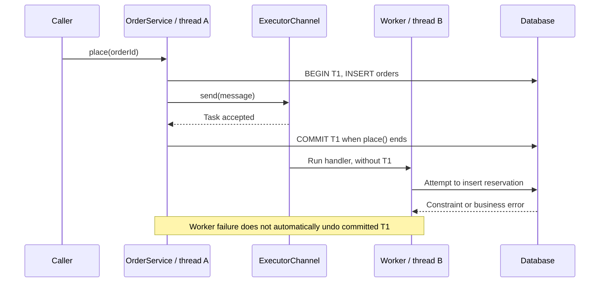

# Do not let async channels break the transaction context

A message flow can traverse multiple endpoints while remaining in the same transaction; conversely, a single handoff to another thread can break the shared transaction across processing steps. What must be determined is **which thread is executing, where the transaction starts and ends, and which resources actually participate**.

In the Transaction support chapter of `SPRING_INTEGRATION_CORE`, this lesson uses `Message`, `MessageChannel`, gateways, endpoints, and Java DSL to analyze that boundary. The goal is to design commit, rollback, and work-handoff behavior properly when asynchronous processing is needed.

## 1. Scope and prerequisites

This lesson focuses on imperative-style transactions using `PlatformTransactionManager` with JDBC. Learners should know how to declare beans, invoke messaging gateways, and wire endpoints in `IntegrationFlow`.

After this lesson, you will be able to:

- Pinpoint thread-handoff points in a flow and predict which steps still belong to the caller's transaction.
- Keep updates requiring atomicity on the same thread.
- Deliberately separate producer and consumer into two distinct transactions.
- Distinguish in-memory queues, durable queues, and queues that truly participate in transactions.
- Verify results using post-commit or post-rollback data rather than relying solely on message-send logs.

With standard JDBC transactions, `@Transactional` does not propagate a transaction to a new thread. Reactive transactions using `ReactiveTransactionManager` and Reactor context follow a different model; do not mechanically apply thread-local conclusions to reactive pipelines. See [the @Transactional contract](https://docs.spring.io/spring-framework/docs/current/javadoc-api/org/springframework/transaction/annotation/Transactional.html).

The configuration snippets below illustrate common Java DSL APIs. Use compatible versions of Spring Framework, Spring Integration, and database drivers managed by your application; no dependency changes are needed to practice the principles in this lesson.

## 2. Transaction context does not live inside Message

In the JDBC model under study, there are three distinct layers of information:

| Layer | Example | Role |
| --- | --- | --- |
| Message data | Payload containing `orderId`, header containing `commandId` | Describes the work and aids correlation |
| Execution context | Thread, call stack, currently executing endpoint | Governs execution path and exception propagation |
| Transaction state | Thread-bound JDBC connection, rollback-only, transaction synchronization callbacks | Manages resource commit or rollback |

A `Message<Long>` handed off to a worker still carries the order ID. That does not carry the sending thread's transaction. Headers such as `transactionId`, `correlationId`, or trace IDs are just data; they do not enlist the worker's JDBC connection into the source transaction.

`TransactionSynchronizationManager` manages resources and synchronizations per thread. Applications may read its state for diagnostics, but should never manually copy resource maps or bind the caller's connection onto a worker. See [TransactionSynchronizationManager](https://docs.spring.io/spring-framework/docs/current/javadoc-api/org/springframework/transaction/support/TransactionSynchronizationManager.html).

For JDBC operations to share a transaction, verify all of the following simultaneously:

1. A transaction wraps the processing segment.
2. Processing continues on the thread bound to that transaction.
3. Operations use resources managed by the corresponding transaction manager.
4. No propagation mode intentionally creates or splits into another transaction.
5. Errors reach the transaction boundary and match rollback rules.

Being on the same thread is an important condition, but not sufficient on its own. An HTTP call sent to a payment service does not automatically become rollback-capable simply because it runs on a thread holding a JDBC transaction.

## 3. Reading channel types as execution boundaries

| Component or invocation style | Execution behavior to watch | Impact on sender's transaction |
| --- | --- | --- |
| `DirectChannel` | Invokes handler on sending thread | Can continue using existing transaction |
| `ExecutorChannel` with thread pool | Hands off handler to executor | No guarantee handler joins sender's transaction |
| `QueueChannel` read later by consumer/poller | Separates send from receive | Does not automatically connect producer and consumer transactions |
| `PublishSubscribeChannel` without executor | Normally invokes subscribers synchronously | Branches can use existing transaction if thread does not change |
| `PublishSubscribeChannel` with executor | Subscribers can run on other threads | Treat branches as separate execution scopes |
| `@Async`, `CompletableFuture`, manual task submission in handler | Thread switch is hidden inside business code | Even an upstream direct channel cannot keep the transaction across this point |

`DirectChannel` invokes the handler before `send()` returns; it does not open a transaction itself. `ExecutorChannel` does not provide a transaction spanning sender and handler. With `CallerRunsPolicy`, tasks may run on the sending thread when the pool is saturated; do not rely on that load-dependent behavior to guarantee transactions. See [Message Channel Implementations](https://docs.spring.io/spring-integration/reference/channel/implementations.html).

With `QueueChannel`, the queue structure itself separates `send()` from `receive()`. Receiving is typically performed by a poller on a separate thread. If you write a send-then-receive sequence on the same thread manually, analyze that exact code; the channel name does not substitute for checking the actual execution path.

### 3.1. Switching threads does not mean committing right at send()

Suppose a `@Transactional` method executes:

```text
open transaction T1
  update A
  send message via ExecutorChannel
  update B
method ends: commit or roll back T1
```

The async handler is no longer inside the call stack using T1. However, T1 can still continue wrapping update B. Precisely put, **T1's scope does not extend to the worker**; it is not that the channel eagerly commits T1 right at the send statement.

The worker can even start before T1 commits. If it reads A via another connection, the worker may not see uncommitted changes, may block on locks, or may read unexpected results depending on isolation level and query type.

## 4. Failure scenario: order committed, reservation failed

Suppose business rules require order creation and reservation to succeed together. The actual sequence turns out to be:



The diagram shows one possible execution order. In production, the worker can start even earlier, before the producer commits.

Two variants must be distinguished:

- **Worker opens no transaction of its own:** JDBC statements may run under auto-commit. One statement succeeding and the next failing can leave partial data behind.
- **Worker has its own transaction T2:** errors can roll back changes in T2. The order already committed in T1 still remains.

Adding `@Transactional` to the worker can solve atomicity inside the worker when calls go through a Spring proxy. It does not merge T2 back into T1.

### 4.1. Misleading observations

| Observed signal | What can be concluded | What still must be checked |
| --- | --- | --- |
| `send()` returns `true` | Channel accepted the message per its contract | Whether the handler finished business work |
| Producer receives no exception | No error propagated along current call path | Whether the worker failed on another thread |
| Both logs share the same `commandId` | Both steps belong to the same logical job | Whether both steps shared a transaction |
| `isActualTransactionActive()` is `true` in both | Each spot has an active real transaction | Whether it is the same transaction or T1 and T2 |
| Error appeared on `errorChannel` | Error-handling mechanism received details | Which transaction rolled back and whether the message is redelivered |

## 5. Design A: keeping everything requiring atomicity on the same thread

Choose this approach when order creation and reservation must share the same commit outcome. The transaction opens on the service wrapping the gateway call; the flow uses `DirectChannel`.

### 5.1. Practice data model

The example uses two tables and one `DataSource`:

```sql
CREATE TABLE orders (
    id BIGINT PRIMARY KEY,
    status VARCHAR(32) NOT NULL
);

CREATE TABLE reservations (
    order_id BIGINT PRIMARY KEY,
    CONSTRAINT fk_reservation_order
        FOREIGN KEY (order_id) REFERENCES orders(id)
);
```

The foreign key relationship intentionally helps expose ordering bugs if a worker is later switched to run before the producer commits.

### 5.2. Gateway and flow configuration

Place each public type in these examples in its own Java file in your practice application. The application needs component scanning for services, handlers, and gateways; package declarations are omitted in the snippets below.

```java
import org.springframework.integration.annotation.MessagingGateway;

@MessagingGateway(defaultRequestChannel = "reservationInput")
public interface ReservationGateway {

    void reserve(Long orderId);
}
```

```java
import javax.sql.DataSource;

import org.springframework.context.annotation.Bean;
import org.springframework.context.annotation.Configuration;
import org.springframework.integration.channel.DirectChannel;
import org.springframework.integration.config.EnableIntegration;
import org.springframework.integration.dsl.IntegrationFlow;
import org.springframework.jdbc.core.JdbcTemplate;
import org.springframework.jdbc.datasource.DataSourceTransactionManager;
import org.springframework.transaction.PlatformTransactionManager;
import org.springframework.transaction.annotation.EnableTransactionManagement;

@Configuration
@EnableIntegration
@EnableTransactionManagement
public class SynchronousReservationConfig {

    @Bean
    public PlatformTransactionManager transactionManager(
            DataSource dataSource) {
        return new DataSourceTransactionManager(dataSource);
    }

    @Bean
    public JdbcTemplate jdbcTemplate(DataSource dataSource) {
        return new JdbcTemplate(dataSource);
    }

    @Bean
    public DirectChannel reservationInput() {
        return new DirectChannel();
    }

    @Bean
    public IntegrationFlow reservationFlow(
            DirectChannel reservationInput,
            ReservationHandler reservationHandler) {
        return IntegrationFlow.from(reservationInput)
                .handle(reservationHandler, "reserve")
                .get();
    }
}
```

If the application already provides a `JdbcTemplate` and matching transaction manager, use those beans. The example assumes a single `DataSource`; when multiple data sources exist, select the right beans using qualifiers.

### 5.3. Placing the transaction on the service wrapping the gateway

```java
import org.springframework.jdbc.core.JdbcTemplate;
import org.springframework.stereotype.Service;
import org.springframework.transaction.annotation.Transactional;

@Service
public class OrderService {

    private final JdbcTemplate jdbc;
    private final ReservationGateway gateway;

    public OrderService(
            JdbcTemplate jdbc,
            ReservationGateway gateway) {
        this.jdbc = jdbc;
        this.gateway = gateway;
    }

    @Transactional(transactionManager = "transactionManager")
    public void place(Long orderId) {
        jdbc.update(
                "INSERT INTO orders(id, status) VALUES (?, ?)",
                orderId, "NEW");
        gateway.reserve(orderId);
    }
}
```

```java
import org.springframework.jdbc.core.JdbcTemplate;
import org.springframework.stereotype.Component;

@Component
public class ReservationHandler {

    private final JdbcTemplate jdbc;

    public ReservationHandler(JdbcTemplate jdbc) {
        this.jdbc = jdbc;
    }

    public void reserve(Long orderId) {
        jdbc.update(
                "INSERT INTO reservations(order_id) VALUES (?)",
                orderId);

        int changed = jdbc.update(
                "UPDATE orders SET status = ? WHERE id = ?",
                "RESERVED", orderId);

        if (changed != 1) {
            throw new IllegalStateException(
                    "Failed to update order " + orderId);
        }
    }
}
```

In this configuration, `reserve()` does not need to open a transaction itself: it runs while `place()` still holds the transaction and uses the same `JdbcTemplate` tied to the selected `DataSource`.

When calling `place()` through the Spring bean:

1. The transaction interceptor opens T1.
2. The service inserts the order.
3. The gateway sends the message; the direct channel invokes the handler on the same thread.
4. The handler inserts the reservation and updates the order status.
5. If all steps succeed, T1 commits.
6. If the handler throws an error matching rollback rules and the error exits `place()`, T1 rolls back.

To practice the failure branch, temporarily insert `throw new IllegalStateException("demo failure");` after the status update statement in your test application's handler. After the call ends with an error, both the new order and the reservation must be absent.

This is a full rollback test because the error occurs **after** both tables were written inside the transaction.

### 5.4. Why does annotation placement matter?

If `@Transactional` is placed only on the handler method, the transaction can finish when that method returns. A downstream endpoint receiving the handler's result does not automatically stay inside the just-completed transaction.

When you need to start a transaction at an endpoint and cover synchronous downstream steps, Spring Integration provides `TransactionHandleMessageAdvice`. This advice has a different scope from a standard `TransactionInterceptor` placed in the request-handler advice chain; it still does not propagate transactions across new threads. See [Transaction Support for message handlers](https://docs.spring.io/spring-integration/reference/handler-advice/tx-handle-message.html).

In the example above, the service wrapping the gateway provides an easy-to-observe boundary: the transaction ends after the entire synchronous call returns to the service.

## 6. Design B: using separate transactions and durable work handoff

Choose this approach when the caller can receive an "accepted" result while reservation completes later.

The business contract must state clearly:

- T1 commits the order in `ACCEPTED` status together with the pending work item.
- T2 receives the work item and performs the reservation.
- If T2 succeeds, the order transitions to `RESERVED`.
- If T2 fails, the accepted order still exists; the work item must be retried or routed to controlled failure handling.

Two independent transactions become an intentional part of the design. There is no expectation that rolling back T2 will delete the order already committed in T1.

### 6.1. A transactional poller must wrap both receive and processing

If a transaction is opened only on the handler:

```text
receive from queue
    -> open transaction in handler
    -> handler fails, business data rolls back
```

Retrieving the message already happened before the handler's transaction. You cannot expect the message to be restored.

With a transactional poller and a transaction-participating message store:

```text
open T2
    -> receive from store
    -> process via synchronous endpoints
    -> commit both message removal and business updates
or roll back T2
    -> undo changes belonging to T2
```

The poller is the proper place to put a transaction wrapping `receive()`. See [Poller Transaction Support](https://docs.spring.io/spring-integration/reference/transactions.html#poller-transaction-support).

Message-recovery guarantees depend on the resource: JDBC rollback does not undo taking a message from an in-memory Java queue. With a transaction-capable persistent store and a properly configured poller, message retrieval is only confirmed when the transaction succeeds. See [Persistent QueueChannel Configuration](https://docs.spring.io/spring-integration/reference/channel/configuration.html).

### 6.2. QueueChannel example using JDBC store and PostgreSQL

The following configuration is an **alternative** to the synchronous configuration in section 5. Do not enable both configurations with identically named beans simultaneously.

The practice application requires:

- Compatible Spring Integration core, Spring Integration JDBC, Spring JDBC, and PostgreSQL driver libraries.
- A PostgreSQL `DataSource` used for both business tables and message store tables.
- The business schema from section 5 and the message store schema matching the version in use.
- Spring-managed services and handlers.

`JdbcChannelMessageStore` requires a query provider matching the database. Sample schemas are packaged inside the Spring Integration JDBC library; create the tables before using the store. See [JDBC Message Store](https://docs.spring.io/spring-integration/reference/jdbc/message-store.html).

```java
import java.time.Duration;

import javax.sql.DataSource;

import org.springframework.context.annotation.Bean;
import org.springframework.context.annotation.Configuration;
import org.springframework.integration.channel.QueueChannel;
import org.springframework.integration.config.EnableIntegration;
import org.springframework.integration.dsl.IntegrationFlow;
import org.springframework.integration.dsl.Pollers;
import org.springframework.integration.jdbc.store.JdbcChannelMessageStore;
import org.springframework.integration.jdbc.store.channel
        .PostgresChannelMessageStoreQueryProvider;
import org.springframework.integration.store.MessageGroupQueue;
import org.springframework.jdbc.core.JdbcTemplate;
import org.springframework.jdbc.datasource.DataSourceTransactionManager;
import org.springframework.transaction.PlatformTransactionManager;
import org.springframework.transaction.annotation.EnableTransactionManagement;

@Configuration
@EnableIntegration
@EnableTransactionManagement
public class DurableReservationConfig {

    @Bean
    public PlatformTransactionManager transactionManager(
            DataSource dataSource) {
        return new DataSourceTransactionManager(dataSource);
    }

    @Bean
    public JdbcTemplate jdbcTemplate(DataSource dataSource) {
        return new JdbcTemplate(dataSource);
    }

    @Bean
    public JdbcChannelMessageStore reservationStore(
            DataSource dataSource) {
        JdbcChannelMessageStore store =
                new JdbcChannelMessageStore(dataSource);
        store.setChannelMessageStoreQueryProvider(
                new PostgresChannelMessageStoreQueryProvider());
        return store;
    }

    @Bean
    public QueueChannel durableReservationQueue(
            JdbcChannelMessageStore reservationStore) {
        return new QueueChannel(
                new MessageGroupQueue(
                        reservationStore, "reservation-work"));
    }

    @Bean
    public IntegrationFlow durableReservationFlow(
            QueueChannel durableReservationQueue,
            ReservationHandler reservationHandler,
            PlatformTransactionManager transactionManager) {
        return IntegrationFlow.from(durableReservationQueue)
                .handle(reservationHandler, "reserve",
                        endpoint -> endpoint.poller(
                                Pollers.fixedDelay(
                                                Duration.ofMillis(200))
                                        .receiveTimeout(0)
                                        .maxMessagesPerPoll(1)
                                        .transactional(transactionManager)))
                .get();
    }
}
```

`MessageGroupQueue` connects the queue to the message store. The group ID `reservation-work` is kept stable across restarts to continue receiving persisted work items. See [MessageGroupQueue](https://docs.spring.io/spring-integration/api/org/springframework/integration/store/MessageGroupQueue.html).

On the poller, `transactional(transactionManager)` wraps the polling task in transaction advice. `receiveTimeout(0)` avoids waiting when the queue is empty; `maxMessagesPerPoll(1)` limits messages retrieved per poll. See [PollerSpec](https://docs.spring.io/spring-integration/api/org/springframework/integration/dsl/PollerSpec.html).

### 6.3. Producer inserts order and enqueues within the same T1

```java
import java.util.UUID;

import org.springframework.beans.factory.annotation.Qualifier;
import org.springframework.integration.channel.QueueChannel;
import org.springframework.jdbc.core.JdbcTemplate;
import org.springframework.messaging.Message;
import org.springframework.messaging.support.MessageBuilder;
import org.springframework.stereotype.Service;
import org.springframework.transaction.annotation.Transactional;

@Service
public class OrderSubmissionService {

    private final JdbcTemplate jdbc;
    private final QueueChannel queue;

    public OrderSubmissionService(
            JdbcTemplate jdbc,
            @Qualifier("durableReservationQueue") QueueChannel queue) {
        this.jdbc = jdbc;
        this.queue = queue;
    }

    @Transactional(transactionManager = "transactionManager")
    public String submit(Long orderId) {
        String commandId = UUID.randomUUID().toString();

        jdbc.update(
                "INSERT INTO orders(id, status) VALUES (?, ?)",
                orderId, "ACCEPTED");

        Message<Long> message = MessageBuilder.withPayload(orderId)
                .setHeader("commandId", commandId)
                .build();

        if (!queue.send(message, 1_000)) {
            throw new IllegalStateException(
                    "Failed to hand off command " + commandId);
        }

        return commandId;
    }
}
```

The example builds a message with a `Long` payload and a `String` business header, avoiding putting persistence-context-bound entities, connections, or temporary reply channels into the store. If using custom DTOs or complex headers, verify serialization mechanics and deserialization configuration for your framework version.

When the service is invoked through its proxy, writing the order and writing the message share the same `DataSource` in T1. An enqueue failure rolls back T1. Under isolation levels disallowing dirty reads, the consumer cannot read the producer's uncommitted message.

On the receiving side, the poller opens T2 before fetching the message. The handler from section 5 runs JDBC on the poller thread. If the handler fails after inserting the reservation, T2 must roll back both the business updates and removing the message from the store.

The guarantees above require the same resource and an appropriate transaction manager. Merely having two beans point to "the same database name" is not enough if they actually use separate `DataSource` instances or connections not sharing the transaction.

### 6.4. A second thread break can still ruin the design

Correct configuration at the start of the consumer is not enough if the flow continues like this:

```text
transactional poller
    -> receive from JDBC store in T2
    -> ExecutorChannel
    -> business handler on another thread
```

The poller can complete T2 right after handing off the task. The message has been removed from the store, yet business work has not finished. A handler error does not automatically restore the message belonging to the already committed T2.

Therefore, processing that T2 must protect must stay synchronous. If another async stage is needed, design another durable handoff with its own contract and transaction.

### 6.5. Retries and permanently failing messages

The minimal configuration sets no attempt limit. A message that always fails can be polled repeatedly after each rollback.

In real deployments, add policies for transient and permanent errors:

- Bounded retries with backoff for recoverable errors.
- Persist attempt counts in a way that is not lost with the rolled-back transaction.
- Move permanently failing messages to a dedicated handling area with the failure reason recorded.
- Design source message acknowledgment and failure-record persistence so no gap drops work.

Do not catch errors and return success just to stop repeated logs: that behavior can cause the poller to commit message retrieval even though business work failed.

## 7. Post-commit, outbox, and non-JDBC resources

### 7.1. Sending after commit solves data-visibility ordering

A post-commit callback can start a task only when the order was saved successfully. `@TransactionalEventListener` binds to the `AFTER_COMMIT` phase by default; if no transaction exists, the listener does not run by default. See [Transaction-bound Events](https://docs.spring.io/spring-framework/reference/data-access/transaction/event.html).

However, analyze the following gap:

```text
commit order
    -> process stops
    -> task not yet enqueued
```

An in-memory event or submitting to an executor after commit does not create a durable work record. The callback also cannot roll back the committed transaction if the subsequent send fails.

This approach may fit best-effort notifications or cases with separate reconciliation and recovery mechanisms.

### 7.2. Outbox for handoffs requiring recovery

When sending to a broker or external system, a common design is:

```text
T1: write orders + write outbox in same database
    -> commit
relay: read committed outbox
    -> send to target system
    -> mark as sent
consumer: process using a stable business key
```

This design option follows from eliminating the gap between two writes. The relay can succeed in sending and then stop before marking sent, so redelivery and idempotent handling must be accepted.

In the section 6 example, a queue using a JDBC store written in the same transaction as the order already performs durable internal handoff. No extra outbox table is needed if the requirement is simply an internal worker receiving work from that queue.

### 7.3. Database and broker do not automatically share a transaction

If you use a local JDBC transaction to write an order and then send to an independent broker, do not assume both operations commit or roll back together.

Choose an explicit mechanism, such as an outbox or distributed transactions with resources that genuinely support and are configured for them. The term "transactional channel" does not mean an automatic global transaction across every database and broker.

Similarly, rolling back T2 does not recall already sent emails or undo HTTP requests already processed externally. Those side effects need idempotency keys, durable state, or business-appropriate compensation actions.

## 8. Error handling must align with the transaction that needs rollback

In synchronous flows, exceptions can unwind along the call stack. In async flows, errors are typically represented by an `ErrorMessage` sent to a configured error channel; scheduled pollers also publish errors via an error handler. See [Error Handling](https://docs.spring.io/spring-integration/reference/error-handling.html).

Distinguish **error notification** from **transaction decision**:

| Scenario | Impact to understand |
| --- | --- |
| Error exits service holding T1 | T1 is evaluated for rollback per its rules |
| Async handler fails after T1 already committed | Only active worker-side transactions can be rolled back |
| Handler catches error inside transaction scope and returns | Transaction interceptor may see success and commit |
| Error exits polling task with transaction advice | Advice gets to roll back before the error is reported to the outer handler |
| Error flow logs after rollback | Logging aids operations; does not create redelivery if source lacks support |

Advice ordering, retries, and recovery can alter the exception path. When recovery turns an error into a normal result inside the transaction scope, determine whether that is truly an allowed committable business outcome.

### 8.1. A gateway waiting for a result does not mean a shared transaction

A request-reply gateway can wait for an async worker and receive a reply or error per configuration. If the error returns before the caller's transactional method finishes, the caller can roll back T1.

However, changes on the worker still do not automatically belong to T1. If the worker already committed T2, rolling back T1 does not undo T2. A timeout also does not implicitly cancel the running task: the worker can continue and finish after the caller times out.

### 8.2. REQUIRED does not locate transactions on another thread

`REQUIRED` joins an existing transaction in a matching execution context, or creates one if none exists. `REQUIRES_NEW` proactively creates an independent physical transaction in the standard model. See [Transaction Propagation](https://docs.spring.io/spring-framework/reference/data-access/transaction/declarative/tx-propagation.html).

Therefore:

- A worker using `REQUIRED` without receiving T1's context will not look up T1 from the message.
- Switching the worker to `REQUIRES_NEW` makes independence explicit; it does not restore atomicity with the producer.
- Putting `MANDATORY` on a proxied service detects a missing transaction at that point, but does not prove the active transaction is the intended one.

Also check proxy invocation: calling a `@Transactional` method from another method on the same object, under default proxy mode, does not trigger a new transaction.

## 9. Business endpoints also affect rollback paths

A flow typically contains transformers, routers, filters, and aggregators. Do not inspect only channels and ignore endpoint behavior:

- **Transformer:** can transform payloads on the same thread. To signal failure, an error must escape to the transaction boundary; returning an "error-reporting" payload may still be treated as a normal result.
- **Router:** selects processing branches. Inspect each branch individually for channels, transaction managers, and error handling.
- **Filter:** discarding a message without throwing an error can be a valid outcome and cause the transaction to commit. If business rules require rollback on discard, express that in configuration or handler code.
- **Aggregator:** storing and grouping multiple messages does not mean input messages share a transaction. Release or timeout paths may trigger at another time; determine transactions for store writes and result emission.

For example, a transactional poller receiving a command and having a filter intentionally drop duplicates can commit the receive. That is reasonable if the system has already proved that command was processed earlier. If the filter accidentally drops a valid command, a "poll succeeded" log will not catch the lost business operation.

## 10. Observing and verifying with durable outcomes

### 10.1. Placing probes on both sides of a thread switch

You can use the following helper in a practice application:

```java
import org.springframework.messaging.Message;
import org.springframework.transaction.support
        .TransactionSynchronizationManager;

public final class TxProbe {

    private TxProbe() {
    }

    public static void log(String stage, Message<?> message) {
        System.out.printf(
                "stage=%s thread=%s txActive=%s txName=%s commandId=%s%n",
                stage,
                Thread.currentThread().getName(),
                TransactionSynchronizationManager
                        .isActualTransactionActive(),
                TransactionSynchronizationManager
                        .getCurrentTransactionName(),
                message.getHeaders().get("commandId"));
    }
}
```

Place probes before sending, at the start of the handler, and before exiting the transaction scope. Do not use transaction names or `txActive=true` as the sole proof of sharing the same transaction. Only database state after the transaction scope completes tells which updates committed or rolled back.

### 10.2. Verification matrix

| Practice case | How to create the scenario | Outcome to verify |
| --- | --- | --- |
| Direct flow succeeds | Call `OrderService.place()` | `RESERVED` order and reservation exist |
| Direct flow rolls back | Throw error after both updates in handler | Neither new order nor reservation remains |
| Executor splits transactions | Replace input channel with executor having its own worker | Worker does not automatically use producer's transaction |
| Producer rolls back during durable enqueue | Throw error after `queue.send()`, before service finishes | No order and no committed work item |
| Consumer JDBC rolls back | Throw error after update in T2 | No committed reservation; message remains receivable |
| In-memory queue | Receive message then fail handler | Do not expect JDBC rollback to restore message to queue |
| Consumer with second async point | Insert executor after receive step | Observe message acknowledgment before business completion |
| Restart after producer commit | Stop consumer, enqueue, restart | Durable message is still received under same group ID |
| Replay same work item | Resend with same idempotency key | No duplicate business effect after adding idempotent handling |

For async tests, use `CountDownLatch`, a barrier, or a bounded wait tool to control ordering. Do not use an arbitrary `Thread.sleep()` as proof that the worker finished.

When testing consumer rollback, pause automatic polling after the controlled failure or coordinate with a latch, preventing the next poll from altering data before inspection.

A test pre-wrapped in `@Transactional` can obscure the boundary being verified. Invoke the service through its proxy and query results after the application transaction finishes; use an independent observation connection or transaction scope when needed.

### 10.3. Idempotency must travel with the business transaction

In the minimal example, `commandId` only helps tracking; there is no complete deduplication mechanism yet. The primary key on `reservations` prevents inserting two rows, but can cause duplicate messages to fail infinitely.

One extension is persisting processed keys:

```sql
CREATE TABLE processed_commands (
    command_id VARCHAR(100) PRIMARY KEY,
    order_id BIGINT NOT NULL
);
```

Inside the same T2, the consumer should:

1. Record `commandId` using an atomic mechanism capable of handling concurrency.
2. If the command already completed earlier, finish down an intentional success branch.
3. If it is a new command, perform business updates and commit together with the deduplication record.

With PostgreSQL, you can use `INSERT ... ON CONFLICT DO NOTHING` and check affected row count. Avoid separate "SELECT not found then INSERT" patterns without appropriate constraints or locking.

Do not record "already processed" in a separate transaction before business work finishes. If business updates roll back while that marker remains, redelivery may be skipped even though the work never succeeded.

## 11. Fixes that do not solve the real boundary

| Attempted fix | Problem | Proper direction |
| --- | --- | --- |
| Add header containing transaction ID | Only adds data to the message | Design transaction boundaries and participating resources |
| Copy thread-local or connection to worker | Bypasses lifecycle, resource, and concurrency management | Open a valid transaction on the receiving side |
| Shrink thread pool to one worker | Worker is still a different thread from caller | Use direct flow if a transaction must be shared |
| Use `CallerRunsPolicy` to "preserve transaction" | Behavior changes with load | Choose a model independent of pool saturation |
| Only add `@Transactional` to handler | Can leave the receive step outside the transaction | Place transaction on poller when receive must be protected |
| Switch to persistent store without transaction | Durability does not create atomicity | Configure transactions and verify rollback |
| Catch all exceptions and log | Can turn failure into commit | Let errors reach the boundary or recover per clear contract |
| Increase gateway timeout | Only changes wait duration | Address atomicity, task cancellation, and late results separately |

## 12. Choosing a model according to business commitments

Before adding an async channel, write down the exact commitment of the call:

- If the caller must know that order creation and reservation both completed together, use a synchronous flow within an appropriate single transaction.
- If the caller only needs to know the work was durably accepted, commit the intake state together with the message or outbox, and process in a separate consumer transaction.
- If interacting with external systems, define handoff points, redelivery capability, and compensation behavior for each side effect.

For each flow segment, sketch threads and transactions separately:

```text
Synchronous:
thread A | T1: create order -> gateway -> DirectChannel -> reserve -> COMMIT

Asynchronous with durable handoff:
thread A | T1: create ACCEPTED order + persist message -> COMMIT
thread B | T2: receive + reserve + update status -> COMMIT / ROLLBACK
```

A design meets requirements when commit and rollback outcomes match business commitments, while also explaining what happens if a worker fails, a message is redelivered, or the process stops between the two stages.
